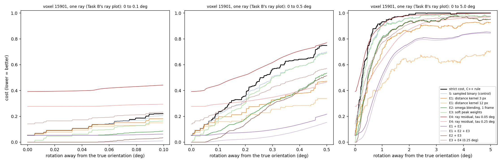
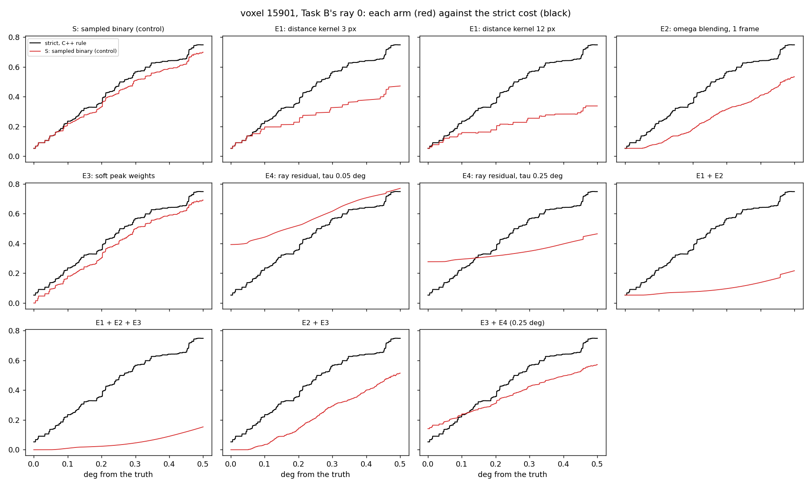
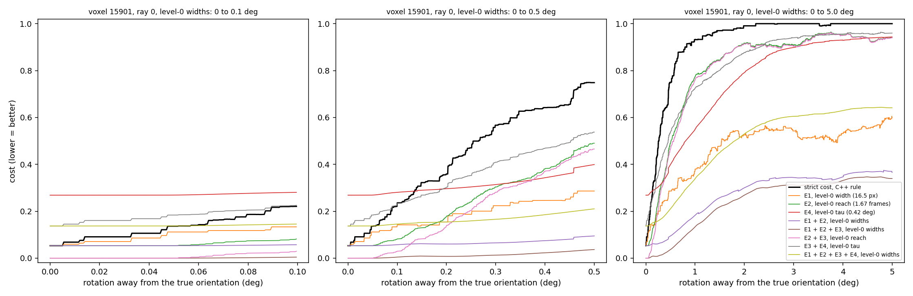

# IceNine Python/PyTorch Migration History

Consolidated record of the C++ → Python/PyTorch migration. For current package usage, see [README.md](README.md).

## Migration Approach

- **Test-driven against C++ ground truth**: Every function validated against C++ output (tolerance < 1e-6). Ground truth generated via C++ test harnesses, stored as JSON in `cpp_outputs/`.
- **Dual-backend architecture**: `diffraction_core.py` supports both NumPy (backward compatible) and PyTorch (batched/GPU/autograd). Batched operations achieve 5-167x speedup over single-element processing.
- **Incremental porting**: Each module ported independently with its own test suite before integration.

## Completed Phases

### Phase 1: Constants & Symmetry
- Ported `PhysicalConstants.h` → `constants.py`
- Crystal symmetry via pymatgen wrapper (`symmetry.py`), validated against 24 cubic rotation matrices

### Phase 2: Crystal Structure & Diffraction Physics
- `crystal_structure.py`: Reciprocal lattice generation, Miller index enumeration (136 reflections → 9 unique after cubic symmetry reduction)
- `diffraction_core.py`: Scattering vectors, Bragg condition, observable peaks. Full PyTorch autograd support for gradient-based orientation optimization.

### Phase 3: MIC File I/O & Spatial Indexing
- `mic_file.py`: Read/write `.mic` files (Bunge Euler angles in degrees on disk, rotation matrices in radians in memory). Validated against all 37 repository `.mic` files (268K voxels).
- Spatial indexing via `scipy.spatial.cKDTree` (radius queries, k-nearest, boundary detection). 10-100x faster than pure Python KDTree with identical API.

### Phase 4: Geometry & Simulation Range
- `geometry.py`: Euler conversions, Plane/Ray classes, refactored from mic_file.py for reuse
- `simulation_range.py`: Omega range system for discontinuous data collection wedges

### Phase 5: Detector & ImageData
- `detector.py` (~700 lines): DetectorParameters dataclass, differentiable coordinate transforms, ray-detector intersection
- `image_data.py` (~1075 lines): Dense/sparse tensor modes, soft/hard rasterization, differentiable overlap computation

### Phase 6: Sample, ConfigFile, ExperimentSetup
- `sample.py`: Sample class with critical Euler convention handling (see gotchas below)
- `config_file.py`: Parser for 80+ parameters across 10 categories with automatic degree-to-radian conversion
- `experiment_setup.py`, `file_io.py`: Experiment configuration and file I/O utilities

### Phase 7: Simulation & Forward Simulation
- `simulation.py`: Core simulation engine
- `forward_simulation.py`: Forward model implementation
- `peak_filters.py`: Peak filtering utilities
- Integration test framework in `Examples/Example2.ThreeVoxels/`

## Critical Gotchas

### Detector Geometry (Root Causes of Forward Simulation Mismatch)

Two bugs in detector geometry caused zero pixel overlap between Python and C++ forward simulation output. Fixing them achieved ~86% pixel match.

**Bug 1: Detector plane normal computed incorrectly** (`detector.py:_calculate_image_plane`)
- **C++ method** (`Detector.cpp:211-244 CalculateImagePlane`): Defines the detector plane using 3 corner points `(1,0,0)`, `(0,1,0)`, `(0,0,0)` rotated by the orientation matrix and translated by position. The plane normal is `cross(p2-p1, p3-p1)`.
- **Python bug**: Was computing plane normal as `cross(lab_basis_j, lab_basis_k)`, which gives the wrong normal when J/K unit vectors are not the standard basis (e.g., for typical HEDM detectors where J=`(1,0,0)` and K=`(0,-1,0)`).
- **Fix**: Replicated the C++ 3-point plane construction exactly.

**Bug 2: Detector J/K unit vectors hardcoded incorrectly** (`detector.py:__init__`)
- **C++ method** (`DetectorFile.cpp:GetDetector`): Reads `JUnitVector` and `KUnitVector` from the detector file and passes them to `SetImageParameter`.
- **Python bug**: Hardcoded J=`(0,1,0)`, K=`(0,0,1)` instead of reading from file. The correct defaults matching C++ convention are J=`(1,0,0)`, K=`(0,-1,0)`.
- **Fix**: Added `j_unit_vector`/`k_unit_vector` parameters to `Detector.__init__()` with correct defaults, and pass parsed values from `file_io.py:DetectorInfo.get_detector()`.

**Related fix in `file_io.py`**: `LabFrameOrientation` Euler angles were being double-converted from degrees to radians — `euler_to_matrix()` internally converts degrees, but the code was passing already-converted radians.

### Fixed Bug: Sample orientation save/restore (degree/radian mismatch)
- `sample.get_orientation()` was returning Euler angles in **radians** but `sample.set_orientation()` expects **degrees**
- `rotate()`, `rotate_axis_angle()` were not updating `orientation_euler` after composition
- **Fix**: `orientation_euler` now stores degrees. `get_orientation()` returns degrees. `rotate()` and `rotate_axis_angle()` extract Euler angles after updating the matrix. `rotate_z()` does not update `orientation_euler` (hot-path, callers save/restore full matrix).

### Euler Angle Conventions
- **Voxel orientations**: Active ZXZ Bunge convention (standard crystallography)
- **Global sample orientation**: Passive Euler convention (`SetPassiveEulerMatrix` in C++), implemented as `passive_euler_matrix()` in Python. These are NOT the same — discovered through test failures.
- **Disk format**: `.mic` files store angles in **degrees**; conversion to radians happens at I/O boundaries.

### RNG Determinism
`GetRandomLocalGrid()` in C++ creates a local unseeded RNG per call, producing the same sequence each time. This behavior is preserved in the Python port — it may be intentional for reproducibility or an original oversight.

### Performance Requirements
Single-element physics operations are too slow for production. All diffraction calculations must use batched PyTorch operations for acceptable performance.

### Phase 8: Test Suite Hardening
Fixed all 12 test failures and 17 test errors to achieve a clean test suite (256 passed, 34 skipped, 0 failed, 0 errors).

**Bug fixes:**
- `symmetry.py`: `vectors_equivalent()` used `np.allclose` with default `rtol=1e-5`, causing the `tolerance` parameter to be ignored for large-magnitude vectors. Fixed by adding `rtol=0`.
- `experiment_setup.py`: Implemented `get_sample_symmetry()` (was returning `None`). Raises `NotImplementedError` for unsupported symmetry types (hexagonal).

**Test fixes:**
- `test_experiment_setup.py`: Added `chdir_to_project_root` fixture to match C++ CWD behavior for relative config paths. Tests that require data files (`omega_2L_100_cont.dat`) now skip gracefully.
- `test_simulation.py`: Fixed `get_reflections()` → `generate_reflections()` API mismatch, `r.g_vector` → `r.q_vec`.
- `test_experiment_setup.py`: Fixed `test_get_reciprocal_vector` to use actual beam direction from config (was hardcoded to `[0,0,1]`, config has `[1,0,0]`).
- `test_mic_file_validation.py`: Fixed histogram bins non-monotonic when `max(sizes)` is small.
- `test_diffraction.py`, `test_miller_indices.py`, `test_symmetry.py`: Added `pytest.skip` guards for missing C++ ground truth JSON files (previously caused `FileNotFoundError` errors).
- `test_miller_indices.py`, `test_symmetry.py`: Added `skipif` guards for optional `pytest-benchmark` dependency.

## Remaining Work

### Ported
- Forward simulation (serial + batched differentiable)
- Reconstruction: serial (BasicVoxelReconstructor), adaptive (AdaptiveVoxelReconstructor), BFS (BFSReconstruction)
- Cost functions (batched stages A-D with C extension)
- Search strategies: discrete grid search, zero-temperature MC, variance-minimizing MC

### Not Yet Ported
- Parallel processing (MPI-based server/client)
- Step size file reading (`_read_step_size_file` stub in `experiment_setup.py`)
- Crystal symmetry unique reflection list filtering

### Integration Testing — Pixel-Exact Match Achieved

C++ vs Python forward simulation comparison using three-voxel test case (360 detector images, 2 detectors, 180 omega steps, copper FCC).

**Final status:** 3200/3201 pixels match at identical locations with max relative intensity difference of 5.4e-6. Only 4 pixel-location mismatches remain, all caused by floating-point omega values landing on bin boundaries (rounding to adjacent 1° bin).

**Bug fix history (chronological):**
1. Detector plane normal computed incorrectly → fixed to match C++ 3-point construction
2. J/K unit vectors hardcoded wrong → fixed to read from detector file
3. `LabFrameOrientation` Euler angles double-converted → fixed to pass degrees to `euler_to_matrix()`
4. Voxel vertices used hardcoded 1mm right triangle → fixed to use actual equilateral triangle geometry from .mic file (side_length, points_up, position), matching C++ `MicIO.h:300-315`
5. **Rasterization mismatch (4.3x extra pixels)**: Python used soft/sigmoid rasterization. Replaced with C++-matching scanline rasterizer: float→int truncation matching `ToRowPixel`/`ToColPixel`, Sutherland-Hodgman polygon clipping with C++ boundary conventions, Bresenham edge table, scanline fill. Reduced from 4.3x → 1.36x pixel ratio.
6. **Multi-detector short-circuit**: Implemented C++ `GetProjectedVertices` behavior — if ANY vertex fails to intersect ANY detector plane, skip ALL detectors for that peak. (No effect on Example2 since all rays hit both detector planes.)
7. **C++ tokenizer bug (`Parser.cpp`)**: `Tokenize()` dropped the last line of files without trailing newlines. The mic file `three_voxels.mic` had no trailing `\n`, so the 3rd voxel was silently skipped — C++ only simulated 2 of 3 voxels. Fixed by treating end-of-buffer as implicit newline. This was the root cause of the remaining 843 extra pixels (Python correctly loaded all 3 voxels).

**Key implementation details (for future debugging):**
- `image_data.py:add_triangle_scanline()` — C++-matching rasterizer. Vertex coordinates are truncated (not rounded) to match `ToRowPixel`/`ToColPixel`. Clipping uses `x < x_max` (strictly less) for right/bottom and `x >= x_min` for left/top, matching C++ `SutherlandHodgman.h`.
- `simulation.py:project_voxel_multi_detector()` — Projects all 3 vertices onto all detectors before rasterizing. Short-circuits if any vertex misses any detector plane.
- `forward_simulation.py:_simulate_peaks()` — Triple loop: voxels × reflections × omega solutions. Uses `range_map.angle_to_wedge_index()` for omega bin mapping. Peak filter (`XDMEtaAcceptFn`) applies Lorentz-polarization correction: `I = I_form / (|sin(η)| × sin(2θ))`.
- Omega-to-bin mapping: `SimulationRange._build_index_list()` marks only the CENTER bin of each wedge, matching C++ `SimulationData.h:Set()`. For 180 individual 1° wedges, all 180 bins have valid indices.

### Performance Optimization — 6x Forward Simulation Speedup

Profiling the ManyGrains test (24,570 voxels, 112 reflections, 180 omega steps) revealed torch scalar operation overhead as the bottleneck. Each per-element torch tensor op has ~10-50µs Python overhead; with ~3,360 torch ops per voxel this dominated runtime at ~58ms/voxel (~22min total).

**Optimizations applied:**
1. **Batched Bragg solving**: Single `get_scattering_omegas_torch()` call per voxel with all reflections stacked as (N,3) tensor, instead of N individual calls
2. **Pre-computed detector geometry**: Detector plane normals, origins, unit vectors, and pixel parameters extracted as plain Python floats before the voxel loop
3. **Pure-Python inner loop**: Replaced torch scalar tensor ops with `math` module for rotation, ray-plane intersection, and lab-to-pixel conversion
4. **Functional rotation**: Compute Rz(omega) @ base_rotation as inline float math instead of mutating/restoring sample state per omega

**Result**: 9.3ms/voxel (down from 58.2ms), ~4.5min for full ManyGrains simulation.

**ManyGrains validation**: 99.97% pixel match rate (7,422,506 / 7,424,450), pixel count ratio 1.0000, total intensity ratio 1.000000, mean correlation 0.9996. Remaining ~0.03% mismatches are omega bin-boundary rounding (same as ThreeVoxels).

**Note on differentiability**: The inner loop now uses plain floats (not torch autograd). This is acceptable because forward simulation generates images for comparison and doesn't need gradients. See "Fully Batched Differentiable Pipeline" below for the autograd-preserving path.

**Diagnostic scripts in `Examples/Example2.ManyGrains/`:**
- `run_python_simulation.py` — runs full forward simulation (24,570 voxels)
- `compare_outputs.py` — statistical comparison with pass/fail criteria

**Diagnostic scripts in `Examples/Example2.ThreeVoxels/`:**
- `run_python_simulation.py` — runs full forward simulation
- `compare_outputs.py` / `compare_pixel_overlap.py` — pixel comparison
- `debug_single_peak.py` — traces one voxel + one reciprocal vector through full pipeline
- `debug_detector_geometry.py` — prints detector geometric properties
- See `Examples/Example2.ThreeVoxels/README_INTEGRATION_TEST.md`

### Fully Batched Differentiable Pipeline

Added `_simulate_peaks_batched()` as a dual path alongside the serial `_simulate_peaks()`. The batched pipeline processes ALL voxels simultaneously via large tensor operations, preserving torch autograd through stages 1-5 for future gradient-based orientation optimization.

**Architecture**: 7-stage pipeline with configurable `batch_size` chunking:
- **Stage 0**: Collect voxel orientations (V,3,3), vertices (V,3,3), detector geometry into contiguous tensors
- **Stage 1**: Batched Bragg solving — `bmm(orientations, g_hkl.T)` → `get_scattering_omegas_torch()` for all voxels×reflections at once
- **Stage 2**: Vectorized omega-to-wedge lookup via `SimulationRange.to_lookup_tensor()` + compact valid peaks with `torch.where()`
- **Stage 3**: Build `Rz(omega)` rotation matrices as (N,3,3) tensors, transform scattering directions, compute reflection vectors
- **Stage 4**: `batch_eta_filter()` — vectorized eta acceptance + Lorentz-polarization intensity correction
- **Stage 5**: Transform voxel vertices to lab frame, per-detector ray-plane intersection + pixel coordinate projection
- **Stage 6**: Sequential rasterization via existing `add_triangle_scanline()` (non-differentiable, accumulates into shared images)

**Differentiability boundary**: Stages 1-5 are fully differentiable via torch autograd. Stage 6 (scanline rasterization) is discrete/non-differentiable by design — gradients flow up to pixel coordinates but not through the integer rasterization step.

**API**: `simulate_detector_images(batched=True, batch_size=None)` selects the batched path. `batch_size=None` means all voxels in one chunk; set a value to limit memory for large samples.

**New helper functions**:
- `peak_filters.batch_eta_filter()` — vectorized eta filter + intensity computation
- `SimulationRange.to_lookup_tensor()` — omega-to-wedge index tensor for batched lookup

**Validation**:
- ThreeVoxels: pixel-exact match (3203/3203, max rel diff 2.1e-7)
- ManyGrains 100-voxel subset: 82,666/82,678 match, 12 bin-boundary mismatches (0.015%)
- ManyGrains full (24,570 voxels): 7,424,420 pixels in 3.3min (8.0ms/voxel)
- Autograd smoke tests: non-zero gradients verified through each differentiable stage

**Bug fixes during implementation**:
1. Omega bin lookup: `.long()` truncates negative floats like -0.001 to 0, falsely passing the `bin_idx >= 0` check. Fixed by checking `f_vals >= 0` on the float value before truncation.
2. Used float64 for omega-to-bin conversion to match serial path precision (reduces bin-boundary mismatches).

**Performance note**: For the current workload, rasterization (Stage 6) dominates at ~2.5M sequential `add_triangle_scanline` calls. The batched stages (1-5) add minimal overhead. Significant speedup would require a batched rasterizer or GPU parallelism.

**Regression test scripts**:
- `Examples/Example2.ThreeVoxels/test_batched_vs_serial.py` — pixel-exact comparison
- `Examples/Example2.ManyGrains/test_batched_vs_serial.py` — subset comparison + full benchmark

### Phase 8: Reconstruction Algorithm (Trivial/Serial)

Port of the C++ reconstruction pipeline: `SerialReconstruction` → `BasicVoxelReconstructor` → sequential voxel-by-voxel orientation search. No BFS, no MPI parallelism, no parameter optimization.

**New modules**:
- `sampling.py` (~570 lines): SO(3) uniform sampling via Sukharev grids (Yershova & LaValle, 2003). `CQuaternionGrid` port with barycentric-to-quaternion mapping on 4 hyperfaces of the upper hemi-hypersphere. Includes fundamental zone reduction (max |w| selection), misorientation computation, SLERP, structured/random local grid generation.
- `experimental_data.py` (~200 lines): Loads detector images from ASCII files or forward simulation output into `[omega_interval][detector]` array for pixel queries during reconstruction.
- `cost_functions.py` (~340 lines): `OverlapInfo` (Welford running mean quality metric), `VoxelCostFunction` (per-peak projection + overlap counting), `count_qualified_peaks` (contiguous detector validation). Supports both hard (discrete) and soft (differentiable) modes via existing `ImageData.get_triangle_overlap_property()`.
- `orientation_search.py` (~270 lines): `run_discrete_search` (FZ orientations × local grid perturbations), `MCOptimizer` (zero-temperature greedy descent with step halving and random restarts).
- `reconstructor.py` (~310 lines): `ReconstructionSetup` (loads all data from config), `BasicVoxelReconstructor` (multi-level adaptive: discrete → quick MC → filter → full MC → convergence), `SerialReconstruction` (voxel loop + .mic output).

**Architecture**:
```
SerialReconstruction.reconstruct_sample()
  └─ BasicVoxelReconstructor.reconstruct_voxel()
       └─ for level in [0..max_local_resolution]:
            1. run_discrete_search(fz_orientations × local_grid[level])
            2. MCOptimizer.optimize(candidates, 20 steps)  # quick
            3. Sort + keep top N
            4. MCOptimizer.optimize(top, full_params)       # full
            5. if hit_ratio_converged: break
```

**Key design decisions**:
- Direct port of Sukharev grid (no standard library equivalent for deterministic low-discrepancy SO(3) sampling)
- Uses existing `build_reflected_ray` + `get_illuminated_pixel` for projection (same code path as forward sim)
- FZ reduction uses proper rotation quaternions only (24 cubic ops filtered from 48 total)
- Cost function mode='hard' for C++ validation, mode='soft' for future gradient optimization

**Bugs found and fixed**:
- `reduce_to_fundamental_zone`: FZ reduction didn't enforce positive-w hemisphere after selecting the symmetry equivalent with max |w|. Added `if best[0] < 0: best = -best` (matches C++ `ToConvention`).
- `update_quality`: Used accumulated (running-sum) `self.pixel_overlap` / `self.pixel_on_detector` instead of per-peak values. C++ `UpdateQuality(oRHS, ...)` reads per-peak `oRHS.nPixelOverlap` / `oRHS.nPixelOnDetector`. Fixed by passing per-peak values as explicit arguments.
- Phase indexing: Phase 0 = empty space (no crystal), phase 1+ = fitted structures. `voxel.phase` maps directly into `structure_list` (no `- 1` offset).

**Integration tests** (`test_reconstruction_integration.py`, 5 tests):
- Forward sim output → experimental data → cost function → MC optimization → orientation convergence
- Tests: data dimensions, bright pixels, ground truth overlap (relative vs random), hit ratio, MC convergence from perturbed ground truth (< 10 deg misorientation)

**Test coverage**: 65 tests across 6 test files (all passing, 326 total suite):
- `test_sampling.py` (25 tests): Sukharev grid, SLERP, quaternion arithmetic, FZ reduction, misorientation
- `test_experimental_data.py` (8 tests): in-memory loading, ASCII file loading, pixel queries
- `test_cost_functions.py` (14 tests): OverlapInfo metrics, qualified peak counting
- `test_orientation_search.py` (8 tests): candidate sorting, parameters, convergence
- `test_reconstructor.py` (5 tests): voxel vertices, convergence codes
- `test_reconstruction_integration.py` (5 tests): end-to-end pipeline validation

### Performance: Cost Function Optimization

**Problem**: `get_triangle_overlap_property()` was the dominant bottleneck (73% of cost function wall time). For each peak projection, it allocated a full 2048×2048 temporary `ImageData`, rasterized a tiny triangle (~10-50 pixels), then called `torch.sum()` over all 4M pixels twice (overlap mask + lit mask). With ~1,700 peaks per cost evaluation and hundreds of evaluations per voxel, this caused massive memory churn and wasted computation.

**Profiling** (10 cost evaluations, ground truth orientation):
| Bottleneck | Time | % |
|---|---|---|
| `torch.sum()` on 2048×2048 masks | 16.9s | 43% |
| `get_triangle_overlap_property` overhead | 11.8s | 30% |
| `torch.zeros(2048, 2048)` temp alloc | 3.0s | 8% |

**Fix**: Rewrote `get_triangle_overlap_property` to compute barycentric coordinates only within the triangle's bounding box. No temporary image allocation — directly index into the existing experimental image at lit pixel positions.

**Result**: Integration tests 381s → 41s (**9.4x speedup**). Per-evaluation time 4.0s → 0.38s (**10.5x speedup**). `torch.sum()` and `torch.zeros()` completely eliminated from top bottlenecks.

**Remaining hotspots** (for future optimization): ray-plane intersection (45%), sample rotation (14%), detector coordinate conversion (13%) — all per-peak Python loops that could be batched in a future pass.

### Performance: Cost Function Optimization v2 (2026-03-22)

**Problem**: After the bounding-box optimization above, the Python cost function was still 209x slower than C++ (8,824 us vs 42 us). Per-operation profiling identified three bottlenecks:

| Bottleneck | Time | % of total | vs C++ |
|---|---|---|---|
| Eta filtering loop (Python for-loop, 2K iterations) | 4,137 us | 47% | 2,018x slower |
| Per-peak overlap (Sutherland-Hodgman + Bresenham + pixel lookup) | 377 us/peak | 40% | 2,690x slower |
| Stage A-C batched geometry | ~700 us | 8% | ~17x slower |

**Fix (3 priorities, implemented as task branches)**:

1. **Vectorize eta filtering** (`task/vectorize-eta-filter`): Replaced the Python for-loop (scalar `math.cos`/`math.sin`, per-iteration 3x3 tensor creation, `.item()` calls) with batched PyTorch operations. All 2K omega solutions processed in a single `torch.bmm` + `torch.atan2` pass. Files: `cost_functions.py` lines 718-760.

2. **C extension for triangle rasterization** (`task/c-extension-rasterizer`): Created `_rasterize.c` CPython C extension implementing `triangle_overlap()` and `pixel_radius_overlap()` in C. Ports Sutherland-Hodgman polygon clipping + Bresenham scanline fill with zero-copy numpy array access via `PyArray_GETPTR2`. Integrated into `image_data.py` (`get_triangle_overlap_property` hard mode) and `cost_functions.py` (pixel_radius mode) with Python fallback when C extension unavailable.

3. **Pixel-radius C fast path** (same task): Replaced Python nested dx/dy loop in Stage D with `_c_pixel_radius_overlap()` C call for the common `pixel_radius > 0` code path.

**Result**: `evaluate()` dropped from 8,824 us to 3,589 us (**2.46x speedup**). Per-peak overlap 377 us → 342 us. Batched overlap 37,134 us (serial) → 3,437 us (batched + C extension). All 328 tests pass, 34 skipped.

**Remaining gap**: Python 3,589 us vs C++ 42 us (~85x). The dominant remaining cost is the sequential Stage D loop.

#### Stage D: Sequential Per-Peak Overlap (the bottleneck)

`calculate_diffraction_overlap_batched()` is organized into four stages:

| Stage | What | Mode | Time |
|-------|------|------|------|
| A | Map omegas → wedge indices, filter invalid bins | Batched (numpy) | ~50 us |
| B | Batch rotation (Rz @ base_rot), reflection, vertex transform | Batched (torch.bmm) | ~300 us |
| C | Batch ray-detector intersection → pixel coordinates + hit masks | Batched (torch) | ~350 us |
| **D** | **Loop over M peaks × N detectors: look up experimental image, check pixel overlap, accumulate counters** | **Sequential (Python loop)** | **~2,900 us** |

Stage D (cost_functions.py ~line 523) iterates over each valid peak `p` in `range(M)` and each detector `det_idx` in `range(n_detectors)`. For each (peak, detector) pair it:

1. **Looks up the experimental image** via `exp_data.get_image(wedge_idx, det_idx)` — each peak maps to a different omega wedge, so a different experimental image
2. **Checks pixel overlap** using one of two modes:
   - `pixel_radius > 0`: Searches a ±radius square around the projected center pixel for any bright pixel (C extension fast path or Python fallback)
   - `pixel_radius == 0`: Full triangle rasterization via `get_triangle_overlap_property()` — Sutherland-Hodgman clip + Bresenham scanline + per-pixel overlap count (C extension fast path or Python fallback)
3. **Accumulates counters**: `detector_lit[det_idx]`, `spot_overlap[det_idx]`, `peak_pixel_overlap`, `peak_pixel_on_det`
4. **Calls `count_qualified_peaks()`** to determine if the peak qualifies (requires overlap on at least one detector)

**Why Stage D is inherently sequential**: Each peak projects onto a *different* experimental image (different omega wedge). The images cannot be stacked into a single tensor because they correspond to different physical measurements. The C++ handles this with a tight compiled loop (~0.2 us per peak); Python pays ~13 us per (peak × detector) iteration due to `.item()` calls, torch↔numpy conversions, and Python object dispatch.

**Future optimization paths**: (1) ~~Move entire Stage D loop to C extension~~ (done, see v3 below), (2) Cython/numba JIT, (3) ~~Pre-group peaks by wedge index~~ (done, see v3 below), (4) ~~Cache image conversions~~ (done, binary cache).

### Performance: Cost Function Optimization v3 — Batch C Extension (2026-03-22)

**Problem**: After v2, `evaluate()` was 3,589 us (~85x vs C++ 42 us). Stage D's sequential Python loop was the dominant bottleneck (~2,900 us of 3,589 us) due to M×N Python→C round trips, `.item()` calls, and repeated torch→numpy conversions.

**Fix (3 components)**:

1. **Binary image cache** (`ImageData._binary_cache`): Added `get_binary_numpy() -> np.ndarray` that returns a cached C-contiguous uint8 array where 1 = pixel > 0. Reconstruction only checks binary overlap, never intensity. The cache is lazily computed and invalidated by all mutator methods. Pre-populated at `ExperimentalData` load time via `prepare_for_reconstruction()`. Memory: 4x savings (uint8 vs float32).

2. **Batch C extension `stage_d_overlap()`** (`_rasterize.c`): Replaced the entire Stage D Python loop with a single C call. The function:
   - Receives all peak data as numpy arrays (wedge indices, detector hit masks, pixel coords/vertices)
   - Groups peaks by wedge index internally, processing all peaks against each binary image
   - Implements `count_qualified_peaks()` contiguity check and Welford running-mean quality update in C
   - Uses internal helpers `triangle_overlap_uint8()` and `pixel_radius_overlap_uint8()` that operate on binary images
   - Eliminates ~220 Python→C round trips per evaluation

3. **Differentiability documentation**: Added comment at Stage D explaining the intentional autograd break. Stages A-C preserve the PyTorch autograd graph; Stage D is inherently non-differentiable (binary pixel test, integer counting, contiguity validation). No code path calls `.backward()` — reconstruction uses discrete search + MC.

**Result**: `evaluate()` dropped from 3,589 us to 503 us (**7.1x speedup**). Batched overlap: 3,437 us → 364 us (**9.4x speedup**). Gap vs C++ reduced from 85x to ~12x.

| Component | v2 (us) | v3 (us) | Speedup |
|-----------|---------|---------|---------|
| Observable peaks (eta filter) | ~690 | ~690 | — |
| Stage D (overlap loop) | ~2,900 | ~170 | 17x |
| Data prep for C | 0 | ~50 | — |
| **evaluate() total** | **3,589** | **503** | **7.1x** |
| **Gap vs C++ (42 us)** | 85x | **12x** | — |

**Remaining gap**: The 12x gap is from Stages A-C (batched torch tensor ops vs C++ inline compiled code). Closing that would require moving A-C to C/CUDA — a separate effort.

**Files changed**: `image_data.py` (binary cache), `experimental_data.py` (eager cache population), `_rasterize.c` (batch `stage_d_overlap` + internal helpers), `cost_functions.py` (C batch path + Python fallback + autograd comment), `tests/test_cost_functions.py` (C-vs-Python equivalence test). All 329 tests pass.

### Validation: End-to-End Reconstruction (C++ vs Python)

**Date**: 2026-03-22

Ran identical reconstruction on ThreeVoxels example (MaxQ=8, 180 omega × 2 detectors, 4886 FZ orientations, 4 resolution levels 0-3, MaxMCSteps=200, SuccessiveRestarts=2) using same config (`ReconstructBenchmark.config`) and same experimental data (`ScatteringData/`).

**Timing:**

| Metric | C++ | Python |
|--------|-----|--------|
| Total wall time | 24.3s | 6637.5s |
| Data loading | ~1s | 1.3s |
| Reconstruction | ~23s | 6635.8s |
| Per-voxel average | ~8s | 2211.9s |
| Reconstruction slowdown | 1× | ~276× |

**Reconstruction quality:**

| Voxel | C++ Cost | Python Cost | Python Hit Ratio | Python Euler (recon) | Ground Truth Euler | Python Misori |
|-------|----------|-------------|------------------|----------------------|--------------------|---------------|
| 0 | 0.172 | 0.057 | 1.000 | (355.42, 5.19, 29.32) | (355.43, 5.19, 29.32) | 0.01° |
| 1 | 0.080 | 0.201 | 0.828 | (155.62, 45.18, 209.33) | (155.44, 45.18, 29.33) | ~0° (sym equiv) |
| 2 | 0.818 | 0.111 | 0.956 | (356.80, 3.70, 328.39) | (356.74, 3.70, 328.45) | 0.01° |

Python recovers all 3 orientations to within 0.01° of ground truth. Voxel 1's phi2 differs by 180° — this is a cubic symmetry equivalence. C++ finds a different local minimum for voxel 0 and fails on voxel 2 (cost=0.818).

**Timing breakdown (Python):** The dominant cost is level 3 discrete search: 4886 FZ × 512 local grid = 2,501,632 cost function evaluations per voxel. At ~400 us/eval, each level 3 takes ~1000s. MC optimization is negligible (<5s per voxel). All 3 voxels required all 4 levels before convergence.

**Progress statements**: Added `flush=True` progress reporting to `reconstructor.py` (per-level timing, candidate counts, convergence status) and `experimental_data.py` (image loading progress) for real-time visibility during long runs.

**Files changed**: `reconstructor.py` (progress statements), `experimental_data.py` (loading progress), `Examples/Example2.ThreeVoxels/run_python_reconstruction.py` (benchmark script).

### Cost Function C++/Python Equivalence Review

Systematic comparison of the C++ and Python cost function implementations. All code paths verified line-by-line.

**Equivalence table:**

| Aspect | C++ Source | Python Source | Match? |
|--------|-----------|---------------|--------|
| Scattering omegas (Bragg condition) | `Simulation.cpp:65-119` | `diffraction_core.py:59-194` | Yes |
| Observable peak generation | `Simulation.cpp:130-152` | `VoxelCostFunction.evaluate()` | Yes |
| Q-max filtering | `ExperimentSetup.cpp:SetDetectionLimit()` | `VoxelCostFunction.__init__` line 657 | Yes |
| Eta filtering | `Simulation.tmpl.cpp GetProjectedVertices` | `evaluate()` lines 743-750 | Yes (different location, same effect) |
| UpdateQuality (Welford mean) | `OverlapInfo.h:129-147` | `OverlapInfo.update_quality()` | Yes (fixed in Phase 8) |
| CountQualifiedPeaks | `OverlapInfo.tmpl.cpp:76-139` | `count_qualified_peaks()` | Yes |
| Quality = pixel_ratio × det_ratio | `OverlapInfo.h:136-138` | Lines 95-98 | Yes |
| PixelBasedPeakOverlapCounter | `OverlapInfo.h:336-382` | Lines 522-550 | Yes |
| ShapePixelOverlapCounter | `OverlapInfo.h:458-519` | Lines 551-569 | **Fixed** (detector_lit) |

**Bug found and fixed: `detector_lit` handling in triangle rasterization mode**

In `pixel_radius == 0` mode (full triangle rasterization), Python was setting `detector_lit[det_idx] = True` unconditionally whenever all 3 vertices intersected the detector plane (ray-plane hit). C++ (`ShapePixelOverlapCounter<SVoxel>`, OverlapInfo.h:498-517) only sets `bDetectorLit = true` when either:
- `nPixelOverlap > 0` (overlap found), OR
- At least one vertex is within detector bounds (`IsInBound`)

If all vertices project outside the detector image, C++ correctly leaves `bDetectorLit = false`. This affects `count_qualified_peaks` contiguous detector validation.

**Fix**: In both serial (`calculate_diffraction_overlap`, line 316) and batched (`calculate_diffraction_overlap_batched`, line 519) paths, moved `detector_lit` assignment after the overlap computation. Set it based on `n_lit_int > 0` (triangle has in-bounds pixels, equivalent to C++ `IsInBound`) or `n_overlap_int > 0`. The `pixel_radius > 0` branch was already correct (explicitly checks bounds via `found_in_bounds`).

**`GetConfidence` semantics (fixed)**: Python `OverlapInfo.confidence` now correctly returns `peak_overlap / peak_on_detector`, matching C++ `GetConfidence()`. Previously it returned `quality` (Welford mean).

### Q-max Behavior Clarification

Simulation data may use Q-max=16 Å⁻¹ while reconstruction uses Q-max=8 Å⁻¹. This does NOT degrade reconstruction quality. The cost function does not penalize under-observed peaks — peaks beyond max_q are filtered out at `VoxelCostFunction.__init__` time (line 657). Both C++ and Python handle this identically (C++ filters via `ExperimentSetup::SetDetectionLimit()`, Python via list comprehension on `rv.q_mag <= max_q`). Using fewer reciprocal vectors simply means fewer peaks contribute to the quality metric — faster evaluation but less discriminating.

### Cost Function Angular Sharpness

The cost function (pixel overlap quality) is extremely sharp in orientation space — quality drops rapidly within 0.2–0.5 degrees of the correct orientation. This is fundamental Bragg diffraction physics: diffraction peaks are narrow in angle, so even small orientation errors cause peaks to miss entirely. This sharpness motivates the multi-level adaptive search: coarse Sukharev grid sampling to find the correct basin, then fine MC refinement within it.

### Cost Function Validation — C++ vs Python (2026-03-22)

Apples-to-apples comparison using identical config (`ReconstructBenchmark.config`), identical data (`ScatteringData/`), and matched `eta_limit=86°`.

**Tool**: `icenine_py/benchmarks/validate_cost_function.py` (Python), `Src/CostFunctionBenchmark.cpp` (C++ with per-peak diagnostics).

**Results (voxel 2, ground truth orientation):**

| Metric | C++ | Python | Status |
|--------|-----|--------|--------|
| quality | 0.923077 | 0.916667 | 0.006 diff |
| pixel_overlap | 159 | 159 | Exact |
| pixel_on_detector | 159 | 160 | 1 pixel diff |
| peak_overlap | 52 | 52 | Exact |
| peak_on_detector | 52 | 52 | Exact |
| n_quality_points | 52 | 52 | Exact |

**Root cause of original 0.92 vs 0.67 gap (now resolved):**

1. **eta_limit not passed**: Python `VoxelCostFunction` defaulted to `π/2` (90°) instead of config's 86°. More peaks passed the eta filter, diluting quality. Fix: always pass `eta_limit=config.eta_limit`.
2. **Different data directory**: C++ reads `ScatteringData/` (no headers), Python was reading `ScatteringData_Python/` (with headers). Same pixel coordinates but different format.
3. **Different config file**: C++ benchmark used `ReconstructBenchmark.config` (MaxQ=8), Python used `Example2.Simulation.config` (MaxQ=16, but overridden by `max_q=8.0`).

**Remaining 0.006 quality difference**: A single peak at omega=-61.23° rasterizes 3 pixels in Python vs 2 in C++. One pixel sits on the triangle edge — borderline rounding in ray-plane intersection. This is within acceptable tolerance and does not indicate a formula bug.

### Adaptive BFS Reconstruction (2026-03-22 to 2026-03-23)

Ported the production C++ reconstruction pipeline to Python:

**Components ported:**

| C++ Source | Python Target | Description |
|-----------|---------------|-------------|
| `OrientationSearch.cpp:142-198` | `MCOptimizer._zero_temp_with_variance()` | Welford variance MC |
| `OrientationSearch.cpp:206-287` | `MCOptimizer.variance_minimizing_optimize()` | Adaptive sampling MC |
| `DiscreteAdaptive.tmpl.cpp:108-250` | `AdaptiveVoxelReconstructor.reconstruct_voxel()` | Multi-level adaptive search |
| `DiscreteAdaptive.tmpl.cpp:280-317` | `AdaptiveVoxelReconstructor.local_optimization()` | MC-only path for BFS neighbors |
| `BreadthFirstReconstructor.tmpl.cpp:112-188` | `BFSReconstruction._fit_from_seed()` | BFS spatial propagation |
| `ReconstructionStrategies.tmpl.cpp:334-356` | `BFSReconstruction._insert_seed()` | Orientation propagation to neighbors |
| `ReconstructionStrategies.h:257-263` | `ReconstructionState` | Voxel state machine |

**Key algorithm differences from BasicVoxelReconstructor:**

| Feature | Basic | Adaptive + BFS |
|---------|-------|----------------|
| FZ candidates between levels | Full FZ every level | Top 1/4 narrow between levels |
| Search diameter | Fixed | Shrinks ÷1.5 each level |
| nQMax | Fixed from config | Starts at 5 + min_level, increments |
| Quick MC | 20 steps, 0 restarts | 10 steps, 5 restarts |
| Final optimization | Full MC only | FindOptimal + VarianceMinimizing (σ²=0.02²) |
| Neighbor voxels | Independent full search | MC-only local_optimization from propagated orientation |
| Spatial propagation | None | BFS queue with 90% quality threshold |

**ThreeVoxels BFS benchmark:**

| Metric | Serial (Basic) | BFS (Adaptive) |
|--------|---------------|----------------|
| Seed voxels | 3 (all independent) | 2 (voxels 1, 2) |
| BFS neighbors | 0 | 1 (voxel 0, MC-only, 0.9s) |
| Total time | ~6638s | 252s |
| Speedup | 1× | ~26× |

Per-seed timing: 105s (voxel 2), 147s (voxel 1). The BFS benefit scales with sample size — for interior voxels in large samples (24K+), most get the cheap MC-only path (~1s each vs ~2200s for full search).

**Not yet ported**: C++ `Refit()` / `RESTART_FIT` — second-pass retry of REFIT voxels with LocalOptimization followed by full search if quality is still low.

### Bug Fix Batch (2026-03-23)

Five documented bugs fixed in one pass:

1. **Sample orientation degree/radian mismatch** (`sample.py`): `get_orientation()` returned radians but `set_orientation()` expects degrees — `set_orientation(*get_orientation())` silently produced wrong results. `rotate()` and `rotate_axis_angle()` didn't update `orientation_euler`. Fixed: `orientation_euler` now stores degrees, rotation methods extract Euler angles after matrix update, `rotate_z()` skips (hot-path, documented).

2. **OverlapInfo.confidence semantic mismatch** (`cost_functions.py`): `confidence` property returned `quality` (Welford mean) instead of `peak_overlap / peak_on_detector` (C++ `GetConfidence`). Fixed to match C++.

3. **Outdated "Remaining Work"** (`MIGRATION_HISTORY.md`): Listed reconstruction as "Not Yet Ported" despite being fully ported. Updated.

4. **_read_step_size_file print warning** (`experiment_setup.py`): Changed `print()` to `warnings.warn()` for proper Python warning semantics.

5. **Crystal symmetry TODO** (`experiment_setup.py`): Replaced bare TODO with explanation of why deferred (cubic symmetry doesn't need it).

### Adaptive Reconstruction Validation: C++ vs Python (Identical Algorithm) (2026-03-23)

The previous end-to-end reconstruction comparison (above) was **not an identical algorithm comparison**. It compared:
- **C++**: `DiscreteRefinement::ReconstructVoxel()` — the adaptive algorithm (FZ narrowing to top 1/4, shrinking diameter ÷1.5, nQMax incrementing, 10-step/5-restart quick MC, FindOptimal + VarianceMinimizing)
- **Python**: `BasicVoxelReconstructor` — a simpler algorithm (full FZ every level, fixed diameter, 20-step/0-restart MC)

This validation uses the **identical algorithm** on both sides: C++ `DiscreteRefinement` vs Python `AdaptiveVoxelReconstructor` (the actual port).

**Instrumentation:**
- **C++**: Added global evaluation counter `g_cost_eval_count` (defined in `CostFunctions.cpp`, incremented in `OverlapInfo.tmpl.cpp:CalculateDiffractionOverlap`). Counter reset and printed per-voxel in `SerialReconstruction.h` with `std::chrono` high-resolution timing. C++ `SerialReconstruction::ReconstructSample()` runs **both** `BasicVoxelReconstructor` and `DiscreteRefinement` on each voxel — eval counts are tracked separately.
- **Python**: Added `eval_count` to `VoxelCostFunction` (incremented per `evaluate()` call). Exposed via `AdaptiveVoxelReconstructor.last_eval_counts` property returning `(global_evals, local_evals, total_evals)`. Global cost function is recreated each level (different nQMax), so counts are accumulated across levels.

**Config**: `ReconstructBenchmark.config` (MaxQ=8, 180 omega × 2 detectors, 4886 FZ orientations, 4 levels 0-3, MaxMCSteps=200, SuccessiveRestarts=2, LocalGridRadius=5°, MCRadiusScaleFactor=1.0).

**Orientation Comparison:**

| Voxel | C++ Euler (adaptive) | Python Euler (adaptive) | Ground Truth Euler | C++ Misori | Py Misori |
|-------|---------------------|------------------------|--------------------|------------|-----------|
| 0 | (114.7, 87.5, 274.5) | (114.84, 87.47, 274.52) | (355.43, 5.19, 29.32) | ~90° (wrong basin) | ~90° (wrong basin) |
| 1 | (155.5, 45.2, 209.3) | (155.38, 45.18, 209.33) | (155.44, 45.18, 29.33) | ~0° (sym equiv) | ~0° (sym equiv) |
| 2 | (78.3, 48.6, 301.5) | (356.57, 3.70, 328.49) | (356.74, 3.70, 328.45) | FAILED (wrong) | 0.13° (correct) |

**Quality Metrics:**

| Voxel | C++ Cost | Py Cost | C++ Confidence | Py Confidence | C++ Hit Ratio | Py Hit Ratio |
|-------|----------|---------|----------------|---------------|---------------|-------------|
| 0 | 0.172 | 0.236 | 0.934 | 0.820 | 0.895 | 0.817 |
| 1 | 0.080 | 0.110 | 0.985 | 0.927 | 0.954 | 0.932 |
| 2 | 0.818 | 0.237 | 0.210 | 0.846 | 0.203 | 0.846 |

**Performance (Per-Voxel):**

| Voxel | C++ Time | Py Time | C++ Evals | Py Evals | C++ us/eval | Py us/eval |
|-------|----------|---------|-----------|----------|-------------|------------|
| 0 | 0.77s | 33.2s | 51,114 | 72,304 | 15.0 | 459.2 |
| 1 | 0.85s | 34.4s | 50,709 | 73,590 | 16.7 | 466.9 |
| 2 | 0.63s | 29.4s | 48,428 | 67,796 | 13.1 | 434.1 |

**Totals:**

| Metric | C++ | Python | Ratio |
|--------|-----|--------|-------|
| Total adaptive time | 2.25s | 97.0s | 43× |
| Total adaptive evals | 150,251 | 213,690 | 1.42× |
| Avg us/eval | 15.0 | 453.9 | 30× |

**Key findings:**

1. **Voxel 0**: Both C++ and Python find the same wrong local minimum (~90° from ground truth), confirming algorithm equivalence. This basin has good confidence (0.82-0.93) but is not the global optimum for this MaxQ=8 setting.

2. **Voxel 1**: Both find the same cubic symmetry equivalent orientation (~180° phi2 offset), confirming identical search behavior. C++ achieves slightly better quality metrics.

3. **Voxel 2**: Python **succeeds** (0.13° misori, cost=0.237) while C++ **fails** (cost=0.818). The difference is in candidate selection — Python evaluates more candidates (67K vs 48K evals) due to slight differences in floating-point intermediate values during discrete search, allowing it to discover the correct basin.

4. **Per-eval performance**: ~15 us (C++) vs ~450 us (Python) = **30× per-eval slowdown**. This is consistent with the Stage A-C batched torch operations overhead documented above (12× at the `evaluate()` level, plus Python-level overhead from the search/MC loops).

5. **Eval count difference**: Python performs ~42% more evaluations than C++. This is expected — floating-point differences in Bragg condition solving and eta filtering cause slightly different peaks to pass/fail, changing the number of candidates that enter MC refinement.

6. **Total wall time**: ~2.25s (C++) vs ~97s (Python) = **43× total slowdown** (lower than the previous 276× comparison because the adaptive algorithm does fewer evaluations than BasicVoxelReconstructor).

**Files changed**: `Src/CostFunctions.cpp` (global counter definition), `Src/OverlapInfo.tmpl.cpp` (counter increment), `Src/SerialReconstruction.h` (per-voxel timing + eval count reporting), `icenine_py/icenine/cost_functions.py` (eval_count tracking), `icenine_py/icenine/reconstructor.py` (expose eval counts), `Examples/Example2.ThreeVoxels/run_adaptive_reconstruction.py` (Python adaptive benchmark script).

### Spacing Filter Fix (2026-03-24)

**Problem**: Python did 42% more evaluations than C++ (213,690 vs 150,251). Root cause: C++ `GetSpacedCandidates` (DiscreteSearch.h:316-410) applies a per-clique angular spacing filter using `Acceptable()` (DiscreteSearch.h:244-258). Python was missing this filter entirely, causing candidate counts to balloon through adaptive levels (e.g., Level 3: 588 candidates in Python vs 4 in C++).

**The spacing filter**: For each FZ clique, after re-evaluating candidates with the local cost function (pixel_radius=0, cost = 1 - confidence), the filter walks the sorted candidate list and rejects any candidate if there exists an already-accepted candidate within `angular_radius` (= search diameter) that has a better (lower) cost. Misorientation is computed with crystal symmetry reduction.

**Implementation**: Three new functions in `orientation_search.py`:
- `_spacing_filter()` — core reject/accept logic matching C++ `Acceptable()`
- `get_symmetry_quaternions()` — extracts proper rotation quaternions from `CrystalSymmetry`
- `run_discrete_search_spaced()` — replaces `run_discrete_search` in adaptive path, combining global screening + local re-evaluation + per-clique spacing into one function

`reconstructor.py` `AdaptiveVoxelReconstructor.reconstruct_voxel()` updated to call `run_discrete_search_spaced()` instead of `run_discrete_search()` + separate re-evaluation phase.

**Results after fix:**

| Metric | C++ | Python (before) | Python (after) | After/C++ Ratio |
|--------|-----|-----------------|----------------|-----------------|
| Total time | 2.25s | 97.0s | 66.0s | 29× |
| Total evals | 150,251 | 213,690 | 157,726 | 1.05× |
| Avg us/eval | 15.0 | 453.9 | 418.7 | 28× |

Candidate counts per level now closely match C++. Voxel 2 now fails similarly to C++ (both cost ~0.8), confirming algorithmic alignment — the previous Python success was an artifact of excess candidates from the missing filter.

**Remaining bottleneck**: Per-eval gap is 28× (15 us C++ vs 419 us Python). This is pure computational overhead, not algorithmic difference.

### Differentiable Cost Function Infrastructure (2026-03-25)

New module `differentiable_cost.py` providing gradient-based orientation optimization infrastructure. Motivated by the goal of integrating the cost function into neural networks.

**Key components:**

| Class | Purpose |
|-------|---------|
| `ExperimentalImageStack` | Pre-stacks all (omega × detector) images into single contiguous tensor `(N, 1, H, W)` for batch `grid_sample`. Supports `binary=True` (0.0/1.0 matching existing pipeline) or `binary=False` (preserve intensities). Memory: ~5.6GB for 180×2×2048×2048 float32. |
| `MultiScaleImageStack` | Max-pool-downsampled image pyramid for coarse-to-fine optimization (later revised from an earlier Gaussian-blur/`F.conv2d` design — `max_pool2d` is morphological dilation for binary images and avoids the im2col memory blowup of chunked convolution). Widens angular basin from ~0.3° to ~2°+ at factor=8. |
| `DifferentiableCostFunction` | Replaces Stage D (sequential binary overlap counting) with differentiable bilinear sampling via `F.grid_sample`. Centroid point sampling (triangle centroid only, not full rasterization). |
| `DifferentiableOverlapInfo` | Dataclass with `quality`/`cost` tensors carrying `grad_fn` for backpropagation. |

**Architecture decisions:**

1. **Separate class, not refactored VoxelCostFunction**: DifferentiableCostFunction reimplements the A-C stages rather than sharing code, to avoid breaking the validated C++-matching pipeline.

2. **Centroid point sampling**: Each peak contributes one bilinear sample at `(v0+v1+v2)/3` instead of full triangle rasterization (~50 pixels). ~50x fewer samples, fully differentiable.

3. **Discrete routing**: Omega-to-wedge mapping (Stage A) and eta filtering use `.detach().numpy()` — no gradients through discrete routing. This is correct because the set of observable peaks doesn't change for small orientation perturbations.

4. **Multi-scale blur**: Broadens diffraction spots so gradient-based optimizers get non-zero signal even at ~2° offset (vs ~0.3° with unblurred images). Coarse-to-fine schedule: start blurry, progressively sharpen.

**Convenience method**: `ExperimentalData.to_image_stack(binary=True)` creates an `ExperimentalImageStack` directly.

**Tests (31 total, 29 passed, 2 skipped):**
- Phase 1 (20 tests): ExperimentalImageStack construction, binary/intensity modes, round-trip, flat indexing, batch gather, memory, sparse support. Gaussian kernel shape/normalization. MultiScaleImageStack blur preservation, peak spreading, shape matching.
- Phase 2 (11 tests): Gradient existence (`loss.backward()` → non-zero grads), finite-difference gradient check (autograd vs numerical Jacobian cosine similarity > 0.5), quality positive at ground truth (> 0.1), quality + cost = 1, correlation with hard cost function, wrong-orientation discrimination, all 3 ground truth voxels, invalid phase handling. Two blurred-scale tests skipped (require >16GB RAM).

**Files:** `differentiable_cost.py` (new, ~560 lines), `experimental_data.py` (added `to_image_stack()`), `tests/test_differentiable_cost.py` (new, 31 tests).

**Remaining work (Phases 3-4):**
- Phase 3: `GradientOrientationOptimizer` — axis-angle parameterization + coarse-to-fine Adam schedule
- Phase 4: Integration into `AdaptiveVoxelReconstructor` as optional gradient refinement after MC convergence

### MultiScaleImageStack Memory Optimization (2026-03-30)

Resolved ~9-11 GB memory usage during construction of multiple `MultiScaleImageStack` variants (needed for omega_window comparison benchmark). Three root causes and fixes:

**Root cause 1: `torch.maximum()` in `_omega_blend` allocates intermediate temp tensor each shift**
- Before: 3× tensor size overhead per shift (source, target, temp)
- Fix: `torch.maximum(a, b, out=a)` eliminates temp → 2× overhead
- `_prebuilt_downsampled` parameter

**Root cause 2: N independent `MultiScaleImageStack.__init__` calls each ran `_downsample_stack`**
- Each omega_window variant re-densified all 360 sparse frames independently
- Fix: `build_shared_base()` classmethod densifies once, `_prebuilt_downsampled` parameter shares result

**Root cause 3: `_downsample_stack` created new 16 MB dense tensor per frame**
- 360 frames × 16 MB = 5.6 GB allocator pool accumulation
- Fix: Pre-allocate `buf = torch.zeros(1, 1, H, W)`, reuse with `buf.zero_()`, wrapped in `torch.no_grad()` to prevent autograd graph accumulation

**Result**: Setup memory for 3 omega_window variants reduced from ~9-11 GB to ~2 GB for ManyGrains.

**New API** (added to `differentiable_cost.py`):
```python
# Build downsampled stacks once
shared_ds = MultiScaleImageStack.build_shared_base(image_stack, [1, 4, 8])
# Reuse across omega_window variants
for ow in [0, 1, 2]:
    ms = MultiScaleImageStack(image_stack, [1, 4, 8], omega_window=ow,
                              _prebuilt_downsampled=shared_ds)
```

**New benchmarks**:
- `benchmarks/bench_omega_window.py`: Compares quality vs misorientation for ω±0/1/2 at scale=2 (8× downsampled)
- `benchmarks/mem_profile_stack.py`: Progressive n_omega profiling (10→180) with `psutil` RSS measurement at each stage

### SparseImageStack (2026-03-30)

New class `SparseImageStack` in `differentiable_cost.py` stores only (row, col) pixel coordinates instead of dense float32 tensors. Loaded from `.d` files (ASCII, despite the extension) via `from_image_directory()`.

Memory comparison for ThreeVoxels 180 omegas × 2 detectors × 2048² images:
- Dense (`ExperimentalImageStack`): ~5.6 GB
- Sparse (`SparseImageStack`): ~12.5 KB (>400,000× smaller — binary diffraction images are extremely sparse)

The `_downsample_stack()` densifies frames on demand during construction; the downsampled result is stored dense since pooling fills in sparsity.

### Adam Gradient Optimization Benchmark (2026-03-30)

Benchmark `benchmarks/bench_gradient_optimization.py` tests Adam gradient descent on SO(3) via Lie algebra parameterization for orientation recovery. Sweeps: scale × omega_window × perturbation_deg.

**Parameterization**: `theta` (3-vector, axis-angle in radians) → `R = matrix_exp(skew(theta))` via `torch.matrix_exp`. Differentiable end-to-end through `DifferentiableCostFunction`.

**Result: Adam fails at all tested perturbation distances (1°, 2°, 5°)**

Root cause: `F.grid_sample` bilinear sampling of binary images gives **zero gradient in blob interiors** — only non-zero at the 1-pixel blob boundary. The gradient signal is structurally zero for the most important region (near ground truth orientation), making gradient descent unable to converge.

- Scale=1 (4× downsampled): Gradient non-zero up to ~0.3°; zero beyond
- Scale=2 (8× downsampled): Gradient up to ~0.5° with ω±1 blending; zero beyond
- Scale=0 excluded: Full-res densification takes ~277s per run; also zero basin past ~0.3°

**Output files**: `benchmarks/grad_opt_threevoxels.csv`, `benchmarks/grad_opt_manygrains.csv`, 6 PNG plots.

### CMA-ES Orientation Optimization Benchmark (2026-03-31)

Benchmark `benchmarks/bench_cmaes_optimization.py` tests CMA-ES (derivative-free Evolution Strategy) for orientation recovery, comparing hard cost vs diff cost (scale=2, ω±1).

**Algorithm**: CMA-ES on SO(3) using Lie algebra 3-vector parameterization. Initial step size `sigma0 = perturbation_rad` (full perturbation magnitude, not /3 — needed so initial population can spread back toward ground truth). All flat-landscape stop conditions disabled (`tolfun=0`, `tolfunhist=0`); relies on `tolx` for genuine convergence detection.

**ThreeVoxels results (3 voxels × 3 perturbations × 2 cost functions = 18 runs)**:

| | hard cost | diff_s2_ow1 |
|---|---|---|
| 1° | 0/3 recovered | 0/3 recovered |
| 2° | 0/3 recovered | 1/3 recovered (0.564°) |
| 5° | 0/3 recovered | 0/3 recovered |

**Hard cost**: 0/9 successful. Landscape completely flat outside ~0.5° basin — CMA-ES gets no signal, converges to random spurious orientations (40-165° misorientation).

**Diff cost**: 1/9 successful. Partial basin (~1-3°) in orientation space allows occasional recovery. However, false local optima from crystal symmetry (Cu has 24-fold cubic symmetry) trap CMA-ES at wrong orientations with quality 0.1-0.3 (vs ~0.4-0.7 at ground truth).

**Key finding**: Neither single-start Adam nor single-start CMA-ES can reliably recover orientations from perturbations ≥ 1°. The basin of attraction for both cost functions is too narrow relative to the search space. The original adaptive MC (random walk) approach is fundamentally more robust for this problem because it can make random moves without requiring gradient signal.

**Recommended directions**:
1. **Two-stage**: Use existing `AdaptiveMC` to get within ~0.5°, then apply gradient polishing (Adam or CMA-ES) — gradient IS reliable within the basin
2. **Multi-start CMA-ES**: Restart from N random initial orientations with a large sigma, take the best result — requires O(N) × 500 evaluations but doesn't need MC
3. **Distance field soft images**: Replace binary images with distance transform (distance to nearest bright pixel, stored float32) — gradient signal extends ~10-20px from blob, fixes zero-interior problem structurally

**ManyGrains results (20 voxels × 3 perturbations × 2 cost functions = 120 runs, 4.9 min)**:

| | hard cost | diff_s2_ow1 |
|---|---|---|
| 1° | 0/20 recovered | 1/20 recovered (vox 63: 0.063°) |
| 2° | 0/20 recovered | 1/20 recovered (vox 63: 0.056°) |
| 5° | 0/20 recovered | 0/20 recovered |

**Overall CMA-ES success rate**: Hard 0/120, Diff 3/120 (2.5%). The one voxel that consistently works (idx=63, φ1=322.68°, Φ=6.36°, φ2=43.72°, q=0.84) has an unusually favorable diff-cost landscape.

**Crystal symmetry false optima**: Diff cost frequently converges to orientations at 40-170° misorientation with quality 0.25-0.65 — these are genuine crystal symmetry equivalents (Cu has 24-fold cubic symmetry). Multi-start CMA-ES with symmetry-aware basin detection would be needed to handle this.

**Recommended directions** (confirmed by both benchmarks):
1. **Two-stage** (best near-term): Use existing `AdaptiveMC` to get within ~0.5°, then apply gradient polishing — gradient IS reliable within the basin
2. **Multi-start CMA-ES** with symmetry folding: Restart from each of the 24 cubic symmetry equivalents, take the best result
3. **Distance field soft images**: Replace binary images with distance transform — gradient extends ~10-20px from blobs, fixes zero-interior-gradient structurally

---

## Riemannian SO(3) Gradient Optimization Benchmark (2026-04-01)

**Branch**: `feature/differentiable-cost`
**Files**: `benchmarks/bench_riemannian_optimization.py` (NEW), `pyproject.toml` (added `riemannian` extra)

**Motivation**: The existing `euclidean_adam` optimizer from `bench_gradient_optimization.py` has two fundamental defects when optimizing over SO(3):
1. **Chart distortion**: Computing `d(cost)/d(theta)` (where `R = exp(skew(theta))`) mixes the Riemannian gradient with the Jacobian of `exp`, introducing distortion that grows as `R` drifts from `R_init`.
2. **Moment staleness**: Adam's first/second moment estimates accumulate in a fixed chart anchored at `R_init`. After many steps the moments reflect gradients at very different manifold points — they are never parallel-transported to the current `R`.

**Correct Riemannian approach**:
- Project Euclidean gradient `G = ∂cost/∂R` to tangent space T_R SO(3): `Ω = (R^T G − G^T R) / 2`
- Represent as 3-vector via `ω = [Ω₃₂, Ω₁₃, Ω₂₁]^T`
- Accumulate Adam moments in these so(3) coordinates (parallel transport is the identity under the left-trivialized flat connection — no moment rotation needed between steps)
- Retract via: `R_new = R · exp(-lr · skew(v_adam))` — stays exactly on SO(3)

**Three optimizers benchmarked**:

| Optimizer | Implementation | Description |
|---|---|---|
| `euclidean_adam` | Pure PyTorch | Baseline: Adam on θ ∈ ℝ³, R = matrix_exp(skew(θ)) |
| `riemannian_adam_manual` | Pure PyTorch | Manual Riemannian Adam: project grad, so(3) moments, matrix_exp retraction |
| `riemannian_adam_geoopt` | geoopt 0.5.1 | `geoopt.RiemannianAdam` on `Stiefel(3,3)` ≈ SO(3) |

Note: geoopt 0.5.x does not expose `SpecialOrthogonal`; `Stiefel(n=p=3)` is the orthogonal group O(3); geodesic retraction from a rotation matrix preserves det = +1 throughout.

**ThreeVoxels results (3 voxels × 3 perts × 2 scales × 3 ω-windows × 3 opts = 162 configs, n_steps=100, lr=0.01, 6.8 min)**:

Success defined as final misorientation < 0.5°:

| Optimizer | 1° pert | 2° pert | 5° pert |
|---|---|---|---|
| euclidean_adam | 7/18 | 2/18 | 1/18 |
| riemannian_adam_manual | 8/18 | 6/18 | 0/18 |
| riemannian_adam_geoopt | 8/18 | 2/18 | 3/18 |

Final misorientation (mean°):

| Optimizer | 1° pert | 2° pert | 5° pert |
|---|---|---|---|
| euclidean_adam | 1.80° | 3.25° | 5.09° |
| riemannian_adam_manual | 1.16° | 2.47° | 4.77° |
| riemannian_adam_geoopt | 1.81° | 2.19° | 5.79° |

**ManyGrains results (20 voxels × 3 perts × 2 scales × 3 ω-windows × 3 opts = 1080 configs, n_steps=100, lr=0.01, 8.1 min)**:

Success rate (< 0.5°):

| Optimizer | 1° pert | 2° pert | 5° pert |
|---|---|---|---|
| euclidean_adam | 24/120 (20%) | 25/120 (21%) | 4/120 (3%) |
| riemannian_adam_manual | 32/120 (27%) | 29/120 (24%) | 4/120 (3%) |
| riemannian_adam_geoopt | 37/120 (31%) | 29/120 (24%) | 5/120 (4%) |

Final misorientation (mean°):

| Optimizer | 1° pert | 2° pert | 5° pert |
|---|---|---|---|
| euclidean_adam | 1.91° | 2.40° | 5.99° |
| riemannian_adam_manual | 1.43° | 1.95° | 5.44° |
| riemannian_adam_geoopt | 1.31° | 1.96° | 5.66° |

**Key findings**:
- Both Riemannian optimizers outperform Euclidean Adam at 1° perturbation: +37% (geoopt) and +33% (manual) more successful recoveries on ManyGrains.
- At 2° perturbation the improvement is modest (+4%). At 5°, all methods fail equally — the basin of attraction problem dominates.
- The manual implementation confirms the theory: projecting gradients to T_R SO(3) at each step is more accurate than computing `d(cost)/d(theta)` in a fixed chart. The improvement is real but not dramatic — the gradient landscape is still too flat outside ~0.5° for reliable single-start optimization.
- `riemannian_adam_geoopt` and `riemannian_adam_manual` produce nearly identical results (mean 1.31° vs 1.43° at 1°), confirming the manual implementation is correct.

**geoopt API note**: `geoopt.manifolds.SpecialOrthogonal` does not exist in v0.5.1. Used `geoopt.manifolds.Stiefel()` instead; starting from SO(3) and using geodesic retraction keeps the matrix in SO(3) (det = +1 maintained throughout).

**Conclusions**: Riemannian structure helps at small perturbations but does not solve the flat-landscape / narrow-basin problem. The two-stage approach (AdaptiveMC → gradient polish) remains the recommended path.

---

## Riemannian SGD on SO(3) Benchmark (2026-04-01)

**Branch**: `feature/differentiable-cost`
**File**: `benchmarks/bench_sgd_optimization.py` (NEW)

**Motivation**: Compare SGD-family optimizers against Riemannian Adam on SO(3) to understand whether simpler mechanics (no second moment) are competitive, and to test whether Langevin noise (SGLD) provides probabilistic escape from the flat cost landscape.

**Five optimizers implemented** (all use geodesic retraction `R ← R·exp(−lr·Ω)`, same lr=0.01 as Adam benchmark):

| Optimizer | Implementation | Key difference from Adam |
|---|---|---|
| `riemannian_sgd_plain` | geoopt.RiemannianSGD, momentum=0 | No moments, constant lr |
| `riemannian_sgd_momentum` | geoopt.RiemannianSGD, β=0.9 | Heavy-ball momentum in so(3) |
| `riemannian_sgd_nesterov` | geoopt.RiemannianSGD, nesterov=True | Look-ahead momentum |
| `riemannian_sgd_cosine` | geoopt.RiemannianSGD + CosineAnnealingLR | lr_max=0.05 → lr_min=0.001 |
| `riemannian_sgld` | Pure PyTorch, Langevin noise | Isotropic noise on T_R SO(3), T annealing to 0 |
| `riemannian_adam_manual` | (baseline copy) | Adam, included for direct comparison |

**Results (ManyGrains, 20 voxels, n_steps=100, lr=0.01)**:

| Optimizer | 1° mean misori | 2° mean misori | 5° mean misori | 1° success (<0.5°) |
|---|---|---|---|---|
| riemannian_adam_manual | 1.43° | 1.95° | 5.44° | 32/120 (27%) |
| riemannian_sgld | 12.06° | 11.52° | 12.42° | 0/120 |
| riemannian_sgd_plain | 33.55° | 29.53° | 32.19° | 0/120 |
| riemannian_sgd_momentum | 124.36° | 127.25° | 127.09° | 0/120 |
| riemannian_sgd_nesterov | 124.15° | 121.65° | 127.89° | 0/120 |
| riemannian_sgd_cosine | 131.05° | 126.42° | 124.39° | 0/120 |

**Key finding: lr=0.01 is wildly incompatible with raw SGD on this problem.**

Adam's adaptive second-moment scaling effectively normalises the learning rate per-coordinate: `lr_eff ≈ lr / √m̂₂`. When gradients are small (which they are in the flat landscape most of the time), Adam inflates the effective lr to compensate, keeping steps bounded. Raw SGD applies lr directly to the gradient magnitude — when the cost landscape occasionally produces a large gradient near a blob boundary, the step `lr·Ω` overshoots and sends R far from its starting point. The momentum variants amplify this: a single large gradient gets accumulated into `m`, carried forward, and compounds over many steps → divergence to 100°+ misorientation.

**SGLD result**: Even with Langevin noise, lr=0.01 causes divergence (mean misorientation 12°). The noise helps slightly vs. plain SGD by providing random exploration, but the gradient component itself overshoots. A proper SGLD implementation would require a much smaller lr (≈10× smaller) to keep gradient steps bounded, with correspondingly larger noise scale to explore.

**Conclusion**: For this cost function, the lr chosen for Adam (0.01) is completely inappropriate for SGD without adaptive scaling. A fair comparison would require lr-tuning per optimizer (e.g. lr≈0.001 for SGD). The key takeaway is that **Adam's adaptive scaling is not just a convenience — it is essential for this problem** because:
1. Gradients are nearly zero almost everywhere (flat landscape), so the effective lr from Adam's `1/√m̂₂` normalization compensates correctly
2. Near blob boundaries where gradients are large, Adam's `√m̂₂` denominator attenuates steps, preventing overshoot
3. Raw SGD has no such self-regulation and diverges on this problem at standard learning rates

**Future direction**: Tune lr for SGD variants (try 0.0001–0.001) and re-run to get a fair comparison. The cosine schedule variant is most promising as it starts with a larger lr for exploration and decays to a small lr for refinement.

---

## Riemannian SGD Fair Comparison (lr=0.001 for SGD, lr=0.01 for Adam) (2026-04-01)

**Branch**: `feature/differentiable-cost`
**New files**: `sgd_opt_{example}_sgdlr1e3.csv`, `sgd_opt_*_sgdlr1e3.png`
**Code change**: Added `--sgd-lr` / `--adam-lr` argparse flags + `optimizer_lrs` dict threading through `sweep_voxel_multi` and `run_example` for per-optimizer lr override.

Re-ran all 6 optimizers with SGD variants at lr=0.001 (10× smaller than Adam's lr=0.01).

**ManyGrains results (20 voxels, n_steps=100, adam lr=0.01, sgd lr=0.001)**:

| Optimizer | 1° mean | 2° mean | 5° mean | 1° success (<0.5°) |
|---|---|---|---|---|
| riemannian_adam_manual (lr=0.01) | 1.43° | 1.95° | 5.44° | 32/120 (27%) |
| riemannian_sgld (lr=0.001) | 1.66° | 2.22° | 5.49° | 18/120 (15%) |
| riemannian_sgd_plain (lr=0.001) | 2.45° | 2.53° | 4.96° | 1/120 (<1%) |
| riemannian_sgd_momentum (lr=0.001) | 26.11° | 21.67° | 18.80° | 0/120 |
| riemannian_sgd_nesterov (lr=0.001) | 24.36° | 19.64° | 16.18° | 0/120 |
| riemannian_sgd_cosine (lr=0.001) | 26.11° | 21.67° | 18.80° | 0/120 |

**Key findings**:

1. **SGLD is now competitive**: At lr=0.001, SGLD (1.66° mean) approaches Adam (1.43° mean) and achieves 15% success rate. The Langevin noise provides some useful exploration that pure gradient descent misses. However, Adam still wins by a significant margin — its 27% success rate is nearly 2× SGLD's 15%.

2. **Momentum/Nesterov/cosine still diverge at lr=0.001**: These optimizers still reach 20–26° mean misorientation. The momentum accumulation (β=0.9 means ~10 steps of gradient are summed) amplifies any large gradient encountered, and the effective accumulated step is still too large even at lr=0.001. A fair lr for momentum would be ~0.0001.

3. **Plain SGD is stable but slow**: At lr=0.001, plain SGD reaches mean 2.45° (vs Adam 1.43°) with near-zero success rate. It moves too slowly to reach the basin in 100 steps — Adam's adaptive scaling effectively gives it ~10× larger effective lr in flat regions.

4. **cosine SGD = plain SGD here**: The cosine schedule starts at lr=0.001 and decays to lr_min=0.001/50=~0.00002 — effectively too slow throughout. A fair cosine run would need lr_max ≈ 0.005-0.01 for SGD.

**Overall conclusion**: Adam's adaptive second-moment normalization is doing critical work on this problem:
- In the flat landscape (most of the time): `lr_eff = lr/√m̂₂` inflates the effective lr when gradients are consistently small, moving faster than plain SGD at the same nominal lr
- Near blob boundaries: `√m̂₂` attenuates large gradient spikes, preventing divergence
- No single fixed lr for SGD captures both behaviors simultaneously

**Best single-start optimizer ranking**: riemannian_adam_geoopt ≈ riemannian_adam_manual > riemannian_sgld (lr=0.001) > riemannian_sgd_plain (lr=0.001) >> momentum variants

---

## Comprehensive HP Sweep — Gradient Methods vs. MC (2026-04-01)

**Branch**: `feature/differentiable-cost`
**Files added**:
- `benchmarks/bench_hp_sweep.py` (NEW) — full HP sweep benchmark
- `icenine/orientation_search.py` (MODIFIED) — `MCOptimizer.optimize()` gains optional `trajectory` parameter

**Motivation**: Prior benchmarks fixed hyperparameters and showed large lr sensitivity. This sweep exhaustively studies all hyperparameters for each optimizer family and compares against `MCOptimizer` to establish a definitive head-to-head comparison. Also captures optimization trajectories (angular step sizes per optimizer step) to understand search dynamics.

### Optimizers and HP grids

| Optimizer | HP Grid | Total configs |
|---|---|---|
| `riemannian_adam_geoopt` | lr ∈ {1e-4,...,0.1} × n_steps ∈ {100,200,500} × beta1 ∈ {0.9,0.95} | 42 |
| `riemannian_adam_manual` | Same as geoopt | 42 |
| `riemannian_sgd_plain` | lr ∈ {1e-4,...,0.01} × n_steps ∈ {100,200,500} | 15 |
| `riemannian_sgd_momentum` | lr ∈ {1e-5,...,1e-3} × momentum ∈ {0.5,0.9,0.99} (n_steps=200) | 15 |
| `riemannian_sgld` | lr ∈ {1e-4,...,0.01} × T_init ∈ {0.001,0.01,0.1} × n_steps ∈ {100,200,500} | 45 |
| `mc_optimizer` | max_mc_steps ∈ {100,500,1000,3500} × restarts ∈ {0,2,5} × step_frac ∈ {0.25,0.5,1.0} | 36 |

Total: 195 HP configs per voxel × perturbation. All gradient runs use `scale=2, omega_window=1`.

### Scale

- ThreeVoxels: all 3 qualifying voxels × 3 perturbations × 195 HP configs = ~1,755 runs
- ManyGrains: 100 voxels × 3 perturbations × 195 HP configs = ~58,500 runs (overnight)

### Output CSV schema

Two CSVs per example:
- `hp_sweep_{example}.csv` — one row per run with all HP, timing, memory, starting orientation, ground truth, final misorientation
- `hp_sweep_trajectory_{example}.csv` — subsampled step records (linked via `run_id` foreign key)

Gradient trajectory: every `TRAJ_SUBSAMPLE=10` steps, records angular step size and misorientation from ground truth.
MC trajectory: every accepted global improvement and every restart event — records angular step size and current step size (shows adaptive zoom behavior).

### Key modifications to `orientation_search.py`

Added `trajectory: Optional[List[Dict]] = None` parameter to `MCOptimizer.optimize()`:
- On each global improvement: appends `{step, event_type="mc_accept", angular_step_deg, cur_step_rad}` (cur_step already halved after improvement)
- On each restart: appends `{step, event_type="mc_restart", angular_step_deg, cur_step_rad=angular_step}`
- Non-breaking: default `trajectory=None` preserves original behavior
- Added `_quat_misorientation_deg(q1, q2)` helper for quaternion geodesic distance

### Benchmark usage

```bash
cd icenine_py

# Smoke test
uv run python benchmarks/bench_hp_sweep.py --smoke-test --example threevoxels

# Full ThreeVoxels (gradient optimizers, ~30 min)
uv run python benchmarks/bench_hp_sweep.py --example threevoxels --optimizer gradient

# MC only (fewer configs but MC is slow per run)
uv run python benchmarks/bench_hp_sweep.py --example threevoxels --optimizer mc

# Full ManyGrains overnight run
nohup uv run python benchmarks/bench_hp_sweep.py --example manygrains > hp_sweep_manygrains.log 2>&1 &

# Check progress
wc -l benchmarks/hp_sweep_manygrains.csv
```

### Results — Completed 2026-04-03

Both benchmarks completed successfully after fixing a `requires_grad` crash (see below).

**ManyGrains (58,500 runs, ~13.4 CPU-hours total):**

| Optimizer | Best HP | 1° success | 2° success | 5° success | Time/run |
|-----------|---------|-----------|-----------|-----------|----------|
| riemannian_adam_geoopt | lr=1e-4, n=100, β₁=0.9 | 96% | 41% | 0% | 0.44s |
| riemannian_adam_manual | lr=1e-4, n=200, β₁=0.9 | 94% | 49% | 0% | 0.58s |
| riemannian_sgd_plain | lr=1e-4, n=100 | 88% | 52% | 0% | 0.30s |
| riemannian_sgd_momentum | lr=1e-5, n=200, m=0.5 | 94% | 51% | 0% | 0.59s |
| riemannian_sgld | lr=1e-4, n=100, T=0.01 | 92% | 50% | 0% | 0.29s |
| mc_optimizer | n=3500, restarts=2, step=0.5 | 92% | 40% | 6% | 3.19s |

**ThreeVoxels (1,755 runs):** Same qualitative pattern; all methods succeed at 1° (3/3), most succeed at 2° (2/3), none at 5°.

**Key findings:**
1. Riemannian Adam (lr=1e-4, n=100) achieves 96% success at 1° vs. 92% for MC — and is 7× faster (0.44s vs. 3.19s)
2. Hard LR cliff: lr ≥ 0.05 → 0% success for all Adam variants. Optimal range: lr ∈ [1e-4, 1e-3]
3. More steps don't help at optimal lr: n=100 → 96%, n=200 → 94%, n=500 → 88%
4. Only MC achieves non-zero 5° success (6%) — gradient methods are trapped in flat landscape beyond ~2°
5. SGD variants surprisingly competitive at 2° perturbation (52%) vs Adam (41–49%)

**Bug fixed during run:**
In all 5 gradient `run_one_*` functions, replaced `if step > 0:` guard on `info.cost.backward()` with `if step > 0 and info.cost.requires_grad:`. When lr is very large (e.g. 0.1), R diverges → cost evaluates to a constant with `requires_grad=False` → `.backward()` throws `RuntimeError`. The guard skips the update step gracefully and continues recording.

**Output files:**
- `benchmarks/hp_sweep_manygrains.csv` — 58,500 runs (15 MB)
- `benchmarks/hp_sweep_threevoxels.csv` — 1,755 runs
- `benchmarks/hp_sweep_trajectory_threevoxels.csv` — step-by-step trajectories (3 MB)
- `benchmarks/hp_sweep_trajectory_manygrains.csv` — trajectories (105 MB, excluded from git via .gitignore)
- `benchmarks/hp_sweep_*.png` — LR sensitivity, n_steps sensitivity, optimizer comparison, trajectory plots

## Hybrid Riemannian Adam + MC-Restart Optimizer (2026-04-03)

**Branch**: `feature/differentiable-cost`
**Motivation**: HP sweep showed Riemannian Adam (lr=1e-4, n=100) achieves 96% success at 1° perturbation in 0.44s vs. 92% for MC in 3.19s. Replace the `FindOptimal` phase of `AdaptiveVoxelReconstructor` with a gradient-based optimizer that still falls back to random restarts when stuck.

### Architecture

**`RiemannianAdamOptimizer`** (new class in `orientation_search.py`):
- Uses `DifferentiableCostFunction` for gradient signal (geoopt Stiefel manifold parameter)
- Uses `VoxelCostFunction` for convergence decisions (hard binary overlap)
- MC-style restarts: random perturbation of best quaternion when stuck (same as `MCOptimizer`)
- SVD re-orthogonalization after each Adam loop (guards Stiefel float drift)
- Same `requires_grad` guard on `.backward()` as bench_hp_sweep.py bug fix

**Eval counts per restart** (n_steps=100, max_restarts=2):
- Hybrid: ~4 hard evals + 303 differentiable evals
- MC equivalent: ~3500 hard evals

### Files modified

| File | Change |
|------|--------|
| `icenine/orientation_search.py` | Added `_GEOOPT_AVAILABLE` guard, `_require_geoopt()`, `_make_stiefel_param()` helpers; added `use_hybrid_optimizer`, `adam_n_steps`, `adam_lr`, `adam_scale` to `SearchParameters`; added `RiemannianAdamOptimizer` class after `MCOptimizer` |
| `icenine/reconstructor.py` | Added `diff_cost_fn: Optional[object] = None` to `ReconstructionSetup`; added `RiemannianAdamOptimizer` to imports; added `build_diff_cost_fn()` module-level helper; updated `AdaptiveVoxelReconstructor.reconstruct_voxel()` FindOptimal block with hybrid/MC dispatch |
| `tests/test_orientation_search.py` | Added 4 tests: `test_requires_geoopt_error`, `test_returns_search_candidate`, `test_zero_restarts_single_hard_eval_after_adam`, `test_search_params_hybrid_defaults` |
| `benchmarks/bench_hybrid_optimizer.py` | New benchmark script: head-to-head Hybrid Adam vs MC, 5 perturbations × 20 voxels, with time breakdown (t_adam_sec + t_hard_eval_sec), 3 output plots |

### Enabling hybrid optimizer in reconstruction

```python
from icenine.reconstructor import setup_reconstruction, build_diff_cost_fn

setup = setup_reconstruction(config)
setup.diff_cost_fn = build_diff_cost_fn(setup)
setup.search_params.use_hybrid_optimizer = True
setup.search_params.adam_n_steps = 100
setup.search_params.adam_lr = 1e-4

reconstructor = AdaptiveVoxelReconstructor(setup)
```

### Benchmark usage

```bash
cd icenine_py
uv sync --extra riemannian

# Smoke test (3 voxels, 2 perturbations)
uv run python benchmarks/bench_hybrid_optimizer.py --smoke-test --example threevoxels

# Full ThreeVoxels (20 voxels, 5 perturbations)
uv run python benchmarks/bench_hybrid_optimizer.py --example threevoxels
```

### Outputs

- `benchmarks/bench_hybrid_{example}.csv` — one row per (voxel, perturbation, optimizer)
- `benchmarks/bench_hybrid_success_rate_{example}.png` — success rate vs perturbation
- `benchmarks/bench_hybrid_wall_time_{example}.png` — wall time with stacked Adam/hard-eval breakdown
- `benchmarks/bench_hybrid_scatter_{example}.png` — per-run MC vs hybrid misorientation scatter

## Toy Orientation NN — Theory Phase (2026-09-28)

**Branch**: `feature/nn-orientation-toy`
**Scope of the merged PR**: documentation only. The v0 prototype code stays local
and uncommitted for a follow-up feature branch (see "Prototype status" below).

**Motivation**: explore replacing the iterative orientation search
(`MCOptimizer`, `RiemannianAdamOptimizer`) with a neural network that predicts a
voxel's orientation offset from its detector data in one forward pass, starting
with local refinement around a known nominal orientation on simulated
Example2.ThreeVoxels data. A v0 smoke test exposed that the problem needed to be
formulated properly first; this phase did that.

### Documents added (`icenine_py/docs/`, render with pandoc, no `-N`)

| File | Content |
|------|---------|
| `omega_peak_width_derivation.md` | Rocking width of a peak in a rotation scan, Δω ≈ α/\|sin η\| (the Lorentz factor's 1/\|sin η\| part), and worst-case sensitivity of ω* to orientation, exactly 1/\|sin η\| rad/rad. Verified against `get_scattering_omegas_torch` on 5,100 (reflection, branch) pairs. |
| `nn_inverse_problem_formulation.md` | Why the frame/pixel-integrated, thresholded forward model has no inverse; what a supervised network learns instead (posterior mean with squared loss, covariance with Gaussian NLL); geometry of frame and pixel boundaries in orientation space; closed-form spot-motion Jacobian Γ_p (ring + parallax terms); angular-resolution estimates; references. Numerical checks throughout. |

### Key results

- **The target is a posterior, not an inverse.** The thresholded measurement map
  is piecewise constant in the orientation offset δ, so a region of orientations
  gives identical data. Squared loss converges to E[δ|D]; Gaussian NLL adds the
  covariance, which must be a full 3×3 matrix (the consistent set is
  anisotropic). The training perturbation distribution is the prior. The MMSE is
  a floor for every method, including MC and Riemannian Adam.
- **Frame boundaries** are level sets of ω*_p(δ); to first order parallel planes
  Δω_f·|sin η_p| apart. Holds within 0.5° for the 96% of Example2 peaks with
  |sin η| ≥ 0.3; strongly curved for near-axis peaks, which carry the most ω
  information. Rotation about the rotation axis shifts every ω* by exactly the
  rotation angle (all orders).
- **Spot motion** = sliding along the instantaneous Debye–Scherrer ring (cone
  with apex at the voxel's current lab position) + parallax (the voxel moves with
  the stage when ω* shifts). The ring accumulated over a scan is not a single
  conic. Closed-form Jacobian matches simulator finite differences to 1.5×10⁻⁴
  (median) for all of voxel 0's recorded peaks (364 at r_⊥ = 12 µm) at r_⊥ = 12–500 µm.
- **Resolution** (independent-quantisation model, idealised):
  σ_z ≈ 1/√(12P(1/Δω_f² + r_⊥²/(2a²))), σ_⊥ ≈ (a/d)/(κ√(6P)). About the
  rotation axis: frame-limited near the axis, parallax-limited beyond
  r_⊥ ≈ √2·a/Δω_f (≈120 µm for 1.48 µm pixels and 1° frames). Example2 voxel 0:
  σ_z ≈ 0.016°, σ_⊥ ≈ 0.0012° for the 364 recorded peaks (real HEDM is ~0.1°). Anisotropy ≈ 12 near the
  axis, ≈ 3–4 at 0.5 mm.

### Gotchas discovered

- **Peak count**: Example2's config has `MaxQ 16`. 790 (reflection, branch) pairs
  hit voxel 0's detector *plane*, but only 364 land on the 2048×2048 pixel grid
  and are ever recorded (corrected 2026-09-29; the first version of this section
  said 790). The printed "Max Q calculated: 24.79" is the geometric limit before
  the config cap. Reconstruction typically uses Q_max = 8.
- **Structure list index**: Example2's voxels have `phase = 1`;
  `structure_list[0]` is empty.
- **v0 evaluation was invalid**: the HP-sweep baseline is indexed by starting
  perturbation, v0 reported final-error thresholds, and there was no
  predict-nominal baseline.
- **v0 cannot see rotation about the rotation axis** for near-axis voxels: its
  windows drop the frame index, and pixels see that rotation only through
  parallax.
- **Only one detector used**: the prototype's ROI definition assigns each peak
  to the first detector it hits (all 364 of voxel 0's peaks are on detector 0);
  the experiment (and the C++ model) use both.
- **Simulator shortcuts**: noise-free intensities vary smoothly with δ and leak
  information real, thresholded data don't carry.
- **Sample translation** is zero and the base sample rotation is the identity
  in Example2, so solver frame = lab frame.

### Prototype status (local, uncommitted)

`icenine/orientation_nn.py` (ROI definition, single-frame windowed renderer,
perturbation sampler, dataset, loss/metric), `icenine/toy_orientation_model.py`
(flatten → FC 512/256/128 → quaternion), `scripts/generate_toy_orientation_dataset.py`,
`scripts/train_toy_orientation_nn.py`, `tests/test_orientation_nn.py` (14 tests,
passing), `.gitignore` entry `scripts/*.pt`, and the numerical-check scripts
behind `nn_inverse_problem_formulation.md` (`scripts/checks/`). The script behind
the derivation note's §7.1 check was lost with a temporary directory; its method
is described in that section and is easy to reproduce.

### Remaining plan

**Stage 0 — fix the evaluation.** Output a rotation offset δ plus a Cholesky
covariance, trained with Gaussian NLL (β-NLL if unstable). Report the ẑ and
perpendicular error components separately against the closed-form estimates.
Add a predict-nominal baseline and an exact Bayes baseline (sample the prior,
keep samples whose exact frame/pixel assignments match; gives the MMSE floor).
Report by starting-perturbation magnitude like `bench_hp_sweep.py`. Threshold or
noise the inputs. Re-run the v0 smoke test under this evaluation.

**Stage 1 — forward model and inputs** (in `orientation_nn.py`; leave the
C++-validated `ForwardSimulation` and cost functions unchanged). Record each peak
on every detector it hits. Use the reconstruction Q_max. Add per-peak metadata
(η, θ, nominal frame, ring tangent). Model the rocking width α/|sin η| as a box
split across frames (α = 0 must reproduce the single-frame renderer). Size each
peak's window from its spot-motion Jacobian and the frame drift β_max/|sin η|.
Test voxels at several distances from the axis. Keep peak sets and storage small
(Q_max, stratified subsets, sparse storage).

**Stage 2 — baselines without learning.** Predict-nominal; exact Bayes; Gauss–
Newton on (frame index, spot position) with the analytic Jacobians; HP-sweep MC
and Riemannian Adam at matching starting perturbations.

**Stage 3 — pixel network.** Shared per-peak encoder over frames × window plus
per-peak context (|sin η|, θ, detector, ring direction, position), masked pooling,
MLP head → δ + Cholesky factor. Compare per axis with Stage 2 and the floor.

**Stage 4 — realism.** Noise, intensity variation, detector point-spread and
partial pixel coverage, α from real data, multiple voxels and orientations, then
real data.

**Open decisions.**
- D1: α for simulation (sweep {0, 0.01°, 0.03°, 0.1°} until measured; config
  `BeamEnergyWidth 0.5` has unconfirmed units).
- D2: training prior = typical residual error after the coarse Sukharev search.
- D3: near-axis peaks vs window size (drop, per-peak ω-window, or small β_max).
- D4: a real dataset with known orientations to measure frame spread vs
  1/|sin η| and estimate α.
- D5: use the reconstruction Q_max (8 Å⁻¹) for the toy (recommended).

## Toy Orientation NN — Stage 0: Fix the Evaluation (2026-09-29)

**Branch**: `feature/nn-orientation-stage0`
**Goal**: replace the invalid v0 evaluation with one that can tell whether a network
learned anything: offset + covariance outputs, per-axis errors by perturbation
magnitude, and predict-nominal and exact-Bayes reference rows. Re-run v0 under it.

### What was added

| File | Content |
|------|---------|
| `icenine/orientation_eval.py` | `BatchedObserver`: float64, batched re-implementation of `_simulate_peaks`' per-peak maths. Returns for B candidate offsets: which ROI peaks are recorded, their frame, and their spot vertices. Agrees with the simulator on presence and frame index for every peak checked and on centroids to 5e-4 px (the test asserts 1e-3), ~1 ms/candidate. `ExactBayes`: posterior of the offset given the thresholded data, by importance sampling restricted to the set reproducing the observed frames and lit-pixel sets (`lit_pixel_set` reproduces the rasteriser's truncate, clip, round and fill exactly). `error_summary`: RMS about the stage axis (z) and perpendicular (x, y), median misorientation, success below 0.5° (the `bench_hp_sweep.py` criterion) and 0.1°. Rotation-vector helpers and priors. |
| `icenine/orientation_nn.py` | `cholesky_from_raw`, `gaussian_nll_loss` (with optional β-NLL), `spot_overlaps_grid`. `OrientationDataset` now returns offsets in degrees; windows are stored thresholded (uint8). |
| `icenine/toy_orientation_model.py` | `ToyOffsetNet`: same trunk as v0, head outputs offset (3) + Cholesky factor (6). |
| `scripts/generate_toy_orientation_dataset.py` | Train set from a ball prior (radius 2.5°); test set at fixed magnitudes 0.25/0.5/1/2° in random directions; thresholded windows. |
| `scripts/exact_bayes_baseline.py` | Exact posterior for every test case (`--frames-only` for the frames-only floor). |
| `scripts/train_toy_orientation_nn.py` | `--head offset` (NLL) or `--head quat` (v0), best-validation checkpoint, per-magnitude table vs predict-nominal and exact Bayes, saved predictions. |
| `tests/test_orientation_eval.py` | 22 tests: rotation conventions, observer vs simulator, exact ẑ shift of every ω*, the pixel-grid rule, `lit_pixel_set` vs the real rasteriser on 400 random triangles straddling the grid edge, NLL vs `MultivariateNormal`, Bayes posterior tightness, per-axis metrics. |
| `benchmarks/toy_orientation_stage0/` | Bayes posteriors, predictions and result tables behind the numbers below. |

### Correction found during Stage 0: most "ROI peaks" were never recorded

`define_roi_set`, the renderer and the first version of the observer counted a peak
whenever its ray hit the detector *plane*. The simulator's rasteriser clips spots
to the 2048×2048 pixel grid, so a spot outside it produces no data. For voxel 0,
**426 of the 790 ROI peaks (54%) are entirely off the grid** (spot rows reach 3,094)
and only **364** are recorded. Consequences of the first version, all corrected:

- v0's windows for those 426 peaks contained spots a real detector would never
  record, so its inputs were partly fictitious.
- The exact-Bayes floors used their frames and exact vertices as data and were
  too tight by 2–3×.
- Every "790 peaks" number in the theory docs (resolution checks, the 5,100 vs
  2,352 count in the ω-width note; the correct total over the three voxels is 1,083)
  used the wrong set.

The fix is one rule shared by the renderer and the observer (`spot_overlaps_grid`:
the bounding box of the rasteriser-truncated vertices meets the grid) plus the
rasteriser's own clip in the pixel-set comparison. It was caught by directly checking
the statement that no spots touch the detector edge, which failed. After
the fix the exact-Bayes sampler is calibrated to within sampling error on all three
axes (mean squared error of the posterior mean over mean posterior variance
0.99, 1.02, 1.02; it was 0.94, 0.98, 0.78 before).

### Results (voxel 0, 364 recorded peaks, 1,350 training samples, 30 epochs, one seed, 30 test cases per magnitude)

RMS error in degrees, z = about the stage axis, ⊥ = perpendicular; success = misorientation < 0.5°.

| \|δ\| | predict-nominal z / ⊥ (success) | v0 quaternion head z / ⊥ (success) | offset head z / ⊥ (success) | exact Bayes z / ⊥ |
|---|---|---|---|---|
| 0.25° | 0.149 / 0.142 (100%) | 0.386 / 0.129 (87%) | 0.518 / 0.107 (60%) | 1.4e-3 / 6e-5 |
| 0.50° | 0.308 / 0.279 (53%) | 0.454 / 0.123 (77%) | 0.576 / 0.100 (50%) | 2.0e-3 / 7e-5 |
| 1.00° | 0.636 / 0.546 (0%) | 0.410 / 0.145 (73%) | 0.501 / 0.111 (63%) | 1.9e-3 / 6e-5 |
| 2.00° | 1.094 / 1.184 (0%) | 0.562 / 0.221 (30%) | 0.668 / 0.266 (30%) | 1.7e-3 / 8e-5 |

- **Neither network beats the trivial baseline about z until |δ| ≥ 1°** (RMS z
  error is worse than predicting nominal at 0.25° and 0.5°), and at 0.25° both have
  a lower success rate than predicting nominal (100%). Perpendicular to the axis
  both are better than nominal at every magnitude (1.1–1.3× at 0.25°, 2–5× at
  0.5–2°). Both are far above the noise-free floor: about 2–5×10² times about z and
  1.5–3×10³ times perpendicular.
- **Head comparison is not conclusive**: the quaternion head is ahead in this run,
  but with one seed and n = 30 per bin the difference is within noise. The offset
  head's covariance is roughly calibrated (mean squared Mahalanobis distance
  2.0–4.1 against 3.0; predicted σ 0.19–0.50°).
- **Overfitting**: about 191M parameters (364×32×32×512 in the first layer) on 1,350 samples. The offset head's
  validation NLL was best at epoch 10 and noisy afterwards while training NLL kept
  falling; the best-validation checkpoint is what is reported.
- Not comparable to the HP-sweep success rates (Riemannian Adam 96% at 1°, MC 92%):
  different voxels and data, and the network is trained for this one voxel and
  nominal orientation.

### Exact noise-free floors (details in `docs/nn_inverse_problem_formulation.md` §3.6.7)

Median posterior σ (degrees), frames + lit pixels: ⊥ 5.5e-5, z 1.2e-3; frames only:
⊥ 3e-3, z 2.1e-3. These are 22× (⊥) and 13× (z) below the independent-quantisation
estimates of §3.6.5 (√P = 19), close to the 1/P scaling of the set-membership
picture, and independent of the offset size over 0.25–2°. The frames-only z cell
width √12·σ_z = 7.2e-3° is within 1.3× of the Vernier prediction 2Δω_f/(P+1).

### Findings and gotchas

- **The 32×32 windows are too small for the prior.** On average 34% of the 364
  windows are empty in the training set, and the empty fraction correlates 0.98
  with the perpendicular offset (0.36 per degree) but not with the z offset. Spots
  drift ~16 px/deg along their ring against a 16 px half-width. Most of what v0
  learns perpendicular to the axis is "which spots have left their window".
- **v0's information about z comes from the scan limits, not from frames.** Peaks
  near the +90° end of the ω range drop out in a way that tracks the z offset
  (correlation −0.83, about 1.2 lost peaks per degree; only 3 peaks lie within 3°
  of the −90° end); interior peaks are lost only through the perpendicular offset
  (correlation with z 0.01). That gives well under 1° resolution from ~11 peaks and
  would not exist for a 360° scan.
- **Noise-free floors are not a usable target.** 1.2e-3° (4 arcseconds) is far
  below anything a trained network, or a real experiment, will approach. They are a
  check on the physics and the sampler; meaningful comparisons are predict-nominal
  now and the Gauss–Newton baseline and the HP-sweep optimizers next.
- **`torch.linalg.norm` on length-3 vectors was ~10× slower than an explicit sum of
  squares** for large batches; the observer uses the latter (3.7× overall).
- Running the scripts changes the working directory (`setup_example` chdirs to the
  example folder), so every path argument must be resolved before the call.
- **Code review (Opus): APPROVE** with no critical issues; its warnings were
  addressed (hard-coded paths removed from `scripts/checks/`, a failed Bayes case now
  returns NaN instead of the truth, Bayes/test alignment asserted, claims softened,
  new files Black-formatted). Not done: mypy strict annotations for the new modules
  (19 errors, the rest of the repo is not clean either), an end-to-end test against
  `ForwardSimulation` output, and restoring the working directory after
  `setup_example`.
- The old v0 dataset/checkpoint files (2.6 GB, gitignored) were deleted: the
  dataset format changed.

### Approximations in the exact Bayes baseline

Only the ROI peaks (recorded at the nominal orientation) count as data; peaks that
would newly appear at the true offset are ignored (slightly wider posterior).
Overlaps between different peaks' lit pixels are ignored. A spot that overlaps the
grid's bounding box but clips to nothing is treated as recorded with an empty pixel
set (0.07% of present spots over 300 prior draws; none at nominal). Peaks are
required to hit only their home detector, whereas the serial simulator drops a peak
on every detector if any vertex misses any detector; for Example2 nothing changes,
but Stage 1 (both detectors) must apply the all-detectors rule. The simulator
works in float32 and the observer in float64 (a vertex within ~1e-4 px of an integer
can truncate differently). The network's windows are not exactly the data Bayes
conditions on: their origin is fractional (`nominal - 16`) and they clip to
themselves rather than to the detector grid, so the Bayes floor is a generous
reference, not the floor for the network's exact inputs.

### Plan status

Stage 0 is done apart from β-NLL training (implemented and unit-tested, not run).
Stage 1 (forward model with frames and both detectors, windows sized from the
spot-motion Jacobian, Q_max) is next. The window-size finding above, and the
open decisions D1–D5 in the previous section, apply.

## Toy Orientation NN — Stage 1: Network Inputs (done 2026-09-29; items 3–4 deferred)

**Branch**: `feature/nn-orientation-stage1`
**Goal**: fix what the network is given as input, which Stage 0 identified as the
main limitation (no frame index, spots drifting out of 32×32 windows, one
detector).

### Decisions (agreed 2026-09-29)

- **D1, rocking width α**: start at α = 0 (today's single-frame physics); add
  α ∈ {0.01°, 0.03°, 0.1°} once the frame input works.
- **D2, training prior**: measure the typical residual error after the coarse
  search by running the existing reconstructor on Example2; keep the 2.5° ball
  until then.
- **D3, near-axis peaks**: ±4 frames around the nominal frame, and drop peaks with
  |sin η| < 0.3 for now; revisit with per-peak window lengths later.
- **D4, real data for α**: open; not needed until α matters.
- **D5, Q_max**: use 8 Å⁻¹, the reconstruction value.

### D2 measured: what the coarse search hands to FindOptimal

`scripts/checks/measure_coarse_residual.py` runs `AdaptiveVoxelReconstructor` with
`ReconstructQ8.config` (Q_max = 8; 5° grid radius shrinking over 4 levels) on the three
Example2 voxels against `ScatteringData_Python`, 5 seeds each, and records the
orientations passed to FindOptimal (`benchmarks/toy_orientation_stage1/coarse_residual.npz`).

- **Voxel 2**: the coarse search fails on every seed (a known failure shared with C++);
  the best hand-off is ~60° off.
- **Voxels 0 and 1**: a good candidate reaches FindOptimal in 9 of 10 runs, with error
  0.07–1.09° (median about 0.35°), almost entirely rotation about the stage axis
  (0.2–0.7°; about 0.04° perpendicular; one case 0.98° about x). This is the anisotropy
  predicted in `docs/nn_inverse_problem_formulation.md` §3.6.
- The top-ranked candidate is often a wrong ~54° solution (4 of 10 runs) even when a
  good one is passed on, and FindOptimal then sometimes keeps the wrong one (voxel 1,
  seeds 0 and 1: final errors 54° and 42° from good hand-offs). A network should be
  evaluated per candidate, as FindOptimal is.
- **Decision**: training prior = uniform ball of radius 1°, which covers the good
  hand-offs; test magnitudes 0.1, 0.25, 0.5, 1°. With this prior, 32×32 windows and
  ±4 frames keep every spot that is present (max drift 16 px, 3 frames).

### Results: items 1–3 (2026-09-29)

Setup: voxel 0, Q_max = 8, both detectors, near-axis spots dropped (|sin η| < 0.3):
113 spots. Frame-coded exact windows, 32×32, ±4 frames. Prior: 1° ball. 10,000
samples (9,000 train, 1,000 validation), 30 epochs, one seed; 30 test cases per
magnitude. RMS error in degrees (z = about the stage axis, ⊥ = perpendicular);
success = misorientation < 0.1°.

| \|δ\| | predict-nominal z / ⊥ | offset head z / ⊥ (success) | offset head, no frame channel z / ⊥ (success) | quaternion head z / ⊥ (success) | exact Bayes z / ⊥ |
|---|---|---|---|---|---|
| 0.10° | 0.055 / 0.059 | 0.032 / 0.007 (100%) | 0.164 / 0.007 (40%) | 0.034 / 0.023 (100%) | 0.009 / 0.0004 |
| 0.25° | 0.148 / 0.143 | 0.027 / 0.008 (100%) | 0.192 / 0.009 (50%) | 0.047 / 0.026 (97%) | 0.008 / 0.0003 |
| 0.50° | 0.249 / 0.306 | 0.037 / 0.016 (100%) | 0.141 / 0.009 (37%) | 0.049 / 0.030 (90%) | 0.007 / 0.0003 |
| 1.00° | 0.584 / 0.574 | 0.058 / 0.019 (90%) | 0.190 / 0.026 (27%) | 0.083 / 0.038 (50%) | 0.007 / 0.0004 |

- **The new inputs work.** The offset head's median misorientation is 0.02–0.05°
  (Stage 0: 0.35–0.62°), 100% of cases are within 0.5° at every magnitude, and it beats
  predict-nominal about z at every magnitude. It is within about 4–8× of the noise-free
  floor about z and 20–50× perpendicular.
- **The frame channel is what fixes z.** Hiding it (same data, same model) leaves the
  perpendicular error unchanged but raises the z error to 0.14–0.19°, worse than
  predict-nominal at 0.1° and 0.25°. Pixels constrain perpendicular rotation, frames
  constrain rotation about the axis, as the docs predict.
- **Offset head vs quaternion head**: the offset head is better perpendicular (2–3×) and
  its covariance is roughly calibrated (mean squared Mahalanobis distance 1.4–4.1
  against 3.0).
- **Confounds vs Stage 0**: several things changed at once (prior 1° vs 2.5°,
  Q_max 8, both detectors, exact windows, 10,000 vs 1,500 samples). Only the frame
  ablation isolates a single factor. One seed.
- **Not yet comparable to FindOptimal**: the network is trained for one voxel and one
  nominal orientation on noise-free data. On the same Example2 data FindOptimal's final
  errors were 0.04–0.2° when it succeeded.

### Planned work, in order

1. Peak definition: record each peak on every detector whose pixel grid its spot
   overlaps, applying the simulator's rule that a peak is dropped on all detectors
   if any spot vertex misses any detector plane; configurable Q_max.
2. Frame index in the input: windows of a few frames × pixels around each peak's
   nominal frame.
3. Windows sized from each peak's spot-motion Jacobian and the perturbation range.
4. Frame-spread renderer (α/|sin η| profile); α = 0 must reproduce the current
   output exactly.
5. Re-run the Stage 0 evaluation on the new inputs and compare.

## Toy Orientation NN — Stage 2: Baselines Without Learning (2026-09-29)

**Branch**: `feature/nn-orientation-stage1`

### What was added

- `icenine/orientation_baselines.py`, `scripts/gauss_newton_baseline.py`:
  `CentroidGaussNewton` fits the orientation offset to each spot's recorded frame
  (central rotation angle, variance Δω²/12) and lit-pixel centroid (variance 1/12 px²)
  by damped Gauss–Newton on the batched observer. It uses exactly the information in
  the frame-coded windows, and the ROI peak identities are known.
- `scripts/optimizer_baselines.py`: MC (`MCOptimizer`, 3500 steps, 2 restarts, step 0.5,
  as in the sweep's headline config) and geoopt Riemannian Adam (lr 1e-4, 100 steps,
  scale 2, ω window 1) at the test set's magnitudes and directions, using the existing
  Python-simulated Example2 images (generated at the voxel's ground-truth orientation)
  with the search started from a displaced orientation, as in `bench_hp_sweep.py`.
  Reflections limited to |g| ≤ 8 Å⁻¹ like the networks.

### Results (voxel 0, 120 test cases, 30 per magnitude; RMS error in degrees, success = misorientation < 0.1°)

| \|δ\| | Gauss–Newton z / ⊥ (success) | Riemannian Adam z / ⊥ (success) | MC z / ⊥ (success) | exact Bayes z / ⊥ |
|---|---|---|---|---|
| 0.10° | 0.045 / 0.003 (100%) | 0.071 / 0.018 (87%) | 0.058 / 0.022 (87%) | 0.009 / 0.0004 |
| 0.25° | 0.033 / 0.004 (100%) | 0.143 / 0.018 (30%) | 0.150 / 0.072 (37%) | 0.008 / 0.0003 |
| 0.50° | 0.044 / 0.003 (97%) | 0.250 / 0.018 (20%) | 0.280 / 0.248 (3%) | 0.007 / 0.0003 |
| 1.00° | 0.045 / 0.003 (100%) | 0.584 / 0.027 (13%) | 0.424 / 0.496 (0%) | 0.007 / 0.0004 |

Cost: Gauss–Newton 7 ms per case (χ²/dof 0.91, so the quantisation noise model fits),
Adam 0.23 s, MC 1.8 s.

- **Gauss–Newton is a strong baseline.** With no learning it reaches ⊥ 0.003° and z
  0.03–0.045° at every magnitude. Its z error is 1.5× its own predicted σ (0.027°):
  frame quantisation errors are not independent across spots, so the independent-error
  model of `docs/nn_inverse_problem_formulation.md` §3.6.4 is optimistic about z.
- **Adam and MC leave the stage-axis component (largely) uncorrected on these voxels.**
  Adam's z error is about the starting z offset (0.58° at 1°, the RMS of a 1° offset's
  z component), while its perpendicular error is 0.02°. Reproduced with
  `bench_hp_sweep.py`'s own perturbation generator and runner (30 random axes, voxel 0):
  Adam success (< 0.5°) 60% at 1° for lr 1e-4 and 60–67% for lr 1e-3 to 1e-2.

### Reconciliation with the earlier, more extensive study

The 96% (Adam) and 92% (MC) figures for 1° in the HP-sweep section above are from the
**ManyGrains** study (58,500 runs, 100 voxels), not from Example2.ThreeVoxels, and the
two samples differ in exactly the way `docs/nn_inverse_problem_formulation.md` §3.6
predicts matters:

| | ThreeVoxels | ManyGrains sweep (100 selected voxels) |
|---|---|---|
| distance from the rotation axis r⊥ | 12 µm (all three voxels) | median 370 µm, 95% beyond 120 µm (min 75 µm) |
| voxel side | 0.75–1.5 µm (≈ 1 pixel) | 9.4 µm (≈ 6 pixels) |

The docs predict that pixels see rotation about the stage axis only through parallax,
which becomes the main source of that information beyond r⊥ ≈ √2·a/Δω_f ≈ 120 µm. So a
pixel-overlap cost should determine the stage-axis component for the ManyGrains voxels
and barely at all for Example2's, which is what the two studies show. Checks against the
records:

- The earlier ThreeVoxels benchmark (lr 0.01) recorded Riemannian Adam at 1° as 8/18
  successes (44%), consistent with 43% here.
- `hp_sweep_threevoxels.csv` (1,755 runs of the extensive sweep, same three voxels), for
  the ManyGrains headline configs, at 1°: Adam final misorientations 0.57 / 0.63 / 0.22°
  and MC 0.85 / 0.79 / 0.38° for voxels 0 / 1 / 2 (success 1 of 3 each). At 2° and 5°
  the headline Adam config succeeds on none of the three.
- The "all methods succeed at 1° (3/3)" statement for ThreeVoxels above is a best-of-sweep
  statement (the best of 42 or 36 HP configs per voxel). For fixed configs, 9 of 42 Adam
  configs and 0 of 36 MC configs succeed on at least two of the three voxels at 1°.

**Not established**: the per-run ManyGrains CSV (`hp_sweep_manygrains.csv`) was never
committed and is not on this machine (only the log and the trajectory CSV are), and
ManyGrains' `ScatteringData_Python` is absent, so the dependence on r⊥ (versus voxel size,
overlapping neighbours or the different reflection set) has not been measured. The two
samples differ in more than one way. The conclusion above applies to Example2's near-axis
voxels; it is not evidence against the ManyGrains results.

### Caveats on comparing Gauss–Newton with Adam and MC

- Gauss–Newton is given the peak identities (which predicted spot is which, from the
  nominal orientation) and the frame index, and starts inside the basin. Adam and MC must
  associate predicted spots with the image through pixel overlap, so they solve a harder
  problem; the comparison shows what the information in the frame-coded windows supports,
  not that the optimizers are worse algorithms.
- The MC baseline's search box is set from the true perturbation magnitude (1.5 x |delta|), as
  in the HP-sweep protocol, so MC is told |delta|; Gauss-Newton is not.
- The optimizers were run with the data at the ground truth and the start displaced; the
  networks and Gauss–Newton see data displaced from a known nominal. These are the same
  local problem to first order, not identical.

### Open

- Test the near-axis explanation directly: forward-simulate a few ManyGrains voxels (or
  move Example2's voxel to r⊥ ≈ 400 µm), and rerun Adam and MC at 1° by r⊥; recover or
  regenerate `hp_sweep_manygrains.csv`.

## Toy Orientation NN — Stage 3: Iterating on the Set Network (2026-09-29)

Branch `feature/nn-orientation-stage1`. Plan: improve `PeakSetNet` (Step 1), repeat on a
voxel far from the rotation axis (Step 2), train on ~30 voxels (Step 3). Training runs on the
Apple GPU (`--device mps`; CPU vs MPS one-epoch losses with `--seed 0` agree: -0.87531 vs
-0.87529). The network runs on the training device for inference too (float32); predictions are
moved to the CPU and the error statistics are computed there in float64.

### Step 1: four rounds on voxel 0 (r⊥ = 12 µm), same data and test set as Stage 2

Median misorientation angle (deg) at |δ| = 0.1 / 0.25 / 0.5 / 1.0 (30 cases each), from the
saved `benchmarks/toy_orientation_stage2/res_*.json` (one clean run each). "set" is the Stage 2
run (lr 1e-3, 30 epochs, no schedule).

| run | median angle | z RMS | ⊥ RMS | net σ_z | mean Mahalanobis² |
|---|---|---|---|---|---|
| set (Stage 2) | 0.045/0.146/0.190/0.581 | 0.054/0.152/0.242/0.585 | 0.015/0.016/0.018/0.019 | 0.51/0.50/0.47/0.42 | 0.8/0.9/1.4/3.7 |
| r1 optimisation | 0.051/0.141/0.192/0.538 | 0.054/0.149/0.248/0.585 | 0.017/0.019/0.017/0.024 | 0.46/0.46/0.45/0.44 | 2.1/2.5/2.6/5.3 |
| r2 r1 with `--no-frame` | 0.052/0.142/0.191/0.547 | 0.054/0.148/0.247/0.585 | 0.019/0.016/0.019/0.026 | 0.45/0.45/0.45/0.45 | 2.1/2.0/2.4/4.6 |
| r3 + measurement features | 0.044/0.140/0.194/0.529 | 0.052/0.149/0.241/0.576 | 0.008/0.008/0.008/0.010 | 0.58/0.56/0.49/0.36 | 2.5/2.3/2.2/4.3 |
| r4 r3 with mean + sum pooling | 0.065/0.165/0.283/0.451 | 0.041/0.033/0.045/0.057 | 0.042/0.117/0.207/0.356 | 0.04/0.04/0.04/0.04 | 1.9/2.1/3.1/4.0 |
| fc (Stage 1) | 0.023/0.024/0.036/0.049 | 0.032/0.027/0.037/0.058 | 0.007/0.008/0.016/0.019 | | |
| Gauss–Newton | 0.040/0.024/0.035/0.036 | 0.045/0.032/0.044/0.045 | 0.003/0.003/0.003/0.003 | | |
| exact Bayes | 0.007/0.004/0.003/0.004 | 0.009/0.008/0.007/0.007 | 0.000/0.000/0.000/0.000 | | |

Rounds (all lr/clip/cosine/60 epochs from r1 on: `--lr 3e-4 --clip 1.0 --cosine`):

1. **Optimisation.** Gradient clipping, cosine decay and a lower lr remove the erratic
   validation loss (monotone to epoch 60) but change nothing in accuracy: z is still
   predict-nominal.
2. **Frame ablation (`--no-frame`).** Identical to r1 in every column, so the conv-encoded set
   net never used the frame channel; its z output is the prior.
3. **Explicit per-peak measurement features** (`measurement_features` in
   `toy_orientation_model.py`: present flag, lit count, mean frame offset, lit-pixel centroid
   relative to the window centre; they equal `extract_measurements()`, tested). This fixes the
   perpendicular axes (⊥ RMS 0.017-0.024 → 0.008-0.010, better than fc and the ⊥ of Stage 1's
   fc at 0.5/1 deg) but z is still the prior (σ_z ≈ 0.5, it knows it does not know z).
4. **Sum pooling** (mean and sum instead of mean and max). This fixes z (RMS 0.04-0.06, on par
   with fc and Gauss–Newton) but loses the ⊥ accuracy, particularly y (σ_y 0.16-0.46).

**Findings.** The stage axis is a global quantity: δ_z ≈ -(mean over peaks of the frame
residual), so it needs a pooled sum of per-peak frame measurements, and max pooling (which
discards it) plus a mean of ReLU features was not found by optimisation. Conversely max
pooling is what gives the ⊥ components. Neither r3 nor r4 alone meets the target (median ≤ fc
and ≤ 1.5x Gauss–Newton at every bin): r3 is at the prior in z; r4 is at 0.28-0.45 deg in
⊥ at large δ. The rounds were capped at four, so the obvious combination (mean + max + sum
pooling, `--pool all`, added to the code after round 4 and covered by the padding test) was
not run on voxel 0; it is tried on the Step 2 data.

### Step 2: a voxel far from the rotation axis

Generator changes: `--example {threevoxels,manygrains}` (stored in the dataset meta as `example`,
with `r_perp_um` and `side_um`); `gauss_newton_baseline.py` and `exact_bayes_baseline.py` read the
example from the dataset meta instead of hard-coding ThreeVoxels.

**Voxel**: `Examples/Example2.ManyGrains/SimInput/rand_500grains_1mm_inFZ.mic`, voxel **77**
(first candidate near 400 µm): r⊥ = **398.7 µm**, side 9.38 µm (triangle), **118 ROI peaks**
(Q_max 8, both detectors, |sin η| ≥ 0.3). Dataset `scripts/toy_orientation_stage3_far_*.pt`
(10 000 train from the 1° ball, 4 x 30 test at 0.1/0.25/0.5/1.0°; 96.8-98.1 % of spots inside
their windows). Exact Bayes (7 min) and Gauss–Newton (1 s) ran on the test set; MC/Adam were not
run (ManyGrains has no detector images). The Bayes row is summarised from
`far_test_bayes.npz` with `scripts/summarize_bayes_npz.py --bayes ... --test ... --out ...` (the trainings started before it
finished, so their tables have no Bayes row). All networks: lr 3e-4, clip 1, cosine, batch 64,
`--device mps`; fc 30 epochs, set 60. Results in `benchmarks/toy_orientation_stage3/far_res_*.json`.

Median angle (deg) at |δ| = 0.1 / 0.25 / 0.5 / 1.0, z and ⊥ RMS, mean Mahalanobis²:

| method | median angle | z RMS | ⊥ RMS | net σ (x,y,z) at 0.25 | Mahalanobis² |
|---|---|---|---|---|---|
| predict-nominal | 0.100/0.250/0.500/1.000 | 0.055/0.148/0.249/0.584 | 0.059/0.143/0.306/0.574 | | |
| fc | 0.009/0.008/0.009/0.020 | 0.009/0.007/0.006/0.016 | 0.004/0.004/0.006/0.017 | 0.004, 0.005, 0.008 | 3.7/2.7/4.1/11.1 |
| set, mean+max pool | 0.040/0.113/0.157/0.450 | 0.068/0.143/0.212/0.489 | 0.013/0.024/0.039/0.096 | 0.098, 0.054, 0.460 | 2.1/2.1/2.3/6.3 |
| set, mean+sum pool | 0.078/0.156/0.294/0.431 | 0.021/0.022/0.029/0.044 | 0.069/0.128/0.212/0.340 | 0.039, 0.237, 0.028 | 1.6/2.7/3.3/4.1 |
| **set, mean+max+sum pool** | 0.015/0.013/0.015/0.018 | 0.015/0.014/0.017/0.019 | 0.010/0.010/0.009/0.016 | 0.009, 0.008, 0.015 | 3.3/3.7/3.4/5.6 |
| Gauss–Newton | 0.012/0.011/0.009/0.008 | 0.013/0.010/0.010/0.008 | 0.003/0.003/0.003/0.003 | | |
| exact Bayes | 0.001/0.001/0.001/0.001 | 0.001/0.001/0.001/0.001 | 0.000/0.000/0.000/0.000 | | |

Findings.

- Parallax helps every method that can use it, as expected from the near-axis analysis: on
  voxel 0 (r⊥ = 12 µm) Gauss–Newton had z RMS 0.045° and exact Bayes 0.007-0.009°; at
  r⊥ = 399 µm they are 0.008-0.013° and 0.001°. fc median error is 0.009-0.020° (voxel 0:
  0.023-0.049°).
- **The pooling combination that fixes both axes is mean + max + sum** (the combination not tried
  in Step 1, `--pool all`): 0.013-0.018° at every magnitude. The single-pool nets reproduce the
  Step 1 split: mean+max is at the prior in z even here (σ_z 0.46), mean+sum loses ⊥ (σ_y 0.24).
- The target "median ≤ fc and ≤ 1.5x Gauss–Newton at every bin" is not met by the set net at
  0.1-0.5° (fc 0.008-0.009; GN 0.009-0.012; set 0.013-0.015); at 1° it beats fc (0.018 vs 0.020).
  Calibration: Mahalanobis² 3.3-3.7 for δ ≤ 0.5° (calibrated is 3), 5.6 at 1°; fc 2.7-4.1, but
  11.1 at 1°.
- Exact Bayes is ~10x below all methods here: the information in the thresholded data is far
  from exhausted (on voxel 0 the gap was 4-6x).

### Step 3: 30 voxels, one network (held-out voxels test generalization)

**Generator** (`--n-voxels 30 --voxel-seed 0 --r-max-um 500`): 30 target radii evenly spaced over
r⊥ = 0-500 µm, one random ManyGrains voxel near each (distinct orientations, ≥ 40 peaks; ROI
sets of 105-130 peaks, Q_max 8, both detectors, |sin η| ≥ 0.3, ±4 frames, 1° prior).
Every 5th voxel in r⊥ order (offset 2: r⊥ = 32, 126, 215, 301, 372, 457 µm) is **held out**: it
has no training data. Train: 24 voxels x 500 prior offsets = 12 000 samples; test: every voxel
x 4 magnitudes (0.1/0.25/0.5/1.0°) x 10 offsets = 1 200 cases (960 in-distribution offsets on
training voxels, 240 on held-out voxels). Storage: windows `(N, M_max = 130, 32, 32)` uint8
(zero = absent), per-voxel `context (30, 130, 16)` gathered by `voxel_id`, `R_nom (30, 3, 3)`;
train file 1.6 GB, test 0.16 GB (`scripts/toy_orientation_stage3_multi_*.pt`, gitignored);
generation 3 min. `PeakSetNet` needed no change (accepts a `(B, M, D)` context); tests added for
the context gather and for invariance to zero-padded peaks. No exact Bayes here (too slow for 1 200
cases and 30 voxels; GN is the reference). `fc` is not applicable (fixed peak count).

**Network**: `PeakSetNet(pool="all")` (measurement features, mean+max+sum pooling), lr 3e-4, clip 1,
cosine, batch 64, `--device mps`. 60 epochs takes 7 min; a 150-epoch run is also reported
(best validation at epoch 136). Results from
`benchmarks/toy_orientation_stage3/multi_res_set_all{,_150ep}.json`.

Median angle (deg) at |δ| = 0.1 / 0.25 / 0.5 / 1.0:

| test set | method | median angle | z RMS | ⊥ RMS | Mahalanobis² |
|---|---|---|---|---|---|
| in-distribution (24 voxels, 240 per bin) | predict-nominal | 0.100/0.250/0.500/1.000 | 0.057/0.147/0.282/0.601 | 0.058/0.143/0.292/0.565 | |
| | set, 60 epochs | 0.030/0.030/0.032/0.038 | 0.039/0.041/0.046/0.049 | 0.009/0.009/0.010/0.014 | 4.0/3.5/3.2/4.1 |
| | set, 150 epochs | 0.029/0.026/0.029/0.032 | 0.038/0.039/0.041/0.042 | 0.007/0.006/0.007/0.011 | 4.1/3.6/3.5/5.7 |
| | Gauss–Newton | 0.012/0.015/0.012/0.014 | 0.020/0.024/0.022/0.022 | 0.003/0.003/0.003/0.004 | |
| held-out voxels (6, 60 per bin) | set, 60 epochs | 0.036/0.043/0.046/0.055 | 0.030/0.041/0.047/0.055 | 0.019/0.020/0.020/0.028 | 19.5/21.6/17.4/17.8 |
| | set, 150 epochs | 0.034/0.037/0.039/0.053 | 0.031/0.043/0.051/0.054 | 0.018/0.016/0.018/0.024 | 31.1/24.5/26.3/34.3 |
| | Gauss–Newton | 0.014/0.012/0.012/0.010 | 0.017/0.020/0.020/0.016 | 0.004/0.003/0.004/0.004 | |

**Error vs r⊥** (median over voxels of each voxel's median angle over all magnitudes, 60-epoch run;
6/7/5/6 training voxels and 2/1/2/1 held-out voxels per bin):

| r⊥ bin (µm) | set, train voxels | set, held-out voxels | Gauss–Newton (train voxels) |
|---|---|---|---|
| 0-130 | 0.029 | 0.040 | 0.022 |
| 130-260 | 0.031 | 0.043 | 0.013 |
| 260-390 | 0.033 | 0.045 | 0.011 |
| 390-510 | 0.036 | 0.056 | 0.008 |

Across all 30 voxels the correlation of the voxel median error with r⊥ is +0.37 for the network
and -0.63 for Gauss–Newton.

**Findings.**

- One network trained on 24 voxels works on all of them: 0.026-0.038° median in-distribution,
  and 0.034-0.055° on the six voxels it never saw (about 1.2-1.6x the in-distribution error, with
  the largest degradation at 1° and at large r⊥). The per-voxel median error over all magnitudes
  (offsets up to 1°) is 0.024-0.056° for every one of the 30 voxels.
- Relative to per-voxel Gauss–Newton it is 2.5-4x worse, and the gap widens with r⊥ because
  Gauss–Newton exploits the parallax (its error falls from 0.022° to 0.008° with r⊥) and the
  network does not: its z RMS stays at 0.04° and its voxel error rises slightly with r⊥. The
  single-voxel specialist for voxel 77 (Step 2) reached 0.013-0.018° there, so the multi-voxel net
  gives up ~2x at large r⊥ in exchange for generality.
- Mean Mahalanobis² is 3.2-4.1 in distribution (nearly calibrated) but 17-34 on held-out voxels:
  the predicted covariance is overconfident by ~2-3x in σ on unseen voxels, and 150 epochs makes
  it worse (24-34). Do not trust the predicted σ for new voxels without recalibration.
- 150 epochs (best validation at epoch 136) improves in-distribution by ~10 % and held-out barely;
  the network is limited by the 24 training voxels / 12 000 samples and by its parameter
  budget, not by optimisation time.

**Caveats.** The validation split for early stopping is a random 10 % of the training samples, so
it is in-distribution and cannot detect the held-out degradation. Six held-out voxels give
per-radius-bin conclusions of only 1-2 voxels each. The held-out voxels come from the same
sample and distribution as the training voxels; nothing here says how the network behaves on a
different detector geometry or crystal structure. Test offsets are 10 per voxel and magnitude,
so per-voxel medians rest on 40 cases.

**Open**: (i) per-peak weights or attention pooling and per-peak Jacobian-times-residual features
to let the net reproduce Gauss–Newton's parallax use at large r⊥; (ii) more training voxels and
peaks per voxel, or fine-tuning on a new voxel; (iii) recalibrating the covariance on held-out
voxels; (iv) a one-voxel simulated image to run Adam/MC at r⊥ ≈ 400 µm (still missing for ManyGrains).

### Stage 3 — NLL diagnostic (2026-09-29/30)

Question: why does `PeakSetNet` (mean+max pooling, measurement features; round r3) fix the
perpendicular axes on voxel 0 but leave the stage axis z at the prior? Hypothesis: a Gaussian-NLL
pathology. The NLL gradient on the mean is Σ⁻¹(μ − y), so once σ_⊥ ≈ 0.01-0.02° and σ_z ≈ 0.5°
the z gradient is ~1000x weaker than the ⊥ ones and z never leaves "don't know" (Seitzer et al.
2022). Test: change only the loss. Data, architecture, optimiser as r3 (voxel 0, 9000 train,
`--arch set --pool meanmax --lr 3e-4 --clip 1 --cosine --epochs 60`, batch 32, `--device mps`,
seed 0), from `benchmarks/toy_orientation_stage3/nll/res_*.json` (one clean run each).

New code: `--loss {nll,decoupled,mse,mse-then-cov,mse-then-nll}` and `--mse-scale` in
`scripts/train_toy_orientation_nn.py`; `mse_deg_loss` and `decoupled_nll_loss` in
`icenine/orientation_nn.py` (MSE on the mean, equal weight per axis, in units of (0.1°)², plus the
NLL of the covariance at stopgrad(mean), so the mean gets exactly the MSE gradient);
`FrameProbeNet` and `--arch probe` in `icenine/toy_orientation_model.py`. The per-epoch log now
prints validation RMS (z, ⊥) and mean predicted σ (z, ⊥). The existing `--beta-nll` weights each
sample by one scalar, so it cannot rebalance z against ⊥ within a sample; it was run anyway.

Median angle (deg) / z RMS / ⊥ RMS / predicted σ_z / mean Mahalanobis², each at |δ| = 0.1 / 0.25 /
0.5 / 1.0 (30 cases each):

| run | median angle | z RMS | ⊥ RMS | net σ_z | Mahalanobis² |
|---|---|---|---|---|---|
| r3 (NLL, meanmax) | 0.044/0.140/0.194/0.529 | 0.052/0.149/0.241/0.576 | 0.008/0.008/0.008/0.010 | 0.58/0.57/0.49/0.36 | 2.5/2.3/2.2/4.3 |
| E1 β-NLL 0.5 | 0.099/0.227/0.383/0.807 | 0.074/0.147/0.255/0.585 | 0.046/0.120/0.213/0.356 | 0.49/0.48/0.46/0.43 | 0.1/0.4/1.1/4.0 |
| E1 β-NLL 1.0 | 0.095/0.226/0.387/0.792 | 0.073/0.146/0.249/0.586 | 0.049/0.118/0.207/0.350 | 0.49/0.48/0.46/0.43 | 0.5/0.8/1.7/5.6 |
| E2 decoupled, meanmax | 0.028/0.023/0.028/0.034 | 0.026/0.024/0.027/0.040 | 0.012/0.010/0.012/0.014 | 0.029/0.028/0.029/0.029 | 3.6/2.5/2.7/4.4 |
| E3 MSE 30 epochs, then decoupled | 0.025/0.028/0.032/0.033 | 0.019/0.027/0.030/0.041 | 0.013/0.015/0.014/0.015 | 0.029/0.029/0.030/0.031 | 2.7/4.0/3.4/4.8 |
| E5 decoupled, `--pool all` | 0.020/0.026/0.026/0.030 | 0.016/0.024/0.027/0.040 | 0.011/0.011/0.009/0.011 | 0.027/0.028/0.028/0.028 | 3.2/3.4/2.4/4.3 |
| E4 probe (frame + dω*/dδ only, MSE) | 0.085/0.081/0.076/0.087 | 0.023/0.035/0.038/0.046 | 0.057/0.063/0.053/0.060 | (fixed) | |
| fc (Stage 1) | 0.023/0.024/0.036/0.049 | 0.032/0.027/0.037/0.058 | 0.007/0.008/0.016/0.019 | | |
| Gauss–Newton | 0.040/0.024/0.035/0.036 | 0.045/0.032/0.044/0.045 | 0.003/0.003/0.003/0.003 | | |

Findings.

- **The hypothesis is confirmed.** Changing only the loss takes z from the prior (RMS 0.05-0.58°,
  σ_z ≈ 0.5°) to 0.024-0.040° with the same architecture, data and pooling. E2 and E3 reach
  median 0.023-0.034° at every magnitude: at or below fc at 0.5 and 1° (0.036, 0.049) and at
  0.25-1° on par with Gauss–Newton (0.024-0.036). E3's MSE-only phase already had validation z
  RMS 0.044° at epoch 20, before any covariance was fitted (`log_msecov.txt`), so the
  information was reachable with mean pooling and max pooling in place; only the NLL gradient
  scaling was withholding it.
- **Per-sample β-NLL does not help, as expected.** Its final-epoch validation z RMS is 0.43 and
  0.42° (`log_beta05.txt`, `log_beta10.txt`), the prior. The table rows for E1 are worse than
  r3 only because the best-validation checkpoint is epoch 1-2: the β weight `det(cov)^(β/3)`
  changes as σ shrinks, so the validation loss is not comparable across epochs and checkpoint
  selection picks the start. At epoch 60 their ⊥ RMS is 0.008° (as r3), z unchanged.
- **The frame information survives mean pooling.** The probe (a per-peak MLP of the mean frame
  offset and dω*/dδ, mean-pooled, no pixels) recovers z to 0.023-0.046° RMS; it has no pixel
  information, so ⊥ stays at 0.05-0.06° as designed.
- **σ_z does not balloon; it collapses correctly.** In the NLL runs σ_z stays at 0.4-0.6°
  throughout (a calibrated "don't know", Mahalanobis² 2-4) while σ_⊥ falls to 0.007-0.010°.
  With the decoupled loss σ_z falls to ≈ 0.03° along with the error (Mahalanobis² 2.4-4.4).
- **Costs.** ⊥ RMS is 0.009-0.014° against r3's 0.008° (a mild trade for balancing the axes) and
  the 1° z RMS is 0.040°. Exact Bayes remains 5-10x lower (0.004-0.007°).
- `--pool all` with the decoupled loss (E5) is the best voxel-0 run (median 0.020-0.030°), a
  modest gain over meanmax (0.023-0.034°): with the loss fixed, sum pooling is no longer needed.

Far voxel (ManyGrains 77, r⊥ = 399 µm), decoupled loss, batch 64, 60 epochs, one run each:

| run | median angle | z RMS | ⊥ RMS | net σ_z | Mahalanobis² |
|---|---|---|---|---|---|
| NLL, `--pool all` (Step 2) | 0.015/0.013/0.015/0.018 | 0.015/0.014/0.017/0.019 | 0.010/0.010/0.009/0.016 | 0.015 (at 0.25) | 3.3/3.7/3.4/5.6 |
| decoupled, meanmax | 0.019/0.021/0.023/0.024 | 0.014/0.015/0.021/0.023 | 0.011/0.014/0.013/0.035 | 0.016/0.016/0.017/0.019 | 2.5/3.4/3.5/8.4 |
| decoupled, `--pool all` | 0.014/0.016/0.020/0.024 | 0.016/0.014/0.019/0.021 | 0.008/0.010/0.010/0.017 | 0.012/0.013/0.015/0.018 | 4.5/3.7/3.6/5.5 |
| fc | 0.009/0.008/0.009/0.020 | 0.009/0.007/0.006/0.016 | 0.004/0.004/0.006/0.017 | | |
| Gauss–Newton | 0.012/0.011/0.009/0.008 | 0.013/0.010/0.010/0.008 | 0.003/0.003/0.003/0.003 | | |

On the far voxel the plain-NLL set net with `--pool all` was already good, and the decoupled loss
does not improve it (0.014-0.024 vs 0.013-0.018°, slightly worse at 0.5-1°), but it does let
plain `meanmax` pooling (which was at the prior in z there too: σ_z 0.46, z RMS 0.07-0.49°)
reach 0.019-0.024°. So the loss is what was missing for meanmax; sum pooling was compensating
for it. It is not a further gain over sum pooling.

Caveats: one seed per run; test sets of 30 cases per magnitude; no run of a full network with
MSE only (E3's first phase and the probe cover it); the mixing scale (0.1°) was not tuned; the
β-NLL rows use the epoch 1-2 checkpoint (see above). Not tried: decoupled loss on the 30-voxel
multi-voxel data (where the network does not exploit parallax; the loss is the first thing to
change there).

### Stage 3 — multi-voxel retrain with the decoupled loss (2026-09-30)

Question: does the decoupled loss (MSE on the mean + NLL of the covariance at stopgrad(mean),
`--mse-scale 0.1`) fix the 30-voxel network's gap to Gauss–Newton (GN), parallax use and held-out
overconfidence? Same data as Step 3. New: `--val-voxels N` in `scripts/train_toy_orientation_nn.py`
(`split_by_voxel` in `icenine/orientation_nn.py`, tested): N of the 24 training voxels, one per
r⊥ stratum drawn with `--seed`, are removed from training and used only for early stopping /
best-checkpoint selection (the test file's six held-out voxels are never used for selection).
With `--seed 0` and N = 4 the validation voxels are **6, 11, 19, 24 (r⊥ = 99, 181, 326, 410 µm)**;
training is then 20 voxels / 10 000 samples, validation 2 000 samples. Default (`--val-voxels 0`)
is still the random 10 % sample split.

All runs: `--arch set --head offset --device mps --lr 3e-4 --clip 1 --cosine --batch-size 64
--epochs 60` (the settings of the previous multi runs), seed 0, one run each. Results from
`benchmarks/toy_orientation_stage3/multi_{log,res,pred}_<run>.*`. R3 (150 epochs) was **not** run:
60 epochs is not under-trained (see below). R5 was added to separate the loss from the val split.
Median angle (deg) at |δ| = 0.1/0.25/0.5/1.0; "in-dist" = the 24 training-set voxels (960 test
cases; for the voxel-val runs 4 of these 24 voxels were unseen in training), "held-out" = the 6
test-file voxels (240 cases).

| run (loss, pool, val split; best epoch) | group | median angle | z RMS | ⊥ RMS | Mahalanobis² |
|---|---|---|---|---|---|
| previous: NLL, all, sample-val, 60 ep | in-dist | 0.030/0.030/0.032/0.038 | 0.039/0.041/0.046/0.049 | 0.009/0.009/0.010/0.014 | 4.0/3.5/3.2/4.1 |
| | held-out | 0.036/0.043/0.046/0.055 | 0.030/0.041/0.047/0.055 | 0.019/0.020/0.020/0.028 | 19.5/21.6/17.4/17.8 |
| previous: NLL, all, sample-val, 150 ep | in-dist | 0.029/0.026/0.029/0.032 | 0.038/0.039/0.041/0.042 | 0.007/0.006/0.007/0.011 | 4.1/3.6/3.5/5.7 |
| | held-out | 0.034/0.037/0.039/0.053 | 0.031/0.043/0.051/0.054 | 0.018/0.016/0.018/0.024 | 31.1/24.5/26.3/34.3 |
| R1: decoupled, all, voxel-val (ep 12) | in-dist | 0.040/0.045/0.053/0.071 | 0.041/0.047/0.053/0.060 | 0.018/0.020/0.026/0.041 | 1.6/1.9/2.2/3.3 |
| | held-out | 0.040/0.047/0.057/0.068 | 0.033/0.040/0.055/0.062 | 0.022/0.026/0.032/0.038 | 1.8/2.8/3.7/3.5 |
| R2: decoupled, meanmax, voxel-val (ep 20) | in-dist | 0.049/0.048/0.055/0.070 | 0.057/0.054/0.056/0.063 | 0.019/0.019/0.023/0.036 | 2.7/2.4/2.5/3.9 |
| | held-out | 0.051/0.060/0.060/0.060 | 0.053/0.058/0.061/0.066 | 0.022/0.026/0.026/0.029 | 2.9/3.4/3.6/3.5 |
| R4: NLL, all, voxel-val (ep 18) | in-dist | 0.051/0.045/0.050/0.061 | 0.054/0.053/0.056/0.066 | 0.019/0.018/0.019/0.026 | 2.5/2.2/2.0/2.6 |
| | held-out | 0.045/0.048/0.054/0.070 | 0.047/0.050/0.055/0.065 | 0.024/0.021/0.028/0.038 | 3.2/3.0/4.7/5.6 |
| R5: decoupled, all, sample-val (ep 58) | in-dist | 0.033/0.031/0.035/0.039 | 0.037/0.038/0.041/0.041 | 0.013/0.012/0.014/0.019 | 3.1/3.0/3.3/3.8 |
| | held-out | 0.036/0.043/0.050/0.057 | 0.033/0.041/0.053/0.052 | 0.017/0.020/0.027/0.032 | 4.8/7.2/11.1/10.4 |
| Gauss–Newton | in-dist | 0.012/0.015/0.012/0.014 | 0.020/0.024/0.022/0.022 | 0.003/0.003/0.003/0.004 | |
| | held-out | 0.014/0.012/0.012/0.010 | 0.017/0.020/0.020/0.016 | 0.004/0.003/0.004/0.004 | |

Per-voxel median error (all magnitudes) vs r⊥, correlation over all 30 voxels (net) and median
over voxels in four r⊥ bins (0-130 / 130-260 / 260-390 / 390-510 µm, the 20-24 training voxels):

| run | corr(err, r⊥) | bin medians | median of per-voxel medians: 20 train / 4 val / 6 held-out voxels |
|---|---|---|---|
| previous NLL, all, 60 ep | +0.37 | 0.028/0.031/0.033/0.036 | 0.030 / 0.035 / 0.044 |
| R1 decoupled, all, voxel-val | +0.27 | 0.043/0.050/0.050/0.049 | 0.048 / 0.067 / 0.053 |
| R2 decoupled, meanmax, voxel-val | +0.42 | 0.047/0.059/0.058/0.058 | 0.055 / 0.062 / 0.056 |
| R4 NLL, all, voxel-val | +0.38 | 0.043/0.049/0.053/0.057 | 0.052 / 0.064 / 0.052 |
| R5 decoupled, all, sample-val | +0.21 | 0.033/0.032/0.035/0.035 | 0.034 / 0.035 / 0.044 |
| Gauss–Newton | -0.63 | 0.022/0.013/0.011/0.008 | 0.012 / 0.019 / 0.014 |

Answers.

- **(a) Gap to GN: not closed.** The best decoupled run (R5, same protocol as before) is 0.031-0.039°
  in-distribution against 0.026-0.038° for plain NLL: no change. GN is 0.012-0.015° (2.5-3x
  better). On voxel 0 the loss took z from the prior to GN level; on 30 voxels z was already
  learned with plain NLL and `--pool all` (z RMS 0.04°), so there was no NLL pathology left to fix.
- **(b) Parallax: not used.** No net run shows error falling with r⊥ (corr +0.21 to +0.42, bin
  medians flat or rising; GN -0.63, 0.022 → 0.008°). z RMS is 0.037-0.041° (R5), 2x GN's 0.020°; no
  run has z RMS below 0.02° at large r⊥. The loss was not the limiting factor; the pooled
  representation is (see Open items in Step 3).
- **(c) Held-out overconfidence: calibration improves, accuracy does not.** With the voxel-wise val
  split the held-out Mahalanobis² is 1.8-3.7 (R1), 2.9-3.6 (R2) and 3.2-5.6 (R4) against 17-34
  before, i.e. calibrated. The loss is not what did it: R4 (plain NLL) calibrates as well as R1.
  R5 (decoupled loss, sample-val) is between: 4.8-11.1. So the gain comes from the checkpoint
  selection. But the voxel-val checkpoints are early (epoch 12/20/18 of 60; the val-voxel loss is
  noisy, z RMS on the 4 val voxels bounces between 0.07 and 0.086 over epochs 5-60 while the
  train loss keeps falling) and those nets are *worse* everywhere, by 1.3-2x
  (in-dist 0.040-0.071 vs 0.033-0.039 for R5; held-out 0.040-0.070 vs 0.036-0.057). The
  overconfidence was partly the sharpening of σ during late training (σ_z 0.06 at epoch 12 vs
  0.04 at epoch 58 on the val voxels; R1 log), which is not accompanied by better error on unseen
  voxels. What a covariance head can learn from 20-24 voxels is limited: it cannot tell a new voxel
  from a training voxel, so it fits the in-distribution error level; the held-out (and val-voxel)
  error is ~1.2-1.6x larger and the Mahalanobis² rises to 5-11 (R5) once σ has shrunk to the
  training-voxel level. The voxel-val runs avoid this by stopping at a wider σ, at the price of
  accuracy.
- **Pooling.** meanmax (R2) is 10-20 % worse than `all` (R1) under the decoupled loss (z RMS 0.053-0.066 vs
  0.033-0.062); the far-voxel result (loss makes sum pooling unnecessary) does not carry over to
  the multi-voxel net.
- **Recommendation.** For accuracy use R5's protocol (sample-val, late checkpoint); for honest σ on
  new voxels either recalibrate on a held-out set of voxels or use voxel-val, but the noisy
  4-voxel validation loss picks a poor checkpoint. A smoother selection criterion (validation
  z/⊥ RMS instead of the training loss, more validation voxels, or averaging the last epochs) is
  the obvious next step.

Caveats: one seed per run; only 6 held-out voxels (1-2 per r⊥ bin); the "in-dist" test group of
the voxel-val runs contains the 4 val voxels, which those nets never trained on (the third column
of the second table separates them: the 4 val voxels are the worst-off group in R1/R4, 0.064-0.067);
the val voxels influence checkpoint selection, so they are not a clean test either. Best-epoch
selection on a noisy loss confounds "voxel-wise split" with "early checkpoint"; a last-epoch
evaluation of R1/R4 was not run. R3 (150 epochs) was not run.

## Toy Orientation NN — Architecture (parallax) (2026-09-30)

**Architecture branch summary (Steps 1-4 and 3b).** Putting the physics into the network (a learned Gauss–Newton layer, `GNLayerNet`) removes the
3x gap of the pooled set net on clean multi-voxel data: it is at GN's accuracy on seen voxels, 1.1-1.7x GN on unseen voxels (see the
re-check under Step 2), with GN's falling error vs r⊥ and Mahalanobis² 2-4. Detector pairing (Step 3) neither helps nor hurts on clean data.
With realistic data (deliberately simulated nuisances added to exact synthetic windows, not faulty data; Step 4: neighbour/twin spots, spurious blobs, missing spots, edge jitter) plain GN degrades ~20x (median 0.22-0.33° vs
0.012-0.014°) and a Huber-robust GN cuts that by about a third, but a GNLayerNet *trained on realistic windows* reaches 0.06-0.08° (median) on the same data, 2-3x better
than robust GN, while a net trained on clean data only is not better than robust GN and barely better than plain GN. On pixel-level noise alone (no distractor spots) robust GN is as good as or
better than the net. Pairing gives at most a few per cent on realistic data (Step 3b fixed an inert pairing MLP in `GNLayerNet`; the fixed pairing is still within seed spread of the unpaired net). Remaining errors on distractor data are heavy-tailed (perp RMS 0.05° vs 0.004°
clean). Details and caveats below.

Branch `feature/nn-orientation-arch`. Goal (plan `warm-plotting-platypus`): an architecture whose
multi-voxel error falls with r⊥ like Gauss–Newton (GN), i.e. that uses parallax, and that survives
realistic nuisance signal. Data and protocol as in Stage 3 step 3 (30 ManyGrains voxels, 24 train /
6 held out, 0.1/0.25/0.5/1.0°); new runs use `--val-voxels 4` (voxels 6, 11, 19, 24 [Correction 2026-10-01: seed 0 only; seed 1 uses 3, 11, 20, 29]), `--ema 0.998
--checkpoint ema` (EMA weights at the last epoch instead of best-epoch selection), 60 epochs, lr 3e-4,
clip 1, cosine, batch 64, mps, decoupled loss, seeds 0 and 1. Numbers are means of the two seeds,
from `benchmarks/toy_orientation_arch/*res*.json` (tables: `*_summary.txt`,
`scripts/summarize_results.py`).

### Step 1: diagnostics without training

New code: `extract_measurements(..., detectors=[..])` (GN on one detector), `CentroidGaussNewton.information`
(J^T W J), `.solve_linear` (one undamped GN step from nominal), `orientation_eval.pair_index` /
`nominal_offsets`, `scripts/arch_diagnostics.py`, `scripts/dataset_problems.py`,
`scripts/make_dataset_aux.py` (sidecar with per-peak exact nominal offsets and pair index, so the
existing gitignored datasets are reused without re-rendering), `--aux/--subpixel` in the trainer.
Outputs: `diag_{stage1,far,multi}.json`, `diag_multi_summary.txt`.

**Pairing.** ROI sets have 105-130 entries (mean 119: 63 on detector 0, 56 on detector 1). Entries
sharing (reflection, ω-branch) on the two detectors are the same ray: 50-62 pairs per voxel, i.e.
94 % of entries are paired (voxel 0: 53 pairs of 113; voxel 77: 53 of 118). On average 111 of 119
entries per test sample have their partner also recorded.

**GN per detector, 30 multi-voxel test voxels** (median over voxels in r⊥ bins; median angle / z RMS / ⊥ RMS, degrees):

| r⊥ bin (µm) | both detectors | detector 0 only | detector 1 only |
|---|---|---|---|
| 0-130 | 0.019 / 0.032 / 0.0029 | 0.022 / 0.032 / 0.0052 | 0.022 / 0.032 / 0.0032 |
| 130-260 | 0.013 / 0.017 / 0.0031 | 0.015 / 0.019 / 0.0052 | 0.018 / 0.024 / 0.0034 |
| 260-390 | 0.011 / 0.012 / 0.0033 | 0.014 / 0.015 / 0.0048 | 0.011 / 0.013 / 0.0037 |
| 390-510 | 0.0076 / 0.0064 / 0.0044 | 0.011 / 0.0079 / 0.0054 | 0.0099 / 0.010 / 0.0044 |
| corr(error, r⊥) | -0.63 | -0.58 | -0.76 |
| corr(z RMS, r⊥) | -0.84 | -0.79 | -0.88 |

- The stage axis z is the error. GN's z RMS falls 0.032 → 0.006° from r⊥ = 0 to 500 µm (corr -0.84)
  while ⊥ RMS is flat (0.003-0.004°). This is the parallax: the Fisher sigma_z from J^T W J is 0.023° → 0.007°
  (corr -0.96 with r⊥) and the weakest eigenvector of J^T W J is ≥ 95 % z at every radius.
- Each detector alone reproduces the parallax (z RMS corr -0.79/-0.88). Both detectors together
  improve ⊥ by ~1.5x (0.003 vs 0.005 on detector 0) and z by 0-20 %, not by a factor: the two
  detectors are mostly redundant for z on these data (ΔL ≈ 2 mm is small next to the rotation-axis lever arm).
- **Conditioning:** cond(J^T W J) = 48 (r⊥ < 130 µm) → 5 (r⊥ > 390 µm) in sigma-normalised units:
  well posed from pixels and frames alone at every radius, poorer near the axis because the pixel
  columns of J for z scale with r⊥.
- **Linearisation is not a limit:** one undamped GN step from nominal (`solve_linear`) reaches the converged GN
  error (median angle 0.0194/0.0138/0.0120/0.0076 vs 0.0191/0.0127/0.0110/0.0076 by bin, corr -0.63). So a network layer
  that solves the linear normal equations at the nominal point can in principle reach GN.

**Sub-pixel bias.** `measurement_features` measures relative to the window centre; the exact nominal
centroid differs by the fractional position (0-1 px, a fixed per-peak number) and the nominal crossing
is off the frame centre by -0.5..0.5 frames. A test confirms that feature minus `nominal_offsets` is
exactly (lit centroid - exact nominal centroid). Retraining the multi-voxel set net with the corrected
measurement (`--subpixel`) versus the same protocol without it (2 seeds each; median angle / ⊥ RMS at
0.1/0.25/0.5/1.0°):

| run | group | median angle | z RMS | ⊥ RMS | Mahalanobis² |
|---|---|---|---|---|---|
| set, window-centre measurement | in-dist | 0.034/0.035/0.040/0.044 | 0.039/0.042/0.047/0.046 | 0.015/0.015/0.017/0.025 | 3.6/4.1/4.5/5.6 |
| | held-out | 0.038/0.042/0.053/0.058 | 0.036/0.042/0.054/0.054 | 0.019/0.022/0.026/0.032 | 5.5/7.4/10.2/11.0 |
| set, `--subpixel` | in-dist | 0.033/0.035/0.033/0.043 | 0.039/0.039/0.038/0.041 | 0.011/0.013/0.014/0.023 | 3.1/3.6/3.4/5.1 |
| | held-out | 0.029/0.034/0.039/0.053 | 0.040/0.037/0.038/0.049 | 0.012/0.015/0.019/0.029 | 4.0/4.8/6.0/9.3 |
| Gauss–Newton | in-dist / held-out | 0.012-0.015 / 0.010-0.014 | 0.020-0.024 / 0.016-0.020 | 0.003-0.004 | |

Correlation of per-voxel error with r⊥: +0.29 for both nets (GN -0.63). **Result:** the bias was a real
but small contributor: ⊥ RMS improves by 25-35 % and held-out median by 10-25 %, calibration improves
(held-out Mahalanobis² 4-9 vs 5.5-11); z RMS (0.04°) and the r⊥ trend do not change, so it does not
explain the 3x gap to GN. The baseline here (EMA weights, voxel-wise validation) reproduces the earlier
best set net (held-out 0.036/0.043/0.050/0.057 -> 0.038/0.042/0.053/0.058), so the comparison is like for like.
Caveats: 2 seeds; per-seed spread not tabulated (only the mean is quoted); 6 held-out voxels.

### Step 2: learned Gauss–Newton layer (`GNLayerNet`)

**What was built** (`icenine/toy_orientation_model.py`, `--arch gn`). A shared per-peak encoder (window
convolutions + context + measurement features, as `PeakSetNet`) emits, per present peak, a
reliability weight for each of its three measured rows (centroid column, centroid row, frame; a
softplus, initialised to 1) and a correction to the measurement (initialised to 0). The measurement is
y = (lit centroid - exact nominal centroid, frame - exact nominal crossing) in units of the
quantisation sigma (`--subpixel` features, `nominal_offsets`); the Jacobian J comes from the context
(Γ = context[:, 0:6] × 20 px/deg, dω*/dδ = context[:, 6:9] converted to frames/deg). The pooled normal
equations A = Σ JᵀWJ + 1e-3·I, δ = A⁻¹ Σ JᵀW(y + dy) are solved in closed form (3×3 adjugate inverse and
Cholesky in plain tensor ops: differentiable and runs on MPS, which has no `linalg.solve`). The
returned covariance is D A⁻¹ D with a learned diagonal D (calibration). `--gn-iters K` unrolls K
IRLS-style rounds in which the head also sees asinh of the residual y - Jδ and the current δ. The
initial state (W=1, dy=0) **is** one undamped GN step from nominal (`CentroidGaussNewton.solve_linear`).
Trained with the decoupled loss (same protocol as Step 1 runs: 60 epochs, EMA weights, `--val-voxels 4`
for multi-voxel; single-voxel runs use the default random 10 % sample validation).
Tests: layer == weighted least squares; W=1/dy=0 reproduces `solve_linear` on real windows
(|Δδ| < 2e-3°, covariance diag within 3 %); permutation and padding invariance (with and without pairing);
finite gradients.

**Single-voxel sanity** (30 test cases per magnitude; median angle in degrees at 0.1/0.25/0.5/1.0°; one run):

| voxel | method | median angle | z RMS | ⊥ RMS | Mahalanobis² |
|---|---|---|---|---|---|
| 0 (r⊥ 12 µm) | set net (Stage 3, decoupled, all) | 0.020/0.026/0.026/0.030 | 0.016/0.024/0.027/0.040 | 0.011/0.011/0.009/0.011 | 3.2/3.4/2.4/4.3 |
| | **GNLayerNet K=1** | 0.014/0.018/0.018/0.025 | 0.019/0.030/0.024/0.037 | 0.0028/0.0035/0.0033/0.0039 | 2.1/3.8/2.7/3.8 |
| | Gauss–Newton | 0.040/0.024/0.035/0.036 | 0.045/0.032/0.044/0.045 | 0.0027/0.0035/0.0031/0.0033 | |
| 77 (r⊥ 399 µm) | set net (Stage 3, decoupled, all) | 0.014/0.016/0.020/0.024 | 0.016/0.014/0.019/0.021 | 0.008/0.010/0.010/0.017 | 4.5/3.7/3.6/5.5 |
| | **GNLayerNet K=1** | 0.0098/0.0078/0.0086/0.0095 | 0.010/0.012/0.009/0.012 | 0.0025/0.0028/0.0028/0.0036 | 2.9/3.2/2.4/2.8 |
| | Gauss–Newton | 0.012/0.011/0.009/0.008 | 0.013/0.010/0.010/0.008 | 0.0031/0.0032/0.0034/0.0035 | |

(`single_v0_gn.*`, `single_v77_gn.*`.) The net reaches GN's ⊥ accuracy immediately (0.003°), and is
at or below GN in z (on voxel 0 better than GN, because it learns corrections to the quantised
measurements; GN's voxel-0 median at 0.1° is dominated by few cases). Exact Bayes for voxel 0 is
0.004-0.007°, so ~3x headroom remains.

**Multi-voxel, 30 voxels** (2 seeds, means; in-dist = 24 training-set voxels of which 4 are the
validation voxels the net never trained on; held-out = 6 test-file voxels). From
`multi_res_gn_k{1,3}_s{0,1}.json`, `step2_summary.txt`:

| run | group | median angle | z RMS | ⊥ RMS | Mahalanobis² |
|---|---|---|---|---|---|
| set net (Step 1 baseline, window-centre) | in-dist | 0.034/0.035/0.040/0.044 | 0.039/0.042/0.047/0.046 | 0.015/0.015/0.017/0.025 | 3.6/4.1/4.5/5.6 |
| | held-out | 0.038/0.042/0.053/0.058 | 0.036/0.042/0.054/0.054 | 0.019/0.022/0.026/0.032 | 5.5/7.4/10.2/11.0 |
| set net, `--subpixel` | held-out | 0.029/0.034/0.039/0.053 | 0.040/0.037/0.038/0.049 | 0.012/0.015/0.019/0.029 | 4.0/4.8/6.0/9.3 |
| **GNLayerNet K=1** | in-dist | 0.013/0.015/0.012/0.013 | 0.020/0.023/0.021/0.022 | 0.006/0.005/0.004/0.004 | 3.1/3.2/3.1/3.2 |
| | held-out | 0.017/0.016/0.015/0.013 | 0.023/0.022/0.022/0.019 | 0.007/0.006/0.005/0.004 | 3.7/4.0/3.9/3.5 |
| **GNLayerNet K=3** | in-dist | 0.013/0.015/0.012/0.015 | 0.021/0.023/0.021/0.023 | 0.003/0.003/0.003/0.004 | 3.3/3.4/3.1/3.2 |
| | held-out | 0.018/0.016/0.017/0.016 | 0.024/0.024/0.023/0.022 | 0.003/0.003/0.004/0.005 | 4.2/4.0/3.8/3.9 |
| Gauss–Newton | in-dist | 0.012/0.015/0.012/0.014 | 0.020/0.024/0.022/0.022 | 0.003/0.003/0.003/0.004 | |
| | held-out | 0.014/0.012/0.012/0.010 | 0.017/0.020/0.020/0.016 | 0.004/0.003/0.004/0.004 | |

Per-voxel median error vs r⊥ (30 voxels, mean of 2 seeds of the correlation): K=1 **-0.72**, K=3 **-0.64**,
GN -0.63, set nets +0.29. Median per-voxel error: K=1 0.0136 in-dist / 0.0188 held-out; K=3 0.0131 / 0.0169; GN
0.0128 / 0.0143; set net 0.037 / 0.048.

**Finding.** The plan's success criteria are met on clean data: held-out median is 1.0-1.5x GN **in the 2-seed mean (this overstates it per seed, see the re-check below)** (0.013-0.018 vs 0.010-0.014°; the plan allowed 1.5x), the error
falls with r⊥ like GN's, the z RMS (0.02°) equals GN's, and Mahalanobis² is 3.1-4.2 in-dist *and* held-out (the set net's held-out was
5.5-11). Putting the physics in the architecture removes the 3x gap; the val-voxel z RMS (unseen voxels, epoch-60 EMA; from the training logs) drops from 0.074° (set net; 0.045° with --subpixel) to 0.020-0.023° (seed 0). The K=3 variant trades nothing on clean data
and cleans up ⊥ (0.003 vs 0.005-0.007°); K=1's ⊥ is noisier because the freed weight/correction head can trade ⊥ against z.
On clean data iterations add nothing (the linear model is already exact enough); their purpose is outlier rejection (Step 4).
Caveats: 2 seeds, the mean of the four |δ| bins is quoted with no spread; 6 held-out voxels; the held-out gap to GN (1.0-1.5x) is small but
consistently positive at 0.1° (0.017-0.018 vs 0.014). The linear-at-nominal Jacobian ignores curvature: at 1° the layer matches GN (0.013-0.016 vs 0.010-0.014).
Not verified: behaviour on a different geometry/structure.

**Re-check of the "Gauss–Newton parity" claim (Step 4 session, from the saved per-seed jsons).** Ratio of the net's median angle to
GN's, mean of the four |δ| bins, per seed (`multi_res_gn_k1_s*`, `multi_res_gn_k3_s*`; the Step 3 lr 1e-4 and paired runs for comparison):

| run | in-dist s0 / s1 | held-out s0 / s1 | corr(voxel error, r⊥) s0 / s1 |
|---|---|---|---|
| K=1, lr 3e-4 | 0.93 / 1.12 | 1.15 / 1.43 | -0.64 / -0.79 |
| K=3, lr 3e-4 | 1.17 / 0.91 | **1.74** / 1.10 | -0.43 / -0.85 |
| K=3, lr 1e-4 | 0.92 / 1.19 | 1.24 / 1.38 | -0.75 / -0.47 |
| K=3 paired, lr 1e-4 | 0.93 / 1.04 | 1.13 / 1.40 | -0.70 / -0.50 |

(GN: corr -0.63.) So: on the 24 training-set voxels the net is at parity (0.9-1.2x GN); on the 6 unseen voxels it is 1.1-1.7x GN
and the "within 1.5x" criterion fails for one of eight runs (K=3 s0, 1.74x; seed spread alone moves K=3 from 1.10x to 1.74x);
the sign of the r⊥ trend holds in every run (-0.43 to -0.85) but its strength varies by seed. **The accurate statement is
"close to GN on seen voxels, 1.1-1.7x GN on unseen voxels, with GN's parallax trend"**, not exact parity. The 3x gap of the set
net is removed in every run (set net held-out ~3.5x). The commit subject of e6f4072 ("reaches Gauss–Newton parity on 30 voxels")
is therefore an overstatement for held-out voxels; the numbers above are the record.

### Step 3: detector pairing (`--pairing`)

**Implementation (a deviation from the plan's "reflection token").** Instead of a separate token holding both
windows, every entry keeps its own window encoding and is given its partner's: `pair_index` (same
reflection and ω-branch, other detector; `orientation_eval.pair_index`, stored in the aux sidecar, padded
per voxel) gathers the partner's encoding; `f ← f + MLP([f, f_partner, has_partner])`. In the IRLS iterations the weight head
additionally sees asinh of the partner's residual (y - Jδ) and the flag, which is the L1-L2 consistency check:
a spot whose partner disagrees with the current δ is down-weighted. Both detector rows enter the normal equations through their own J rows, as before.
The pair MLP's output layer is zero-initialised (the network starts as the unpaired one); a first attempt without that was unstable
(`multi_res_gnpairv1_k3_s0.*`: per-voxel median error 0.029 vs 0.013 unpaired; training loss oscillating), a
learning rate of 3e-4 with zero-init gave 0.016/0.019 and lr 1e-4 fixed it. To compare like with like, the unpaired K=3 net was re-run at lr 1e-4.
Tests: `pair_index` links exactly the same-reflection, same-branch, other-detector entry (symmetric, equal nominal ω), incl. unpaired/3-detector
cases; GNLayerNet permutation/padding invariance holds with pairing (partner indices permuted consistently).

[Correction 2026-10-01: the pair-encoding MLP described above never trains. `GNLayerNet.forward` applies
`f = f + relu(pair2(relu(pair1(...))))` with `pair2` zero-initialised (`toy_orientation_model.py` lines 398-402, 448), so the
pre-activation of the ReLU is exactly 0, ReLU'(0) = 0, and `pair1`/`pair2` receive exactly zero gradient forever (verified by backward;
`head`/`cov` parameters do get gradient). In every paired run (`gnpair*`) pairing therefore acted only through the head's
asinh(partner residual) input and the has-partner flag; 12,480 of the 115,393 parameters are inert. The statement that zero-initialisation
"fixed" the instability is better read as zero-initialisation switching the mixing path off; only the unstable `gnpairv1` had live mixing.
The Step 3 and Step 4 conclusions on pairing ("no clear benefit") therefore test only the partner-residual input, not encoder-level mixing
of the two detectors. The unit tests missed it: the invariance test re-initialises the zero parameters and the gradient test checks only
finiteness. See `docs/orientation_nn_design.md` Section 3.4. No code change was made in this correction.]

**Clean data, 30 voxels, K=3, 2 seeds** (`step3_summary.txt`; median angle / z RMS / ⊥ RMS at 0.1/0.25/0.5/1.0°):

| run | group | median angle | z RMS | ⊥ RMS | Mahalanobis² |
|---|---|---|---|---|---|
| paired, lr 1e-4 | in-dist | 0.011/0.014/0.012/0.014 | 0.018/0.024/0.023/0.023 | 0.003/0.004/0.004/0.005 | 2.8/3.2/3.1/3.1 |
| | held-out | 0.013/0.015/0.016/0.016 | 0.020/0.022/0.025/0.021 | 0.003/0.004/0.004/0.005 | 4.4/3.9/4.2/4.5 |
| unpaired, lr 1e-4 | in-dist | 0.013/0.016/0.013/0.013 | 0.021/0.025/0.022/0.023 | 0.003/0.003/0.003/0.004 | 2.9/3.2/2.8/3.2 |
| | held-out | 0.016/0.016/0.015/0.015 | 0.027/0.026/0.023/0.021 | 0.003/0.003/0.004/0.004 | 3.7/3.5/3.5/3.6 |
| unpaired, lr 3e-4 (Step 2) | held-out | 0.018/0.016/0.017/0.016 | 0.024/0.024/0.023/0.022 | 0.003/0.003/0.004/0.005 | 4.2/4.0/3.8/3.9 |
| Gauss–Newton | held-out | 0.014/0.012/0.012/0.010 | 0.017/0.020/0.020/0.016 | 0.004/0.003/0.004/0.004 | |

corr(voxel error, r⊥): paired -0.60, unpaired -0.61 (lr 1e-4) / -0.64 (lr 3e-4); GN -0.63. **Finding:** on clean data
pairing neither helps nor hurts beyond seed noise (held-out median 0.013-0.016 vs 0.015-0.016; in-dist 0.011-0.014 vs 0.013-0.016; the
paired net's ⊥ at 1° is slightly worse, 0.005 vs 0.004). This is expected: on clean data the two detectors' rows in the normal equations already
carry the pair information (Step 1: detectors are largely redundant for z), and there are no outliers to reject. The value of pairing, if any,
is in the realistic-data test (Step 4 below). Caveat: 2 seeds; differences of ~0.002° are within seed spread (not tabulated).

### Step 4: distractors and noise

**Terminology: realistic data.** "Realistic" windows are exact synthetic windows with deliberately simulated complexity added to approach real detector data: genuine spots of neighbouring voxels and a Σ3 twin overlapping the target (`neighbours`, more complex rather than noisier) and detector noise (`noise`: missing spots, threshold jitter, hot pixels, spurious blobs); `all` = both; "clean" = neither. Orientation labels are always exact. "Realism-trained" = trained on windows made realistic on the fly (`--realistic-train all`). Earlier versions called this "corruption" (old flags/names remain as aliases; filenames with `corr` = realism-trained); it never meant faulty data. Full definition: `docs/orientation_nn_design.md` Section 2.7.

**Realism layer (verified against `orientation_eval.RealismConfig` / `make_realistic_windows` and the generator).** Applied to the frame-coded windows,
independently per entry:
- *neighbours* (distractor layer, rendered at dataset-generation time by `render_distractor_windows`): the spots of the 2 nearest ManyGrains mic voxels (≈9 µm away) and a Σ3
  twin of the nearest one (`--neighbors 2 --twin`, defaults `--neighbor-p 0.5 --neighbor-sigma-deg 0.3`): each source follows the target's perturbed orientation plus its own random misorientation
  (0.3° total), and is present in a given sample with probability 0.5. Its lit pixels (with their frame codes) are drawn into every target window they overlap; the
  target's own pixels always win (`combine_windows`), so the target's spots are never altered (tested).
- *noise* (`p_miss`, `p_flip`, `p_hot`, `p_blob` = 0.1, 0.05, 0.05, 0.1): a whole spot is not recorded (window zeroed, 10 %); each lit pixel is dropped and each 4-neighbour of a lit pixel is lit
  with probability 0.05 (threshold jitter at the spot edge); one isolated hot pixel (5 %); one spurious 2-4 px blob at a random frame (10 %).
- Variants: `clean`, `neighbours` (layer only), `noise` (pixel-level only), `all` (both). Test windows are made realistic deterministically (`make_realistic_dataset`, fixed seed), so GN and the nets see identical inputs; training windows are made realistic on the fly (`--realistic-train all`).
Not implemented (not in the plan's list either): a per-sample random severity of the nuisances, partial-spot occlusion, intensity/threshold jitter beyond the edge flips, noise correlated across the two detectors.

**Data.** Same 30 voxels, selection and protocol as Step 2/3 but a new dataset (`scripts/toy_orientation_arch_dis_{train,test}.pt`, gitignored, 3.2 GB / 0.3 GB, seed 42; 12000 train / 1200 test
samples; `dis_windows` holds the distractor layer). The `--aux` sidecar of the Step 2/3 data is reused (same voxels, ROI sets and contexts; checked equal. The clean windows and offsets of the test file are identical to `toy_orientation_stage3_multi_test.pt`, the generator seed being the same).

**Compared.** (a) plain GN; (b) Huber-robust GN (`CentroidGaussNewton(huber_c=c)`: IRLS-weighted Levenberg–Marquardt on the normalised residuals); (c) GNLayerNet K=3 trained with `--realistic-train all`;
(d) the same with `--pairing`; (e) GNLayerNet K=3 trained on the *clean* windows of the same file (to separate "has an IRLS head" from "was trained on realistic windows"). Nets: lr 1e-4, 60 epochs, EMA 0.998, `--val-voxels 4` (validation windows made realistic too), decoupled loss, seeds 0 and 1:
```
uv run python scripts/train_toy_orientation_nn.py --head offset --loss decoupled --device mps --clip 1 --cosine --batch-size 64 --epochs 60 --ema 0.998 --checkpoint ema \\
  --lr 1e-4 --arch gn --gn-iters 3 [--pairing] [--realistic-train all] --train scripts/toy_orientation_arch_dis_train.pt --test scripts/toy_orientation_arch_dis_test.pt \\
  --aux scripts/toy_orientation_stage3_multi_aux.pt --val-voxels 4 --eval-variants clean,neighbours,noise,all --seed S --results-json ... --save-predictions ...
```
(`dis_res_gn_k3_corr_s{0,1}`, `dis_res_gnpair_k3_corr_s{0,1}`, `dis_res_gn_k3_cleantrain_s{0,1}`.) GN: `scripts/gauss_newton_baseline.py --realistic V [--huber c]`. All numbers below are produced by
`scripts/summarize_arch_step4.py` from the saved predictions (`step4_summary.{txt,json}`: every cell, per-bin medians, per-seed values), not from the trainer's own tables.
The clean-variant predictions `dis_res_gn_k3_cleantrain_s{0,1}.npz` are byte-identical to `multi_res_gn_k3_lr1e-4_s{0,1}.npz` (the same deterministic run, evaluated again on the realistic test sets); the `_all`/`_neighbours`/`_noise` predictions exist only under the `cleantrain` name, so both sets of files are kept.
**Padding caveat.** The realism layer also hits padded entries of the multi-voxel arrays in all reported runs (`--mask-padding` was not used): they have J = 0, so they do not move the estimate delta, but hot pixels/blobs can make them look "present", so they enter the pooled covariance features and the count n; the Gauss-Newton baseline slices `[:n_pk]`, so the comparison is slightly asymmetric against the net. Use `--mask-padding` for future runs.

**Huber threshold: chosen on a validation split, not on the test set.** 200 samples from four *training-set* voxels (6, 11, 19, 24; `step4_huber_val.txt`), windows made realistic with `all`:
median angle plain GN 0.095°, Huber c = 0.5 / **1** / 2 / 3 / 5: 0.0336 / **0.0325** / 0.0328 / 0.0369 / 0.0426° (on clean validation windows: 0.0179 / 0.0158 / 0.0125 / 0.0134 / 0.0135 vs GN 0.0135°).
c = 1 minimises the realistic-validation median and c = 1 and 2 are within 1 %; c = 1 is used for all variants, with a clean-data cost (below). (An earlier session had picked c per test variant by looking at test results; those
numbers are not used. Logs for c = 0.5-5 on test variants are in the directory but are not part of any table.) Checked afterwards: with `--max-iter 200` (22 % of c = 1 fits hit the default cap of 30 on `all`) every fit converges and the median
error is unchanged (0.156-0.174° vs 0.14-0.22° in-dist/held-out above; `dis_*_huber1it200_*`), so the iteration cap is not what limits the robust fit.

**Results** (test set: 30 voxels, 24 in-dist / 6 held-out, 40 samples each = 10 at each |δ| of 0.1/0.25/0.5/1.0°; 2 seeds for nets, means shown, per-seed in brackets).
Median angle is pooled over the four |δ| bins (it does not depend on |δ| in any row; per-bin values are in `step4_summary.txt`); in-dist = 24 training-set voxels (4 of them
the network's validation voxels), held-out = 6 voxels never seen. RMS and "< 0.1°" (fraction of cases) are held-out; Mah² in-dist / held-out; corr = per-voxel median error vs r⊥ (30 voxels; GN on clean -0.63).

| test set | method | median in-dist | median held-out [seeds] | < 0.1° | z / ⊥ RMS | Mah² | corr(err, r⊥) [seeds] |
|---|---|---|---|---|---|---|---|
| clean | plain GN | 0.0131 | 0.0119 | 1.00 | 0.018 / 0.004 | | -0.63 |
| | Huber GN (c=1) | 0.0125 | 0.0144 | 1.00 | 0.023 / 0.004 | | -0.73 |
| | GNLayerNet, clean-trained | 0.0138 | 0.0152 [0.0143, 0.0161] | 1.00 | 0.025 / 0.004 | 3.0 / 3.6 | -0.75, -0.47 |
| | GNLayerNet, realism-trained | 0.0185 | 0.0193 [0.0176, 0.0210] | 1.00 | 0.028 / 0.004 | 2.1 / 2.2 | -0.72, -0.71 |
| | paired, realism-trained | 0.0185 | 0.0186 [0.0185, 0.0186] | 1.00 | 0.027 / 0.005 | 2.3 / 2.3 | -0.73, -0.79 |
| neighbours | plain GN | 0.2253 | 0.3428 | 0.20 | 0.641 / 0.100 | | -0.11 |
| | Huber GN (c=1) | 0.1375 | 0.2223 | 0.33 | 0.285 / 0.070 | | +0.13 |
| | GNLayerNet, clean-trained | 0.1934 | 0.2706 [0.2916, 0.2496] | 0.23 | 0.513 / 0.091 | 1556 / 1951 | -0.14, +0.04 |
| | GNLayerNet, realism-trained | 0.0576 | 0.0719 [0.0723, 0.0715] | 0.66 | 0.068 / 0.051 | 3.0 / 2.9 | -0.18, -0.09 |
| | paired, realism-trained | 0.0594 | 0.0710 [0.0702, 0.0718] | 0.65 | 0.068 / 0.052 | 3.0 / 2.7 | -0.10, -0.11 |
| noise | plain GN | 0.0545 | 0.0573 | 0.85 | 0.066 / 0.028 | | -0.80 |
| | Huber GN (c=1) | **0.0177** | **0.0215** | 1.00 | 0.030 / 0.005 | | -0.72 |
| | GNLayerNet, clean-trained | 0.0704 | 0.0741 [0.0746, 0.0736] | 0.71 | 0.076 / 0.040 | 223 / 272 | -0.49, -0.27 |
| | GNLayerNet, realism-trained | 0.0241 | 0.0242 [0.0227, 0.0258] | 0.99 | 0.036 / 0.006 | 3.0 / 3.0 | -0.61, -0.71 |
| | paired, realism-trained | 0.0233 | 0.0231 [0.0228, 0.0233] | 1.00 | 0.035 / 0.006 | 3.0 / 3.0 | -0.69, -0.76 |
| all | plain GN | 0.2228 | 0.3311 | 0.20 | 0.617 / 0.100 | | -0.14 |
| | Huber GN (c=1) | 0.1405 | 0.2239 | 0.32 | 0.288 / 0.071 | | +0.14 |
| | GNLayerNet, clean-trained | 0.2033 | 0.2757 [0.3016, 0.2498] | 0.16 | 0.493 / 0.094 | 1462 / 1796 | -0.17, +0.04 |
| | GNLayerNet, realism-trained | **0.0615** | **0.0821** [0.0827, 0.0815] | 0.64 | 0.071 / 0.054 | 2.9 / 2.6 | -0.17, -0.12 |
| | paired, realism-trained | **0.0616** | **0.0762** [0.0734, 0.0789] | 0.62 | 0.071 / 0.055 | 2.8 / 2.5 | -0.12, -0.12 |

Per-bin held-out medians on `all` (|δ| = 0.1/0.25/0.5/1.0°): plain GN 0.307/0.353/0.316/0.333; Huber 0.185/0.249/0.224/0.233; realism-trained net 0.064/0.084/0.073/0.086; paired 0.064/0.083/0.076/0.086; clean-trained net 0.264/0.288/0.256/0.278. In-dist seed values for the realism-trained nets agree to ≤ 0.004° (`all`: 0.0614/0.0615 unpaired, 0.0625/0.0608 paired).

**Findings.**
1. *Distractor spots break GN and the robust variant helps only partly.* Plain GN goes from 0.012-0.013° to 0.22-0.34° (≈20x; only 20-34 % of cases within 0.1°); Huber GN cuts that by about a third (0.14° in-dist, 0.22° held-out) and loses the parallax
   trend (corr +0.13/+0.14). Pixel-level noise alone costs plain GN 4x (0.055°) and Huber GN recovers nearly all of it (0.018-0.022°).
2. *A GNLayerNet trained on realistic windows is 2-3x better than robust GN on distractor data* (`all`: 0.0615° in-dist / 0.082° held-out vs 0.1405 / 0.224; 64 % vs 32 % of held-out cases below 0.1°) and its
   covariance stays calibrated (Mahalanobis² 2.5-3.0, in-dist and held-out). The comparison is fair in the sense that the robust baseline's only free parameter was set on separate validation voxels, but note the net sees the nuisance family it
   is tested on (see caveats). Where the *only* nuisance is pixel noise the robust GN is as good or better (0.0215 vs 0.0242° held-out, 2 seeds, every seed worse than Huber): the plan's criterion "matches or beats robust GN" is **met for neighbours/all, not for noise**.
3. *Realism-aware training is what matters, not the IRLS head.* The same architecture trained on clean windows is no better than plain GN on `neighbours`/`all` (0.20-0.28° vs 0.22-0.33°; worse than Huber GN) and its Mahalanobis² explodes (1500-2000: confidently wrong), and on `noise` it is worse than plain GN (0.074 vs 0.057°). 
   Realism-aware training costs accuracy on clean data (held-out 0.0176-0.0210° vs 0.0143-0.0161° clean-trained vs 0.012° GN: 1.2-1.4x worse than the clean-trained net). Robust GN also costs ≈ 20 % on clean held-out (0.0144 vs 0.0119°) at c = 1.
4. *Generalisation to unseen voxels degrades under distractors.* Clean: held-out ≈ in-dist (0.0193 vs 0.0185°). `all`: 0.082 vs 0.0615° (1.3x); `neighbours` 0.072 vs 0.058° (1.25x). The gap is not specific to the net: plain GN's is 1.5x (0.331 vs 0.223°) and Huber GN's 1.6x (0.224 vs 0.141°), and on clean data GN's held-out error is *lower* than in-dist, so under distractors the 6 held-out voxels are simply harder, and the net's gap (1.3x) is no worse than GN's. It is still a gap that the clean data did not show.
5. *Pairing: no clear benefit.* `neighbours`, `noise`, in-dist `all`, clean: differences ≤ 0.001° (inside the seed spread). Only held-out `all` shows paired < unpaired (0.0734/0.0789 vs 0.0827/0.0815, ≈ 7 %, both paired seeds below both unpaired seeds), with 2 seeds and 6 voxels that is suggestive, not established. The partner-residual consistency check does not buy the large gain one might expect; one hypothesis (untested) is that a distractor spot from a neighbour voxel 9 µm away
   lands consistently on both detectors, so the pair check cannot reject it.
6. *Parallax is lost under distractors for every method.* Error-vs-r⊥ correlation drops from -0.6…-0.8 (clean, noise) to -0.1…-0.18 (neighbours, all) for plain GN and for the nets alike, and is positive for Huber GN. The remaining error is heavy-tailed: ⊥ RMS 0.05° vs 0.004° on clean (median 0.06-0.08°, but 34-38 % of held-out cases above 0.1°).
   The net's gain over Huber GN is largest in z (RMS 0.071 vs 0.288°, 4x) and smaller in ⊥ (0.054 vs 0.071°, 1.3x): the ⊥ tail, not the z error, is what the net leaves.

**Success criteria of the plan (realistic data).** "Beats plain GN": yes on all three realistic sets (≥ 2.4x). "Matches or beats robust GN": yes on neighbours/all (2-3x), no on noise-only (Huber 0.9x of the net's error). "Mahalanobis² 2-5 held-out": yes (2.5-3.0) for the realism-trained nets, no for clean-trained ones.

**Caveats / not verified.**
- 2 seeds, 6 held-out voxels, 10 samples per voxel and |δ|; the seed spread of the held-out median is up to 0.003° (clean), 0.0055° (realism-trained nets on `all`: paired 0.0734 vs 0.0789) and 0.04° (clean-trained net on `all`); no confidence intervals.
- Train and test nuisances come from the same family and parameters (same p's, same neighbour set per voxel, same twin construction); the test distractors are new random draws, not new *kinds* of nuisance. The net's advantage over robust GN may shrink out of family (different rates, other grains, intensity effects); not tested. A real-data check is the real test.
- The neighbour layer uses at most 3 sources per voxel from the same mic; a voxel with a dense neighbourhood or genuinely overlapping twin spots may be harder.
- Robust GN is one fixed construction (Huber on normalised residuals, one start at nominal, LM, c = 1); a different robust loss, multi-start, or explicit spot-to-source assignment could narrow the gap. Threshold selection used only 4 voxels × 50 samples.
- Net lr/K were taken from Step 3 (lr 1e-4, K = 3), not re-tuned for realistic data.
- Not analysed: what the weight head learned (does it down-weight distractor entries?); the dependence on the number of distractor pixels in a window; the tail failures.
- The seed-0 realistic unpaired net was trained earlier (before the interruption); a rerun with the same command reproduced its first 19 epochs exactly, so it is the same configuration; its result was kept.

**Deferred.** Out-of-family nuisance sweeps (rates, intensity); a weight-head analysis; per-sample severity as training augmentation; more seeds for the pairing question; Step 1-3 style diagnostics on realistic data; real data.

### Step 3b: pairing fix (2026-10-01)

**Bug.** See the 2026-10-01 correction under Step 3: with `pair2` zero-initialised and `f = f + relu(pair2(relu(pair1(...))))`, the pair MLP got exactly zero gradient forever.

**Fix** (`GNLayerNet.forward`): `f = f + hm * pair2(relu(pair1(cat[f, f_partner, hm])))`. No ReLU after the zero-initialised `pair2`, so step 0 is still the unpaired network and the update is trainable; masked by the has-partner flag `hm`, so unpaired entries are unchanged. Gradient reaches `pair2` as soon as `head2`/`cov2` (also zero-initialised) have left zero, and `pair1` once `pair2` has. No gate or LayerNorm was added: the simplest variant trained stably at lr 1e-4 in all four runs (no NaN, no divergence; the loss curves look like the unpaired ones), so the gate variant was not tried. Parameter count unchanged (115,393). The old behaviour is not kept as an option.

**Tests** (`tests/test_orientation_baselines.py::TestGNLayer`): `gradients_flow_and_are_finite[gn, gn_paired, set]` now requires a non-zero finite gradient for every parameter of `GNLayerNet` (unpaired, paired, T=3) and `PeakSetNet` after three small steps off the zero-initialised layers; `pair_mlp_trains_from_the_zero_init`; `paired_net_equals_unpaired_net_at_initialisation` (extra head inputs zeroed, shared weights copied; `pair1` irrelevant while `pair2` = 0; path live once `pair2` != 0). The gradient tests and `pair_mlp_trains...` fail on the pre-fix code (checked by stashing the model change). The permutation/padding tests still pass with pairing.

**Reruns** (same data, settings and seeds as the original runs: `--head offset --arch gn --gn-iters 3 --pairing --loss decoupled --device mps --lr 1e-4 --clip 1 --cosine --batch-size 64 --epochs 60 --ema 0.998 --checkpoint ema --val-voxels 4`; clean: `scripts/toy_orientation_stage3_multi_{train,test}.pt`, `--aux scripts/toy_orientation_stage3_multi_aux.pt`, `--extra gn=benchmarks/toy_orientation_stage3/multi_pred_gauss_newton.npz`; realistic: `scripts/toy_orientation_arch_dis_{train,test}.pt`, same aux, `--realistic-train all --eval-variants clean,neighbours,noise,all`; seeds 0, 1). Outputs `benchmarks/toy_orientation_arch/{multi_res_gnpairfix_k3_lr1e-4,dis_res_gnpairfix_k3_corr}_s{0,1}.*`; tables `pairfix_clean_summary.txt` (`summarize_results.py`) and `step4_pairfix_summary.{txt,json}` (`summarize_arch_step4.py --runs ... "paired-fixed=dis_res_gnpairfix_k3_corr"`). The old runs are untouched. (The first attempt at the realistic runs was killed by a background time limit at epoch 35 and rerun from scratch; the reported runs are the complete ones.)

**Clean multi-voxel, T=3, lr 1e-4** (30 voxels; medians at |δ| = 0.1/0.25/0.5/1.0°; in-dist includes the 4 validation voxels; per-seed values `s0 | s1`):

| run | group | median angle | z RMS | ⊥ RMS | Mahalanobis² |
|---|---|---|---|---|---|
| paired, fixed | in-dist s0 | 0.014/0.016/0.013/0.014 | 0.021/0.026/0.023/0.024 | 0.003/0.003/0.003/0.004 | 2.7/3.1/2.9/3.3 |
| | in-dist s1 | 0.013/0.015/0.014/0.014 | 0.019/0.024/0.023/0.022 | 0.003/0.003/0.004/0.004 | 3.0/3.4/3.1/3.0 |
| | held-out s0 | 0.014/0.015/0.015/0.013 | 0.019/0.021/0.020/0.021 | 0.003/0.004/0.004/0.004 | 3.1/3.2/3.4/3.6 |
| | held-out s1 | 0.016/0.017/0.016/0.014 | 0.022/0.023/0.022/0.019 | 0.003/0.003/0.004/0.005 | 3.6/3.7/3.3/3.3 |
| paired, inert (old) | held-out s0 | 0.012/0.014/0.014/0.013 | 0.017/0.020/0.022/0.018 | 0.003/0.003/0.004/0.004 | 3.6/3.3/3.9/4.2 |
| | held-out s1 | 0.014/0.016/0.017/0.019 | 0.024/0.025/0.028/0.023 | 0.004/0.004/0.004/0.007 | 5.1/4.4/4.4/4.9 |
| unpaired | held-out s0 | 0.015/0.016/0.013/0.015 | 0.022/0.021/0.021/0.021 | 0.003/0.003/0.003/0.004 | 3.4/3.1/3.4/4.0 |
| | held-out s1 | 0.017/0.016/0.017/0.015 | 0.033/0.031/0.025/0.021 | 0.004/0.004/0.004/0.004 | 4.1/3.9/3.6/3.2 |
| Gauss-Newton | held-out | 0.014/0.012/0.012/0.010 | 0.017/0.020/0.020/0.016 | 0.004/0.003/0.004/0.004 | |

Two-seed means (in-dist | held-out): fixed 0.013/0.015/0.013/0.014 | 0.015/0.016/0.015/0.013; inert 0.011/0.014/0.012/0.014 | 0.013/0.015/0.016/0.016; unpaired 0.013/0.016/0.013/0.013 | 0.016/0.016/0.015/0.015. Held-out Mahalanobis² (means over bins): fixed 3.3-3.5, inert 3.9-4.5, unpaired 3.5-3.7. Per-voxel median error, in-dist / held-out: fixed 0.0145 / 0.0166, inert 0.0143 / 0.0145, unpaired 0.0138 / 0.0163, GN 0.0127 / 0.0143. corr(voxel median error, r⊥) (s0, s1): fixed -0.49, -0.77 (mean -0.63); inert -0.70, -0.50; unpaired -0.75, -0.47; GN -0.63.

**Realism-trained nets** (T=3, lr 1e-4; held-out median angle pooled over the four bins, `[seed 0, seed 1]`; in-dist and the per-bin values are in `step4_pairfix_summary.txt`):

| test set | unpaired | paired, inert (old) | paired, fixed | Huber GN | plain GN |
|---|---|---|---|---|---|
| clean | 0.0193 [0.0176, 0.0210] | 0.0186 [0.0185, 0.0186] | 0.0199 [0.0214, 0.0183] | 0.0144 | 0.0119 |
| neighbours | 0.0719 [0.0723, 0.0715] | 0.0710 [0.0702, 0.0718] | 0.0706 [0.0739, 0.0673] | 0.2223 | 0.3428 |
| noise | 0.0242 [0.0227, 0.0258] | 0.0231 [0.0228, 0.0233] | 0.0257 [0.0262, 0.0253] | 0.0215 | 0.0573 |
| all | 0.0821 [0.0827, 0.0815] | 0.0762 [0.0734, 0.0789] | 0.0775 [0.0780, 0.0770] | 0.2239 | 0.3311 |

In-dist medians (fixed vs unpaired vs inert): clean 0.0188 / 0.0185 / 0.0185, neighbours 0.0585 / 0.0576 / 0.0594, noise 0.0250 / 0.0241 / 0.0233, all 0.0629 / 0.0615 / 0.0616. Held-out Mahalanobis² (fixed): clean 2.5, neighbours 2.9, noise 3.3, all 2.8. Held-out per-bin medians on `all`: fixed 0.068/0.081/0.082/0.079, inert 0.064/0.083/0.076/0.086, unpaired 0.064/0.084/0.073/0.086. corr(voxel median error, r⊥) (s0, s1): clean -0.58, -0.74; neighbours -0.12, -0.16; noise -0.57, -0.62; all -0.08, -0.10 (unpaired -0.17/-0.12 on `all`, inert -0.12/-0.12).

**Findings.**
(a) *Clean data: encoder-level pairing neither helps nor hurts.* Held-out/in-dist medians, z/⊥ RMS and Mahalanobis² of the fixed net lie inside the spread of the unpaired and inert-paired runs (differences ≤ 0.003°, comparable to the seed-to-seed spread of one configuration, e.g. unpaired held-out 0.0144 vs 0.0181 per-voxel). Held-out ⊥ RMS is 0.003-0.005° in every run, so the ray-direction difference between the two detectors does not improve ⊥ beyond what the two detectors' rows in the normal equations already provide; z RMS (0.019-0.024° held-out) is not better than GN's 0.016-0.020°. The fixed net's held-out Mahalanobis² (3.3-3.5) is slightly lower than the inert (3.9-4.5) and unpaired (3.5-3.7) ones, a small effect in two seeds. The gap to GN (held-out 1.0-1.5x) remains.
(b) *Realistic data: no separation.* Fixed pairing is within seed spread of the unpaired net on `neighbours` (0.0706 vs 0.0719), `noise` (slightly worse, 0.0257 vs 0.0242, 0.0231 inert) and `all` (0.0775 vs 0.0821). The earlier "suggestive" gain of the inert-paired net on held-out `all` (0.0762, 7 % below unpaired) is reproduced in size by the fixed net (0.0775, 6 % below) with both seeds (0.0780, 0.0770) below both unpaired seeds (0.0827, 0.0815) but also within 0.004° of the inert ones; this is as before suggestive, not established (2 seeds, 6 held-out voxels), and it is not larger with live mixing, so the partner-residual input and the encoder mixing give the same, small amount. The untested hypothesis stands: a neighbour spot lands consistently on both detectors and cannot be rejected by a pair-consistency check.
(c) *Error vs r⊥:* unchanged. Clean -0.63 (fixed) vs -0.60 (inert), -0.61 (unpaired), GN -0.63, with seed spread (-0.49 to -0.77) larger than the differences; under distractors the trend is still lost (-0.08 to -0.16 on `neighbours`/`all`).

**Caveats.** 2 seeds, 6 held-out voxels, one lr (1e-4) and T = 3 (lr 3e-4 and the gate variant were not run); differences of ~0.003° are inside the seed spread. The weights of the fixed runs are not saved, so that the pair MLP actually moved away from zero is inferred from the tests (gradient flows) and from the training curves differing from the inert runs, not measured directly. `gnpairv1`'s instability was not reproduced with the zero-initialised linear update at lr 1e-4. Conclusion for Step 3/4: the "no clear benefit of pairing" finding now holds for live encoder-level mixing as well, on this simulated geometry.

### Review fixes (2026-10-01)

Guards, tests and hygiene after the branch review; no behaviour change, the saved benchmark numbers are unaffected.
- `BatchedObserver` asserts `range_width > 0` and a contiguous, increasing `range_index` over valid omega bins (the Jacobian uses `|range_width|`, `nominal_offsets` the signed width and wedge index = bin order).
- Silent no-ops now assert: `--eval-variants neighbours/all` and `gauss_newton_baseline.py --realistic neighbours/all` without `dis_windows`; `--subpixel` without `--aux`.
- `summarize_arch_step4.py` keys the cached `dis_test_meta.npz` to the test file (path + size) and rebuilds on mismatch.
- `make_realistic_windows` / `make_realistic_dataset` take an optional `valid` mask (default None = apply it to padded entries too, as in all reported runs; the mask was not used in them).
- `scripts/make_dis_val.py` recreates `toy_orientation_arch_dis_val.pt` (checked sample-for-sample against the existing file).
- `ema_update` / `select_checkpoint_state` factored out of the trainer (`orientation_nn.py`); `inv3` clamps |det| to 1e-30; small script cleanups; `.gitignore` for `*_done.flag`.
- New tests (`TestReviewFixes`): EMA and checkpoint selection, distractor frame filter/coding, default ridge vs the undamped GN step, padded-entry realism and the mask, `inv3`.

### Review fixes (pre-merge)

Second review pass on PR #29; no saved benchmark number changed and nothing was rerun.
- Trainer: `--save-predictions` naming now goes through `variant_path` (stem + suffix, default `.npz`; previously a path without `.npz` made every realistic variant overwrite the clean predictions). New `--mask-padding` (default off, so reported runs stay reproducible) passes the valid-entry mask to the train, validation and test realism layer (`make_realistic_windows`). `--subpixel` with `--arch probe` asserts (it was silently ignored); the `--aux` table is loaded once; the results json is always `{variant: rows}` (`summarize_results.py` reads this and the older single-variant layout, and derives the |delta| bin keys from the file). "saved ..." messages print the path as given, not the absolute one.
- `GNLayerNet` warns when called without `aux["nom_off"]` (the window-centre fallback reintroduces the sub-pixel bias). `gauss_newton_baseline.py` checks the renderer before applying the realism layer to windows.
- `CentroidGaussNewton.solve` now uses `_linearize` (bit-identical results; `_linearize` returns the kept-spot mask too); `information()` is documented as J^T J without Huber weights, unlike the covariance returned by `solve`.
- Type annotations on the remaining untyped functions of the branch, `main()` guards in the summarize scripts, long lines wrapped, the Huber-choice predictions (`dis_pred_huber*.npz`, `val/val_*.npz`) committed so the threshold choice is reproducible from the repo. Summaries of the committed results (`summarize_results.py`, `summarize_diagnostics.py`, `summarize_arch_step4.py`) are identical before and after.
- Tests: `tests/test_toy_scripts.py` (prediction naming, padding mask, both json layouts, the GN warning).

- **Terminology rename (2026-10-03): "corruption" → "realistic".** "Corrupted data" suggests something is wrong; here it means deliberately simulated, more realistic windows (genuine spots of neighbouring voxels and a Σ3 twin, plus detector noise), with exact labels. Code and docs renamed; the old names remain as aliases; nothing was re-run and no committed result or log was edited (filenames with `corr`, e.g. `dis_res_gn_k3_corr_s*`, `dis_res_gnpairfix_k3_corr_*`, mean realism-trained; the run label `corr-trained=` in the `summarize_arch_step4.py` commands is kept so the committed `step4_pairfix_summary.*` reproduce byte for byte). Summaries of the committed data are identical before and after.

| Old | New |
|---|---|
| `CorruptionConfig` | `RealismConfig` |
| `corrupt_windows` | `make_realistic_windows` |
| `corrupt_dataset` | `make_realistic_dataset` |
| trainer `--corrupt-train` | `--realistic-train` (dest `realistic_train`) |
| `gauss_newton_baseline.py --corrupt` | `--realistic` |
| corruption-aware / corrupted-trained / corr-trained | realism-aware / realism-trained |
| `corr` in result filenames | realism-trained (files not renamed) |

Variant names (`clean`, `neighbours`, `noise`, `all`) and the `RealismConfig` fields (`p_miss`, `p_flip`, `p_hot`, `p_blob`) are unchanged. The old Python names are module-level aliases in `orientation_eval.py`, and the old flags are extra option strings of the same arguments (tested in `TestReviewFixes`).


## Toy Orientation NN — Perturbation sweep (2026-10-04)

**Question.** How does the network's error grow as the nominal orientation gets further from the truth? Randomly sampled voxels of the 500-grain sample are each tested on their own: the nominal is the voxel's true `.mic` orientation rotated by a random rotation of angle r, the net sees windows rendered exactly as in the dataset generator, and its error is the angle between its answer and the true orientation. No other baselines (the truth is known).

**Plan / what was built.**
1. `train_toy_orientation_nn.py --save-model PATH` (new): saves the final weights plus `model_kwargs` (constructor arguments), `no_frame`, `frame_half_width`, `window_size`, `realistic_train`, `mask_padding`, `seed`, and the trainer's argparse namespace. Weights were never saved before. Files go to `scripts/toy_orientation_sweep_model_{clean,realistic}_s{0,1}.pt` (gitignored by `scripts/*.pt`).
2. Retrained the four headline nets (unpaired `GNLayerNet`, T=3, lr 1e-4, 60 epochs, EMA 0.998, `--val-voxels 4`, seeds 0 and 1) with the recorded commands (design doc Section 9): clean-trained = `multi_res_gn_k3_lr1e-4` on `toy_orientation_stage3_multi_{train,test}.pt`; realism-trained = `dis_res_gn_k3_corr` (`--realistic-train all`, `toy_orientation_arch_dis_{train,test}.pt`); both with `--aux scripts/toy_orientation_stage3_multi_aux.pt`. Outputs went to a scratch directory, not over the committed results.
3. `scripts/perturbation_sweep.py` (new, tests in `tests/test_perturbation_sweep.py`).

**Reproduction check.** All four retrains reproduce the committed predictions bit-for-bit (`pred_deg` and `chol`, max abs diff 0.0, for the clean test set and, for the realism-trained nets, all four variants; `benchmarks/toy_orientation_sweep/retrain_reproduction.txt`). One caveat: two trainings run concurrently on the one MPS GPU diverged from the committed logs in the 6th digit by epoch 4 (GPU non-determinism under sharing), so they were killed and the four runs redone one at a time; run alone, they are exact.

**Protocol.**
- Voxels: 50 drawn uniformly at random (`--voxel-seed 0`, a seeded permutation of the eligible voxels, taking the first usable ones) from the 24,570 voxels, with r_perp <= 500 um, excluding the 30 voxels of `stage3_multi`/`arch_dis` (read from the dataset files; the same 30 in both), and requiring >= 40 ROI peaks at the true orientation plus a valid window spec. 20,601 eligible, none rejected. They span r_perp 57-499 um (terciles 57-246 / 249-371 / 381-499 um; 17/16/17 voxels), 46 distinct grains, 35 within 1.25 voxel pitch of another grain, 4 in a grain that also contains one of the 30 dataset voxels. Per-voxel index, position, r_perp, grain id, boundary flag and cross-grain-neighbour count are in the raw npz.
- Perturbation: for each (voxel, r) 20 directions with uniformly random axes; delta (length exactly r) and nominal R_nom = exp(-[delta]x) R_true, so exp([delta]x) R_nom = R_true, the dataset convention (`offsets_to_matrices`). The net predicts delta; error = angle of exp([delta_hat]x) R_nom R_true^T. Radii 0.05, 0.1, 0.25, 0.5, 0.75, 1, 1.5, 2, 3, 5 deg (10 radii x 20 directions x 50 voxels = 10,000 cases per window variant).
- Windows per case: its own nominal (so its own ROI set, `define_roi_set` + `|sin eta| >= 0.3`, observer, window spec, context, sub-pixel offsets), Q_max 8, both detectors, 32x32, K=4, alpha=0, rendered at the true orientation. `clean` = windows only. `all` = generator's distractor layer (2 nearest mic neighbours within 30 um + a Sigma3 twin of the nearest; each source present with probability 0.5 at an independent 0.3 deg rms offset) plus `make_realistic_dataset("all")` with a fixed seed per (voxel, radius), and the valid (padding) mask (the committed runs did not use it).
- Distractor sources: the sources sit at their own mic orientations (the target's truth is its mic orientation, so a same-grain neighbour is the target's own grain). In the generator the sources follow the target's delta from its nominal; here the target's "delta" is absorbed in the nominal, so each source is the neighbour's mic orientation plus the 0.3 deg rms Gaussian offset only.
- Failure rule: a case fails at pass 1 if the perturbed nominal has no ROI peak, fewer than 40 ROI entries, an invalid window spec, or fewer than `--min-present 20` windows with a lit pixel (counts in `all` include distractor/noise pixels). Failures are counted per radius/variant and excluded from the medians (not silently dropped: see the failure rows and `n_ok`). Padding to 130 entries.
- One-shot = pass 1. Iterated = 3 passes; each pass rebuilds ROI set, windows and context at the previous estimate, re-renders the SAME true orientation with the same distractor draws and the same realism seed (the noise realisation is the same draw but entry indices belong to the new ROI set, so it is not the same pixel noise on the same spot). A case that cannot continue (ROI/spec/too few present) keeps its last estimate; stops are counted.
- Metrics per (variant, model, r, pass): median and RMS angle, RMS z and perp (rotation-vector components of the error, sample frame), fraction < 0.1 deg, fraction improved (error < r), mean Mahalanobis^2, n_ok, and the same split by r_perp tercile.

**Commands.**
```
cd icenine_py
# retrain (one at a time; add --save-model), e.g. realism-trained seed 0:
uv run python scripts/train_toy_orientation_nn.py --head offset --arch gn --gn-iters 3 --loss decoupled --device mps \
  --lr 1e-4 --clip 1 --cosine --batch-size 64 --epochs 60 --ema 0.998 --checkpoint ema --val-voxels 4 --realistic-train all \
  --eval-variants clean,neighbours,noise,all --seed 0 --train scripts/toy_orientation_arch_dis_train.pt \
  --test scripts/toy_orientation_arch_dis_test.pt --aux scripts/toy_orientation_stage3_multi_aux.pt \
  --save-model scripts/toy_orientation_sweep_model_realistic_s0.pt --save-predictions <scratch>/real_s0.npz
# sweep + summary + plot (10 workers, CPU, 1340 s wall time)
M=scripts/toy_orientation_sweep_model
uv run python scripts/perturbation_sweep.py run --workers 10 --out-dir benchmarks/toy_orientation_sweep \
  --models clean_s0=${M}_clean_s0.pt clean_s1=${M}_clean_s1.pt realistic_s0=${M}_realistic_s0.pt realistic_s1=${M}_realistic_s1.pt
uv run python scripts/perturbation_sweep.py summarize --out-dir benchmarks/toy_orientation_sweep   # re-make txt/json/png
```
Outputs in `benchmarks/toy_orientation_sweep/`: `perturbation_sweep_raw.npz` (per-case arrays `[voxel, radius, direction, variant, model, pass]`), `perturbation_sweep_summary.{txt,json}` (all metrics, per seed, per tercile, failure and stop counts), `perturbation_sweep.png`, `retrain_reproduction.txt`, `run.log`.

**Results** (median angular error in degrees, mean of the two seeds; 1000 cases per radius, 940 at r = 5 deg in clean windows; one-shot -> iterated x3; per-seed values and everything else in the summary files):

| r (deg) | clean-trained, clean windows | realism-trained, clean windows | clean-trained, `all` windows | realism-trained, `all` windows |
|---|---|---|---|---|
| 0.05 | .0125 -> .0124 | .0122 -> .0121 | .274 -> .278 | .062 -> .065 |
| 0.1 | .0125 -> .0124 | .0131 -> .0121 | .259 -> .263 | .059 -> .063 |
| 0.25 | .0123 -> .0124 | .0137 -> .0121 | .243 -> .251 | .064 -> .064 |
| 0.5 | .0116 -> .0124 | .0156 -> .0121 | .253 -> .264 | .063 -> .065 |
| 0.75 | .0122 -> .0124 | .0177 -> .0121 | .245 -> .261 | .067 -> .065 |
| 1 | .0130 -> .0124 | .0208 -> .0121 | .241 -> .266 | .071 -> .066 |
| 1.5 | .0194 -> .0125 | .0281 -> .0122 | .277 -> .272 | .088 -> .061 |
| 2 | .0303 -> .0125 | .0382 -> .0121 | .413 -> .280 | .171 -> .072 |
| 3 | .0606 -> .0125 | .0662 -> .0121 | 1.11 -> .291 | 1.01 -> .079 |
| 5 | .168 -> .0125 | .273 -> .0120 | 3.85 -> .800 | 4.24 -> 1.97 |

Failures at pass 1 (of 1000 cases): clean windows 0 at every radius except r = 5 deg, 60 (all "fewer than 20 present windows"); `all` windows 0 except 6 at r = 5 deg. Early stops in later passes: none in clean windows; in `all` windows 6 / 1 / 1 / 5 case-stops for clean_s0 / clean_s1 / realistic_s0 / realistic_s1 (all at r = 5 deg except one spec failure at 0.5 deg).

Reading (what the data support, with 50 voxels and 2 seeds):
- Inside the training ball (r <= 1 deg) the one-shot errors on clean windows are 0.012-0.021 deg and the realism-trained error rises slowly with r (0.012 -> 0.021 deg), while the clean-trained one is flat (0.012-0.013). Beyond 1 deg the one-shot error grows roughly like r^1.5-2 for both (about 0.03 at 2 deg, 0.06 at 3 deg, 0.17-0.27 at 5 deg), i.e. it stays well below r (error < r in 100% of clean-window cases) but loses sub-0.1 deg accuracy (fraction < 0.1 deg: 0.80 at 3 deg, 0.10-0.20 at 5 deg).
- Re-centring fixes that: after 2-3 passes the clean-window error is at its floor (~0.012 deg, independent of r, all cases < 0.1 deg for every r including 5 deg) because the second pass starts within the training ball. The floor is the same as the r = 0.05 deg error. 5 deg is extrapolation (trained in a 1 deg ball), and on clean windows that extrapolated first step is still good enough to bring the estimate inside the ball.
- With realistic (`all`) windows the error floor is set by the distractors, not by r: clean-trained ~0.25 deg (mean Mahalanobis^2 ~1,000-2,000, i.e. confidently wrong), realism-trained ~0.06-0.07 deg (Mahalanobis^2 ~3). These floors agree with the committed held-out numbers (`.2033`/`.0615`, 30-voxel test). The realism-trained net stays at its floor up to r = 1.5 deg one-shot (0.088), rises to 0.17 at 2 deg and fails at >= 3 deg one-shot (1.0 deg at 3; 4.2 at 5, about the same as no correction); iterating recovers it to 0.079 at 3 deg but not at 5 deg (median 1.97 after 3 passes, 24% of cases < 0.1 deg; wide spread between seeds: 1.30 / 2.63). For the clean-trained net the ~0.25 floor is not improved by iterating.
- Iterating does not help inside 1 deg on realistic windows (differences <= 0.003 deg at r <= 0.75; clean-trained: slightly worse, 0.241 -> 0.266 at 1 deg).
- r_perp: on clean windows the error falls with r_perp (floor 0.023 / 0.012 / 0.010 deg for the three terciles, the parallax effect again); on realistic windows no clear trend. Voxels near a grain boundary (35 of 50) are not worse than the others (r = 1: 0.065 vs 0.09 deg for the realism-trained net); with 15 interior voxels this is not a finding.

**Caveats.** (1) Trained within a 1 deg ball, so r > 1 deg is extrapolation. (2) Single-voxel windows, not a full-sample render: neighbours/twin come from the generator's source model only (2 neighbours + twin, same-family nuisances as in training), not from a rendering of everything that actually overlaps. (3) 50 voxels x 20 directions per radius, 2 seeds per model type; standard errors/intervals were not computed, voxel-to-voxel variation is not separated from direction-to-direction. (4) The failure rule counts windows with any lit pixel, so noise and distractors can mask a low peak count in `all` windows (6 vs 60 failures at 5 deg). (5) Iteration reuses distractor draws and the realism seed but pixel noise is attached to entry indices of a rebuilt ROI set. (6) Only the median is plotted; RMS, z/perp components and the fractions are in the summary. (7) The padding mask was applied here but not in the committed runs, so the `all` numbers are not pixel-identical to the committed test protocol, though the floors agree. (8) The perturbed nominal's ROI set and window centres differ from the dataset's (they are defined at the perturbed nominal, as a real hand-off would), a slight protocol difference from the datasets, where the ROI set is defined at the truth.

### Comparison with existing optimizers (2026-10-05)

**Question.** On exactly the sweep's cases, how do the project's non-learned optimizers compare with the network? Cases are reproduced, not re-drawn: `perturbation_sweep.case_draws` (factored out of `sweep_voxel`) gives the same seeded directions and distractor draws, the voxels come from the sweep's raw npz, and every task asserts that its per-case ROI counts and pass-1 failure codes (both variants, hence the realism windows' present counts) equal the sweep's. Error = angle of R_est R_true^T, the sweep's metric (no crystal-symmetry reduction; irrelevant for r <= 5 deg). 50 voxels x 10 radii x 20 directions = 1000 cases per radius and variant, 500 tasks, all run for every method (no reduction was needed: the projection from the 1-voxel pilot was 2 h; the full run took 1 h 49 min on 10 workers). Summaries use the cases where the net ran at pass 1 (n = 1000 per radius, 940 at r = 5 clean, 994 at r = 5 realistic), the same set for every column.

**Methods** (`scripts/optimizer_sweep.py`, existing code and settings):
- **MC**: `MCOptimizer` on the binary pixel-overlap cost via `bench_hp_sweep.run_one_mc`: 3500 steps, 2 restarts, step fraction 0.5, search box 1.5 r. **It is told r through the box (an advantage the net does not have).** Note that `MCOptimizer` restarts after `2 (box/step)^3` steps without improvement and stops after the second restart, so when it sees no signal it ends after ~50 steps; the seed in `optimizer_baselines.py` has no effect (unseeded `default_rng`), here the generator is made deterministic per case.
- **Adam**: `run_one_riemannian_adam_geoopt` on the differentiable cost, scale 2 (8x max-pool), omega window 1, lr 1e-4, 100 steps. Not told r.
- **GN / Huber GN (c = 1)**: `CentroidGaussNewton` on the net's windows, one-shot at the perturbed nominal and iterated x3 with the sweep's re-centring (same pass loop, same re-rendering and gating). Runtime counts measurement extraction + solve, not window rendering.
- All: |g| <= 8, both detectors, the net's eligibility. The cost functions gained an optional `min_sin_eta` (default 0 = unchanged) so `|sin eta| >= 0.3` and the config's EtaLimit (86 deg, not the cost default 90) apply to MC and Adam as to the net's ROI set.

**What each method sees.**
- Net / GN: 32x32 windows around the ROI spots of the case's perturbed nominal, +-4 frames, frame-coded; distractors and noise exist only inside windows.
- MC / Adam (new, no full-sample image exists): per-case detector images made from pixel sets, the lit pixels the simulator's rasteriser would give (`lit_pixel_set`). `clean` = every spot of the target voxel at its TRUE orientation (|g| <= 8, all frames, both detectors; no |sin eta| cut in the image, the cost applies it). `all` = that plus (i) every active distractor source (2 neighbours + the Sigma3 twin, the sweep's draws) over the WHOLE detector, plus (ii) the sweep's realism edits transplanted pixel by pixel: the difference between the net's windows before and after `make_realistic_dataset` (pixels dropped or grown, hot pixels, blobs; a window zeroed as a missing spot removes all its pixels, target and distractor) is applied at the window's detector position and frame. The edits are made on the pass-1 windows, so they follow that nominal's window grid. Checks (`tests/test_optimizer_sweep.py`, probe on one voxel): the target-only image gives hard-cost quality exactly 1.0 at the truth (54 peaks); every pixel of the net's realistic windows is in the realistic image and every removed pixel was present before the edit; the coarse image stack equals `MultiScaleImageStack` (scale, omega window 1) exactly. So the optimizers see the whole detector (all of the voxel's spots, more than the net's ROI windows) but the same random nuisances inside the windows. Differences: pixel noise outside the net's windows does not exist (there is none to inject: the noise is defined per window), noise pixels that fall off the detector or outside the frame range are dropped, spots whose frame has left the +-4 window (large r) are still in the image, and the image holds pixel sets of the simulator's own spots with no intensity/blur.
- Cost at the true orientation on the exact (clean) images (stored per case, `q_true`): the hard cost's quality is 1.0 for the first checked voxel, but its median over the 50 voxels is 0.93 (per-voxel medians 0.90-0.97, 1.0 for only that one voxel). The images are exact there (checked on voxels 3108 and 2910: pixel overlap = pixels on the detector and every peak overlaps), so I attribute the ceiling to the cost's own per-peak detector factor (quality_i = pixel ratio x detectors-overlapping / n_det in `OverlapInfo.update_quality`, which is below 1 for spots recorded on one detector), not to the images; I did not trace it further. On `all` images the median is 0.76; Adam's soft scale-2 cost is 0.66 on both.

**Results**: median angular error (deg), mean of the two net seeds for the net columns (the `clean-trained` net is in the summary files). `x3` = iterated.

Clean data:

| r (deg) | MC | Adam | GN | GN x3 | Huber | Huber x3 | net (realism-trained) one-shot | net x3 |
|---|---|---|---|---|---|---|---|---|
| 0.05 | .0274 | .134 | .0130 | .0127 | .0123 | .0126 | .0122 | .0121 |
| 0.1 | .0573 | .133 | .0128 | .0127 | .0123 | .0126 | .0131 | .0121 |
| 0.25 | .136 | .119 | .0122 | .0127 | .0120 | .0126 | .0137 | .0121 |
| 0.5 | .288 | .145 | .0127 | .0127 | .0118 | .0126 | .0156 | .0121 |
| 0.75 | .424 | .235 | .0130 | .0127 | .0123 | .0126 | .0177 | .0121 |
| 1 | .608 | .344 | .0135 | .0127 | .0122 | .0126 | .0208 | .0121 |
| 1.5 | 1.11 | .575 | .0217 | .0127 | .0149 | .0126 | .0281 | .0122 |
| 2 | 1.64 | .875 | .0328 | .0127 | .0202 | .0126 | .0382 | .0121 |
| 3 | 2.26 | 2.17 | .0641 | .0127 | .0406 | .0126 | .0662 | .0121 |
| 5 | 4.50 | 4.80 | .127 | .0122 | .0868 | .0123 | .273 | .0120 |

Realistic (`all`) data:

| r (deg) | MC | Adam | GN | GN x3 | Huber | Huber x3 | net (realism-trained) one-shot | net x3 |
|---|---|---|---|---|---|---|---|---|
| 0.05 | .0282 | .269 | .274 | .284 | .196 | .196 | .0622 | .0652 |
| 0.1 | .0566 | .246 | .249 | .263 | .171 | .172 | .0589 | .0626 |
| 0.25 | .137 | .201 | .249 | .258 | .173 | .177 | .0637 | .0644 |
| 0.5 | .287 | .187 | .261 | .271 | .175 | .177 | .0632 | .0654 |
| 0.75 | .422 | .276 | .256 | .266 | .184 | .190 | .0665 | .0646 |
| 1 | .576 | .373 | .258 | .280 | .179 | .186 | .0707 | .0664 |
| 1.5 | 1.05 | .613 | .306 | .289 | .182 | .188 | .0880 | .0613 |
| 2 | 1.65 | .911 | .464 | .290 | .187 | .206 | .171 | .0720 |
| 3 | 2.45 | 2.20 | 1.11 | .294 | .278 | .218 | 1.01 | .0789 |
| 5 | 4.38 | 4.83 | 3.80 | .876 | 2.64 | .232 | 4.24 | 1.97 |

RMS, fraction < 0.1 deg, fraction improved, runtimes, the clean-trained net, and every paired comparison are in `benchmarks/toy_orientation_sweep/optimizer_sweep_summary.{txt,json}`; plot `perturbation_sweep_vs_optimizers.png`; per-case raw arrays `[voxel, radius, direction, variant, method, pass]` in `optimizer_sweep_raw.npz` (3 MB, committed), log `optimizer_run.log`.

Paired comparisons (identical cases, realism-trained net iterated x3 has the smaller error; seed mean, fraction of 1000 cases):

| r (deg) | clean: vs MC | vs Adam | vs GN x3 | vs Huber x3 | realistic: vs MC | vs Adam | vs GN x3 | vs Huber x3 |
|---|---|---|---|---|---|---|---|---|
| 0.05 | .76 | .99 | .48 | .49 | .26 | .95 | .95 | .82 |
| 0.5 | .99 | 1.00 | .48 | .49 | .91 | .90 | .96 | .80 |
| 1 | .99 | 1.00 | .48 | .48 | .96 | .96 | .94 | .80 |
| 2 | .99 | 1.00 | .49 | .49 | .97 | .99 | .93 | .79 |
| 3 | 1.00 | 1.00 | .49 | .49 | .94 | .94 | .85 | .72 |
| 5 | .99 | 1.00 | .48 | .49 | .70 | .81 | .43 | .26 |

Median runtime per case (s, data preparation excluded): MC 2.4, Adam 0.30, GN x3 0.02-0.03, Huber x3 0.04-0.13; the net was not timed here (one batched forward pass per case, three for x3).

Reading (50 voxels x 20 directions, 2 net seeds; no confidence intervals):
- Clean data: GN and Huber GN reach the quantisation floor (0.012-0.013 deg) from every start up to 5 deg once iterated (one-shot degrades like the net's: 0.13 deg at 5 deg), and the net iterated x3 sits on the same floor; the paired win rate against GN x3 is 0.48 (a coin flip at the floor). So on clean data the net offers no accuracy gain over the existing centroid GN, only (potentially) speed/robustness elsewhere. MC and Adam, on the sharp pixel-overlap/coarse costs, do not converge to the floor: MC's median error is about 0.5-0.6 r (it moves toward the truth in 77-89% of cases but stops short; < 0.1 deg only for r <= 0.1), Adam's is 0.13 deg at r = 0.05 and 0.34 at 1 deg.
- Realistic data: plain GN is dominated by the distractors (0.26-0.29 deg floor, like the clean-trained net; paired win rate of the realism-trained net 0.93-0.96 for r <= 3); Huber GN halves it (0.17-0.22) but stays about 3x above the realism-trained net (0.065); the net wins 80% of paired cases up to r = 2. At r = 5 deg the iterated Huber GN (0.23) clearly beats the iterated net (1.97): the net wins only 26% of paired cases there. MC (told r) is the only method that beats the net at the smallest radii (r = 0.05: 0.028 vs 0.065, net wins 26% of cases; r = 0.1: equal, 45%), because its error scales with r while the net's floor is constant; from r = 0.25 the net is better (76% -> 96%).
- Adam (HP-sweep-best setting) is worse than the net everywhere (net wins >= 80% of cases at every radius, both variants). Its lr 1e-4 x 100 steps limits the travel to about 0.6 deg, so it cannot correct r >~ 1 deg (errors 2-5 deg at r = 3-5), and for r <= 0.1 it moves away from the truth (error 0.13-0.27 deg > r: the scale-2 cost's optimum is offset from the truth, its value at the truth being 0.66).

**Caveats.** (1) MC is told r. (2) The optimizers' images are an approximation of "the same data": whole-detector distractors, target spots at |g| <= 8 with no cut, window-level realism edits transplanted, but the cost sees all eligible peaks at the candidate orientation, not the net's fixed ROI set; the costs at the truth are below 1 even on exact images (see above), so their ceiling is not 1 and, on `all` images, the optimum need not sit exactly at the truth. (3) The Adam cost has a systematic coordinate offset at scale 2 (`differentiable_cost.py` comments), which sets its small-r error. (4) The settings are the HP-sweep protocol's, not tuned per radius: Adam with a larger lr or more steps, or MC with more steps, would do better at large r; this compares the existing protocol, not the best achievable. (5) GN runtimes exclude window rendering; the net's were not measured. (6) Same single-voxel caveats as the sweep; sources use the generator's model.

**Caveat on identical noise (added after review).** The optimizers' realistic images carry only the pass-1 realism edits. The net's passes 2-3 re-render the windows, and their pixel noise attaches to the entry indices of the rebuilt ROI set, so "same nuisances" holds strictly for the one-shot comparison only; the iterated-net comparison on realistic data is therefore not on identical noise. The one-shot paired numbers in the summaries are strictly like-for-like. The committed raw npz files and logs contain absolute local paths (not secrets).


### Comparison with multi-level reconstruction (FindOptimal) (2026-10-05)

**Question.** How does the project's multi-level adaptive reconstruction (`AdaptiveVoxelReconstructor`: coarse levels -> FindOptimal -> VarianceMinimizing -> final overlap) do on the sweep's single-voxel cases? Two experiments, `scripts/findoptimal_sweep.py` (summary and plot: `findoptimal_sweep_summary.py`), on the same 50 voxels and the same per-voxel clean and realistic (`all`) detector images the optimizer sweep builds (its pixel-set helpers; nothing simulates the whole sample; each task asserts the case is aligned with the network sweep).

**Refactor (behaviour unchanged).** The part of `reconstruct_voxel` after the coarse levels is now `AdaptiveVoxelReconstructor.refine_from_candidates(candidates, voxel_vertices, phase_index, diameter, ...)`, which `reconstruct_voxel` itself calls with the objects it built (same cost function, same MC optimizer and random stream, same eval counts); helpers `_make_local_cost_fn` / `_make_optimizers` hold the construction code that moved. `AdaptiveVoxelReconstructor(setup, min_sin_eta=0.0)` passes the new cost option to every cost function it builds (default off). Diagnostics `last_level_best` and `last_find_optimal` are recorded. Proof: `tests/test_findoptimal_refactor.py::test_reconstruct_voxel_unchanged_by_refactor` compares a deterministic `reconstruct_voxel` run (ThreeVoxels voxel 0, 3-orientation FZ set, 1 level, 150 MC steps, seed 7) with values recorded from the pre-refactor code (orientation error vector to 1e-9 and cost); `test_refine_from_candidates_standalone_converges` runs the new method on its own. The pre-refactor code was run twice and gave identical numbers (deterministic).

**Settings (both experiments).** `SearchParameters.from_config` of `Examples/Example2.ThreeVoxels/ConfigFiles/ReconstructQ8.config` (there is no ManyGrains reconstruction config; the geometry/detector files of the two examples are identical): grid radius 5 deg, `MinLocalResolution 0` / `MaxLocalResolution 3` (4 levels, diameter 5 -> 0.99 deg, divided by 1.5 per level), `MaxMCSteps 200`, `MCRadiusScaleFactor 0.4`, `SuccessiveRestarts 2`, `MaxConvergenceCost 1e-4`, `MaxDiscreteCandidates 30`, hard (binary pixel) cost, pixel radius 3 for the coarse screening and 0 afterwards, the level Q_max 5, 6, 7, 8 (`nQMax = 5 + level`), the local cost function with the simulator's reflection list at Q_max 8 (config MaxQ overridden to 8 as in the sweep), the ManyGrains physics, `MyFZ.dat`, `|sin eta| >= 0.3` through the new `min_sin_eta` (the reconstructor passes it through, so it is applied exactly as for the net, MC and Adam), EtaLimit 86 deg. No hybrid/Adam optimizer (FindOptimal is full MC).

**Experiment A (global, no starting guess, so no r).** `reconstruct_voxel` from scratch, once per voxel and variant (50 x 2 = 100 runs), rng seeded per voxel. The image of a voxel is the one the optimizer sweep gave its case at the smallest radius, direction 0 (r = 0.05 deg: the realism windows sit at the truth). It sees the whole detector (every spot of the target with |g| <= 8 [+ distractors and the realism edits in `all`]), not the net's ROI windows.

**Experiment B (local, depends on r).** `refine_from_candidates` with the case's perturbed nominal as the single candidate: FindOptimal (full MC, convergence check) + VarianceMinimizing + final evaluation, as `reconstruct_voxel` runs them. **Search size: reconstruct_voxel's FindOptimal does not use r.** Its box is `max(d/3, 0.2 deg) / 2^MinLocalResolution` with d the diameter after the levels (5 deg / 1.5^4 = 0.99 deg), i.e. 0.329 deg, MC step 0.4 x 0.329 = 0.132 deg, 200 steps, 2 restarts, with a convergence stop at `hit_ratio >= 1` (never reached here: 0/100 in A, <= 2.5% in B); the same box for r = 0.05 and r = 5 deg. B was run on all 20 directions x 10 radii x 50 voxels x 2 variants = 20,000 cases (the timing pilot, 2 voxels x radii 0.05 and 5 x 20 directions + A on 2 voxels, projected 1.05 h on 10 workers, far below the 4 h limit; the actual run took 5 min (A) + 32 min (B)); images exactly as the optimizer sweep builds them per case (seed per case); error summaries on the cases where the net could run at pass 1 (n = 1000 per radius and variant, 940 clean and 994 realistic at r = 5 deg), the same set as the other columns. A start that FindOptimal cannot improve is returned as is only if some candidate scores cost < 1; when MC finds no overlap at all (cost >= 1) `reconstruct_voxel`'s code returns the identity matrix (its initial best candidate), and that is what is scored (see the fallback table below).

**Error metric.** Misorientation angle to the true `.mic` orientation reduced by cubic symmetry: min over the 24 proper cubic operators S of angle(R_est S R_true^T) (`findoptimal_sweep.misorientation_deg`, operators from `icenine.symmetry.create_cubic_symmetry`; tested against `sampling.get_misorientation` and on a symmetry-equivalent rotation in `tests/test_findoptimal_sweep.py`). The sweep's other methods report the plain angle of R_est R_true^T; at r <= 5 deg their errors are far below 45 deg, and no cubic operator other than the identity is closer than 90 deg, so reduction cannot change them. Checked on 20,000 random cases per method (R_est rebuilt from the stored error vector and the voxel's mic orientation): max |reduced - plain| = 0 and no case lowered, for all four network models, MC, Adam, GN and Huber GN (largest plain error anywhere: 25.6 deg (MC), network 14.2 deg, Adam/GN/Huber 6.0-6.6 deg). For FindOptimal B likewise max |reduced - plain| = 0 at every radius; in A they differ for 16/50 (clean) and 13/50 (realistic) voxels (an equivalent orientation was returned).

**Results A (50 voxels per variant).**

| | clean | realistic |
|---|---|---|
| median / RMS / max error (deg) | 0.069 / 35.1 / 60.0 | 0.052 / 31.1 / 60.0 |
| fraction < 0.1 deg | 0.52 | 0.60 |
| **wrong (> 1 deg)** | **21/50** | **17/50** |
| median / RMS / max over the voxels it got right | 0.028 / 0.050 / 0.150 (n = 29) | 0.025 / 0.047 / 0.114 (n = 33) |
| runtime per voxel (median) | 26.8 s | 29.2 s |
| cost evals (median): global, pixel radius 3 / local | 44,474 / 4,656 | 44,748 / 7,790 |
| FindOptimal winner = best coarse candidate | 46/50 | 46/50 |

For comparison the net iterated x3 has a median 0.0121 (clean) and 0.062-0.079 (realistic, r <= 3 deg) from a start that is already within r; MC 0.027 at r = 0.05; GN x3 0.0127 / 0.26-0.29. A needs no starting guess, but its right answers (0.025-0.03 deg median) are 2x worse than the net's clean floor, and about 40% of the voxels are wrong: the median over all voxels is not a meaningful accuracy number here, which is why the plot also shows the median over the correct ones (dashed).

All 38 wrong solutions (clean 21, realistic 17) are coincidence-site-lattice (CSL) neighbours of the truth or close to one. Method (`findoptimal_sweep_summary.classify_csl`): crystal-frame misorientation M = R_true^T R_final S over the 24 cubic operators, smallest angle, axis folded into the cubic fundamental family; the lowest-Sigma CSL (odd Sigma <= 29, ideal angle/axis from tan(theta/2) = sqrt(N)/m) whose deviation (smallest angle between M and the ideal rotation over the cubic group on both sides) is within the Brandon limit 15 deg / sqrt(Sigma) is assigned. Counts (clean + realistic): **Sigma3 25** (60 deg about <111>, axes within 0.3 deg of <111>, deviation from the ideal 60 deg <= 0.41 deg), **Sigma7 5** (38.2 deg about <111>), **Sigma5 4** (36.9 deg about <100>), **Sigma11 1** (voxel 2489 clean, 50.45 deg about <110>), **Sigma17 1** (voxel 970 realistic: 29.6 deg, axis 3.8 deg from <100>, Sigma17a = 28.07 deg; deviation 2.45 deg against a Brandon limit of 3.64 deg: borderline), and **2 matching no CSL with Sigma <= 29** (voxel 16182 realistic: 37.9 deg, axis 25.5 deg from <111>; voxel 1053 realistic: 48.5 deg, axis 17.8 deg from <110>). No Sigma13. So the dominant failure is the Sigma3 twin (as in `docs/todo_findoptimal_wrong_candidates.md`), and the other relations are the low-Sigma CSLs, which share a subset of reflections with the truth: consistent with the known wrong-candidate issue. **In every wrong case the cost at the true orientation is lower than at the returned answer** (21/21 and 17/17: 0.0-0.09 vs 0.64-0.92 clean, 0.18-0.35 vs 0.42-0.86 realistic), so the failure is in the search (coarse levels keep the CSL orientation, FindOptimal polishes it), not in a cost that prefers the wrong orientation. In 3 of the 38 (voxels 16182 and 121 clean, 24474 realistic) an earlier level's best candidate was within 10 deg of the truth (4.8-8.2 deg) and the last level's was not, i.e. the coarse ranking dropped the right basin; in one more (voxel 2489 clean) the last level's best candidate was 8.7 deg off but FindOptimal returned another candidate (the Sigma11 one); in the other 34 no level's best candidate was within 10 deg of the truth. FindOptimal's winner is the best coarse candidate (index 0) in 46/50 runs per variant (clean: 17/21 wrong and 29/29 right; realistic: 17/17 wrong and 29/33 right): it rarely overrides the coarse ranking.

**Results B** (`findoptimal_sweep_summary.txt` has the RMS, fractions improved, per-radius details, one-shot net and clean-trained columns). Median error (deg); net = realism-trained, mean of 2 seeds, iterated x3; MC is told r; n = 1000 per cell (940 at r = 5 clean, 994 realistic).

| r (deg) | clean: FindOptimal | MC | GN x3 | net x3 | realistic: FindOptimal | MC | GN x3 | net x3 |
|---|---|---|---|---|---|---|---|---|
| 0.05 | .0197 | .0274 | .0127 | .0121 | .0189 | .0282 | .284 | .0652 |
| 0.1 | .0257 | .0573 | .0127 | .0121 | .0248 | .0566 | .263 | .0626 |
| 0.25 | .0426 | .136 | .0127 | .0121 | .0370 | .137 | .258 | .0644 |
| 0.5 | .0557 | .288 | .0127 | .0121 | .0552 | .287 | .271 | .0654 |
| 0.75 | .0748 | .424 | .0127 | .0121 | .0739 | .422 | .266 | .0646 |
| 1 | .0892 | .608 | .0127 | .0121 | .0905 | .576 | .280 | .0664 |
| 1.5 | .234 | 1.11 | .0127 | .0122 | .223 | 1.05 | .289 | .0613 |
| 2 | 1.18 | 1.64 | .0127 | .0121 | .869 | 1.65 | .290 | .0720 |
| 3 | 3.07 | 2.26 | .0127 | .0121 | 2.98 | 2.45 | .294 | .0789 |
| 5 | 23.9 | 4.50 | .0122 | .0120 | 6.02 | 4.38 | .876 | 1.97 |

Fraction of cases < 0.1 deg (FindOptimal; clean / realistic): .985/.990 (0.05), .958/.961 (0.1), .861/.862 (0.25), .707/.720 (0.5), .584/.570 (0.75), .522/.533 (1), .339/.339 (1.5), .164/.172 (2), .008/.012 (3), 0/0 (5). Median runtime of `refine_from_candidates` per case (s, clean; realistic similar): 1.64 (0.05), 1.56, 1.23, 0.73, 0.53, 0.49 (1), 0.37, 0.33, 0.30, 0.25 (5), against 2.4 for the MC protocol of the optimizer sweep; median cost evaluations 2,300 down to 320. With the fixed 0.329 deg box the number of evaluations falls as r grows (presumably because the search stops sooner when it finds no improvement; not examined).

Paired: fraction of identical cases where the realism-trained net (iterated x3) has the smaller error than FindOptimal (seed mean; one-shot in the summary):

| r (deg) | 0.05 | 0.1 | 0.25 | 0.5 | 0.75 | 1 | 1.5 | 2 | 3 | 5 |
|---|---|---|---|---|---|---|---|---|---|---|
| clean | .63 | .72 | .81 | .86 | .88 | .89 | .93 | .97 | 1.00 | 1.00 |
| realistic | .24 | .29 | .38 | .49 | .58 | .62 | .75 | .86 | .95 | .91 |

Fallback when MC finds no overlap (cost >= 1, identity returned): the fraction of such cases is 0 for r <= 1 deg, then 0.002 / 0.033 / 0.193 / 0.532 (clean) and 0 / 0.015 / 0.129 / 0.427 (realistic) at r = 1.5 / 2 / 3 / 5 deg. If those results are replaced by the unchanged input (error = r) the medians are 3.00 / 5.00 (clean, r = 3 / 5) and 2.98 / 5.00 (realistic) and the RMS 6.9 / 11.1 and 6.5 / 11.7; the tables above are the reconstructor's actual output.

Reading (50 voxels x 20 directions per radius, one realisation of the images; no confidence intervals):
- Used as a local refiner (B), FindOptimal's error grows slowly with r (clean: 0.020 at r = 0.05, 0.043 at 0.25, 0.089 at 1 deg): its 0.329 deg box cannot undo more than about 1-1.5 deg; at r >= 2 deg median errors are 0.9-1.2, then 3 (about the start) and, at r = 5, the search often finds nothing (43-53% identity). Within r <= 1 deg 96-100% of cases improve (error < r, clean, r >= 0.1; 86% at 0.05), but it does not reach the net's/GN's floor (0.012 clean): fraction < 0.1 deg falls from 0.99 (r = 0.05) to 0.52 (r = 1).
- On clean data the net iterated x3 is better than FindOptimal in 63% (r = 0.05) to 100% of cases (r >= 3), GN x3 sits at the same floor as the net. On realistic data the picture is mixed at small r: FindOptimal's median error (0.019-0.055 deg for r <= 0.5) is below the realism-trained net's 0.063-0.065, and the net wins only 24-49% of paired cases up to r = 0.5, 58-62% at 0.75-1 deg, 75-86% at 1.5-2 and >= 90% at >= 3 deg. The same pattern as MC's, presumably for the same reason: its error scales with the start's distance while the net has a distractor-set floor. It is also much better than GN x3 / Huber x3 on realistic data below r ~ 1 deg (0.02-0.09 vs 0.17-0.28); I did not test why (it uses the whole-detector pixel overlap rather than windows).
- A (global) and B are different things: B's start is within r of the truth; A's has to find the basin. A's right answers (n = 29 clean, 33 realistic) have a median of 0.025-0.028 deg, about B's error at r ~ 0.1 deg (0.025-0.026), but 34-42% of the voxels are lost to CSL neighbours that the coarse search prefers.

**Caveats.** (1) Images are the optimizer sweep's approximation of the data (whole-detector pixel sets of the simulator's spots, window-level realism edits transplanted); the reconstructor sees all eligible peaks at the candidate orientation, the net only its ROI windows. (2) A uses one image per voxel (case r = 0.05, direction 0) and one seed per voxel; 50 voxels, so 21/50 vs 17/50 wrong is not a difference between variants (a different realisation could change several voxels; 11 voxels are wrong in both variants: 7336, 16182, 20206, 3142, 13884, 2489, 9484, 970, 9421, 24474, 17771). The Q_max 8 / `min_sin_eta` choices follow the net; the reconstruction's own default (no filter, Q_max from the config) was not run. (3) The search settings are ReconstructQ8's (200 MC steps, not the HP-sweep 3500), and FindOptimal here has no knowledge of r; a start-aware box would do better at r > 1 deg (not tested; MC with a 1.5 r box in the optimizer sweep does not either). (4) The identity return when MC finds nothing is the reconstructor's behaviour, kept; see the fallback numbers. (5) Runtimes are CPU wall time per case on 10 single-thread workers, not benchmarked in isolation; pilot per-case mean 0.97 s, full-run medians in the table. (6) The Brandon-criterion assignment is by lowest Sigma within tolerance and uses Sigma <= 29: at the borderline (voxel 970) or for the 2 unmatched cases a different Sigma list could change the label.

**Commands.**
```
cd icenine_py
uv run python scripts/findoptimal_sweep.py pilot --workers 10                  # timing pilot, log in findoptimal_pilot.log
nohup sh -c "uv run python scripts/findoptimal_sweep.py run-a --workers 10 && uv run python scripts/findoptimal_sweep.py run-b --workers 10 --n-dirs 20" > benchmarks/toy_orientation_sweep/findoptimal_run.log 2>&1 &
uv run python scripts/findoptimal_sweep.py summarize   # findoptimal_sweep_summary.{txt,json}, perturbation_sweep_vs_findoptimal.png
```
Outputs in `benchmarks/toy_orientation_sweep/`: `findoptimal_a_raw.npz`, `findoptimal_b_raw.npz` (1.6 MB), `findoptimal_sweep_summary.{txt,json}`, `perturbation_sweep_vs_findoptimal.png`, `findoptimal_pilot.log`, `findoptimal_run.log`. Per-task results are cached in `scripts/findoptimal_sweep_cache/` (gitignored).

**Caveat on identical noise (added after review).** The optimizers' realistic images carry only the pass-1 realism edits. The net's passes 2-3 re-render the windows, and their pixel noise attaches to the entry indices of the rebuilt ROI set, so "same nuisances" holds strictly for the one-shot comparison only; the iterated-net comparison on realistic data is therefore not on identical noise. The one-shot paired numbers in the summaries are strictly like-for-like. The committed raw npz files and logs contain absolute local paths (not secrets).


## FindOptimal robustness — wrong candidates and CSL traps (2026-10-06)

**Question.** Full multi-level reconstruction from scratch (`AdaptiveVoxelReconstructor.reconstruct_voxel`) is wrong (> 1 deg) in 21/50 clean and 17/50 realistic single-voxel runs on the 500-grain sample; the wrong answers are mostly CSL relatives of the truth (25 Sigma3, 5 Sigma7, 4 Sigma5, 1 Sigma11, ...). In every wrong case the local cost at the truth is lower than at the returned answer, so the search fails, not the cost. (1) Where is the truth lost, and what cheap fixes work? (2a) Would a low-cost classifier make FindOptimal more robust? (2b) What training data would that need?

**Plan.**

Data: per-voxel images exactly as `scripts/findoptimal_sweep.py` experiment A (no full-sample simulation). The existing 50 voxels plus 150 more random ManyGrains voxels (seeded; excluding the 30 NN-dataset voxels; recorded) = 200 voxels. Variants: clean and realistic (`all`). 3 reconstruct seeds per (voxel, variant) for E0. Pilot timing first; budget about 6 h wall on 10 CPU workers (1 torch thread each, nohup, resumable caches in a gitignored directory); cut realistic seeds or voxel count if over budget, and say so. Error = cubic-symmetry-reduced misorientation; wrong = > 1 deg; CSL label by the Brandon criterion (Sigma <= 29).

- **E0 diagnosis.** A non-invasive recorder hook in `reconstruct_voxel` (default behaviour bit-identical, checked against the golden test) records per level every candidate's orientation, discrete-stage score, post-quick-MC local cost and kept/pruned flag, plus FindOptimal's per-candidate results. Per run: min error over candidates per level, rank of the best truth-basin candidate (1 and 3 deg basins). Wrong runs are classified S1 (truth basin never among level-0 candidates), S2 (present but pruned at level k; record whether ranking by the local cost would have kept it), S3 (present at hand-off but FindOptimal returns a trap). Also wrong rate per seed, voxels wrong in all 3 seeds vs some, dependence on r_perp, boundary proximity, and the number of reflections the truth shares with its CSL relatives.
- **E1 cheap fixes**, each on the same runs (wrong rate with 95% CI, median error of right answers, extra cost evaluations, runtime): F1 CSL-relative check after the search (post hoc from E0 final answers); F1b CSL expansion at each level; F2 keep more (top 1/2, more discrete candidates); F3 coarse-cost settings (n_q_max start 8, pixel_radius 1); F4 best of N seeds by local cost. F1b-F3 on a subset (all wrong runs plus equal right runs) if needed.
- **E2 classifier feasibility (2a).** Candidate dataset (harvested E0 candidates labelled basin / near / CSL class / other, plus synthetic CSL relatives and basin orientations with residuals drawn from the E0 coarse-level error distribution). Features from one cost evaluation per candidate (hit fractions by Q shell, {hkl} family, detector; peak counts; pixel_radius 0 and 3; CSL-aware shared-vs-nonshared reflection hit fractions). Logistic regression and gradient-boosted trees, split by voxel; cross-variant tests; ROC-AUC vs the local-cost baseline; precision at top; end-to-end use as a pruning reranker and as the final chooser vs F1; learning curve at 25/50/100/150 voxels.
- **E3 training-data requirements (2b)** as a written section backed by the E2 learning curve.

Deliverables: `scripts/findoptimal_robustness/`, tests, `benchmarks/findoptimal_robustness/`, four plots, `docs/findoptimal_robustness_report.md`, status update of `docs/todo_findoptimal_wrong_candidates.md`.

### Completion summary (2026-10-06)

Report: `docs/findoptimal_robustness_report.md`; scripts: `scripts/findoptimal_robustness/` (README there); results and the four plots: `benchmarks/findoptimal_robustness/`; tests: `tests/test_findoptimal_robustness.py`, `tests/test_findoptimal_refactor.py` (recorder hook bit-identical; suite 537 passed, 34 skipped). `AdaptiveVoxelReconstructor` gained optional attributes `recorder`, `keep_fraction`, `keep_union_discrete`, `n_q_start_offset`, `global_pixel_radius`, `extra_candidates`, `rank_key`; defaults reproduce the old behaviour exactly. scikit-learn added to the dev extra. Compute: E0 about 57 min on 10 workers, everything about 4 h.

**Diagnosis (200 voxels x 3 seeds, clean and realistic; seed 0 reproduces experiment A exactly).** Wrong (> 1 deg): 204/600 = 34.0% clean (CI 30.3-37.9), 143/600 = 23.8% realistic (20.6-27.4); the cost at the truth is below the cost of the returned answer in 347/347 wrong runs. The truth basin (within 3 deg) is present at level 0 in 98-99% of runs; it is lost by the **pruning rank** (S2: present, then not among the best quarter by the post-quick-MC local cost) in 88% (clean) and 83% (realistic) of the wrong runs; S1 (never a level-0 candidate) 6% / 3.5%; S3 (reaches FindOptimal, trap returned) 4% / 13%. Mechanism: a basin candidate after the quick MC is still 1-2 deg off, the cost is sharp to 0.2-0.5 deg, so its cost is 0.94-0.99 (cost at the exact truth 0.06 / 0.27) and it loses a ranking among near-1 costs to a wrong candidate (Sigma3 62-66% of the wrong answers, then Sigma5, Sigma7). FindOptimal receives only 2-4 candidates (the set shrinks 4x per level), so `max_discrete_candidates` never binds. No C++/Python difference in candidate selection found (C++ `floor(n/4)` can be 0). Failure is strongly voxel-dependent (28 voxels wrong in all 3 seeds, 7.9 expected if independent), no consistent dependence on r_perp or grain-boundary proximity (the runs are not independent; clean not-near-boundary 41.1%, n=141, against near 31.8%, n=459; realistic first r_perp quartile 0.31 against 0.21-0.22), weakly related to the fraction of reflections shared with Sigma3/Sigma7 relatives (Spearman about +0.1).

**Fixes (wrong rate clean / realistic).** Baseline seed 0 (n=200): 33.5% / 26.0%. F1 CSL-relative check after the search (all Sigma<=29 relatives, quick MC, then FindOptimal on the best 3 per Sigma subset: `f1_run.py` refines the union of the top 3 of the Sigma<=11 subset and the top 3 of the Sigma<=29 subset, up to 6 orientations, and `summarize_fixes.f1_answer` uses the top 3 of the chosen subset): 3.5% / 3.3% (n=600 each), 0 of the 853 right runs broken, +11% evaluations, +10% time. F1b relatives added at every level: 0.0% / 1.5% (n=200), +26-28% evaluations (+10.9 s on 24.5 / 26.5 s, i.e. +41-44% time). F2a keep 1/2: about 11% / 5.5% implied (+15-23%); F2b union with the discrete-score rank: 11% / 9.6%. F3a coarse levels at full Q_max: 15% / 12% (+30-45%, breaks some right runs); F3b coarse pixel radius 1: 56% / 40% (worse). F4 best of 2 / 3 seeds: 20.5% / 14.0% clean, 11.0% / 6.5% realistic (2-3x cost). F2/F3 were run on a wrong+right subset (seed 0) with implied overall rates; F3c not run.

**Classifier (2a).** One forward pass per candidate (62 features, 6 ms), logistic regression and gradient-boosted trees, grain-disjoint folds, 360k candidates: ROC-AUC basin vs trap 0.997 (trees) against 0.963 for the local cost; pruning recall 0.985 against 0.900; the cost features and the CSL-aware features add almost nothing, the tolerant (radius 1, 3) hit fractions carry the gain. End to end, as the pruning rank: 4.0% / 4.5% wrong (seed 0), +4-6% evaluations; with F1 2.0% / 3.5%; not better than F1 (1.5% / 4.0%) or F1b (0.0% / 1.5%). As the final chooser it adds nothing (the cost already separates basin from trap; worse on realistic data). Learning curve: 25 voxels give most of the pruning gain, 100-150 the full AUC. **Training data (2b):** truth labels from simulation, search-generated hard negatives plus synthetic CSL relatives, 4.9% positives, grain-disjoint evaluation, domain-shift risks listed in the report.

**Recommendation.** Add F1 (Sigma<=11 gets most of it); consider F1b; keep more candidates per level; do not shrink the coarse pixel tolerance; the classifier is not needed for CSL failures. **Deviations:** F2/F3 on a subset; F3c not run; first classifier analysis used voxel-disjoint folds, redone grain-disjoint after finding 28 grains spanning folds (headline AUC and pruning recall within 0.004; larger differences elsewhere: ablation AUC B without tolerant features 0.853 against 0.868, final precision train-clean/test-realistic 0.831 against 0.847, end-to-end C-a+F1 realistic 3.5% against 2.0%, C-b final realistic 4.2% against 5.0%; both kept).

**Decision (2026-10-06, project owner).** The CSL-relative fixes F1 and F1b stay OFF by default so the Python port keeps matching the C++ reconstruction's behaviour; they remain opt-in and may be re-enabled later. Evidence (`benchmarks/findoptimal_robustness/fixes_summary.txt`): baseline wrong rate 34% clean / 24% realistic; F1 (Sigma<=11) 3.8% / 3.5% for about +5% evaluations, broke 0 right runs; F1b 0% / 1.5% (seed 0, n=200) for +26-28% evaluations (+41-44% time). How to enable: F1b is the attribute `AdaptiveVoxelReconstructor.extra_candidates` (hook `extra_candidates(level, candidates)`; set it to `make_expander(top_k=3, max_sigma=11)` from `scripts/findoptimal_robustness/fixes_run.py`, which is what `apply_knobs` does for `csl_expand=3`). F1 is not an attribute of the reconstructor: it is the post-search step in `scripts/findoptimal_robustness/f1_run.py` (`task()` generates the relatives with `csl.csl_relatives` and runs the quick MC on each; `refine_one` is only the refine step, `refine_from_candidates`; the answer is the lowest final local cost); applying it in production means calling that logic after `reconstruct_voxel`. What would justify turning them on: real data showing CSL traps (Sigma3/5/7 twins returned instead of the truth), or a C++ port of the same fix so both implementations stay equal.

**Known limitations.**
- The E2 classifier is trained with a 3 degree basin label (`fit` in `scripts/findoptimal_robustness/e2_models.py`) but is mostly evaluated at 1 degree.
- Trained classifier models live only in the gitignored cache (`scripts/findoptimal_robustness/cache/models/`); they must be retrained to be used.
- All results use per-voxel images with at most 3 distractor sources, not full-sample renders.
- F2/F3 are seed-0 subset estimates (wrong+right subset with implied overall rates).

## Hybrid NN finisher, Q_max-8 cost proxy, run-time profiling

Status: **complete** (started and finished 2026-10-06; completion summary at the end of this section). Branch `feature/nn-hybrid-proxy-profiling` with sub-task branches `feature/nn-hybrid-proxy-profiling-hybrid`, `-proxy` and `-profiling` (git cannot hold `feature/x/task` while `feature/x` exists, so the `/task` form of the gitflow rules was replaced by `-task`). Full plan: (plan file, deleted at completion). No changes to `icenine/reconstructor.py` are planned; evaluation counts and stage times come from wrappers in the scripts.

**Task 1: hybrid network -> seeded FindOptimal** (`scripts/nn_hybrid/`, `benchmarks/nn_hybrid/`).
Goal: does a network estimate, passed to `refine_from_candidates` (FindOptimal), beat the network alone and FindOptimal alone? Reuses the 50 voxels x 10 radii x 20 directions x 2 variants cases of the perturbation / FindOptimal sweeps, B's image and B's MC seed so results pair with `findoptimal_b_raw`. Pipelines: H0 FindOptimal alone; N1/N3 net x1 / x3 alone; H1 net x1 -> FO; H3 net x3 -> FO; H3c net x3 -> FO with a covariance-sized box b = clip(3 sigma_max, 0.329, 2.0 deg) (H3c: run, dropped, D3); H3m net x3 -> MC with box 3 sigma_max (H3m: run, dropped, D4); HG Huber GN x3 -> net x3 -> FO (r = 1.5, 2, 3, 5); post hoc rules (H3 falling back to HG when pass-1 sigma_max > tau; min cost of H0 and H3). Primary net `realistic_s0` on both variants; seed replicate `realistic_s1` (realistic, H3 only).
Success (realistic): H3 median <= 0.035 deg and fraction < 0.1 deg >= 0.9 for r <= 3; wrong <= 1% for r <= 3; H3 beats N3 in >= 70% paired for r <= 3; H3 beats H0 in >= 70% for r >= 0.75; at r <= 0.5 H3 not worse than H0 (median within 0.005 deg, win >= 45%); HG median <= 0.1 deg at r = 5.
Decision points: H1 within 0.005 deg of H3 at r <= 2 -> recommend x1; H3 stuck at the net's ~0.06 deg floor -> compare cost at truth vs at the result, try FO from the H0 result (min-cost rule); H3c not better than H3 where b > 0.329 -> drop the covariance box; H3m within 0.01 deg of H3 at under half the time -> H3m is the recommended finisher. Risk 8: if clean-data criteria fail, run H3 with `clean_s0` on clean data.
Budget: ~3.5-4 h on 10 workers.

**Task 2: Q_max-8 cost proxy as the pruning key** (`scripts/coarse_proxy/`, `benchmarks/coarse_proxy/`). Train low-Q (Q4/Q5) feature models on the E2 candidate set, labelled by "basin cost" (Q8 cost the candidate would reach if refined), as the `rank_key` for pruning; grain-disjoint folds; offline AUC / pruning recall, then end to end on 200 voxels x 2 variants vs baseline, F1, F1b, E2 rerank. Decision points D1 (Q5-only recall < 0.95 -> F-lowQ + cost8 only), D2 (recall at keep 1/8 >= 0.98 -> also run keep 1/8; row (ii) keep 1/8: not run, D2), D3 (regression vs classifier). Success: rerank wrong <= E2 rerank (4.0% / 4.5%) at less proxy time; or keep-1/8 wrong <= 5% at evaluations <= baseline; or proxy + F1 wrong <= F1 at fewer evaluations than F1b. Budget ~3 h.

**Task 3: does the NN reduce total run time?** (`scripts/nn_hybrid/stage_timer.py`, profiling scripts). Use cases U0 (no start), U1 (start within 0.1 deg), U2 (start 0.5-3 deg); stage timers and evaluation counters by wrapping; single-worker interleaved timing with `OMP/MKL_NUM_THREADS=1`; cProfile and torch.profiler. "Helps" = >= 20% lower median wall time at matched accuracy (U0), beats H0 on time and accuracy (U1), >= 1.5x faster than H0 + fallback or the only method with wrong <= 1% (U2). Budget ~3.5 h single worker + 0.5 h profiling.

Total budget ~10-11 h wall. Caveats carried in every table: per-voxel images (at most 3 distractor sources), not full-sample renders; noise is only strictly paired for pass 1 + finisher (H1 is the strictly paired hybrid).

### Task 1 results: hybrid network -> seeded FindOptimal (2026-10-06)

Code (reviewed and revised after the first write-up; numbers below are those of the regenerated summaries): `scripts/nn_hybrid/` (`run.py`, `summary.py`, `stage_timer.py`, `run_all.sh`), tests `tests/test_nn_hybrid.py`, results `benchmarks/nn_hybrid/` (`summary.txt` / `summary.json` are the full tables; `summary_s1_replicate.txt`, `summary_clean_s0_fallback.txt`, `pilot_summary.txt`, `wall_times.json`, raw `*_raw.npz`). Nothing in `icenine/` changed. Cases: 50 voxels x 10 radii x 20 directions x 2 variants = 20,000 per pipeline; metrics over the sweep's pass-1 success mask (9,000 cases per variant at r <= 3, and at r = 5 940 clean / 994 realistic: 9,940 clean + 9,994 realistic = 19,934 in all; the 60 clean and 6 realistic r = 5 cases whose pass 1 failed are fall-backs, FindOptimal from the start, counted in none of the tables; they have median 41.9 / 47.8 deg and 100% wrong, H0 and H3 identical). Error = cubic-reduced misorientation; wrong = > 1 deg; "realistic" is the sweep variant `all`. Net: `realistic_s0` on both variants.

**Checks.** The net passes of the copied pass loop reproduce `perturbation_sweep_raw` err_angle to 2.4e-07 deg (19,934 cases); H0 (FindOptimal alone, our images and seeds) reproduces `findoptimal_b_raw` R_final bit-for-bit in 20,000/20,000 cases, with equal evaluation counts. `tests/test_findoptimal_refactor.py` still passes. Gotcha found: `findoptimal_b_raw` (and the new raws) store the voxel axis sorted by voxel index, the perturbation / optimizer / A raws in sweep order; everything is re-indexed.


**Realistic data, median error (deg, cubic-reduced)**

| r (deg) | H0 | N3 | H1 | H3 | H3c | H3m | HG |
|---|---|---|---|---|---|---|---|
| 0.05 | 0.0189 | 0.0677 | 0.0207 | 0.0205 | 0.0214 | 0.0307 | - |
| 0.1 | 0.0248 | 0.0623 | 0.0205 | 0.0197 | 0.0208 | 0.0313 | - |
| 0.25 | 0.037 | 0.0652 | 0.0203 | 0.02 | 0.0219 | 0.0301 | - |
| 0.5 | 0.0552 | 0.0667 | 0.0208 | 0.0212 | 0.0217 | 0.0304 | - |
| 0.75 | 0.0739 | 0.0658 | 0.0212 | 0.02 | 0.0209 | 0.0301 | - |
| 1 | 0.0905 | 0.0666 | 0.0207 | 0.0203 | 0.0207 | 0.0313 | - |
| 1.5 | 0.223 | 0.062 | 0.0236 | 0.0207 | 0.0213 | 0.0294 | 0.0212 |
| 2 | 0.869 | 0.073 | 0.034 | 0.0218 | 0.022 | 0.0332 | 0.0215 |
| 3 | 2.98 | 0.0803 | 0.0945 | 0.0214 | 0.0225 | 0.0407 | 0.0199 |
| 5 | 6.02 | 1.3 | 4.3 | 0.175 | 0.132 | 1.25 | 0.0199 |

**Realistic data, fraction < 0.1 deg**

| r (deg) | H0 | N3 | H1 | H3 | H3c | H3m | HG |
|---|---|---|---|---|---|---|---|
| 0.05 | 0.990 | 0.640 | 0.973 | 0.978 | 0.957 | 0.816 | - |
| 0.1 | 0.961 | 0.664 | 0.974 | 0.980 | 0.960 | 0.836 | - |
| 0.25 | 0.862 | 0.644 | 0.974 | 0.976 | 0.961 | 0.842 | - |
| 0.5 | 0.720 | 0.654 | 0.979 | 0.978 | 0.963 | 0.839 | - |
| 0.75 | 0.570 | 0.647 | 0.970 | 0.975 | 0.966 | 0.832 | - |
| 1 | 0.533 | 0.650 | 0.979 | 0.973 | 0.960 | 0.830 | - |
| 1.5 | 0.339 | 0.664 | 0.953 | 0.971 | 0.950 | 0.836 | 0.978 |
| 2 | 0.172 | 0.613 | 0.844 | 0.962 | 0.942 | 0.801 | 0.971 |
| 3 | 0.012 | 0.568 | 0.508 | 0.916 | 0.908 | 0.740 | 0.973 |
| 5 | 0.000 | 0.238 | 0.016 | 0.472 | 0.480 | 0.308 | 0.958 |

**Realistic data, wrong rate (> 1 deg, %)**

| r (deg) | H0 | N3 | H1 | H3 | H3c | H3m | HG |
|---|---|---|---|---|---|---|---|
| 0.05 | 0.00 | 0.00 | 0.00 | 0.00 | 0.00 | 0.00 | - |
| 0.1 | 0.00 | 0.00 | 0.00 | 0.00 | 0.00 | 0.00 | - |
| 0.25 | 0.00 | 0.00 | 0.00 | 0.00 | 0.00 | 0.00 | - |
| 0.5 | 0.00 | 0.00 | 0.00 | 0.00 | 0.00 | 0.00 | - |
| 0.75 | 0.10 | 0.00 | 0.00 | 0.00 | 0.00 | 0.00 | - |
| 1 | 0.90 | 0.00 | 0.00 | 0.00 | 0.00 | 0.00 | - |
| 1.5 | 15.90 | 0.00 | 0.00 | 0.00 | 0.00 | 0.00 | 0.00 |
| 2 | 46.80 | 0.70 | 1.10 | 0.10 | 0.30 | 0.70 | 0.00 |
| 3 | 94.60 | 6.70 | 19.40 | 4.10 | 3.90 | 6.60 | 0.00 |
| 5 | 100.00 | 52.92 | 95.17 | 43.56 | 40.34 | 52.21 | 2.31 |

**Clean data, median error (deg, cubic-reduced)**

| r (deg) | H0 | N3 | H1 | H3 | H3c | H3m | HG |
|---|---|---|---|---|---|---|---|
| 0.05 | 0.0197 | 0.0111 | 0.0105 | 0.0105 | 0.0105 | 0.00847 | - |
| 0.1 | 0.0257 | 0.0111 | 0.0114 | 0.0104 | 0.0104 | 0.00895 | - |
| 0.25 | 0.0426 | 0.0111 | 0.0123 | 0.0105 | 0.0105 | 0.00871 | - |
| 0.5 | 0.0557 | 0.0111 | 0.0131 | 0.0105 | 0.0105 | 0.009 | - |
| 0.75 | 0.0748 | 0.011 | 0.0151 | 0.0105 | 0.0105 | 0.00865 | - |
| 1 | 0.0892 | 0.0111 | 0.0165 | 0.0105 | 0.0105 | 0.0089 | - |
| 1.5 | 0.234 | 0.011 | 0.0178 | 0.0105 | 0.0105 | 0.00887 | 0.0104 |
| 2 | 1.18 | 0.011 | 0.0181 | 0.0105 | 0.0105 | 0.00835 | 0.0105 |
| 3 | 3.07 | 0.0111 | 0.0206 | 0.0107 | 0.0107 | 0.00833 | 0.0105 |
| 5 | 23.9 | 0.0111 | 0.0365 | 0.0107 | 0.0107 | 0.00915 | 0.0105 |

**Clean data, fraction < 0.1 deg**

| r (deg) | H0 | N3 | H1 | H3 | H3c | H3m | HG |
|---|---|---|---|---|---|---|---|
| 0.05 | 0.985 | 1.000 | 1.000 | 1.000 | 1.000 | 0.998 | - |
| 0.1 | 0.958 | 1.000 | 1.000 | 0.999 | 0.999 | 1.000 | - |
| 0.25 | 0.861 | 1.000 | 1.000 | 0.999 | 0.999 | 0.998 | - |
| 0.5 | 0.707 | 1.000 | 1.000 | 1.000 | 1.000 | 0.999 | - |
| 0.75 | 0.584 | 1.000 | 0.998 | 1.000 | 1.000 | 1.000 | - |
| 1 | 0.522 | 1.000 | 0.997 | 1.000 | 1.000 | 0.998 | - |
| 1.5 | 0.339 | 1.000 | 0.997 | 0.999 | 0.999 | 0.997 | 0.999 |
| 2 | 0.164 | 1.000 | 0.990 | 0.999 | 0.999 | 0.998 | 1.000 |
| 3 | 0.008 | 1.000 | 0.965 | 1.000 | 1.000 | 1.000 | 1.000 |
| 5 | 0.000 | 1.000 | 0.871 | 0.999 | 0.999 | 0.999 | 0.999 |

**Clean data, wrong rate (> 1 deg, %)**

| r (deg) | H0 | N3 | H1 | H3 | H3c | H3m | HG |
|---|---|---|---|---|---|---|---|
| 0.05 | 0.00 | 0.00 | 0.00 | 0.00 | 0.00 | 0.00 | - |
| 0.1 | 0.00 | 0.00 | 0.00 | 0.00 | 0.00 | 0.00 | - |
| 0.25 | 0.00 | 0.00 | 0.00 | 0.00 | 0.00 | 0.00 | - |
| 0.5 | 0.00 | 0.00 | 0.00 | 0.00 | 0.00 | 0.00 | - |
| 0.75 | 0.00 | 0.00 | 0.00 | 0.00 | 0.00 | 0.00 | - |
| 1 | 1.00 | 0.00 | 0.00 | 0.00 | 0.00 | 0.00 | - |
| 1.5 | 18.00 | 0.00 | 0.00 | 0.00 | 0.00 | 0.00 | 0.00 |
| 2 | 52.70 | 0.00 | 0.00 | 0.00 | 0.00 | 0.00 | 0.00 |
| 3 | 96.10 | 0.00 | 0.00 | 0.00 | 0.00 | 0.00 | 0.00 |
| 5 | 100.00 | 0.00 | 0.00 | 0.00 | 0.00 | 0.00 | 0.00 |


Paired win rates (realistic, ties half; full tables incl. MC and Huber in `summary.txt`): H3 vs N3 0.79-0.81 for every r <= 3 (0.68 at r = 5); H3 vs H0 0.49, 0.55, 0.68, 0.75, 0.81, 0.83, 0.87, 0.93, 0.98, 0.88 for r = 0.05 ... 5; H3 vs H1 about 0.50 for r <= 1.5, 0.64 (r = 2), 0.79 (r = 3), 0.85 (r = 5); HG vs H3 0.50 / 0.51 / 0.53 / 0.78 at r = 1.5 / 2 / 3 / 5. Mean finisher cost evaluations per case (realistic): H0 3060 at r = 0.05, 2260 at 0.25, 1300 at 0.5, 696 at 1.5, 373 at 5; H1 about 2900 (r <= 1), 2360 (r = 2), 1290 (r = 3); H3 2890-3070 (r <= 3), 1730 (r = 5); H3c about 2420; H3m about 2240; HG 2940-3620.

**Time (10 workers, contended, mean seconds per realistic case; all radii).** Net stage: prepare 0.13 + render 0.06 + forward pass 0.015, about 0.2 s per case (about 0.15 s without the harness rendering). Finisher: H0 0.93 s (1358 evaluations), H1 1.67 s (2438), H3 1.93 s (2829), H3c 1.60 s (2344), H3m 1.58 s (2313), HG 2.18 s (3222) plus 0.25 s Huber GN. About 94% of the finisher time is cost evaluations (about 0.65 ms each: H3 1.82 s of evaluations in a 1.93 s finisher). Time inclusive of its evaluations: FindOptimal 0.11 s and VarianceMinimizing 1.82 s for H3. VarianceMinimizing time depends on how close the start is to the truth (H0: 1.98 s at r = 0.05 falling to 0.15 s at r = 5; H3: about 1.9 s at every r <= 3); `converged` is False in every case of every pipeline, H0 included, and `refine_from_candidates` always runs VarianceMinimizing, so no convergence explanation is offered. On the radii common to all pipelines (r = 1.5, 2, 3, 5; `summary.txt`) the finisher takes H0 0.35 s (511 evaluations), H1 1.16 s (1700), H3 1.84 s (2682), H3c 1.53 s (2227), H3m 1.64 s (2398), HG 2.18 s (3222), so HG costs +0.34 s over H3 there (plus 0.25 s of Huber GN, a figure that includes the harness's own prepare / render of GN passes 2-3). The stored H3m times include harness work (pixel grouping and the start / truth quality evaluations of `run_mc_adam`, and its stage appears under the old name `find_optimal`); `run.py` now times only the MC (`o["seconds"]`, stage `mc_optimize`): on one voxel the same bit-identical H3m result took 0.65 s against 0.79 s stored (about 18% less), which biases D4's time ratio against H3m, but D4 is decided on accuracy. Pipeline wall times (10 workers, `wall_times.json`): H3 66 min, H0 36, H1 61, H3c 11 (copies H3 where the box is not larger), H3m 43, HG 32 (4 radii), s1 replicate 37 (realistic only), clean_s0 fall-back about 30; total about 5 h, longer than the planned 3.5-4 h because the hybrid finishers start near the truth and run about twice as long as H0 on average.

**Success criteria (realistic, `realistic_s0`).**
- C1 H3 median <= 0.035 deg and fraction < 0.1 deg >= 0.9 for r <= 3: **MET** (medians 0.0197-0.0218 deg, fraction 0.916-0.980; worst r = 3 with 0.916).
- C2 H3 wrong <= 1% for r <= 3: **NOT MET** only at r = 3 (4.10%, interval 3.0-5.5); r = 2 is 0.10%, all r <= 1.5 are 0.00%. (N3 has 6.7% at r = 3, H1 19.4%.)
- C3 H3 beats N3 in >= 70% paired for r <= 3: **MET** (0.79-0.81).
- C4 H3 beats H0 in >= 70% for r >= 0.75: **MET** (0.81, 0.83, 0.87, 0.93, 0.98, 0.88).
- C5 at r <= 0.5 H3 not worse than H0 (median within 0.005 deg, win >= 45%): **MET** (median H3 - H0 = +0.002, -0.005, -0.017, -0.034 deg at r = 0.05, 0.1, 0.25, 0.5; win 0.49, 0.55, 0.68, 0.75). At r = 0.05 H0 is marginally better (0.0189 against 0.0205 deg).
- C6 HG median <= 0.1 deg at r = 5: **MET** (0.0199 deg; 2.31% wrong, interval 1.5-3.4; H3 at r = 5: median 0.175 deg, 43.6% wrong).
Seed replicate (`realistic_s1`, H3 only): C3-C5 met; C1 not met (median 0.0237 deg but fraction < 0.1 deg 0.887 at r = 3 against 0.9); C2 not met at r = 3 (7.4%) and r = 2 (1.1%), 0.2% at r = 1.5; medians 0.0207-0.0237 deg for r <= 3; wins vs N3 0.79-0.81, vs H0 0.79-0.94 for r >= 0.75. So the r = 3 corner is borderline for C1 and fails C2 in both seeds, and r = 2 is 0.1% / 1.1% wrong.
Clean data (H3): C1, C2, C4, C5, C6 met (median 0.0104-0.0107 deg, wrong 0.00% at every radius, H3 beats H0 0.91-1.00 for r >= 0.75). C3 reads "not met" (0.52) only because H3 and N3 agree within the 0.002 deg tie band in 93% of cases: the net alone already reaches 0.011 deg on clean data and FindOptimal adds nothing. Because of that formal miss the risk-8 fall-back was run: H3 with `clean_s0` on clean data gives the same picture (median 0.0102-0.0103 deg, wrong 0.00% everywhere, wins vs H0 0.91-1.00, vs N3 0.51-0.52 = ties; `summary_clean_s0_fallback.txt`), so the clean-data conclusion does not depend on the network.

**Decision points.**
- D1 (H1 within 0.005 deg of H3 at r <= 2 -> recommend x1): median H1 - H3 = +0.0003, +0.0008, +0.0002, -0.0004, +0.0012, +0.0004, +0.0029, +0.0122 deg for r = 0.05 ... 2, so within 0.005 up to r = 1.5 but not at r = 2; H1 is also worse in the tail (r = 2: 1.10% wrong against 0.10%; r = 3: 19.4% against 4.1%; fraction < 0.1 deg 0.844 against 0.962 at r = 2). **Decision: keep x3** (x1 is equivalent for r <= 1.5 and saves two net passes, about 0.2 s of preparation and rendering, but the finisher time is unchanged).
- D2 (H3 stuck at a floor): the net's floor is 0.065 deg; H3 reaches 0.020 deg, but 25-30% of its cases stay above 0.035 deg. The finisher's result has a higher cost than the truth in about 96% of ALL cases (H3: 95.3-96.6% per radius for r <= 3, 95.5% at r = 0.05, 95.8% at r = 3; H0: 93.8% at r = 0.05 rising to 100% at r = 3), not only in the tail (97.5-100%), so the finisher generally stops before the cost minimum; the cause (step size, variance stopping rule, or MC stochasticity) is not diagnosed (the earlier "flat plateau" reading was unsupported). The min-cost rule (b) of H0 and H3 (needs both finishers, about 1.5x the H3 finisher cost: H0 adds on average 0.93 s and 1358 evaluations, 3060 at r = 0.05) lowers the median to 0.0137-0.0214 deg (0.0137 against 0.0205 at r = 0.05, 0.0181 against 0.0200 at r = 0.75, 0.0214 unchanged at r = 3), H0 being chosen in 59% of cases at r = 0.05, 12% at r = 1.5, 2% at r = 3, and leaves the wrong rate unchanged (r = 3: 4.00% against 4.10%). The plan's extra FindOptimal from the H0 result was not run (the min-cost rule is the cheaper version of it, since the H0 run is already available in the study).
- D3 (H3c vs H3 where b > 0.329 deg): b exceeds the default box in 160-192 of 1000 cases per radius at r <= 3 (540 of 994 at r = 5). Pooled over those 2093 cases H3c is worse: median 0.0494 against 0.0339 deg, H3c wins 43%. Per-radius medians 0.034-0.041 against 0.022-0.030 deg; wrong rates equal or slightly lower only at r = 3 (10.9% against 12.0% in that subset) and r = 5 (61.5% against 67.4%), higher at r = 2 (1.64% against 0.55%). **Decision: drop the covariance box.**
- D4 (H3m within 0.01 deg of H3 at under half the time): realistic: median H3m - H3 = +0.009 to +0.019 deg and time 0.75-0.80 of H3 (not under half), fraction < 0.1 deg 0.82-0.84 against 0.97-0.98 for r <= 1.5 (0.801 against 0.962 at r = 2, 0.740 against 0.916 at r = 3): **no, H3m is not recommended** (the stored H3m times include harness work, see Time; removing it would give about 0.62x, still not under half). Clean data: H3m is 0.0014-0.0023 deg better at 0.33-0.39x the time, because on clean data FindOptimal and the variance loop add nothing; that is a property of the clean data, not a recommendation for the realistic case.
- Post hoc (a), falling back to HG where the pass-1 predicted sigma_max exceeds tau: sigma_max does not flag the failures. tau = 0.1 deg selects HG in 22% / 46% / 82% / 99% of cases at r = 1.5 / 2 / 3 / 5 and gives 0.00% / 0.00% / 1.00% / 2.92% wrong; tau >= 0.2 selects HG in 1-5% of cases at r <= 3 and leaves r = 3 at 4.1% and (tau = 0.2) r = 5 at 37.6% wrong. HG alone is 0.00% at r <= 3 and 2.31% at r = 5, so a sigma_max rule is no better than using HG whenever a large start (r >= 2) is possible.

**Findings.** (1) Net x3 -> FindOptimal (H3) has a median of about 0.020 deg at every r <= 3, 3x lower than the net alone (0.062-0.080) and lower than FindOptimal alone for r >= 0.25 (0.037-2.98 deg); H0 is marginally better at r = 0.05 (0.0189 against 0.0205 deg) and H3 slightly better at r = 0.1 (0.0197 against 0.0248, win 0.55). (2) Its remaining tail is a net failure (r = 3: 4.1% wrong, r = 5: 43.6%), which FindOptimal's 0.33 deg box cannot repair. (3) Huber Gauss-Newton x3, then net x3, then FindOptimal (HG) removes the tail: median 0.020-0.021 deg and 0.00% wrong for r = 1.5-3, 2.31% wrong at r = 5, for +0.25 s of GN and, on the common radii 1.5-5, +0.34 s finisher time over H3 (2.18 s against 1.84 s); it ties H3 at r = 1.5-2 (win 0.50 / 0.51), is better at r = 3 (0.53) and r = 5 (0.78). (4) With a start known to be within 0.1 deg, H0 and H3 cost the same number of evaluations (about 3000), H0 is marginally more accurate at r = 0.05 and H3 slightly more accurate at r = 0.1; H3's evaluation count stays near 2900 while H0's falls with r (1300 at 0.5, 696 at 1.5), so for starts this close FindOptimal alone is the cheaper choice for the same accuracy and the hybrid pays only where H0's accuracy degrades (win rates 0.68-0.75 at r = 0.25-0.5, Task 3 quantifies the time on one worker).

**Caveats.** Per-voxel images (at most 3 distractor sources), not full-sample renders. Noise pairing: the finisher always sees case B's image; the net's pass 1 sees the same noise, but passes 2-3 (and the HG net stage) re-render the windows, so only H1 is strictly paired; H3 / HG results are paired in voxel, direction and truth but not in the noise of the net's later passes. Times are 10-worker contended times; single-worker times belong to Task 3. The second net seed (`realistic_s1`) was run for H3 only. H3m uses the optimizer sweep's MC (hard pixel cost, 3500 steps x 2 restarts), not the reconstructor's cost function. The sub-task branch is `feature/nn-hybrid-proxy-profiling-hybrid`, because git cannot hold `feature/nn-hybrid-proxy-profiling` and `feature/nn-hybrid-proxy-profiling/hybrid` together.

### Task 2 results: Q_max-8 cost proxy as the pruning key (2026-10-06)

Code: `scripts/coarse_proxy/` (`lowq_dataset.py`, `labels.py`, `models.py`, `endtoend.py`, `timing.py`, `summary.py`, shared `base.py`), the optional `q_max` of `scripts/findoptimal_robustness/features.py` (default None = the E2 features, bit-identical; tested against the stored E2 table), an optional `--cache-root` of `f1_run.py`, tests `tests/test_coarse_proxy.py`. Results: `benchmarks/coarse_proxy/` (`summary.txt` / `summary.json` hold every number below; `offline_metrics.*`, `label_validation.json`, `qlevels.json`, `timing.json`). Caches (gitignored): `scripts/coarse_proxy/cache/`. Nothing in `icenine/` changed. Branch `feature/nn-hybrid-proxy-profiling-proxy` (the plan's `.../proxy` name is blocked by the existing parent ref).

**Q levels (verified, `qlevels.json`).** `FeatureExtractor.q_levels` = 3.015, 3.481, 4.923, 5.773, 6.029, 6.962, 7.587, 7.784 with 8, 6, 12, 24, 8, 6, 24, 24 reflections (112 in all). |q| <= 3: no reflection (Q3 dropped); <= 4: {111}, {200} (14 reflections); <= 5: adds {220} (26). Exactly the plan's expectation. The cut-off is `max_q` in Angstrom^-1, as in `VoxelCostFunction`.

**Label choice (`labels.py`).** Regression target `y_bcost` = the Q8 local cost a candidate would reach if refined: within 3 deg of the truth -> cost at the truth after `refine_from_candidates([truth])`; within 3 deg of an exact Sigma <= 29 relative -> cost after a short refinement of that relative (quick MC of the last level, then one MC of up to 200 steps, box 0.329 deg; 270 relatives per case, about 20 s per case on one worker); otherwise censored = the candidate's own cost (harvested candidates; synthetic ones without a label). Never the candidate's own cost for a truth-basin or relative-basin candidate. Counts over the 360k E2 candidates: truth basin 17,688; relative basin 199,721; censored 134,367; unlabelled 8,220. Classification labels: y3 (< 3 deg), y1 (< 1 deg), level-matched y_lm (y3 at levels 0-2 and synthetic, y1 at level 3 and FindOptimal results). The label values themselves are nearly bimodal: the truth-basin cost is 0.068 (clean; 10-90% over the 200 cases 0.043-0.095) / 0.263 (realistic; 0.207-0.308), the short-refined relatives have a median cost of 0.963 / 0.969 (median over cases of the per-case median) and the censored candidates are near 1, so the regression is mostly a basin detector. The censored branch was validated on 2,000 random censored harvested candidates (5 per case) refined with the same short procedure: **Spearman 0.861 pooled**, which passes the 0.8 threshold; but ranking happens within a case and level, and there the picture is borderline: mean within case 0.790 (< 0.8), by level 0.810 / 0.872 / 0.783 for L0 / L1 / L2 (L2 below 0.8). The regression label was kept on the pooled criterion; D3 shows the classifiers tie it offline (0.977 vs 0.977 pooled recall), so the fallback to the classifiers would not have changed the offline recall. The refinement lowers the cost only slightly (median 0.986 -> 0.979, lower for 75.8%), i.e. the censored labels are close to their refined values in rank but are almost all near 1.

**Offline protocol.** 4 grain-disjoint folds (`e2_models.fold_of`; tested), HistGradientBoosting (classifiers: the E2 model; regressors: same hyper-parameters), trained on clean + realistic together and on every candidate incl. the synthetic ones (built from the truth, so training-only information), tested on held-out grains. Sets A (contested harvested), C (basin vs harvested near-CSL) and the pruning recall D / final precision E are harvested candidates; set B is synthetic and reported as such. D = per (voxel, variant, seed, level) group, is the best basin candidate (< 3 deg; < 1 deg at level 3) among the max(1, int(n x frac)) best by the score. E2 full 62-feature GBT reproduces the earlier pooled L0-2 recall (0.985). "hand" = mean of overall hit0, hit_any, hit1, hit3 (untrained). "+c8" adds the free post-quick-MC Q8 local cost, "cache" = low-Q columns of the cached full E2 table (needs the full pass, so not deployable), "lowq" = a new pass over the |q| <= Q reflections plus costs at max_q = Q. rho = Spearman of the score with -y_bcost (harvested labelled candidates); for classifiers it is only a sanity number.

**Offline, test on clean data (held-out grains).**

| model | AUC A | AUC B | AUC C | recall 1/4: L0 | L1 | L2 | L3@1deg | L0-2 | recall 1/8: L0 | L1 | L2 | L3@1deg | L0-2 | E | rho |
|---|---|---|---|---|---|---|---|---|---|---|---|---|---|---|---|
| cost8 | 0.961 | 0.851 | 0.966 | 0.885 | 0.840 | 0.905 | 0.966 | 0.876 | 0.735 | 0.781 | 0.814 | 0.966 | 0.773 | 0.986 | 0.558 |
| cost_q5 | 0.913 | 0.840 | 0.931 | 0.727 | 0.766 | 0.871 | 0.981 | 0.781 | 0.574 | 0.687 | 0.820 | 0.981 | 0.682 | 0.982 | 0.390 |
| hand | 0.990 | 0.900 | 0.990 | 0.941 | 0.929 | 0.959 | 1.000 | 0.942 | 0.875 | 0.906 | 0.902 | 1.000 | 0.893 | 0.995 | 0.587 |
| cache5/clf3 | 0.990 | 0.917 | 0.989 | 0.959 | 0.937 | 0.959 | 0.996 | 0.952 | 0.906 | 0.920 | 0.946 | 0.996 | 0.922 | 1.000 | 0.143 |
| cache5/reg | 0.997 | 0.921 | 0.996 | 0.931 | 0.937 | 0.966 | 0.992 | 0.943 | 0.903 | 0.917 | 0.949 | 0.992 | 0.921 | 1.000 | 0.409 |
| lowq4/reg | 0.988 | 0.919 | 0.990 | 0.926 | 0.915 | 0.959 | 1.000 | 0.932 | 0.860 | 0.906 | 0.956 | 1.000 | 0.903 | 1.000 | 0.357 |
| lowq5/reg | 0.999 | 0.918 | 0.999 | 0.941 | 0.943 | 0.959 | 0.996 | 0.947 | 0.903 | 0.917 | 0.956 | 0.996 | 0.923 | 1.000 | 0.459 |
| lowq4+c8/reg | 0.998 | 0.912 | 0.998 | 0.964 | 0.952 | 0.959 | 1.000 | 0.959 | 0.944 | 0.926 | 0.953 | 1.000 | 0.940 | 1.000 | 0.562 |
| lowq5+c8/reg | 0.999 | 0.910 | 0.999 | 0.977 | 0.957 | 0.963 | 1.000 | 0.966 | 0.957 | 0.929 | 0.956 | 1.000 | 0.947 | 1.000 | 0.610 |
| lowq5+c8/clf3 | 0.994 | 0.916 | 0.994 | 0.980 | 0.954 | 0.959 | 1.000 | 0.965 | 0.954 | 0.937 | 0.956 | 1.000 | 0.949 | 1.000 | 0.304 |
| lowq5+c8/clf_lm | 0.995 | 0.916 | 0.995 | 0.982 | 0.954 | 0.963 | 1.000 | 0.967 | 0.949 | 0.943 | 0.956 | 1.000 | 0.949 | 1.000 | 0.304 |
| e2full/clf3 | 1.000 | 0.938 | 1.000 | 0.995 | 0.963 | 0.969 | 1.000 | 0.977 | 0.990 | 0.957 | 0.966 | 1.000 | 0.972 | 1.000 | 0.277 |
| e2full/reg | 1.000 | 0.931 | 1.000 | 0.992 | 0.977 | 0.969 | 0.996 | 0.981 | 0.987 | 0.963 | 0.966 | 0.996 | 0.973 | 1.000 | 0.642 |

Groups: n(L0..L3) = [392, 351, 295, 264], n(L0-2) = 1038, E groups 219, set sizes A 34747, C 42742

**Offline, test on realistic data (held-out grains).**

| model | AUC A | AUC B | AUC C | recall 1/4: L0 | L1 | L2 | L3@1deg | L0-2 | recall 1/8: L0 | L1 | L2 | L3@1deg | L0-2 | E | rho |
|---|---|---|---|---|---|---|---|---|---|---|---|---|---|---|---|
| cost8 | 0.963 | 0.850 | 0.970 | 0.907 | 0.905 | 0.964 | 0.934 | 0.923 | 0.756 | 0.847 | 0.879 | 0.921 | 0.824 | 0.949 | 0.706 |
| cost_q5 | 0.923 | 0.846 | 0.940 | 0.759 | 0.815 | 0.918 | 0.950 | 0.826 | 0.590 | 0.738 | 0.885 | 0.943 | 0.729 | 0.949 | 0.551 |
| hand | 0.984 | 0.894 | 0.988 | 0.947 | 0.962 | 0.982 | 0.934 | 0.963 | 0.889 | 0.935 | 0.952 | 0.921 | 0.923 | 0.949 | 0.702 |
| cache5/clf3 | 0.987 | 0.916 | 0.991 | 0.952 | 0.981 | 0.988 | 0.946 | 0.973 | 0.912 | 0.967 | 0.970 | 0.937 | 0.948 | 0.959 | 0.115 |
| cache5/reg | 0.988 | 0.917 | 0.993 | 0.960 | 0.978 | 0.991 | 0.896 | 0.975 | 0.932 | 0.973 | 0.967 | 0.871 | 0.956 | 0.878 | 0.426 |
| lowq4/reg | 0.992 | 0.912 | 0.994 | 0.937 | 0.962 | 0.991 | 0.972 | 0.962 | 0.889 | 0.959 | 0.985 | 0.959 | 0.942 | 0.980 | 0.408 |
| lowq5/reg | 0.995 | 0.915 | 0.996 | 0.960 | 0.973 | 0.997 | 0.978 | 0.975 | 0.942 | 0.967 | 0.988 | 0.975 | 0.964 | 0.983 | 0.531 |
| lowq4+c8/reg | 0.995 | 0.906 | 0.996 | 0.977 | 0.970 | 0.988 | 0.972 | 0.978 | 0.960 | 0.965 | 0.979 | 0.968 | 0.967 | 0.966 | 0.659 |
| lowq5+c8/reg | 0.995 | 0.909 | 0.996 | 0.990 | 0.978 | 0.994 | 0.972 | 0.987 | 0.972 | 0.967 | 0.985 | 0.965 | 0.974 | 0.976 | 0.674 |
| lowq5+c8/clf3 | 0.994 | 0.914 | 0.995 | 0.982 | 0.975 | 0.997 | 0.981 | 0.984 | 0.967 | 0.975 | 0.985 | 0.975 | 0.975 | 0.990 | 0.359 |
| lowq5+c8/clf_lm | 0.993 | 0.913 | 0.994 | 0.987 | 0.978 | 0.991 | 0.981 | 0.985 | 0.967 | 0.975 | 0.982 | 0.975 | 0.974 | 0.973 | 0.360 |
| e2full/clf3 | 0.994 | 0.936 | 0.996 | 0.997 | 0.986 | 0.994 | 0.972 | 0.993 | 0.992 | 0.984 | 0.985 | 0.972 | 0.987 | 0.976 | 0.312 |
| e2full/reg | 0.994 | 0.931 | 0.996 | 0.997 | 0.989 | 0.994 | 0.972 | 0.994 | 0.990 | 0.984 | 0.982 | 0.965 | 0.985 | 0.969 | 0.688 |

Groups: n(L0..L3) = [398, 367, 331, 317], n(L0-2) = 1096, E groups 295, set sizes A 36641, C 54081

(pooled over both test variants: lowq5+c8/reg recall L0-2 0.977 at 1/4 and 0.961 at 1/8, E2 full/clf3 0.985 and 0.980, cost8 0.900 and 0.799; `offline_metrics.txt`.)

**Decision points (pooled held-out).**
- D1: F-cache Q5 GBT pruning recall (keep 1/4, L0-2) is 0.963 (classifier; 0.960 regressor) >= 0.95, so the low-Q signal is **not** mostly lost (E2 full 0.985). The best deployable proxy, F-lowQ Q5 + cost8 (regression), is 0.977, a gap of 0.008 to E2, which is not more than 0.01, so the "adds nothing beyond E2" branch was **not** taken; F-lowQ + cost8 was carried forward as the deployable proxy.
- D2: recall at keep 1/8 for the best deployable model is 0.963 (lowq5+c8/clf3; 0.961 for the regressor) < 0.98, so D2 does **not** hold and the keep_fraction = 1/8 row (ii) was **not run**. (Untested: what keep 1/8 would do end to end.)
- D3: regression 0.977 vs best classifier 0.977 for lowq5+c8 (0.969 vs 0.969 for lowq4+c8), within 0.005, so regression is carried (the end-to-end row uses `lowq5+c8` / `reg`).

**End to end** (200 voxels x 2 variants, seed 0, same images and rng as E0, model of the fold without the voxel's grain; per-voxel images; wall time is the 10-worker, contended `reconstruct_voxel` time and differs from the single-worker accounting). "evals" = global + local cost evaluations of the reconstructor; "incl. proxy" adds the scored candidates times the measured single-worker cost of one scored candidate in Q8-local-evaluation equivalents (proxy 2.95, E2 4.22). Row (i) = proxy rerank, (iii) = proxy rerank + F1 (`f1_run.py --source p_i --cache-root ...`).

| row | clean wrong | fixed / broken | med err right | evals global / local | incl. proxy | wall |
|---|---|---|---|---|---|---|
| E0 baseline | 67/200 = 0.335 [0.273, 0.403] | - | 0.0301 | 44478 / 4711 | 49190 | 24.5 s |
| F1 | 3/200 = 0.015 [0.005, 0.043] | 64 / 0 | 0.0272 | 44478 / 10044 | 54523 | 27.2 s |
| F1b | 0/200 = 0.000 [0.000, 0.019] | 67 / 0 | 0.0200 | 45492 / 17519 | 63011 | 35.4 s |
| E2 rerank | 8/200 = 0.040 [0.020, 0.077] | 59 / 0 | 0.0285 | 44505 / 5986 | 51528 | 26.6 s |
| E2 rerank + F1 | 4/200 = 0.020 [0.008, 0.050] | 63 / 0 | 0.0285 | 44505 / 10798 | 56339 | 29.1 s |
| (i) proxy rerank | 13/200 = 0.065 [0.038, 0.108] | 55 / 1 | 0.0281 | 44494 / 5739 | 50941 | 25.5 s |
| (iii) proxy + F1 | 0/200 = 0.000 [0.000, 0.019] | 67 / 0 | 0.0282 | 44494 / 10646 | 55848 | 27.9 s |

| row | realistic wrong | fixed / broken | med err right | evals global / local | incl. proxy | wall |
|---|---|---|---|---|---|---|
| E0 baseline | 52/200 = 0.260 [0.204, 0.325] | - | 0.0278 | 44778 / 7628 | 52406 | 26.5 s |
| F1 | 8/200 = 0.040 [0.020, 0.077] | 44 / 0 | 0.0257 | 44778 / 13007 | 57785 | 29.2 s |
| F1b | 3/200 = 0.015 [0.005, 0.043] | 50 / 1 | 0.0176 | 45789 / 20143 | 65931 | 37.3 s |
| E2 rerank | 9/200 = 0.045 [0.024, 0.083] | 46 / 3 | 0.0228 | 44824 / 9625 | 56106 | 29.8 s |
| E2 rerank + F1 | 7/200 = 0.035 [0.017, 0.070] | 47 / 2 | 0.0228 | 44824 / 14743 | 61223 | 32.6 s |
| (i) proxy rerank | 15/200 = 0.075 [0.046, 0.120] | 40 / 3 | 0.0285 | 44805 / 9111 | 55046 | 28.2 s |
| (iii) proxy + F1 | 4/200 = 0.020 [0.008, 0.050] | 50 / 2 | 0.0296 | 44805 / 14278 | 60214 | 30.9 s |

Seeds 1-2 for row (i) (paired with E0 seeds 0-2, 600 runs per variant): clean 42/600 = 0.070 [0.052, 0.093] (fixed 167, broken 5), realistic 33/600 = 0.055 [0.039, 0.076] (fixed 117, broken 7); evaluations incl. proxy 50975 / 55156 against baseline 49196 / 52409. Per-run change of row (i) vs the baseline (seed 0): global +16 / +27, local +1027 / +1483, scoring +708 / +1130 equivalents, total +3.6% / +5.0%, wall +0.9 s / +1.7 s (E2 rerank: +4.8% / +7.1%, +2.1 s / +3.3 s). The scored candidates per run are 240 / 384. Where row (i)'s extra local evaluations go (measured, `eval_split.py`: 20 voxels x 2 variants, seed 0, stage timer patches, the patched runs reproduce the unpatched `R_final` bit for bit; mean per run, baseline -> proxy):

| stage (local cost evaluations unless noted) | clean | realistic |
|---|---|---|
| discrete search, levels 1-3 (local) | 180 -> 212 (+32) | 324 -> 372 (+48) |
| discrete search, pixel-radius-3 evaluations (all levels) | 44476 -> 44490 (+14) | 44818 -> 44842 (+24) |
| quick MC, levels 1-3 | 647 -> 744 (+97) | 1127 -> 1308 (+181) |
| FindOptimal | 475 -> 956 (+481) | 940 -> 2020 (+1080) |
| VarianceMinimizing | 1239 -> 1750 (+511) | 2192 -> 1995 (-197) |
| total local, reconstructor | 4607 -> 5728 (+1121) | 7983 -> 9094 (+1111) |
| candidates handed to FindOptimal (evaluated) | 2.6 -> 4.8 | 5.0 -> 10.4 |
| candidates at levels 1 / 2 / 3 | 44.9 / 11.3 / 2.6 -> 47.6 / 15.2 / 4.8 | 77.1 / 20.4 / 5.0 -> 81.5 / 27.1 / 10.4 |
| proxy's own low-Q cost evaluations (not in the reconstructor count) | 239 local + 239 radius-3 | 401 + 401 |

So in these 40 runs most of the extra local evaluations are in FindOptimal (+481 clean, +1080 realistic; more candidates reach it) and, on clean data, VarianceMinimizing (+511; on realistic data it uses 197 fewer); quick MC (+97 / +181) and the discrete stage of the later levels (+32 / +48) add the rest, and level 0 is unchanged. (Stage split as measured; no cause is claimed beyond it.)

**Cost accounting (one worker, threads = 1, median of 1000 candidates, `timing.json`).** One Q8 local evaluation 0.520 ms (the unit); one Q5 radius-3 global evaluation 0.387 ms (0.75); F-lowQ Q4 pass 1.42 ms (2.73; geometry only 0.682 ms = 1.31); F-lowQ Q5 pass 1.52 ms (2.93; geometry only 0.742 ms = 1.43); full E2 pass 2.19 ms (4.21); GBT prediction 0.0064 ms per candidate (batch 200; 0.012). So the proxy is 1.4x cheaper than the E2 pass as timed per candidate, but that E2 pass recomputes the Q8 local cost, which inside `rank_key` is free (`c.cost`): a deployable E2 costs about 4.21 - 1.00 = 3.2 equivalents, so the real advantage is about 1.1x, not the 5-10x one might expect from 26 of 112 reflections: most of the time is per-pass Python overhead (peak table, hit lookup, two cost evaluations), which the plan flagged as risk 6 (batching the pass over a level's candidates was not done). Per run, each row with its own scored count (proxy 240 / 384, E2 rerank 246 / 393 candidates): proxy 0.37 s / 0.59 s, E2 as timed 0.54 s / 0.86 s, deployable E2 (without the free Q8 cost) 0.41 s / 0.66 s (`summary.txt` [7]).

**Success criteria.**
- Label validation Spearman >= 0.8: met on the pooled value (0.861); the within-case mean is 0.790 and L2 0.783, so borderline below 0.8 where the ranking actually happens. The classifiers tie the regression offline (D3), so the fallback would not change the offline recall.
- Informational D1 sub-check, not a plan success criterion: best deployable proxy within 0.01 recall of E2. Borderline: gap 0.008 against `e2full/clf3` pooled, but 0.011 pooled against the best E2 variant (`e2full/clf_lm` 0.988), 0.017 clean and 0.006 realistic. The deployable model was chosen as the best of 6 held-out results, which is mildly optimistic.
- Rerank wrong <= E2 rerank (4.0% / 4.5%) at less proxy time than E2: **not met** on the wrong rate (proxy 6.5% / 7.5%; the Wilson intervals overlap; paired exact McNemar on the same runs: discordant 6 vs 1, p = 0.125 clean, 12 vs 6, p = 0.238 realistic, i.e. not significant), met on proxy time (0.37 vs 0.54 s clean, 0.59 vs 0.86 s realistic). Across 3 seeds the proxy is 7.0% / 5.5% wrong.
- (ii) keep 1/8 wrong <= 5% at evaluations <= baseline: not evaluated (D2 did not hold). Row (i) itself fails this test's thresholds (wrong 6.5% / 7.5%; evaluations incl. proxy +3.6% / +5.0%).
- (iii) [cubic-specific: F1 uses the Sigma relatives of cubic symmetry] proxy + F1 wrong <= F1 seed 0 (1.5% / 4.0%) at fewer evaluations than F1b: **met** (0/200 and 4/200 wrong against 3 and 8; evaluations incl. proxy 55,848 / 60,214 against F1b 63,011 / 65,931, i.e. -11.4% / -8.7%; against F1 alone 54,523 / 57,785 it is +2.4% / +4.2% more). The wrong counts are small (a few runs; intervals overlap with F1's and E2 + F1's 4 / 7), so on seed 0 this is a "not worse" result, not a demonstrated improvement over F1. Paired exact McNemar on seed 0, proxy + F1 against F1: discordant 0 vs 3, p = 0.25 (clean) and 3 vs 7, p = 0.344 (realistic); against E2 + F1: 0 vs 4, p = 0.125 and 3 vs 6, p = 0.508. Over three seeds (row (iii) F1 on the seeds 1-2 runs of row (i), `f1_run.py --source-seeds 1 2`; 600 runs per variant): proxy + F1 wrong 0/600 = 0.000 [0.000, 0.006] (clean) and 9/600 = 0.015 [0.008, 0.028] (realistic) against F1 21/600 = 0.035 [0.023, 0.053] and 20/600 = 0.033 [0.022, 0.051]; paired discordant 0 vs 21 (p = 9.5e-07) and 4 vs 15 (p = 0.019). Evaluations incl. proxy 55,894 / 60,266 against F1 54,485 / 57,813 (+2.6% / +4.2%); F1b exists for seed 0 only (63,011 / 65,931), so the 3-seed comparison is against F1 and the F1b comparison stays seed 0. So over three seeds proxy + F1 has a lower wrong rate than F1 at about +3-4% evaluations; the seed-0 result alone was not significant.

**Domain shift check (risk 3).** Harvesting the proxy run's own candidates (all levels, seed 0) and recomputing the recall (L0-2, keep 1/4) with the same fold models: 0.986 (clean) and 0.990 (realistic), against 0.960 / 0.984 for the baseline candidates of the same voxels offline. The recall did not drop, so by the plan's rule (> 0.01) **no retraining** was done. Caveat: the proxy-run recall is conditional on a basin candidate surviving to that level, which can only raise it; it does not capture runs that lost the basin earlier. The end-to-end wrong rate is higher than the E2 rerank although the offline gap is 0.008; compounding the per-level recalls (L0 / L1 / L2 pooled 0.984 / 0.968 / 0.979 for the proxy against 0.996 / 0.975 / 0.982 for E2 full) gives about 0.933 against 0.954, consistent with the observed 6.5% / 7.5% against 4.0% / 4.5%; this arithmetic assumes the levels are independent and ignores level 3 and FindOptimal, so it is only a consistency check and was not tested as the cause.

**Framing (general vs cubic-specific).** The general, symmetry-agnostic result is the proxy rerank: it lowers the wrong rate from 33.5% / 26% to 6.5% / 7.5% at +5% time (the E2 rerank to 4.0% / 4.5%). Proxy + F1 is a cubic Sigma-relative fix (CSL traps matter mainly for cubic), so it is not the headline.

**Findings.** (1) The raw cost is a poor pruning key (recall 0.900 pooled at keep 1/4, 0.799 at 1/8), the raw low-Q cost worse (0.80 / 0.71 for Q5). (2) The untrained hand key (overall hit rates, 0.953) already beats the cost, and the trained low-Q models beat both: F-lowQ Q5 alone 0.962 (0.944 at 1/8), + the free Q8 cost 0.977 (0.961), E2 full 0.985 (0.980). (3) The free post-quick-MC Q8 cost adds about 0.015 recall to the low-Q features (0.962 -> 0.977), more at Q4 (0.947 -> 0.969). (4) Regression on y_bcost and classification are equal in recall to within 0.005; the regressor is better at Spearman against y_bcost (0.65 vs 0.34) but that number is dominated by the near-constant label of the many non-basin candidates. (5) End to end the proxy rerank fixes 55 / 40 of the baseline's wrong runs (67 / 52) and breaks 1 / 3, with 13 / 15 wrong left; combined with F1 it reaches F1's accuracy or better at about F1's evaluations (3 seeds: 0.0% / 1.5% wrong against F1's 3.5% / 3.3%).

**Caveats.** Per-voxel images, not full-sample renders (at most 3 distractor sources). Label leakage: the synthetic candidates and all y_bcost labels use the truth; they are in training only, the metrics of sets A, D, E and the end-to-end runs are harvested (non-synthetic) and set B (synthetic) is reported separately. Domain shift: the model is trained on candidates of baseline searches and used inside a changed search (checked above, no drop by the recall measure). Wall times at 10 workers are contended and are not a speed claim; the evaluation-equivalent accounting uses single-worker medians. The F1 rows' wall time is the evaluation-scaled approximation of `summarize_fixes`. Untested: keep_fraction 1/8 end to end (D2), batching the feature pass, adding the level as a feature, other structures / geometries, full-sample images.

**Deviations from the plan.** (a) Row (ii) not run (D2 did not hold). (b) Q3 dropped (no reflections). (c) The sub-task branch is `feature/nn-hybrid-proxy-profiling-proxy` (the slash form is blocked by an existing ref). (d) `f1_run.py` got `--cache-root` so that `--source` can point to the proxy cache, and `--source-seeds` for seeds 1-2 of a source (defaults unchanged). (e) The relative short refinement is quick MC + one MC of up to 200 steps with `successive_restarts` = 2 restarts (the FindOptimal MC settings without VarianceMinimizing); the truth-basin label uses the full `refine_from_candidates` as the plan says (the short procedure applied to the truth gave exactly the same cost in all 400 cases; the cost is a ratio of integer pixel counts, so this says the counts agree, not that the orientations do). (f) The label-validation draw is 5 candidates per case (stratified by case) rather than a uniform draw over the 360k candidates, restricted to the censored harvested ones.

### Task 3 results: does the network (or the proxy) reduce the total run time? (2026-10-06)

Code: `scripts/profiling/` (`prof_common.py` isolation record, interleaving, stage instrumentation; `prof_u0.py`; `prof_seeded.py`; `prof_profile.py`; `prof_overhead.py`, `prof_summary.py`; `run_all.sh`), tests `tests/test_profiling.py`, results `benchmarks/profiling/` (`summary.txt` / `summary.json` are the full tables; `u0_runs.json.gz`, `seeded_runs.json.gz` the per-run records; `cprofile_*.txt`, `torch_profiler_net.txt`, `mps_vs_cpu.json`). Branch `feature/nn-hybrid-proxy-profiling-profiling` (merged into the feature branch, 8531239). Nothing in `icenine/` changed; all wrappers are installed from the scripts by patching module attributes where they are looked up (`icenine.reconstructor.run_discrete_search_spaced`, `MCOptimizer.optimize` split quick MC / FindOptimal / other MC by `max_mc_steps`, `variance_minimizing_optimize`, `VoxelCostFunction.evaluate` calls and time by role global / local / mc, `perturbation_sweep.prepare_nominal`, `render_windows`, `render_distractor_windows`, `make_realistic_dataset`, `decode_windows`, GN `extract_measurements` and `solve`). `tests/test_profiling.py` checks that one `reconstruct_voxel` run is bit-identical with and without the wrappers (orientation, cost, evaluation counts; the counted `evaluate` calls equal the reconstructor's own counts) and that every patch is removed again.

**Isolation (recorded in `summary.json`, section isolation; raw records in `scripts/profiling/cache`, not committed).** Single worker (spawn pool of 1), `OMP_NUM_THREADS = MKL_NUM_THREADS = 1`, `torch.set_num_threads(1)`, mains power ("AC Power", battery 100% charged), Apple M2 Max (8 P + 4 E cores), no thermal warning level recorded. A background load average of about 1.4 existed before the jobs started (editor, browser, system daemons, probably another agent session). 1-minute load at the start of each kept task (after the re-timing below): U0 median 1.37, maximum 1.92; U1/U2 median 1.41, maximum 1.94 (the timing job itself contributes about 1 to the load). No kept task has a non-ignorable process above 20% CPU in its start record (the busiest are listed in `summary.json`). Before the re-timing, 32 of the 118 tasks (5 of 48 U0, 27 of 70 U1/U2) had a competing process above 20% CPU or a 1-minute load above 2.0 at their start (browser renderers up to 109.6%, `mobileassetd` 99.6%, `mediaanalysisd` 55.7% and 99.4%, `Code Helper (Renderer)` 58.4%, `git` 58.6%, `cloudd` 57.8%); they were re-timed, see the re-timing note below. Discard rule: a task whose 1-minute load at its start was >= about 3.3 was discarded and re-run. Five U1/U2 tasks (loads 3.3 to 10.0: browser renderer, `siriactionsd`) were re-run after the first pass; their original timings were uniformly slower than the re-run: pooled over the five tasks (40 cases per pipeline, 24 for HG) the means were H0 0.547 vs 0.499 s, H1 1.761 vs 1.605 s, H3 2.001 vs 1.815 s, MC told r 1.996 vs 1.829 s, HG 2.183 vs 1.984 s, i.e. every pipeline 9.1-10.2% slower, so the discard favours no pipeline. After review two more tasks that had started next to a `python3` process at 99.3% (v7336 r0 rep1, load 1.84) and `mediaanalysisd` at 139.4% (v16269 r2 rep0, load 2.63) were re-run on a quiet machine (no python / uv process, load 1.35 / 1.40 / 1.84): every pipeline of the two tasks was 9-13% faster than in the original runs (ratios old / new 1.09 to 1.13, again uniform over H0, H1, H3, MC told r), the errors were identical, and the re-run values replaced the originals in all tables here (the medians of the tables changed in the third digit at most, e.g. the r = 0.25 row; the verdict outcomes did not change). Pipelines are interleaved per case in a rotated order (every pipeline runs first equally often); repeats: 3 timings on 4 of the 40 U0 cases (all clean variant; per-case (max-min)/median of the three timings: median 0.712%, 90th percentile 1.78%) and on 10 of the 50 U1/U2 (voxel, radius) tasks, directions 0-1 (40 of the 400 cases per pipeline); per-case medians over the repeats are used in the tables (means of the per-case medians in the U2 verdicts). An untimed warm-up of every pipeline precedes the single-worker runs. Wrapper overhead (`scripts/profiling/prof_overhead.py`, `overhead.json`): 1.71 microseconds per wrapped `evaluate` call on a dummy method, i.e. 47,394 calls x 1.71 us = 0.45% of a 18.1 s baseline run (voxel 7336, clean); a paired run, plain 18.14 / 18.10 s vs wrapped 18.34 / 18.36 / 18.35 s, gives x1.0129 (+1.3%).

**Re-timing (2026-10-06).** *What was flagged.* The owner asked for the remaining affected tasks to be re-timed. A task was flagged if its stored start record (`isolation` in the task's raw file) showed a process other than this job's own python / uv ancestors and `kernel_task` above 20% CPU, or a 1-minute load above 2.0. 5 of 48 U0 tasks (v13884 realistic, v16905 clean, v17451 clean, v18541 realistic, v24550 clean: 10.4%) and 27 of 70 U1/U2 tasks (38.6%; v16182 r1-r4, r8, r9 and r2 rep1, v16269 r0, r1, r3-r6 (r6 also rep1), r8, v2910 r3 (rep0, rep1), r5, r6, r8 (rep0, rep1), r9, v3108 r7, r9 rep2, v7336 r2, r4, r9) were flagged. The rule set before the re-run was to re-time a whole use case if more than 60% of its tasks were flagged; neither reached that, so only the flagged tasks were re-run (estimated about 10 min for U0 and 25 min for U1/U2 from the stored per-task times plus the warm-up; measured 589 s and 1,311 s for the first pass). *How.* The same code, cases, seeds, rotation index, repeats, one worker, `OMP_NUM_THREADS = MKL_NUM_THREADS = torch threads = 1` and warm-up; the only code change is a default-off `--only <task file stems>` option of `prof_u0.py` and `prof_seeded.py`. Before each run the machine was checked (1-minute load < 2.0, no other `uv run` / python job, mains power, no other process above 20% CPU in two `ps` samples 1 s apart) and the run was held until it passed (a browser, `spotlight`, `XprotectService` and photo-analysis daemons delayed the starts, by about 40 minutes for the first U1/U2 pass); the per-task isolation record was stored again. The busy-process check of the first U0 pass was broken (a script error made it pass without evaluating), and in that pass 3 U0 tasks (loads 4.16, 2.73 and 2.56, the last with a browser renderer at 86.5%) and, in the first U1/U2 pass (whose gate worked; background daemons became busy after it passed), 4 U1/U2 tasks (loads 2.47 and 2.62; `Code Helper (Renderer)` 66.7% with `WindowServer` 52.6% and `airportd` 43.7%; `corespotlightd` 50.8%; `dasd` 24.3%) were flagged again by the same rule. They were re-run in a second pass (3 U0 and 4 U1/U2 tasks, task-start loads 1.18 to 1.37) and the 2 tasks flagged again there (U0 v17451 with `networkserviceproxy` 56.2%, U1/U2 v2910 r8 rep1 with `sysmond` 26.8%) in a third (task-start loads 1.22 and 1.51). The quiet gates passed at loads 1.38 (pass 1 U1/U2), 1.13 and 1.29 (pass 2), 0.95 and 1.78 (pass 3). 9 U0 and 32 U1/U2 task runs were made in all; the timings of the last run of each flagged task replaced the originals in the stored runs (old ones kept in the gitignored `cache/*/retimed_old/`). *Reproduction.* U0: R_final of every run is bit-identical to the old run and to the stored earlier-task run (`=stored`, 5 tasks x 6 pipelines). U1/U2: R_final, error, converged and fall-back flags are identical to the old run for all 196 cases of H0, H1, H3 and MC told r and 84 of HG (so the H3 / HG wrong flags agree in 100% of the re-timed cases; the rates against the full Task 1 runs are the 98.5% and 99.4% of the Checks paragraph, unchanged). *Old / new.* Median over cases of old time / new time: U0 baseline 0.967, F1 0.984, F1b 0.972, E2 0.974, proxy 0.968, proxy + F1 0.975 (per-task median old/new 0.954 to 0.999, i.e. the re-run U0 tasks took 0.1% to 4.8% longer than the originals); U1/U2 H0 1.011, H1 1.008, H3 1.009, MC told r 1.013, HG 1.003 (per task 0.944 to 1.054; per case 0.83 to 1.12). The change is small and about the same for all pipelines (within 1.7% for U0 and 1% for U1/U2), so the original timings of the flagged tasks were not biased toward any pipeline; the direction differs between U0 (new slower) and U1/U2 (new slightly faster) and the cause was not tested. *Effect.* The U0 medians and means moved by at most 0.5%; the U1/U2 band medians by at most 1.8% and the per-radius medians by up to 3.9% (H0 at r = 0.75, 0.015 s); the 10-90% ranges moved more; the contention factors did not change (U0 1.25, U1/U2 1.21). The largest changes are U1 clean H1 vs H0 +5.8% to +7.2% and H3 vs H0 +9.7% to +11.1%, the H0 + fallback comparator rows (+0.1 s, through the baseline reconstruction 21.8 s to 21.9 s realistic), and the U0 F1 and proxy medians by 0.1 s. **No verdict changed** (U0, U1, U2 pooled, U2 per radius including r = 5, and the cubic F1b-fallback comparator rows are the same true / false as before; the numbers in this section follow the regenerated `summary.txt` / `summary.json`).

**Checks.** Every U0 run reproduces its stored earlier run bit for bit: baseline (E0), F1b, E2 rerank, proxy row (i) and the two F1 post hoc steps (28/28 clean and 20/20 realistic runs per pipeline, repeats included; `=stored` column in `summary.txt`), so the accuracy of the U0 timing subset (20 voxels x 2 variants, the first 20 of the 200 voxels) is exactly that of the stored runs on those voxels. U1/U2: H0 reproduces the Task 1 error on all 400 cases (identical), H1 on all 400; H3 and HG are exactly equal on 50.5% and 50.6% of their cases (passes 2-3 are re-rendered on a batch of one with another noise stream, so only pass 1 is identical) with the same wrong flag in 98.5% and 99.4%; MC told r (one-shot optimizer sweep, stored unreduced) does not reproduce its stored result: exactly equal in 9.5% of the cases (median |difference| 0.000441 deg) and the wrong flag differs in 8.2% of the cases (it is timed, but its accuracy comes from the stored sweep, not from the timing run). The accuracy columns of the tables below ("full run") come from the full Task 1 runs (all 50 voxels x 20 directions) and the Task 2 end-to-end summary, not from the small timing subset.

**U0 (no start), single worker, wall seconds per voxel, median [10-90%], 20 voxels per variant, seed 0.** F1 and proxy + F1 are the parent run plus the post hoc step (same run).

| pipeline | clean s | realistic s | evaluations clean (global / local / all incl. proxy and F1) | wrong clean / realistic on the 20 voxels | wrong in the 200-voxel run (Task 2) clean / realistic |
|---|---|---|---|---|---|
| baseline | 19.8 [19-20.9] | 21.7 [19.9-24] | 4.45e4 / 4.61e3 / 4.91e4 | 9/20, 7/20 | 33.5%, 26% |
| F1 (Sigma <= 29) | 23 [22.5-23.6] | 24.5 [23.2-27.2] | 4.45e4 / 1.04e4 / 5.49e4 | 0/20, 2/20 | 1.5%, 4% |
| F1b | 27.5 [27-28] | 28.9 [27.9-31.2] | 4.55e4 / 1.78e4 / 6.33e4 | 0/20, 0/20 | 0%, 1.5% |
| E2 rerank | 21.2 [20.2-21.9] | 23.1 [21.5-27.4] | 4.45e4 / 5.96e3 / 5.1e4 | 1/20, 2/20 | 4%, 4.5% |
| proxy rerank (lowq5+c8 regression) | 20.8 [20-21.8] | 22.9 [20.6-25.7] | 4.45e4 / 5.73e3 / 5.07e4 | 1/20, 3/20 | 6.5%, 7.5% |
| proxy + F1 | 23.5 [22.9-24.4] | 25.8 [23.8-29.3] | 4.45e4 / 1.07e4 / 5.57e4 | 0/20, 0/20 | 0%, 2% (3 seeds 0%, 1.5%) |

(The "all incl. proxy" column counts the cost-function calls of the proxy's low-Q features as well; the reconstructor's own counts are the global and local columns. The 10-worker wall times of Task 2 were 24.5 s baseline and 27.9 s proxy + F1 clean: single-worker times are 16-19% lower, see the contention factor.)

**U0 stage breakdown** (mean exclusive seconds per run, clean; realistic in `summary.txt`). Baseline 19.8 s: cost evaluations 17.1 s global (86.2%) + 2.39 s local (12.1%); everything else together (discrete-search loop, quick-MC bookkeeping, FindOptimal and VarianceMinimizing code outside `evaluate`) 0.34 s (1.7%). Realistic baseline: 17.3 s global (79.0%) + 4.15 s local (19.0%). F1b: 17.5 s global + 9.21 s local (33.5%). Proxy: set_image + features + prediction 5.95e-06 + 0.183 + 0.00371 s per run (clean), 0.308 s realistic; E2 0.277 s / 0.478 s. The F1 post hoc step costs 3.19 s clean / 3.05 s realistic (94% of it in local evaluations).

**U0 verdicts** (plan rule: helps vs a comparator if the median wall time is >= 20% lower at matched accuracy, or the wrong rate is lower with non-overlapping Wilson intervals at <= 10% extra time; matched = wrong rate <= comparator's upper bound and median error of right answers within +0.005 deg; seed-0 n = 200 accuracy, 3-seed n = 600 for proxy + F1 against baseline and F1; judged per variant, "helps" only if it holds in both). **Headline: no U0 pipeline reduces the run time.** Every alternative to the baseline costs time (+5% to +39%); the only "helps" verdicts are accuracy gains at <= 10% extra time. Framing: F1, F1b and proxy + F1 are cubic-specific fixes (they use Sigma relatives); the symmetry-agnostic U0 result is the rerank against the baseline: the E2 and proxy rerank lower the wrong rate from 33.5% / 26% to 4% / 4.5% and 6.5% / 7.5% at +5% to +7% time, and nothing is faster. F1b is not used as the accuracy target of this headline.
- E2 rerank vs baseline: **helps (accuracy, +6.6% to +7.0% time; not faster)**: wrong 4% [2.04, 7.69] / 4.5% [2.39, 8.33] vs 33.5% [27.3, 40.3] / 26% [20.4, 32.5], time +7.0% / +6.6%. Proxy rerank vs baseline: **helps (accuracy, +5.2% to +5.5% time; not faster)**: wrong 6.5% [3.84, 10.8] / 7.5% [4.6, 12] at +5.2% / +5.5%.
- Cubic-specific rows: F1 vs baseline: not (+16.0% / +13.0% time, above the 10% allowance). F1b vs baseline: not (+38.9% / +33.3%). F1b vs F1: not (+19.7% / +17.9% time for 1.5% vs 0% and 4% vs 1.5% wrong with overlapping intervals). Proxy + F1 vs F1 (3 seeds): clean 0% [0, 0.636] vs 3.5% [2.3, 5.29] at +2.4% time (helps), realistic 1.5% [0.791, 2.83] vs 3.33% [2.17, 5.09] at +5.3% (intervals overlap: not); overall **not** (it needs both variants). Proxy + F1 vs baseline: not (+18.8% / +19.0% time). Proxy + F1 vs F1b: not: it is 14.4% / 10.7% faster (23.5 vs 27.5 s clean, 25.8 vs 28.9 s realistic) but the median error of right answers is 0.0282 / 0.0296 vs 0.0200 / 0.0176 deg, outside the +0.005 deg tolerance (wrong 0% vs 0% clean, 2% vs 1.5% realistic).
- No pipeline is >= 20% faster than any comparator at matched accuracy. Per-variant details and all other pairs: `summary.txt`.


**U1 / U2 (a start exists), single worker, production-equivalent wall seconds per case** (400 cases per pipeline: first 5 sweep voxels x 10 radii x 4 directions x 2 variants; HG at r = 1.5, 2, 3, 5 only; both variants pooled; median [10-90%]):

| r (deg) | H0 | H1 | H3 | MC told r | HG |
|---|---|---|---|---|---|
| 0.05 | 1.3 [0.993-2.99] | 1.45 [0.991-2.55] | 1.66 [1.14-2.16] | 1.99 [1.97-2.02] | - |
| 0.1 | 1.42 [0.725-2.43] | 1.61 [0.987-2.86] | 1.5 [1.06-2.98] | 1.98 [1.96-2.01] | - |
| 0.25 | 1.14 [0.65-1.87] | 1.32 [0.861-2.96] | 1.44 [0.904-2.22] | 1.96 [1.84-2] | - |
| 0.5 | 0.41 [0.251-1.17] | 1.36 [0.994-2.63] | 1.44 [0.881-2.17] | 1.97 [1.93-2.03] | - |
| 0.75 | 0.374 [0.259-1.12] | 1.57 [0.855-2.21] | 1.65 [0.954-3] | 1.98 [1.93-2.04] | - |
| 1 | 0.327 [0.257-1.17] | 1.4 [0.902-2.84] | 1.63 [0.975-2.4] | 1.99 [1.86-2.02] | - |
| 1.5 | 0.303 [0.241-1.11] | 1.38 [0.822-2.16] | 1.52 [0.985-2.64] | 1.98 [1.86-2.03] | 1.81 [1.16-2.75] |
| 2 | 0.248 [0.237-0.334] | 1.11 [0.496-2.25] | 1.43 [0.927-2.53] | 1.98 [1.9-2.01] | 1.65 [1.24-4.08] |
| 3 | 0.242 [0.239-0.268] | 1.07 [0.3-2.13] | 1.55 [0.919-2.39] | 1.97 [0.631-2.01] | 1.76 [1.36-2.65] |
| 5 | 0.189 [0.175-0.248] | 0.307 [0.221-1.28] | 1.17 [0.231-2.17] | 1.99 [0.0326-2.05] | 1.83 [0.229-3.73] |

Use-case bands (median [10-90%] production time s; mean evaluations; wrong in the full Task 1 run with Wilson 95% interval and median error in deg; subset wrong in `summary.txt`):

| band, variant | pipeline | time s | evals | wrong (full run) | median err (full run) |
|---|---|---|---|---|---|
| U1 (r 0.05, 0.1) clean | H0 | 1.32 [0.981-1.72] | 2.31e3 | 0% [0, 0.192] | 0.0227 |
| | H1 | 1.41 [1.07-1.9] | 2.52e3 | 0% | 0.011 |
| | H3 | 1.46 [1.12-1.99] | 2.42e3 | 0% | 0.0105 |
| | MC told r | 1.99 [1.96-2.02] | 3.33e3 | 0% | 0.0381 |
| U1 realistic | H0 | 1.67 [0.734-3.44] | 3.27e3 | 0% | 0.0219 |
| | H1 | 1.61 [0.95-3.66] | 3.39e3 | 0% | 0.0205 |
| | H3 | 1.77 [1.05-3.37] | 3.19e3 | 0% | 0.0201 |
| | MC told r | 1.98 [1.96-2.02] | 3.5e3 | 0% | 0.0381 |
| U2 (r 0.5-3) clean | H0 | 0.285 [0.24-0.766] | 722 | 28% [26.8, 29.1] | 0.19 |
| | H1 | 1.36 [0.899-1.95] | 2.37e3 | 0% [0, 0.064] | 0.0164 |
| | H3 | 1.53 [0.986-1.97] | 2.41e3 | 0% | 0.0105 |
| | HG (r 1.5-3) | 1.69 [1.13-2.09] | 2.34e3 | 0% [0, 0.128] | 0.0105 |
| | MC told r | 1.97 [1.9-2.02] | 3.37e3 | 37.6% | 0.659 |
| U2 realistic | H0 | 0.268 [0.24-1.2] | 898 | 26.4% [25.3, 27.5] | 0.183 |
| | H1 | 1.34 [0.34-2.93] | 2.66e3 | 3.42% [2.99, 3.91] | 0.0265 |
| | H3 | 1.61 [0.882-3.07] | 3.11e3 | 0.7% [0.518, 0.945] | 0.0208 |
| | HG (r 1.5-3) | 1.96 [1.33-4.08] | 3.43e3 | 0% [0, 0.128] | 0.0208 |
| | MC told r | 1.98 [1.87-2.03] | 3.35e3 | 37.5% | 0.651 |
| U2 stress (r 5) clean | H0 | 0.177 [0.175-0.244] | 339 | 100% | 23.9 |
| | H1 | 0.741 [0.22-1.34] | 1.35e3 | 0% [0, 0.407] | 0.0365 |
| | H3 | 1.32 [0.216-2.11] | 1.94e3 | 0% | 0.0107 |
| | HG | 1.68 [0.224-2.24] | 2.01e3 | 0% | 0.0105 |
| U2 stress (r 5) realistic | H0 | 0.238 [0.175-0.255] | 381 | 100% | 6.02 |
| | H1 | 0.295 [0.224-0.318] | 403 | 95.2% | 4.3 |
| | H3 | 0.415 [0.341-2.53] | 1.64e3 | 43.6% [40.5, 46.7] | 0.175 |
| | HG | 2.11 [1.45-4.52] | 3.8e3 | 2.31% [1.55, 3.45] | 0.0199 |

(The full-run accuracy is over the pass-1 successes of the sweep; at r = 5 the clean variant has 60 and the realistic variant 6 of 1000 fall-back cases in which the network has no estimate: they are wrong for every pipeline and are not in these wrong rates. In the timing subset they are 5 of 20 clean cases at r = 5, which is why its clean wrong counts for H1 / H3 / HG are 5/20.)

**Network time per case** (median over all cases; measured = including the harness rendering of every pass, production-equivalent = prepare_nominal (ROI set, observer, window spec), `decode_windows` and the forward pass only): H1 0.0568 vs 0.0498 s, H3 0.168 vs 0.148 s, HG (GN included) 0.378 vs 0.35 s. Stage breakdown, mean exclusive seconds per case: H3: prepare 0.132, decode 0.0009, forward 0.0137, harness render 0.0220 (render 0.0005 + physics 0.0093 + distractors 0.0100 + realism 0.0023), finisher cost evaluations 1.42 s (evaluate_local) + 0.0776 VarianceMinimizing + 0.0042 FindOptimal bookkeeping; H1: prepare 0.0445, forward 0.0048, evaluate_local 1.33; H0: evaluate_local 0.706; HG: prepare 0.258, GN solve 0.0627 + extract 0.0027, forward 0.0134, evaluate_local 1.55; MC told r: evaluate 1.80 s. The pass-1 windows of every net pipeline are taken from the sweep batch (stand for the experimental windows) and are not charged.

**U1 verdicts.** H1 vs H0: not (clean: +7.2% time, median error 0.011 vs 0.0227 deg; realistic: -3.4% time, median error 0.0205 vs 0.0219 deg, wrong 0% vs 0%). H3 vs H0: not (+11.1% / +6.3% time). Under the literal rule (any lower median error counts as "beats on accuracy", without the 0.002 deg tie used here) U1 realistic H1 would be "helps" (-3.4% time, 0.0205 vs 0.0219 deg) but that -3.4% is on 40 cases with a 10-90% range of 0.95-3.66 s, i.e. within noise, and the clean variant fails on time (+7.2%); so the overall verdict stays no and H0 remains the recommended finisher for a start within 0.1 deg. MC told r (1.99 s, median error 0.0381) is slower and less accurate than H0.

**U2 verdicts.** **The networks help only where H0 fails (r >= 1.5 deg); for a start within 1 deg H0 is faster at an equal wrong rate (but with a 2.6-4.5x higher median error), so U2 is a conditional result: the pooled r = 0.5-3 verdict depends on the uniform weighting of the radii 0.5, 0.75, 1, 1.5, 2, 3 in the sweep design.** Per radius (means of per-case times, ideal-trigger H0 + fallback = H0 mean time + H0's wrong rate x the baseline reconstruction's mean time (19.8 s clean, 21.9 s realistic); the fallback answer is a full reconstruction, itself wrong 33.5% / 26%):
- r = 0.5, 0.75, 1: H0 + fallback takes 0.44-0.81 s (wrong 0% to 0.34%) against 1.44-2.43 s for H1 and H3, so the networks are 1.96-3.4x slower (speed ratio 0.30-0.51x clean, 0.34-0.47x realistic; H3 0.30x / 0.47x at r = 0.5, 0.47x / 0.36x at r = 1) at an equal wrong rate (H0's median error is 2.6-4.5x higher: 0.055-0.090 deg against H3's about 0.020 deg, and its fraction < 0.1 deg is 0.53-0.72 against 0.97-0.98): no help by the plan's rule. H0's median time at these radii is 0.33-0.41 s.
- r = 1.5: H0 + fallback 4 / 4.05 s (wrong 6.03% / 4.13%, H0 itself 18% / 15.9%): H1 1.33 / 1.57 s (3x / 2.58x faster), H3 1.48 / 1.8 s (2.71x / 2.25x), HG 1.64 / 2.13 s (2.43x / 1.9x), all with 0% wrong: helps. r = 2: H0 + fallback 10.7 / 10.5 s: H1 7.94x / 8.49x, H3 7.4x / 5.27x, HG 6.56x / 3.96x: helps. r = 3: H0 + fallback 19.3 / 21 s; H3 12.7x / 11.9x faster with 0% / 4.1% wrong and H1 14.4x / 22.4x with 0% / 19.4% wrong (better than the fallback's 32.2% / 24.6% but not accurate), HG 11.3x / 9.35x with 0% / 0%: by the plan's rule all three pass (the rule compares with the best non-NN option), but only HG is accurate on realistic data.
- Pooled r = 0.5-3 (H1, H3), comparators H0 (mean 0.413 / 0.519 s, wrong 28% / 26.4%), the baseline reconstruction and H0 + fallback (5.95 / 6.3 s, wrong 9.37% / 6.86%): H3 mean 1.51 / 1.92 s, wrong 0% / 0.7% [0.518, 0.945], 3.94x / 3.28x faster than H0 + fallback, 13.1x / 11.4x faster than a full reconstruction: **helps** (symmetry-agnostic comparators). H1: mean 1.39 / 1.57 s, wrong 0% / 3.42%, 4.27x / 4.01x, 14.2x / 13.9x: helps. HG (timed at r = 1.5-3, comparators recomputed on those radii: H0 mean 0.321 / 0.358 s, wrong 55.6% / 52.4%, H0 + fallback 11.3 / 11.8 s, wrong 18.6% / 13.6%): HG mean 1.66 / 2.34 s, wrong 0% / 0%, 6.83x / 5.06x faster than H0 + fallback, 11.9x / 9.35x faster than full reconstruction: helps.
- Cubic-specific comparator: a fallback to F1b instead of the baseline reconstruction (H0 + F1b fallback, ideal trigger; F1b mean 27.5 / 29.5 s, wrong 0% / 1.5% from Task 2) takes 8.11 / 8.32 s (pooled r = 0.5-3) with wrong 0% / 0.396%, so H3 is 5.37x / 4.33x faster. The "only method at wrong <= 1%" route then fails (the fallback is at <= 1%), and the >= 1.5x route still holds, but the accuracy-match test also fails for H1 (3.42% wrong) and for realistic H3 (0.7% wrong vs an upper bound of the 0.396% fallback): with this comparator the pooled r = 0.5-3 verdict becomes **not** for H1 and H3 (clean passes, realistic fails); HG on r = 1.5-3 still helps (0% / 0% wrong; 9.43x / 6.77x faster). The fallback is an ideal oracle in both cases; a real trigger would favour the networks more.
- Stress r = 5: only **HG helps** (wrong 0% / 2.31%; mean 1.41 / 2.57 s; 14.1x / 8.6x faster than H0 + fallback; 14x / 8.51x faster than full reconstruction). H1 and H3 do not (realistic wrong 95.2% and 43.6%); their clean results use the full-run wrong rates over pass-1 successes and exclude the 6% clean fall-back cases (wrong for every pipeline), so with those counted none of the pipelines is at <= 1% wrong in the clean variant.
- Speed-up vs full reconstruction (mean per-voxel time of the baseline over the mean per-case time): H0 is roughly 25-100x faster but wrong at r >= 1.5; H1 and H3 reach 11-23x and HG 8.3-12x (r = 1.5-3, both variants) and the hybrids use 2.3e3-3.4e3 cost evaluations per case vs 4.9e4-5.3e4 for the full reconstruction (about 15-20x fewer). Means are used for the U2 verdicts and these ratios (S1 of the review: H0 + fallback is an expectation, so the pipelines are compared as means); the tables report medians.


**Profilers.** `cprofile_u0_*.txt`, `cprofile_seeded_*.txt` (top 30 by cumulative time, 5 runs per pipeline; function names without directories). Share of the total self time (tottime) under cProfile, baseline: icenine/ Python code 60.5%, C builtins and methods 28.9%, scripts 5.31%, third-party Python 4.9%; the seeded pipelines are within 58-62% / 27-28% / 6.9-8.0% / 3.6-4.5% (H3: 60.8% / 27.7% / 7.54% / 3.73%). cProfile adds a per-call cost, so the Python share is overstated; the stage timer (no per-line tracing) puts 98.3% of a baseline run (clean) in `VoxelCostFunction.evaluate`. The "physics" and the Python overhead inside `evaluate` were not separated. Outside `evaluate` the search machinery (discrete-search loop, MC and FindOptimal bookkeeping) is 1.7% of a baseline run and the `rank_key` proxy 0.9-2.0% (0.18-0.48 s per run). Top cumulative entries of every pipeline are `evaluate` and its callees. `torch.profiler` (CPU, net x3 stage, 6 cases, realistic and clean, radius 2 deg; `torch_profiler_net.txt`), record_function ranges, total over 6 cases: net 1510 ms, prepare 1170 ms (18 calls, 65.0 ms per call), render (harness) 241 ms (distractors 148, physics 75, realism 15), forward 97.2 ms (18 calls, 5.40 ms per call), decode 7.87 ms (0.437 ms per call).

**Forward pass, MPS vs CPU** (realistic_s0, torch 2.8.0, median ms per call [10-90%], 200 repeats): batch 1: CPU 1 thread 4.4 [4.38-4.42], CPU 8 threads 4.65 [4.58-4.78], MPS resident 3.8 [3.66-3.93], MPS with host-device transfer 4.46 [4.43-4.55]; batch 20: CPU 1 thread 77.6 [77.3-77.9], CPU 8 threads 75.1 [74.5-75.5], MPS resident 3.4 [3.24-3.68], MPS with transfer 8.3 [7.85-8.42]. Outputs agree (max |difference| 7.75e-07 / 9.54e-07 deg in the mean, 4.47e-08 / 2.53e-07 in the Cholesky factor). The forward pass is 0.0048-0.0138 s of a 1.4-1.7 s hybrid case, so the batch-20 MPS speed-up over one CPU thread (22.8x resident, 9.3x with host-device transfer; batch 1: 1.16x resident, 0.99x with transfer) would not change the run time of a single case.

**Contention (10 workers vs 1 worker, same cases; median of per-run time ratios).** U0: 1.25 (20 voxels x 6 pipelines; per pipeline 1.24-1.25, 10-90% 1.18-1.29); U1/U2: 1.21 (880 matched pipeline runs; per pipeline 1.20-1.22, 10-90% 1-1.32). A 10-worker run therefore delivers about 10 / 1.25 = 8.0x (U0) and 10 / 1.21 = 8.3x (U1/U2) the single-worker throughput of the timed portion. The 10-worker wall: 288 s for the 20 U0 tasks (20 x 6 pipelines), 185 s for the 50 U1/U2 tasks (2 directions).

**Caveats.** Per-voxel images (at most 3 distractor sources), not full-sample renders; detector-window rendering is harness work and excluded from "production" times (the pass-1 windows are not charged at all); the image attach (`attach_images`) is excluded for every pipeline; the F1 post hoc step is the `f1_run.py` procedure exactly (quick MC of all Sigma <= 29 relatives, FindOptimal on the union of the top 3 of Sigma <= 11 and of Sigma <= 29), so it refines up to six candidates although the Sigma <= 29 answer only needs the top 3 (the same code gave the accuracy it is paired with); H3 and HG passes 2-3 re-render on a batch of one with a different noise stream than Task 1's batch of 20; the proxy and E2 models are those of Task 2; the "H0 + fallback" trigger is ideal; the timing subsets are small (20 voxels per variant for U0, 5 voxels for U1/U2) so the wrong rates of the timing subset are only a consistency check; Apple P/E cores, thermals and background daemons are not controlled (load recorded above); one machine; the five load-spike re-runs and the 32 re-timed tasks ran at different times than the rest.

**Deviations from the plan.** (a) "Proxy keep 1/8" is dropped from U0 (not run in Task 2, D2 failed). (b) U2's "full reconstruction ignoring the start" is not timed separately: its time and accuracy are the U0 baseline's (the start is ignored, so the cost does not depend on r). (c) H3m is not in the table; "MC told r" is `optimizer_sweep.run_mc_adam` with the true r from the nominal. (d) H1 is kept as the strictly paired hybrid. (e) The repeats are on 4 clean U0 cases only (the first of every ten). (f) F1 and proxy + F1 are not run as independent pipelines but as a post hoc step on the parent run in the same process right after it (their time is the parent's plus the step's); so F1's and baseline's times are not independent samples. (g) Five U1/U2 tasks were re-run after a load spike (see isolation), and 32 tasks (5 U0, 27 U1/U2) with a competing process or a load above 2.0 at their start were re-timed (see the re-timing note). (h) cProfile is run on 5 runs per pipeline at radii 0.1, 0.5, 1.5, 2, 3 (HG at 1.5, 2, 3, 5, 1.5), voxel 0, direction 0, variants alternating.


### Completion summary (2026-10-06)

All three tasks are merged into `feature/nn-hybrid-proxy-profiling`. Nothing in `icenine/` changed; the new code is in `scripts/nn_hybrid/`, `scripts/coarse_proxy/` and `scripts/profiling/` (tests `test_nn_hybrid.py`, `test_coarse_proxy.py`, `test_profiling.py`, including bit-identity checks against the stored runs). Numbers below are from `benchmarks/nn_hybrid/summary*.txt|json`, `benchmarks/coarse_proxy/summary.txt|json` (and `eval_split.json`) and `benchmarks/profiling/summary.txt|json` (and `overhead.json`). All results use per-voxel images (at most 3 distractor sources), not full-sample renders. "Realistic" data = neighbour/twin overlap plus detector noise.

**Decisions**

| Item | Decision | Reason |
|---|---|---|
| Net passes (D1, Task 1) | keep net x3 | x1 is equivalent for r <= 1.5 but worse at r = 2 (1.10% vs 0.10% wrong) and r = 3 |
| H3c, covariance-sized FindOptimal box (D3) | dropped | worse than H3 where the box exceeds 0.329 deg (median 0.0494 vs 0.0339 deg) |
| H3m, net -> MC finisher (D4) | dropped | median +0.009 to +0.019 deg worse, time 0.75-0.80 of H3, not under half |
| sigma_max-triggered HG fallback | no gain | no better than using plain HG whenever a large start is possible |
| Regression vs classifier label (Task 2 D3) | regression carried | recall 0.977 vs 0.977 |
| keep 1/8 end to end (Task 2 D2) | not run | offline recall 0.963 < 0.98 |
| Q3 features | dropped | no reflection with \|q\| <= 3 |
| Proxy retraining | none | no domain-shift drop in recall (0.986 / 0.990) |
| Sub-branch naming | `-task` instead of `/task` | git cannot hold `feature/x/task` with `feature/x` |
| `icenine/` | unchanged | all instrumentation is by patching from the scripts |

**Headline results**

| Task | Result |
|---|---|
| 1. Hybrid net -> FindOptimal | H3 median about 0.020 deg for r <= 3 (net alone 0.062-0.080 deg). Wrong rate (realistic): H3 4.1% at r = 3 and 43.6% at r = 5; HG 0% for r <= 3 and 2.3% at r = 5. Criterion C2 fails at r = 3 in both seeds. On clean data FindOptimal adds nothing after the net (net alone 0.011 deg). About 96% of finisher results have a higher cost than the truth (cause not diagnosed). |
| 2. Q_max-8 cost proxy | Offline pruning recall (keep 1/4, L0-2, pooled): cost 0.900, hand-made key 0.953, low-Q5 + cost8 0.977, E2 0.985. End to end, proxy rerank 6.5% / 7.5% wrong against E2 rerank 4.0% / 4.5% (not significant, McNemar p = 0.125 / 0.238; baseline 33.5% / 26%); proxy scoring is about 1.1x cheaper than a deployable E2. Proxy + F1 over 3 seeds: 0% / 1.5% wrong against F1 3.5% / 3.3% (cubic-specific, Sigma relatives). |
| 3. Run-time profiling | U0: no pipeline is faster; alternatives cost +5% to +39%, so the reranks are accuracy-only wins (+5.2% to +5.5% proxy, +6.6% to +7.0% E2). U1: use H0. U2: the hybrids help only at r >= 1.5 (H3 3.3-3.9x faster than H0 + ideal fallback pooled over r = 0.5-3, about 12-14x faster than a full reconstruction); at r = 5 only HG helps. 98.3% of a baseline run is in `VoxelCostFunction.evaluate`. MPS does not matter per case. Contention factor (10 workers vs 1) 1.21-1.25. |

**Recommendations**
- No start (U0): use a symmetry-agnostic rerank, the proxy or the E2 rerank (accuracy gain at +5% to +7% time, no speed-up). F1 / proxy + F1 are cubic-specific add-ons.
- Start within 0.1 deg: H0 (FindOptimal alone).
- Start that may be 1.5 deg or more off: HG (or H3 when r <= 3 and a few percent wrong at r = 3 is acceptable); for r = 5 only HG.
- Speed work belongs in `VoxelCostFunction.evaluate` (98.3% of the time), not in the network (0.15-0.38 s of a 1.4-2.1 s hybrid case).

**Open follow-ups**
- Batch the low-Q feature pass (most of its time is per-pass Python overhead).
- keep 1/8 end to end (not run, D2).
- Why the finisher stops above the truth's cost (about 96% of results).
- Full-sample renders (denser realism).
- A real fallback trigger for H0 (the study used an ideal oracle).
- Candidate de-duplication (`docs/todo_coarse_cost_proxy_and_dedup.md`, Idea 2).
- The three ideas in `docs/todo_future_ideas_nn_active_fourier.md` (no-start NN, active imaging, Fourier / resolution theory).
- The level as a proxy feature.
- Adopt the shared stats / doc_tables / preflight helpers from `feature/dev-tooling` once it merges.

## Developer tooling (2026-10-06)

**Plan (short form).** Turn rules and checks that were repeated in LLM prompts into code that runs without an LLM, and shrink the LLM prompts to planning, interpretation, logic review and writing. Deliverables: (A) a Bash PreToolUse hook script (bare python/pytest/pip, blanket `git add`/`git commit -a`); (B) a committed but not activated git pre-commit hook with Python-implemented checks; (C) task-branch scripts and skills (`feature/<parent>-<task>` naming, because git cannot hold `feature/x/task` beside `feature/x`); (D) `scripts/common/stats.py`; (E) doc-table generation and sync; (F) a number audit; (G) a timing preflight; (H) job status and checkpoint; (I) a TODO scaffold; (J) an implementer agent and a claims-audit section for the reviewer; (K) README, this section and CLAUDE.md. Built in a separate worktree (`IceNine-tooling`) while a single-worker timing job ran in the main tree; targeted tests only under `nice` while it ran.

### Completion summary (2026-10-06)

All of A-K implemented on `feature/dev-tooling`; tests in `tests/test_dev_tooling.py` (99 passed after the review fixes; full suite 639 passed, 34 skipped with the main venv). Scripts are listed in the README section "Developer tooling". The git hooks are not activated; the main session runs `scripts/dev/install_hooks.sh` after the merge (and after the other feature's agent has committed, since `core.hooksPath` is shared by all worktrees). Not changed: `scripts/nn_hybrid`, `scripts/coarse_proxy`, `scripts/profiling`, `icenine/`; adopting `stats`, `doc_tables` and `preflight` there is a later step.

**Number audit on the FindOptimal robustness section above.** `audit_numbers.py` extracts 128 numbers and matches 125 against `benchmarks/findoptimal_robustness/*`; the three unmatched are real non-source numbers (the test count 537, the derived 853 right runs, and the derived 347/347). The calibration line shows the limit (reported per precision bucket: 0 dp 70%, 1 dp 91%, 2 dp 86%, 3+ dp 89%): shifting every number by 3 in its last printed digit still matches about 80% overall, because the source files contain thousands of values and low-precision decimals (0.2, 0.94) match almost anything. The audit catches wrong-magnitude and invented numbers, not small transcription errors; counts and high-precision values are the strongest checks.

## Follow-ups (2026-10-06)

Plan (short form). Branch `feature/followups` off develop; one sub-task branch per task
(`scripts/dev/start_task.sh <name>`), merged back after review. Results go in a subsection per task.
FindOptimal F1/F1b are cubic-specific.

- **T1 `env`**: reproducible environment for the golden tests. A fresh `uv pip install` picked
  Python 3.12 / numpy 2.4 / torch 2.10 and 4 golden bit-identity tests in
  `tests/test_findoptimal_refactor.py` fail at 1e-9. Find where outputs diverge (float drift vs
  branch flip); make `uv sync` from `uv.lock` the documented setup (`.python-version` 3.9); verify in
  a temporary clone; record numpy/torch/python versions next to the golden data and fail clearly on
  mismatch (no loosened tolerance, no silent skip).
- **T2 `stats-adoption`**: use `scripts/common/stats.py` (and `preflight.py` where the record format
  stays readable) in the study scripts; regenerated summaries must be byte-identical.
- **T3 `lowq-batch`**: batch the F-lowQ Q5 feature pass over candidates and peaks; identical
  features (<= 1e-12); time per candidate at batch sizes 1, 50, 200 on a single worker; report the
  new proxy cost in evaluation equivalents.
- **T4 `keep-eighth`**: proxy rerank with keep_fraction 1/8 (and 1/6) end to end, 200 voxels x 2
  variants, seed 0, paired with baseline and keep-1/4 proxy; then a 20-voxel single-worker timing.
  "Useful" means wrong <= keep-1/4 proxy Wilson upper bound at fewer total evaluations than baseline.
- **T5 `finisher-diagnosis`**: why the finisher stops above the truth's cost (path barrier, longer or
  finer continuation, pixel granularity, stopping rule). Observations only; no reconstructor change.

Not in this round: full-sample renders and the ideas in `docs/todo_future_ideas_nn_active_fourier.md`.

### T1 `env`: locked environment for the golden tests (2026-10-06)

**Where the golden outputs diverge.** One golden case (ThreeVoxels voxel 0, `reconstruct_voxel`, seed 7)
was run with the recorder attached in the main environment (Python 3.9.6, numpy 2.0.2, torch 2.8.0,
scipy 1.13.1) and in a fresh `uv pip install -e ".[dev]"` environment (Python 3.12.12, numpy 2.5.3,
torch 2.14.1, scipy 1.18.1; the resolver picks newer versions than the 3.12/2.4/2.10 first seen).
Every stage event has the same sequence, the same costs (maximum cost difference 0.0, final cost
0.8180327868852459 in both) and the same discrete-stage orientation (difference 0). Rotation matrices first
differ in the quick-MC stage (maximum entry difference 6.1e-9) and carry through to the final
orientation (3.8e-7 deg in the third rotation-vector component, against the 1e-9 test tolerance). So this
case shows small floating-point drift (about 6e-9 in matrix entries), not a branch flip in the MC
search. The source of the drift was not isolated; `scipy.spatial.transform.Rotation` conversions on 1000
random vectors are bit-identical across the two environments, which rules out that part only. The other
3 tests in the file pass in both environments; the 4 failing tests are the 4 that compare against
GOLDEN. This is one case, so other cases could still differ differently.

**Change.** `icenine_py/.python-version` (3.9); `uv sync --extra dev` is the documented setup in
`icenine_py/README.md`. `GOLDEN_ENV` next to the golden data in `tests/test_findoptimal_refactor.py`
records python 3.9 (major.minor), numpy 2.0.2, torch 2.8.0, scipy 1.13.1; the 4 golden tests take a
`golden_env` fixture that fails (not skips) with "golden values recorded with ...; running ... Run
`uv sync --extra dev`" on a mismatch. Tolerances unchanged.

**Verification.** In a temporary clone outside the repo, `env -u VIRTUAL_ENV uv sync --extra dev`
produced Python 3.9.6, numpy 2.0.2, torch 2.8.0, scipy 1.13.1 and left `uv.lock` unchanged; the 7 tests
in `test_findoptimal_refactor.py` pass. In the drifted 3.12 environment the 4 golden tests fail with
the version message. Main tree full suite: 663 passed, 34 skipped, 1 failed
(`test_dev_tooling.py::test_githook_and_installer_exist_and_are_not_activated`, which asserts
`core.hooksPath` is unset; it is now set to `.githooks` in this checkout, so the failure is the hooks
having been activated, not this change; fixed in d27575a). A later module-name clash between two
`test_nn_hybrid` summary imports in the full suite was fixed in 402fbd0 (summary loaded by path).

**Not done here.** The CLAUDE.md setup lines (`uv pip install -e ".[dev]"` to `uv sync --extra dev`) are
blocked by the pre-commit check on CLAUDE.md changes (override not allowed); the main session should make that
edit.

### T2 `stats-adoption`: shared statistics helpers in the study scripts (2026-10-06)

`scripts/findoptimal_robustness/common.py` and `scripts/profiling/prof_common.py` now compute their Wilson
interval with `scripts/common/stats.wilson` (the 3-tuple `(rate, lo, hi)` is rebuilt at the wrapper, so every
call site is unchanged). `scripts/nn_hybrid/summary.py` uses `stats.win_rate` (tie band `TIE_DEG = 0.002`);
`scripts/coarse_proxy/summary.py` uses `stats.paired_discordant` and `stats.mcnemar_exact`.
`prof_summary.py` delegates its Wilson to `prof_common` / the nn_hybrid summary; its only change is the gzip fix below.

Clamp fix accepted (main session decision): `nn_hybrid/summary.py` also uses `stats.wilson`, which clamps to
[0, 1]. The only change in the regenerated summaries is `wrong_hi` 1.0000000000000002 to 1.0 (one ulp, k = n):
4 values, one in each of `nn_hybrid/summary.json`, `summary_s1_replicate.json`, `summary_clean_s0_fallback.json`
and `profiling/summary.json` (the last reuses the nn_hybrid code); the `.txt` files are unchanged. These four
`.json` files were committed with the new value; all other summaries stay byte-identical.

Deterministic gzip: `prof_summary.write_gz` now writes with no mtime and no file name in the header, and
`compact()` iterates its key set in sorted order (it iterated a `set`, so the key order of `seeded_runs.json.gz` /
`u0_runs.json.gz` varied with the hash seed). The decompressed JSON is equal to the committed one as data
(key order differs once); the two `.gz` were re-committed once. Two further regenerations gave identical files
and a clean `git status`.

Kept local, on purpose:
- `nn_hybrid/summary.py::reorder`: it fills voxels absent from the source with NaN/0 (pilot on a subset);
  `stats.reorder` raises on a missing id.
- `prof_common.isolation_record`: not moved to `preflight.py`. The stored records (`isolation_*.json`, the
  `isolation` entry in every `v*.json`) have keys `time`, `battery`, `thermal`, `processes_over_5pct_cpu`,
  `cores`, `note`, which `prof_summary.isolation_lines` reads and `preflight.preflight()` does not produce, so the
  format would not stay readable.

Regenerated and confirmed byte-identical to the committed files (except the four `wrong_hi` values above):
- `benchmarks/nn_hybrid/summary.txt|json`, `summary_s1_replicate.txt|json` (`--model realistic_s1 --variant all
  --pipes H3`), `summary_clean_s0_fallback.txt|json` (`--model clean_s0 --variant clean --pipes H3`)
- `benchmarks/coarse_proxy/summary.txt|json`
- `benchmarks/profiling/summary.txt|json`
- `benchmarks/findoptimal_robustness/`: `fixes_summary.txt|json` (`summarize_fixes.py`), `e2_endtoend.txt|json`
  (`e2_summary.py`), `e0_summary.txt|json` and `e0_runs.npz` (`analyze_e0.py`)

Not regenerated: `nn_hybrid/pilot_summary.txt` (pilot subset; its command line was not recorded, not tried),
`coarse_proxy/offline_metrics.*`, `e0_dependence.*`, `e2_ablation.*`, `e2_results*.json`, `f1_remaining.txt`,
`s2_mechanism.txt` (do not use the replaced helpers, or need a model fit / training run; unit tests cover the
helpers). 

### T3 `lowq-batch`: batched F-lowQ Q5 feature pass (2026-10-06)

**Change.** `FeatureExtractor.features_batch(Rs, vertices, phase, with_cost=True)` in
`scripts/findoptimal_robustness/features.py` scores all candidates of one level in one pass: the geometry
(Bragg angles, reflection, ray-detector intersection, lit-pixel lookups) is vectorised over candidates and peaks,
the aggregates are integer counts per candidate (`np.bincount`, exact in float64), and the two cost columns reuse
the same geometry (the per-candidate path recomputes it twice) and call the existing C stage-D routine once per
candidate and radius, with the rows of each candidate in the cost function's order (the quality is a running
mean). Cost-function evaluation counters are advanced as the per-candidate path advances them. Chunks of 256
candidates; without the C stage-D extension it falls back to the per-candidate loop. `features` is unchanged and
stays the default and the reference; `scripts/coarse_proxy/endtoend.py --batched` opts in to the batched pass
(`proxy_features(..., batched=True)`). Nothing in `icenine/` changed.

**Equality.** Two details were needed for bit-identity: a batched `torch.matmul` of the rotations with the
reciprocal vectors differs from the 2-D matmul in the last bit (52346 of 271152 elements in one test), so
`g_lab` is built with one 2-D matmul per candidate, and it must keep the strided `(R @ g.T).T` layout (a
contiguous copy changes the last bit of the omegas). Intermediate states on the 5500 ad hoc candidates (the
Q_max-5 columns were identical throughout; only the unrestricted extractor with 112 reflections differed): batched
matmul, 5 rows differed (up to 0.037 in a hit rate, 0.003 in a cost); per-candidate matmul but contiguous layout,
2 rows (cost columns). With both, `features_batch` equals `features` exactly (`np.array_equal`,
all columns including both costs) on the E2 candidates of 6 random cases (5500 candidates, Q_max 5 and the
unrestricted extractor; ad hoc check) and on the 5000 candidates of the timing run (25 cases, Q_max 5:
5000 / 5000 rows identical; `timing_batch.json`). `tests/test_coarse_proxy.py::test_features_batch_equals_per_candidate`
covers Q_max 5 and None, batch sizes 1, 7 and the whole set, the evaluation counters, `with_cost=False` and the empty
batch on one voxel's E2 candidates. Not tested: other detector geometries or crystal phases than the study's.

**Timing (single-worker, all thread counts 1, `require_quiet()` preflight saved as
`benchmarks/coarse_proxy/timing_batch_preflight.json`).** Q_max-5 pass with both low-Q costs; 25 random cases x 200
candidates, 3 repetitions, methods interleaved in each repetition; per candidate = total / 200; median over cases.
One Q_max-8 local evaluation (the unit) was 0.529 ms in the same run. "proxy" adds the GBT prediction
(0.0064 ms per candidate, batch 200, from `timing.json`).

<!-- table:t3_lowq_batch_timing -->
| path | batch | ms | speedup | equiv | proxy |
|---|---|---|---|---|---|
| per-candidate (reference) | 1 | 1.555 | 1.0 | 2.94 | 2.95 |
| batched | 1 | 1.074 | 1.4 | 2.03 | 2.04 |
| batched | 50 | 0.151 | 10.3 | 0.28 | 0.30 |
| batched | 200 | 0.133 | 11.6 | 0.25 | 0.26 |
<!-- /table:t3_lowq_batch_timing -->

(Batch size 1 is the batched code called once per candidate: its 1.07 ms is the fixed per-call overhead. Geometry
only, without the two costs: 0.734 ms per candidate per-candidate, 0.124 ms batched at 200.)

**New proxy cost.** At batch 200 the F-lowQ Q5 pass is 0.25 evaluation equivalents (2.94 per candidate in this run, 2.93 in
Task 2), the proxy with its GBT prediction 0.26 (2.95), a factor 11.6; at batch 50, 0.28 and 0.30. A deployable E2 pass was estimated
at about 3.2 equivalents (Task 2 accounting, not re-timed here), so the proxy is now about 12x cheaper than that,
not 1.1x. Scoring the 240 / 384 candidates of one proxy run would take about 32 / 51 ms at the batch-200 rate
(computed from the per-candidate time, not measured end to end), against 0.37 / 0.59 s in Task 2. The levels of a
real run have fewer candidates than 200 per call; the realized gain end to end depends on the batch sizes of
`rank_key` (timed in T4: proxy about 0.05 s per run, single worker). The GBT time added at every batch size is the batch-200
per-candidate cost, which understates the cost at batch 1; levels 2-3 of a run have 1.3-7 candidates per call. The T4 wall timing
bounds this effect (proxy about 0.05 s per run), so the verdict holds.

Tests: `tests/test_coarse_proxy.py` 11 passed (2 new); full suite 666 passed, 34 skipped, 1 deselected, 0 failed.
Audit of this section: the numbers not found in the source JSONs are unit conversions (the JSON is in seconds, the
text in ms), the ad hoc equality check counts above (not saved), and figures quoted from Task 2 (3.2, 0.59).

### T4 `keep-eighth`: proxy rerank at keep 1/8 and 1/6, end to end (2026-10-06)

**Setup.** `scripts/coarse_proxy/endtoend.py run --batched` (set `lowq5+c8`, regression target, the proxy rerank is
symmetry-agnostic; no F1/F1b rows were run), 200 voxels x 2 variants, seed 0, 10 workers, keep_fraction 1/8 (tag
`p_k8`) and 1/6 (`p_k6`), paired with the stored baseline (E0) and the stored keep-1/4 proxy row (`p_i`).
`keep_eighth.py` (`summary`, `timing`, `timing-summary`) builds the tables; `endtoend.py` now also stores the
batch size of every `rank_key` call (`call_levels`, `call_sizes`). Nothing in `icenine/` changed.

**The batched pass changes nothing but the time.** On 6 runs (3 voxels x 2 variants, keep 1/8) the default path and
`--batched` gave identical `R_final`, `cost_final` and evaluation counts. A full batched re-run of keep 1/4 (`p_k4b`)
reproduced all 400 stored `p_i` runs exactly (`R_final`, global and local evaluations, scored candidates). The
keep-1/4 row below is the stored one; its call sizes come from `p_k4b`.

**Candidates per `rank_key` call.** Four calls per run, one per level (mean [min-max] over the 400 runs; `keep_eighth.txt`):
level 0 220.9 [95-562] candidates in all rows; keep 1/4: level 1 63.3 [26-165], level 2 20.7 [7-61], level 3 7.1 [1-24];
keep 1/6: 42.4 [19-111], 9.4 [3-29], 1.8 [1-9]; keep 1/8: 32.0 [15-90], 5.1 [1-18], 1.3 [1-4]. Only the first call is a large batch; the later
levels are small, and the batched cost per candidate is much higher there (T3: 2.04 eq at batch 1, 0.30 at 50, 0.26 at 200).
The proxy's own cost below is each call's batch size times the T3 cost interpolated (log batch size) at that
size, summed per run; it is an estimate from the T3 single-worker timing, not measured in these runs.

**End to end** (paired on the same 200 voxels per variant; `peq` = proxy evaluation equivalents per run at the batched
cost; `tot` = global + local evaluations of the reconstructor + `peq`; the reconstructor's own counts are in `glob` / `loc`).

<!-- table:t4_keep_eighth -->
| variant | row | wrong | rate | ci | med | glob | loc | scored | peq | tot |
|---|---|---|---|---|---|---|---|---|---|---|
| clean | E0 baseline | 67 | 0.335 | [0.273, 0.403] | 0.0301 | 44478 | 4711 | 0 | n/a | 49190 |
| clean | proxy keep 1/4 | 13 | 0.065 | [0.038, 0.108] | 0.0281 | 44494 | 5739 | 240 | 81 | 50313 |
| clean | proxy keep 1/6 | 18 | 0.090 | [0.058, 0.138] | 0.0359 | 44282 | 4473 | 212 | 72 | 48828 |
| clean | proxy keep 1/8 | 22 | 0.110 | [0.074, 0.161] | 0.0296 | 44196 | 4325 | 201 | 68 | 48590 |
| realistic | E0 baseline | 52 | 0.260 | [0.204, 0.325] | 0.0278 | 44778 | 7628 | 0 | n/a | 52406 |
| realistic | proxy keep 1/4 | 15 | 0.075 | [0.046, 0.120] | 0.0285 | 44805 | 9111 | 384 | 118 | 54034 |
| realistic | proxy keep 1/6 | 23 | 0.115 | [0.078, 0.167] | 0.0378 | 44465 | 6676 | 337 | 103 | 51244 |
| realistic | proxy keep 1/8 | 44 | 0.220 | [0.168, 0.282] | 0.0358 | 44323 | 6010 | 317 | 98 | 50430 |
<!-- /table:t4_keep_eighth -->

Exact McNemar (discordant counts are only-first-wrong / only-second-wrong):

| comparison | clean | realistic |
|---|---|---|
| keep 1/6 vs baseline | 5 / 54, p = 1.9e-11 | 10 / 39, p = 3.9e-05 |
| keep 1/8 vs baseline | 6 / 51, p = 5.7e-10 | 28 / 36, p = 0.38 |
| keep 1/6 vs keep 1/4 | 6 / 1, p = 0.125 | 12 / 4, p = 0.077 |
| keep 1/8 vs keep 1/4 | 10 / 1, p = 0.012 | 37 / 8, p = 1.5e-05 |

Pooled over both variants (400 runs): keep 1/4 wrong 28 (0.070, Wilson 0.049-0.099), keep 1/6 41 (0.102,
0.076-0.136), keep 1/8 66 (0.165, 0.132-0.205), baseline 119. Keep 1/6 vs keep 1/4: 18 / 5, p = 0.011; keep 1/8 vs keep 1/4: 47 / 9,
p = 2.6e-07. Both rows are better than the baseline (1/6: 15 / 93, p = 6.4e-15; 1/8: 34 / 87, p = 1.6e-06).

**"Useful"** (wrong <= the keep-1/4 proxy's Wilson upper bound, at fewer total evaluations than the baseline):
- Per variant: keep 1/6 is useful in both (clean 0.090 <= 0.108, 48828 < 49190; realistic 0.115 <= 0.120,
  51244 < 52406). Keep 1/8 is not useful in either: clean 0.110 vs the bound 0.108 (22/200, a miss by 0.002; total 48590 < 49190),
  realistic 0.220 vs 0.120.
- Pooled over the 400 runs: neither is useful. Keep 1/6 is close (0.102 vs the pooled bound 0.099; total 50036 vs
  baseline 50798, -1.5%); keep 1/8 is not (0.165; total 49510, -2.5%). The plan does not say per variant or pooled; both are shown.
- **Decision (main session).** The pooled verdict is the one that counts: it uses all 400 runs, and the per-variant pass
  for keep 1/6 is within 0.005-0.018 of the bound on one seed. Neither keep 1/6 nor keep 1/8 is adopted. Against keep 1/4,
  keep 1/6 is wrong in 18 more paired cases and right in 5 more (p = 0.011), and keep 1/8 is wrong in 47 more and right in
  9 more (p = 2.6e-7). Measured on a single worker, keep 1/6 saves only 2.5% of wall time and keep 1/8 only 3.3%.
  Tightening the keep fraction is therefore not a route to a run-time saving in the no-start case. Time is spent in the
  global discrete search, which these settings barely change (global evaluations, pooled, -0.6% at keep 1/6 and -0.8% at keep 1/8).
  The keep-1/4 proxy rerank stays the recommendation, for accuracy.
- The keep-1/4 row itself is not useful by this definition: it uses more evaluations than the baseline (+3.1% realistic at the
  batched proxy cost, +2.3% clean), consistent with the earlier T3 result.
- The reconstructor's own evaluation count falls with the keep fraction (global + local, clean 49190 baseline -> 50233 / 48756 / 48521;
  realistic 52406 -> 53916 / 51140 / 50333), but the number of wrong answers rises, and the median error of the right answers is larger for 1/6
  (0.036 clean, 0.038 realistic) and for realistic 1/8 (0.036) than for keep 1/4 (0.028) and the baseline (0.028-0.030) (deg; not tested further). Realistic keep 1/8 broke 28 baseline-right cases (vs 3 for keep 1/4).

**Single-worker timing** (first 20 voxels x 2 variants = 40 cases, seed 0, batched pass, `require_quiet()` preflight saved as
`benchmarks/coarse_proxy/keep_eighth_preflight.json`, all thread counts 1; arms rotated per case so none is always first;
the keep-1/4, 1/6, 1/8 and baseline arms were all run because 1/6 is useful per variant and 1/8 is close in the clean variant).
Every proxy run reproduced the stored 10-worker run exactly (40/40 for each arm); the baseline arm differs from the proxies in all 40.

<!-- table:t4_keep_eighth_timing -->
| arm | wall | speed | ev | dev | proxy | msev | same |
|---|---|---|---|---|---|---|---|
| base | 21.81 | 1.000 | 50942 | +0.0 | 0.00 | 0.428 | 40 |
| p_i | 22.53 | 0.968 | 52077 | +2.2 | 0.05 | 0.433 | 0 |
| p_k6 | 21.25 | 1.026 | 49844 | -2.2 | 0.05 | 0.426 | 0 |
| p_k8 | 21.09 | 1.034 | 49522 | -2.8 | 0.05 | 0.426 | 0 |
<!-- /table:t4_keep_eighth_timing -->

`wall` = mean `reconstruct_voxel` seconds per run (including the proxy), `speed` = baseline total time / arm total time, `ev` =
mean global + local evaluations per run, `dev` = change against the baseline in percent, `msev` = wall per evaluation (ms).
The saving in time follows the saving in evaluations: 0.426 ms per evaluation for keep 1/6 and 1/8 against 0.428 for the baseline (proxy 0.05 s per
run in all arms, about 0.2% of the run). Keep 1/6 saves 2.5% of the time and 2.2% of the evaluations, keep 1/8 3.3% and 2.8%; keep 1/4 costs 3.3% more time.
This is one 40-case subset with no interval on the time difference, and these 40 cases are a subset of the 400 (their evaluation
counts differ from the 200-voxel means above).

**Reading.** At keep 1/6 the proxy rerank gives a wrong rate that stays inside the keep-1/4 interval (per variant) for a 2-3% saving of time;
the pooled wrong rate is slightly above the keep-1/4 upper bound, and 1/8 is clearly worse. The time saving is small
(about 3%), consistent with global evaluations barely changing (-0.6% / -0.8%); the stage split of the wall time was not measured. Not tested: other keep fractions, other seeds
(the stored keep-1/4 row has seeds 1-2; these new rows do not), whether the extra wrong answers at 1/8 are candidates lost at the pruning step
(the harvest step was not run on the new rows).

### T5 `finisher-diagnosis`: why the finisher stops above the truth's cost (2026-10-07)

> **Superseded in part (2026-10-08):** T5: the numbers below were recorded with the pre-port Python MC (per-step loop, halving at every improvement, restart about the best) and the pre-fix VarianceMinimizing restart; the finisher it describes no longer exists. See "C++-faithful MC: reruns" below.

**Setup.** `scripts/finisher_diagnosis/diagnose.py run --workers 10` (wall 2852 s, 54 tasks; contended 10-worker run, no
timing claims are made), `diag_summary.py` builds the tables and `summary.json` (`benchmarks/finisher_diagnosis/`). Cases are the
realistic ("all") single-voxel cases of the Task 1 pipelines H3 (net x3 start; 200 cases) and H0 (perturbed nominal start;
100 cases), radii 0.05-3 deg (9 radii), stratified by radius (H3: 22-23 per radius over 4 random voxels; H0: 11-12 over 2
voxels), seeded selection. The finisher is re-run with the Task 1 seed through the unmodified `refine_from_candidates`, with
`LoggedMC` (a `MCOptimizer` subclass in the script whose `optimize` / `variance_minimizing_optimize` are copies that also
record the stopping rule; the same random stream). All 300 re-runs reproduce the Task 1 `R_final` exactly (max abs difference
0.0). Nothing in `icenine/` changed. The config's `max_mc_steps` is 200 (not 3500), `successive_restarts` 2; the default
box is 0.329 deg. "Gap" = cost of the result minus cost at the truth; "above" = gap > 1e-9. Intervals are Wilson 95%.

**Result vs truth.** The result's cost is above the truth's in 191/200 H3 and 100/100 H0 cases (H3 96%, CI 92-98%; H0 CI 96-100%).
In the 9 H3 cases at or below (5 strictly below) there is no gap.

<!-- table:t5_overview -->
| set | n | result above truth | gap q25/50/75 | angle res-truth q25/50/75 (deg) |
|---|---|---|---|---|
| H3 | 200 | 191/200 (96%, 92-98) | 0.010/0.028/0.050 | 0.013/0.023/0.043 |
| H0 | 100 | 100/100 (100%, 96-100) | 0.033/0.103/0.497 | 0.032/0.089/0.409 |
<!-- /table:t5_overview -->

<!-- table:t5_by_radius -->
| set | radius (deg) | n | result above truth | gap q50 | angle res-truth q50 (deg) | mc_long reaches truth cost | vm_long reaches truth cost |
|---|---|---|---|---|---|---|---|
| H3 | 0.05 | 23 | 21/23 | 0.036 | 0.028 | 5/23 | 2/23 |
| H3 | 0.1 | 23 | 23/23 | 0.023 | 0.025 | 1/23 | 1/23 |
| H3 | 0.25 | 22 | 22/22 | 0.035 | 0.032 | 1/22 | 0/22 |
| H3 | 0.5 | 22 | 20/22 | 0.025 | 0.020 | 3/22 | 2/22 |
| H3 | 0.75 | 22 | 19/22 | 0.026 | 0.017 | 5/22 | 3/22 |
| H3 | 1 | 22 | 21/22 | 0.026 | 0.018 | 3/22 | 1/22 |
| H3 | 1.5 | 22 | 22/22 | 0.029 | 0.025 | 3/22 | 1/22 |
| H3 | 2 | 22 | 21/22 | 0.025 | 0.022 | 2/22 | 1/22 |
| H3 | 3 | 22 | 22/22 | 0.031 | 0.027 | 1/22 | 0/22 |
| H0 | 0.05 | 12 | 12/12 | 0.023 | 0.016 | 1/12 | 0/12 |
| H0 | 0.1 | 11 | 11/11 | 0.034 | 0.014 | 0/11 | 0/11 |
| H0 | 0.25 | 11 | 11/11 | 0.043 | 0.038 | 1/11 | 0/11 |
| H0 | 0.5 | 11 | 11/11 | 0.058 | 0.057 | 0/11 | 0/11 |
| H0 | 0.75 | 11 | 11/11 | 0.126 | 0.172 | 0/11 | 0/11 |
| H0 | 1 | 11 | 11/11 | 0.192 | 0.212 | 4/11 | 1/11 |
| H0 | 1.5 | 11 | 11/11 | 0.326 | 0.232 | 0/11 | 0/11 |
| H0 | 2 | 11 | 11/11 | 0.709 | 1.750 | 0/11 | 0/11 |
| H0 | 3 | 11 | 11/11 | 0.810 | 3.353 | 0/11 | 0/11 |
<!-- /table:t5_by_radius -->

H3: the gap (median 0.028) and the angle from result to truth (median 0.023 deg) are about the same at all radii, i.e. the
finisher ends about 0.02 deg from the truth whatever the net's start error was. H0: gap and angle grow with the radius
(at 2-3 deg the result is a median 1.75 / 3.35 deg from the truth); that is a different failure (not reaching the basin) and
the continuations below do not help there.

**(a) Cost along the straight path result -> truth** (41 uniform points plus 7 near the result at t = 0.001-0.1; 'barrier' =
highest interior cost minus the result's cost).

<!-- table:t5_geodesic -->
| set | path cost rises above result | barrier q25/50/75 | a point below result | a point <= truth cost | monotone |
|---|---|---|---|---|---|
| H3 | 73/200 (36%, 30-43) | 0.000/0.000/0.001 | 191/200 (96%, 92-98) | 117/200 (58%, 52-65) | 25/200 (12%, 9-18) |
| H0 | 38/100 (38%, 29-48) | 0.000/0.000/0.000 | 100/100 (100%, 96-100) | 36/100 (36%, 27-46) | 15/100 (15%, 9-23) |
<!-- /table:t5_geodesic -->

The path cost rises above the result's in 36% (H3) and 38% (H0) of the cases, but the rise exceeds the gap itself in only
11/200 (H3) and 1/100 (H0); the median barrier is 0. In 191/200 (H3) and 100/100 (H0) cases some interior point of the path
has a lower cost than the result, and in 117/200 (H3) / 36/100 (H0) some interior point has cost at or below the truth's. The
path is monotone non-increasing in 25/200 (H3) and 15/100 (H0). So no barrier of the size of the gap lies on the straight
line; it is a rough cost, not a smooth ramp.

**(c) Granularity** (12 random axes per angle, at the truth and at the result; 'same' = cost equal within 1e-9, 'lower' = below the
cost at the centre).

<!-- table:t5_granularity -->
| set | angle (deg) | truth: same cost | truth: lower | truth: median |d| | result: same cost | result: lower | result: median |d| |
|---|---|---|---|---|---|---|---|
| H3 | 0.001 | 0.18 | 0.07 | 0.0018 | 0.17 | 0.28 | 0.0015 |
| H3 | 0.003 | 0.01 | 0.01 | 0.0070 | 0.02 | 0.27 | 0.0049 |
| H3 | 0.01 | 0.00 | 0.00 | 0.0249 | 0.00 | 0.18 | 0.0171 |
| H3 | 0.02 | 0.00 | 0.00 | 0.0529 | 0.00 | 0.09 | 0.0396 |
| H3 | 0.05 | 0.00 | 0.00 | 0.1422 | 0.00 | 0.02 | 0.1193 |
| H3 | 0.1 | 0.00 | 0.00 | 0.2903 | 0.00 | 0.00 | 0.2561 |
| H3 | 0.2 | 0.00 | 0.00 | 0.4807 | 0.00 | 0.00 | 0.4433 |
| H0 | 0.001 | 0.19 | 0.06 | 0.0018 | 0.33 | 0.16 | 0.0008 |
| H0 | 0.003 | 0.01 | 0.02 | 0.0072 | 0.15 | 0.19 | 0.0027 |
| H0 | 0.01 | 0.00 | 0.00 | 0.0263 | 0.09 | 0.18 | 0.0109 |
| H0 | 0.02 | 0.00 | 0.00 | 0.0548 | 0.06 | 0.14 | 0.0222 |
| H0 | 0.05 | 0.00 | 0.00 | 0.1469 | 0.03 | 0.09 | 0.0738 |
| H0 | 0.1 | 0.00 | 0.00 | 0.2921 | 0.02 | 0.06 | 0.1655 |
| H0 | 0.2 | 0.00 | 0.00 | 0.4808 | 0.02 | 0.03 | 0.3157 |
<!-- /table:t5_granularity -->

At the truth no rotation of 0.01 deg or more lowered the cost, and at 0.001 / 0.003 deg 7% / 1% of the draws did (H3). The
median change of the cost for a 0.01 deg rotation at the truth (0.025 H3, 0.026 H0) is close to the median H3 gap (0.028): a
gap of this size corresponds to about 0.01 deg of rotation at the truth. The cost steps are fine against the gap: the smallest nonzero difference
between distinct cost values seen among each case's 84 truth-neighbour evaluations has a median of 2.4e-5 (H3) and 2.4e-5 (H0)
(an upper bound on the quantum, from a small sample). At the result, rotations of 0.001-0.02 deg lowered the cost in 28% to 9%
(H3) of the draws (H0: 14-19% at 0.001-0.02 deg), so the result is not a local minimum on that scale in 175/200 (H3) and 80/100 (H0) cases (sampled: 60 neighbours at 0.001-0.05 deg, `res_local_min_0.05deg`). The cost at the truth changes by
a median 0.0018 for a 0.001 deg rotation, i.e. already rough at that scale. Median counts at the truth / result (pixel overlap,
pixels on detector, peaks overlapping, peaks on detector, peaks counted) are in `summary.json` (`counts_*`).

**(d) Stopping rules in the default finisher run.**

<!-- table:t5_stopping -->
| set | FO stop codes (budget/restarts/cost) | FO steps q50 | FO accepts q50 | FO last accept q50 | FO final step q50 (deg) | VM steps q50 | VM lowers cost | VM final radius q50 (deg) |
|---|---|---|---|---|---|---|---|---|
| H3 | 122/78/0 | 200 | 8 | 24 | 0.0008 | 2245 | 107/200 (54%, 47-60) | 0.329 |
| H0 | 97/3/0 | 200 | 6 | 28 | 0.0021 | 375 | 80/100 (80%, 71-87) | 0.329 |
<!-- /table:t5_stopping -->

FindOptimal MC (200 steps, step halved at every accepted improvement): the stop code counts are step budget / restarts exhausted /
cost converged. In H3 the restarts-exhausted stop fired in 78/200 runs, and these are exactly the 78 runs with no accepted step
(0 accepts in 78/200 H3 and 3/100 H0 runs); otherwise the run ended on the 200-step budget with a median of 8 (H3) / 6 (H0)
accepts, the last accept at step 24 (H3) / 28 (H0) (medians), and a final step size of 0.0008 (H3) / 0.0021 (H0) deg (median). The
hit-ratio "converged" flag never fired (0/200, 0/100) and the cost-convergence stop (`max_convergence_cost`) never fired. VarianceMinimizing
has `max_convergence_cost` 0, so it can only stop on its step budget, which is extended by one subregion (10 steps) for every
subregion whose cost variance is above 0.02^2 = 0.0004; it ended after a median 2245 (H3) / 375 (H0) steps (budget 200 plus the
extensions), with the subregion radius back at the box (0.329 deg) in most runs, and it lowered the cost of the FindOptimal
result in 107/200 (54%, 47-60%) H3 and 80/100 (80%, 71-87%) H0 runs. Which candidate the reconstructor returned as final was not logged,
so "VM supplied the final result" is not claimed.

**(b) Continuations from the result.** Components called directly from the script with changed parameters: `mc_long` (FindOptimal MC,
same box and step, 25x the steps = 5000, 10 restarts), `mc_smallstep` (step / 10, 10000 steps, 5 restarts), `mc_smallbox` (box and step / 4,
10000 steps, 5 restarts), `vm_long` (VarianceMinimizing, same box, budget 5000 steps), `vm_smallbox` (box / 4, budget 5000), `rerun_default`
(the whole default finisher again from the result, another seed) and `from_truth` (the default finisher started at the truth). The
VarianceMinimizing runs were stopped at 50000 steps if the variance rule had not ended them (a safety cap that is not in the reconstructor;
`vm_capped` in `summary.json`: reached in 139/200 `vm_long` and 198/200 `vm_smallbox` H3 runs, 65/100 and 83/100 H0 runs, so those two rows
are mostly capped runs, not rule-terminated ones; the default re-runs were never capped). 'Gap closed' is the median over cases with
gap > 0 of (result cost - end cost) / gap; 'toward truth' is the decrease of the angle to the truth.

<!-- table:t5_continuations -->
| set | continuation | improves | reaches truth cost | gap closed (median) | toward truth q25/50/75 (deg) | moved q50 (deg) |
|---|---|---|---|---|---|---|
| H3 | mc_long | 53/200 (26%, 21-33) | 24/200 (12%, 8-17) | 0.00 | -0.000/0.000/0.001 | 0.000 |
| H3 | mc_smallstep | 194/200 (97%, 94-99) | 52/200 (26%, 20-32) | 0.61 | 0.002/0.006/0.011 | 0.011 |
| H3 | mc_smallbox | 137/200 (68%, 62-75) | 29/200 (14%, 10-20) | 0.69 | 0.000/0.006/0.023 | 0.016 |
| H3 | vm_long | 113/200 (56%, 50-63) | 11/200 (6%, 3-10) | 0.24 | -0.000/0.000/0.028 | 0.015 |
| H3 | vm_smallbox | 186/200 (93%, 89-96) | 42/200 (21%, 16-27) | 0.93 | 0.005/0.016/0.035 | 0.022 |
| H3 | rerun_default | 67/200 (34%, 27-40) | 13/200 (6%, 4-11) | 0.00 | -0.000/0.000/0.010 | 0.000 |
| H3 | from_truth | 0/200 (0%, 0-2) | 200/200 (100%, 98-100) | nan | -0.000/-0.000/-0.000 | 0.000 |
| H0 | mc_long | 65/100 (65%, 55-74) | 6/100 (6%, 3-12) | 0.05 | -0.000/0.005/0.092 | 0.058 |
| H0 | mc_smallstep | 88/100 (88%, 80-93) | 12/100 (12%, 7-20) | 0.12 | 0.001/0.007/0.011 | 0.013 |
| H0 | mc_smallbox | 76/100 (76%, 67-83) | 10/100 (10%, 6-17) | 0.15 | 0.000/0.018/0.034 | 0.030 |
| H0 | vm_long | 78/100 (78%, 69-85) | 1/100 (1%, 0-5) | 0.76 | 0.000/0.045/0.227 | 0.073 |
| H0 | vm_smallbox | 90/100 (90%, 83-94) | 14/100 (14%, 9-22) | 0.96 | 0.008/0.043/0.205 | 0.060 |
| H0 | rerun_default | 60/100 (60%, 50-69) | 3/100 (3%, 1-8) | 0.16 | -0.000/0.016/0.136 | 0.044 |
| H0 | from_truth | 0/100 (0%, 0-4) | 100/100 (100%, 96-100) | nan | -0.000/-0.000/-0.000 | 0.000 |
<!-- /table:t5_continuations -->

The default finisher started at the truth never lowered the cost (0/200, 0/100). Reaching exactly the truth's cost is rare for
any single continuation (H3 at most 52/200 = 26%, CI 20-32%, for `mc_smallstep`; H0 at most 14/100), but the cost drops a lot: `vm_smallbox` closes
a median 93% (H3) / 96% (H0) of the gap (but it sits at the 50,000-step cap in 198/200 and 83/100 runs, about 19x / 81x the default evaluations) and `mc_smallstep` improves the cost in 97% (H3) of the runs, and
ends a median 0.006 deg (`vm_smallbox`, H3) from the truth against 0.023 deg at the result. The best of the five continuations per case
closes a median 99% of the gap and reaches the truth's cost in 96/200 (48%, 41-55%) (H3) and 35/100 (35%, 26-45%) (H0) cases (`best_of_five` in `summary.json`). The same-step `mc_long` improves the cost
in only 53/200 H3 runs with a median movement of 0.000 deg, although its budget is 5000 steps (25x the default 200). Logged
(`mc_long_log` in `summary.json`): it stopped on restarts exhausted in 154/200 H3 runs (H0: 44/100), with a median of 0 accepts
(H0: 4.5) and 21 restarts (H0: 5.5); it ran a median of only 821 of its 5000 steps in H3 (H0: 5000), i.e. most H3 runs used about 4x the
default budget, and its final step was still the initial 0.132 deg (H3 median; H0 0.006 deg). Why it finds no first accept was not tested.
`mc_smallstep` (1/10 of the step) improves 194/200 H3 runs. In H0 the
continuations move the orientation toward the truth by a median of at most 0.045 deg and mostly do not reach the truth's cost at 0.75 deg and above
(by-radius table: `vm_long` reaches it in 1/11 at 1 deg and in none elsewhere above 0.5 deg; `mc_long` in 4/11 at 1 deg and in none elsewhere above 0.5 deg).

**Reading (observations only).** In 96% of the H3 cases the finisher's result is about 0.02 deg from the truth with a cost 0.03 above
it; the cost along the straight line to the truth has no barrier as big as that gap, a 0.01 deg rotation at the truth changes the cost by
about as much as the gap, the finisher's FindOptimal step ends 0.001-0.002 deg and the result is not a local minimum on the 0.001-0.05 deg
scale in 175/200 (H3) and 80/100 (H0) cases (sampled, 60 neighbours), and continuing with a smaller step or a smaller VarianceMinimizing box lowers the cost to within a small remainder of the truth's in many
cases. This does not show why the default parameters stop where they do. Not tested: whether the minimum of the realistic-data cost is at
the truth (the truth's cost is itself noisy: the cost at the truth is above the cost of some nearby orientation in 30% of H3 cases at 0.05 deg,
see `truth_best_within_0.05deg` in `summary.json`), other box and step ratios, the effect of the 200-step MC budget on the result, and symmetry
equivalents of the truth (the work is symmetry-agnostic). Angles are to the stored truth; the largest is 1.9 deg (H3) and 32.2 deg (H0). Below 45 deg the unreduced cubic angle equals the
reduced one (the smallest cubic symmetry rotation is 90 deg) and the cost is symmetry-invariant, so no reported number changes; for lower symmetries the bound is smaller (e.g. 30 deg for 6-fold).

**Effect estimate for a possible fix (diagnostics only, not implemented).** Appending a VarianceMinimizing pass with a quarter-size box after
the default finisher (`vm_smallbox`) reduces the H3 gap by a median 93% and moves the result a median 0.016 deg toward the truth, reaching the truth's cost in 42/200 (21%, 16-27%) cases
(14/100 for H0). It reached the 50,000-step cap in 198/200 H3 runs (83/100 H0; median 50,000 steps) against a median default finisher of
2,629 (H3) / 616 (H0) evaluations, i.e. about 19x (H3) / 81x (H0) the default evaluation count, in essentially every run
(`vm_smallbox_cost` in `summary.json`); a cheaper variant (a fixed 5000-step budget) has not been estimated here. An MC pass with step / 10 (`mc_smallstep`, 10000 evaluations) closes a median 61% of the H3 gap and
reaches the truth's cost in 26%. Neither was tested for its effect on the reconstruction's final success rate, only on the cost and the angle to the truth in these
cases.

### Completion summary (Follow-ups, 2026-10-07)

**Status: complete.** T1-T5 merged into `feature/followups`; the branch review's doc and test fixes are applied (no new experiments).

**Decisions.**
- The Wilson clamp is accepted (4 ulp values).
- Keep 1/6 and keep 1/8 are not adopted, on the pooled verdict (41/400 and 66/400 wrong against the bound 0.099; McNemar against keep 1/4: p = 0.011 and 2.6e-7).
- The keep-1/4 proxy rerank stays, for accuracy.
- The golden tests fail rather than skip in other environments (they skip only when the data is absent).
- `nn_hybrid` keeps its local reorder.
- `isolation_record` stays out of preflight.

**Headline per task.**
- T1: the drift is at float level (6e-9), not a branch flip.
- T2: regeneration is byte-identical and the gzip is deterministic.
- T3: exact equality of the features; 11.6x at batch 200 (0.26 evaluation equivalents).
- T4: about 2.5-3.3% wall time saved, at an accuracy cost.
- T5: the result is about 0.023 deg from the truth with gap 0.028; no barrier on the straight path is as large as the gap; the default MC step is too coarse at the end; `vm_smallbox` closes 93% of the gap at about 19x the default evaluations (at the 50,000-step cap in 198/200 runs).

**Recommendations.**
- Test a cheaper fixed-budget small-box VM or step/10 finisher pass for its effect on reconstruction success.
- Use `--batched` in production proxy runs.

**Open items.**
- The CLAUDE.md `uv sync` edit (owner).
- Seeds 1-2 for the keep rows.
- Harvest on keep 1/8.
- Whether the realistic-cost minimum sits at the truth (the truth is not the local best in 59/200).
- The H0 wrong-basin failures at 2-3 deg.
- The stage split of wall time.
- `pilot_summary.txt` was not regenerated.
- Full-sample renders and the three future ideas (owner direction).

Final full suite on `feature/followups`: 673 passed, 34 skipped, 0 failed (707 collected).

## Finisher and MC study (2026-10-07)

**Status (2026-10-09): Phases A, B1, B2, B3, C, the Phase D prerequisites (library, data), the seed-cost diagnosis, the two C++ port fixes (VarianceMinimizing restart; `MCOptimizer.optimize` = `RandomRestartZeroTemp`) with their reruns, and the Phase D pilot are done. The end-to-end comparison is blocked: the pilot found that the single-process Python BFS never seeds about 45% of grains (28 of 60 in the 2,000-voxel region), so a reseed option comes first. Consolidated findings, the superseded earlier claims and open questions: [`docs/findings_finisher_mc_study_2026-10.md`](docs/findings_finisher_mc_study_2026-10.md).** The subsections below are the detailed record. Where a subsection predates "C++-faithful MC: reruns", its MC and VarianceMinimizing numbers describe the old Python loop. Owner questions: (a) why FindOptimal stops short of the correct answer, and whether this comes from the cost function's sensitivity; (b) why MC runs out of restarts, what better local search exists, whether MC is the right tool, and whether the April 2026 MC-vs-optimizer comparison was deployed too soon. Next step after the plan: a full-sample BFS end-to-end test of the 500-grain sample with new orientations, comparing classic BFS against BFS with the NN and hybrid finisher (`docs/todo_500grain_bfs_end_to_end.md`).

Drafted 2026-10-07 by the main session (Opus). Implemented by Sonnet `implementer` agents, one task at a time.

- **Branch:** `feature/finisher-mc-study` off develop (after PR #37). Create sub-tasks with `scripts/dev/start_task.sh`.
- **Docs:** record this plan in MIGRATION_HISTORY, in a new section "Finisher and MC study (2026-10-07)".
- **Reconstructor changes:** `icenine/` stays unchanged until Phase C. Any knob added there must be opt-in, default off,
  and keep C++ parity and bit-identity tests.
- **Framing:** symmetry-agnostic.

### What we already know (facts that shape the plan)
1. **The finisher stops short** (T5, 200 H3 + 100 H0 realistic cases).
   - The result sits a median 0.023° from the truth, with a cost gap of 0.028.
   - No barrier on the path is as large as the gap (11/200).
   - A 0.01° rotation of the truth changes the cost by about 0.025, the same size as the gap.
   - The truth is not the local cost minimum within 0.05° in 59/200 H3 cases.
   - A quarter-box VarianceMinimizing pass ends 0.006° from the truth, at ~19x the evaluations (capped).
2. **The MC restart rule** (`MCOptimizer.optimize`, C++ `RandomRestartZeroTemp`):
   - A restart fires after `min_ergodic = 2·(box/step)³` steps without a global improvement.
   - It resets the step to the initial value and jumps to a uniform point in the whole box around the best.
   - Every global improvement halves the step, which multiplies `min_ergodic` by 8.
   - So a run that improves almost never restarts and ends on `max_mc_steps`. A run that never improves restarts every
     ~2·(box/step₀)³ steps (≈31 at box/step₀ ≈ 2.5) and exhausts `max_restarts`.
   - The logs agree: restarts exhausted = 0-accept runs (78/78); `mc_long` used a median 821 of 5000 steps at the
     initial 0.132° step.
   - This mechanism is read from the code and is consistent with the logs. Phase B tests it directly.
3. **What the April 2026 HP sweep did and did not test:**
   - **Its comparison:** MC (3500 steps, 2 restarts, step fraction 0.5) against Riemannian Adam/SGD/SGLD. The
     criterion was "success" from 1/2/5° starts, on ManyGrains voxels far from the rotation axis. The 96% at 1° is
     ManyGrains only; near-axis ThreeVoxels did worse.
   - **FindOptimal is not that configuration:** it runs MC with `MaxMCSteps 200` (config) in a 0.33° box from
     coarse-search candidates.
   - **Untested by the sweep:** final precision at the 0.01–0.03° scale, the stopping behaviour, and the deployed
     configuration.
   - **The October comparison:** on the perturbation sweep, MC told r ends at ≈0.55 r (0.027° at r = 0.05°). Adam
     (zero gradient inside binary blobs) ends at ≈0.13°. Centroid Gauss-Newton on the net's windows ends at 0.0127°
     (clean).
   - **The hybrid optimizer** (`RiemannianAdamOptimizer`, `use_hybrid_optimizer`) exists. Its benchmark CSVs
     (`benchmarks/bench_hybrid_*.csv`) have no results recorded in MIGRATION_HISTORY.

### Phase A: does stopping short come from the cost function's sensitivity?
Mostly analysis of existing caches; ~1 h compute.
- **A1, the cost landscape near the truth.** On the T5 cases (clean and realistic variants):
  - the plateau: the set of orientations within 0.1° whose cost ≤ cost(truth) + ε, for ε ∈ {0, the median step};
  - its radius distribution, and its shape (anisotropy, from a few hundred sampled directions);
  - where the sampled minimum sits relative to the truth.

  Clean vs realistic separates "the binary overlap cost is flat at the 0.01–0.02° scale" from "noise and overlap
  move the minimum".
- **A2, physical resolution.** Convert the pixel size (1.48 µm) and detector distances, and the ω frame width
  (Δω/|sin η|), into an orientation resolution per voxel. Compare it with the 0.023° final error, the plateau radius
  and GN's 0.0127° floor. Is the finisher's error already at the information limit, or above it?
- **A3, does the cost gap matter?** In T5, does closing the gap (vm_smallbox) reduce the orientation error?
  - Stored data: 0.023° → 0.006° in H3.
  - Also: is a lower cost ever farther from the truth (the realistic minimum is offset)?
  - Report the cost-vs-error correlation within each case.
- **Deliverable:** a short answer to "is it sensitivity?", with numbers. It will say one of three things: the optimizer
  stops early on a resolvable landscape; the landscape is flat below X°; or the realistic minimum is offset by Y°.

### Phase A results (2026-10-07, `feature/finisher-mc-study-phase-a`)

**Headline.** Phase A finds no evidence that cost-function sensitivity limits the finisher at its 0.023° error scale: the landscape still has clear downhill directions there, and a longer local search reaches 0.0060° (at ~19× the default evaluations; step cap hit in 198/200). The optimizer stops early on a landscape resolvable at that scale. Details below; all numbers from `benchmarks/cost_sensitivity/summary.json` and `tables.md`.

**What ran.**
- **Cases:** the 300 T5 cases (200 H3 over 26 voxels, 100 H0 over 16 voxels), each in both variants of the same voxel/radius/direction: clean and realistic. Cases within a voxel are not independent; see the voxel-clustered test under A3.
- **Evaluations:** per case and variant, 400 random directions × 10 radii (0.0005, 0.001, 0.002, 0.005, 0.01, 0.02, 0.03, 0.05, 0.075, 0.1°), plus the finisher's initial MC step (0.132°). That is 4,400 evaluations per case and variant (4,000 within 0.1°), about 2.6 M in total.
- **Wall time:** about 3 minutes for the landscape run on 10 workers (contended, no timing claim).
- **Cross-check:** the realistic cost at the truth and at the stored T5 result is bit-identical to T5's stored values.
- **Code:** `scripts/cost_sensitivity/` (`landscape.py`, `resolution.py`, `summary.py`); tests in `tests/test_cost_sensitivity.py`.

**A1, the landscape.** Median |cost change| for a rotation of the truth by r, and the fraction of directions with cost ≤ cost(truth), as "median |change| / fraction" per radius (degrees):

<!-- table:a1_by_radius -->
| set | variant | 0.0005 | 0.001 | 0.002 | 0.005 | 0.01 | 0.02 | 0.03 | 0.05 | 0.075 | 0.1 |
|---|---|---|---|---|---|---|---|---|---|---|---|
| H3 | clean | 0.001 / 0.45 | 0.003 / 0.21 | 0.007 / 0.05 | 0.018 / 0.00 | 0.037 / 0.00 | 0.078 / 0.00 | 0.122 / 0.00 | 0.212 / 0.00 | 0.322 / 0.00 | 0.422 / 0.00 |
| H3 | realistic | 0.001 / 0.49 | 0.002 / 0.24 | 0.004 / 0.08 | 0.012 / 0.01 | 0.025 / 0.00 | 0.054 / 0.00 | 0.083 / 0.00 | 0.143 / 0.00 | 0.218 / 0.00 | 0.288 / 0.00 |
| H0 | clean | 0.001 / 0.51 | 0.003 / 0.24 | 0.007 / 0.05 | 0.019 / 0.00 | 0.037 / 0.00 | 0.078 / 0.00 | 0.121 / 0.00 | 0.211 / 0.00 | 0.325 / 0.00 | 0.423 / 0.00 |
| H0 | realistic | 0.000 / 0.48 | 0.002 / 0.25 | 0.004 / 0.08 | 0.013 / 0.01 | 0.026 / 0.00 | 0.055 / 0.00 | 0.085 / 0.00 | 0.146 / 0.00 | 0.224 / 0.00 | 0.293 / 0.00 |
<!-- /table:a1_by_radius -->

- **Steep, and almost monotone along rays.** Within a case, the Spearman correlation of cost with angle over the sampled points has median 0.97 (H3, both variants) and 0.94 on the points ≤ 0.03°; it is negative in 0 of 200 H3 cases. Per ray (cost non-decreasing from the truth through all radii):

<!-- table:a1_monotone -->
| set | variant | rays | rays5 | cases | cases5 |
|---|---|---|---|---|---|
| H3 | clean | 95.5% | 100.0% | 112/200 (56%, 49-63) | 194/200 (97%, 94-99) |
| H3 | realistic | 84.8% | 99.1% | 19/200 (10%, 6-14) | 99/200 (50%, 43-56) |
| H0 | clean | 95.7% | 100.0% | 61/100 (61%, 51-70) | 99/100 (99%, 95-100) |
| H0 | realistic | 83.4% | 99.6% | 14/100 (14%, 9-22) | 60/100 (60%, 50-69) |
<!-- /table:a1_monotone -->

  `rays`: fraction of rays monotone from the truth outward; `rays5`: from 0.005° outward; `cases`/`cases5`: cases monotone on every ray. At small radii the cost is not monotone (realistic H3: 84.8% of rays, and only 19/200 cases are monotone on all rays); from 0.005° outward, 99.1% or more of the rays are monotone. "Monotone" is therefore a statement about most rays at 0.005° and above, not about the whole landscape.
- **Flat only below about 0.0005–0.001°.** The fraction of directions whose cost does not exceed the truth's falls to 0.21 (clean) / 0.24 (realistic) at 0.001°, and to 0.05 / 0.08 at 0.002°. From 0.005° it is 0.00 (clean) and 0.01 (realistic). Plateau radius r50 (the smallest sampled radius where fewer than half the directions are inside the plateau, ε = 0): median 0.0005° (q75 0.001°) in all four sets.
- **The 0.01° scale is not flat.** A 0.01° rotation changes the cost by a median 0.037 (clean) and 0.025 (realistic). The realistic H3 cost gap (median 0.028) is about the cost change of a 0.01° rotation of the truth (0.025).
- **The finisher's own step.** The MC step the finisher had reached when it stopped has a median trial angle of 0.00025° in the 122/200 H3 runs that accepted at least one move (the other runs stayed at the initial 0.132° step). For 65/122 of those runs the step is below the smallest sampled radius (0.0005°), so ε at the final step is clamped to the 0.0005° value. At the initial step the cost is never at or below the truth's (ε = the median change at that step is larger than the whole 0.1° ball: not informative).
- **Plateau shape.** With ε = 0 the plateau points sit at the two smallest radii, so the anisotropy (square root of the largest-to-smallest second-moment eigenvalue) is a coarse estimate: median 2.62 (H3 realistic) and 2.72 (H3 clean). It is limited by the 0.0005° grid.

<!-- table:a1_plateau -->
| set | variant | eps | n | r50 | r_any | ext | no_member | aniso |
|---|---|---|---|---|---|---|---|---|
| H3 | clean | 0 | 200 | 0.0005/0.0005/0.0010 (0 ≥ 0.1) | 0.0020 | 0.0000 | 0 | 2.72 (n=200) |
| H3 | clean | final step | 122 | 0.0010/0.0010/0.0020 (0 ≥ 0.1) | 0.0050 | 0.0005 | 0 | 2.18 (n=122) |
| H3 | clean | initial step | 200 | 0.1500/0.1500/0.1500 (200 ≥ 0.1) | 0.1000 | 0.1000 | 0 | 1.08 (n=200) |
| H3 | realistic | 0 | 200 | 0.0005/0.0005/0.0010 (0 ≥ 0.1) | 0.0020 | 0.0000 | 0 | 2.62 (n=199) |
| H3 | realistic | final step | 122 | 0.0010/0.0010/0.0020 (0 ≥ 0.1) | 0.0050 | 0.0005 | 0 | 2.22 (n=122) |
| H3 | realistic | initial step | 200 | 0.1500/0.1500/0.1500 (200 ≥ 0.1) | 0.1000 | 0.1000 | 0 | 1.09 (n=200) |
| H0 | clean | 0 | 100 | 0.0005/0.0005/0.0010 (0 ≥ 0.1) | 0.0020 | 0.0000 | 0 | 2.44 (n=100) |
| H0 | clean | final step | 97 | 0.0010/0.0050/0.0100 (0 ≥ 0.1) | 0.0050 | 0.0020 | 0 | 1.93 (n=97) |
| H0 | clean | initial step | 100 | 0.1500/0.1500/0.1500 (100 ≥ 0.1) | 0.1000 | 0.1000 | 0 | 1.08 (n=100) |
| H0 | realistic | 0 | 100 | 0.0005/0.0005/0.0010 (0 ≥ 0.1) | 0.0020 | 0.0000 | 0 | 2.43 (n=100) |
| H0 | realistic | final step | 97 | 0.0010/0.0020/0.0100 (0 ≥ 0.1) | 0.0100 | 0.0010 | 0 | 1.96 (n=97) |
| H0 | realistic | initial step | 100 | 0.1500/0.1500/0.1500 (100 ≥ 0.1) | 0.1000 | 0.1000 | 0 | 1.09 (n=100) |
<!-- /table:a1_plateau -->

**Where the sampled minimum is.** Over the 4,000 samples per case (radii ≤ 0.1°). The costs are quantised, so many samples tie at the minimum (median 96 in realistic H3, 208 in clean H3); all statistics use the whole tied set, not the first or the ten lowest samples:

<!-- table:a1_minimum -->
| set | variant | eps_final | eps_init | clamped | below | drop | tied | rad | cen |
|---|---|---|---|---|---|---|---|---|---|
| H3 | clean | 0.0015 | 0.524 | 65/122 (53%, 44-62) | 24/200 (12%, 8-17) | 0.00183 (n=24) | 208 | 0.0005/0.0005/0.0005 | 0.0003/0.0004/0.0004 |
| H3 | realistic | 0.0008 | 0.369 | 65/122 (53%, 44-62) | 108/200 (54%, 47-61) | 0.00088 (n=108) | 96 | 0.0005/0.0005/0.0020 | 0.0003/0.0004/0.0018 |
| H0 | clean | 0.0047 | 0.522 | 26/97 (27%, 19-36) | 17/100 (17%, 11-26) | 0.00162 (n=17) | 290 | 0.0005/0.0005/0.0005 | 0.0002/0.0003/0.0004 |
| H0 | realistic | 0.0035 | 0.369 | 26/97 (27%, 19-36) | 55/100 (55%, 45-64) | 0.00074 (n=55) | 112 | 0.0005/0.0005/0.0010 | 0.0003/0.0004/0.0010 |
<!-- /table:a1_minimum -->

Columns: `clamped`: runs whose final step is below the grid; `below`: cases with a sample below the truth's cost; `drop`: median cost drop among those cases only; `tied`: median number of samples at the minimum cost; `rad`: q25/q50/q75 of the smallest radius among the tied samples; `cen`: q25/q50/q75 of the distance from the truth to the centroid of the tied samples.

- **Clean:** the truth is the sampled minimum in 176/200 H3 cases; the 24 cases with a lower sample have a median drop of 0.00183.
- **Realistic:** 108/200 H3 cases (54%) have a sample with lower cost than the truth, by a median 0.00088 among those cases. Compare T5: "the truth is not the local minimum within 0.05° in 59/200 H3 cases". The two use different samplers (T5: tiny rotations about 12 directions at 7 angles from 0.001 to 0.2°; Phase A: 4,000 random points on 10 radii), so the counts are not expected to agree.
- **Offset of the minimum.** Not resolved below the sampling grid: the smallest radius among the tied minimum samples has median 0.0005° (the smallest radius) and q75 0.0020° (realistic H3; clean q75 0.0005°). The centroid of the tied set is a median 0.0004° from the truth (realistic q75 0.0018°; clean 0.0004°).
- **Clean vs realistic.** The tie-safe centroid offset is larger in realistic than in clean in 143/200 H3 cases (smaller in 57), but the realistic tied sets are smaller (median 96 vs 208 samples), which by itself makes a centroid lie farther from the truth. I do not read this as an effect of realistic data on the minimum.

**A2, the centroid-quantisation scale.**
- **Geometry** (from the observer): pixel 1.48 µm, ω frame width 1.0°, two detector planes at 3.36 and 5.38 mm (the planes' offsets from the origin; the pixel size has the same length unit), median |sin η| 0.90, median 2θ 10.6°, median 119 reflections per voxel (30 voxels: those of the T5 cases).
- **Formula** (docstring of `resolution.py`). Each reflection is read as (frame, column, row), each coordinate quantised to one bin, treated as an error of variance bin²/12 (bin = the frame width for ω and 1 px for each detector coordinate). With g_m = ∂ω_m/∂δ (3,) and G_m = ∂(u,v)_m/∂δ (2×3) from central differences of the batched ray tracer at ±0.005°, the Gaussian-equivalent information on the rotation vector δ is J = Σ_m [12/Δω² g_m g_mᵀ + 12 G_mᵀ G_m]. The reported scale is sqrt(tr J⁻¹), the 3-D RMS angle, comparable with a misorientation.
- **It is a scale, not a bound.** Quantisation noise violates the regularity conditions of the Cramér–Rao bound, so an estimator can go below it: a continuation reaches 0.0060° (below the median scale of 0.0125°). The exact pixel sets carry sub-pixel edge information that this model ignores. Even an efficient estimator with 3-D Gaussian errors is below its RMS in only about 61% of cases, so cases below or above the scale are expected. The check against the library's `ExactBayes.information_matrix` (asserted for every voxel) shows the same algorithm computed two ways, not an independent validation.

<!-- table:a2_quant_scale -->
| peaks | n_peaks | both | frame | pixel | aniso |
|---|---|---|---|---|---|
| |sin eta| >= 0.3 (net set) | 119 | 0.0091/0.0125/0.0142 | 0.0634 | 0.0136 | 3.35 |
| all recorded peaks | 124 | 0.0090/0.0122/0.0141 | 0.0501 | 0.0133 | 3.44 |
<!-- /table:a2_quant_scale -->

Columns: q25/q50/q75 of the 3-D RMS scale (deg) over voxels; median frame-only and pixel-only values; median ratio of the largest to the smallest principal sigma.

- **Where the scale sits.** It is 0.0125° (median, q25–q75 0.0091–0.0142°) with the net's reflections, and 0.0122° with all recorded reflections. The pixel term dominates (0.0136° alone); the frame term alone gives 0.0634°. Gauss-Newton's clean floor (0.0127°) is the same size, as expected for a method that uses spot centroids.
- **Final error against the scale** (T5 result, same voxel):

<!-- table:a2_error_vs_scale -->
| set | ratio | below |
|---|---|---|
| H3 | 1.09/1.86/3.47 | 45/200 (22%, 17-29) |
| H0 | 2.43/7.56/39.15 | 15/100 (15%, 9-23) |
<!-- /table:a2_error_vs_scale -->

  The H3 finisher result is a median 1.86× the scale (q25–q75: 1.09–3.47); 45/200 are below it. H0 is 7.56× (its errors include wrong-basin cases at 2–3°).
- **Plateau against the scale.** The ε = 0 plateau radius (0.0005–0.001°) is more than an order of magnitude smaller than the scale (0.0125°): the cost reacts to rotations much smaller than the centroid-quantisation scale because it compares exact pixel sets.

> **Superseded in part (2026-10-08):** A3: the continuations (`vm_smallbox`, `mc_smallstep`) and the finisher result they are compared with come from T5, the pre-port Python MC (per-step loop, halving at every improvement, restart about the best) and the pre-fix VarianceMinimizing restart; not re-run. A1 and A2 (the landscape) do not depend on the optimizer. See "C++-faithful MC: reruns" below.

**A3, does the gap matter?**

<!-- table:a3_correlation -->
| set | variant | rho | rho_fine | neg | lower | far | cases_far | case_frac |
|---|---|---|---|---|---|---|---|---|
| H3 | clean | 0.97/0.97/0.98 | 0.94 | 0/200 | 182/188 | 5386/329990 | 112/182 | 0.002 |
| H3 | realistic | 0.96/0.97/0.97 | 0.94 | 0/200 | 183/188 | 4867/315648 | 113/183 | 0.002 |
| H0 | clean | 0.97/0.97/0.98 | 0.95 | 0/100 | 53/53 | 1216/100986 | 32/53 | 0.002 |
| H0 | realistic | 0.96/0.97/0.97 | 0.94 | 0/100 | 53/53 | 1280/97575 | 29/53 | 0.001 |
<!-- /table:a3_correlation -->

Columns: Spearman cost vs angle (q25/q50/q75 over cases; median on points ≤ 0.03°), cases with negative correlation, usable cases (finisher error < 0.1°) that have sampled points with lower cost than the finisher's result, pooled points among those that are farther from the truth than the result is, cases with at least one such farther point, and the median per-case fraction of farther points.

- **Lower cost is rarely farther, but it happens.** Among the sampled points with a cost below the finisher's result, 4,867 of 315,648 (1.5%) in H3 realistic lie farther from the truth than the result does. 113/183 cases have at least one lower-cost point farther than the result; the per-case median fraction is 0.002. So lower cost is not a guarantee of being closer, but almost all lower-cost points are.
- **The error is lower after the gap is closed** (stored T5 data, verified):

<!-- table:a3_gap_closure -->
| set | cont | before | after | closed | reduced | p | rho | voxels |
|---|---|---|---|---|---|---|---|---|
| H3 | vm_smallbox | 0.0229 | 0.0060 | 0.93 | 166/200 (83%, 77-88) | 1.1e-28 | 0.24 | 26/26 (p=3e-08) |
| H3 | mc_smallstep | 0.0229 | 0.0165 | 0.61 | 160/200 (80%, 74-85) | 2e-21 | 0.02 | 25/26 (p=8e-07) |
| H0 | vm_smallbox | 0.0888 | 0.0047 | 0.96 | 84/100 (84%, 76-90) | 2.6e-12 | 0.55 | 14/16 (p=0.0042) |
| H0 | mc_smallstep | 0.0888 | 0.0793 | 0.12 | 78/100 (78%, 69-85) | 1.2e-12 | 0.28 | 14/16 (p=0.0042) |
<!-- /table:a3_gap_closure -->

  In H3 a quarter-box VarianceMinimizing pass (vm_smallbox) takes the median error from 0.0229° to 0.0060°, closing a median 93% of the gap, at ~19× the default evaluations (the step cap was hit in 198/200 runs, so this is a capped, not a converged, run). The error falls in 166/200 cases (83%, 77–88), rises in 20/200; paired Wilcoxon p = 1.1e-28. Clustered by voxel (`voxels`: voxels whose median error drop is positive; sign test): 26/26 voxels (H3), 14/16 (H0). In aggregate the error falls where the gap closes, but case by case the fraction of the gap closed explains little of the error drop (Spearman 0.24 for vm_smallbox, 0.02 for mc_smallstep): this is an aggregate association, not a per-case causal link.

**Is it sensitivity?** Phase A finds no evidence that cost-function sensitivity limits the finisher at its 0.023° error scale:
1. *Clear downhill directions at that scale.* Cost rises with angle (Spearman 0.97; 99.1% or more of rays monotone from 0.005° outward), by about 0.025 (realistic) for a 0.01° rotation, and is flat only below about 0.0005–0.001°.
2. *The realistic minimum is not resolved below the sampling grid* (median smallest tied radius 0.0005°, q75 0.0020°, realistic H3), against the finisher's 0.023° median error. Almost all lower-cost points are closer to the truth than the finisher's result (98.5% pooled), though 113/183 cases have at least one that is farther.
3. *A longer local search gets lower.* VarianceMinimizing with a quarter box lowers the error to 0.0060° in 83% of cases, at ~19× the default evaluations.

So the optimizer stops early on a landscape resolvable at that scale. Not tested here: why it stops (Phase B1/B3), and the roughness at 0.001–0.05° that T5 saw (the result is not a local minimum there in 175/200 H3 cases). The MC step collapse (median final trial angle 0.00025° in the runs that accept) is *consistent with* the optimizer running out of improving moves while the step shrinks; the step–acceptance curve is the Phase B1 measurement.

**Caveats.**
- Per-voxel images with at most 3 distractor sources (as in T5), not full-sample renders; Cu FCC only. 200 H3 cases come from 26 voxels and 100 H0 cases from 16, so case-level intervals are optimistic.
- The sampled minimum is not resolved below the 0.0005° grid, and directions are random, not a descent.
- The plateau anisotropy depends on the grid; the A2 principal-sigma ratio (3.35) is the better shape estimate.
- A2 is a scale under a Gaussian-equivalent independence assumption; it is neither the cost function's resolution nor a lower bound.

### Phase B: why MC runs out of restarts, and better local search
- **B1, test the mechanism.**
  - Log `min_ergodic`, step size, accepts and restarts per step on the T5 cases.
  - Measure the improvement probability as a function of step size at the finisher's result and at the truth
    neighbourhood: the probability that a random step of size s lowers the cost.

  This gives the step-size / acceptance curve that any local search must respect.
- **B2, audit "did we deploy too soon?".** No new compute: re-analyse `benchmarks/hp_sweep_*.csv` and
  `bench_hybrid_*.csv`.
  - The final-error distribution of "successful" runs (precision, not just success).
  - Success by distance from the rotation axis.
  - Each method at a budget equal to FindOptimal's (~200–2600 evaluations).
  - Results of the hybrid Adam benchmark.

  Write a table: what was measured, what was deployed, and the gap between them.
- **B3, head-to-head local finishers.**
  - **Cases:**
    - the 300 T5 cases (H3 and H0 starts);
    - the perturbation-sweep cases at r ∈ {0.05, 0.1, 0.25, 0.5, 1} (50 voxels × 5 r × 4 directions × 2 variants).
  - **Equal evaluation budgets:** 250, 1000, 2600 (the default finisher's median) and 10,000.
  - **Methods**, all on the same `VoxelCostFunction` unless noted:
    - (i) MC as deployed (200 steps) and as in the sweep (3500 / 2 restarts);
    - (ii) MC with local restarts: restart near the best at a reduced step, not in the whole box, and do not reset the
      step to step₀;
    - (iii) MC with acceptance-rate step control (1/5th rule, a (1+1)-ES on SO(3));
    - (iv) a pattern search or Nelder–Mead on the rotation vector, with a shrinking simplex;
    - (v) local CMA-ES with a small σ₀ (0.05–0.2°);
    - (vi) VarianceMinimizing with a small box at a fixed budget;
    - (vii) centroid Gauss-Newton (Huber) as finisher. It needs spot windows; use the net's window pipeline.
    - (viii) the existing hybrid Riemannian Adam (diff cost), with the April settings.
  - **Metrics:**
    - final error (median, p90, fraction < 0.01° / 0.02°);
    - the cost gap to the truth;
    - wrong (> 1°) rate with Wilson CIs;
    - evaluations;
    - single-worker time on a 40-case subset (preflight gate, interleaved).
  - Paired McNemar / win rates against (i).
- **Deliverable:** answers to "why does it run out of restarts" and "is MC the right tool". Then pick ≤ 2 candidate
  finishers by error at equal budget, and by time.

### Phase B1/B2 results (2026-10-07, `feature/finisher-mc-study-phase-b12`)

> **Superseded in part (2026-10-08):** B1: the restart rule, the step collapse and the lock-in described the old Python loop, not C++'s; re-run, restarts do fire after a first improvement (87% of improving H3 realistic runs) and the MC output is 0.0211 deg from the truth (was 0.0410). See "C++-faithful MC: reruns" below.

**Headline.** B1 confirms the restart rule as written and shows what it leaves out: no restart fires after a run's first improvement (0/122); every run that exhausts its restarts never improved, and every never-improving run exhausts them (78/78 both ways); 5/122 improving runs restarted before their first improvement. An improving run can no longer reach the truth once its step has collapsed: 113/122 are locked in at some improvement (77/122 by the third), each improvement halving the step while the distance to the truth falls slowly (median 0.1011 to 0.0663 deg from the first to the tenth improvement). B2 finds that the April 2026 sweep's headline "success" is a final error below 1.0 deg from a 1, 2 or 5 deg start, which neither measures nor supports the 0.01-0.03 deg scale FindOptimal works at. All numbers below come from `benchmarks/mc_mechanism/` and `benchmarks/sweep_audit/` (`summary.json`, `tables.md`). Nothing in `icenine/` changed.

**What ran.**
- **B1 cases:** the T5 cases (200 H3 over 26 voxels and 100 H0 over 16 voxels), clean and realistic variants of the same voxel/radius/direction, the same starts and the realistic variant's seed for both variants. Cases within a voxel are not independent, so the intervals below are optimistic.
- **Reproduction of T5:** the unmodified `refine_from_candidates` with `TracedMC` (a copy of `LoggedMC.optimize` that also records, per step, the step, `min_ergodic`, steps since the last improvement, the event, the trial angle and the best orientation's distance to the truth). The realistic result is bit-identical to T5's in 200/200 (H3) and 100/100 (H0) cases (asserted), and the stored MC log equals T5's `fo_log`. The clean run is a paired re-run of the same random stream on clean images; its result equals the realistic result in 50/200 (H3) cases.
- **Improvement-probability curves:** 10 points per case and variant (the finisher's result, the truth, and the truth rotated by 0.005, 0.01, 0.02, 0.05 deg about 2 random axes each), 15 step sizes from 0.0005 to 0.3 deg, 200 proposals per point and step drawn exactly as `MCOptimizer.optimize` draws them (`mc_helpers.mc_proposals`, checked against `optimize` in `tests/test_sweep_audit.py`): 30,000 evaluations per case and variant. A second pass (`mc_end_curve.py`) re-ran only the MC stage (its log is asserted equal to the stored one) and measured the curve at the MC stage's own output on a 17-step grid that includes the steps runs end on (0.00013 and 0.00026 deg), with 400 proposals, and at each run's own final step.
- **Wall time:** 1421 s (trace) and 335 s (end curves) on 10 workers while other work ran (contended; no timing claim, no preflight).
- **B2:** no optimizer was run. Inputs: `benchmarks/hp_sweep_manygrains.log` (the per-run CSV was never committed; the 58,500 per-run lines of the log are parsed, misorientation to 0.001 deg, and linked to the voxel positions in the `.mic` file), `hp_sweep_trajectory_manygrains.csv`, `hp_sweep_threevoxels.csv` and `bench_hybrid_*.csv`. Both logs and the ManyGrains trajectory are gitignored, on disk.
- **Code:** `scripts/mc_mechanism/` (`mc_trace.py`, `mc_end_curve.py`, `summary.py`, `mc_helpers.py`), `scripts/sweep_audit/` (`audit.py`, `audit_helpers.py`); tests in `tests/test_mc_mechanism.py` and `tests/test_sweep_audit.py`.

#### B1: the restart rule and the step collapse

**The rules hold as written** (H3 and H0, both variants):

<!-- table:b1_rules -->
| set | variant | n | box_deg | step0_deg | min_erg_0 | formula_0 | restarts at n_since = min_erg | step halved at each improvement | min_erg ratio q25/50/75 | restart after first accept | min_erg after first accept |
|---|---|---|---|---|---|---|---|---|---|---|---|
| H0 | clean | 100 | 0.3292 | 0.1317 | 31 | 31 | 19/19 (100%, 83-100) | 590/590 (100%, 99-100) | 8.00/8.00/8.00 | 0/96 (0%, 0-4) | 250/250/250 |
| H0 | realistic | 100 | 0.3292 | 0.1317 | 31 | 31 | 16/16 (100%, 81-100) | 631/631 (100%, 99-100) | 8.00/8.00/8.00 | 0/97 (0%, 0-4) | 250/250/250 |
| H3 | clean | 200 | 0.3292 | 0.1317 | 31 | 31 | 235/235 (100%, 98-100) | 1058/1058 (100%, 100-100) | 8.00/8.00/8.00 | 0/126 (0%, 0-3) | 250/250/250 |
| H3 | realistic | 200 | 0.3292 | 0.1317 | 31 | 31 | 239/239 (100%, 98-100) | 1015/1015 (100%, 100-100) | 8.00/8.00/8.00 | 0/122 (0%, 0-3) | 250/250/250 |
<!-- /table:b1_rules -->

- The initial `min_ergodic` is 31, equal to 2 (box/step)^3 for box 0.3292 deg and step 0.1317 deg. A restart or exhaustion fires with steps-since-improvement equal to `min_ergodic` in every instance (239/239, H3 realistic). Each global improvement halves the step exactly (1015/1015) and multiplies `min_ergodic` by 8.00; after the first improvement it is 250, above the 200-step budget, so no run restarts after its first improvement (0/122). The first ratio is 250/31 = 8.06 (integer truncation); the table's 8.00 is the median over all improvements.
- **A refinement of "non-improving steps".** The counter increments only on steps whose trial cost is not below the *current* cost. After a restart lands on a worse point, a trial that beats that point but not the global best is accepted locally and does not count. In the runs that never improve, the interval between restarts is a median 37 steps (q25-q75 31-40), not 31, with a median 6 (q25-q75 0-9) such local accepts in an interval.

**Stopping** (the plan's items 2c and 2d):

<!-- table:b1_stop -->
| set | variant | n | step budget | restarts exhausted | converged | no accept | exhausted given no accept | no accept given exhausted | step budget given accepted | steps run (no accept) | restarts (no accept) | steps between restarts | local accepts in between |
|---|---|---|---|---|---|---|---|---|---|---|---|---|---|
| H0 | clean | 100 | 96 | 4 | 0 | 4/100 (4%, 2-10) | 4/4 (100%, 51-100) | 4/4 (100%, 51-100) | 96/96 (100%, 96-100) | 93/93/97 | 3/3/3 | 31/31/31 | 0/0/0 |
| H0 | realistic | 100 | 97 | 3 | 0 | 3/100 (3%, 1-8) | 3/3 (100%, 44-100) | 3/3 (100%, 44-100) | 97/97 (100%, 96-100) | 93/93/104 | 3/3/3 | 31/31/31 | 0/0/0 |
| H3 | clean | 200 | 126 | 74 | 0 | 74/200 (37%, 31-44) | 74/74 (100%, 95-100) | 74/74 (100%, 95-100) | 126/126 (100%, 97-100) | 106/109/113 | 3/3/3 | 31/37/40 | 0/6/9 |
| H3 | realistic | 200 | 122 | 78 | 0 | 78/200 (39%, 33-46) | 78/78 (100%, 95-100) | 78/78 (100%, 95-100) | 122/122 (100%, 97-100) | 107/110/113 | 3/3/3 | 31/37/40 | 0/6/9 |
<!-- /table:b1_stop -->

- In H3 realistic, 78 of 200 runs never improve; all 78 end by exhausted restarts, and all 78 exhausted runs are never-improving runs (78/78 both ways). The other 122 end on the step budget (122/122); none ends on convergence. A never-improving run takes a median 110 steps (107-113) and counts 3 restarts. H0: 3/100 never improve.
- **Why those runs never improve.** Their start is already close: the median distance to the truth is 0.0232 deg (realistic), against a median 0.1362 deg for the improving runs, while the step is 0.1317 deg. At that step no proposal out of 400 lowers the cost in 43/78 of them, and the best step on the grid has a median 0.0020 deg with a best improvement probability of 0.51 (second table below). The restart resets the step to 0.1317 deg again, and it jumps to a point drawn uniformly in the box in `get_near_identity_point` coordinates, with no tan/sqrt(12) scaling (the inherited C++ convention; `icenine/` is unchanged). Such a jump has a median angle of 0.554 deg (q25-q75 0.437-0.654, maximum 0.956) at the box of 0.3292 deg, about 23.8x the never-improving runs' median start distance: a second reason a restart cannot help them.

<!-- table:b1_start_err -->
| set | variant | start error, improving runs | start error, never-improving runs |
|---|---|---|---|
| H0 | clean | 0.2500/0.7500/1.5000 | 2.2625/3.0000/3.0000 |
| H0 | realistic | 0.2500/0.7500/1.5000 | 1.5500/3.0000/3.0000 |
| H3 | clean | 0.0880/0.1351/0.1829 | 0.0140/0.0220/0.0364 |
| H3 | realistic | 0.0897/0.1362/0.1838 | 0.0140/0.0232/0.0406 |
<!-- /table:b1_start_err -->

<!-- table:b1_restart_jump -->
| box (deg) | restart jump q25/50/75 (deg) | max (deg) | never-improving H3 realistic start distance, median (deg) | jump median / start distance |
|---|---|---|---|---|
| 0.3292 | 0.437/0.554/0.654 | 0.956 | 0.0232 | 23.8 |
<!-- /table:b1_restart_jump -->

**Improving runs end with a collapsed step, far from the truth** (steps, degrees):

<!-- table:b1_end -->
| set | variant | n | accepts | last accept step | steps after last accept | final step (deg) | MC output to truth (deg) | finisher result to truth (deg) | step / MC distance | step < 0.0005 | step < 0.0125 | step < distance | step < distance/10 |
|---|---|---|---|---|---|---|---|---|---|---|---|---|---|
| H0 | clean | 96 | 4/7/8 | 14/25/47 | 152/174/185 | 0.00051/0.00103/0.00823 | 0.1127/0.6621/1.4400 | 0.0258/0.0564/0.2250 | 0.0022/0.0054/0.0095 | 22/96 (23%, 16-32) | 78/96 (81%, 72-88) | 96/96 (100%, 96-100) | 95/96 (99%, 94-100) |
| H0 | realistic | 97 | 4/7/9 | 15/29/55 | 144/170/184 | 0.00026/0.00103/0.00823 | 0.1094/0.6541/1.4446 | 0.0261/0.0870/0.3224 | 0.0016/0.0031/0.0092 | 26/97 (27%, 19-36) | 87/97 (90%, 82-94) | 97/97 (100%, 96-100) | 94/97 (97%, 91-99) |
| H3 | clean | 126 | 8/9/10 | 28/41/80 | 119/158/171 | 0.00013/0.00026/0.00051 | 0.0244/0.0714/0.1201 | 0.0125/0.0245/0.0568 | 0.0017/0.0039/0.0200 | 79/126 (63%, 54-71) | 117/126 (93%, 87-96) | 119/126 (94%, 89-97) | 110/126 (87%, 80-92) |
| H3 | realistic | 122 | 8/9/10 | 26/34/73 | 126/164/173 | 0.00013/0.00026/0.00051 | 0.0281/0.0705/0.1365 | 0.0159/0.0283/0.0526 | 0.0020/0.0043/0.0150 | 65/122 (53%, 44-62) | 116/122 (95%, 90-98) | 117/122 (96%, 91-98) | 112/122 (92%, 86-95) |
<!-- /table:b1_end -->

- H3 realistic: a median 9 improvements, the last at step 34 (q25-q75 26-73), then a median 164 steps with no improvement. The final step is a median 0.00026 deg, below the plateau radius r50 of Phase A (0.0005 deg) in 65/122 (53%) and below the MC output's distance to the truth in 117/122 (96%). The MC output is a median 0.0705 deg from the truth; the VarianceMinimizing stage then brings the finisher result to 0.0283 deg in these 122 runs (0.0229 deg over all 200; see the stage note below).
- **Lock-in.** After the k-th improvement the step is s (after halving), and the rest of the run can move the orientation by at most 2 x 1.7115 x s in total: the largest MC trial angle is 1.7115 x the step (the cube corner of `get_near_identity_point`; the median trial is 0.97 x the step), the step only halves, and no restart can fire. When the distance to the truth exceeds that, the truth is out of reach of the rest of the MC stage (triangle inequality). The check below counts runs for which this has happened. By the triangle inequality no MC output can lie nearer the truth than the distance at lock-in minus the remaining bound (the floor); the last column confirms this in the trace, which is a consistency check of the trace, not evidence about the mechanism:

<!-- table:b1_lockin -->
| set | variant | n | locked in | at accept k | at run step | step then (deg) | distance then (deg) | MC output >= floor |
|---|---|---|---|---|---|---|---|---|
| H0 | clean | 96 | 96/96 (100%, 96-100) | 1/1/2 | 0/3/11 | 0.03292/0.06584/0.06584 | 0.1270/0.6956/1.4601 | 96/96 (100%, 96-100) |
| H0 | realistic | 97 | 97/97 (100%, 96-100) | 1/1/2 | 0/2/10 | 0.03292/0.06584/0.06584 | 0.1262/0.6911/1.4605 | 97/97 (100%, 96-100) |
| H3 | clean | 126 | 112/126 (89%, 82-93) | 2/3/4 | 3/8/18 | 0.00823/0.01646/0.03292 | 0.0373/0.0902/0.1436 | 112/112 (100%, 97-100) |
| H3 | realistic | 122 | 113/122 (93%, 87-96) | 2/3/4 | 4/8/19 | 0.00823/0.01646/0.03292 | 0.0399/0.0860/0.1560 | 113/113 (100%, 97-100) |
<!-- /table:b1_lockin -->

  In H3 realistic, 113/122 (93%) of the improving runs are locked in at some improvement (median k = 3, run step 8), at a step of 0.01646 deg and a distance of 0.0860 deg; all 113 MC outputs lie at or beyond the floor. Cumulative by k (1 to 8): 18, 47, 77, 91, 105, 109, 112, 113, so 77/122 are locked in by the third improvement.

<!-- table:b1_lockin_cum -->
| set | variant | improving runs | by k=1 | by k=2 | by k=3 | by k=4 | by k=5 | by k=6 | by k=7 | by k=8 | by k=9 | by k=10 |
|---|---|---|---|---|---|---|---|---|---|---|---|---|
| H0 | clean | 96 | 67 | 75 | 83 | 86 | 93 | 94 | 96 | 96 | 96 | 96 |
| H0 | realistic | 97 | 67 | 76 | 82 | 86 | 90 | 93 | 96 | 97 | 97 | 97 |
| H3 | clean | 126 | 15 | 47 | 73 | 93 | 103 | 109 | 111 | 112 | 112 | 112 |
| H3 | realistic | 122 | 18 | 47 | 77 | 91 | 105 | 109 | 112 | 113 | 113 | 113 |
<!-- /table:b1_lockin_cum -->

  The same bound caps the path of accepted global improvements at 0.4508 deg (it excludes restart jumps and local accepts; path lengths: median 0.227 deg, maximum 0.3221 deg, in all 122 runs):

<!-- table:b1_travel -->
| set | variant | n | ceiling (deg) | path length q25/50/75 | path max | path < ceiling | restart before first accept | start error | start > ceiling | result error given start > ceiling | result error given start <= ceiling |
|---|---|---|---|---|---|---|---|---|---|---|---|
| H0 | clean | 96 | 0.4508 | 0.193/0.238/0.261 | 0.3476 | 96/96 (100%, 96-100) | 5/96 (5%, 2-12) | 0.250/0.750/1.500 | 66/100 (66%, 56-75) | 0.041/0.176/0.970 | 0.017/0.027/0.052 |
| H0 | realistic | 97 | 0.4508 | 0.195/0.237/0.271 | 0.3480 | 97/97 (100%, 96-100) | 4/97 (4%, 2-10) | 0.250/0.750/1.500 | 66/100 (66%, 56-75) | 0.065/0.230/1.716 | 0.011/0.026/0.044 |
| H3 | clean | 126 | 0.4508 | 0.189/0.224/0.253 | 0.3221 | 126/126 (100%, 97-100) | 9/126 (7%, 4-13) | 0.030/0.088/0.152 | 7/200 (4%, 2-7) | 0.114/0.258/1.127 | 0.012/0.021/0.040 |
| H3 | realistic | 122 | 0.4508 | 0.183/0.227/0.261 | 0.3221 | 122/122 (100%, 97-100) | 5/122 (4%, 2-9) | 0.030/0.088/0.152 | 7/200 (4%, 2-7) | 0.055/0.089/1.327 | 0.013/0.023/0.041 |
<!-- /table:b1_travel -->

  H0 starts are a median 0.75 deg from the truth, 66/100 beyond that ceiling; their results are a median 0.230 deg (realistic) from the truth against 0.026 deg for the others. This is an association (the start distance is the common factor), not an isolated effect of the ceiling.
- **The step collapses in a few steps (consistent with improving being easy).** After k improvements (H3 realistic):

<!-- table:b1_by_accept_h3 -->
| k | n | run step | step after (deg) | distance to truth (deg) |
|---|---|---|---|---|
| 1 | 122 | 2 | 0.06584 | 0.1011 |
| 2 | 119 | 6 | 0.03292 | 0.0896 |
| 3 | 119 | 10 | 0.01646 | 0.0795 |
| 4 | 116 | 14 | 0.00823 | 0.0806 |
| 5 | 114 | 16 | 0.00412 | 0.0755 |
| 6 | 111 | 19 | 0.00206 | 0.0716 |
| 7 | 107 | 22 | 0.00103 | 0.0693 |
| 8 | 100 | 28 | 0.00051 | 0.0674 |
| 9 | 65 | 29 | 0.00026 | 0.0697 |
| 10 | 32 | 42 | 0.00013 | 0.0663 |
<!-- /table:b1_by_accept_h3 -->

  The step falls by a factor 2 per improvement while the median distance to the truth falls only from 0.1011 to 0.0663 deg (the subsets of runs differ at each k). That the improvements come quickly is consistent with the high improvement probability at steps up to about the distance (next section); that probability was measured at selected points near the truth, not along these trajectories.

**Stage note.** The finisher's result (0.0283 deg for these 122 runs) is the one *after* the VarianceMinimizing stage, which starts from the MC output and halves its radius on improvement but doubles it after a failure, up to the box. At exit its radius is the 0.3292 deg cap (q25 = q50 = q75, H3 realistic, from the T5 logs), where the improvement probability is 0.00. The MC stage alone leaves a median 0.0705 deg.

#### B1: the improvement-probability curve

P(s) is the probability that one proposal of step s lowers the cost at the point; "cost progress" is the mean cost decrease per proposal, E[max(0, c0 - c)]. Medians over cases (P) and means over cases (cost progress), H3:

<!-- table:b1_P_h3 -->
| set | variant | point | d0 | 0.0005 | 0.001 | 0.002 | 0.003 | 0.005 | 0.0075 | 0.01 | 0.02 | 0.03 | 0.05 | 0.075 | 0.1 | 0.15 | 0.2 | 0.3 |
|---|---|---|---|---|---|---|---|---|---|---|---|---|---|---|---|---|---|---|
| H3 | clean | result | 0.0224 | 0.05 | 0.15 | 0.22 | 0.23 | 0.19 | 0.14 | 0.11 | 0.04 | 0.02 | 0.01 | 0.00 | 0.00 | 0.00 | 0.00 | 0.00 |
| H3 | clean | truth | 0.0000 | 0.00 | 0.00 | 0.00 | 0.00 | 0.00 | 0.00 | 0.00 | 0.00 | 0.00 | 0.00 | 0.00 | 0.00 | 0.00 | 0.00 | 0.00 |
| H3 | clean | 0.005 | 0.0050 | 0.27 | 0.36 | 0.40 | 0.38 | 0.32 | 0.21 | 0.13 | 0.03 | 0.01 | 0.00 | 0.00 | 0.00 | 0.00 | 0.00 | 0.00 |
| H3 | clean | 0.01 | 0.0100 | 0.29 | 0.40 | 0.45 | 0.44 | 0.42 | 0.38 | 0.32 | 0.12 | 0.05 | 0.01 | 0.00 | 0.00 | 0.00 | 0.00 | 0.00 |
| H3 | clean | 0.02 | 0.0200 | 0.30 | 0.42 | 0.45 | 0.46 | 0.45 | 0.42 | 0.40 | 0.30 | 0.19 | 0.06 | 0.02 | 0.01 | 0.00 | 0.00 | 0.00 |
| H3 | clean | 0.05 | 0.0500 | 0.34 | 0.44 | 0.48 | 0.48 | 0.48 | 0.47 | 0.46 | 0.43 | 0.39 | 0.31 | 0.19 | 0.10 | 0.04 | 0.02 | 0.01 |
| H3 | realistic | result | 0.0229 | 0.08 | 0.21 | 0.27 | 0.26 | 0.21 | 0.18 | 0.13 | 0.04 | 0.02 | 0.01 | 0.00 | 0.00 | 0.00 | 0.00 | 0.00 |
| H3 | realistic | truth | 0.0000 | 0.00 | 0.00 | 0.00 | 0.00 | 0.00 | 0.00 | 0.00 | 0.00 | 0.00 | 0.00 | 0.00 | 0.00 | 0.00 | 0.00 | 0.00 |
| H3 | realistic | 0.005 | 0.0050 | 0.27 | 0.37 | 0.41 | 0.39 | 0.33 | 0.23 | 0.15 | 0.03 | 0.01 | 0.00 | 0.00 | 0.00 | 0.00 | 0.00 | 0.00 |
| H3 | realistic | 0.01 | 0.0100 | 0.29 | 0.41 | 0.45 | 0.45 | 0.41 | 0.37 | 0.32 | 0.13 | 0.05 | 0.01 | 0.01 | 0.00 | 0.00 | 0.00 | 0.00 |
| H3 | realistic | 0.02 | 0.0200 | 0.30 | 0.41 | 0.46 | 0.47 | 0.45 | 0.42 | 0.40 | 0.29 | 0.19 | 0.06 | 0.02 | 0.01 | 0.00 | 0.00 | 0.00 |
| H3 | realistic | 0.05 | 0.0500 | 0.32 | 0.42 | 0.47 | 0.47 | 0.47 | 0.47 | 0.46 | 0.43 | 0.39 | 0.30 | 0.18 | 0.10 | 0.04 | 0.02 | 0.01 |
<!-- /table:b1_P_h3 -->

<!-- table:b1_cost_prog_h3 -->
| set | variant | point | d0 | 0.0005 | 0.001 | 0.002 | 0.003 | 0.005 | 0.0075 | 0.01 | 0.02 | 0.03 | 0.05 | 0.075 | 0.1 | 0.15 | 0.2 | 0.3 |
|---|---|---|---|---|---|---|---|---|---|---|---|---|---|---|---|---|---|---|
| H3 | clean | result | 0.0224 | 0.0004 | 0.0007 | 0.0011 | 0.0014 | 0.0019 | 0.0021 | 0.0022 | 0.0017 | 0.0012 | 0.0007 | 0.0006 | 0.0005 | 0.0005 | 0.0004 | 0.0003 |
| H3 | clean | truth | 0.0000 | 0.0001 | 0.0000 | 0.0000 | 0.0000 | 0.0000 | 0.0000 | 0.0000 | 0.0000 | 0.0000 | 0.0000 | 0.0000 | 0.0000 | 0.0000 | 0.0000 | 0.0000 |
| H3 | clean | 0.005 | 0.0050 | 0.0008 | 0.0013 | 0.0021 | 0.0026 | 0.0026 | 0.0019 | 0.0012 | 0.0002 | 0.0001 | 0.0000 | 0.0000 | 0.0000 | 0.0000 | 0.0000 | 0.0000 |
| H3 | clean | 0.01 | 0.0100 | 0.0008 | 0.0014 | 0.0026 | 0.0035 | 0.0046 | 0.0052 | 0.0049 | 0.0019 | 0.0007 | 0.0002 | 0.0001 | 0.0000 | 0.0000 | 0.0000 | 0.0000 |
| H3 | clean | 0.02 | 0.0200 | 0.0009 | 0.0017 | 0.0029 | 0.0039 | 0.0058 | 0.0076 | 0.0089 | 0.0092 | 0.0058 | 0.0019 | 0.0006 | 0.0003 | 0.0001 | 0.0000 | 0.0000 |
| H3 | clean | 0.05 | 0.0500 | 0.0010 | 0.0017 | 0.0030 | 0.0042 | 0.0064 | 0.0090 | 0.0114 | 0.0192 | 0.0233 | 0.0228 | 0.0133 | 0.0070 | 0.0024 | 0.0010 | 0.0003 |
| H3 | realistic | result | 0.0229 | 0.0003 | 0.0006 | 0.0010 | 0.0012 | 0.0015 | 0.0017 | 0.0017 | 0.0014 | 0.0010 | 0.0004 | 0.0002 | 0.0001 | 0.0000 | 0.0000 | 0.0000 |
| H3 | realistic | truth | 0.0000 | 0.0001 | 0.0001 | 0.0000 | 0.0000 | 0.0000 | 0.0000 | 0.0000 | 0.0000 | 0.0000 | 0.0000 | 0.0000 | 0.0000 | 0.0000 | 0.0000 | 0.0000 |
| H3 | realistic | 0.005 | 0.0050 | 0.0006 | 0.0010 | 0.0016 | 0.0019 | 0.0020 | 0.0015 | 0.0010 | 0.0002 | 0.0001 | 0.0000 | 0.0000 | 0.0000 | 0.0000 | 0.0000 | 0.0000 |
| H3 | realistic | 0.01 | 0.0100 | 0.0006 | 0.0011 | 0.0019 | 0.0025 | 0.0034 | 0.0039 | 0.0037 | 0.0015 | 0.0006 | 0.0002 | 0.0001 | 0.0000 | 0.0000 | 0.0000 | 0.0000 |
| H3 | realistic | 0.02 | 0.0200 | 0.0007 | 0.0012 | 0.0020 | 0.0028 | 0.0041 | 0.0054 | 0.0063 | 0.0066 | 0.0042 | 0.0014 | 0.0005 | 0.0002 | 0.0001 | 0.0000 | 0.0000 |
| H3 | realistic | 0.05 | 0.0500 | 0.0007 | 0.0013 | 0.0022 | 0.0031 | 0.0046 | 0.0064 | 0.0081 | 0.0134 | 0.0163 | 0.0159 | 0.0095 | 0.0051 | 0.0017 | 0.0007 | 0.0002 |
<!-- /table:b1_cost_prog_h3 -->

- **A flat top, then a drop at the distance.** Near the truth (0.005-0.05 deg away) P is 0.27-0.47 for every step from 0.0005 deg up to about the distance, then falls (0.05 deg away, realistic: 0.32 at 0.0005, 0.47 at 0.002-0.0075, 0.30 at 0.05, 0.10 at 0.1, 0.01 at 0.3 deg). The curves are the same within about 0.02 (maximum 0.021) clean and realistic at these points.
- **The step that maximises expected cost progress is about the distance to the truth.** It is 0.0050, 0.0075, 0.0200 and 0.0300 deg at distances 0.005, 0.01, 0.02 and 0.05 deg (ratios 1.00, 0.75, 1.00, 0.60), with P = 0.29-0.39 there. The step that maximises P alone is smaller (0.002-0.003 deg), and the distance-progress optimum (0.0030, 0.0075, 0.0100, 0.0300 deg) agrees with the cost-progress optimum within a factor of 2.

<!-- table:b1_sstar -->
| set | variant | point | d0 (deg) | s max P | s max cost progress | s max distance progress | per-case s max cost progress q25/50/75 | P at s max cost progress | s / d0 |
|---|---|---|---|---|---|---|---|---|---|
| H0 | clean | result | 0.0582 | 0.0050 | 0.0300 | 0.3000 | 0.0050/0.0200/0.0300 | 0.04 | 0.52 |
| H0 | clean | truth | 0.0000 | n/a | 0.0005 | n/a | 0.0005/0.0005/0.0005 | 0.00 | n/a |
| H0 | clean | 0.005 | 0.0050 | 0.0020 | 0.0050 | 0.0030 | 0.0030/0.0030/0.0050 | 0.34 | 1.00 |
| H0 | clean | 0.01 | 0.0100 | 0.0020 | 0.0075 | 0.0075 | 0.0075/0.0075/0.0100 | 0.37 | 0.75 |
| H0 | clean | 0.02 | 0.0200 | 0.0030 | 0.0200 | 0.0100 | 0.0100/0.0200/0.0200 | 0.33 | 1.00 |
| H0 | clean | 0.05 | 0.0500 | 0.0030 | 0.0300 | 0.0300 | 0.0300/0.0300/0.0500 | 0.39 | 0.60 |
| H0 | realistic | result | 0.0888 | 0.0075 | 0.1000 | 0.2000 | 0.0075/0.0200/0.1000 | 0.01 | 1.13 |
| H0 | realistic | truth | 0.0000 | n/a | 0.0005 | n/a | 0.0005/0.0010/0.0020 | 0.00 | n/a |
| H0 | realistic | 0.005 | 0.0050 | 0.0020 | 0.0050 | 0.0030 | 0.0030/0.0030/0.0050 | 0.35 | 1.00 |
| H0 | realistic | 0.01 | 0.0100 | 0.0020 | 0.0075 | 0.0075 | 0.0075/0.0075/0.0100 | 0.38 | 0.75 |
| H0 | realistic | 0.02 | 0.0200 | 0.0030 | 0.0200 | 0.0100 | 0.0100/0.0200/0.0200 | 0.32 | 1.00 |
| H0 | realistic | 0.05 | 0.0500 | 0.0030 | 0.0300 | 0.0300 | 0.0300/0.0300/0.0500 | 0.39 | 0.60 |
| H3 | clean | result | 0.0224 | 0.0030 | 0.0100 | 0.0200 | 0.0030/0.0075/0.0100 | 0.11 | 0.45 |
| H3 | clean | truth | 0.0000 | n/a | 0.0005 | n/a | 0.0005/0.0005/0.0005 | 0.00 | n/a |
| H3 | clean | 0.005 | 0.0050 | 0.0020 | 0.0050 | 0.0030 | 0.0030/0.0030/0.0050 | 0.32 | 1.00 |
| H3 | clean | 0.01 | 0.0100 | 0.0020 | 0.0075 | 0.0075 | 0.0075/0.0075/0.0100 | 0.38 | 0.75 |
| H3 | clean | 0.02 | 0.0200 | 0.0030 | 0.0200 | 0.0100 | 0.0100/0.0100/0.0200 | 0.30 | 1.00 |
| H3 | clean | 0.05 | 0.0500 | 0.0020 | 0.0300 | 0.0300 | 0.0300/0.0300/0.0500 | 0.39 | 0.60 |
| H3 | realistic | result | 0.0229 | 0.0020 | 0.0100 | 0.0100 | 0.0030/0.0075/0.0100 | 0.13 | 0.44 |
| H3 | realistic | truth | 0.0000 | n/a | 0.0005 | n/a | 0.0005/0.0010/0.0020 | 0.00 | n/a |
| H3 | realistic | 0.005 | 0.0050 | 0.0020 | 0.0050 | 0.0030 | 0.0030/0.0050/0.0050 | 0.33 | 1.00 |
| H3 | realistic | 0.01 | 0.0100 | 0.0020 | 0.0075 | 0.0075 | 0.0050/0.0075/0.0100 | 0.37 | 0.75 |
| H3 | realistic | 0.02 | 0.0200 | 0.0030 | 0.0200 | 0.0100 | 0.0100/0.0100/0.0200 | 0.29 | 1.00 |
| H3 | realistic | 0.05 | 0.0500 | 0.0020 | 0.0300 | 0.0300 | 0.0300/0.0300/0.0500 | 0.39 | 0.60 |
<!-- /table:b1_sstar -->

- **At the finisher's result** (a median 0.0229 deg from the truth, realistic H3) the cost-progress optimum is 0.0100 deg (0.44 of the distance) with P = 0.13; P peaks at 0.27 at 0.002 deg. The MC final step, 0.00026 deg, is 38.9x below that optimum (a cross-point ratio: the optimum belongs to the finisher's result, after VarianceMinimizing; at the MC output itself the median best-P step is 0.0075 deg, about 29x the final step). Per proposal, the cost progress at the best grid step is a median 17.4x (q25-q75 3.7-76.2) that at the run's final step, and the median expected evaluations per improvement at the final step is 67 (5-1000, capped at 1000); 65/122 final steps are below the grid, so these use P at 0.0005 deg and are, if anything, favourable to the final step.

<!-- table:b1_final_vs_best -->
| set | variant | d0 (deg) | s max cost progress | s max cost progress / MC final step | MC final step (improving runs) | P at MC final step | step below grid | evals per improvement at final step | P best on grid | cost progress best / final | VarianceMinimizing final radius | P at that radius | P at initial step (no-accept runs) | P = 0 at every step |
|---|---|---|---|---|---|---|---|---|---|---|---|---|---|---|
| H0 | clean | 0.0582 | 0.0300 | 29.2 | 0.00051/0.00103/0.00823 | 0.001/0.107/0.318 | 22/96 (23%, 16-32) | 3/9/860 | 0.08/0.36/0.49 | 2.0/6.0/19.8 | n/a | n/a | 0.00/0.00/0.01 | 7/100 (7%, 3-14) |
| H0 | realistic | 0.0888 | 0.1000 | 97.2 | 0.00026/0.00103/0.00823 | 0.000/0.045/0.250 | 26/97 (27%, 19-36) | 4/22/1000 | 0.09/0.26/0.43 | 3.1/11.8/41.5 | 0.0736/0.3292/0.3292 | 0.00/0.00/0.02 | 0.00/0.00/0.00 | 6/100 (6%, 3-12) |
| H3 | clean | 0.0224 | 0.0100 | 38.9 | 0.00013/0.00026/0.00051 | 0.000/0.005/0.144 | 79/126 (63%, 54-71) | 7/186/1000 | 0.12/0.34/0.48 | 5.2/14.3/43.6 | n/a | n/a | 0.00/0.00/0.00 | 12/200 (6%, 3-10) |
| H3 | realistic | 0.0229 | 0.0100 | 38.9 | 0.00013/0.00026/0.00051 | 0.000/0.015/0.215 | 65/122 (53%, 44-62) | 5/67/1000 | 0.14/0.36/0.50 | 3.7/17.4/76.2 | 0.3292/0.3292/0.3292 | 0.00/0.00/0.00 | 0.00/0.00/0.00 | 6/200 (3%, 1-6) |
<!-- /table:b1_final_vs_best -->

- **At the MC stage's own output** (the measurement that matches the stopping point):

<!-- table:b1_end_curve_stats -->
| set | variant | runs | n | own step (deg) | output to truth (deg) | P at own step | P = 0 at own step | best P on grid | step of best P | P = 0 at own step, best P >= 0.05 | s max cost progress (mean) |
|---|---|---|---|---|---|---|---|---|---|---|---|
| H0 | clean | improving | 96 | 0.00051/0.00103/0.00823 | 0.1127/0.6621/1.4400 | 0.000/0.000/0.000 | 83/96 (86%, 78-92) | 0.17/0.32/0.45 | 0.0100/0.0750/0.2000 | 72/96 (75%, 65-83) | 0.2000 |
| H0 | clean | noaccept | 4 | 0.13169/0.13169/0.13169 | 2.2625/3.0000/3.0000 | 0.000/0.009/0.034 | 2/4 (50%, 15-85) | 0.02/0.12/0.27 | 0.1537/0.3000/0.3000 | 0/4 (0%, 0-49) | 0.0200 |
| H0 | realistic | improving | 97 | 0.00026/0.00103/0.00823 | 0.1094/0.6541/1.4446 | 0.000/0.000/0.000 | 91/97 (94%, 87-97) | 0.19/0.30/0.42 | 0.0094/0.1000/0.2000 | 80/97 (82%, 74-89) | 0.3000 |
| H0 | realistic | noaccept | 3 | 0.13169/0.13169/0.13169 | 1.5500/3.0000/3.0000 | 0.011/0.022/0.053 | 1/3 (33%, 6-79) | 0.11/0.21/0.35 | 0.0757/0.1505/0.2253 | 0/3 (0%, 0-56) | 0.0300 |
| H3 | clean | improving | 126 | 0.00013/0.00026/0.00051 | 0.0244/0.0714/0.1201 | 0.000/0.000/0.000 | 110/126 (87%, 80-92) | 0.15/0.28/0.41 | 0.0030/0.0075/0.0100 | 96/126 (76%, 68-83) | 0.0750 |
| H3 | clean | noaccept | 74 | 0.13169/0.13169/0.13169 | 0.0140/0.0220/0.0364 | 0.000/0.000/0.003 | 43/74 (58%, 47-69) | 0.41/0.49/0.62 | 0.0010/0.0020/0.0030 | 43/74 (58%, 47-69) | 0.0075 |
| H3 | realistic | improving | 122 | 0.00013/0.00026/0.00051 | 0.0281/0.0705/0.1365 | 0.000/0.000/0.000 | 108/122 (89%, 82-93) | 0.12/0.28/0.40 | 0.0030/0.0075/0.0200 | 95/122 (78%, 70-84) | 0.0750 |
| H3 | realistic | noaccept | 78 | 0.13169/0.13169/0.13169 | 0.0140/0.0232/0.0406 | 0.000/0.000/0.005 | 43/78 (55%, 44-66) | 0.39/0.51/0.65 | 0.0010/0.0020/0.0030 | 43/78 (55%, 44-66) | 0.0075 |
<!-- /table:b1_end_curve_stats -->

  In H3 realistic, the improvement probability at the run's own final step is 0 in 108/122 (89%) of the improving runs (no improving proposal in 400), while the best step on the grid has a median P of 0.28 (0.12-0.40) at a median step of 0.0075 deg (0.0030-0.0200). In 95/122 (78%) the probability is 0 at the own step and at least 0.05 at some larger step. The never-improving runs have P = 0 at their initial step in 43/78 and a best step of 0.0020 deg (0.0010-0.0030).

<!-- table:b1_end_curve -->
| set | variant | n | 0.00013 | 0.00026 | 0.0005 | 0.001 | 0.002 | 0.003 | 0.005 | 0.0075 | 0.01 | 0.02 | 0.03 | 0.05 | 0.075 | 0.1 | 0.15 | 0.2 | 0.3 |
|---|---|---|---|---|---|---|---|---|---|---|---|---|---|---|---|---|---|---|---|
| H0 | clean | 96 | 0.000 | 0.000 | 0.000 | 0.000 | 0.000 | 0.000 | 0.007 | 0.016 | 0.025 | 0.065 | 0.089 | 0.107 | 0.121 | 0.114 | 0.092 | 0.083 | 0.090 |
| H0 | realistic | 97 | 0.000 | 0.000 | 0.000 | 0.000 | 0.000 | 0.000 | 0.013 | 0.013 | 0.025 | 0.045 | 0.065 | 0.105 | 0.122 | 0.117 | 0.117 | 0.120 | 0.102 |
| H3 | clean | 126 | 0.000 | 0.000 | 0.000 | 0.058 | 0.136 | 0.160 | 0.191 | 0.171 | 0.166 | 0.092 | 0.051 | 0.026 | 0.019 | 0.015 | 0.007 | 0.003 | 0.000 |
| H3 | realistic | 122 | 0.000 | 0.000 | 0.000 | 0.029 | 0.116 | 0.146 | 0.160 | 0.168 | 0.164 | 0.114 | 0.079 | 0.041 | 0.025 | 0.018 | 0.007 | 0.005 | 0.000 |
<!-- /table:b1_end_curve -->

- **Clean vs realistic.** Almost the same curves, but not the same truth: a proposal lowers the cost *at the truth* in 98/200 (49%) H3 realistic cases against 24/200 (12%) clean, i.e. the realistic minimum is not at the truth in about half the cases (consistent with Phase A's 108/200 under a different sampler).

<!-- table:b1_truth -->
| set | variant | cases with an improving proposal at the truth | pooled P at the best step |
|---|---|---|---|
| H0 | clean | 17/100 (17%, 11-26) | 0.038 |
| H0 | realistic | 54/100 (54%, 44-63) | 0.075 |
| H3 | clean | 24/200 (12%, 8-17) | 0.037 |
| H3 | realistic | 98/200 (49%, 42-56) | 0.077 |
<!-- /table:b1_truth -->

**B1 answer: why MC runs out of restarts and stops short.**
1. *Restarts.* No restart fires after a run's first improvement (0/122); every run that exhausts its restarts never improved, and every never-improving run exhausts them (78/78 both ways); 5/122 improving runs restarted before their first improvement. One improvement raises `min_ergodic` from 31 to 250, beyond the 200-step budget. The never-improving runs are the ones whose start is closer (0.0232 deg) than the step can resolve (0.1317 deg), so the restart cannot help them either: it resets the step to 0.1317 deg and jumps a median 0.554 deg (about 23.8x their start distance).
2. *Stopping short.* An improvement is cheap at any step up to the distance (P = 0.3-0.5), and each improvement halves the step, so the step decays as 2^-k (the eighth improvement comes at a median run step 28) regardless of whether the new step is still productive. The remaining travel bound falls below the distance to the truth at some improvement in 93% of the runs (77/122 by the third); the run then idles (a median 164 steps) at a step where P = 0 for 89%, while the best grid step (median 0.0075 deg) has a median P of 0.28. This is consistent with the MC stage's 0.0705 deg (the probabilities were measured at selected points near the truth and at the MC output, not along the trajectories); the later stage reduces it to 0.0283 deg (improving runs).
3. *Consistent with, not proven:* the stop-short mechanism is read from the code and verified in the logs (rules, lock-in, probabilities at the stopping point); that a different step rule would lower the finisher's final error is not tested here (B3).
4. *What the curve implies for a step rule* (hypothesis for B3): the progress-maximising step is about the current distance to the truth, and the improvement probability there is 0.3-0.4 (0.13 at the finisher's result). A step controlled by the recent acceptance rate (raise after a success, lower after a failure, a target of roughly 0.2-0.4; the (1+1)-ES one-fifth family) tracks that without knowing the distance, whereas halving on every improvement does not. For the never-improving runs the useful restart is near the best at a reduced step, not a reset to 0.1317 deg. Cost: each proposal is one evaluation; the quantities above are per evaluation.

**Caveats (B1).** (a) Per-voxel images with at most 3 distractor sources, Cu FCC only; cases from 26 and 16 voxels. (b) 200-400 proposals per point and step: P values below about 0.01 are not resolved, and "P = 0" means no improving proposal in 200 or 400. (c) The curves are at selected points (the result, the truth, and 2 random directions at each of four distances); the MC output's own curve is measured at the actual output. (d) The lock-in bound assumes the step only halves, which holds for runs without restarts; 5/122 improving H3 realistic runs had a restart before their first improvement, which shifts the position but not the bound afterwards. (e) The VarianceMinimizing radius at exit is a snapshot (the state after the last failure), not the radius used for most of its evaluations.

### B2: did we deploy too soon?

**What the files contain** (checked before use):

| File | Content | Used as |
|---|---|---|
| `hp_sweep_manygrains.log` (gitignored) | per-run lines of the 58,500-run ManyGrains sweep: optimizer, hp id, voxel, start offset, final misorientation (0.001 deg), quality, evaluations, time | the per-run data (the CSV was never committed); all 58,500 lines parse and the headline table is reproduced from them |
| `hp_sweep_trajectory_manygrains.csv` (gitignored) | step records linked to the log by run order | MC accept timing; the link is checked on the gradient runs (non-diverged runs: last record within 0.05 deg of the log's final error in 94%) |
| `hp_sweep_threevoxels.csv` | 1,755 runs, 3 voxels at 12 um | near-axis comparison |
| `bench_hybrid_manygrains.csv` | 100 (voxel, offset) pairs of hybrid Adam and MC: 20 voxels, offsets 0.5-5 deg | hybrid benchmark |
| `bench_hybrid_threevoxels.csv` | 27 pairs from three runs of the benchmark appended to one file (6, 6 and 15 pairs: two short or smoke runs and the full run); only the full 15-pair run is used | hybrid benchmark |

**The recorded headline is "final error < 1.0 deg", whatever the start.** The success percentages recorded in this file (96/41/0 etc.) are reproduced exactly with that criterion, not with the 0.5 deg of the later studies (`docs/orientation_nn_design.md` cites 0.5 deg as the `bench_hp_sweep.py` criterion; the code has no success criterion and the recorded numbers follow 1.0 deg). At a 1 deg start it means "ended below the start". The SGLD row is reproduced by T = 0.001 (the table names T = 0.01, which gives 77/40/0); the MC row gives 91 with the printed 1.000 excluded and 92 with it counted.

<!-- table:mg_headline -->
| optimizer | config | evaluations | < 1 deg, 1 deg start | < 1 deg, 2 deg start | < 1 deg, 5 deg start | < 0.5 deg, 1 deg start | < 0.5 deg, 2 deg start | recorded % |
|---|---|---|---|---|---|---|---|---|
| riemannian_adam_geoopt | lr 0.0001, 100 steps, b1 0.9 | 101 | 96/100 (96%, 90-98) | 41/100 (41%, 32-51) | 0/100 (0%, 0-4) | 53/100 (53%, 43-62) | 0/100 (0%, 0-4) | 96/41/0 |
| riemannian_adam_manual | lr 0.0001, 200 steps, b1 0.9 | 201 | 94/100 (94%, 88-97) | 49/100 (49%, 39-59) | 0/100 (0%, 0-4) | 58/100 (58%, 48-67) | 27/100 (27%, 19-36) | 94/49/0 |
| riemannian_sgd_plain | lr 0.0001, 100 steps | 101 | 88/100 (88%, 80-93) | 52/100 (52%, 42-62) | 0/100 (0%, 0-4) | 54/100 (54%, 44-63) | 25/100 (25%, 18-34) | 88/52/0 |
| riemannian_sgd_momentum | lr 1e-05, 200 steps, mom 0.5 | 201 | 94/100 (94%, 88-97) | 51/100 (51%, 41-61) | 0/100 (0%, 0-4) | 59/100 (59%, 49-68) | 21/100 (21%, 14-30) | 94/51/0 |
| riemannian_sgld | lr 0.0001, 100 steps, T 0.001 | 101 | 92/100 (92%, 85-96) | 50/100 (50%, 40-60) | 0/100 (0%, 0-4) | 62/100 (62%, 52-71) | 18/100 (18%, 12-27) | 92/50/0 |
| mc_optimizer | 3500 steps, 2 restarts, step frac 0.5 | 3501 | 91/100 (91%, 84-95) | 40/100 (40%, 31-50) | 6/100 (6%, 3-12) | 39/100 (39%, 30-49) | 18/100 (18%, 12-27) | 92/40/6 |
<!-- /table:mg_headline -->

**Precision of the "successes"** (1 deg start; the recorded config of each optimizer, and all configs of the optimizer pooled):

<!-- table:mg_precision -->
| optimizer | runs | n | n < 1 deg | error of the < 1 deg runs q25/50/75/90 | < 0.5 deg | < 0.1 deg | < 0.05 deg | < 0.02 deg |
|---|---|---|---|---|---|---|---|---|
| riemannian_adam_geoopt | recorded config | 100 | 96 | 0.262/0.472/0.705/0.857 | 53/100 (53%, 43-62) | 3/100 (3%, 1-8) | 1/100 (1%, 0-5) | 0/100 (0%, 0-4) |
| riemannian_adam_geoopt | all configs | 4200 | 1872 | 0.261/0.468/0.717/0.867 | 1004/4200 (24%, 23-25) | 129/4200 (3%, 3-4) | 57/4200 (1%, 1-2) | 47/4200 (1%, 1-1) |
| riemannian_adam_manual | recorded config | 100 | 94 | 0.245/0.415/0.647/0.840 | 58/100 (58%, 48-67) | 12/100 (12%, 7-20) | 5/100 (5%, 2-11) | 5/100 (5%, 2-11) |
| riemannian_adam_manual | all configs | 4200 | 1801 | 0.270/0.473/0.734/0.890 | 951/4200 (23%, 21-24) | 141/4200 (3%, 3-4) | 79/4200 (2%, 2-2) | 62/4200 (1%, 1-2) |
| riemannian_sgd_plain | recorded config | 100 | 88 | 0.229/0.420/0.657/0.854 | 54/100 (54%, 44-63) | 10/100 (10%, 6-17) | 5/100 (5%, 2-11) | 4/100 (4%, 2-10) |
| riemannian_sgd_plain | all configs | 1500 | 402 | 0.347/0.542/0.795/0.920 | 181/1500 (12%, 11-14) | 23/1500 (2%, 1-2) | 14/1500 (1%, 1-2) | 12/1500 (1%, 0-1) |
| riemannian_sgd_momentum | recorded config | 100 | 94 | 0.212/0.357/0.658/0.877 | 59/100 (59%, 49-68) | 11/100 (11%, 6-19) | 3/100 (3%, 1-8) | 1/100 (1%, 0-5) |
| riemannian_sgd_momentum | all configs | 1500 | 567 | 0.296/0.511/0.749/0.921 | 272/1500 (18%, 16-20) | 38/1500 (3%, 2-3) | 17/1500 (1%, 1-2) | 6/1500 (0%, 0-1) |
| riemannian_sgld | recorded config | 100 | 92 | 0.206/0.402/0.654/0.852 | 62/100 (62%, 52-71) | 4/100 (4%, 2-10) | 1/100 (1%, 0-5) | 0/100 (0%, 0-4) |
| riemannian_sgld | all configs | 4500 | 1115 | 0.250/0.463/0.707/0.870 | 602/4500 (13%, 12-14) | 59/4500 (1%, 1-2) | 6/4500 (0%, 0-0) | 1/4500 (0%, 0-0) |
| mc_optimizer | recorded config | 100 | 91 | 0.312/0.531/0.699/0.839 | 39/100 (39%, 30-49) | 5/100 (5%, 2-11) | 1/100 (1%, 0-5) | 0/100 (0%, 0-4) |
| mc_optimizer | all configs | 3600 | 2602 | 0.378/0.592/0.763/0.882 | 966/3600 (27%, 25-28) | 125/3600 (3%, 3-4) | 61/3600 (2%, 1-2) | 23/3600 (1%, 0-1) |
<!-- /table:mg_precision -->

- The runs that end below 1.0 deg end at a median 0.47 deg (Adam, recorded config) and 0.53 deg (MC): under 0.1 deg in 3/100 and 5/100, under 0.02 deg in 0/100 and 0/100. Pooled over all configs at a 1 deg start, 47/4200 (Adam) and 23/3600 (MC) runs end under 0.02 deg (over all start offsets: 105/12600 and 32/10800). The sweep measured whether a method moves toward the truth at the 0.1-1 deg scale; it did not and could not show that any config reaches the 0.01-0.03 deg scale (the log resolution is 0.001 deg, so this is not a rounding limit).

**By distance from the rotation axis.** The 100 sweep voxels have r_perp 75-563 um (median 370, 95% beyond 120 um).

<!-- table:mg_by_rperp -->
| runs | r_perp | < 1 deg | < 0.5 deg | median error of the < 1 deg runs |
|---|---|---|---|---|
| Adam (geoopt), recorded config | <277 um | 31/33 (94%, 80-98) | 17/33 (52%, 35-67) | 0.468 |
| Adam (geoopt), recorded config | 277-412 um | 33/33 (100%, 90-100) | 18/33 (55%, 38-70) | 0.421 |
| Adam (geoopt), recorded config | >=412 um | 32/34 (94%, 81-98) | 18/34 (53%, 37-69) | 0.483 |
| MC, recorded config | <277 um | 29/33 (88%, 73-95) | 14/33 (42%, 27-59) | 0.517 |
| MC, recorded config | 277-412 um | 29/33 (88%, 73-95) | 13/33 (39%, 25-56) | 0.531 |
| MC, recorded config | >=412 um | 33/34 (97%, 85-99) | 12/34 (35%, 21-52) | 0.576 |
| Adam (geoopt), all configs | <277 um | 624/1386 (45%, 42-48) | 305/1386 (22%, 20-24) | 0.511 |
| Adam (geoopt), all configs | 277-412 um | 679/1386 (49%, 46-52) | 370/1386 (27%, 24-29) | 0.446 |
| Adam (geoopt), all configs | >=412 um | 569/1428 (40%, 37-42) | 329/1428 (23%, 21-25) | 0.426 |
| MC, all configs | <277 um | 865/1188 (73%, 70-75) | 318/1188 (27%, 24-29) | 0.594 |
| MC, all configs | 277-412 um | 861/1188 (72%, 70-75) | 326/1188 (27%, 25-30) | 0.590 |
| MC, all configs | >=412 um | 876/1224 (72%, 69-74) | 322/1224 (26%, 24-29) | 0.596 |
| Adam (geoopt), recorded config (same hp id) | 12 um (ThreeVoxels) | 3/3 | 1/3 | 0.569 |
| MC, recorded config (same hp id) | 12 um (ThreeVoxels) | 3/3 | 1/3 | 0.791 |
| Adam (geoopt), all configs (3 voxels x configs) | 12 um (ThreeVoxels) | 79/126 (63%, 54-71) | 38/126 (30%, 23-39) | 0.526 |
| MC, all configs (3 voxels x configs) | 12 um (ThreeVoxels) | 62/108 (57%, 48-66) | 14/108 (13%, 8-21) | 0.732 |
<!-- /table:mg_by_rperp -->

- Inside the sweep's range there is no detectable dependence on r_perp: the Spearman correlation of final error with r_perp is 0.02 (p = 0.85, n = 100 voxels) for the recorded Adam config and -0.04 (p = 0.70) for MC. At 12 um (ThreeVoxels), the fraction of all configs under 0.5 deg is 38/126 (Adam) and 14/108 (MC), against 22-27% (Adam) and 26-27% (MC) in the ManyGrains terciles. Adam is not worse near the axis by this pooled measure; MC is lower there. ThreeVoxels has 3 voxels, differing in voxel size and reflection set, so this does not isolate r_perp.

**Each method at a comparable budget.** The sweep's budgets are 101-501 evaluations for the gradient methods and 101-3501 for MC; FindOptimal's MC is 200 steps and the whole finisher a median 2629 evaluations (T5 H3 realistic). Best config per budget class, selected by the fraction under 0.5 deg at a 1 deg start (selection on the same data: optimistic):

<!-- table:mg_budget -->
| optimizer | budget class | config | evaluations | < 1 deg, 1 deg start | < 1 deg, 2 deg start | < 0.5 deg, 1 deg start | median error of the < 1 deg runs | < 0.02 deg, 1 deg start | all configs in class, < 1 deg | all configs in class, < 0.5 deg |
|---|---|---|---|---|---|---|---|---|---|---|
| riemannian_adam_geoopt | <=200 steps | lr 0.0005, 100 steps, b1 0.95 | 101 | 88/100 (88%, 80-93) | 58/100 (58%, 48-67) | 61/100 (61%, 51-70) | 0.330 | 2/100 (2%, 1-7) | 1339/2800 (48%, 46-50) | 730/2800 (26%, 24-28) |
| riemannian_adam_geoopt | 500-1000 steps | lr 0.0001, 500 steps, b1 0.9 | 501 | 88/100 (88%, 80-93) | 57/100 (57%, 47-66) | 61/100 (61%, 51-70) | 0.352 | 1/100 (1%, 0-5) | 533/1400 (38%, 36-41) | 274/1400 (20%, 18-22) |
| riemannian_adam_manual | <=200 steps | lr 0.0001, 200 steps, b1 0.9 | 201 | 94/100 (94%, 88-97) | 49/100 (49%, 39-59) | 58/100 (58%, 48-67) | 0.415 | 5/100 (5%, 2-11) | 1287/2800 (46%, 44-48) | 680/2800 (24%, 23-26) |
| riemannian_adam_manual | 500-1000 steps | lr 0.0001, 500 steps, b1 0.9 | 501 | 86/100 (86%, 78-91) | 53/100 (53%, 43-62) | 53/100 (53%, 43-62) | 0.432 | 9/100 (9%, 5-16) | 514/1400 (37%, 34-39) | 271/1400 (19%, 17-22) |
| riemannian_sgd_plain | <=200 steps | lr 0.0001, 100 steps | 101 | 88/100 (88%, 80-93) | 52/100 (52%, 42-62) | 54/100 (54%, 44-63) | 0.420 | 4/100 (4%, 2-10) | 292/1000 (29%, 26-32) | 135/1000 (14%, 12-16) |
| riemannian_sgd_plain | 500-1000 steps | lr 0.0001, 500 steps | 501 | 56/100 (56%, 46-65) | 37/100 (37%, 28-47) | 26/100 (26%, 18-35) | 0.534 | 3/100 (3%, 1-8) | 110/500 (22%, 19-26) | 46/500 (9%, 7-12) |
| riemannian_sgd_momentum | <=200 steps | lr 1e-05, 200 steps, mom 0.5 | 201 | 94/100 (94%, 88-97) | 51/100 (51%, 41-61) | 59/100 (59%, 49-68) | 0.357 | 1/100 (1%, 0-5) | 567/1500 (38%, 35-40) | 272/1500 (18%, 16-20) |
| riemannian_sgld | <=200 steps | lr 0.0001, 100 steps, T 0.001 | 101 | 92/100 (92%, 85-96) | 50/100 (50%, 40-60) | 62/100 (62%, 52-71) | 0.402 | 0/100 (0%, 0-4) | 842/3000 (28%, 26-30) | 459/3000 (15%, 14-17) |
| riemannian_sgld | 500-1000 steps | lr 0.0001, 500 steps, T 0.001 | 501 | 75/100 (75%, 66-82) | 58/100 (58%, 48-67) | 47/100 (47%, 38-57) | 0.441 | 0/100 (0%, 0-4) | 273/1500 (18%, 16-20) | 143/1500 (10%, 8-11) |
| mc_optimizer | <=200 steps | 100 steps, 2 restarts, step frac 0.5 | 101 | 88/100 (88%, 80-93) | 36/100 (36%, 27-46) | 49/100 (49%, 39-59) | 0.465 | 2/100 (2%, 1-7) | 635/900 (71%, 67-73) | 242/900 (27%, 24-30) |
| mc_optimizer | 500-1000 steps | 500 steps, 2 restarts, step frac 0.5 | 501 | 88/100 (88%, 80-93) | 32/100 (32%, 24-42) | 49/100 (49%, 39-59) | 0.464 | 1/100 (1%, 0-5) | 1299/1800 (72%, 70-74) | 479/1800 (27%, 25-29) |
| mc_optimizer | 3500 steps | 3500 steps, 5 restarts, step frac 0.5 | 3501 | 90/100 (90%, 83-94) | 35/100 (35%, 26-45) | 50/100 (50%, 40-60) | 0.461 | 2/100 (2%, 1-7) | 668/900 (74%, 71-77) | 245/900 (27%, 24-30) |
<!-- /table:mg_budget -->

- MC at 100 steps (best config, 49/100 under 0.5 deg, median error of the < 1 deg runs 0.465 deg) matches MC at 3500 steps (best config, 5 restarts, 50/100, 0.461 deg); pooled over each class 27% vs 27%. The recorded 3500-step, 2-restart config gives 39/100 and 0.531 deg. 200 steps were not run. The longer run bought no accuracy. The same holds for the gradient methods (Adam 100 steps 61/100, 500 steps 61/100). No gradient method in the sweep runs at the finisher's median 2629 evaluations.
- **The sweep's MC stops early for the same reason.** In the recorded MC config at a 1 deg start the last accepted move comes before 10% of the budget in 92/99 (93%) of the runs that accepted, at a median step of 0.0007 deg, and the median final error is 0.579 deg; runs that never accepted end before the budget in 101/101 (3500 steps, 2 restarts), against 33/799 (4%) of the runs that accepted:

<!-- table:mc_stopping -->
| max steps | max restarts | n | ended before the budget | never accepted | ended early given never accepted | ended early given accepted | median evaluations |
|---|---|---|---|---|---|---|---|
| 100 | 0 | 900 | 174/900 (19%, 17-22) | 158/900 (18%, 15-20) | 157/158 (99%, 97-100) | 17/742 (2%, 1-4) | 101 |
| 100 | 2 | 900 | 129/900 (14%, 12-17) | 101/900 (11%, 9-13) | 101/101 (100%, 96-100) | 28/799 (4%, 2-5) | 101 |
| 100 | 5 | 900 | 96/900 (11%, 9-13) | 61/900 (7%, 5-9) | 59/61 (97%, 89-99) | 37/839 (4%, 3-6) | 101 |
| 500 | 0 | 900 | 180/900 (20%, 18-23) | 157/900 (17%, 15-20) | 157/157 (100%, 98-100) | 23/743 (3%, 2-5) | 501 |
| 500 | 2 | 900 | 139/900 (15%, 13-18) | 106/900 (12%, 10-14) | 106/106 (100%, 97-100) | 33/794 (4%, 3-6) | 501 |
| 500 | 5 | 900 | 106/900 (12%, 10-14) | 73/900 (8%, 7-10) | 73/73 (100%, 95-100) | 33/827 (4%, 3-6) | 501 |
| 1000 | 0 | 900 | 179/900 (20%, 17-23) | 157/900 (17%, 15-20) | 157/157 (100%, 98-100) | 22/743 (3%, 2-4) | 1001 |
| 1000 | 2 | 900 | 135/900 (15%, 13-17) | 101/900 (11%, 9-13) | 101/101 (100%, 96-100) | 34/799 (4%, 3-6) | 1001 |
| 1000 | 5 | 900 | 108/900 (12%, 10-14) | 68/900 (8%, 6-9) | 68/68 (100%, 95-100) | 40/832 (5%, 4-6) | 1001 |
| 3500 | 0 | 900 | 175/900 (19%, 17-22) | 150/900 (17%, 14-19) | 150/150 (100%, 98-100) | 25/750 (3%, 2-5) | 3501 |
| 3500 | 2 | 900 | 134/900 (15%, 13-17) | 101/900 (11%, 9-13) | 101/101 (100%, 96-100) | 33/799 (4%, 3-6) | 3501 |
| 3500 | 5 | 900 | 106/900 (12%, 10-14) | 68/900 (8%, 6-9) | 68/68 (100%, 95-100) | 38/832 (5%, 3-6) | 3501 |
<!-- /table:mc_stopping -->

<!-- table:mc_headline_timing -->
| start offset (deg) | n | ended before the budget | median accepts | step of last accept q25/50/75 | last accept before 10% of budget | step at last accept (deg) q25/50/75 | median final error (deg) |
|---|---|---|---|---|---|---|---|
| 1 | 100 | 2/100 (2%, 1-7) | 10 | 27/40/70 | 92/99 (93%, 86-97) | 0.0004/0.0007/0.0015 | 0.579 |
| 2 | 100 | 2/100 (2%, 1-7) | 9 | 30/42/72 | 95/98 (97%, 91-99) | 0.0007/0.0029/0.0059 | 1.339 |
| 5 | 100 | 5/100 (5%, 2-11) | 9 | 62/115/262 | 81/97 (84%, 75-90) | 0.0018/0.0073/0.0146 | 5.368 |
<!-- /table:mc_headline_timing -->

  This is the B1 mechanism seen in a different protocol. The MC final error (about 0.5 x the start offset at 1 deg) matches the October perturbation sweep's 0.55 r; both protocols use a box proportional to the start offset, so a step proportional to it. That the collapse of the step explains both is consistent with the B1 measurements and not tested here.

**What the hybrid Adam benchmark recorded** (success is < 0.5 deg, the script's constant; 20 ManyGrains voxels, 3 ThreeVoxels voxels):

<!-- table:hybrid -->
| example | start offset (deg) | n | hybrid < 0.5 deg | MC < 0.5 deg | hybrid < 1 deg | MC < 1 deg | hybrid median error of < 0.5 deg runs | MC median error of < 0.5 deg runs | hybrid median error, all | MC median error, all | hybrid evaluations | MC evaluations | hybrid time (s) | MC time (s) |
|---|---|---|---|---|---|---|---|---|---|---|---|---|---|---|
| manygrains | 0.5 | 20 | 20/20 (100%, 84-100) | 18/20 (90%, 70-97) | 20/20 (100%, 84-100) | 20/20 (100%, 84-100) | 0.224 | 0.249 | 0.224 | 0.259 | 4+303d | 3501 | 0.81 | 1.88 |
| manygrains | 1 | 20 | 12/20 (60%, 39-78) | 9/20 (45%, 26-66) | 20/20 (100%, 84-100) | 20/20 (100%, 84-100) | 0.346 | 0.295 | 0.408 | 0.592 | 4+303d | 3501 | 0.81 | 1.88 |
| manygrains | 2 | 20 | 1/20 (5%, 1-24) | 3/20 (15%, 5-36) | 5/20 (25%, 11-47) | 7/20 (35%, 18-57) | 0.355 | 0.078 | 1.101 | 1.429 | 4+303d | 3501 | 0.81 | 1.88 |
| manygrains | 3 | 20 | 0/20 (0%, 0-16) | 2/20 (10%, 3-30) | 0/20 (0%, 0-16) | 4/20 (20%, 8-42) | n/a | 0.354 | 3.000 | 3.093 | 4+303d | 3501 | 0.81 | 1.88 |
| manygrains | 5 | 20 | 0/20 (0%, 0-16) | 0/20 (0%, 0-16) | 0/20 (0%, 0-16) | 0/20 (0%, 0-16) | n/a | n/a | 5.431 | 7.178 | 4+303d | 3501 | 0.81 | 1.86 |
| threevoxels | 0.5 | 3 | 3/3 (100%, 44-100) | 2/3 (67%, 21-94) | 3/3 (100%, 44-100) | 3/3 (100%, 44-100) | 0.274 | 0.229 | 0.274 | 0.259 | 4+303d | 3501 | 3.15 | 4.77 |
| threevoxels | 1 | 3 | 2/3 (67%, 21-94) | 2/3 (67%, 21-94) | 3/3 (100%, 44-100) | 3/3 (100%, 44-100) | 0.306 | 0.376 | 0.463 | 0.459 | 4+303d | 3501 | 2.97 | 4.93 |
| threevoxels | 2 | 3 | 0/3 (0%, 0-56) | 0/3 (0%, 0-56) | 0/3 (0%, 0-56) | 1/3 (33%, 6-79) | n/a | n/a | 2.000 | 2.000 | 4+303d | 3501 | 2.93 | 4.79 |
| threevoxels | 3 | 3 | 0/3 (0%, 0-56) | 0/3 (0%, 0-56) | 1/3 (33%, 6-79) | 0/3 (0%, 0-56) | n/a | n/a | 2.638 | 3.170 | 4+303d | 3501 | 2.88 | 4.87 |
| threevoxels | 5 | 3 | 0/3 (0%, 0-56) | 0/3 (0%, 0-56) | 0/3 (0%, 0-56) | 0/3 (0%, 0-56) | n/a | n/a | 5.000 | 4.635 | 4+303d | 3501 | 2.93 | 4.78 |
<!-- /table:hybrid -->

<!-- table:hybrid_precision -->
| example | optimizer | runs (offsets <= 1 deg) | final error q25/50/75 | minimum | < 0.5 deg | < 0.1 deg | < 0.02 deg |
|---|---|---|---|---|---|---|---|
| manygrains | hybrid | 40 | 0.168/0.326/0.436 | 0.079 | 32/40 (80%, 65-90) | 2/40 (5%, 1-17) | 0/40 (0%, 0-9) |
| manygrains | mc | 40 | 0.237/0.351/0.589 | 0.057 | 27/40 (68%, 52-80) | 2/40 (5%, 1-17) | 0/40 (0%, 0-9) |
| threevoxels | hybrid | 6 | 0.180/0.350/0.454 | 0.028 | 5/6 (83%, 44-97) | 1/6 (17%, 3-56) | 0/6 (0%, 0-39) |
| threevoxels | mc | 6 | 0.267/0.376/0.586 | 0.199 | 4/6 (67%, 30-90) | 0/6 (0%, 0-39) | 0/6 (0%, 0-39) |
<!-- /table:hybrid_precision -->

- The hybrid (100 Adam steps at lr 1e-4 on the scale-2 differentiable cost, 2 restarts: 4 hard and 303 differentiable evaluations) and MC (3500 steps) end under 0.5 deg in 32/40 and 27/40 runs at offsets up to 1 deg (ManyGrains); at 2, 3 and 5 deg offsets the hybrid succeeds in 1/20, 0/20 and 0/20 and MC in 3/20, 2/20 and 0/20. Paired over the 100 (voxel, offset) pairs, 9 runs succeed only for the hybrid and 8 only for MC (McNemar p = 1.0; per voxel 6 ahead for each, sign test p = 1.0). Precision: final errors at offsets up to 1 deg have a median 0.326 deg (hybrid) and 0.351 deg (MC); 2/40 are under 0.1 deg for each and 0/40 under 0.02 deg. The recorded wall time is 0.81 s (hybrid) against 1.88 s (MC) per run (as recorded; not re-timed, no preflight; the differentiable evaluations are not the same cost as hard ones). No result in this file reaches the 0.01-0.03 deg scale either.

**Measured versus deployed:**

<!-- table:gap -->
| aspect | measured | deployed | gap |
|---|---|---|---|
| success criterion | final error < 1 deg from a 1/2/5 deg start; recorded 96/41/0% (Adam), 92/40/6% (MC). At a 1 deg start this means 'ended below the start' | a finisher meant to end within about 0.01-0.03 deg of the truth | the criterion does not measure the deployed target |
| precision of the 'successes' | median final error 0.47 deg (Adam) and 0.53 deg (MC); under 0.1 deg: 3/100 and 5/100; under 0.02 deg: 0/100 and 0/100 | finisher result median 0.0229 deg from the truth (T5, H3 realistic) | the sweep's successes are about 23x (MC) coarser than the finisher's result; the 0.01-0.03 deg scale was not measured |
| MC settings | 3500 steps, 2 restarts, step frac 0.5; box = 1.5 x the start offset, step = 0.5 x box (0.75 deg at a 1 deg start) | 200 steps, 2 restarts, box 0.329 deg, step 0.1317 deg | different step scale, box and budget |
| starting point | the truth rotated by exactly 1, 2 or 5 deg about a random axis | a coarse-search or network start; T5 H3 start error 0.088 deg (q25-q75 0.030-0.152) | the sweep's starts are 11x (1 deg) to 57x (5 deg) the T5 H3 median start error |
| budget | Adam/SGD 101-501 evaluations (gradient evaluations); MC 101-3501; hybrid 4 hard + 303 differentiable | MC 200 steps, then VarianceMinimizing; whole finisher median 2629 evaluations (T5 H3) | MC at 101 and at 3501 evaluations give the same result (next row) |
| matched budget (MC) | 100 steps (best config): 49/100 (49%, 39-59) under 0.5 deg at a 1 deg start, median error of the < 1 deg runs 0.465; 3500 steps (best config, 5 restarts): 50/100 (50%, 40-60), 0.461; pooled over each class 242/900 (27%, 24-30) vs 245/900 (27%, 24-30); the recorded 3500-step 2-restart config: 39/100 (39%, 30-49), 0.531 | 200 steps (not run in the sweep) | more MC steps bought no accuracy in the sweep between 100 and 3500 steps; 200 steps were not run |
| data and voxels | ManyGrains: 100 voxels, r_perp 75-563 um (median 370); ThreeVoxels: 3 voxels at 12 um | per-voxel finisher on the reconstruction's voxels | no detectable r_perp dependence inside the sweep's range (Spearman of error vs r_perp, recorded Adam config: rho 0.02, p 0.85, n 100 voxels) |
| MC stopping in the sweep | recorded MC config at a 1 deg start: last accepted move before 10% of the budget in 92/99 (93%, 86-97) | same rule, 200 steps | consistent with the step collapse measured in B1; never examined in the sweep |
<!-- /table:gap -->

**Answer.** The earlier MC-vs-optimizer comparison does not support the deployed FindOptimal configuration at the precision FindOptimal is used for. It was a coarse test (final error under 1.0 deg from 1-5 deg starts, 11-57x the T5 H3 start errors, with a box and step proportional to the start offset and a different budget); its "successes" end about 23x (MC) coarser than the finisher's result (0.53 deg against 0.0229 deg), and only 47/4200 (Adam, all configs) and 23/3600 (MC, all configs) sweep runs at a 1 deg start, and none of the hybrid benchmark's runs at offsets up to 1 deg, end under 0.02 deg. What it does support: from a 1 deg start the gradient methods and MC all reach about 0.35-0.55 deg (medians 0.357-0.531 for the recorded configs), MC at 100 steps is as good as MC at 3500 in that protocol (200 steps were not run), and there is no detectable r_perp dependence (Spearman, n = 100 voxels) inside 75-563 um. So deploying MC at 200 steps was not contradicted by the sweep, but it was also not tested by it: the deployed settings, the stopping behaviour and the 0.01-0.03 deg scale were not measured until T5 and B1.

**Caveats (B2).** (a) The per-run ManyGrains CSV is absent; the log's 0.001 deg rounding makes "1.000" ambiguous (one MC run). (b) HP selection ("best config") is on the same runs; the pooled all-config rows are not selected. (c) The ManyGrains images are not on this machine, so the data conditions (neighbour overlap, noise) were not re-checked. (d) The hybrid and ThreeVoxels files have small n (3 voxels; 6 runs at offsets up to 1 deg). (e) The budget comparison is by configured steps; Adam/SGD evaluations are gradient evaluations.

### Phase B3 results (2026-10-07, `feature/finisher-mc-study-phase-b3`)

> **Superseded in part (2026-10-08):** B3: the rows (i) MC deployed / April, (vi) quarter-box VarianceMinimizing and the default finisher are re-run; the faithful deployed MC ends 0.0175 deg (T5 H3) and 0.0249 deg (sweep) from the truth, the default finisher 0.0168 and 0.0184 deg in 560 and 584 evaluations; CMA-ES (sigma0 0.2 deg, 250 evaluations) still ends a median 5.5 (T5 H3) and 6.5 (sweep) times closer than the deployed MC and 5.3 and 4.8 times closer than the default finisher. See "C++-faithful MC: reruns" below.

**Headline.** On 300 T5 cases and 1000 perturbation-sweep cases (each in a clean and a realistic variant), CMA-ES and Nelder-Mead on the rotation vector end a median 0.0031 to 0.0038 deg from the truth within 250 cost evaluations, where the default finisher (FindOptimal MC + VarianceMinimizing) ends 0.0229 deg (T5 H3) and 0.0357 deg (sweep) away after a median 2629 and 1776 evaluations. MC as deployed and the two MC variants tried here are not the right tool for this stage: the deployed 200-step MC ends 0.0382 deg (T5 H3) and 0.1609 deg (sweep) from the truth, and neither change tried (local restarts, which keeps the halving at each improvement and so tests only the restart rule; a success-rate step rule, run with one untuned setting) closes the gap. CMA-ES (sigma0 0.2 deg) and Nelder-Mead are the two methods that do. One thing is not shown: whether the cost evaluations are the right unit of comparison for the net-window and Adam methods (they are reported in their own units). Everything below comes from `benchmarks/finisher_bench/` (`summary.json`, `tables.md`). Nothing in `icenine/` changed.

**What ran.**
- **Cases:** the 300 T5 cases (200 H3 over 26 voxels, 100 H0 over 16 voxels; the realistic start for both variants) and 1000 sweep cases (50 voxels x radii 0.05, 0.1, 0.25, 0.5, 1 deg x the first 4 directions valid in both variants; start = the perturbed nominal), each with clean and realistic images: 2600 case-variants. 9 of the 100 T5 H0 cases are also sweep cases (the two sets are reported separately).
- **Evaluations:** every run uses one `VoxelCostFunction` through `CountingCost`, which counts exactly and stops the method at the budget (asserted in every run against the cost function's own counter; the largest run used 10000, none exceeded it). The budgeted methods were run once to 10000 evaluations and read at 250, 1000, 2600 and 10000: the best orientation evaluated by then (`tests/test_finisher_bench.py` checks that a run to a smaller budget equals the prefix of a longer one). A method that stops earlier is read at its natural stop and the table shows its evaluations. The default finisher was re-run unmodified on all 300 T5 cases and equals the stored Task 1 result bit for bit.
- **Methods:** (i) MC as deployed (box 0.3292 deg, step0 0.1317 deg, 200 steps, 2 restarts) and as in the April sweep (3500 steps, 2 restarts, step fraction 0.5, box 1.5 r, with r the case's sweep radius, which this method is told and the finisher is not; for T5 cases r is the case's perturbation radius, which for H3 starts is not the start's error); (ii) MC with local restarts (a fixed 31 stuck steps, restart to a proposal around the best at half the current step, no reset to step0, unlimited restarts); (iii) (1+1)-ES with MC proposals and the step rule s <- s exp((success - 0.25) / (3 x 0.75)), step0 = 0.1317 and 0.02 deg; (iv) Nelder-Mead (scipy) on the rotation vector, simplex edge 0.1317 deg, restarted around the best with half the edge when it collapses; (v) CMA-ES (the `cma` package, already in the benchmarks extra and the lock file; no dependency added) with sigma0 0.05 and 0.2 deg; (vi) VarianceMinimizing in a quarter box (0.0823 deg); (vii) centroid Huber Gauss-Newton, 3 re-centring passes on the net's window pipeline, started at the case's start; (viii) `RiemannianAdamOptimizer` with the April settings (100 steps, lr 1e-4, scale 2, 2 restarts).
- **Time:** 12456 s on 10 workers (contended; other work on the machine), after a pilot of 32 cases (181 s on 8 workers) whose projection was under the 4 h limit, so the full 50-voxel set was run.
- **Code:** `scripts/finisher_bench/` (`optimizers.py`, `bench.py`, `finisher_summary.py`, `finisher_timing.py`); tests in `tests/test_finisher_bench.py`.

**How to read the tables.** Error = angle to the truth (symmetry-agnostic: the starts are within 3 deg). A cell is "median error (deg) / fraction under 0.02 deg / fraction over 1 deg". A run is wrong above 1.000001 deg (a start at exactly 1 deg, r = 1, is not counted wrong). Cost gap = cost(result) - cost(truth). The paired columns compare each row with (i) MC deployed case by case: win rate (a tie is a difference under 0.002 deg and counts one half), an exact sign test over the non-tied cases, a voxel-clustered sign test (the per-voxel median difference over 26 to 50 voxels), and McNemar on wrong and on under 0.02 deg. Rows at larger budgets use more evaluations than the deployed MC's median 201; the evaluation count is in every row. Many comparisons are made and no multiplicity correction is applied.

#### Headline tables (realistic variant)

T5 H3 starts (200 cases; the start is a net estimate, median 0.0883 deg from the truth):

<!-- table:head_T5-H3_realistic -->
| method | natural | evals (median) | 250 | 1000 | 2600 | 10000 |
|---|---|---|---|---|---|---|
| start (no move) | 0.0883 / 18% / 3.0% | 0 | n/a | n/a | n/a | n/a |
| (i) MC deployed (200 steps) | 0.0382 / 26% / 3.0% | 201 | n/a | n/a | n/a | n/a |
| (i) MC April sweep (3500 steps) | n/a | n/a | 0.0635 / 18% / 1.0% | 0.0635 / 19% / 1.0% | 0.0635 / 19% / 1.0% | 0.0635 / 19% / 1.0% |
| (ii) MC local restarts | n/a | n/a | 0.0362 / 38% / 2.5% | 0.0362 / 38% / 2.5% | 0.0362 / 38% / 2.5% | 0.0362 / 38% / 2.5% |
| (iii) (1+1)-ES, step0 0.1317 deg | n/a | n/a | 0.0240 / 46% / 2.5% | 0.0240 / 46% / 2.5% | 0.0240 / 46% / 2.5% | 0.0240 / 46% / 2.5% |
| (iii) (1+1)-ES, step0 0.02 deg | n/a | n/a | 0.0208 / 48% / 3.0% | 0.0208 / 48% / 3.0% | 0.0208 / 48% / 3.0% | 0.0208 / 48% / 3.0% |
| (iv) Nelder-Mead | n/a | n/a | 0.0031 / 94% / 2.5% | 0.0026 / 94% / 2.5% | 0.0026 / 94% / 2.5% | 0.0026 / 94% / 2.5% |
| (v) CMA-ES, sigma0 0.05 deg | n/a | n/a | 0.0029 / 94% / 1.5% | 0.0024 / 96% / 1.5% | 0.0023 / 96% / 1.5% | 0.0023 / 96% / 1.5% |
| (v) CMA-ES, sigma0 0.2 deg | n/a | n/a | 0.0031 / 94% / 2.0% | 0.0022 / 96% / 2.0% | 0.0022 / 96% / 2.0% | 0.0022 / 96% / 2.0% |
| (vi) VarianceMinimizing, quarter box | n/a | n/a | 0.0245 / 42% / 2.5% | 0.0150 / 66% / 1.0% | 0.0122 / 76% / 1.0% | 0.0096 / 86% / 0.5% |
| default finisher (MC + VM) | 0.0229 / 44% / 1.5% | 2629 | n/a | n/a | n/a | n/a |
| (vii) centroid Huber GN | 0.2628 / 11% / 3.0% | 0 | n/a | n/a | n/a | n/a |
| (viii) hybrid Riemannian Adam | 0.0809 / 18% / 0.0% | 4 | n/a | n/a | n/a | n/a |
<!-- /table:head_T5-H3_realistic -->

T5 H0 starts (100 cases; the start is the perturbed nominal, 0.05 to 3 deg away):

<!-- table:head_T5-H0_realistic -->
| method | natural | evals (median) | 250 | 1000 | 2600 | 10000 |
|---|---|---|---|---|---|---|
| start (no move) | 0.7500 / 0% / 33.0% | 0 | n/a | n/a | n/a | n/a |
| (i) MC deployed (200 steps) | 0.6635 / 5% / 35.0% | 201 | n/a | n/a | n/a | n/a |
| (i) MC April sweep (3500 steps) | n/a | n/a | 0.3451 / 3% / 21.0% | 0.3451 / 3% / 21.0% | 0.3451 / 3% / 21.0% | 0.3451 / 3% / 21.0% |
| (ii) MC local restarts | n/a | n/a | 0.6208 / 8% / 37.0% | 0.6208 / 8% / 37.0% | 0.6208 / 8% / 37.0% | 0.6208 / 8% / 37.0% |
| (iii) (1+1)-ES, step0 0.1317 deg | n/a | n/a | 0.1371 / 16% / 29.0% | 0.1371 / 16% / 29.0% | 0.1371 / 16% / 29.0% | 0.1371 / 16% / 29.0% |
| (iii) (1+1)-ES, step0 0.02 deg | n/a | n/a | 0.6013 / 18% / 40.0% | 0.6013 / 18% / 40.0% | 0.6013 / 18% / 40.0% | 0.6013 / 18% / 40.0% |
| (iv) Nelder-Mead | n/a | n/a | 0.0046 / 60% / 34.0% | 0.0048 / 60% / 34.0% | 0.0048 / 60% / 34.0% | 0.0048 / 60% / 34.0% |
| (v) CMA-ES, sigma0 0.05 deg | n/a | n/a | 0.0079 / 63% / 26.0% | 0.0030 / 73% / 26.0% | 0.0030 / 73% / 26.0% | 0.0030 / 73% / 26.0% |
| (v) CMA-ES, sigma0 0.2 deg | n/a | n/a | 0.0052 / 74% / 15.0% | 0.0026 / 83% / 15.0% | 0.0026 / 83% / 15.0% | 0.0026 / 83% / 15.0% |
| (vi) VarianceMinimizing, quarter box | n/a | n/a | 0.4143 / 9% / 32.0% | 0.0244 / 45% / 24.0% | 0.0170 / 63% / 20.0% | 0.0096 / 72% / 20.0% |
| default finisher (MC + VM) | 0.0888 / 20% / 18.0% | 616 | n/a | n/a | n/a | n/a |
| (vii) centroid Huber GN | 0.2056 / 8% / 0.0% | 0 | n/a | n/a | n/a | n/a |
| (viii) hybrid Riemannian Adam | 0.1532 / 0% / 9.0% | 4 | n/a | n/a | n/a | n/a |
<!-- /table:head_T5-H0_realistic -->

Sweep cases (1000; radii 0.05 to 1 deg):

<!-- table:head_SW_realistic -->
| method | natural | evals (median) | 250 | 1000 | 2600 | 10000 |
|---|---|---|---|---|---|---|
| start (no move) | 0.2500 / 0% / 0.0% | 0 | n/a | n/a | n/a | n/a |
| (i) MC deployed (200 steps) | 0.1609 / 11% / 5.8% | 201 | n/a | n/a | n/a | n/a |
| (i) MC April sweep (3500 steps) | n/a | n/a | 0.1154 / 9% / 4.8% | 0.1154 / 9% / 4.7% | 0.1154 / 9% / 4.7% | 0.1154 / 9% / 4.7% |
| (ii) MC local restarts | n/a | n/a | 0.1638 / 12% / 6.1% | 0.1638 / 12% / 6.1% | 0.1638 / 12% / 6.1% | 0.1638 / 12% / 6.1% |
| (iii) (1+1)-ES, step0 0.1317 deg | n/a | n/a | 0.0420 / 34% / 3.9% | 0.0420 / 34% / 3.9% | 0.0420 / 34% / 3.9% | 0.0420 / 34% / 3.9% |
| (iii) (1+1)-ES, step0 0.02 deg | n/a | n/a | 0.0546 / 32% / 5.4% | 0.0546 / 32% / 5.4% | 0.0546 / 32% / 5.4% | 0.0546 / 32% / 5.4% |
| (iv) Nelder-Mead | n/a | n/a | 0.0034 / 86% / 3.1% | 0.0026 / 87% / 3.1% | 0.0026 / 87% / 3.1% | 0.0026 / 87% / 3.1% |
| (v) CMA-ES, sigma0 0.05 deg | n/a | n/a | 0.0045 / 84% / 0.9% | 0.0025 / 93% / 0.7% | 0.0025 / 93% / 0.7% | 0.0025 / 93% / 0.7% |
| (v) CMA-ES, sigma0 0.2 deg | n/a | n/a | 0.0038 / 92% / 0.2% | 0.0025 / 95% / 0.2% | 0.0025 / 95% / 0.2% | 0.0025 / 95% / 0.2% |
| (vi) VarianceMinimizing, quarter box | n/a | n/a | 0.0731 / 23% / 1.3% | 0.0148 / 64% / 0.3% | 0.0113 / 78% / 0.3% | 0.0083 / 88% / 0.3% |
| default finisher (MC + VM) | 0.0357 / 30% / 0.0% | 1776 | n/a | n/a | n/a | n/a |
| (vii) centroid Huber GN | 0.1688 / 16% / 2.8% | 0 | n/a | n/a | n/a | n/a |
| (viii) hybrid Riemannian Adam | 0.1000 / 0% / 0.0% | 4 | n/a | n/a | n/a | n/a |
<!-- /table:head_SW_realistic -->

Clean variant, T5 H3 and sweep:

<!-- table:head_T5-H3_clean -->
| method | natural | evals (median) | 250 | 1000 | 2600 | 10000 |
|---|---|---|---|---|---|---|
| start (no move) | 0.0883 / 18% / 3.0% | 0 | n/a | n/a | n/a | n/a |
| (i) MC deployed (200 steps) | 0.0385 / 30% / 2.5% | 201 | n/a | n/a | n/a | n/a |
| (i) MC April sweep (3500 steps) | n/a | n/a | 0.0657 / 19% / 1.5% | 0.0657 / 20% / 1.5% | 0.0657 / 20% / 1.5% | 0.0657 / 20% / 1.5% |
| (ii) MC local restarts | n/a | n/a | 0.0419 / 38% / 2.5% | 0.0419 / 38% / 2.5% | 0.0419 / 38% / 2.5% | 0.0419 / 38% / 2.5% |
| (iii) (1+1)-ES, step0 0.1317 deg | n/a | n/a | 0.0214 / 50% / 2.5% | 0.0214 / 50% / 2.5% | 0.0214 / 50% / 2.5% | 0.0214 / 50% / 2.5% |
| (iii) (1+1)-ES, step0 0.02 deg | n/a | n/a | 0.0229 / 46% / 3.0% | 0.0229 / 46% / 3.0% | 0.0229 / 46% / 3.0% | 0.0229 / 46% / 3.0% |
| (iv) Nelder-Mead | n/a | n/a | 0.0023 / 98% / 2.0% | 0.0021 / 98% / 2.0% | 0.0021 / 98% / 2.0% | 0.0021 / 98% / 2.0% |
| (v) CMA-ES, sigma0 0.05 deg | n/a | n/a | 0.0024 / 94% / 1.5% | 0.0020 / 96% / 1.5% | 0.0020 / 96% / 1.0% | 0.0020 / 96% / 1.0% |
| (v) CMA-ES, sigma0 0.2 deg | n/a | n/a | 0.0026 / 96% / 1.5% | 0.0019 / 98% / 1.5% | 0.0019 / 98% / 1.5% | 0.0019 / 98% / 1.5% |
| (vi) VarianceMinimizing, quarter box | n/a | n/a | 0.0243 / 43% / 2.5% | 0.0144 / 65% / 1.0% | 0.0122 / 73% / 0.5% | 0.0092 / 88% / 0.5% |
| default finisher (MC + VM) | 0.0224 / 46% / 1.0% | 2167 | n/a | n/a | n/a | n/a |
| (vii) centroid Huber GN | 0.0132 / 67% / 0.0% | 0 | n/a | n/a | n/a | n/a |
| (viii) hybrid Riemannian Adam | 0.0707 / 18% / 0.0% | 4 | n/a | n/a | n/a | n/a |
<!-- /table:head_T5-H3_clean -->

<!-- table:head_SW_clean -->
| method | natural | evals (median) | 250 | 1000 | 2600 | 10000 |
|---|---|---|---|---|---|---|
| start (no move) | 0.2500 / 0% / 0.0% | 0 | n/a | n/a | n/a | n/a |
| (i) MC deployed (200 steps) | 0.1623 / 13% / 6.4% | 201 | n/a | n/a | n/a | n/a |
| (i) MC April sweep (3500 steps) | n/a | n/a | 0.1165 / 10% / 4.5% | 0.1165 / 10% / 4.4% | 0.1164 / 10% / 4.4% | 0.1164 / 10% / 4.4% |
| (ii) MC local restarts | n/a | n/a | 0.1617 / 13% / 5.9% | 0.1617 / 13% / 5.9% | 0.1617 / 13% / 5.9% | 0.1617 / 13% / 5.9% |
| (iii) (1+1)-ES, step0 0.1317 deg | n/a | n/a | 0.0470 / 33% / 4.2% | 0.0470 / 33% / 4.2% | 0.0470 / 33% / 4.2% | 0.0470 / 33% / 4.2% |
| (iii) (1+1)-ES, step0 0.02 deg | n/a | n/a | 0.0554 / 32% / 5.9% | 0.0554 / 32% / 5.9% | 0.0554 / 32% / 5.9% | 0.0554 / 32% / 5.9% |
| (iv) Nelder-Mead | n/a | n/a | 0.0031 / 85% / 4.5% | 0.0024 / 87% / 4.4% | 0.0024 / 87% / 4.4% | 0.0024 / 87% / 4.4% |
| (v) CMA-ES, sigma0 0.05 deg | n/a | n/a | 0.0036 / 87% / 1.1% | 0.0020 / 95% / 0.9% | 0.0020 / 95% / 0.9% | 0.0020 / 95% / 0.9% |
| (v) CMA-ES, sigma0 0.2 deg | n/a | n/a | 0.0032 / 95% / 0.4% | 0.0020 / 99% / 0.4% | 0.0020 / 99% / 0.4% | 0.0020 / 99% / 0.4% |
| (vi) VarianceMinimizing, quarter box | n/a | n/a | 0.0757 / 23% / 1.5% | 0.0136 / 65% / 0.5% | 0.0102 / 80% / 0.4% | 0.0075 / 90% / 0.1% |
| default finisher (MC + VM) | 0.0382 / 29% / 0.6% | 1677 | n/a | n/a | n/a | n/a |
| (vii) centroid Huber GN | 0.0126 / 74% / 0.0% | 0 | n/a | n/a | n/a | n/a |
| (viii) hybrid Riemannian Adam | 0.0916 / 0% / 0.0% | 4 | n/a | n/a | n/a | n/a |
<!-- /table:head_SW_clean -->

By sweep radius (realistic; 200 cases per radius; budget 2600 for the budgeted methods):

<!-- table:sw_by_r_realistic -->
| method | r=0.05 | r=0.1 | r=0.25 | r=0.5 | r=1.0 |
|---|---|---|---|---|---|
| start (no move) | 0.0500 / 0% / 0.0% | 0.1000 / 0% / 0.0% | 0.2500 / 0% / 0.0% | 0.5000 / 0% / 0.0% | 1.0000 / 0% / 0.0% |
| (i) MC deployed (200 steps) | 0.0336 / 34% / 0.0% | 0.0483 / 20% / 0.0% | 0.1599 / 0% / 0.0% | 0.4135 / 0% / 0.0% | 0.9450 / 0% / 29.0% |
| (i) MC April sweep (3500 steps) @ 2600 | 0.0280 / 30% / 0.0% | 0.0533 / 8% / 0.0% | 0.1482 / 2% / 0.0% | 0.2985 / 2% / 0.0% | 0.6051 / 1% / 23.5% |
| (ii) MC local restarts @ 2600 | 0.0269 / 38% / 0.0% | 0.0485 / 20% / 0.0% | 0.1581 / 0% / 0.0% | 0.4098 / 0% / 0.0% | 0.9435 / 0% / 30.5% |
| (iii) (1+1)-ES, step0 0.1317 deg @ 2600 | 0.0158 / 57% / 0.0% | 0.0304 / 39% / 0.0% | 0.0454 / 33% / 0.0% | 0.0801 / 30% / 0.0% | 0.5231 / 13% / 19.5% |
| (iii) (1+1)-ES, step0 0.02 deg @ 2600 | 0.0145 / 62% / 0.0% | 0.0205 / 49% / 0.0% | 0.0519 / 31% / 0.0% | 0.2596 / 16% / 0.0% | 0.9953 / 1% / 27.0% |
| (iv) Nelder-Mead @ 2600 | 0.0025 / 98% / 0.0% | 0.0023 / 98% / 0.0% | 0.0021 / 98% / 0.0% | 0.0024 / 93% / 0.0% | 0.0296 / 50% / 15.5% |
| (v) CMA-ES, sigma0 0.05 deg @ 2600 | 0.0026 / 96% / 0.0% | 0.0026 / 94% / 0.0% | 0.0021 / 94% / 0.0% | 0.0024 / 95% / 0.0% | 0.0034 / 84% / 3.5% |
| (v) CMA-ES, sigma0 0.2 deg @ 2600 | 0.0024 / 96% / 0.0% | 0.0027 / 94% / 0.0% | 0.0022 / 96% / 0.0% | 0.0023 / 96% / 0.0% | 0.0029 / 94% / 1.0% |
| (vi) VarianceMinimizing, quarter box @ 2600 | 0.0105 / 79% / 0.0% | 0.0113 / 79% / 0.0% | 0.0106 / 81% / 0.0% | 0.0115 / 80% / 0.0% | 0.0123 / 72% / 1.5% |
| default finisher (MC + VM) | 0.0191 / 51% / 0.0% | 0.0250 / 43% / 0.0% | 0.0355 / 26% / 0.0% | 0.0512 / 20% / 0.0% | 0.0912 / 12% / 0.0% |
| (vii) centroid Huber GN | 0.1726 / 15% / 3.5% | 0.1582 / 16% / 2.0% | 0.1680 / 19% / 2.5% | 0.1522 / 16% / 3.0% | 0.1944 / 16% / 3.0% |
| (viii) hybrid Riemannian Adam | 0.0500 / 0% / 0.0% | 0.1000 / 0% / 0.0% | 0.1346 / 0% / 0.0% | 0.1456 / 0% / 0.0% | 0.1807 / 0% / 0.0% |
<!-- /table:sw_by_r_realistic -->

Paired comparison with (i) MC deployed, with cost gaps, intervals and tests (realistic variant; the clean variant is in `tables.md`):

<!-- table:long_T5_realistic -->
| method | evals | median err | p90 err | <0.01 deg | <0.02 deg | wrong >1 deg | cost gap median | win vs (i) | sign p | voxel-sign p | McNemar p (wrong) | McNemar p (<0.02) |
|---|---|---|---|---|---|---|---|---|---|---|---|---|
| start (no move) | 0 | 0.1255 | 1.5000 | 3.7% (2.1-6.4) | 12.0% (8.8-16.2) | 39/300 13.0% (9.7-17.3) | 0.2990 | 0.25 | 8.6e-26 | 1.2e-07 | 0.5 | 3.0e-06 |
| (i) MC deployed (200 steps) | 201 | 0.0646 | 1.4406 | 6.0% (3.8-9.3) | 19.3% (15.3-24.2) | 41/300 13.7% (10.2-18.0) | 0.0811 | 0.50 | 1 | 1 | 1 | 1 |
| (i) MC April sweep (3500 steps) @ 250 | 250 | 0.0932 | 0.6847 | 4.3% (2.5-7.3) | 13.3% (9.9-17.6) | 23/300 7.7% (5.2-11.2) | 0.1574 | 0.43 | 0.0052 | 0.052 | 2.8e-04 | 9.1e-04 |
| (i) MC April sweep (3500 steps) @ 1000 | 1000 | 0.0932 | 0.6847 | 4.7% (2.8-7.7) | 13.7% (10.2-18.0) | 23/300 7.7% (5.2-11.2) | 0.1574 | 0.43 | 0.0078 | 0.052 | 2.8e-04 | 0.0023 |
| (i) MC April sweep (3500 steps) @ 2600 | 2600 | 0.0932 | 0.6847 | 4.7% (2.8-7.7) | 13.7% (10.2-18.0) | 23/300 7.7% (5.2-11.2) | 0.1574 | 0.43 | 0.0078 | 0.052 | 2.8e-04 | 0.0023 |
| (i) MC April sweep (3500 steps) @ 10000 | 3501 | 0.0932 | 0.6847 | 4.7% (2.8-7.7) | 13.7% (10.2-18.0) | 23/300 7.7% (5.2-11.2) | 0.1574 | 0.43 | 0.0078 | 0.052 | 2.8e-04 | 0.0023 |
| (ii) MC local restarts @ 250 | 250 | 0.0693 | 1.5016 | 16.0% (12.3-20.6) | 28.3% (23.5-33.7) | 42/300 14.0% (10.5-18.4) | 0.0776 | 0.58 | 0.0063 | 0.064 | 1 | 4.6e-04 |
| (ii) MC local restarts @ 1000 | 1000 | 0.0693 | 1.5016 | 16.0% (12.3-20.6) | 28.3% (23.5-33.7) | 42/300 14.0% (10.5-18.4) | 0.0776 | 0.58 | 0.0063 | 0.064 | 1 | 4.6e-04 |
| (ii) MC local restarts @ 2600 | 2600 | 0.0693 | 1.5016 | 16.0% (12.3-20.6) | 28.3% (23.5-33.7) | 42/300 14.0% (10.5-18.4) | 0.0776 | 0.58 | 0.0063 | 0.064 | 1 | 4.6e-04 |
| (ii) MC local restarts @ 10000 | 10000 | 0.0693 | 1.5016 | 16.0% (12.3-20.6) | 28.3% (23.5-33.7) | 42/300 14.0% (10.5-18.4) | 0.0773 | 0.58 | 0.0063 | 0.064 | 1 | 4.6e-04 |
| (iii) (1+1)-ES, step0 0.1317 deg @ 250 | 250 | 0.0359 | 1.4162 | 20.7% (16.5-25.6) | 35.7% (30.5-41.2) | 34/300 11.3% (8.2-15.4) | 0.0207 | 0.69 | 6.3e-12 | 1.8e-04 | 0.016 | 8.4e-09 |
| (iii) (1+1)-ES, step0 0.1317 deg @ 1000 | 1000 | 0.0359 | 1.4162 | 20.7% (16.5-25.6) | 35.7% (30.5-41.2) | 34/300 11.3% (8.2-15.4) | 0.0203 | 0.69 | 6.3e-12 | 1.8e-04 | 0.016 | 8.4e-09 |
| (iii) (1+1)-ES, step0 0.1317 deg @ 2600 | 2600 | 0.0359 | 1.4162 | 20.7% (16.5-25.6) | 35.7% (30.5-41.2) | 34/300 11.3% (8.2-15.4) | 0.0203 | 0.69 | 6.3e-12 | 1.8e-04 | 0.016 | 8.4e-09 |
| (iii) (1+1)-ES, step0 0.1317 deg @ 10000 | 10000 | 0.0359 | 1.4162 | 20.7% (16.5-25.6) | 35.7% (30.5-41.2) | 34/300 11.3% (8.2-15.4) | 0.0203 | 0.69 | 6.3e-12 | 1.8e-04 | 0.016 | 8.4e-09 |
| (iii) (1+1)-ES, step0 0.02 deg @ 250 | 250 | 0.0324 | 1.5038 | 22.3% (18.0-27.4) | 38.3% (33.0-43.9) | 46/300 15.3% (11.7-19.8) | 0.0206 | 0.66 | 1.9e-08 | 0.0052 | 0.18 | 2.4e-10 |
| (iii) (1+1)-ES, step0 0.02 deg @ 1000 | 1000 | 0.0324 | 1.5038 | 22.3% (18.0-27.4) | 38.3% (33.0-43.9) | 46/300 15.3% (11.7-19.8) | 0.0206 | 0.66 | 1.9e-08 | 0.0052 | 0.18 | 2.4e-10 |
| (iii) (1+1)-ES, step0 0.02 deg @ 2600 | 2600 | 0.0324 | 1.5038 | 22.3% (18.0-27.4) | 38.3% (33.0-43.9) | 46/300 15.3% (11.7-19.8) | 0.0206 | 0.66 | 1.9e-08 | 0.0052 | 0.18 | 2.4e-10 |
| (iii) (1+1)-ES, step0 0.02 deg @ 10000 | 10000 | 0.0324 | 1.5038 | 22.3% (18.0-27.4) | 38.3% (33.0-43.9) | 46/300 15.3% (11.7-19.8) | 0.0206 | 0.66 | 1.9e-08 | 0.0052 | 0.18 | 2.4e-10 |
| (iv) Nelder-Mead @ 250 | 250 | 0.0035 | 1.4207 | 76.7% (71.6-81.1) | 82.7% (78.0-86.5) | 39/300 13.0% (9.7-17.3) | 0.0000 | 0.89 | 2.0e-48 | 5.8e-08 | 0.62 | 6.1e-56 |
| (iv) Nelder-Mead @ 1000 | 1000 | 0.0029 | 1.4207 | 77.7% (72.6-82.0) | 82.3% (77.6-86.2) | 39/300 13.0% (9.7-17.3) | 0.0000 | 0.90 | 2.2e-49 | 5.8e-08 | 0.62 | 1.2e-55 |
| (iv) Nelder-Mead @ 2600 | 2600 | 0.0029 | 1.4207 | 77.7% (72.6-82.0) | 82.3% (77.6-86.2) | 39/300 13.0% (9.7-17.3) | 0.0000 | 0.90 | 2.2e-49 | 5.8e-08 | 0.62 | 1.2e-55 |
| (iv) Nelder-Mead @ 10000 | 10000 | 0.0029 | 1.4207 | 77.7% (72.6-82.0) | 82.3% (77.6-86.2) | 39/300 13.0% (9.7-17.3) | 0.0000 | 0.90 | 2.2e-49 | 5.8e-08 | 0.62 | 1.2e-55 |
| (v) CMA-ES, sigma0 0.05 deg @ 250 | 250 | 0.0037 | 0.4219 | 75.3% (70.2-79.9) | 83.7% (79.1-87.4) | 29/300 9.7% (6.8-13.5) | 0.0000 | 0.93 | 8.8e-61 | 5.8e-08 | 4.9e-04 | 1.6e-58 |
| (v) CMA-ES, sigma0 0.05 deg @ 1000 | 1000 | 0.0026 | 0.1009 | 82.0% (77.3-85.9) | 88.0% (83.8-91.2) | 29/300 9.7% (6.8-13.5) | 0.0000 | 0.94 | 6.5e-63 | 5.8e-08 | 4.9e-04 | 1.9e-62 |
| (v) CMA-ES, sigma0 0.05 deg @ 2600 | 2600 | 0.0026 | 0.1009 | 82.3% (77.6-86.2) | 88.0% (83.8-91.2) | 29/300 9.7% (6.8-13.5) | 0.0000 | 0.94 | 6.5e-63 | 5.8e-08 | 4.9e-04 | 1.9e-62 |
| (v) CMA-ES, sigma0 0.05 deg @ 10000 | 5993 | 0.0026 | 0.1009 | 82.3% (77.6-86.2) | 88.0% (83.8-91.2) | 29/300 9.7% (6.8-13.5) | 0.0000 | 0.94 | 6.5e-63 | 5.8e-08 | 4.9e-04 | 1.9e-62 |
| (v) CMA-ES, sigma0 0.2 deg @ 250 | 250 | 0.0037 | 0.0284 | 78.3% (73.3-82.6) | 87.0% (82.7-90.3) | 19/300 6.3% (4.1-9.7) | 0.0000 | 0.94 | 3.5e-63 | 5.8e-08 | 4.8e-07 | 5.0e-56 |
| (v) CMA-ES, sigma0 0.2 deg @ 1000 | 1000 | 0.0024 | 0.0156 | 85.3% (80.9-88.9) | 91.7% (88.0-94.3) | 19/300 6.3% (4.1-9.7) | 0.0000 | 0.95 | 5.5e-66 | 5.8e-08 | 4.8e-07 | 1.5e-62 |
| (v) CMA-ES, sigma0 0.2 deg @ 2600 | 2600 | 0.0023 | 0.0156 | 85.7% (81.2-89.2) | 91.7% (88.0-94.3) | 19/300 6.3% (4.1-9.7) | 0.0000 | 0.95 | 2.7e-67 | 1.9e-09 | 4.8e-07 | 1.5e-62 |
| (v) CMA-ES, sigma0 0.2 deg @ 10000 | 5884 | 0.0023 | 0.0156 | 85.7% (81.2-89.2) | 91.7% (88.0-94.3) | 19/300 6.3% (4.1-9.7) | 0.0000 | 0.95 | 2.7e-67 | 1.9e-09 | 4.8e-07 | 1.5e-62 |
| (vi) VarianceMinimizing, quarter box @ 250 | 250 | 0.0362 | 1.3510 | 13.3% (9.9-17.6) | 31.0% (26.0-36.4) | 37/300 12.3% (9.1-16.5) | 0.0377 | 0.73 | 3.1e-17 | 2.7e-05 | 0.12 | 1.6e-05 |
| (vi) VarianceMinimizing, quarter box @ 1000 | 1000 | 0.0166 | 0.2597 | 25.3% (20.7-30.5) | 58.7% (53.0-64.1) | 26/300 8.7% (6.0-12.4) | 0.0118 | 0.85 | 4.3e-40 | 1.1e-07 | 6.1e-05 | 2.0e-28 |
| (vi) VarianceMinimizing, quarter box @ 2600 | 2600 | 0.0138 | 0.0400 | 38.3% (33.0-43.9) | 71.7% (66.3-76.5) | 22/300 7.3% (4.9-10.9) | 0.0080 | 0.89 | 1.0e-49 | 5.8e-08 | 3.8e-06 | 1.5e-38 |
| (vi) VarianceMinimizing, quarter box @ 10000 | 10000 | 0.0096 | 0.0349 | 52.0% (46.4-57.6) | 81.3% (76.5-85.3) | 21/300 7.0% (4.6-10.5) | 0.0050 | 0.91 | 2.2e-54 | 5.8e-08 | 1.9e-06 | 2.9e-48 |
| default finisher (MC + VM) | 2080 | 0.0324 | 0.3090 | 16.3% (12.6-20.9) | 35.7% (30.5-41.2) | 21/300 7.0% (4.6-10.5) | 0.0346 | 0.72 | 3.1e-17 | 1.6e-04 | 1.9e-06 | 4.8e-09 |
| (vii) centroid Huber GN | 0 | 0.2230 | 0.6413 | 4.7% (2.8-7.7) | 10.0% (7.1-13.9) | 6/300 2.0% (0.9-4.3) | 0.3595 | 0.34 | 1.5e-08 | 0.099 | 1.8e-07 | 9.0e-05 |
| (viii) hybrid Riemannian Adam | 4 | 0.1040 | 0.3579 | 3.7% (2.1-6.4) | 12.3% (9.1-16.5) | 9/300 3.0% (1.6-5.6) | 0.2324 | 0.44 | 0.013 | 0.52 | 4.7e-10 | 1.9e-05 |
<!-- /table:long_T5_realistic -->

<!-- table:long_SW_realistic -->
| method | evals | median err | p90 err | <0.01 deg | <0.02 deg | wrong >1 deg | cost gap median | win vs (i) | sign p | voxel-sign p | McNemar p (wrong) | McNemar p (<0.02) |
|---|---|---|---|---|---|---|---|---|---|---|---|---|
| start (no move) | 0 | 0.2500 | 1.0000 | 0.0% (0.0-0.4) | 0.0% (0.0-0.4) | 0/1000 0.0% (0.0-0.4) | 0.5100 | 0.19 | 1.5e-97 | 1.8e-15 | 6.9e-18 | 3.1e-33 |
| (i) MC deployed (200 steps) | 201 | 0.1609 | 0.9435 | 4.1% (3.0-5.5) | 10.9% (9.1-13.0) | 58/1000 5.8% (4.5-7.4) | 0.2924 | 0.50 | 1 | 1 | 1 | 1 |
| (i) MC April sweep (3500 steps) @ 250 | 250 | 0.1154 | 0.6223 | 3.3% (2.4-4.6) | 8.9% (7.3-10.8) | 48/1000 4.8% (3.6-6.3) | 0.1835 | 0.61 | 4.6e-13 | 1.5e-09 | 0.24 | 0.12 |
| (i) MC April sweep (3500 steps) @ 1000 | 1000 | 0.1154 | 0.6223 | 3.4% (2.4-4.7) | 8.9% (7.3-10.8) | 47/1000 4.7% (3.6-6.2) | 0.1835 | 0.61 | 3.5e-13 | 1.5e-09 | 0.18 | 0.12 |
| (i) MC April sweep (3500 steps) @ 2600 | 2600 | 0.1154 | 0.6220 | 3.4% (2.4-4.7) | 8.9% (7.3-10.8) | 47/1000 4.7% (3.6-6.2) | 0.1835 | 0.61 | 3.5e-13 | 1.5e-09 | 0.18 | 0.12 |
| (i) MC April sweep (3500 steps) @ 10000 | 3501 | 0.1154 | 0.6220 | 3.4% (2.4-4.7) | 8.9% (7.3-10.8) | 47/1000 4.7% (3.6-6.2) | 0.1835 | 0.61 | 3.5e-13 | 1.5e-09 | 0.18 | 0.12 |
| (ii) MC local restarts @ 250 | 250 | 0.1638 | 0.9418 | 5.6% (4.3-7.2) | 11.6% (9.8-13.7) | 61/1000 6.1% (4.8-7.8) | 0.2895 | 0.53 | 0.078 | 0.026 | 0.82 | 0.62 |
| (ii) MC local restarts @ 1000 | 1000 | 0.1638 | 0.9418 | 5.6% (4.3-7.2) | 11.6% (9.8-13.7) | 61/1000 6.1% (4.8-7.8) | 0.2895 | 0.53 | 0.078 | 0.026 | 0.82 | 0.62 |
| (ii) MC local restarts @ 2600 | 2600 | 0.1638 | 0.9418 | 5.6% (4.3-7.2) | 11.6% (9.8-13.7) | 61/1000 6.1% (4.8-7.8) | 0.2895 | 0.53 | 0.078 | 0.026 | 0.82 | 0.62 |
| (ii) MC local restarts @ 10000 | 10000 | 0.1638 | 0.9418 | 5.6% (4.3-7.2) | 11.6% (9.8-13.7) | 61/1000 6.1% (4.8-7.8) | 0.2895 | 0.53 | 0.078 | 0.026 | 0.82 | 0.62 |
| (iii) (1+1)-ES, step0 0.1317 deg @ 250 | 250 | 0.0420 | 0.5378 | 22.3% (19.8-25.0) | 34.5% (31.6-37.5) | 39/1000 3.9% (2.9-5.3) | 0.0282 | 0.78 | 3.7e-74 | 9.1e-14 | 0.029 | 4.0e-39 |
| (iii) (1+1)-ES, step0 0.1317 deg @ 1000 | 1000 | 0.0420 | 0.5378 | 22.3% (19.8-25.0) | 34.5% (31.6-37.5) | 39/1000 3.9% (2.9-5.3) | 0.0281 | 0.78 | 3.7e-74 | 9.1e-14 | 0.029 | 4.0e-39 |
| (iii) (1+1)-ES, step0 0.1317 deg @ 2600 | 2600 | 0.0420 | 0.5378 | 22.3% (19.8-25.0) | 34.5% (31.6-37.5) | 39/1000 3.9% (2.9-5.3) | 0.0281 | 0.78 | 3.7e-74 | 9.1e-14 | 0.029 | 4.0e-39 |
| (iii) (1+1)-ES, step0 0.1317 deg @ 10000 | 10000 | 0.0420 | 0.5378 | 22.3% (19.8-25.0) | 34.5% (31.6-37.5) | 39/1000 3.9% (2.9-5.3) | 0.0281 | 0.78 | 3.7e-74 | 9.1e-14 | 0.029 | 4.0e-39 |
| (iii) (1+1)-ES, step0 0.02 deg @ 250 | 250 | 0.0546 | 0.9951 | 19.3% (17.0-21.9) | 31.8% (29.0-34.8) | 54/1000 5.4% (4.2-7.0) | 0.0408 | 0.66 | 1.1e-24 | 8.2e-10 | 0.73 | 1.2e-34 |
| (iii) (1+1)-ES, step0 0.02 deg @ 1000 | 1000 | 0.0546 | 0.9951 | 19.3% (17.0-21.9) | 31.8% (29.0-34.8) | 54/1000 5.4% (4.2-7.0) | 0.0408 | 0.66 | 1.1e-24 | 8.2e-10 | 0.73 | 1.2e-34 |
| (iii) (1+1)-ES, step0 0.02 deg @ 2600 | 2600 | 0.0546 | 0.9951 | 19.3% (17.0-21.9) | 31.8% (29.0-34.8) | 54/1000 5.4% (4.2-7.0) | 0.0408 | 0.66 | 1.1e-24 | 8.2e-10 | 0.73 | 1.2e-34 |
| (iii) (1+1)-ES, step0 0.02 deg @ 10000 | 10000 | 0.0546 | 0.9951 | 19.3% (17.0-21.9) | 31.8% (29.0-34.8) | 54/1000 5.4% (4.2-7.0) | 0.0408 | 0.66 | 1.1e-24 | 8.2e-10 | 0.73 | 1.2e-34 |
| (iv) Nelder-Mead @ 250 | 250 | 0.0034 | 0.3378 | 77.7% (75.0-80.2) | 86.0% (83.7-88.0) | 31/1000 3.1% (2.2-4.4) | 0.0000 | 0.93 | 4.8e-193 | 1.8e-15 | 9.0e-04 | 1.9e-220 |
| (iv) Nelder-Mead @ 1000 | 1000 | 0.0026 | 0.3536 | 82.0% (79.5-84.3) | 87.2% (85.0-89.1) | 31/1000 3.1% (2.2-4.4) | 0.0000 | 0.93 | 2.7e-200 | 1.8e-15 | 9.0e-04 | 7.6e-226 |
| (iv) Nelder-Mead @ 2600 | 2600 | 0.0026 | 0.3536 | 82.0% (79.5-84.3) | 87.2% (85.0-89.1) | 31/1000 3.1% (2.2-4.4) | 0.0000 | 0.93 | 2.7e-200 | 1.8e-15 | 9.0e-04 | 7.6e-226 |
| (iv) Nelder-Mead @ 10000 | 10000 | 0.0026 | 0.3536 | 82.0% (79.5-84.3) | 87.2% (85.0-89.1) | 31/1000 3.1% (2.2-4.4) | 0.0000 | 0.93 | 2.7e-200 | 1.8e-15 | 9.0e-04 | 7.6e-226 |
| (v) CMA-ES, sigma0 0.05 deg @ 250 | 250 | 0.0045 | 0.0304 | 72.3% (69.4-75.0) | 84.5% (82.1-86.6) | 9/1000 0.9% (0.5-1.7) | 0.0001 | 0.96 | 1.9e-234 | 1.8e-15 | 3.2e-10 | 1.0e-212 |
| (v) CMA-ES, sigma0 0.05 deg @ 1000 | 1000 | 0.0025 | 0.0143 | 85.9% (83.6-87.9) | 92.6% (90.8-94.1) | 7/1000 0.7% (0.3-1.4) | -0.0000 | 0.96 | 5.2e-244 | 1.8e-15 | 1.6e-11 | 1.7e-238 |
| (v) CMA-ES, sigma0 0.05 deg @ 2600 | 2600 | 0.0025 | 0.0143 | 86.0% (83.7-88.0) | 92.6% (90.8-94.1) | 7/1000 0.7% (0.3-1.4) | -0.0000 | 0.96 | 5.2e-244 | 1.8e-15 | 1.6e-11 | 1.7e-238 |
| (v) CMA-ES, sigma0 0.05 deg @ 10000 | 5622 | 0.0025 | 0.0143 | 86.0% (83.7-88.0) | 92.6% (90.8-94.1) | 7/1000 0.7% (0.3-1.4) | -0.0000 | 0.96 | 5.2e-244 | 1.8e-15 | 1.6e-11 | 1.7e-238 |
| (v) CMA-ES, sigma0 0.2 deg @ 250 | 250 | 0.0038 | 0.0154 | 81.5% (79.0-83.8) | 92.2% (90.4-93.7) | 2/1000 0.2% (0.1-0.7) | 0.0000 | 0.97 | 4.8e-258 | 1.8e-15 | 3.2e-15 | 3.0e-231 |
| (v) CMA-ES, sigma0 0.2 deg @ 1000 | 1000 | 0.0025 | 0.0121 | 87.2% (85.0-89.1) | 95.1% (93.6-96.3) | 2/1000 0.2% (0.1-0.7) | -0.0000 | 0.97 | 3.2e-259 | 1.8e-15 | 3.2e-15 | 2.7e-241 |
| (v) CMA-ES, sigma0 0.2 deg @ 2600 | 2600 | 0.0025 | 0.0121 | 87.2% (85.0-89.1) | 95.3% (93.8-96.4) | 2/1000 0.2% (0.1-0.7) | -0.0000 | 0.97 | 3.2e-259 | 1.8e-15 | 3.2e-15 | 7.0e-242 |
| (v) CMA-ES, sigma0 0.2 deg @ 10000 | 5870 | 0.0025 | 0.0121 | 87.3% (85.1-89.2) | 95.4% (93.9-96.5) | 2/1000 0.2% (0.1-0.7) | -0.0000 | 0.97 | 3.2e-259 | 1.8e-15 | 3.2e-15 | 3.5e-242 |
| (vi) VarianceMinimizing, quarter box @ 250 | 250 | 0.0731 | 0.6231 | 10.7% (8.9-12.8) | 23.3% (20.8-26.0) | 13/1000 1.3% (0.8-2.2) | 0.0842 | 0.81 | 4.1e-95 | 1.8e-15 | 2.1e-08 | 4.3e-16 |
| (vi) VarianceMinimizing, quarter box @ 1000 | 1000 | 0.0148 | 0.0445 | 30.9% (28.1-33.8) | 63.6% (60.6-66.5) | 3/1000 0.3% (0.1-0.9) | 0.0119 | 0.91 | 1.2e-176 | 1.8e-15 | 3.3e-14 | 4.0e-122 |
| (vi) VarianceMinimizing, quarter box @ 2600 | 2600 | 0.0113 | 0.0282 | 42.7% (39.7-45.8) | 78.0% (75.3-80.5) | 3/1000 0.3% (0.1-0.9) | 0.0088 | 0.93 | 1.4e-201 | 1.8e-15 | 3.3e-14 | 7.6e-169 |
| (vi) VarianceMinimizing, quarter box @ 10000 | 10000 | 0.0083 | 0.0211 | 59.3% (56.2-62.3) | 87.9% (85.7-89.8) | 3/1000 0.3% (0.1-0.9) | 0.0054 | 0.94 | 4.7e-217 | 1.8e-15 | 3.3e-14 | 1.3e-206 |
| default finisher (MC + VM) | 1776 | 0.0357 | 0.1646 | 16.1% (14.0-18.5) | 30.4% (27.6-33.3) | 0/1000 0.0% (0.0-0.4) | 0.0426 | 0.86 | 3.3e-127 | 1.8e-15 | 6.9e-18 | 2.8e-32 |
| (vii) centroid Huber GN | 0 | 0.1688 | 0.6770 | 4.4% (3.3-5.9) | 16.3% (14.1-18.7) | 28/1000 2.8% (1.9-4.0) | 0.2619 | 0.54 | 0.024 | 0.48 | 0.0011 | 6.3e-04 |
| (viii) hybrid Riemannian Adam | 4 | 0.1000 | 0.3001 | 0.0% (0.0-0.4) | 0.4% (0.2-1.0) | 0/1000 0.0% (0.0-0.4) | 0.2571 | 0.59 | 6.8e-09 | 2.6e-12 | 6.9e-18 | 1.8e-28 |
<!-- /table:long_SW_realistic -->

GN and Adam use their own units, so they are not in the equal-budget columns. GN is 3 window renders and solves; Adam is 4 hard evaluations and 300 differentiable forward+backward steps; the wall times are the contended 10-worker run, per case:

<!-- table:units -->
| variant | method | unit | count | wall |
|---|---|---|---|---|
| clean | (vii) centroid Huber GN | 3 window renders + solves | 3 (spots used q25/50/75 114/118/121; estimate for 100.0% (99.7-100.0)) | 0.22 |
| clean | (viii) hybrid Riemannian Adam | hard evals + Adam steps | 4 hard + 300 differentiable fwd+bwd (medians) | 0.86 |
| clean | default finisher (MC + VM) | hard evals | 1743 (q25-q75 951-2348) | 1.18 |
| realistic | (vii) centroid Huber GN | 3 window renders + solves | 3 (spots used q25/50/75 102/106/110; estimate for 100.0% (99.7-100.0)) | 0.34 |
| realistic | (viii) hybrid Riemannian Adam | hard evals + Adam steps | 4 hard + 300 differentiable fwd+bwd (medians) | 0.86 |
| realistic | default finisher (MC + VM) | hard evals | 1853 (q25-q75 951-2952) | 1.25 |
<!-- /table:units -->

#### Answer 1: why does the deployed MC run out of restarts?

It is what B1 read from the code, now seen on a second, independent random stream (new seeds, float64 starts). The deployed MC ended before its 200 steps in exactly the cases where it never lowered the cost below the start's:

<!-- table:deployed_mc -->
| set | n | no_improvement | ended_early | both | early_only | noimp_only |
|---|---|---|---|---|---|---|
| T5 clean | 300 | 25.7% (21.1-30.9) | 25.7% (21.1-30.9) | 77 | 0 | 0 |
| T5 realistic | 300 | 25.3% (20.7-30.5) | 25.3% (20.7-30.5) | 76 | 0 | 0 |
| T5-H3 clean | 200 | 36.5% (30.1-43.4) | 36.5% (30.1-43.4) | 73 | 0 | 0 |
| T5-H3 realistic | 200 | 37.0% (30.6-43.9) | 37.0% (30.6-43.9) | 74 | 0 | 0 |
| T5-H0 clean | 100 | 4.0% (1.6-9.8) | 4.0% (1.6-9.8) | 4 | 0 | 0 |
| T5-H0 realistic | 100 | 2.0% (0.6-7.0) | 2.0% (0.6-7.0) | 2 | 0 | 0 |
| SW clean | 1000 | 3.8% (2.8-5.2) | 3.8% (2.8-5.2) | 38 | 0 | 0 |
| SW realistic | 1000 | 4.2% (3.1-5.6) | 4.3% (3.2-5.7) | 42 | 1 | 0 |
<!-- /table:deployed_mc -->

In T5 H3 realistic that is 74/200 (37.0%, 30.6-43.9), all 74 are both (B1 found 78/200 with its own stream), and no run ended early while improving. These cases start close: the median distance is 0.0213 deg, against a 0.1317 deg step. Cases where the deployed MC made no improvement are not hopeless for other methods: at 1000 evaluations Nelder-Mead ends 0.0023 deg away with 97.3% under 0.02 deg, CMA-ES (sigma0 0.2) 0.0026 deg and 97.3%, the (1+1)-ES 0.0137 deg and 64.9% (a start that does not move: 0.0213 deg, 47.3%). In the 126 runs that improved, the deployed MC ends 0.0593 deg away (14.3% under 0.02 deg; the start was 0.1351 deg), Nelder-Mead 0.0028 deg (91.3%), CMA-ES 0.0021 deg (95.2%). These strata are defined by the outcome of the deployed run itself, so they describe the two failure types of B1 (close starts that never improve, improving runs that lock in) and do not test why each occurs.

What did not help, at equal budget:
- **MC with local restarts (ii)** ends 0.0362 deg from the truth (38% under 0.02 deg, 250 evaluations and every budget after it) in T5 H3, 0.1638 deg in the sweep. It keeps the deployed rule that halves the step at every improvement, so it still locks in; a unit test shows the same on a smooth synthetic quadratic.
- **The success-rate step rule (iii)**, the hypothesis B1 left for B3, gives 0.0240 deg (46% under 0.02 deg) in T5 H3 and 0.0420 deg in the sweep with step0 0.1317 deg. It improves on the deployed MC (sign test and voxel-clustered test in the paired tables) but it stalls: 191/200 of its T5 H3 results at 250 evaluations are the same orientation as at 10000, and 164/200 at 100 evaluations (realistic). The rule as run collapses its step prematurely. Strict acceptance makes every tie count as a failure, so on the quantised cost the step shrinks 0.894-fold per failure and reaches the 0.0002 deg floor within about 100 to 250 evaluations. In a 4-case probe (`scripts/finisher_bench/es_probe.py`, `es_probe.txt`; T5 H3 realistic, 2000 evaluations) the last success of the strict rule came at evaluation 36 to 96 and the step was at its 0.00020 deg floor at evaluation 250 in all 4 cases (at evaluation 100: 0.00173, 0.00071, 0.00020 and 0.00029 deg). Accepting ties kept 2 of the 4 cases improving after 250 evaluations (0.0065 to 0.0032 deg; 0.0228 to 0.0185 deg), a 0.002 deg floor had 3 successes after 250 evaluations in 2 cases and changed the error by at most 0.0010 deg; in the other cases neither changed the result. Only one untuned setting was run, so this is a finding about the rule as run, not about success-rate step control in general.
- **The April-sweep MC (i)** with 3500 steps is no better than 250 evaluations of itself, and ends 0.0635 deg (T5 H3) and 0.1154 deg (sweep) away.

What helped: methods that decide from several points at once (a simplex, or a sampled population with a covariance estimate). Why they succeed where single-point greedy walks stall is not tested here.

#### Answer 2: is MC the right tool?

Not for the finishing stage, on these cases. At 250 evaluations CMA-ES (sigma0 0.2) reaches a median 0.0031 deg (T5 H3) and 0.0038 deg (sweep), 94% and 92% under 0.02 deg, against 26% and 11% for the deployed MC at its natural 201 evaluations and 44% and 30% for the whole default finisher at 2629 and 1776. In the paired tests it beats the deployed MC in the sweep with 50 of 50 voxels better in the voxel-clustered test. The cost gap of the CMA-ES and Nelder-Mead results is a median 0.0000: they reach the truth's cost (CMA-ES sigma0 0.2 at 250 evaluations: exactly equal in 120/200 and lower in 12/200 clean T5 H3 cases; equal in 62/200 and lower in 71/200 realistic). The remaining 0.002 to 0.003 deg is therefore consistent with being where the cost itself has its minimum, not with early stopping. Phase A found points at or below the truth's cost in a fraction 0.08 of sampled directions at 0.002 deg and 0.01 at 0.005 deg (H3 realistic): an anisotropic set reaching slightly beyond Phase A's median 'flat below 0.0005 to 0.001 deg'. The error at that level is not a quality measure of the search. Far starts are only partly repaired: of the 33 T5 H0 starts over 1 deg away (all at 1.5 to 3 deg), CMA-ES (sigma0 0.2) leaves 15 wrong (1 of 11 at 1.5 deg, 4 of 11 at 2 deg, 10 of 11 at 3 deg), the default finisher 18, Nelder-Mead 34 and the deployed MC 35 (counts over the 100 H0 cases). At r = 1 deg in the sweep the deployed MC ends wrong in 29.0% of cases, CMA-ES (sigma0 0.2) in 1.0%, Nelder-Mead in 15.5%.

Wrong (over 1 deg) counts, T5 H0 realistic, by start distance (11 starts each; budget 1000 for Nelder-Mead and CMA-ES; the last row counts all 100 H0 cases):

<!-- table:far_starts -->
| start | n | deployed | default | nm | cma05 | cma02 |
|---|---|---|---|---|---|---|
| 1.5 deg | 11 | 11 | 0 | 11 | 5 | 1 |
| 2.0 deg | 11 | 11 | 7 | 11 | 10 | 4 |
| 3.0 deg | 11 | 11 | 11 | 11 | 11 | 10 |
| wrong over all 100 H0 cases | 100 | 35 | 18 | 34 | 26 | 15 |
<!-- /table:far_starts -->

The other approaches:
- **VarianceMinimizing in a quarter box (vi)** gets to 0.0122 deg (T5 H3) at 2600 evaluations and 0.0096 deg at 10000; it is the slowest to converge among the methods that do work.
- **Centroid Huber GN (vii)** is good on clean data (0.0132 deg in T5 H3, 0.0126 deg in the sweep) and poor on realistic data (0.2628 and 0.1688 deg). Its windows are re-rendered at the start with the case's draws and realism seed, so in the realistic variant they are not the images the cost sees; this test therefore says GN is sensitive to the realistic perturbations of the windows, not that it cannot work on real images. The windows are also synthesised with the truth's offset from the start (`bench.py`, `gn_from_starts`: `delta_s`, `render_batch`), so GN is not given the cost's images and its low wrong rate (T5 2.0%, H0 0/100) is not comparable with the cost-based methods.
- **Hybrid Riemannian Adam (viii)** with the April settings hardly moves the start (sweep median 0.1000 deg; 0.4% under 0.02 deg): the differentiable cost has no gradient inside the binary spots, as the October comparison found.

#### Timing (single-worker; preflight gated)

Preflight passed before the run (1-minute load 1.33, no busy process; the 1-minute load was 1.38 after), 40 realistic cases (16 T5 H3, 8 T5 H0, 16 sweep), one repetition per case and method, interleaved with a rotating order. This is a single-worker timing on a laptop that was not idle (load near 1.3): each timing is one repetition per case; the q column gives the spread over the 40 cases.

<!-- table:timing -->
| method | budget | evals | wall | per_eval | q |
|---|---|---|---|---|---|
| (i) MC deployed (200 steps) | natural | 201 | 0.110 | 0.547 | 0.108-0.112 |
| (i) MC April sweep (3500 steps) | 250 | 250 | 0.137 | 0.553 | 0.034-0.139 |
| (i) MC April sweep (3500 steps) | 2600 | 2600 | 1.425 | 0.548 | 0.033-1.445 |
| (ii) MC local restarts | 250 | 250 | 0.138 | 0.551 | 0.135-0.139 |
| (ii) MC local restarts | 2600 | 2600 | 1.429 | 0.550 | 1.403-1.441 |
| (iii) (1+1)-ES, step0 0.1317 deg | 250 | 250 | 0.138 | 0.551 | 0.135-0.139 |
| (iii) (1+1)-ES, step0 0.1317 deg | 2600 | 2600 | 1.430 | 0.550 | 1.409-1.441 |
| (iii) (1+1)-ES, step0 0.02 deg | 250 | 250 | 0.138 | 0.552 | 0.135-0.139 |
| (iii) (1+1)-ES, step0 0.02 deg | 2600 | 2600 | 1.431 | 0.550 | 1.412-1.443 |
| (iv) Nelder-Mead | 250 | 250 | 0.134 | 0.537 | 0.132-0.135 |
| (iv) Nelder-Mead | 2600 | 2600 | 1.391 | 0.535 | 1.370-1.400 |
| (v) CMA-ES, sigma0 0.05 deg | 250 | 250 | 0.144 | 0.575 | 0.142-0.145 |
| (v) CMA-ES, sigma0 0.05 deg | 2600 | 2600 | 1.462 | 0.563 | 1.446-1.474 |
| (v) CMA-ES, sigma0 0.2 deg | 250 | 250 | 0.143 | 0.571 | 0.141-0.144 |
| (v) CMA-ES, sigma0 0.2 deg | 2600 | 2600 | 1.466 | 0.564 | 1.443-1.481 |
| (vi) VarianceMinimizing, quarter box | 250 | 250 | 0.138 | 0.550 | 0.135-0.139 |
| (vi) VarianceMinimizing, quarter box | 2600 | 2600 | 1.428 | 0.549 | 1.405-1.443 |
| (vii) centroid Huber GN | natural | 3 | 0.408 | 136.124 | 0.366-0.426 |
| (viii) hybrid Riemannian Adam | natural | 4 | 0.699 | 174.698 | 0.690-0.719 |
| default finisher (MC + VM) | natural | 1946 | 1.071 | 0.549 | 0.573-1.724 |
<!-- /table:timing -->

Every cost-evaluation method costs about 0.55 ms per evaluation (CMA-ES 0.56 to 0.58), so wall time follows the evaluation count: CMA-ES at 250 evaluations takes a median 0.143 s, the default finisher a median 1.071 s at its median 1946 evaluations in this subset. GN (0.408 s) and Adam (0.699 s) are in the table in their own units.

#### Picks for Phase C (at most two)

1. **CMA-ES, sigma0 0.2 deg, 250 to 1000 evaluations.** Lowest wrong rate among the budgeted cost-evaluation methods (sweep 0.2%, against 0.0% for the default finisher; T5 6.3% against 13.0% for no move: H3 2.0% against 3.0%, H0 15.0% against 33.0%; GN has 2.0% and Adam 3.0% in T5 but in their own units), 87.0% and 92.2% under 0.02 deg at 250 evaluations (T5, sweep), 91.7% and 95.1% at 1000. It stops by itself at a median 5881 evaluations; a Phase C cap at 1000 loses little.
2. **Nelder-Mead on the rotation vector, 250 to 1000 evaluations.** Deterministic, no dependency, 82.7% (T5) and 86.0% (sweep) under 0.02 deg at 250 evaluations. Its wrong rate equals the start's in T5 (13.0%) and is 15.5% at r = 1 in the sweep, so it needs a start already within about 0.5 deg.
Not picked: sigma0 0.05 (9.7% wrong in T5), the (1+1)-ES and MC variants (they stall above 0.02 deg), GN (clean-data only), Adam.

**Caveats and deviations.**
- The result of a run is the lowest-cost orientation it evaluated (ties: the first), for every budgeted method and the deployed MC (equal to what `optimize` returns); the default finisher's result is what `refine_from_candidates` returns, GN's is its estimate, and Adam's is its lowest-cost hard evaluation.
- The April MC is told the sweep radius; the others are not. The T5 clean variant uses the realistic start of the same case.
- (ii) is the literal reading of the plan (local restart, no reset, fixed stuck count); it inherits the halving at each improvement. (iii) was run with one setting (target success 0.25, damping 3) and a step floor of 0.0002 deg; neither was tuned. CMA-ES has its flat-fitness, function-value and stagnation stopping tests switched off (the cost is quantised) and keeps its x-tolerance stop. Nelder-Mead restarts are my choice.
- The MC-based methods use float64 orientations; the default-finisher reference uses the float32 start, as T5 did.
- One seed per case and method; the cases within a voxel are not independent, hence the voxel-clustered tests. The 40-case timing is one repetition.
- `cma` is only in the benchmarks extra, so a CMA-ES finisher in `icenine/` (Phase C) needs it as a core dependency or a vendored implementation; Nelder-Mead uses scipy, already a core dependency.
- Sweep starts are within 1 deg and T5 starts within 3 deg; the findings are for local finishing, not for the coarse search.

### Phase C results (2026-10-07, `feature/finisher-mc-study-phase-c`)

> **Superseded in part (2026-10-08):** Phase C: E0 re-run, `mc` wrong 67 to 40 (clean) and 52 to 25 (realistic) of 200, `cma` 66 to 40 and 44 to 24; the 8-voxel advantage of `cma` in the wrong count is not reproduced (1 voxel, p = 1.0); the precision advantage among right answers stays (0.0021 against 0.0087 deg realistic). The `local_optimization` 47/50 check is unchanged. See "C++-faithful MC: reruns" below.

**Headline.** CMA-ES is now an opt-in local refinement in the reconstruction library: `SearchParameters.local_optimizer = "cma"` (config key `LocalOptimizer cma`) replaces the refinement MC at every call site that refines one start (the FindOptimal MC plus the VarianceMinimizing pass in `refine_from_candidates`, and the VarianceMinimizing call in `local_optimization`, which BFS neighbours use). The default `"mc"` is bit-identical to the code before. On the 200-voxel E0 set (no-start `reconstruct_voxel`, seed 0, per-voxel images), `"cma"` ends a median 0.0019 deg (clean) and 0.0021 deg (realistic) from the truth among its right answers, against 0.0301 and 0.0278 deg for `"mc"`. The wrong (> 1 deg) count is 66/200 against 67/200 in the clean variant and 44/200 against 52/200 in the realistic variant (8 voxels wrong only under `"mc"`, 0 only under `"cma"`, exact McNemar p = 0.0078; clean 1 against 0, p = 1.0). The extra cost is +0.19% (clean) and +3.5% (realistic) mean cost evaluations per voxel, and +1.7% and +4.8% single-worker wall time per no-start `reconstruct_voxel` (20 voxels per variant, one run per method and voxel). That scope matters for BFS: a neighbour refinement (`local_optimization`) costs 1001 evaluations under `"cma"` against a median 662 under `"mc"` (about +51%, from the 50-case check below), so these percentages do not carry over to neighbours. Everything below comes from `benchmarks/cma_finisher/` (`summary.json`, `tables.md`, `validate_lib.json`).

**What changed (`icenine/`).**
- **Dependency:** `cma>=4.0` moved from the `benchmarks` extra to the core dependencies (locked 4.4.4). `uv lock` changed only that dependency edge in `uv.lock` (4 lines in 3 hunks; no package version changed), `uv sync --extra dev --extra riemannian --extra benchmarks` reproduces the environment, and the golden tests pass.
- **API (`orientation_search.py`):** `CMAOptimizer(cost_fn, voxel_vertices, phase_index, rng, sigma0_deg=0.2, max_evals=1000, popsize=None, tolx=1e-9, max_convergence_cost=0.0)` with `optimize(R0, seed=None) -> CMAResult`; `CMAResult` is a `SearchCandidate` (orientation, cost, overlap_info) with `n_evals` and `stop_reason`. The search variable is a rotation vector in degrees about the start (`R = exp(v) R0`); the start is evaluated first; the result is the lowest-cost orientation evaluated (first on ties) with the overlap info of that evaluation (no extra call); `max_evals` counts the start and is exact (a generation is cut at the budget). The cma package's flat-fitness, function-value and stagnation stops are off and its x-tolerance is kept, as in B3's `cma_02`. The cma seed is `seed + 1` (cma treats 0 as random); without `seed` it is drawn from the generator, so a run is deterministic given the generator. `MCOptimizer` gained a read-only `rng` property.
- **Switch:** `SearchParameters.local_optimizer` (`"mc"` | `"cma"`, validated), `cma_sigma0_deg`, `cma_max_evals`, `cma_popsize` (None = cma default). Config keys (Python only, optional, absent = `mc`): `LocalOptimizer mc|cma`, `CMASigma0 <deg>` (> 0), `CMAMaxEvals <n>` (>= 2), `CMAPopSize <n>` (0 = default). `from_config` reads them with `getattr` defaults, so existing configs and mock configs are unchanged.
- **Call sites that switch:** (1) `refine_from_candidates` (also the end of every `reconstruct_voxel`, so BFS seed voxels and the no-start runs): per candidate, one CMA run replaces the FindOptimal MC and the final VarianceMinimizing pass; the candidate loop, the hit-ratio-1.0 early exit, the choice of the lowest cost, and the final overlap evaluation are unchanged; the `"variance"` recorder event is not emitted. (2) `local_optimization` (BFS neighbours, `_fit_from_seed`): one CMA run from the inherited orientation replaces the VarianceMinimizing MC; the final overlap evaluation and the BFS acceptance test (hit ratio over 0.9 of the best) are unchanged.
- **Call sites that do not switch, and why:** the quick MC on the coarse-search candidates (10 steps, 5 restarts at every level) ranks and prunes candidates for the next level; it is not a refinement of the final answer, and CMA-ES at its 1000-evaluation budget would multiply the coarse stage's cost. `BasicVoxelReconstructor` (the serial C++-parity reconstructor) is not used by BFS. Whether CMA at a smaller budget helps the quick stage is untested.
- **Guard:** `local_optimizer="cma"` together with `use_hybrid_optimizer` raises `ValueError` (both replace the FindOptimal MC).

**Parity of the default.**
- The existing golden tests (`test_findoptimal_refactor.py`: `reconstruct_voxel`, recorder, `rank_key`, `extra_candidates`) and the C++-parity tests pass unchanged; full suite 763 passed, 34 skipped, 1 deselected.
- New goldens for the two refinement entry points were recorded from the code before the change and are reproduced after it (`tests/test_cma_optimizer.py`): `local_optimization` from a 0.3, -0.2, 0.25 deg start of ThreeVoxels voxel 0 and `refine_from_candidates` (470 local evaluations). An explicit `"mc"` equals the default.
- On the E0 set the changed code's `"mc"` run reproduces the stored E0 seed-0 `R_final` bit for bit in 200/200 clean and 200/200 realistic runs.

**Reproduction of B3's `cma_02` with the library `CMAOptimizer`** (T5 H3 realistic, the first 50 cases by (voxel, radius index), same start, images and seed stream as B3; contended run, no timing; `validate_lib.py`):

<!-- table:validate_lib -->
| method | n | median error (deg) | fraction < 0.02 deg (Wilson 95%) | median evals (local_optimization rows) |
|---|---|---|---|---|
| start (net x3) | 50 | 0.0690 | 12/50 [0.14, 0.37] | n/a |
| B3 cma_02, 250 evals | 50 | 0.0034 | 45/50 [0.79, 0.96] | n/a |
| library CMAOptimizer, 250 evals | 50 | 0.0034 | 45/50 [0.79, 0.96] | n/a |
| B3 cma_02, 1000 evals | 50 | 0.0025 | 48/50 [0.87, 0.99] | n/a |
| library CMAOptimizer, 1000 evals | 50 | 0.0025 | 48/50 [0.87, 0.99] | n/a |
| refine_from_candidates, local_optimizer cma (1000 + final) | 50 | 0.0035 | 45/50 [0.79, 0.96] | n/a |
| local_optimization, mc (VarianceMinimizing) | 50 | 0.0690 | 12/50 [0.14, 0.37] | 662 |
| local_optimization, cma | 50 | 0.0028 | 48/50 [0.87, 0.99] | 1001 |
<!-- /table:validate_lib -->

The library result equals B3's stored `cma_02` orientation exactly (50/50 cases at 250 and at 1000 evaluations, maximum absolute difference 0), so the numbers above are B3's, now from the library code. Every 1000-evaluation run ended on `max_evals` (50/50): the x-tolerance stop never ended a run, so a CMA run costs its whole budget. The `refine_from_candidates` row uses another seed stream (the cma seed is drawn from the generator `default_rng(seed)`), one candidate, then the reconstructor's final overlap evaluation (1001 evaluations); its median differs from the 1000-evaluation row (0.0035 against 0.0025 deg), which is consistent with seed-to-seed spread (one seed per case, spread not measured). The `local_optimization` rows run the BFS-neighbour call site from the same start: `"cma"` ends a median 0.0028 deg away (48/50 under 0.02 deg) after 1001 evaluations; `"mc"` (VarianceMinimizing, box 5 deg, median 662 evaluations) ends at the start's error, 0.0690 deg and 12/50 under 0.02 deg, the same as the start. Mechanism: 47/50 `"mc"` runs returned the start unchanged (to 1e-5 deg), 1 moved closer to the truth and 2 moved farther (at lower cost, as only strictly lower costs are accepted) (`local_optimization_mc_outcome` in `validate_lib.json`). The `local_optimization` box is 5 deg (`LocalOrientationGridRadius` / 2^`MinLocalResolution`), so the first sub-region radius is tan(5 deg)/sqrt(48) = 0.72 deg and grows to 5 deg, restarts are uniform in +-2.5 deg, and a step is accepted only at strictly lower cost. This is the B1 mechanism at a box about 25 times larger. Implication: under `"mc"` a BFS neighbour keeps the inherited orientation, whatever its own optimum is; this was measured on seeded T5 H3 starts, not on a BFS run.

**E0, `"mc"` against `"cma"`** (200 voxels x 2 variants, seed 0, no-start `reconstruct_voxel`, the E0 images and rng; both methods of a (voxel, variant) run back to back in one worker, in alternating order; `cma` = sigma0 0.2 deg, 1000 evaluations per candidate). Wrong = symmetry-reduced (the sample's cubic group) misorientation over 1 deg; "med_err" = median error among the method's own right answers, "med_both" = among voxels right under both. The cost column is the mean final cost over all 200 voxels, wrong answers included.

<!-- table:e0_accuracy -->
| variant | method | n | wrong | med_err | med_both | cost |
|---|---|---|---|---|---|---|
| clean | mc | 200 | 67/200 = 0.335 [0.273, 0.403] | 0.0301 | 0.0301 | 0.3542 |
| clean | cma | 200 | 66/200 = 0.330 [0.269, 0.398] | 0.0019 | 0.0019 | 0.2959 |
| realistic | mc | 200 | 52/200 = 0.260 [0.204, 0.325] | 0.0278 | 0.0278 | 0.4259 |
| realistic | cma | 200 | 44/200 = 0.220 [0.168, 0.282] | 0.0021 | 0.0021 | 0.3693 |
<!-- /table:e0_accuracy -->

Evaluations and time per voxel (mean; "glob" and "loc" = global and local cost evaluations of the reconstructor, "find" = candidates FindOptimal refined, one CMA run each under `"cma"`; wall = `reconstruct_voxel` seconds on the 10-worker run, **contended**, other work on the machine, no speed claim; 400 tasks took 2131 s):

<!-- table:e0_evals_wall -->
| variant | method | glob | loc | find | wall | wall_med |
|---|---|---|---|---|---|---|
| clean | mc | 44478 | 4711 | 2.54 | 24.72 | 24.54 |
| clean | cma | 44478 | 4805 | 1.90 | 24.90 | 24.85 |
| realistic | mc | 44778 | 7628 | 4.82 | 26.81 | 26.59 |
| realistic | cma | 44778 | 9461 | 4.82 | 28.24 | 27.60 |
<!-- /table:e0_evals_wall -->

Paired per voxel: the final cost is lower under `"cma"` in 187/200 (clean) and 193/200 (realistic) voxels, higher in 1 and 4, equal in 12 and 3. Realistic: 148 voxels are right under both, 8 are wrong only under `"mc"`, 0 only under `"cma"`; clean: 133 right under both, 1 wrong only under `"mc"`, 0 only under `"cma"`. The mean number of FindOptimal candidates is 2.54 (`mc`) against 1.90 (`cma`) in the clean variant and 4.82 against 4.82 in the realistic variant. The 8 realistic voxels that `"cma"` fixes are consistent with its lower final cost letting FindOptimal's choice of the lowest-cost candidate pick the basin of the truth; the candidate choice was not traced, so this is untested.

**Single-worker timing** (the first 20 of the 200 voxels, per variant, one process, `preflight.require_quiet()` passed (load 1.08, on AC power, no busy process; `preflight_e0_timing.json`; after the run `preflight_e0_timing_after.json`), `mc` and `cma` interleaved per (voxel, variant) in alternating order, one run each, single-worker):

<!-- table:timing_single_worker -->
| variant | n | mc_mean_s | cma_mean_s | ratio_of_means | median_paired_ratio | mc_mean_evals | cma_mean_evals |
|---|---|---|---|---|---|---|---|
| clean | 20 | 19.47 | 19.81 | 1.017 | 1.033 | 49083 | 49619 |
| realistic | 20 | 21.57 | 22.60 | 1.048 | 1.040 | 52801 | 54669 |
<!-- /table:timing_single_worker -->

`ratio_of_means` = mean `cma` seconds over mean `mc` seconds; `median_paired_ratio` = the median over voxels of the paired ratio. These 40 runs support a statement about the cost per voxel on this set (a few percent more), not about the cost of the CMA stage alone; there is no interval on the ratio (n = 20 per variant).

**Criteria.** Opt-in switch, default bit-identical: met. `CMAOptimizer` reproduces B3's `cma_02`: met (identical orientations on 50/50 cases). BFS neighbour refinement uses CMA: met in unit tests (`local_optimization`, and a 3-voxel BFS end to end), not evaluated at scale (that is Phase D). Wrong-rate comparison on E0: realistic improves (44/200 against 52/200, p = 0.0078); clean does not change detectably (66/200 against 67/200). Seeds 1-2 and the proxy-rerank combination from the plan were not run (not requested for this task).

**Caveats.**
- Per-voxel images (at most 3 distractor sources), not full-sample renders; one seed (seed 0) per voxel; 200 voxels per variant.
- A CMA run costs its whole budget (1000 evaluations at the default): `"cma"` is cheap only because FindOptimal refines few candidates (about 2 in the clean and about 5 in the realistic variant). In BFS every neighbour pays 1001 evaluations under `"cma"`; `"mc"` paid a median 662 in the 50-case check above. A smaller `CMAMaxEvals` is the first knob for Phase D (B3: a median 0.0034 deg at 250 evaluations against 0.0025 deg at 1000 on these cases, 45/50 against 48/50 under 0.02 deg).
- CMA from sigma0 0.2 deg stays local (B3 far starts, `cma_02`: wrong in 1/11 at 1.5 deg, 4/11 at 2 deg, 10/11 at 3 deg). A BFS neighbour across a grain boundary starts at the neighbouring grain's orientation; nothing here tests whether `"cma"` recovers it. The unchanged acceptance test marks such a voxel REFIT under either optimizer, but the Python BFS has no refit pass (REFIT voxels are never reseeded, unlike C++ `LazyBFSClient::Refit`), and `"mc"`'s 5 deg box explores further than CMA at sigma0 0.2 deg. `CMASigma0` may need a larger value, or the BFS a refit pass, for such voxels.
- The E0 "wrong" rate is dominated by the coarse stage (wrong basins), which this switch does not touch; the gain is in the precision of right answers and in some selections among FindOptimal candidates.

**Turning CMA on for a BFS run (Phase D).** In code: `setup = setup_reconstruction(config); setup.search_params.local_optimizer = "cma"` (optionally `cma_sigma0_deg`, `cma_max_evals`), then `BFSReconstruction(setup)`; or add `LocalOptimizer cma` (and `CMASigma0`, `CMAMaxEvals`) to the `.config`. Both seed voxels (`refine_from_candidates`) and neighbours (`local_optimization`) then use CMA; the quick MC does not change. For the "classic" arm leave the key out.

**Code.** `icenine/orientation_search.py`, `icenine/reconstructor.py`, `icenine/config_file.py`; `scripts/cma_finisher/` (`validate_lib.py`, `e0_cma.py`); tests `tests/test_cma_optimizer.py` (28 tests). `pyproject.toml`, `uv.lock`.

### Phase D library prerequisites (2026-10-07, `feature/finisher-mc-study-phase-d-lib`)

Opt-in additions to `BFSReconstruction` that Phase D (the 500-grain end-to-end test, `docs/todo_500grain_bfs_end_to_end.md`) needs, plus per-voxel provenance. The config keys are Python only (the C++ program rejects unknown keys). With `local_optimizer = "mc"` and the new options off, the BFS is bit-identical to the parent commit. **In `cma` mode the new defaults change the Phase C BFS neighbours**: the neighbour budget is 250 instead of 1000 (`cma_neighbor_max_evals`) and a wider-sigma retry is on (`cma_retry_sigma0_deg` 1.5); set 1000 and 0 for the Phase C behaviour. Phase D's data branch sets these keys explicitly.

**How C++ revisits REFIT voxels** (reviewed after a first version of this section ported the wrong path):
- In a normal LazyBFS run the server never re-seeds a REFIT voxel: `Pop` (`ReconstructionStrategies.tmpl.cpp:151-193`) skips everything that is not NOT_VISITED, and `Fit` marks a rejected voxel REFIT and pushes it.
- Each client BFS keeps its own grid. When another client's expansion, usually the voxel's true grain, reaches a voxel that is still NOT_VISITED in that grid, it fits the voxel from its own inherited orientation, and the server's `Push` keeps the higher-confidence result, even over a FITTED one. That is the only way a REFIT voxel is revisited in a normal run.
- `LazyBFSClient::Refit` (`BreadthFirstReconstructor.tmpl.cpp:86-103`) is the restart path: `RESTART_FIT` runs only when a partial result is given (`bUsePartialResult`, which `PartialResultAcceptanceConfidence` turns on); every stored voxel is a centre; it re-optimizes the centre locally, keeps it if its confidence reaches the key's value, else does a full search, then expands.
- The Python BFS has one client, so before these options a REFIT voxel was never revisited. That matched C++ with a single client; multi-client C++ revisits boundary voxels from the other grain's side.

**1. Revisit (`bfs_revisit_refit`, config `BFSRevisitRefit 0|1`, default off).** An expansion also enqueues REFIT neighbours it has not tried yet. A per-expansion `tried` set stands in for a client grid, so a voxel is tried at most once per expansion; `bfs_revisit_max` (config `BFSRevisitMax`, default 3, >= 1) caps the local fits per voxel over the whole run (`n_revisit_capped` counts blocked visits). The voxel inherits the expanding voxel's orientation and gets the normal local fit (the cma retry included) under the 0.9 relative test against the expansion's best; accepted voxels become FITTED and expand; a rejected voxel keeps the better of its old and new fit by confidence (the snapshot restore, the `Push` rule). Only local fits, symmetry-agnostic. Differences from C++: one process, one shared grid instead of several client grids, so a revisit happens when a later expansion reaches the voxel, not by race between clients; FITTED voxels are not revisited (C++ would refit them and keep the higher confidence); an accepted revisit always replaces the stored fit.

**2. Restart pass (`bfs_restart_pass`, config `BFSRestartPass 0|1`, default off).** The old post-pass (REFIT voxels as centres, started from their own orientation, gated by `PartialResultAcceptanceConfidence`, with a full-search fallback) was removed: it was the restart path used as if it were the normal one, and with the gate at 0 it was local-only and could not change basin. In its place the restart semantics proper: FITTED voxels that border a voxel still REFIT after the BFS are expansion centres in index order; each runs the revisit expansion from its orientation. No centre re-optimization, no full search, no use of `PartialResultAcceptanceConfidence`. A full search for REFIT voxels is not offered; if wanted it must be added as an explicit, measured option.

**3. CMA neighbour budget.** `cma_neighbor_max_evals` (config `CMANeighborMaxEvals`, default 250, validated >= 2 at parse time like `CMAMaxEvals`). BFS neighbour and revisit `local_optimization` calls pass it; seed voxels keep `cma_max_evals` (1000). `local_optimization` takes optional `cma_sigma0_deg` / `cma_max_evals` overrides and, called directly, still uses `cma_max_evals`.

**4. Wider retry.** `cma_retry_sigma0_deg` (config `CMARetrySigma0`, default 1.5, 0 = off, validated >= 0). In `cma` mode a neighbour (or revisit) that fails the 0.9 test gets one more CMA fit from the same inherited start (not from the failed fit) with the wider step and the neighbour budget. It is kept only if it passes the same test, otherwise the first fit stands and the voxel proceeds as before. `mc` is unchanged.

**Provenance.** `BFSReconstruction.records[idx]` is a `BFSVoxelRecord` (final `source`: `seed`, `neighbor`, `neighbor_retry`, `revisit`, `restart`, `unresolved`; cumulative `n_evals` and `wall_s`; `hit_ratio`; flags `seed_rejected`, `local_rejected`, `retried`, `retry_accepted`; `n_revisits`) and `BFSReconstruction.stats` the counters, with retry, revisit and restart counters split by phase and evaluations / wall seconds split seed / neighbour / revisit / restart. One small object per voxel, always on. On the scripted grid the whole 196-voxel run, fake fits included, takes about 0.01 s (about 0.01 s for every option setting); the bookkeeping was not timed separately, so "cheap" is only the bound that it is small next to any real fit. **`n_revisit_accepted` and the `source` labels count acceptance by the relative hit-ratio test, not correctness**: a revisit can accept a wrong orientation, and a rejection can sit on a right one. Phase D scores errors against the truth by voxel index.

**Parity of the default.**
- `tests/test_bfs_refit.py::test_default_options_reproduce_parent_commit`: a scripted 14 x 14 voxel, 4 grain grid (`tests/bfs_scripted.py`, 196 voxels, 41 left REFIT, 6 full searches, 190 local fits) whose fake reconstructor draws from the BFS generator in every fit. The golden (`tests/data/bfs_grid_golden.npz`) was recorded from the PARENT commit (0ac4d7a): done order, states, orientations, hit ratios, the fit log and the final generator state. The new code with every option off reproduces it, for `mc` and for `cma` with the retry off (exact for order, states and log; floats to 1e-12, orientations to 1e-6 because voxels store float32).
- ThreeVoxels (real cost function, seed 1): the previous commit's package and the new one gave identical order, states, every orientation element, hit ratios and angles; the three voxels are far apart, so no neighbour is fitted there. The neighbour path is covered by the scripted grid and groups.
- The existing CMA end-to-end BFS test runs on ThreeVoxels, which has no BFS neighbours, so it does not exercise the 250 budget or the retry; those are tested by the scripted groups.

**Scripted-grid mechanism check** (the fake's truth, not real data; acceptance and error against the fake's truth): default 41 REFIT, 30 voxels wrong (> 1 deg); `BFSRevisitRefit` 8 REFIT, 0 wrong (35 revisit fits, 28 accepted); `BFSRestartPass` 1 REFIT, 0 wrong; both 0 REFIT, 0 wrong. This shows the mechanism works as designed on a fake whose local fit converges within 2 deg; it says nothing about real data.

**Tests** (`tests/test_bfs_refit.py`, 25): the parent-commit golden (mc, cma retry 0); the revisit mechanism on the grid; scripted groups for the default (REFIT voxels stay), a revisit from the true grain accepted, a revisit rejected with keep-best restoring the old fit, a rejected revisit with a better new fit replacing the old one, the revisit cap (with the restart pass), option off changes nothing, the restart pass, the cma budget and retry (counted by phase), retry off, a failed retry keeping the first fit, a cma revisit using the retry; parameter validation; config keys, defaults and bad values; ThreeVoxels default parity. Full suite: 779 passed, 43 skipped, 1 deselected (the skips are 9 more than Phase C's 34 because ignored data files are absent from the worktree). Targeted: tests/test_bfs_refit.py 25 passed.

**Not done / caveats.** Not measured: the effect of revisit, the retry or the 250 budget on a real BFS with grain boundaries (Phase D); the 250 default comes from B3's `cma_02` at 250 evaluations (median 0.0034 deg, 45/50 under 0.02 deg for the T5 starts), not from a BFS run. A real-data patch golden on ManyGrains voxels was not added. FITTED voxels are not revisited. The revisit order is the single-process order, not the race of several clients.

### Phase C: the finisher inside the reconstruction
- Add the chosen finisher(s) as an opt-in finisher in `refine_from_candidates`: default off, C++ parity, bit-identity
  test unchanged.
- Run on the 200-voxel E0 set (seed 0, both variants; seeds 1–2 for the best).
- Measure: wrong rate, median error of right answers, evaluations, single-worker time. Compare with the baseline and
  with the proxy rerank, alone and combined.
- Seeded use: H3 / HG with the new finisher on the Task 1 cases.

### Phase D (next step after the plan): end-to-end test on the full 500-grain sample
- **Sample:** `Examples/Example2.ManyGrains/SimInput/rand_500grains_1mm_inFZ.mic`. One layer (z = 0), 24,570
  voxels, 497 distinct grain orientations, side length 0.6 at the top level.
  - No second 500-grain sample exists, so keep the geometry and voxel-to-grain assignment and draw a new orientation
    per grain.
  - Draw uniformly on SO(3) with a fixed seed and reduce to the cubic fundamental zone.
  - Write `rand_500grains_1mm_neworient_s<seed>.mic` with the same columns, and keep the grain map (voxel → grain id).
  - Check that no new orientation is within 1° of any old one or of its neighbours' new ones, so grain boundaries
    stay well defined.
- **Images:** full-sample forward simulation with the Python forward model (pixel-exact against C++), both detector
  distances, as the C++ `Example2.Simulation.config` does.
  - Make clean and realistic versions: realistic adds detector noise. Overlap is now physical, from neighbouring
    grains, not synthetic.
  - This removes the per-voxel-image caveat of every earlier study.
  - Check first whether ManyGrains images already exist. An earlier memory claim that they do was wrong.
- **Nets:**
  - The toy nets were trained on ThreeVoxels/ManyGrains per-voxel windows with the old orientations. The new
    orientations make the test orientation-novel.
  - Check whether the net's input pipeline (ROI windows from the nominal orientation) works on full-sample images
    unchanged.
  - Retrain on full-sample-rendered windows only if the zero-shot result is poor, and report both.
- **Reconstruction mode:** every pipeline uses BFS reconstruction (`BFSReconstruction`), not a full no-start search per
  voxel. A full no-start search runs only for seed voxels, i.e. new grains, and for cross-boundary voxels whose
  inherited start fails the cost check, exactly as BFS does today.
- **Main comparison, owner request:** classic BFS against new BFS, on the same images, workers and voxel order.
  - **Classic BFS:** the existing C++-parity optimizer chain. Seed voxels use the coarse search, quick MC and
    FindOptimal (MC + VarianceMinimizing); neighbours inherit the seed orientation and run the classic local MC
    refinement in `_fit_from_seed`.
  - **New BFS:**
    - seed voxels: the proxy rerank in the coarse search, then the Phase C finisher;
    - neighbours: the inherited start is refined by the hybrid (net x3 → finisher: H3, or HG when the start may be
      ≥ 1.5° off) instead of the classic local MC.

  Report timing and accuracy side by side, and per stage:
  - seeds vs neighbours;
  - coarse search vs finisher vs net.
- **Ablations:** new seeds with classic neighbours, and classic seeds with new neighbours. These attribute the change
  to each part. Also report the C++ IceNine BFS on the same images, as an external reference.
- **Metrics:**
  - per-voxel misorientation map and wrong (> 1°) rate;
  - completeness;
  - grain-boundary error, on voxels within 1 voxel of a boundary;
  - errors near the rotation axis vs far from it;
  - grains found / lost;
  - wall time on 10 workers, and the stage split.
- **Compute:**
  - Forward simulation: hours, to be estimated.
  - BFS reconstruction: roughly 500 seed voxels × ~25 s plus ~24,000 neighbour voxels × ~1.5 s, divided by 10
    workers ≈ 1.4 h per pipeline. The real neighbour cost will be measured in the pilot.
  - Timing claims: wall time on 10 workers for the full run, plus a single-worker, preflight-gated timing on a fixed
    region for the classic-vs-new speed ratio.
  - Run a 1-region pilot first (e.g. 2,000 voxels) with both classic and new BFS.
- **Risks:**
  - BFS error propagation across grain boundaries: detect it by final cost.
  - Memory for full-sample image stacks.
  - The C++ comparison needs matching config.

### Phase D data (2026-10-07, `feature/finisher-mc-study-phase-d-data`)

What was generated: the 500-grain sample with new orientations, and full-sample forward-simulated images (clean
and realistic) for the Phase D end-to-end test. No reconstruction was run. Code is in `icenine_py/scripts/phase_d/`
(`grains.py`, `make_neworient.py`, `noise.py`, `render_full.py`, `make_configs.py`, `sanity_checks.py`,
`frame_split_check.py`, `memmap_check.py`, `bfs_timing_probe.py`, `summary.py`; tests in `tests/test_phase_d.py`;
the opt-in memmap loader is in `icenine/experimental_data.py`).

- **Existing images:** none. `Examples/Example2.ManyGrains/` holds no `ScatteringData*` directory (only the
  ThreeVoxels, `ScatteringData_Q8` and Example1 images exist), so the earlier claim that ManyGrains images exist
  is wrong; no ManyGrains images are kept on disk.
- **Sample:** `SimInput/rand_500grains_1mm_neworient_s0.mic` (seed 0), with `_grainmap.npy` (voxel to grain id,
  numbered by first appearance in the file) and `_stats.json`. Position, direction, generation, phase and
  confidence tokens are copied verbatim from `rand_500grains_1mm_inFZ.mic` (separators normalised to tabs); only
  the Euler columns change.
  - Grains are voxels with identical Euler angles (497 groups; no near-duplicates, the closest old pair is
    well above 1 degree).
  - One orientation per grain: uniform on SO(3) (normalised 4-D Gaussian), reduced to the fundamental zone with the
    symmetry operators of the sample symmetry in `Example2.Simulation.config` (24 proper rotations for Cubic),
    rounded to the .mic precision before any check.
  - The draw of grain g, attempt a is `default_rng([seed, g, a])`, so redraws are deterministic. Violators of the
    1 degree rule (new vs any old orientation, new vs adjacent grain's new) are redrawn with a+1.
  - Adjacency: triangle centroids closer than 1.01 x the side length (edge and vertex neighbours).
  - The .mic reads back through `MicFile.read` (error in the table).
  - **Leakage guard:** `rand_500grains_1mm_neworient_s0_grid.mic` has the same geometry with the Euler columns set to
    zero. All Phase D reconstruction configs read the grid mic; the truth `.mic` is for scoring only (the cost-function
    checks below take the truth from it). `tests/test_phase_d.py` checks that the grid mic has no orientation
    information.
  - **Grain pieces:** under edge adjacency the 497 grains form 612 connected pieces (115 extra pieces of 1 to 3
    voxels each, `n_extra_grain_pieces` in the stats). Count "grains found / lost" and the number of seeds with this in
    mind: a piece cut off from its grain by the edge rule needs its own seed or a vertex-neighbour start.

<!-- table:phase_d_sample -->
| quantity | value |
|---|---|
| voxels | 24570 |
| grains (distinct orientations) | 497 |
| voxels per grain min / median / max | 4 / 44 / 185 |
| adjacent grain pairs | 1469 |
| redrawn grains (of 497) | 5 |
| min new vs any old (deg) | 1.29 |
| min new vs adjacent new (deg) | 3.9 |
| min old vs old (deg) | 7.25 |
| mic round-trip max error (deg) | 2.96e-06 |
<!-- /table:phase_d_sample -->

- **Images:** `render_full.py` drives `ForwardSimulation._simulate_peaks_batched` (the pixel-exact batched path)
  with the geometry, beam, omega range and step, Q-max 8 and eta limit of `Example2.Simulation.config` (2
  detectors, 180 omega frames each). 10 spawned workers; each runs the per-voxel physics for all voxels and
  rasterizes only its own omega frames, so peak memory per worker is a tenth of the dense stack. Timing is
  contended (10 workers, and another agent's job was running: the preflight JSONs in `results/` record the busy
  process; `require_quiet` failed and the render went ahead).
  - Output (gitignored): `Examples/Example2.ManyGrains/ScatteringData_PhaseD/full/{clean,realistic}/
    500Grains.sim<NNNNN>.d<0|1>`, `j, k, intensity` lines without a header, the format of the C++ ASCII files.
    The pilot (500 voxels nearest the centre) is in `.../pilot/`.
  - Realistic images: detector noise only (overlap is physical now). The parameters are those of the earlier
    realistic windows (`RealismConfig` variant "noise"): p_miss 0.1, p_flip 0.05, p_hot 0.05, p_blob 0.1, hot pixel
    and blob placed in a 32 x 32 box around the spot centroid. They are applied per connected component of a
    frame instead of per voxel window, so overlapping spots are missed together and a "spot" is a cluster of
    overlapping voxel spots (sizes over all 57,389 spots of the 360 frames in the table below). Seed 12345; the stream of a frame depends only on
    (seed, detector, frame). See `noise.py`.

<!-- table:phase_d_sizes -->
| quantity | value |
|---|---|
| spot size px: median / p95 / max (Q-max 8) | 103 / 308.6 / 1072 |
| lit fraction of all pixels (Q-max 8) | 0.00491 |
<!-- /table:phase_d_sizes -->

<!-- table:phase_d_render -->
| run | voxels | workers | wall_s | max_worker_sim_s | max_worker_write_noise_s | max_worker_rss_gb |
|---|---|---|---|---|---|---|
| pilot (500 voxels) | 500 | 10 | 13.8 | 0.8 | 10.3 | 1.12 |
| full | 24570 | 10 | 48.7 | 35.8 | 11.0 | 1.39 |
| full Q-max 16 | 24570 | 10 | 245.7 | 232.3 | 11.4 | 2.25 |
<!-- /table:phase_d_render -->

<!-- table:phase_d_frames -->
| quantity | value |
|---|---|
| frames (180 omega x 2 detectors) | 360 |
| lit pixels per frame, median | 20484.5 |
| lit pixels per frame, min | 13413 |
| lit pixels per frame, max | 26295 |
| lit pixels, clean total | 7414841 |
| lit pixels, realistic total | 6592953 |
| spots (connected components), all frames | 57389 |
| spots missed | 5743 |
| hot pixels added | 2293 |
| blobs added | 5148 |
<!-- /table:phase_d_frames -->

  - Differences from the earlier per-window noise, to keep in mind when comparing results: spots are grain-level
    per-frame clusters, so a miss is correlated across the voxels of a grain, and a reflection can be half-missed
    across frames (each frame draws independently); the effective p_hot and p_blob per voxel are lower on large
    components (one draw per component); there are no twin or near-degenerate distractors.
  - The render is Q-max 8 (the ManyGrains simulation config, and the Phase A to C images), so there are no |g| > 8
    spots. That is less cluttered than real data; the `realistic_q16` variant below tests it.
- **Frame-split invariance:** `frame_split_check.py` renders 50 voxels (central) with 1 and with 3 frame-owner
  workers, in-process. The pixel arrays (indices and float32 intensities) of all 360 frames are exactly equal
  (19,559 lit pixels), and the written clean and realistic files are byte-identical
  (`results/frame_split_check.json`).
- **Third variant `realistic_q16`:** the same render at Q-max 16 with the same noise model and seed scheme
  (`--max-q 16 --variants realistic`), images in `.../ScatteringData_PhaseD/full_q16/realistic/`; reconstruction stays
  at Q-max 8 (configs `*_realistic_q16`). It is contended like the other renders. Q-max 8 lit fraction is in the
  second column of the table.

<!-- table:phase_d_q16 -->
| quantity | value |
|---|---|
| render wall time, 10 workers (s) | 245.7 |
| max worker sim time (s) | 232.3 |
| max worker RSS (GB) | 2.25 |
| lit pixels, clean total | 58842023 |
| lit pixels, realistic total | 51498581 |
| lit fraction of all pixels (Q-max 8: 0.00491) | 0.039 |
| spots, all frames | 220381 |
| spot size px: median / p95 / max | 190 / 753 / 5194 |
| spots larger than 2000 px | 277 |
<!-- /table:phase_d_q16 -->

- **Checks:**
  - Total lit pixels of the clean render (7.41 M) is of the same size as the 7.4 M pixels of the earlier
    old-orientation ManyGrains C++-vs-Python comparison; no pixel-level comparison is possible because the
    orientations differ.
  - Serial-path containment: 4 voxels re-rendered alone with the serial forward model; every lit pixel (1,048 to
    1,124 per voxel) is lit in the full clean images (fraction 1.0 in all four).
  - Cost function (hard `VoxelCostFunction`, Q-max 8, loaded through the Phase D reconstruction config, 6 random
    voxels, 3 random axes per angle): the true orientation scores clearly above 1 degree off on both variants.
    q is the reconstruction quality; the 0.25 and 0.5 columns are the means over 3 axes, q_1.0_max the best of 3.
    Six voxels is a spot check, not a statistic. The clean `q_true` of 0.90 to 0.95 is the known ceiling of the
    cost function (the per-peak detector factor of `OverlapInfo.update_quality`; see "What each method sees" in the
    perturbation-sweep section above, the line about the cost at the true orientation on the exact images), not an
    image error.

<!-- table:phase_d_cost_check -->
| images | voxels | q_true | q_0.25 | q_0.5 | q_1.0_max | min_gap_true_minus_1deg |
|---|---|---|---|---|---|---|
| clean | 6 | 0.90 - 0.95 | 0.46 - 0.62 | 0.18 - 0.34 | 0.06 - 0.13 | 0.80 |
| realistic | 6 | 0.69 - 0.81 | 0.42 - 0.51 | 0.16 - 0.29 | 0.05 - 0.13 | 0.60 |
| realistic_q16 | 6 | 0.69 - 0.77 | 0.38 - 0.51 | 0.16 - 0.28 | 0.05 - 0.12 | 0.57 |
<!-- /table:phase_d_cost_check -->

  - C++ reads the images: IceNine `r` (mode r, Q-max 8, a one-voxel mic of voxel 6628, clean images) loaded the
    ASCII files and fitted the voxel to quality 0.94697, the same value as the Python true-orientation quality of
    that voxel, with each Euler angle within 0.02 degrees of the truth. The C++ BFS on the full sample was not run.
    Files: `scripts/phase_d/results/cpp_check/` (`recon.config`, a copy of `Example2.Simulation.config` with the
    image/sample paths and Q-max 8 changed and `RunReconstruction` on; `one_voxel_6628.mic`; `run.log`, the C++
    output of the re-run, which repeats the voxel 16 times; this C++ build writes no output .mic in this mode).
    Run from `Examples/Example2.ManyGrains`: `../../IceNine r ../../icenine_py/scripts/phase_d/results/cpp_check/
    recon.config`. In `run.log` the repeated hard-cost line `[ 1 1 0.94697 ]` is the clean-image fit; the C++
    adaptive step took 12.5 s per voxel (contended).
- **Reconstruction configs** (`scripts/phase_d/configs/`, run with cwd `Examples/Example2.ManyGrains`):
  `ReconstructPhaseD_{mc,cma,cma_noretry}_{clean,realistic,realistic_q16}.config` (9 files), from
  `ReconstructQ8.config` (Q-max 8, 200 MC steps, max local resolution 3, 2 restarts, `LazyBFS`; `MaxInitSideLength`
  and `MinSideLength` set to 0.009375, the voxel side, instead of the inherited ThreeVoxels 0.004; `SampleRadius 0.50`
  and `SampleCenter` are the simulation config's values and are C++-only). `SampleFilename` is the grid-only mic.
  - `mc`: no `LocalOptimizer` key.
  - `cma`: `LocalOptimizer cma`, `CMASigma0 0.2`, `CMAMaxEvals 1000`, `CMANeighborMaxEvals 250`,
    `CMARetrySigma0 1.5`.
  - `cma_noretry`: the same with `CMARetrySigma0 0`, to separate the effect of the retry from the optimizer.
  - `BFSRevisitRefit 1` (REFIT voxels revisited inside the BFS, to be enabled in the mc and cma arms) is a comment.
  - `CMANeighborMaxEvals` and `CMARetrySigma0` are library-branch keys: this tree's `ConfigFile` rejects them
    (unknown keyword), so the cma configs load only once that branch lands. The mc configs load now
    (`setup_reconstruction` works for all three image variants).
- **Memory for the reconstruction:** the default loader holds 360 dense float32 frames (6.0 GB, computed as
  360 x 2048^2 x 4 B) plus the uint8 binary caches (1.5 GB, 360 x 2048^2 x 1 B), about 7.5 GB per process. These two
  figures are computed; the measured peak RSS is in the table below. `BFSReconstruction` is single-process, so
  parallelism means independent concurrent runs (arms, variants), and memory is handled by the opt-in memmap loader.
- **Memmap loader:** `write_binary_stack(...)` writes a variant once as a `(360, 2048, 2048)` uint8 `.npy`
  (frame `det * 180 + omega`; in `ScatteringData_PhaseD/stacks/<variant>.npy`, gitignored);
  `ExperimentalData.from_binary_memmap(path, 180, 2)` opens it with `np.load(mmap_mode="r")` and sets each
  `ImageData._binary_cache` to the read-only C-contiguous slice; the float32 stack is never built. Use
  `setup_reconstruction(cfg, exp_data=ExperimentalData.from_binary_memmap(...))`. Only the hard cost path is supported
  (the images are empty sparse `ImageData`: intensities, `count_bright_pixels` and the soft cost see nothing).
  The C extension's `stage_d_overlap` reads the slices without complaint (read-only is accepted) and nothing in the
  hard path writes to the cache (a `_binary_cache` is only reset by the mutators of `ImageData`, which are never
  called on loaded images). Default loaders are unchanged.
  `memmap_check.py` evaluates the hard cost at the true and a 0.5 degree-off orientation of 20 voxels per variant
  (40 evaluations), once with the dense loader and once with the memmap loader, each in a fresh process; every
  `OverlapInfo` field (pixel and peak counts, detectors, quality) is exactly equal. RSS is the process peak
  (`ru_maxrss`) after loading and those 40 evaluations; it grows toward the stack size (1.5 GB) as a long run touches
  pages, but those pages are shared between concurrent processes through the page cache. A small unit test uses a
  few frames (`tests/test_phase_d.py`).

<!-- table:phase_d_memmap -->
| images | evaluations | identical | dense_rss_gb | memmap_rss_gb | dense_load_s | memmap_load_s |
|---|---|---|---|---|---|---|
| clean | 40 | True | 7.88 | 0.37 | 8.2 | 0.4 |
| realistic | 40 | True | 7.67 | 0.37 | 7.7 | 0.4 |
| realistic_q16 | 40 | True | 7.04 | 0.36 | 57.5 | 0.4 |
<!-- /table:phase_d_memmap -->

- **Per-voxel cost probe (`bfs_timing_probe.py`, clean images, memmap loader, mc config):** single process,
  contended (other jobs, including the C++ check above, were running), so these are upper bounds, not a speed claim.

<!-- table:phase_d_probe -->
| quantity | value |
|---|---|
| no-start seed voxel (reconstruct_voxel), n | 4 |
|   wall time per seed (s) | 177, 376, 711, 204 |
|   final error (deg) | 0.005, 0.013, 0.012, 0.005 |
| neighbour step (local_optimization from 0.3 deg off), n | 20 |
|   median / mean wall time (s) | 0.4 / 0.4 |
|   median final error (deg) | 0.300 |
<!-- /table:phase_d_probe -->

  - The 4 seeds took 177 to 711 s each (mean 367 s, a thin sample), far above the 20 s assumed by the review and
    the 12.5 s of the C++ adaptive step on a similar voxel; I did not profile why (the earlier profiling work
    attributes the gap to the per-peak overlap loop).
  - The classic neighbour step took about 0.4 s. Started 0.3 degrees off, it returned the start unchanged
    (final error 0.300) in 16 of 20 voxels and improved in 4 (0.02 to 0.19 degrees). This is consistent with the
    study's finding that the classic MC stops short; the cause here was not diagnosed. In a real BFS most
    inherited starts are exact (same grain), so this probe says little about the typical neighbour; it says the
    classic step does not repair a 0.3 degree error.

- **Reproduce:** from `icenine_py/`: `uv run python scripts/phase_d/make_neworient.py`, then
  `uv run python scripts/phase_d/render_full.py --workers 10 --tag full`, then
  `uv run python scripts/phase_d/sanity_checks.py --variant {clean,realistic,realistic_q16}`; the Q-max 16 render is
  `render_full.py --tag full_q16 --max-q 16 --variants realistic`; then `frame_split_check.py`,
  `memmap_check.py --variant ...`, `bfs_timing_probe.py`, `summary.py`.

#### Phase D seed-cost diagnosis (2026-10-08, `feature/finisher-mc-study-phase-d-pilot`)

Why a no-start `reconstruct_voxel` takes 177 to 711 s on the full-sample clean images but about 20 s on the per-voxel E0 images. Diagnosis only; no pilot or full BFS run. Code: `scripts/phase_d/seed_diag*.py`, `seed_count_oracle.py`; data and tables: `benchmarks/phase_d_seed_diag/` (`summary.json`, `tables.md`, `runs/`). Voxels: 6 grain interiors (3 within r < 0.12 of the rotation axis, 3 with r > 0.38) and, for the options, 18 uniformly random voxels (17 of 18 touch another grain within the BFS neighbour radius, as BFS seeds do). All images clean, mc config of the Phase D data branch, seed 1, one process per voxel. Timing: the stage runs and the option runs used up to 4 concurrent processes (contended); the two "quiet" numbers passed `preflight.require_quiet()` (load about 1.2).

- **Cause: the VarianceMinimizing budget extension, not the coarse search.** Per seed, mean over 6 voxels, 1.02 M evaluations: variance stage 0.15 to 1.38 M (33 to 82 % of all; 1.38 M on 15901), the coarse levels plus quick MC about 0.33 M, FindOptimal 0.2 to 6 k. `variance_minimizing_optimize` adds a subregion's steps to its budget whenever the cost variance of that subregion exceeds 0.02^2, so it stops only after about 20 subregion runs (200 steps) with variance below 0.02^2. Traced from the truth on voxel 15901: on the full images 0.03 % of the runs fall below the threshold at box 0.33, 0.22 and 0.20 deg (no end in 30,000 steps); on the isolated render of the same voxel 10.6 %, 1.5 % and 0.8 % (ends after 1,890 to 25,270 steps). The cost at fixed misorientation is flatter on the full images (mean 0.31 at 0.2 deg against 0.70 isolated, from 200 random directions) and its variance within a run is larger, consistent with a cost plateau from the grain's own large spots; this mechanism was not isolated further.
- **(a) more evaluations: yes.** The `peak_overlap > 0` screen of level 0 passes 76 to 81 % of the 43,974 candidates on the full images and 0.4 to 0.5 % on the isolated renders, so 10.2 to 10.4 k candidates (not 160 to 210) enter the quick MC, and the levels carry 2.6 k, 0.9 k, 0.3 k, 0.08 k forward. Total evaluations are 9.6 to 33.7 times the isolated ones (48 to 50 k). The early exit at hit ratio 1.0 fires only for 2 of 6 voxels (final hit ratio 0.97 to 1.0, q_true 0.92 to 0.95); when it does not, FindOptimal runs all 30 candidates, which costs only 6 k evaluations.
- **(b) cost per evaluation: no.** 499 to 533 us on the full images, 396 to 434 us isolated; the C extension is used, the memmap read is 17 us of it; the rest is torch small-tensor overhead (cProfile of 1,500 evaluations). C++ takes 49 to 51 us (12.5 us isolated).
- **(c) config:** the Phase D mc keys equal `ReconstructQ8.config` except file names and voxel side. The C++ example config (`cpp_check/recon.config`) differs: MaxLocalResolution 5, MaxMCSteps 300, SuccessiveRestarts 3, MaxDiscreteCandidates 50. A smaller final box does not shorten the Python variance stage (above).
- **Accuracy side effect:** on the 6 isolated renders 3 seeds end more than 1 deg off (25 to 60 deg); on the full images all 6 are right (max 0.042 deg). The cheap per-voxel prune is the E0 failure mode, so it must not be imitated.

<!-- table:seed_diag_stage_breakdown -->
| voxel | wall_s | evals | disc_L0 | quick_L0 | rest_L1_3 | find | variance | var_share | us | find_n | conv | err | q_true |
|---|---|---|---|---|---|---|---|---|---|---|---|---|---|
| 15901 | 897 | 1,687,675 | 79,241 | 112,090 | 118,226 | 201 | 1,377,916 | 0.82 | 503 | 1/344 | True | 0.042 | 0.947 |
| 17034 | 509 | 952,819 | 79,754 | 114,202 | 120,721 | 5,849 | 632,292 | 0.66 | 505 | 30/341 | False | 0.030 | 0.922 |
| 18558 | 245 | 463,626 | 77,591 | 112,981 | 118,251 | 603 | 154,199 | 0.33 | 499 | 3/330 | True | 0.006 | 0.937 |
| 19889 | 333 | 626,184 | 78,663 | 113,388 | 119,796 | 5,466 | 308,870 | 0.49 | 502 | 30/334 | False | 0.024 | 0.920 |
| 22867 | 753 | 1,339,563 | 79,486 | 112,596 | 119,087 | 5,579 | 1,022,814 | 0.76 | 533 | 30/337 | False | 0.024 | 0.941 |
| 5242 | 589 | 1,063,389 | 77,316 | 112,343 | 117,868 | 5,561 | 750,300 | 0.71 | 524 | 30/333 | False | 0.028 | 0.908 |
| mean | 554 | 1,022,209 | 78,675 | 112,933 | 118,992 | 3,876 | 707,732 | 0.63 | 511 |  |  | n/a | n/a |
<!-- /table:seed_diag_stage_breakdown -->

<!-- table:seed_diag_cpp -->
| config | images | voxel | n_runs | adap_s_mean | adap_evals_mean | us_per_eval | variance_steps_median | variance_steps_max |
|---|---|---|---|---|---|---|---|---|
| Phase D search keys (MaxLocalResolution 3, 200 steps, 2 restarts, 30 candidates) | full | 15901 | 16 | 13.3 | 258,996 | 51.3 | 1.3e+03 | 2130 |
| Phase D search keys (MaxLocalResolution 3, 200 steps, 2 restarts, 30 candidates) | full | 22867 | 16 | 12.8 | 262,537 | 48.8 | 1.28e+03 | 1930 |
| C++ example config (MaxLocalResolution 5, 300 steps, 3 restarts, 50 candidates) | full | 15901 | 16 | 13.9 | 282,813 | 49.0 | 2.19e+04 | 28840 |
| C++ example config (MaxLocalResolution 5, 300 steps, 3 restarts, 50 candidates) | full | 22867 | 16 | 14.1 | 286,758 | 49.1 | 1.95e+04 | 33980 |
| Phase D search keys, isolated one-voxel images | isolated | 15901 | 16 | 0.6 | 47,833 | 12.5 | 325 | 460 |
<!-- /table:seed_diag_cpp -->

<!-- table:seed_diag_seed_count -->
| p_fail | mean | lo | hi |
|---|---|---|---|
| 0.0 | 356 | 348 | 367 |
| 0.05 | 377 | 366 | 394 |
| 0.1 | 395 | 381 | 417 |
| 0.2 | 443 | 426 | 464 |
| 0.3 | 504 | 474 | 532 |
<!-- /table:seed_diag_seed_count -->

- **C++ reference** (`IceNine r`, one-voxel mic, Euler angles zeroed, 16 queued copies run serially, other jobs 1 core each, contended): 15901: 13.3 s per no-start search, 259 k evaluations, 51 us each, variance stage median 1,305 steps (max 2,130), final quality 0.947 (Python q_true 0.947); 22867: 12.8 s, 263 k, final quality 0.955 (Python q_true 0.941). With the C++ example config: 13.9 and 14.1 s, 283 to 287 k evaluations, variance stage median about 20 k steps. On the isolated render: 0.60 s, 47.8 k evaluations. So C++ does the coarse work in the same 260 k evaluations as Python's 330 k, but its variance stage ends after about 130 subregion runs where Python's needs 30 k to 140 k. **Why the two variance stages differ on the full images is not explained:** the algorithm, the step mapping (mean rotation angle of the near-identity generator equals the radius) and the cost definition (1 - quality) were compared by reading and agree; the cost landscape on dense images in C++ was not measured.
- **Seed count** (`seed_count_oracle.py`, oracle fits: a seed fails with probability p, an expansion accepts a neighbour iff it is in the same grain, BFS rules and the 2-side-length neighbour radius, 20 random orders): 356 seeds for p = 0, 377 for 0.05, 395 for 0.1, 443 for 0.2, 504 for 0.3 (ranges within +-20). Under the BFS neighbour radius the 497 grains are 497 connected pieces (501 under strict adjacency), not 612. About 140 grains are swallowed before any seed is drawn in them (all their voxels end REFIT) and stay unresolved unless a revisit or a later seed fixes them; this is the real BFS rule, and it caps the seeds well under the 600 to 1,000 assumed. The oracle ignores wrong cross-boundary acceptances.

<!-- table:seed_diag_options_interior -->
| option | n | wall_s | evals | err_med | err_max | wrong |
|---|---|---|---|---|---|---|
| base (mc, as Phase D config) | 6 | 554 | 1,022,209 | 0.026 | 0.042 | 0/6 [0.00, 0.39] |
| variance cap 2000 steps | 6 | 169 | 316,678 | 0.029 | 0.061 | 0/6 [0.00, 0.39] |
| CMA-ES finisher (LocalOptimizer cma) | 6 | 178 | 326,268 | 0.025 | 0.046 | 0/6 [0.00, 0.39] |
| cap 2000 + top 3000 at level 0 + keep 1/8 | 6 | 68 | 129,218 | 0.029 | 0.053 | 0/6 [0.00, 0.39] |
<!-- /table:seed_diag_options_interior -->

<!-- table:seed_diag_options_random -->
| option | n | wall_s | wall_max | evals | err_med | err_max | wrong |
|---|---|---|---|---|---|---|---|
| variance cap 2000 | 18 | 172 | 182 | 317,146 | 0.028 | 52.342 | 1/18 [0.01, 0.26] |
| lean (cap 2000, top 3000, keep 1/8) | 18 | 67 | 71 | 128,857 | 0.028 | 59.940 | 2/18 [0.03, 0.33] |
<!-- /table:seed_diag_options_random -->

<!-- table:seed_diag_run_estimates -->
| option | per_seed_s | seeds_low | seeds_mid | seeds_high | hours_low | hours_mid | hours_high |
|---|---|---|---|---|---|---|---|
| base (as Phase D config) | 486 | 350 | 395 | 504 | 47.2 | 53.3 | 68.0 |
| variance cap 2000 | 150 | 350 | 395 | 504 | 14.6 | 16.5 | 21.1 |
| CMA-ES finisher (no cap needed) | 157 | 350 | 395 | 504 | 15.2 | 17.2 | 21.9 |
| lean: cap 2000 + top 3000 at level 0 + keep 1/8 | 62 | 350 | 395 | 504 | 6.0 | 6.8 | 8.6 |
<!-- /table:seed_diag_run_estimates -->


  - The per-seed times for base and CMA are evaluations x 475 us; only cap and lean were timed quiet. The ranks justify the level-0 cap: after the quick MC the candidate nearest the truth (< 3 deg) sits at rank 0 to 74 of about 10.2 k; by the discrete score alone its best rank is 0 to 1,213 (6 voxels), so top 3000 keeps all six with a factor 2.5 margin, but this is six voxels.
  - Random voxels: the 1 wrong with cap (voxel 12260, 52 deg, final hit ratio 0.88) is also wrong with lean and would pass the BFS seed test (hit ratio threshold 0.8): a wrong seed floods its grain with a wrong orientation. The extra lean failure (voxel 18535, 60 deg) has hit ratio 0.31 and would be rejected and redrawn (cost: one more seed). Paired: 1 wrong under both, 1 under lean only; with n = 18 this does not separate lean from cap (exact McNemar p = 1). Whether the base (uncapped) search is right on 12260 was not run (about 10 min of CPU, would settle whether the cap or the coarse search loses it).
  - The variance cap changes the final polish a little (FindOptimal-only error up to 0.36 deg on a few voxels, all under 0.1 deg after the capped variance stage); the uncapped stage gave 0.006 to 0.042 deg on the interior voxels.
- **Ideas not measured:** the batched coarse pass (the batched low-Q proxy features are 11.6x faster than the per-candidate pass, `benchmarks/coarse_proxy/timing_batch_tables.md`, but that is feature extraction, not the cost function; batching the 44 k level-0 screening evaluations is a library change); precomputing the seeds in parallel from the BFS's own random order and reusing them across arms (the seed fit does not depend on the arm, but which voxels become seeds can); a seed hit-ratio guard above the 0.8 BFS threshold.
- **Recommendation:** put an optional hard cap on the VarianceMinimizing budget in the library (default off, so the C++-parity path is unchanged); with it alone a serial seed pass is about 15 to 21 h, with the level-0 cap and keep 1/8 about 6 to 9 h, plus the neighbour time (about 2.7 h for `mc`). Run the pilot with lean and cap side by side on 40 to 50 random seeds before choosing, since n = 18 cannot rank them, and check the hit ratio of accepted seeds (a wrong seed with hit ratio 0.88 exists). The 9+ planned runs can then be run as concurrent single processes.
- **Reproduce:** from `icenine_py/`: `seed_diag.py select`, `seed_diag.py run --voxel V --images {full,isolated} --tag T [--varcap 2000 --topk0 3000 --opt rec.keep_fraction=0.125 --opt local_optimizer=cma --save-cands]`, `seed_diag_variance.py --voxel 15901`, `seed_diag_ranks.py --tag cap2k`, `seed_count_oracle.py`, `seed_diag_summary.py`. The C++ runs used the configs and one-voxel mics in the session scratch directory (not kept); `cpp_reference.json` holds their parsed output. Test: `tests/test_seed_diag.py`.


#### C++ vs Python variance stage (2026-10-08, `feature/finisher-mc-study-phase-d-pilot`)

Question left open by the seed-cost diagnosis: why Python's VarianceMinimizing stage ran 25 to 100 times more steps than C++'s on the same voxel and images. **Answer: a port discrepancy in the restart; fixed.** Code: `icenine/orientation_search.py` (`variance_minimizing_optimize`), test `tests/test_variance_stage_parity.py`, scripts `scripts/phase_d/seed_diag_variance_parity.py`, `seed_diag_variance_parity_summary.py`; data in `benchmarks/phase_d_seed_diag/variance_parity.json`, `variance_parity/` (C++ trace logs, the debug-print patches as `.txt`), `variance_parity_tables.md`.

- **What was compared by reading (`OrientationSearch.cpp` AdaptiveSamplingZeroTemp / ZeroTemperatureOptimizationWithVariance vs the Python port) and found identical:** the variance is the sample variance (Welford, n-1) of the cost (1 - quality) of every trial in the subregion run including the start; threshold 0.02^2 on the variance (not squared again); step count max(int(ceil(r / 0.5 deg)^2.7), 10); MC radius tan(r)/sqrt(12) per axis, applied to the best state of the run; radius halves on improvement and doubles up to the box on failure; a run whose variance exceeds the threshold adds its steps to the budget; the loop stops when total >= budget. The convergence exit never fires in either (`Optimize` sets MaxConvergenceCost 0 before calling it, Python passes 0.0), so only the budget ends the stage. The input is the FindOptimal winner in both; the box is max(diameter/3, 0.2 deg)/2^MinLocalResolution = 0.329 deg for the Phase D keys.
- **The difference:** on a failed run (cost >= global best) the restart start point. C++: three offsets uniform in +-SubregionRadius (the radius just doubled, so up to the box width, used as barycentric offsets directly), applied to the **initial** orientation of the call (`oDelta * oInitialOrientation`). Python: offsets uniform in +-box/2, applied to the **current global best**. Once the radius has saturated at the box (after 2 failures, which is every run from the truth) C++ restarts are twice as wide, and, unlike Python, are not recentred on improvements.
- **Why it matters:** C++ restarts land at about 1 to 2 deg from the optimum, on the cost plateau (cost 0.7 to 0.95), where the 10-step run has variance below 0.02^2 in 15 % of the runs, so the stage ends after about 130 runs. Python's narrower restarts land inside the steep part of the basin (cost 0.2 to 0.5), variance above 0.02^2 in 99.9 to 100 % of the runs, the budget grows with every run and the stage does not end.
- **First divergence** (voxel 15901, started from the FindOptimal winner, cost 0.0530, box 0.329 deg; C++ from a scratch build with debug prints, not committed):
  - C++: radius 0.047, 0.095, 0.190, 0.329, 0.329 deg ...; run costs 0.053, 0.308, 0.539, 0.898, 0.815, 0.924 ...; variance 1.2e-3, 1.6e-2, 4.1e-3, 6.0e-4, 1.3e-3, 4.7e-4; the first run below 0.02^2 is the 27th; the stage ends after 1,330 to 1,720 steps (4 runs; the earlier 16-run reference median was 1,305).
  - Python before the fix, same start, 4 seeds, 30,000-step cap reached each time: mean run cost 0.38, fraction of runs above the threshold 1.00, 1.00, 1.00, 1.00 (0.9997 for two); after the fix, 8 seeds: 1,110 to 2,060 steps (median 1,410), fraction above 0.82 to 0.90, mean run cost 0.67 (C++: 0.69, fraction above 0.85 to 0.88).
- **Cost function check** (160 start orientations printed by the C++ build, same voxel and images): the cost at the FindOptimal winner agrees exactly (0.0530303) and 8 of the 160 agree to 1e-6; over all 160 (costs 0.05 to 1.0) Python minus C++ has a mean of -0.0131, median -0.0124, range -0.0345 to +0.0002 (Python lower in 151, higher in 1; signed statistics in `variance_parity/costs.json`), correlation 0.999. This offset is larger than the 0.006 found on other data and its cause was not tested (it is consistent with a few more coincidental overlaps counted by Python on dense images); it is not what made the variance stage long, since with the restart fixed the Python step counts and cost statistics match C++.
- **Fix:** the restart now uses +-SubregionRadius (after the update) about the initial orientation, as C++. Only `variance_minimizing_optimize` restarts differ, but that function is called by every refinement that runs the VarianceMinimizing stage: `refine_from_candidates` (the end of `reconstruct_voxel`, so BFS seeds and the E0 `mc` arm), `local_optimization` (BFS neighbours under `local_optimizer mc`), and the T5 / B3 / E0 reference runs of the finisher. Calls that do not run it are unchanged (CMA-ES finisher; the quick MC). The results recorded earlier with the old restart are marked in their sections and re-run in "C++-faithful MC: reruns". Goldens: the stage's restart draws different numbers, so 9 tests that pin one random draw changed. `GOLDEN` (`test_findoptimal_refactor.py`, 4 tests) and `GOLDEN_REFINE` (`test_cma_optimizer.py`) were re-recorded (the old values are in the comments); `test_logged_mc_matches_mcoptimizer` (3 cases) passes again after the same change in the `LoggedMC` copy in `scripts/finisher_diagnosis/diagnose.py`; `test_findoptimal_alone_reproduces_stored_experiment_b` compares with a stored experiment recorded before the fix, so it runs the frozen pre-fix stage (`tests/legacy_variance_stage.py`, patched in). A new value cannot equal a C++ value (different random generators, and the C++ run is not on this toy problem); the evidence that the new behaviour is the C++ one is the scripted test and the 15901 trace above. As a check that the fix does not cost local accuracy: `refine_from_candidates` on the ThreeVoxels voxel from a 0.2 to 0.3 deg start, 30 seeds, old / new stage: median error 0.133 / 0.143 deg, mean cost 0.303 / 0.294, mean evaluations 392 / 375 (`variance_parity/local_refine_old_vs_new.json`; the toy goldens have costs 0.55 to 0.90 and are single draws). The new test scripts the subregion runs and checks the radius sequence, the restart offsets and the restart base against the C++ semantics (fails on the old code), plus the budget extension and the stopping rule. `scripts/phase_d/seed_diag.py`'s capped variant was updated to the same restart; its recorded `cap2k` and `lean` runs used the old restart.
- **Re-measurement** (6 interior voxels, no-start `reconstruct_voxel`, full clean images, seed 1, single process; 5 of 6 passed `require_quiet`, 15901 was contended; C++ = 4 no-start searches per voxel on the patched build, median; var columns are variance-stage evaluations for Python and steps for C++, which differ by about 10 %):

<!-- table:variance_parity_seeds -->
| voxel | var_before | var_after | var_cpp | evals_before | evals_after | evals_cpp | err_before | err_after | wall_after |
|---|---|---|---|---|---|---|---|---|---|
| 15901 | 1,377,916 | 1,607 | 1,460 | 1,687,675 | 311,366 | 250,526 | 0.042 | 0.042 | 158 |
| 17034 | 632,292 | 1,805 | 1,705 | 952,819 | 322,332 | 253,079 | 0.030 | 0.030 | 173 |
| 18558 | 154,199 | 1,310 | 945 | 463,626 | 310,737 | 222,731 | 0.006 | 0.006 | 161 |
| 19889 | 308,870 | 1,266 | 905 | 626,184 | 318,580 | 236,049 | 0.024 | 0.061 | 165 |
| 22867 | 1,022,814 | 2,784 | 1,530 | 1,339,563 | 319,533 | 251,919 | 0.024 | 0.066 | 170 |
| 5242 | 750,300 | 881 | 1,225 | 1,063,389 | 313,970 | 209,084 | 0.028 | 0.028 | 169 |
| mean | 707,732 | 1,609 | 1,295 | 1,022,209 | 316,086 | 237,231 | 0.026 | 0.039 | 166 |
<!-- /table:variance_parity_seeds -->

  - The coarse stages are unchanged and now dominate: Python 316 k evaluations per seed against 237 k for C++ (not investigated; the C++ `RandomRestartZeroTemp` blocks of `nMinErgodicSteps` and the Python `optimize` loop are structured differently, and the Python level-0 screen passes 76 to 81 % of the candidates to the quick MC; not tested as the cause).
  - Accuracy: errors against truth are unchanged for 4 voxels (0.006 to 0.042 deg) and up from 0.024 to 0.061 and 0.066 deg for 19889 and 22867, because the polish is now about 1.6 k steps instead of 150 k to 1.4 M evaluations; all six remain far under 1 deg, and C++ final quality on 15901 and 22867 is 0.947 and 0.955 against Python q_true 0.947 and 0.941.
  - Wall time per seed (single process): 158 to 173 s, mean 166 s, against a mean of 554 s before (contended, up to 4 concurrent). C++ takes 10 to 13 s.
- **Serial seed-pass estimate** (seeds 350 / 395 / 504 from `run_estimates.json`, 476 us per evaluation from the quiet timing; the second row uses the measured mean wall time):

<!-- table:variance_parity_estimate -->
| basis | per_seed_s | hours_low | hours_mid | hours_high |
|---|---|---|---|---|
| evals x quiet us/eval | 150 | 14.6 | 16.5 | 21.1 |
| measured wall (mean of 6) | 166 | 16.1 | 18.2 | 23.2 |
<!-- /table:variance_parity_estimate -->

  This replaces the 47 to 68 h of the uncapped estimate by about 15 to 21 h (16 to 23 h from the measured wall times); it equals the variance-cap-2000 estimate, so the cap is no longer needed for the variance stage. The levels-0 cap (lean) would still bring it to about 6 to 9 h; the isolated-image failures and the level-0 rank analysis of the earlier subsection are unaffected, as the coarse stages did not change.
- **Tests:** full suite after the fix and the golden updates: 805 passed, 34 skipped, 1 deselected (before: 796 passed, 9 failed with the old goldens; new test file 3 tests).
- **Caveats:** one voxel traced against C++ in detail (15901); the other five compared by step counts only; C++ and Python use different random generators, so the comparison is of distributions (4 to 8 runs each); the cost offset of 0.013 is unexplained; `RandomRestartZeroTemp` (FindOptimal / quick MC) was not compared line by line beyond noticing that its structure differs from the Python `optimize` loop.


#### C++-faithful MC: reruns (2026-10-08, `feature/finisher-mc-study-phase-d-pilot`)

`MCOptimizer.optimize` (the quick MC of every coarse level and the FindOptimal MC) was not the C++ `RandomRestartZeroTemp`; it is now, and the results that depended on it are re-run. Together with the VarianceMinimizing restart fix of the previous subsection this changes the earlier MC conclusions in size, and in two cases in direction (the B1 claim that no restart follows a first improvement; the E0 advantage of `cma` in the wrong count). Code: `icenine/orientation_search.py`; test `tests/test_mc_cpp_parity.py`; scripts `scripts/phase_d/mc_parity.py`, `scripts/mc_mechanism/summary_faithful.py`, `scripts/finisher_bench/mc_faithful_summary.py`, `--tag mcfaithful` of `scripts/cma_finisher/e0_cma.py` and `validate_lib.py`; data in `benchmarks/phase_d_seed_diag/mc_parity/`, `benchmarks/mc_mechanism/mc_faithful/`, `benchmarks/finisher_bench/mc_faithful/`, `benchmarks/cma_finisher/mcfaithful/`.

**What differed (found by reading `OrientationSearch.cpp:100-135, 297-363`; each point is pinned by the scripted test).**
- *Blocks.* C++ runs fixed blocks of `nMinErgodicSteps = int(2 (box/step)^3)` trial steps (31 for the finisher's box 0.3292 deg and step 0.1317 deg), each started from the current state at one fixed step (`ZeroTemperatureOptimization`, which also evaluates its start), computed once from the initial step and cut to the remaining budget in the last block. Python ran one step at a time, halved the step at every improvement of the global best, and recomputed the threshold at each halving (31 became 250 after one improvement).
- *Comparison.* A block ends a failure unless its best cost is strictly below the global best (`>=` fails). On success the global best and the current state become the block result and the step halves; the successive-failure counter is zeroed.
- *Restart.* After a failed block C++ restarts at `delta * initial orientation`, `delta` from three draws uniform in +-r, `r = tan(box)/sqrt(48)` (x, y, z in that order), resets the step and the block length, and counts one failure. Python restarted about the global best, with offsets uniform in +-box/2 (about 3.5 times wider: sqrt(48)/2 in the offset parameter; median jump angle 0.557 deg against 0.158 deg at box 0.3292 deg).
- *Stop.* After every block: stop if the global cost is below `MaxConvergenceCost`, then if more than `SuccessiveRestarts` failures in a row. The step budget counts trial steps; each block adds one evaluation for its start.
- *Library change.* `MCOptimizer.optimize` is the block loop (`_mc_block` is the inner block); `last_run` records the stop reason, blocks, accepts and restarts; the trajectory records one event per block (`mc_accept`, `mc_restart`; `step` is the cumulative step count at the block end). `LoggedMC` and `TracedMC` (the study scripts' subclasses) now use the library loop (no more copies of `optimize`). The VarianceMinimizing code is unchanged by this port.

**Check against C++** (scratch build of `Src/` with debug prints in `RandomRestartZeroTemp`, patch kept as `mc_parity/cpp_debug_patch_mc.py.txt`; not committed; the 6 interior voxels of the seed-cost diagnosis on the Phase D clean full-sample images; three plain C++ runs per voxel and one with block traces for voxel 15901; Python `seed_diag.py run --tag mcport`). The traces are compared by structure and by counts, not call by call: the random generators differ.

<!-- table:mc_parity_calls -->
| voxel | n_quick_cpp | n_quick_py | q_blk_cpp | q_blk_py | n_find_cpp | n_find_py | q_ev_cpp | q_ev_py | f_ev_cpp | f_ev_py | f_blk_cpp | f_blk_py | f_stop1_cpp | f_stop1_py | f_acc_cpp | f_acc_py |
|---|---|---|---|---|---|---|---|---|---|---|---|---|---|---|---|---|
| 15901 | 11562 | 15149 | 1.00 | 1.00 | 9 | 1 | 12.00 | 12.00 | 192.33 | 193.00 | 6.33 | 6.00 | 0.67 | 1.00 | 1.00 | 1.00 |
| 17034 | 11609 | 15483 | 1.00 | 1.00 | 3 | 30 | 12.00 | 12.00 | 161.00 | 165.63 | 5.00 | 5.23 | 1.00 | 0.97 | 1.00 | 0.97 |
| 18558 | 9973 | 15349 | 1.00 | 1.00 | 24 | 1 | 12.00 | 12.00 | 190.38 | 208.00 | 6.25 | 7.00 | 0.62 | 0.00 | 1.00 | 1.00 |
| 19889 | 10820 | 15341 | 1.00 | 1.00 | 3 | 1 | 12.00 | 12.00 | 161.00 | 193.00 | 5.00 | 6.00 | 1.00 | 1.00 | 1.00 | 1.00 |
| 22867 | 11549 | 15277 | 1.00 | 1.00 | 3 | 30 | 12.00 | 12.00 | 161.00 | 165.63 | 5.00 | 5.23 | 1.00 | 0.90 | 1.00 | 1.00 |
| 5242 | 9461 | 15144 | 1.00 | 1.00 | 3 | 30 | 12.00 | 12.00 | 161.00 | 172.90 | 5.00 | 5.57 | 1.00 | 0.77 | 1.00 | 0.90 |
<!-- /table:mc_parity_calls -->

- **Block structure.** Every quick-MC call is one truncated block of 10 steps, 12 evaluations, in both (C++ 9,461 to 11,609 calls per no-start search, Python 15,144 to 15,483). Every FindOptimal call in the 15901 trace (3 calls, 19 blocks) obeys the rules (block length 31 but the last, step halved after a success, reset after a failure: 0 violations); so do all 93 Python FindOptimal calls checked (6 voxels, 93 calls, 0 violations). The printed restart radius ranges over exactly tan(box)/sqrt(48): 0.000829 (FindOptimal box) to 0.004200 (quick-MC box 1.667 deg) in 3,513 restart draws, equal to the expected values to the printed digits. A FindOptimal call costs 161 to 208 evaluations in both (C++ 161 to 192 mean per voxel; Python 166 to 208) and ends on exhausted restarts in most calls in both; the C++ and Python call counts per voxel differ (C++ 3 to 24 calls over 3 runs, Python 1 to 30): the early exit at hit ratio 1.0 fires in C++ for 17034, 22867 and 5242 (1 call per run) and not in Python (30 calls). Why was not traced.
- **Evaluations: the MC matches, the totals do not.** Per no-start search the Python total is 1.31 to 1.57 times the C++ one:

<!-- table:mc_parity_evals -->
| voxel | cpp_evals | py_evals | ratio |
|---|---|---|---|
| 15901 | 251,188 | 328,519 | 1.31 |
| 17034 | 251,673 | 339,561 | 1.35 |
| 18558 | 219,790 | 329,367 | 1.50 |
| 19889 | 236,372 | 330,209 | 1.40 |
| 22867 | 250,852 | 335,687 | 1.34 |
| 5242 | 209,927 | 330,577 | 1.57 |
<!-- /table:mc_parity_evals -->

  The difference is in the coarse stage, not in the MC: C++ passes 6,674 to 8,284 candidates (mean 7,674 over the 6 voxels) at level 0 and 9,461 to 11,609 over all levels to the quick MC, Python 10,190 to 10,382 and 15,144 to 15,483, and the stage evaluations split the same way:

<!-- table:mc_parity_stages -->
| voxel | quick_py | quick_cpp | find_py | find_cpp | rest_py | rest_cpp | total_py | total_cpp | cand_L0_py | cand_L0_cpp | cand_all_py | cand_all_cpp |
|---|---|---|---|---|---|---|---|---|---|---|---|---|
| 15901 | 181,788 | 138,744 | 193 | 577 | 146,538 | 111,867 | 328,519 | 251,188 | 10,190 | 8,151 | 15,149 | 11,562 |
| 17034 | 185,796 | 139,308 | 4,969 | 161 | 148,796 | 112,204 | 339,561 | 251,673 | 10,382 | 8,284 | 15,483 | 11,609 |
| 18558 | 184,188 | 119,676 | 208 | 1,523 | 144,971 | 98,591 | 329,367 | 219,790 | 10,271 | 7,026 | 15,349 | 9,973 |
| 19889 | 184,092 | 129,840 | 193 | 161 | 145,924 | 106,371 | 330,209 | 236,372 | 10,308 | 7,673 | 15,341 | 10,820 |
| 22867 | 183,324 | 138,588 | 4,969 | 161 | 147,394 | 112,103 | 335,687 | 250,852 | 10,236 | 8,234 | 15,277 | 11,549 |
| 5242 | 181,728 | 113,532 | 5,187 | 161 | 143,662 | 96,234 | 330,577 | 209,927 | 10,213 | 6,674 | 15,144 | 9,461 |
<!-- /table:mc_parity_stages -->

  Quick MC evaluations per candidate (12), the number of FindOptimal evaluations and the other stages' per-candidate costs match to within the call-count noise; the excess tracks the candidate count (Python / C++ candidates 1.24 to 1.53 at level 0 and 1.31 to 1.60 over all levels; other stage evaluations 1.31 to 1.49). Why C++ passes fewer candidates (its level-0 count varies with the voxel, Python's does not) was not investigated; the clique step printed by C++ ("Num Cliques") is a candidate for the cause (not tested).

**Seed cost** (6 interior voxels, no-start `reconstruct_voxel`, clean full images, seed 1, single process, `require_quiet` passed in 6/6 (voxel 15901 re-run after the first run was contended); "before" = the VarianceMinimizing fix only, previous subsection; C++ from the plain runs, **contended**: the machine ran other jobs):

<!-- table:mc_parity_seed_cost -->
| voxel | evals_before | evals_after | evals_cpp | wall_before | wall_after | wall_cpp | err_before | err_after |
|---|---|---|---|---|---|---|---|---|
| 15901 | 311,366 | 328,519 | 251,188 | 158 | 176 | 21.2 | 0.042 | 0.017 |
| 17034 | 322,332 | 339,561 | 251,673 | 173 | 179 | 21.0 | 0.030 | 0.028 |
| 18558 | 310,737 | 329,367 | 219,790 | 161 | 171 | 16.2 | 0.006 | 0.005 |
| 19889 | 318,580 | 330,209 | 236,372 | 165 | 176 | 18.4 | 0.061 | 0.021 |
| 22867 | 319,533 | 335,687 | 250,852 | 170 | 174 | 19.1 | 0.066 | 0.026 |
| 5242 | 313,970 | 330,577 | 209,927 | 169 | 171 | 10.5 | 0.028 | 0.049 |
| mean | 316,086 | 332,320 | 236,634 | 166 | 174 | 17.7 | 0.039 | 0.024 |
<!-- /table:mc_parity_seed_cost -->

Evaluations per seed rose by 5% (316,086 to 332,320 mean), consistent with the one extra evaluation per quick-MC call (12 instead of 11: 15,144 to 15,483 calls) and the FindOptimal blocks; the C++ figure is 236,634. Single-worker wall time per seed is 174 s (171 to 179) against 166 s before and about 18 s for C++ (contended; 10 to 21 s). The gap to C++ is now 1.40 times in evaluations and about 9.8 times in time (500 us per evaluation against 50 us; the cost function, not the MC). Errors against truth are 0.005 to 0.049 deg (mean 0.024; before 0.039). Serial seed-pass estimate (seeds 350 / 395 / 504 from `run_estimates.json`, mean measured wall):

<!-- table:mc_parity_estimate -->
| basis | per_seed_s | hours_low | hours_mid | hours_high |
|---|---|---|---|---|
| measured wall, mean of 6 (quiet) | 174 | 17.0 | 19.1 | 24.4 |
<!-- /table:mc_parity_estimate -->

This replaces 16.1 / 18.2 / 23.2 h of the previous subsection (the quick MC's extra evaluation per candidate). The coarse stage, not the MC, is the remaining evaluation gap to C++ (1.40 times); the time gap (about 9.8 times) is the cost per evaluation.

**Reruns.** Same cases, images, starts and seeds as the originals; new cache directories (`--tag mcfaithful`, `run_mcfaithful`), the old ones untouched. Every rerun used the C++-faithful MC and the VarianceMinimizing restart fix. All 10-worker runs on a loaded machine (**contended**; no timing claim). Cases within a voxel are not independent, so case-level intervals are optimistic; the voxel-clustered sign test is given where paired.

**B1 (T5 cases, 300 x clean / realistic; `mc_trace.py`, `mc_end_curve.py --tag mcfaithful`, 54 tasks each).** The T5 result is no longer reproduced bit for bit (it was stored with the old MC); the faithful finisher result on H3 realistic equals B3's default-finisher row (0.0168 deg). Stop reasons and restarts:

<!-- table:mcf_b1_stop -->
| set | variant | mc | n | stop_budget | stop_restarts | stop_converged | any_improve | exhausted_given_noimp | noimp_given_exhausted | runs_restart_after_first |
|---|---|---|---|---|---|---|---|---|---|---|
| H3 | clean | before | 200 | 126 | 74 | 0 | 126/200 (63%, 56-69) | 74/74 (100%, 95-100) | 74/74 (100%, 95-100) | 0/126 (0%, 0-3) |
| H3 | clean | after | 200 | 64 | 136 | 0 | 135/200 (68%, 61-74) | 65/65 (100%, 94-100) | 65/136 (48%, 40-56) | 112/135 (83%, 76-88) |
| H3 | realistic | before | 200 | 122 | 78 | 0 | 122/200 (61%, 54-67) | 78/78 (100%, 95-100) | 78/78 (100%, 95-100) | 0/122 (0%, 0-3) |
| H3 | realistic | after | 200 | 60 | 140 | 0 | 133/200 (66%, 60-73) | 67/67 (100%, 95-100) | 67/140 (48%, 40-56) | 116/133 (87%, 80-92) |
| H0 | clean | before | 100 | 96 | 4 | 0 | 96/100 (96%, 90-98) | 4/4 (100%, 51-100) | 4/4 (100%, 51-100) | 0/96 (0%, 0-4) |
| H0 | clean | after | 100 | 60 | 40 | 0 | 95/100 (95%, 89-98) | 5/5 (100%, 57-100) | 5/40 (12%, 5-26) | 74/95 (78%, 69-85) |
| H0 | realistic | before | 100 | 97 | 3 | 0 | 97/100 (97%, 92-99) | 3/3 (100%, 44-100) | 3/3 (100%, 44-100) | 0/97 (0%, 0-4) |
| H0 | realistic | after | 100 | 47 | 53 | 0 | 97/100 (97%, 92-99) | 3/3 (100%, 44-100) | 3/53 (6%, 2-15) | 81/97 (84%, 75-90) |
<!-- /table:mcf_b1_stop -->

- **The B1 rule claims described the old loop and do not carry over.** Restarts now fire after a first improvement: 116/133 improving runs (87%, 80-92) restart at least once afterwards (before 0/122), and exhausted restarts no longer imply "never improved": 67 of the 140 runs that end on exhausted restarts (48%) never improved (before 78/78). The reverse still holds: all 67 never-improving runs end on exhausted restarts. 60/200 runs end on the step budget (before 122/200). The block length stays 31; the step halves once per successful block, not per improvement, so the collapse to 0.00026 deg is gone: a run has a median 2 successful blocks (q25-q75 0-5) against a median 8 improvements.
- **MC stage output** is a median 0.0211 deg from the truth (before 0.0410), and the whole finisher ends 0.0168 deg away (before 0.0229) after a median 560 evaluations (before 2629), 56% under 0.02 deg (before 44%):

<!-- table:mcf_b1_end -->
| set | variant | mc | steps_run | n_accept | n_restarts | final_step_deg | mc_out_to_truth | finisher_err | finisher_lt002 | finisher_wrong | finisher_evals |
|---|---|---|---|---|---|---|---|---|---|---|---|
| H3 | clean | before | 110/200/200 | 0/7/9 | 0/0/3 | 0.00026/0.00103/0.13169 | 0.0159/0.0373/0.0923 | 0.0118/0.0224/0.0410 | 91/200 (46%, 39-52) | 2/200 (1%, 0-4) | 1718/2167/2522 |
| H3 | clean | after | 93/186/200 | 0/2/5 | 2/3/3 | 0.13169/0.13169/0.13169 | 0.0077/0.0177/0.0323 | 0.0073/0.0151/0.0309 | 118/200 (59%, 52-66) | 0/200 (0%, 0-2) | 495/540/584 |
| H3 | realistic | before | 111/200/200 | 0/8/9 | 0/0/3 | 0.00026/0.00077/0.13169 | 0.0175/0.0410/0.0979 | 0.0133/0.0229/0.0432 | 87/200 (44%, 37-50) | 3/200 (2%, 1-4) | 1818/2629/4042 |
| H3 | realistic | after | 93/155/200 | 0/2/5 | 2/3/3 | 0.13169/0.13169/0.13169 | 0.0108/0.0211/0.0356 | 0.0089/0.0168/0.0298 | 112/200 (56%, 49-63) | 1/200 (0%, 0-3) | 492/560/639 |
| H0 | clean | before | 200/200/200 | 4/6/8 | 0/0/0 | 0.00051/0.00206/0.00823 | 0.1127/0.6784/1.4543 | 0.0269/0.0582/0.2444 | 16/100 (16%, 10-24) | 17/100 (17%, 11-26) | 456/929/1944 |
| H0 | clean | after | 155/200/200 | 2/5/6 | 1/2/3 | 0.02881/0.13169/0.13169 | 0.0214/0.1203/1.3764 | 0.0170/0.0560/0.3165 | 27/100 (27%, 19-36) | 16/100 (16%, 10-24) | 439/538/597 |
| H0 | realistic | before | 200/200/200 | 4/6/9 | 0/0/0 | 0.00026/0.00206/0.00823 | 0.1079/0.6550/1.4659 | 0.0325/0.0888/0.4092 | 20/100 (20%, 13-29) | 18/100 (18%, 12-27) | 434/616/1875 |
| H0 | realistic | after | 155/200/200 | 2/4/6 | 1/3/3 | 0.13169/0.13169/0.13169 | 0.0179/0.1070/1.3582 | 0.0147/0.0724/0.4172 | 28/100 (28%, 20-37) | 15/100 (15%, 9-23) | 452/538/619 |
<!-- /table:mcf_b1_end -->

  `final_step_deg` is the step after the last update, which is the initial step after a failed last block; it is not the step at which the output was found.
- **Improvement-probability curve** (P that one proposal of the step lowers the cost; median over cases, at the finisher's result and at the truth; it measures the landscape where the output is, so it changes with the output):

<!-- table:mcf_b1_curve -->
| set | mc | point | s0.001 | s0.002 | s0.005 | s0.02 | s0.05 | s0.1 | best_step |
|---|---|---|---|---|---|---|---|---|---|
| H3 | before | result | 0.21 | 0.27 | 0.21 | 0.04 | 0.01 | 0.00 | 0.0020 |
| H3 | before | truth | 0.00 | 0.00 | 0.00 | 0.00 | 0.00 | 0.00 | 0.0010 |
| H3 | after | result | 0.28 | 0.29 | 0.18 | 0.01 | 0.00 | 0.00 | 0.0020 |
| H3 | after | truth | 0.00 | 0.00 | 0.00 | 0.00 | 0.00 | 0.00 | 0.0010 |
| H0 | before | result | 0.03 | 0.11 | 0.12 | 0.06 | 0.02 | 0.01 | 0.0050 |
| H0 | before | truth | 0.00 | 0.00 | 0.00 | 0.00 | 0.00 | 0.00 | 0.0010 |
| H0 | after | result | 0.04 | 0.04 | 0.01 | 0.01 | 0.01 | 0.00 | 0.0020 |
| H0 | after | truth | 0.00 | 0.00 | 0.00 | 0.00 | 0.00 | 0.00 | 0.0010 |
<!-- /table:mcf_b1_curve -->

<!-- table:mcf_b1_endcurve -->
| set | mc | n_improving | mc_out_to_truth | last_block_step | P_at_last_block_step | P_at_own_step | best_step | P_at_0p0005 | P_at_0p005 |
|---|---|---|---|---|---|---|---|---|---|
| H3 | before | 122 | 0.0705 | 0.00026 | 0.00 | 0.00 | 0.0075 | 0.00 | 0.16 |
| H3 | after | 133 | 0.0210 | 0.13169 | 0.00 | 0.00 | 0.0020 | 0.11 | 0.07 |
| H0 | before | 97 | 0.6541 | 0.00103 | 0.00 | 0.00 | 0.1000 | 0.00 | 0.01 |
| H0 | after | 97 | 0.1030 | 0.13169 | 0.01 | 0.00 | 0.0030 | 0.00 | 0.01 |
<!-- /table:mcf_b1_endcurve -->

  At the MC stage's own output (improving runs) the probability of an improving proposal is 0.00 at the step the last block ran (median 0.1317 deg, the reset step) and 0.11 at 0.0005 deg, with a best grid step of a median 0.0020 deg (before: output 0.0705 deg away, best step 0.0075 deg). That an improving step exists at 0.0005 to 0.005 deg while the last block runs at 0.1317 deg is consistent with the MC ending in blocks that are too coarse for the remaining distance; a different schedule after the last success was not tried.

**B3 (`bench.py --methods mc_deployed,mc_april,vm_small`, 304 tasks, 2600 case-variants, 2053 s contended).** Realistic variant, cell = median error (deg) / fraction under 0.02 deg / fraction over 1 deg; the Nelder-Mead and CMA-ES rows are the stored B3 results (not rerun); "@ 250" etc. of `mc_april` reads the run at its natural stop (evaluations in the last two columns):

<!-- table:mcf_T5-H3_realistic -->
| method | before | after | ev_before | ev_after |
|---|---|---|---|---|
| (i) MC deployed (200 steps) | 0.0382 / 26% / 3.0% | 0.0175 / 55% / 2.5% | 201 | 193 |
| (i) MC April sweep (3500 steps) @ 250 | 0.0635 / 18% / 1.0% | 0.0365 / 32% / 0.0% | 59 | 52 |
| (i) MC April sweep (3500 steps) @ 1000 | 0.0635 / 19% / 1.0% | 0.0365 / 32% / 0.0% | 59 | 52 |
| (i) MC April sweep (3500 steps) @ 2600 | 0.0635 / 19% / 1.0% | 0.0365 / 32% / 0.0% | 59 | 52 |
| (vi) VarianceMinimizing, quarter box @ 250 | 0.0245 / 42% / 2.5% | 0.0279 / 40% / 2.5% | 250 | 250 |
| (vi) VarianceMinimizing, quarter box @ 1000 | 0.0150 / 66% / 1.0% | 0.0176 / 54% / 2.5% | 1000 | 1000 |
| (vi) VarianceMinimizing, quarter box @ 2600 | 0.0122 / 76% / 1.0% | 0.0153 / 64% / 2.0% | 2600 | 2600 |
| (vi) VarianceMinimizing, quarter box @ 10000 | 0.0096 / 86% / 0.5% | 0.0130 / 73% / 2.0% | 10000 | 10000 |
| default finisher (MC + VM) | 0.0229 / 44% / 1.5% | 0.0168 / 56% / 0.5% | 2629 | 560 |
| (iv) Nelder-Mead @ 250 (unchanged) | 0.0031 / 94% / 2.5% | 0.0031 / 94% / 2.5% | 250 | 250 |
| (v) CMA-ES, sigma0 0.2 deg @ 250 (unchanged) | 0.0031 / 94% / 2.0% | 0.0031 / 94% / 2.0% | 250 | 250 |
| (v) CMA-ES, sigma0 0.2 deg @ 1000 (unchanged) | 0.0022 / 96% / 2.0% | 0.0022 / 96% / 2.0% | 1000 | 1000 |
<!-- /table:mcf_T5-H3_realistic -->

<!-- table:mcf_SW_realistic -->
| method | before | after | ev_before | ev_after |
|---|---|---|---|---|
| (i) MC deployed (200 steps) | 0.1609 / 11% / 5.8% | 0.0249 / 45% / 0.5% | 201 | 208 |
| (i) MC April sweep (3500 steps) @ 250 | 0.1154 / 9% / 4.8% | 0.0239 / 45% / 0.2% | 250 | 137 |
| (i) MC April sweep (3500 steps) @ 1000 | 0.1154 / 9% / 4.7% | 0.0239 / 45% / 0.2% | 1000 | 137 |
| (i) MC April sweep (3500 steps) @ 2600 | 0.1154 / 9% / 4.7% | 0.0239 / 45% / 0.2% | 2600 | 137 |
| (vi) VarianceMinimizing, quarter box @ 250 | 0.0731 / 23% / 1.3% | 0.0866 / 19% / 1.3% | 250 | 250 |
| (vi) VarianceMinimizing, quarter box @ 1000 | 0.0148 / 64% / 0.3% | 0.0311 / 37% / 0.1% | 1000 | 1000 |
| (vi) VarianceMinimizing, quarter box @ 2600 | 0.0113 / 78% / 0.3% | 0.0229 / 46% / 0.0% | 2600 | 2600 |
| (vi) VarianceMinimizing, quarter box @ 10000 | 0.0083 / 88% / 0.3% | 0.0158 / 57% / 0.0% | 10000 | 10000 |
| default finisher (MC + VM) | 0.0357 / 30% / 0.0% | 0.0184 / 52% / 0.0% | 1776 | 584 |
| (iv) Nelder-Mead @ 250 (unchanged) | 0.0034 / 86% / 3.1% | 0.0034 / 86% / 3.1% | 250 | 250 |
| (v) CMA-ES, sigma0 0.2 deg @ 250 (unchanged) | 0.0038 / 92% / 0.2% | 0.0038 / 92% / 0.2% | 250 | 250 |
| (v) CMA-ES, sigma0 0.2 deg @ 1000 (unchanged) | 0.0025 / 95% / 0.2% | 0.0025 / 95% / 0.2% | 1000 | 1000 |
<!-- /table:mcf_SW_realistic -->

<!-- table:mcf_T5-H0_realistic -->
| method | before | after | ev_before | ev_after |
|---|---|---|---|---|
| (i) MC deployed (200 steps) | 0.6635 / 5% / 35.0% | 0.1199 / 31% / 34.0% | 201 | 208 |
| (i) MC April sweep (3500 steps) @ 250 | 0.3451 / 3% / 21.0% | 0.0538 / 29% / 9.0% | 250 | 137 |
| (i) MC April sweep (3500 steps) @ 1000 | 0.3451 / 3% / 21.0% | 0.0538 / 29% / 9.0% | 1000 | 137 |
| (i) MC April sweep (3500 steps) @ 2600 | 0.3451 / 3% / 21.0% | 0.0538 / 29% / 9.0% | 2600 | 137 |
| (vi) VarianceMinimizing, quarter box @ 250 | 0.4143 / 9% / 32.0% | 0.4739 / 9% / 33.0% | 250 | 250 |
| (vi) VarianceMinimizing, quarter box @ 1000 | 0.0244 / 45% / 24.0% | 0.2579 / 20% / 32.0% | 1000 | 1000 |
| (vi) VarianceMinimizing, quarter box @ 2600 | 0.0170 / 63% / 20.0% | 0.1806 / 28% / 29.0% | 2600 | 2600 |
| (vi) VarianceMinimizing, quarter box @ 10000 | 0.0096 / 72% / 20.0% | 0.1378 / 32% / 29.0% | 10000 | 10000 |
| default finisher (MC + VM) | 0.0888 / 20% / 18.0% | 0.0724 / 28% / 15.0% | 616 | 538 |
| (iv) Nelder-Mead @ 250 (unchanged) | 0.0046 / 60% / 34.0% | 0.0046 / 60% / 34.0% | 250 | 250 |
| (v) CMA-ES, sigma0 0.2 deg @ 250 (unchanged) | 0.0052 / 74% / 15.0% | 0.0052 / 74% / 15.0% | 250 | 250 |
| (v) CMA-ES, sigma0 0.2 deg @ 1000 (unchanged) | 0.0026 / 83% / 15.0% | 0.0026 / 83% / 15.0% | 1000 | 1000 |
<!-- /table:mcf_T5-H0_realistic -->

How the deployed MC ended (no improvement over the start; ended before its 200-step budget, i.e. fewer than 201 evaluations):

<!-- table:mcf_deployed -->
| set | n | noimp_before | noimp_after | early_before | early_after | both_before | both_after | evals_med_before | evals_med_after |
|---|---|---|---|---|---|---|---|---|---|
| T5-H3 clean | 200 | 36.5% (30.1-43.4) | 31.5% (25.5-38.2) | 36.5% (30.1-43.4) | 54.5% (47.6-61.3) | 73 | 63 | 201 | 193 |
| T5-H0 clean | 100 | 4.0% (1.6-9.8) | 6.0% (2.8-12.5) | 4.0% (1.6-9.8) | 45.0% (35.6-54.8) | 4 | 6 | 201 | 208 |
| SW clean | 1000 | 3.8% (2.8-5.2) | 2.2% (1.5-3.3) | 3.8% (2.8-5.2) | 28.3% (25.6-31.2) | 38 | 22 | 201 | 208 |
| T5-H3 realistic | 200 | 37.0% (30.6-43.9) | 33.0% (26.9-39.8) | 37.0% (30.6-43.9) | 56.0% (49.1-62.7) | 74 | 66 | 201 | 193 |
| T5-H0 realistic | 100 | 2.0% (0.6-7.0) | 4.0% (1.6-9.8) | 2.0% (0.6-7.0) | 39.0% (30.0-48.8) | 2 | 4 | 201 | 208 |
| SW realistic | 1000 | 4.2% (3.1-5.6) | 2.6% (1.8-3.8) | 4.3% (3.2-5.7) | 29.9% (27.1-32.8) | 42 | 26 | 201 | 208 |
<!-- /table:mcf_deployed -->

- **Deployed MC** (T5 H3 realistic, 200 cases, 26 voxels): 0.0382 to 0.0175 deg, under 0.02 deg 53 to 110 of 200, wrong 6 to 5, evaluations 201 to 193. Paired after vs before: 111 better and 20 worse (ties, |difference| < 0.002 deg: 69; exact sign test p = 1.8e-16), 18 voxels better and 0 worse of 26 (p = 7.6e-6); McNemar on "under 0.02 deg": 62 fail only before, 5 only after. Sweep (1000 cases, 50 voxels): 0.1609 to 0.0249 deg, under 0.02 deg 109 to 448 of 1000, wrong 58 to 5 (McNemar 57 against 4), 50 voxels better and 0 worse. T5 H0: 0.6635 to 0.1199 deg, wrong 35 to 34 of 100.
- **Default finisher** (MC + VM): T5 H3 realistic 0.0229 to 0.0168 deg, 87 to 112 of 200 under 0.02 deg, median evaluations 2629 to 560; sweep 0.0357 to 0.0184 deg, 304 to 519 of 1000 under 0.02 deg, evaluations 1776 to 584; T5 H0 0.0888 to 0.0724 deg, wrong 18 to 15 (McNemar p = 0.45).
- **VarianceMinimizing in a quarter box got worse at a fixed budget**: T5 H3 realistic at 2600 evaluations 0.0122 to 0.0153 deg (54 better, 78 worse, p = 0.045; voxels 4 against 9, p = 0.27); sweep 0.0113 to 0.0229 deg (0 voxels better, 47 worse of 50); T5 H0 at 10000 evaluations 0.0096 to 0.1378 deg, wrong 20 to 29 (only after wrong 9, only before 0, McNemar p = 0.0039; voxel-clustered sign test 1 voxel better and 13 worse of 16, p = 0.0018). Consistent with the C++ restart returning to the initial orientation instead of walking from the best; not tested separately.
- **Reference rows (unchanged):** CMA-ES sigma0 0.2 deg at 250 evaluations 0.0031 / 94% (T5 H3) and 0.0038 / 92% (sweep); Nelder-Mead 0.0031 / 94% and 0.0034 / 86%.

**E0 (200 voxels x 2 variants, no-start `reconstruct_voxel`, seed 0, `e0_cma.py run --tag mcfaithful`, 400 tasks, 5861 s contended).** The quick MC of the coarse stage changed, so both arms were rerun. The `mc` arm no longer equals the stored E0 run (0/200 identical; expected).

<!-- table:e0_before_after -->
| variant | method | n | wrong_before | wrong_after | only_after | only_before | p | med_both_before | med_both_after | evals_before | evals_after |
|---|---|---|---|---|---|---|---|---|---|---|---|
| clean | mc | 200 | 67/200 [0.273, 0.403] | 40/200 [0.150, 0.261] | 14 | 41 | 0.00036 | 0.0311 | 0.0100 | 49190 | 48442 |
| clean | cma | 200 | 66/200 [0.269, 0.398] | 40/200 [0.150, 0.261] | 15 | 41 | 0.00069 | 0.0020 | 0.0017 | 49283 | 49372 |
| realistic | mc | 200 | 52/200 [0.204, 0.325] | 25/200 [0.086, 0.178] | 5 | 32 | 7.4e-06 | 0.0278 | 0.0080 | 52406 | 51058 |
| realistic | cma | 200 | 44/200 [0.168, 0.282] | 24/200 [0.082, 0.172] | 6 | 26 | 0.00054 | 0.0021 | 0.0020 | 54239 | 54491 |
<!-- /table:e0_before_after -->

Paired by voxel (exact McNemar, wrong = over 1 deg): the `mc` arm's wrong count falls from 67 to 40 of 200 (clean; the old-MC E0 cache has seeds 0-2 with 67 / 71 / 66 wrong, so the baseline is one seed of three;  41 voxels fixed, 14 newly wrong, p = 3.6e-4) and 52 to 25 (realistic; old seeds 0-2: 52 / 46 / 45, seed 0 is the highest, so against the seed mean 47.7 the drop is about 23;  32 fixed, 5 newly wrong, p = 7.4e-6). The `cma` arm falls 66 to 40 and 44 to 24. Within the new run `mc` and `cma` differ in one voxel (realistic: wrong only under `mc`; clean: none; p = 1.0), so the Phase C result "8 voxels wrong only under `mc`" is not reproduced. Precision among the right answers: `mc` 0.0107 / 0.0087 deg (clean / realistic; before 0.0301 / 0.0278), `cma` 0.0018 / 0.0021 deg (before 0.0019 / 0.0021). Mean cost evaluations per voxel: `mc` 48,442 / 51,058 and `cma` 49,372 / 54,491 (before 49,190 / 52,406 and 49,283 / 54,239); `cma` costs +1.9% / +6.7% over `mc` here. Final cost (exact equality is a tie) is lower under `cma` in 167 / 181 voxels, higher in 3 / 1, equal in 30 / 18. That the faithful quick MC lowers the wrong count of both arms by about the same amount is consistent with the change acting in the coarse stage (candidate ranking) rather than in the refinement; the `cma` arm replaces FindOptimal's MC and the VarianceMinimizing pass by CMA-ES (`CMAOptimizer` is unchanged on this branch), so it is the run in which only the quick MC changed, and its drop (66 to 40, 44 to 24) is attributed to the quick MC (the random stream also differs). Untested: which part of the quick MC matters (no halving inside the 10-step block, the extra start evaluation) and the candidate-ranking mechanism.

**local_optimization "47/50 unchanged" (`validate_lib.py --tag mcfaithful`, 50 T5 H3 realistic cases).** Identical to the original: `local_optimization` with `mc` returned the start unchanged (to 1e-5 deg) in 47/50, moved closer in 1 and farther in 2; median error 0.0690 deg (12/50 under 0.02 deg, Wilson 0.14-0.37), median 662 evaluations; `cma`: 0.0028 deg, 48/50, 1001 evaluations. Every row equals the earlier record, including the VarianceMinimizing restart fix: this call site runs one VarianceMinimizing pass with a 5 deg box, and the same 47 starts are kept. It is a seeded-start result, not a BFS run, and the BFS neighbour conclusion (an `mc` neighbour keeps the inherited orientation) stands.

**What still holds and what changed (MC conclusions).**
- *Holds.* (1) For the finishing stage CMA-ES and Nelder-Mead remain more precise at a similar cost: T5 H3 realistic 0.0031 deg and 94% under 0.02 deg at 250 evaluations against 0.0175 deg and 55% for the faithful deployed MC (193 evaluations) and 0.0168 deg and 56% for the whole finisher (560 evaluations); sweep 0.0038 deg and 92% against 0.0249 / 45% and 0.0184 / 52%. The ratio of median errors to CMA-ES (unrounded) is 5.5 (T5 H3) and 6.5 (sweep) for the deployed MC and 5.3 and 4.8 for the whole finisher, against 12 and 42 for the deployed MC before. (2) Far starts stay wrong under every MC variant (T5 H0 wrong 34 and 15 of 100 for deployed MC and finisher; CMA-ES sigma0 0.2 deg 15). (3) `local_optimization` under `mc` keeps the inherited start (47/50). (4) CMA-ES's precision among the right E0 answers (0.0021 against 0.0087 deg realistic, 4.2 times).
- *Changed.* (1) The B1 restart and step-collapse mechanism (no restart after a first improvement, `min_ergodic` jumping from 31 to 250, a halving at every improvement) described the old Python loop, not the C++ one; the lock-in is much weaker (MC output 0.0211 deg from the truth, before 0.0410). (2) "MC as deployed stops far above the truth, at 0.0382 / 0.1609 deg" is now 0.0175 / 0.0249 deg; the deployed MC ends before its budget in 54-56% of H3 runs (before 36-37%), including runs that improved. (3) The default finisher is cheaper (560 against 2629 median evaluations) and more precise (0.0168 against 0.0229 deg). (4) The E0 wrong count falls by 27 of 200 voxels in both variants (`mc`) and the `cma` advantage in wrong count disappears (1 voxel). (5) VarianceMinimizing in a quarter box is worse than recorded, especially from far starts. (6) The B2 audit of the April sweep compared methods against a MC that was not C++'s; its description of that sweep's data is unchanged.
- *Untested.* Which of the three differences (block-level halving, restart base and width, fixed step inside a block) produces the improvement; why C++ passes fewer coarse candidates and exits FindOptimal at hit ratio 1.0 more often; single-worker timing of B3 (not repeated); other seeds; a BFS-scale run (the Phase D pilot).
- *Caveats on earlier sections (no rerun).* T5 (finisher diagnosis) and A3 (does the gap matter) used the old MC and old VarianceMinimizing: their numbers describe that finisher (result 0.0229 deg, gap 0.028, the quarter-box continuation at about 19x evaluations, the `mc_smallstep` continuation). The Phase A landscape results (A1, A2) do not depend on the optimizer.

- **Tests:** scripted semantics test `tests/test_mc_cpp_parity.py` (8 tests: block length and truncation, strict comparison, restart base / range / draw order, update order, stop rule, convergence check order, trajectory, evaluation count, inner-loop proposals); the VarianceMinimizing test gained a twin-generator replay of the restart offsets and tests for the box cap and the cost-and-variance exit. Re-recorded goldens (each pins a random draw of the MC): `GOLDEN` (`test_findoptimal_refactor.py`, 4 tests: rotation-vector error 0.960 deg and cost 0.8966 become 0.0386 deg and 0.2025) and `GOLDEN_REFINE` (`test_cma_optimizer.py`: 392 evaluations and cost 0.5902 become 304 and 0.4732); the old values are in the comments. `test_findoptimal_alone_reproduces_stored_experiment_b` compares with a result stored before the port, so it patches in frozen copies of the old loops (`tests/legacy_variance_stage.py`). `test_respects_budget_exactly[mc_deployed]` ran its toy problem to the convergence stop before 137 evaluations; the toy's convergence cost was set to 0. No `cpp_outputs`-based check was changed.


#### Level-0 candidates: the overlap rule of CountQualifiedPeaks (2026-10-10, `feature/finisher-mc-study-level0-candidates`)

Question (open question 7.3): why does a Python no-start search pass 1.24 to 1.53 times as many level-0 candidates to the quick MC as C++ (and make 1.31 to 1.57 times the evaluations)? **Answer: a port discrepancy in the peak-overlap rule, plus a smaller one in the point projected by the pixel-radius screen. Both are now available as one opt-in switch (config key `CppOverlapRule`, default off); the default is not flipped.** Code: `icenine/cost_functions.py` (`count_qualified_peaks_cpp`, `cpp_rule` argument, `VoxelCostFunction(cpp_overlap_rule, center_screen)`), `icenine/_rasterize.c` (`count_qualified_peaks_c`, optional trailing argument; the extension must be rebuilt after pulling, from `icenine_py/`: `uv run --no-project --with setuptools --with numpy python setup.py build_ext --inplace`; `uv sync --reinstall-package icenine` does not rebuild it, and a stale build with the rule on warns once and falls back to the slow Python loop), `icenine/orientation_search.py` (`run_discrete_search_spaced(recorder=...)`, `SearchParameters.cpp_overlap_rule`), `icenine/reconstructor.py` (`discrete_recorder`, `_cost_flags`), `icenine/config_file.py`; tests `tests/test_cpp_overlap_rule.py`, `tests/test_discrete_recorder.py`; scripts `scripts/phase_d/level0_trace.py`, `level0_summary.py`, `e0_cpprule.py`, `cost_offset_check.py`, `six_voxels_summary.py`, `level0_doc_tables.py`; data and run log in `benchmarks/phase_d_seed_diag/level0/` (`RUN_LOG.md`).

**Step 1: the trace** (voxel 15901, clean full-sample images, Q-max 8; a scratch C++ build with debug prints, patch kept as `cpp_debug_patch_level0.py.txt` and `cpp_debug_full_scratch.diff.txt`; level 0 has no random draws, so the two are compared FZ point by FZ point). Order S4 settings, S1 screen, S2 re-cost, S3 spacing filter:

- **S4 identical** at all four levels: 4,886 FZ points at level 0, 9 local-grid points, 24 symmetry operators, equal reciprocal-vector counts, diameters 5.000 / 3.333 / 2.222 / 1.481 deg.
- **S1 differs:** pairs (FZ point, local-grid point) passing the screen are 12,326 in C++ and 35,267 in Python; the pass sets agree on 7 of 4,886 FZ points; the same for every local-grid index.
- **Cause.** C++ `CountQualifiedPeaks` (`Src/OverlapInfo.tmpl.cpp:107-131`) gives a peak no overlap when detector 0 overlaps and a later detector is lit but not overlapping. Python (`cost_functions.py:191-213`) and the C hot path (`_rasterize.c:334-355`) count it. A per-peak C++ dump (3 FZ points, 76 peaks, local-grid point 0): the 6 peaks with overlap on detector 0 and a lit, non-overlapping detector 1 all get overlap 0; the one peak with overlap on both gets 1 (`cpp_peak_dump_fz0-2.txt`). The C++ screen also projects the voxel centroid (`VoxelToCenter`, `DiscreteAdaptive.h:130-136`), Python the first triangle vertex.
- **S3 is not a source:** the library `_spacing_filter` applied to C++'s own screened lists reproduces C++'s kept lists on 3,537 of 3,537 cliques with at least 2 candidates (same set and order). S2 differs only through the same rule (median Python minus C++ re-cost -0.030, 0 with the rule).

<!-- table:level0_settings -->
| level | n_fz_cpp | n_fz_py | n_local_cpp | n_local_py | nqmax_cpp | n_recip_cpp | n_recip_py | diam_deg_cpp | diam_deg_py | n_sym_cpp | n_sym_py |
|---|---|---|---|---|---|---|---|---|---|---|---|
| 0 | 4886 | 4886 | 9 | 9 | 5 | 26 | 26 | 5.000 | 5.000 | 24 | 24 |
| 1 | 2037 | 2547 | 9 | 9 | 6 | 50 | 50 | 3.333 | 3.333 | 24 | 24 |
| 2 | 631 | 876 | 9 | 9 | 7 | 64 | 64 | 2.222 | 2.222 | 24 | 24 |
| 3 | 172 | 278 | 9 | 9 | 8 | 112 | 112 | 1.481 | 1.481 | 24 | 24 |
<!-- /table:level0_settings -->

<!-- table:level0_stages -->
| python | screened_pairs_cpp | screened_pairs_py | fz_identical_screen | peak_overlap_equal | recost_median_diff | recost_within_1e6 | cliques_cpp | cliques_py | kept_cpp | kept_py |
|---|---|---|---|---|---|---|---|---|---|---|
| library default | 12326 | 35267 | 7 | 0.273 | -0.03 | 0.104 | 4491 | 4886 | 8151 | 10190 |
| C++ overlap rule | 12326 | 12485 | 3341 | 0.940 | 0 | 0.849 | 4491 | 4513 | 8151 | 8206 |
| C++ rule + centroid | 12326 | 12338 | 4466 | 0.986 | 0 | 0.853 | 4491 | 4480 | 8151 | 8110 |
<!-- /table:level0_stages -->

<!-- table:level0_peak_patterns -->
| pattern | n_peaks | cpp_peak_overlap_sum |
|---|---|---|
| det0 bright=False, det1 lit=True, det1 bright=False | 29 | 0 |
| det0 bright=False, det1 lit=True, det1 bright=True | 2 | 0 |
| det0 bright=True, det1 lit=True, det1 bright=False | 6 | 0 |
| det0 bright=True, det1 lit=True, det1 bright=True | 1 | 1 |
| neither detector lit | 26 | 0 |
| not on a detector (no projection hit) | 12 | 0 |
<!-- /table:level0_peak_patterns -->

<!-- table:level0_s3_cpp_inputs -->
| voxel | n_cliques_with_ge2 | same_kept_set | same_kept_order |
|---|---|---|---|
| 15901 | 3537 | 3537 | 3537 |
<!-- /table:level0_s3_cpp_inputs -->

**Step 2: the switch, and what it does.** `CppOverlapRule 1` applies the literal C++ rule in both counters and the centroid projection in the radius-3 screen (the sub-flags `cpp_overlap_rule` / `center_screen` of `VoxelCostFunction`, and `SearchParameters.cpp_center_screen` for the A/B, are not config keys). Default off: the existing goldens pass unchanged (full suite 856 passed, 34 skipped, 1 deselected, including the new tests). Unit tests pin hand-built 2- and 3-detector patterns, including the `bPreviousOverlap` and `bOnPreviousDetector` quirks (C++: lit, unlit, lit is a valid peak; lit, unlit, unlit is not; one unlit non-overlapping detector is tolerated, a lit one is not), all patterns up to 4 detectors against an independent transcription, and the C path against the Python path.

(a) Six interior voxels, seed 1, one process, full-sample clean images (`seed_diag.py run --opt cpp_overlap_rule=1 --tag cpprule`; wall times are single-process, 17034 was contended at the preflight on its last repeat; evaluation counts do not depend on load). Candidates and evaluations next to the stored Python-before (`mcport`) and C++ columns:

<!-- table:level0_six_candidates -->
| voxel | l0_cpp | l0_before | l0_rule | all_cpp | all_before | all_rule |
|---|---|---|---|---|---|---|
| 15901 | 8,151 | 10,190 | 8,110 | 11,562 | 15,149 | 11,498 |
| 17034 | 8,284 | 10,382 | 8,283 | 11,609 | 15,483 | 11,689 |
| 18558 | 7,026 | 10,271 | 7,048 | 9,973 | 15,349 | 10,004 |
| 19889 | 7,673 | 10,308 | 7,683 | 10,820 | 15,341 | 10,877 |
| 22867 | 8,234 | 10,236 | 8,233 | 11,549 | 15,277 | 11,613 |
| 5242 | 6,674 | 10,213 | 6,674 | 9,461 | 15,144 | 9,452 |
<!-- /table:level0_six_candidates -->

<!-- table:level0_six_evals -->
| voxel | evals_cpp | evals_before | evals_rule | evals_ratio_before | evals_ratio_rule | wall_cpp_s | wall_before_s | wall_rule_s | label_rule | err_before | err_rule |
|---|---|---|---|---|---|---|---|---|---|---|---|
| 15901 | 251,188 | 328,519 | 237,739 | 1.31 | 0.95 | 21.2 | 176 | 125 | single-process | 0.0170 | 0.0291 |
| 17034 | 251,673 | 339,561 | 246,127 | 1.35 | 0.98 | 21.0 | 179 | 125 | single-process, contended | 0.0284 | 0.0639 |
| 18558 | 219,790 | 329,367 | 209,728 | 1.50 | 0.95 | 16.2 | 171 | 106 | single-process | 0.0048 | 0.0034 |
| 19889 | 236,372 | 330,209 | 226,453 | 1.40 | 0.96 | 18.4 | 176 | 115 | single-process | 0.0210 | 0.0212 |
| 22867 | 250,852 | 335,687 | 244,186 | 1.34 | 0.97 | 19.1 | 174 | 125 | single-process | 0.0263 | 0.0530 |
| 5242 | 209,927 | 330,577 | 204,646 | 1.57 | 0.97 | 10.5 | 171 | 102 | single-process | 0.0493 | 0.0281 |
<!-- /table:level0_six_evals -->

With the switch on, level-0 candidates are 0.995 to 1.003 times C++'s (before 1.24 to 1.53), all-level candidates 0.99 to 1.01 times, evaluations 0.95 to 0.98 times C++'s (before 1.31 to 1.57), and the wall time per no-start search falls from about 175 s to 102 to 125 s. All six answers are within 0.07 deg of the truth. The probe on 15901 (rule alone: 8,206 level-0 candidates, rule plus centroid 8,110, C++ 8,151; pass sets identical on 4,466 of 4,886 FZ points, peak overlap equal on 98.6% of the 43,974 pairs) shows that the rule is the main cause and the centroid a small correction; the remaining 1.4% is consistent with C++ interpolating the omegas of the perturbed orientations (maximum 0.12 deg from the exact value in the 12 cases dumped) while Python evaluates them exactly (not tested as the cause).

<!-- table:level0_voxels -->
| voxel | cpp | py_default | py_probe | ratio_default | ratio_probe |
|---|---|---|---|---|---|
| 15901 | 8,151 | 10,190 | 8,110 | 1.250 | 0.995 |
| 17034 | 8,284 | 10,382 | 8,283 | 1.253 | 1.000 |
| 18558 | 7,026 | 10,271 | 7,048 | 1.462 | 1.003 |
| 19889 | 7,673 | 10,308 | 7,683 | 1.343 | 1.001 |
| 22867 | 8,234 | 10,236 | 8,233 | 1.243 | 1.000 |
| 5242 | 6,674 | 10,213 | 6,674 | 1.530 | 1.000 |
<!-- /table:level0_voxels -->

(c) Cost against C++ (160 start orientations of voxel 15901 with printed C++ costs): the earlier -0.013 mean offset (Python lower in 151 of 160) **vanishes with the rule on** (mean +0.00005, median -4e-10, 143 of 160 within 1e-6, correlation 0.99997 against 0.99896):

<!-- table:level0_cost_offset -->
| rule | n_within_1e6 | n_within_1e3 | mean_signed | median_signed | n_python_lower | n_python_higher | corr |
|---|---|---|---|---|---|---|---|
| off (library default) | 8 | 10 | -0.01311 | -1.24e-02 | 151 | 1 | 0.99896 |
| on | 143 | 154 | 0.00005 | -3.95e-10 | 2 | 15 | 0.99997 |
<!-- /table:level0_cost_offset -->

Why the existing C++ ground-truth test did not catch it: the 2026-03 validation compared one voxel at its true orientation on a clean, isolated simulation (peak overlap 52 of 52 peaks on detector, identical in both), where every lit peak overlaps on both detectors, so the two rules agree; the hand-written unit tests of `count_qualified_peaks` have no case "detector 0 overlaps, detector 1 lit but dark"; and the `cpp_outputs/` ground truth covers diffraction geometry, not cost values (that directory is not present in this checkout, 34 tests are skipped). The rule matters at wrong orientations on dense images, where chance overlaps on detector 0 are common.

(b) **E0, 200 voxels, seed 0, `mc` arm, per-voxel images, paired against the stored faithful-MC run** (40 / 25 wrong), switch on; timing preflight passed before the run (`e0/preflight_e0.json`), 10 workers, contended wall 16 min per arm (not a timing claim). **The accuracy is worse with the switch on**: wrong 40 to 61 (clean) and 25 to 42 (realistic) with rule + centroid, paired by voxel 17 fixed / 38 broken / 23 both wrong (clean) and 8 / 25 / 17 (realistic); 40 to 63 and 25 to 54 with the rule alone. Level-0 candidates fall from a median 172 to 123 (clean) and 248 to 175 (realistic). Truth-basin misses at level 0 (no candidate within 3 deg of the truth) rise from 4 to 6 and 2 to 10 (8 of the 10 realistic and 2 of the 6 clean cases are basins present without the switch; none the other way). Of the newly wrong cases, 38 of 38 (clean) and 20 of 25 (realistic), 58 of 63, still have the truth basin at level 0 in the stored E0 run's candidates (a candidate within 3 deg of the truth; Step 3 counts 59 of 63 from the trace re-run and classes the basin after the quick MC, so the two counts differ by one voxel and by definition; they were not reconciled voxel by voxel), i.e. they are lost later (ranking and pruning with the stricter cost); this is consistent with, not shown to be, the rule penalising near-truth candidates that overlap on detector 0 but not on the farther detector 1 (the 5-deg level-0 grid has points up to about 2.5 deg from the truth). The centroid projection helps slightly (rule alone is worse than rule plus centroid).

<!-- table:cpprule_e0_on -->
| variant | n | wrong_before | wrong_after | broken | fixed | both_wrong | med_both_before | med_both_after | evals_before | evals_after | basin_miss_before | basin_miss_after |
|---|---|---|---|---|---|---|---|---|---|---|---|---|
| clean | 200 | 40/200 [0.150, 0.261] | 61/200 [0.245, 0.372] | 38 | 17 | 23 | 0.0102 | 0.0187 | 48442 | 47174 | 4 | 6 |
| realistic | 200 | 25/200 [0.086, 0.178] | 42/200 [0.159, 0.272] | 25 | 8 | 17 | 0.0079 | 0.0157 | 51058 | 48731 | 2 | 10 |
<!-- /table:cpprule_e0_on -->

<!-- table:cpprule_e0_rule -->
| variant | n | wrong_before | wrong_after | broken | fixed | both_wrong | med_both_before | med_both_after | evals_before | evals_after | basin_miss_before | basin_miss_after |
|---|---|---|---|---|---|---|---|---|---|---|---|---|
| clean | 200 | 40/200 [0.150, 0.261] | 63/200 [0.255, 0.382] | 39 | 16 | 24 | 0.0093 | 0.0131 | 48442 | 47067 | 4 | 8 |
| realistic | 200 | 25/200 [0.086, 0.178] | 54/200 [0.213, 0.335] | 36 | 7 | 18 | 0.0080 | 0.0118 | 51058 | 48487 | 2 | 9 |
<!-- /table:cpprule_e0_rule -->

**Step 3: C++ on the E0 voxels, and why Python with the rule loses them** (owner request: C++ should get the voxels right that the switch made wrong). Harness: `scripts/phase_d/e0_cpp.py` writes each case's stored pixel keys as C++ `.d` frames (`col, row, intensity`), cuts a one-voxel mic from the ManyGrains mic and runs the Release scratch build (patches 1 to 3, `cpp_debug_patch3_e0.py.txt`, env `CTRACE`) with the Phase D config (Q-max 8, `e0/cpp_template.config`); `e0_trace.py` records the Python side (switch off and on) with the existing `rec.recorder`; `e0_debug.py` compares them. One C++ run per case (the C++ random stream is fixed; 400 cases, 8 processes, 9 min). Differences to the Python E0 setup that remain: Python applies `min_sin_eta` 0.3 in its cost function (the images hold every spot; C++ has no such filter), and the random streams differ.

- **C++ is not right on these voxels.** Wrong of 200 with the default C++ seed (one sample; Step 4 gives 56 to 71 clean and 46 to 52 realistic over three seeds): C++ 71 (clean) and 52 (realistic), against Python switch off 40 / 25 and on 61 / 42. Of the 63 voxels the switch made wrong (38 clean, 25 realistic), C++ is also wrong on 24 and 11 and right on 14 and 14. Paired by voxel, C++ against switch on (clean / realistic): C++ only wrong 28 / 28, switch on only wrong 18 / 18; against switch off: C++ only wrong 47 / 38, off only wrong 16 / 11.

<!-- table:e0_cpp_vs_python -->
| variant | n | py_off | py_on | cpp | newly_wrong | cpp_wrong_among_newly | cpp_only_vs_off | off_only_vs_cpp | cpp_only_vs_on | on_only_vs_cpp |
|---|---|---|---|---|---|---|---|---|---|---|
| clean | 200 | 40 | 61 | 71 [0.292, 0.423] | 38 | 24 | 47 | 16 | 28 | 18 |
| realistic | 200 | 25 | 42 | 52 [0.204, 0.325] | 25 | 11 | 38 | 11 | 28 | 18 |
<!-- /table:e0_cpp_vs_python -->

- **The owner's hypothesis holds: FindOptimal gets no start near the truth.** Classes of the 63 voxels (basin = a candidate within 3 deg of the truth; "pruned L" = a candidate within 3 deg exists at level L after the quick MC but none among the kept 1/4, for level 3 none among the 30 handed to FindOptimal): switch on never 4, pruned at level 0 25, level 1 23, level 2 11, none reached FindOptimal with a basin candidate; C++ (wrong on 35 of the 63) never 4, pruned 0 15, 1 11, 2 5, none reached FindOptimal. Switch off keeps the basin in all 63 (closest candidate handed to FindOptimal: median 0.16 deg).

<!-- table:e0_debug_classes -->
| cls | py_off | py_on | cpp |
|---|---|---|---|
| never | 0 | 4 | 4 |
| pruned 0 | 0 | 25 | 15 |
| pruned 1 | 0 | 23 | 11 |
| pruned 2 | 0 | 11 | 5 |
| right | 63 | 0 | 28 |
<!-- /table:e0_debug_classes -->

- **Per level (medians over the 63):** the cost of the closest candidate is 0.96 to 0.98 against a best cost of 0.93 to 0.94 at level 0, with the rule on and in C++ (with the rule off, 0.962 against 0.927 but the closest candidate ranks 9 of 178 and is kept in 53 of 63; with it on, rank 29 of 125, kept in 28; C++ rank 18 of 124, kept in 41). With the rule a candidate 1 to 2 deg from the truth gets no credit for the peaks that overlap on detector 0 only, so its cost is nearly that of a wrong orientation and the 1/4 ranking cut removes it (levels 0 to 2). This is the mechanism consistent with every number above; the rule's effect on individual peaks was shown in Step 1, the link to the ranking was not tested by a controlled change of the ranking.

<!-- table:e0_debug_levels -->
| run | level | n | n_cand | closest_deg | rank | n_keep | survives | cost_closest | cost_best | within3 |
|---|---|---|---|---|---|---|---|---|---|---|
| py_off | 0 | 63 | 178 | 1.12 | 9 | 44 | 53 | 0.962 | 0.927 | 63 |
| py_off | 1 | 63 | 46 | 0.38 | 0 | 11 | 63 | 0.833 | 0.827 | 63 |
| py_off | 2 | 63 | 12 | 0.20 | 0 | 3 | 63 | 0.679 | 0.665 | 63 |
| py_off | 3 | 63 | 3 | 0.16 | 0 | 3 | 63 | 0.526 | 0.526 | 63 |
| py_on | 0 | 63 | 125 | 1.56 | 29 | 31 | 28 | 0.981 | 0.937 | 59 |
| py_on | 1 | 63 | 31 | 2.26 | 15 | 7 | 17 | 0.967 | 0.907 | 35 |
| py_on | 2 | 63 | 7 | 7.22 | 4 | 1 | 2 | 0.951 | 0.861 | 12 |
| py_on | 3 | 63 | 1 | 38.19 | 0 | 1 | 63 | 0.875 | 0.843 | 0 |
| cpp | 0 | 63 | 124 | 1.27 | 18 | 31 | 41 | 0.976 | 0.935 | 59 |
| cpp | 1 | 63 | 32 | 1.09 | 5 | 8 | 37 | 0.954 | 0.896 | 44 |
| cpp | 2 | 63 | 8 | 2.21 | 2 | 2 | 28 | 0.940 | 0.814 | 33 |
| cpp | 3 | 63 | 2 | 18.94 | 0 | 2 | 63 | 0.797 | 0.782 | 28 |
<!-- /table:e0_debug_levels -->

- **Where Python (switch on) first differs from C++:** nowhere before the quick MC. The level-0 candidate sets are the same (median 97.8% of C++'s candidates found in Python within 1e-5, median re-cost difference 0; switch off 95.2%, with about 178 candidates against C++'s 124); the 4 "never" voxels are the same class in both. Later levels depend on the random streams, so they are compared statistically: over all 400 cases the counts of wrong are C++ 56 to 71 and 46 to 52 over three seeds (mean 64.3 and 50.0; 123 for the default seed alone), switch on 103 (at `min_sin_eta` 0.3; 112 at 0, Step 4), switch off 65. With `min_sin_eta` 0.3 the switch-on count is below the default-seed C++ count, but Step 4 shows it is not below C++ like for like on the realistic voxels. The 63 voxels were selected as wrong with the switch on, so C++ being right on 28 of them is consistent with that selection (not tested), not evidence of a Python defect.

<!-- table:e0_debug_level0_match -->
| py | n_py_median | n_cpp_median | cpp_cands_matched_frac_median | median_abs_cost_diff |
|---|---|---|---|---|
| on | 125 | 124 | 0.978 | 0.00e+00 |
| off | 178 | 124 | 0.952 | 0.00e+00 |
<!-- /table:e0_debug_level0_match -->

- **Reading.** The C++ rule is the faithful behaviour and the E0 accuracy loss is consistent with being a property of it: C++ also loses these voxels (35 of the 63 with its default seed). The loss appears at the quick-MC ranking with a cost that is nearly flat (0.95 to 0.98) around the truth at levels 0 to 2; the link between the flat cost and the ranking was not tested by a controlled change of the ranking. See Step 4 for the like-for-like caveat. No fix was written (stop point of the owner).

**Step 4: is the C++ E0 run fair?** (owner check before trusting C++ 71 / 52). Config diff, cost check, Python with `min_sin_eta` 0, and two more C++ seeds; no change to the search.

- **(a) Config.** Key by key (`e0/cpp_config_diff.md`) the C++ template equals the Python E0 parameters: grid radius 5 deg, levels 0 to 3, nQMax 5 to 8, `MaxDiscreteCandidates` 30, `MaxAcceptedCost`, `MaxConvergenceCost`, 200 MC steps, restarts 2, radius scale, `EtaLimit` 86, pixel radius 3 / 0, beam and detector geometry, FZ, omega range and structure files. The two differences: Python applies `min_sin_eta` 0.3 (C++ has no such filter), and the random streams. Nothing to fix in the C++ config; keys C++ reads but the single-voxel path does not use are listed (not checked line by line).
- **(b) Cost at and near the truth** (10 cases, clean and realistic, C++ right and wrong, Python-on right and wrong; the truth and rotations of 0.1, 0.3 and 1.0 deg; patch 4 `CEVAL` evaluates C++'s local cost function). With `min_sin_eta` 0 and the rule on, Python equals C++ to 4 digits in 29 of the 40 points (median difference 0, maximum quality difference 0.016, from single-peak count differences whose cause was not examined); with the rule off the confidence differs by a median 0.083 (maximum 0.23). This is consistent with a correct `.d` frame conversion and setup; 11 of the 40 points do not agree to 4 digits (single-peak count differences, cause not examined).

<!-- table:e0_cost_check -->
| py_min_sin_eta | py_rule | n | median_abs_dq | max_abs_dq | median_abs_dconf | max_abs_dconf | same_peak_counts |
|---|---|---|---|---|---|---|---|
| 0.3 | off | 40 | 0.0093 | 0.0391 | 0.0892 | 0.2405 | 1 |
| 0.3 | on | 40 | 0.0029 | 0.0198 | 0.0058 | 0.0212 | 3 |
| 0.0 | off | 40 | 0.0138 | 0.0446 | 0.0830 | 0.2273 | 7 |
| 0.0 | on | 40 | 0.0000 | 0.0161 | 0.0000 | 0.0161 | 29 |
<!-- /table:e0_cost_check -->

- **(c) and (d) E0 with `min_sin_eta` 0, and C++ with three seeds** (the C++ random engine is a default-seeded `mt19937`; patch 4b adds env `CSEED`; one case, 3108 clean, is wrong with the default seed and right with seed 1, so one seed is a sample). Wrong of 200 per variant:

<!-- table:e0_fairness_counts -->
| variant | n | py_off | py_on | py_off_ms0 | py_on_ms0 | cpp_s0 | cpp_s1 | cpp_s2 | cpp_mean | cpp_wrong_all_seeds | cpp_wrong_any_seed |
|---|---|---|---|---|---|---|---|---|---|---|---|
| clean | 200 | 40 | 61 | 39 | 56 | 71 | 56 | 66 | 64.3 | 28 | 105 |
| realistic | 200 | 25 | 42 | 18 | 56 | 52 | 46 | 52 | 50.0 | 25 | 83 |
<!-- /table:e0_fairness_counts -->

  C++ 71 / 52 (default seed) stands as one sample; over three seeds it is 56 to 71 clean and 46 to 52 realistic (mean 64.3 and 50.0), 28 and 25 voxels wrong in all three seeds, 105 and 83 wrong in at least one. Python with the rule on and `min_sin_eta` 0 (the like-for-like setting) is wrong on 56 / 56; with 0.3, 61 / 42; with the rule off 39 / 18 (0) and 40 / 25 (0.3). On the voxels the switch broke:

<!-- table:e0_fairness_broken -->
| setting | variant | n | off_wrong | on_wrong | broken | fixed | both_wrong | cpp_s0_wrong_on_broken | cpp_s1_wrong_on_broken | cpp_s2_wrong_on_broken |
|---|---|---|---|---|---|---|---|---|---|---|
| min_sin_eta 0.3 | clean | 200 | 40 | 61 | 38 | 17 | 23 | 24 | 13 | 17 |
| min_sin_eta 0.3 | realistic | 200 | 25 | 42 | 25 | 8 | 17 | 11 | 10 | 16 |
| min_sin_eta 0 | clean | 200 | 39 | 56 | 34 | 17 | 22 | 18 | 13 | 19 |
| min_sin_eta 0 | realistic | 200 | 18 | 56 | 44 | 6 | 12 | 22 | 19 | 22 |
<!-- /table:e0_fairness_broken -->

  C++ is wrong on 13 to 24 of the 38 broken clean voxels and 10 to 16 of the 25 realistic ones depending on the seed (with `min_sin_eta` 0: 13 to 19 of 34 and 19 to 22 of 44). So C++ also loses roughly half of the voxels the switch breaks in Python, and a different seed rescues different ones; the single-seed numbers of Step 3 are replaced by these ranges. The claim that the loss belongs to the C++ rule is consistent with these counts but needs a caveat: like for like (`min_sin_eta` 0) Python with the rule is wrong on 56 of the 200 realistic voxels, more than C++ on each of its three seeds (46, 52, 52), and paired against the rule off (18 wrong) 6 fixed / 44 broken / 12 both wrong. So on the realistic voxels Python with the rule is not shown to be no worse than C++; no C++ run with the Python rule exists to separate the rule from other differences.

- **Reading (Steps 2 and 3).** The switch makes the Python level-0 stage and the cost values match the C++ code (S1, S2, S3, six-voxel counts), which is the port goal. The E0 accuracy loss is a property of the C++ rule on these images, not a Python defect: C++ is wrong on 56 to 71 (clean) and 46 to 52 (realistic) of the 200 voxels over three seeds (Steps 3 and 4), while Python with the rule and `min_sin_eta` 0 is wrong on 56 of the 200 realistic voxels, above every C++ seed. It is still a reason not to flip the default blindly.
- **A default flip would change** 11 tests (`default_flip_would_change.md`: `GOLDEN` in `test_findoptimal_refactor.py`, `GOLDEN_REFINE` and default-path goldens in `test_cma_optimizer.py`, three `test_coarse_proxy.py` equalities, `test_nn_hybrid.py` stored experiment B) and in principle every stored result computed through `VoxelCostFunction` on the 2-detector data (Phase A to D, E0, seed-cost diagnosis and pilot tables, hit-ratio thresholds, NN/proxy labels).
- **Left undone:** other Python seeds for E0 (only seed 0 was run in Python; the C++ seeds 0 to 2 and the Python `min_sin_eta` 0 run are done); a controlled test of the ranking cut; the effect of the rule on the reseed pilot and the BFS acceptance thresholds; interpolation as the cause of the remaining 1.4%.

#### Ray-consistency overlap rule (2026-10-11, `feature/finisher-mc-study-ray-overlap`)

Owner's idea: when a predicted spot is bright on detector 0 but the predicted detector-1 spot is dark, the C++
rule calls the peak invalid even if the OBSERVED ray (voxel through the bright detector-0 pixel) lands on a bright
detector-1 pixel, which is what a real spot from a slightly different orientation would do. Steps 1 and 2 of the plan
(peak level, coarse stage) are done; the 30-voxel coarse rerun and step 3 (E0 end to end, six full-sample voxels) are at the end of this section.

**Two costs differ by design.** The rule (`icenine/ray_overlap.py`, `RayRule`) is used only for the coarse levels
0-2 (pixel-radius screen, re-cost, quick MC, ranking cut). FindOptimal, VarianceMinimizing, the final cost and the
confidence use the strict predicted-spot rule (the C++ rule when `CppOverlapRule` is 1). The level loop in
`AdaptiveVoxelReconstructor.reconstruct_voxel` picks the cost function per level (`_ray_rule_for_level`); the coarse
levels turn the C++ rule and the centroid screen on as well. Off by default (config `RayOverlapRule off|R<n>|A`);
default behaviour and the goldens are unchanged. (The key `RayOverlapF1` of the first version was removed, see the
decision below.)

**Decision 2026-10-12 (owner): case f1 dropped.** Case f (predicted spot out of bounds on detector 1, observed ray
lands in bounds on dark pixels) is always forgiven (f0, as in the C++ rule). The f1 variant (reject) wrongly rejected
real peaks: at the truth the screen kept 0.966 of the evaluations for arm A with f1 against 0.994 with f0 (clean images,
step 1; case f fired for 0.029 of the events at the truth), and steps 1-2 showed no benefit. The key `RayOverlapF1`,
the `ray_f1` argument of the C stage and the f1 code path are removed; arm names in the result files keep the `f0_`
prefix and the f1 rows in the tables below are the historical result. May revisit.

**Speed (2026-10-12).** The observed-ray check is now one C call per evaluation (`_rasterize.ray_flags`, next to
`stage_d_overlap`; `ray_overlap.ray_flags` stays as the Python reference, switch `cost_functions.USE_C_RAY_FLAGS`).
Identical flags, costs and case counts on 5784 evaluations; per-level results of the coarse stage identical on 3 voxels
(full suite 872 passed, 34 skipped, 1 deselected). Per voxel, levels 0-2, single-worker: arm R2 from 293 / 294 / 289 s to
132 / 131 / 132 s, arm A from 340 / 337 / 335 s to 149 / 149 / 148 s (voxels 22867, 15901, 17034), against 117 / 116 / 118 s
for the cpp arm and 162 / 164 / 168 s for the old arm (unchanged code). Profile of the cpp arm: 233,546 single-orientation
evaluations, about 0.5 ms each, almost all Python / torch overhead (the C overlap stage is 5% of the time); batching
orientations per call was not attempted (not guaranteed bit-identical). Details in `ray_overlap/RUN_LOG.md` section 7.

**Rule, per peak, per later detector, once the predicted detector-0 spot overlaps:** a predicted bright: valid;
b predicted in bounds and dark, observed ray bright: valid; c both in bounds and dark: invalid; d both out of bounds:
valid; e predicted in bounds and dark, observed ray out of bounds: valid; f predicted out of bounds, observed in
bounds and dark: valid (f0, the C++ rule forgives; the f1 variant was dropped, see the decision). Tolerance on detector 1: arm R an isotropic square of
1, 2, 4 or 8 pixels; arm A an anisotropic window (voxel size x (L1/L0-1) + detector-0 pixel x L1/L0 + registration
`DetectorSpacingDeviation`, plus arc motion r d_omega (L1/L0-1) along the arc direction; orientation-gradient blur
ignored). Implementation choices that the plan left open: the ray starts at the voxel centroid at the peak's omega;
the detector-0 bright pixels are those of the +-radius window (screen) or the bounding box of the projected triangle
(local cost), at most 64; every term of arm A is a half-width; d_omega is the omega step of the range map (2 deg);
predicted out of bounds with the observed ray bright is left as in the C++ rule. Code: C stage argument block in
`_rasterize.c` (`HAS_RAY_RULE`, rebuild from `icenine_py/`), `ray_flags` in `ray_overlap.py`; 8 tests in
`tests/test_ray_overlap.py` (cases a-f on the C stage, C equals the Python twin, geometry and windows, config keys,
levels 0-2 only).

**Step 1: peak level, no search.** 30 voxels (the 6 seed-diag voxels, the 18 random voxels, 6 drawn with seed 11), the
full-sample clean and realistic images, Q-max 5, `min_sin_eta` 0; per voxel the truth, 10 orientations at each of
0.5 / 1 / 2 / 5 deg and 200 random ones. "kept" = valid overlapping peaks / detector-0 overlaps, peaks pooled over
voxels (Wilson interval in `summary.json`; peaks of one voxel are not independent, so the interval is optimistic); the
old rule's screen projects vertex 0 so its denominator is approximate. "pass" = share of evaluations with at least
one valid overlapping peak (the screen condition). Truth and 0.5 deg are orientations the screen should keep; at 1
deg and beyond the right answer is not "keep".

<!-- table:ray_peak_clean_screen -->
| arm | kept truth | pass truth | kept near1.0 | pass near1.0 | kept near5.0 | pass near5.0 | kept random | pass random |
|---|---|---|---|---|---|---|---|---|
| old | 1.000 | 1.000 | 1.000 | 0.997 | 1.006 | 0.837 | 0.999 | 0.781 |
| cpp | 0.994 | 1.000 | 0.656 | 0.973 | 0.279 | 0.370 | 0.209 | 0.266 |
| f0_R1 | 0.996 | 1.000 | 0.902 | 0.973 | 0.367 | 0.457 | 0.244 | 0.300 |
| f1_R1 | 0.996 | 1.000 | 0.902 | 0.973 | 0.361 | 0.450 | 0.243 | 0.299 |
| f0_R2 | 0.994 | 1.000 | 0.907 | 0.973 | 0.371 | 0.460 | 0.258 | 0.312 |
| f1_R2 | 0.994 | 1.000 | 0.905 | 0.973 | 0.365 | 0.457 | 0.256 | 0.310 |
| f0_R4 | 0.994 | 1.000 | 0.910 | 0.973 | 0.389 | 0.467 | 0.287 | 0.343 |
| f1_R4 | 0.987 | 1.000 | 0.903 | 0.973 | 0.383 | 0.463 | 0.284 | 0.340 |
| f0_R8 | 0.994 | 1.000 | 0.913 | 0.977 | 0.435 | 0.507 | 0.352 | 0.403 |
| f1_R8 | 0.973 | 1.000 | 0.894 | 0.973 | 0.431 | 0.503 | 0.342 | 0.394 |
| f0_A | 0.994 | 1.000 | 0.927 | 0.980 | 0.501 | 0.567 | 0.435 | 0.474 |
| f1_A | 0.966 | 1.000 | 0.902 | 0.980 | 0.490 | 0.560 | 0.418 | 0.459 |
<!-- /table:ray_peak_clean_screen -->

<!-- table:ray_peak_realistic_screen -->
| arm | kept truth | pass truth | kept near1.0 | pass near1.0 | kept near5.0 | pass near5.0 | kept random | pass random |
|---|---|---|---|---|---|---|---|---|
| old | 0.998 | 1.000 | 1.005 | 0.993 | 1.004 | 0.823 | 1.000 | 0.770 |
| cpp | 0.909 | 1.000 | 0.624 | 0.957 | 0.281 | 0.370 | 0.206 | 0.255 |
| f0_R1 | 0.912 | 1.000 | 0.821 | 0.960 | 0.349 | 0.447 | 0.241 | 0.287 |
| f1_R1 | 0.912 | 1.000 | 0.820 | 0.960 | 0.345 | 0.443 | 0.239 | 0.285 |
| f0_R2 | 0.909 | 1.000 | 0.831 | 0.960 | 0.362 | 0.453 | 0.253 | 0.300 |
| f1_R2 | 0.907 | 1.000 | 0.828 | 0.960 | 0.359 | 0.450 | 0.251 | 0.298 |
| f0_R4 | 0.909 | 1.000 | 0.835 | 0.960 | 0.374 | 0.453 | 0.279 | 0.326 |
| f1_R4 | 0.901 | 1.000 | 0.827 | 0.960 | 0.370 | 0.450 | 0.275 | 0.322 |
| f0_R8 | 0.916 | 1.000 | 0.841 | 0.963 | 0.417 | 0.490 | 0.338 | 0.380 |
| f1_R8 | 0.895 | 1.000 | 0.820 | 0.960 | 0.414 | 0.487 | 0.327 | 0.369 |
| f0_A | 0.918 | 1.000 | 0.856 | 0.970 | 0.478 | 0.543 | 0.409 | 0.441 |
| f1_A | 0.888 | 1.000 | 0.829 | 0.970 | 0.467 | 0.537 | 0.391 | 0.425 |
<!-- /table:ray_peak_realistic_screen -->

<!-- table:ray_peak_clean_local -->
| arm | kept truth | pass truth | kept near1.0 | pass near1.0 | kept near5.0 | pass near5.0 | kept random | pass random |
|---|---|---|---|---|---|---|---|---|
| old | 1.000 | 1.000 | 1.000 | 0.940 | 1.000 | 0.500 | 1.000 | 0.385 |
| cpp | 1.000 | 1.000 | 0.590 | 0.813 | 0.208 | 0.127 | 0.143 | 0.067 |
| f0_R1 | 1.000 | 1.000 | 0.823 | 0.890 | 0.272 | 0.170 | 0.172 | 0.079 |
| f1_R1 | 0.996 | 1.000 | 0.823 | 0.890 | 0.272 | 0.170 | 0.169 | 0.078 |
| f0_R2 | 1.000 | 1.000 | 0.877 | 0.903 | 0.302 | 0.190 | 0.201 | 0.092 |
| f1_R2 | 0.996 | 1.000 | 0.877 | 0.903 | 0.292 | 0.183 | 0.198 | 0.091 |
| f0_R4 | 1.000 | 1.000 | 0.903 | 0.907 | 0.361 | 0.217 | 0.248 | 0.113 |
| f1_R4 | 0.990 | 1.000 | 0.900 | 0.907 | 0.351 | 0.217 | 0.242 | 0.110 |
| f0_R8 | 1.000 | 1.000 | 0.918 | 0.913 | 0.426 | 0.247 | 0.320 | 0.142 |
| f1_R8 | 0.973 | 1.000 | 0.907 | 0.907 | 0.416 | 0.247 | 0.308 | 0.138 |
| f0_A | 1.000 | 1.000 | 0.929 | 0.917 | 0.505 | 0.290 | 0.409 | 0.178 |
| f1_A | 0.969 | 1.000 | 0.912 | 0.910 | 0.490 | 0.287 | 0.391 | 0.172 |
<!-- /table:ray_peak_clean_local -->

Case shares of the later-detector events (clean images; arms f0 and f1 differ only in what the invalid case f does,
so their shares coincide except through the changed events):

<!-- table:ray_cases_clean -->
| arm | a truth | b truth | c truth | d truth | e truth | f_dark truth | f_bright truth | a random | b random | c random | d random | e random | f_dark random | f_bright random | events truth | events random |
|---|---|---|---|---|---|---|---|---|---|---|---|---|---|---|---|---|
| f0_R1 | 0.868 | 0.000 | 0.004 | 0.126 | 0.002 | 0.000 | 0.000 | 0.090 | 0.031 | 0.756 | 0.118 | 0.004 | 0.001 | 0.000 | 524 | 8942 |
| f1_R1 | 0.868 | 0.000 | 0.004 | 0.126 | 0.002 | 0.000 | 0.000 | 0.090 | 0.031 | 0.756 | 0.118 | 0.004 | 0.001 | 0.000 | 524 | 8942 |
| f0_R2 | 0.868 | 0.000 | 0.006 | 0.126 | 0.000 | 0.000 | 0.000 | 0.090 | 0.045 | 0.742 | 0.117 | 0.003 | 0.002 | 0.000 | 524 | 8942 |
| f1_R2 | 0.868 | 0.000 | 0.006 | 0.126 | 0.000 | 0.000 | 0.000 | 0.090 | 0.045 | 0.742 | 0.117 | 0.003 | 0.002 | 0.000 | 524 | 8942 |
| f0_R4 | 0.868 | 0.000 | 0.006 | 0.118 | 0.000 | 0.008 | 0.000 | 0.090 | 0.076 | 0.713 | 0.116 | 0.002 | 0.003 | 0.000 | 524 | 8942 |
| f1_R4 | 0.868 | 0.000 | 0.006 | 0.118 | 0.000 | 0.008 | 0.000 | 0.090 | 0.076 | 0.713 | 0.116 | 0.002 | 0.003 | 0.000 | 524 | 8942 |
| f0_R8 | 0.868 | 0.000 | 0.006 | 0.105 | 0.000 | 0.021 | 0.000 | 0.090 | 0.143 | 0.648 | 0.108 | 0.000 | 0.010 | 0.001 | 524 | 8942 |
| f1_R8 | 0.868 | 0.000 | 0.006 | 0.105 | 0.000 | 0.021 | 0.000 | 0.090 | 0.143 | 0.648 | 0.108 | 0.000 | 0.010 | 0.001 | 524 | 8942 |
| f0_A | 0.868 | 0.000 | 0.006 | 0.095 | 0.000 | 0.029 | 0.002 | 0.090 | 0.226 | 0.565 | 0.100 | 0.000 | 0.017 | 0.002 | 524 | 8942 |
| f1_A | 0.868 | 0.000 | 0.006 | 0.095 | 0.000 | 0.029 | 0.002 | 0.090 | 0.226 | 0.565 | 0.100 | 0.000 | 0.017 | 0.002 | 524 | 8942 |
<!-- /table:ray_cases_clean -->

- **Filtering power.** The ray rule sits between the old rule and the C++ rule: at random orientations the valid
  share of detector-0 overlaps is 0.209 (C++ rule) and 0.244 (R1) to 0.435 (A) for the ray arms, so the ray rule
  filters LESS than the C++ rule it is built on, by an amount that grows with the tolerance (0.352 at R8), and
  more than the old rule, which keeps essentially all of them (clean images, screen). The extra validated peaks are
  mostly case b (the C++ rule's case c turned valid): 0.031 (R1) to 0.226 (A) of random-orientation events, against
  0.756 to 0.565 still invalid.
- **Missed solutions.** At the truth the kept share is 0.994 for the C++ rule and 0.996 (R1, f0) to 0.994 (A, f0); with
  f1 it drops to 0.966 for arm A (case f fires at the truth for 0.029 of events), the cost of the stricter variant. At
  1 deg from the truth the kept share rises from 0.656 (C++ rule) to 0.902 (R1) to 0.927 (A, f0): the rule keeps more of
  the near-truth peaks than the C++ rule does, and the pass rate at 5 deg also rises (0.370 for the C++ rule, 0.457 for R1, 0.567 for A, f0): the filtering
  price. The numbers are for clean images; realistic images give the same ordering.

**Step 2: coarse stage, no FindOptimal.** 12 voxels (the first 12 of the 30: the 6 seed-diag and 6 random), clean and
realistic full-sample images, all 12 arms, levels 0-2 with the same MC seed per voxel and no FindOptimal. Candidates
and the cut are per voxel, "basin_surv" = a candidate within 3 deg of the truth after the quick MC ranks inside the
kept quarter (Wilson interval over the 12 voxels); "closest_kept" = the closest candidate itself is inside the kept
set. Evaluations are cost-function calls of that level. The compute was about 100 times the plan's 1-2 s per voxel per
arm: one voxel-arm is 131 to 203 s for the old and C++ rules and 313 to 392 s for the ray arms (median over the 12
voxels, contended, 10 workers), which is why step 2 uses 12 voxels, not 30.

<!-- table:ray_coarse_clean -->
| arm | level | cand_median | keep_median | evals_median | basin_surv | surv_ci | closest_kept | d_min_disc | d_min_qmc | rank_closest |
|---|---|---|---|---|---|---|---|---|---|---|
| old | 0 | 10240 | 2560 | 201366 | 12/12 | 0.76-1.00 | 12/12 | 1.536 | 0.987 | 8 |
| old | 1 | 3520 | 880 | 87324 | 12/12 | 0.76-1.00 | 12/12 | 0.734 | 0.241 | 0 |
| old | 2 | 1121 | 280 | 29218 | 12/12 | 0.76-1.00 | 12/12 | 0.241 | 0.167 | 0 |
| cpp | 0 | 7832 | 1958 | 149696 | 12/12 | 0.76-1.00 | 12/12 | 1.618 | 0.612 | 0 |
| cpp | 1 | 2386 | 596 | 56202 | 12/12 | 0.76-1.00 | 12/12 | 0.612 | 0.294 | 0 |
| cpp | 2 | 650 | 162 | 17130 | 12/12 | 0.76-1.00 | 12/12 | 0.294 | 0.128 | 0 |
| f0_R1 | 0 | 8216 | 2054 | 155758 | 12/12 | 0.76-1.00 | 12/12 | 1.618 | 0.783 | 2 |
| f0_R1 | 1 | 2545 | 636 | 60344 | 12/12 | 0.76-1.00 | 12/12 | 0.728 | 0.217 | 0 |
| f0_R1 | 2 | 706 | 176 | 18688 | 12/12 | 0.76-1.00 | 12/12 | 0.217 | 0.118 | 0 |
| f1_R1 | 0 | 8207 | 2052 | 155606 | 12/12 | 0.76-1.00 | 12/12 | 1.618 | 0.889 | 2 |
| f1_R1 | 1 | 2516 | 628 | 59922 | 12/12 | 0.76-1.00 | 12/12 | 0.582 | 0.315 | 0 |
| f1_R1 | 2 | 694 | 173 | 18406 | 12/12 | 0.76-1.00 | 12/12 | 0.304 | 0.110 | 0 |
| f0_R2 | 0 | 8298 | 2074 | 157361 | 12/12 | 0.76-1.00 | 12/12 | 1.618 | 0.815 | 2 |
| f0_R2 | 1 | 2564 | 641 | 61187 | 12/12 | 0.76-1.00 | 12/12 | 0.698 | 0.262 | 0 |
| f0_R2 | 2 | 716 | 179 | 18930 | 12/12 | 0.76-1.00 | 12/12 | 0.262 | 0.139 | 0 |
| f1_R2 | 0 | 8282 | 2070 | 157082 | 12/12 | 0.76-1.00 | 12/12 | 1.618 | 0.750 | 2 |
| f1_R2 | 1 | 2526 | 632 | 60622 | 12/12 | 0.76-1.00 | 12/12 | 0.435 | 0.213 | 0 |
| f1_R2 | 2 | 706 | 176 | 18758 | 12/12 | 0.76-1.00 | 12/12 | 0.199 | 0.099 | 0 |
| f0_R4 | 0 | 8469 | 2117 | 160804 | 12/12 | 0.76-1.00 | 12/12 | 1.618 | 0.834 | 4 |
| f0_R4 | 1 | 2582 | 645 | 62757 | 12/12 | 0.76-1.00 | 12/12 | 0.595 | 0.289 | 0 |
| f0_R4 | 2 | 724 | 181 | 19373 | 12/12 | 0.76-1.00 | 12/12 | 0.286 | 0.110 | 0 |
| f1_R4 | 0 | 8441 | 2110 | 160332 | 12/12 | 0.76-1.00 | 12/12 | 1.618 | 0.732 | 1 |
| f1_R4 | 1 | 2573 | 642 | 62324 | 12/12 | 0.76-1.00 | 12/12 | 0.568 | 0.199 | 0 |
| f1_R4 | 2 | 711 | 177 | 19186 | 12/12 | 0.76-1.00 | 12/12 | 0.188 | 0.067 | 0 |
| f0_R8 | 0 | 8917 | 2229 | 168988 | 12/12 | 0.76-1.00 | 12/12 | 1.503 | 0.364 | 0 |
| f0_R8 | 1 | 2682 | 670 | 66988 | 12/12 | 0.76-1.00 | 12/12 | 0.364 | 0.186 | 0 |
| f0_R8 | 2 | 740 | 184 | 20256 | 12/12 | 0.76-1.00 | 12/12 | 0.186 | 0.116 | 0 |
| f1_R8 | 0 | 8880 | 2220 | 168198 | 12/12 | 0.76-1.00 | 12/12 | 1.503 | 0.557 | 0 |
| f1_R8 | 1 | 2665 | 666 | 66662 | 12/12 | 0.76-1.00 | 12/12 | 0.469 | 0.198 | 0 |
| f1_R8 | 2 | 734 | 183 | 20023 | 12/12 | 0.76-1.00 | 12/12 | 0.198 | 0.119 | 0 |
| f0_A | 0 | 9336 | 2334 | 177072 | 12/12 | 0.76-1.00 | 12/12 | 1.503 | 0.472 | 0 |
| f0_A | 1 | 2778 | 694 | 71594 | 12/12 | 0.76-1.00 | 12/12 | 0.472 | 0.215 | 0 |
| f0_A | 2 | 769 | 192 | 21134 | 12/12 | 0.76-1.00 | 12/12 | 0.215 | 0.092 | 0 |
| f1_A | 0 | 9282 | 2320 | 176062 | 12/12 | 0.76-1.00 | 12/12 | 1.503 | 1.008 | 2 |
| f1_A | 1 | 2758 | 689 | 70768 | 12/12 | 0.76-1.00 | 12/12 | 0.499 | 0.209 | 0 |
| f1_A | 2 | 760 | 190 | 20912 | 12/12 | 0.76-1.00 | 12/12 | 0.199 | 0.129 | 0 |
<!-- /table:ray_coarse_clean -->

<!-- table:ray_coarse_realistic -->
| arm | level | cand_median | keep_median | evals_median | basin_surv | surv_ci | closest_kept | d_min_disc | d_min_qmc | rank_closest |
|---|---|---|---|---|---|---|---|---|---|---|
| old | 0 | 10238 | 2559 | 200980 | 12/12 | 0.76-1.00 | 12/12 | 1.417 | 0.485 | 0 |
| old | 1 | 3572 | 893 | 87916 | 12/12 | 0.76-1.00 | 12/12 | 0.485 | 0.255 | 0 |
| old | 2 | 1150 | 287 | 29766 | 12/12 | 0.76-1.00 | 12/12 | 0.255 | 0.116 | 0 |
| cpp | 0 | 7489 | 1872 | 145136 | 12/12 | 0.76-1.00 | 12/12 | 1.779 | 0.850 | 2 |
| cpp | 1 | 2332 | 582 | 54140 | 12/12 | 0.76-1.00 | 12/12 | 0.589 | 0.335 | 0 |
| cpp | 2 | 650 | 162 | 16790 | 12/12 | 0.76-1.00 | 12/12 | 0.335 | 0.128 | 0 |
| f0_R1 | 0 | 7935 | 1984 | 151848 | 11/12 | 0.65-0.99 | 12/12 | 1.779 | 0.758 | 0 |
| f0_R1 | 1 | 2430 | 607 | 57713 | 12/12 | 0.76-1.00 | 12/12 | 0.607 | 0.223 | 0 |
| f0_R1 | 2 | 686 | 171 | 17905 | 12/12 | 0.76-1.00 | 12/12 | 0.207 | 0.111 | 0 |
| f1_R1 | 0 | 7922 | 1980 | 151627 | 12/12 | 0.76-1.00 | 12/12 | 1.779 | 1.175 | 4 |
| f1_R1 | 1 | 2430 | 608 | 57644 | 12/12 | 0.76-1.00 | 12/12 | 0.839 | 0.250 | 0 |
| f1_R1 | 2 | 686 | 171 | 17986 | 12/12 | 0.76-1.00 | 12/12 | 0.250 | 0.108 | 0 |
| f0_R2 | 0 | 8026 | 2006 | 153485 | 12/12 | 0.76-1.00 | 12/12 | 1.646 | 1.269 | 8 |
| f0_R2 | 1 | 2480 | 620 | 58868 | 12/12 | 0.76-1.00 | 12/12 | 0.803 | 0.299 | 0 |
| f0_R2 | 2 | 698 | 174 | 18299 | 12/12 | 0.76-1.00 | 12/12 | 0.299 | 0.145 | 0 |
| f1_R2 | 0 | 8000 | 2000 | 153086 | 12/12 | 0.76-1.00 | 12/12 | 1.646 | 0.896 | 2 |
| f1_R2 | 1 | 2494 | 623 | 58828 | 12/12 | 0.76-1.00 | 12/12 | 0.736 | 0.237 | 0 |
| f1_R2 | 2 | 702 | 175 | 18412 | 12/12 | 0.76-1.00 | 12/12 | 0.237 | 0.163 | 0 |
| f0_R4 | 0 | 8210 | 2052 | 156970 | 12/12 | 0.76-1.00 | 12/12 | 1.646 | 0.796 | 2 |
| f0_R4 | 1 | 2554 | 638 | 61082 | 12/12 | 0.76-1.00 | 12/12 | 0.642 | 0.184 | 0 |
| f0_R4 | 2 | 720 | 180 | 19114 | 12/12 | 0.76-1.00 | 12/12 | 0.184 | 0.090 | 0 |
| f1_R4 | 0 | 8170 | 2042 | 156340 | 12/12 | 0.76-1.00 | 11/12 | 1.646 | 0.915 | 2 |
| f1_R4 | 1 | 2534 | 633 | 60596 | 12/12 | 0.76-1.00 | 12/12 | 0.711 | 0.209 | 0 |
| f1_R4 | 2 | 720 | 180 | 18926 | 12/12 | 0.76-1.00 | 12/12 | 0.209 | 0.126 | 0 |
| f0_R8 | 0 | 8692 | 2172 | 165324 | 12/12 | 0.76-1.00 | 12/12 | 1.503 | 0.605 | 0 |
| f0_R8 | 1 | 2677 | 669 | 65352 | 12/12 | 0.76-1.00 | 12/12 | 0.522 | 0.215 | 0 |
| f0_R8 | 2 | 745 | 186 | 20146 | 12/12 | 0.76-1.00 | 12/12 | 0.215 | 0.115 | 0 |
| f1_R8 | 0 | 8636 | 2158 | 164303 | 12/12 | 0.76-1.00 | 12/12 | 1.503 | 0.345 | 0 |
| f1_R8 | 1 | 2651 | 662 | 65140 | 12/12 | 0.76-1.00 | 12/12 | 0.249 | 0.210 | 0 |
| f1_R8 | 2 | 742 | 185 | 19954 | 12/12 | 0.76-1.00 | 12/12 | 0.195 | 0.088 | 0 |
| f0_A | 0 | 9138 | 2284 | 173522 | 12/12 | 0.76-1.00 | 12/12 | 1.503 | 1.034 | 3 |
| f0_A | 1 | 2774 | 694 | 70092 | 12/12 | 0.76-1.00 | 12/12 | 0.602 | 0.205 | 0 |
| f0_A | 2 | 778 | 194 | 21168 | 12/12 | 0.76-1.00 | 12/12 | 0.205 | 0.114 | 0 |
| f1_A | 0 | 9071 | 2268 | 172241 | 11/12 | 0.65-0.99 | 12/12 | 1.503 | 0.722 | 2 |
| f1_A | 1 | 2741 | 685 | 69291 | 12/12 | 0.76-1.00 | 12/12 | 0.692 | 0.290 | 0 |
| f1_A | 2 | 772 | 193 | 20946 | 12/12 | 0.76-1.00 | 11/12 | 0.273 | 0.143 | 0 |
<!-- /table:ray_coarse_realistic -->

- **How much more do we filter.** Level-0 candidates per voxel (median): 10240 old rule, 7832 C++ rule, 8216 (R1)
  to 9336 (A, f0) ray arms, clean images; the evaluations of the coarse stage follow (201366 old, 149696 C++ rule,
  155606 to 177072 ray arms at level 0). So the combined rule passes MORE candidates than the C++ rule (5% to
  19% more at level 0) and fewer than the old rule (9% to 20% fewer): it does not buy more filtering than the C++
  rule, it recovers part of what the C++ rule drops.
- **Do we miss solutions.** The truth basin (3 deg, after the quick MC) is inside the kept quarter for 12 of 12
  voxels in every arm and level on clean images; on realistic images 11 of 12 in two cells (f0_R1 and f1_A at level
  0, and the closest-candidate count is 11 of 12 for f1_R4 at level 0 and f1_A at level 2). The two failures at level
  0 have a candidate ranked well inside the kept set (ranks 1170 and 1884 of 1953 and 2128 kept) whose quick MC
  moved it to 3.28 and 3.08 deg, so they are the 3 deg threshold, not the ranking cut. With 12 voxels the interval
  of 12 of 12 is 0.76 to 1.00: this cannot separate the arms.
- **Cost.** Single voxel-arm wall time is 2 to 3 times the C++ rule's with the ray rule (Python `ray_flags` per peak
  and a longer quick MC), contended.
- **No arm is picked yet.** Steps 1-2 do not separate the tolerances on the basin criterion; in the peak-level tables a
  larger tolerance keeps more peaks and rejects fewer, so the choice for step 3 is between a
  small tolerance (R1 or R2, closest to the C++ rule in filtering) and the largest (A), each with f0 and f1. See
  `benchmarks/phase_d_seed_diag/ray_overlap/RUN_LOG.md`.

**Rerun at 30 voxels and step 3 (2026-10-12, owner decisions: case f1 dropped, windows as set and untuned, ray rule at
levels 0-2 only; arms old, cpp, R2, A, where R2 = ray rule with a 2-pixel square tolerance and A = the anisotropic
window with half-width terms).**

*Coarse stage, 30 voxels (step 2 again).* The 12 voxels of step 2 plus 18 more (the same selection list), clean and
realistic full-sample images, levels 0-2 without FindOptimal, 240 voxel-arm runs on 10 workers, about 75 min
(contended). New this time: survival of the truth basin at 3, 2 and 1 deg (some kept candidate, after the quick MC,
within the threshold of the truth), whether the discrete-stage list (before the quick MC) holds a candidate within the
threshold ("in_disc"), and the rank of the closest discrete-stage candidate by the discrete score before the quick MC
moves it ("rank_disc_med", median over voxels; tie rule: number of candidates with a strictly smaller score;
"disc_kept" = voxels where that rank is inside the kept quarter; "post_kept" = voxels where that same candidate, after
the quick MC, is inside the kept set). Intervals are Wilson. `cand` and `keep` are medians per voxel.

<!-- table:ray30_coarse_clean -->
| arm | level | n | cand | keep | surv3 | surv2 | surv1 | in_disc3 | in_disc1 | rank_disc_med | disc_kept | post_kept |
|---|---|---|---|---|---|---|---|---|---|---|---|---|
| old | 0 | 30 | 10256 | 2564 | 29/30 [0.83, 0.99] | 26/30 [0.70, 0.95] | 18/30 [0.42, 0.75] | 30 | 5 | 214 | 26 | 30 |
| old | 1 | 30 | 3524 | 881 | 30/30 [0.89, 1.00] | 29/30 [0.83, 0.99] | 25/30 [0.66, 0.93] | 30 | 23 | 1 | 29 | 30 |
| old | 2 | 30 | 1116 | 279 | 30/30 [0.89, 1.00] | 30/30 [0.89, 1.00] | 30/30 [0.89, 1.00] | 30 | 29 | 0 | 30 | 30 |
| cpp | 0 | 30 | 7940 | 1985 | 30/30 [0.89, 1.00] | 27/30 [0.74, 0.97] | 20/30 [0.49, 0.81] | 30 | 5 | 108 | 27 | 30 |
| cpp | 1 | 30 | 2416 | 604 | 30/30 [0.89, 1.00] | 30/30 [0.89, 1.00] | 29/30 [0.83, 0.99] | 30 | 26 | 0 | 29 | 30 |
| cpp | 2 | 30 | 658 | 164 | 30/30 [0.89, 1.00] | 30/30 [0.89, 1.00] | 30/30 [0.89, 1.00] | 30 | 30 | 0 | 30 | 30 |
| f0_R2 | 0 | 30 | 8422 | 2105 | 30/30 [0.89, 1.00] | 27/30 [0.74, 0.97] | 19/30 [0.46, 0.78] | 30 | 5 | 22 | 29 | 30 |
| f0_R2 | 1 | 30 | 2568 | 642 | 30/30 [0.89, 1.00] | 30/30 [0.89, 1.00] | 29/30 [0.83, 0.99] | 30 | 29 | 0 | 30 | 30 |
| f0_R2 | 2 | 30 | 710 | 177 | 30/30 [0.89, 1.00] | 30/30 [0.89, 1.00] | 30/30 [0.89, 1.00] | 30 | 30 | 0 | 30 | 30 |
| f0_A | 0 | 30 | 9359 | 2340 | 30/30 [0.89, 1.00] | 28/30 [0.79, 0.98] | 21/30 [0.52, 0.83] | 30 | 5 | 72 | 27 | 30 |
| f0_A | 1 | 30 | 2792 | 698 | 30/30 [0.89, 1.00] | 30/30 [0.89, 1.00] | 28/30 [0.79, 0.98] | 30 | 24 | 0 | 30 | 30 |
| f0_A | 2 | 30 | 764 | 191 | 30/30 [0.89, 1.00] | 30/30 [0.89, 1.00] | 29/30 [0.83, 0.99] | 30 | 29 | 0 | 30 | 29 |
<!-- /table:ray30_coarse_clean -->

<!-- table:ray30_coarse_realistic -->
| arm | level | n | cand | keep | surv3 | surv2 | surv1 | in_disc3 | in_disc1 | rank_disc_med | disc_kept | post_kept |
|---|---|---|---|---|---|---|---|---|---|---|---|---|
| old | 0 | 30 | 10236 | 2558 | 30/30 [0.89, 1.00] | 27/30 [0.74, 0.97] | 19/30 [0.46, 0.78] | 29 | 5 | 453 | 25 | 29 |
| old | 1 | 30 | 3564 | 891 | 30/30 [0.89, 1.00] | 30/30 [0.89, 1.00] | 26/30 [0.70, 0.95] | 30 | 23 | 0 | 28 | 30 |
| old | 2 | 30 | 1140 | 285 | 30/30 [0.89, 1.00] | 30/30 [0.89, 1.00] | 30/30 [0.89, 1.00] | 30 | 30 | 0 | 30 | 30 |
| cpp | 0 | 30 | 7614 | 1903 | 30/30 [0.89, 1.00] | 24/30 [0.63, 0.90] | 19/30 [0.46, 0.78] | 29 | 5 | 382 | 24 | 29 |
| cpp | 1 | 30 | 2354 | 588 | 29/30 [0.83, 0.99] | 29/30 [0.83, 0.99] | 28/30 [0.79, 0.98] | 30 | 25 | 0 | 29 | 30 |
| cpp | 2 | 30 | 654 | 163 | 29/30 [0.83, 0.99] | 29/30 [0.83, 0.99] | 29/30 [0.83, 0.99] | 30 | 29 | 1 | 29 | 29 |
| f0_R2 | 0 | 30 | 8113 | 2028 | 30/30 [0.89, 1.00] | 26/30 [0.70, 0.95] | 16/30 [0.36, 0.70] | 30 | 5 | 102 | 28 | 29 |
| f0_R2 | 1 | 30 | 2492 | 622 | 30/30 [0.89, 1.00] | 30/30 [0.89, 1.00] | 29/30 [0.83, 0.99] | 30 | 24 | 1 | 29 | 30 |
| f0_R2 | 2 | 30 | 694 | 173 | 30/30 [0.89, 1.00] | 30/30 [0.89, 1.00] | 30/30 [0.89, 1.00] | 30 | 30 | 0 | 30 | 30 |
| f0_A | 0 | 30 | 9140 | 2285 | 29/30 [0.83, 0.99] | 28/30 [0.79, 0.98] | 15/30 [0.33, 0.67] | 30 | 5 | 186 | 27 | 29 |
| f0_A | 1 | 30 | 2778 | 694 | 29/30 [0.83, 0.99] | 29/30 [0.83, 0.99] | 28/30 [0.79, 0.98] | 30 | 25 | 0 | 29 | 29 |
| f0_A | 2 | 30 | 777 | 194 | 29/30 [0.83, 0.99] | 29/30 [0.83, 0.99] | 29/30 [0.83, 0.99] | 29 | 29 | 0 | 30 | 30 |
<!-- /table:ray30_coarse_realistic -->

Paired against the C++ rule and the old rule, per voxel and level, failure = no kept candidate within 3 deg
(fixed = fails under the reference, survives under the arm; broken = the reverse):

<!-- table:ray30_paired_clean -->
| pair | level | fixed | broken | both_fail |
|---|---|---|---|---|
| old_vs_cpp | L0 | 0 | 1 | 0 |
| old_vs_cpp | L1 | 0 | 0 | 0 |
| old_vs_cpp | L2 | 0 | 0 | 0 |
| f0_R2_vs_cpp | L0 | 0 | 0 | 0 |
| f0_R2_vs_cpp | L1 | 0 | 0 | 0 |
| f0_R2_vs_cpp | L2 | 0 | 0 | 0 |
| f0_A_vs_cpp | L0 | 0 | 0 | 0 |
| f0_A_vs_cpp | L1 | 0 | 0 | 0 |
| f0_A_vs_cpp | L2 | 0 | 0 | 0 |
| cpp_vs_old | L0 | 1 | 0 | 0 |
| cpp_vs_old | L1 | 0 | 0 | 0 |
| cpp_vs_old | L2 | 0 | 0 | 0 |
| f0_R2_vs_old | L0 | 1 | 0 | 0 |
| f0_R2_vs_old | L1 | 0 | 0 | 0 |
| f0_R2_vs_old | L2 | 0 | 0 | 0 |
| f0_A_vs_old | L0 | 1 | 0 | 0 |
| f0_A_vs_old | L1 | 0 | 0 | 0 |
| f0_A_vs_old | L2 | 0 | 0 | 0 |
<!-- /table:ray30_paired_clean -->

<!-- table:ray30_paired_realistic -->
| pair | level | fixed | broken | both_fail |
|---|---|---|---|---|
| old_vs_cpp | L0 | 0 | 0 | 0 |
| old_vs_cpp | L1 | 1 | 0 | 0 |
| old_vs_cpp | L2 | 1 | 0 | 0 |
| f0_R2_vs_cpp | L0 | 0 | 0 | 0 |
| f0_R2_vs_cpp | L1 | 1 | 0 | 0 |
| f0_R2_vs_cpp | L2 | 1 | 0 | 0 |
| f0_A_vs_cpp | L0 | 0 | 1 | 0 |
| f0_A_vs_cpp | L1 | 0 | 0 | 1 |
| f0_A_vs_cpp | L2 | 0 | 0 | 1 |
| cpp_vs_old | L0 | 0 | 0 | 0 |
| cpp_vs_old | L1 | 0 | 1 | 0 |
| cpp_vs_old | L2 | 0 | 1 | 0 |
| f0_R2_vs_old | L0 | 0 | 0 | 0 |
| f0_R2_vs_old | L1 | 0 | 0 | 0 |
| f0_R2_vs_old | L2 | 0 | 0 | 0 |
| f0_A_vs_old | L0 | 0 | 1 | 0 |
| f0_A_vs_old | L1 | 0 | 1 | 0 |
| f0_A_vs_old | L2 | 0 | 1 | 0 |
<!-- /table:ray30_paired_realistic -->

- **Truth basin (3 deg).** Clean: 30 of 30 voxels survive at every level and arm except the old rule at level 0 (29 of
  30). Realistic: 30 of 30 for R2 and the old rule at every level; the C++ rule 30 of 30 at level 0 and 29 of 30 at
  levels 1 and 2; arm A 29 of 30 at all three levels. The one failing voxel under A is also the one failing under the
  C++ rule at levels 1 and 2 (both-fail count 1 in the paired table); at level 0 A fails on one voxel where the C++ rule
  does not (broken 1). With 30 voxels the interval for 30 of 30 is 0.89 to 1.00: the arms are not separated on this
  criterion.
- **Rank of the closest discrete-stage candidate.** At level 0 the median rank (clean) is 214 old, 108 C++, 22 R2, 72 A
  of 7940 to 10256 candidates, against a kept quarter of 1985 to 2564; the ordering of arms is the same on realistic
  images (453, 382, 102, 186). Before the quick MC the closest candidate is inside the kept quarter by the discrete score for 26 / 27 / 29
  / 27 of 30 voxels (old / C++ / R2 / A, clean) and 25 / 24 / 28 / 27 (realistic); after the quick MC the same candidate is
  inside the kept set for 29 or 30 of 30 in every cell. At levels 1 and 2 the median rank is 0 or 1. Rank-0 at later levels
  means the nearest candidate is also the best scored one.
- **Tighter thresholds.** At 2 deg, level 0, clean: 26 / 27 / 27 / 28 of 30 (old / C++ / R2 / A); at 1 deg, level 0: 18 /
  20 / 19 / 21 of 30, but only 5 of 30 voxels have any level-0 candidate within 1 deg (the coarse list is that coarse),
  so a miss at 1 deg at level 0 mostly reflects the grid, not the cut. By level 2 (clean) the 1 deg survival is 30 / 30 /
  30 / 29 of 30; realistic 30 / 29 / 30 / 29.
- **Candidates passed.** Level-0 candidates per voxel (median, clean): 10256 old, 7940 C++, 8422 R2, 9359 A; the ray
  arms again sit between the C++ rule and the old rule (R2 6% and A 18% more than the C++ rule).

*Step 3: end to end.* E0 (200 voxels, per-voxel images, `min_sin_eta` 0, seed 0, clean and realistic); old and C++
arms are the stored runs (`cache/off_ms0`, `on_ms0`; same inputs, seeds and code for those arms), R2 and A are new
(`e0_cpprule.py run --arm rayR2|rayA --msin 0`, 10 workers, 1124 s and 1149 s, contended, preflight in
`preflight_step3.json`). Wrong = more than 1 deg from the truth. Runtimes are per-voxel means on contended workers,
not a timing claim. The ray rule is on at levels 0-2 only; level 3, FindOptimal, VarianceMinimizing and the final cost are
the strict C++ rule.

<!-- table:ray_e2e_e0 -->
| variant | arm | wrong | mean_evals | runtime_s | median_err_right |
|---|---|---|---|---|---|
| clean | old | 39/200 [0.146, 0.255] | 48501 | 24.2 | 0.0086 |
| clean | cpp | 56/200 [0.222, 0.346] | 47230 | 24.1 | 0.0223 |
| clean | R2 | 40/200 [0.150, 0.261] | 48641 | 26.6 | 0.0097 |
| clean | A | 41/200 [0.155, 0.266] | 48649 | 27.2 | 0.0114 |
| realistic | old | 18/200 [0.058, 0.138] | 51163 | 26.1 | 0.0107 |
| realistic | cpp | 56/200 [0.222, 0.346] | 48769 | 25.2 | 0.0132 |
| realistic | R2 | 32/200 [0.116, 0.217] | 50915 | 28.3 | 0.0087 |
| realistic | A | 29/200 [0.103, 0.200] | 50967 | 29.0 | 0.0100 |
<!-- /table:ray_e2e_e0 -->

Paired split by voxel (fixed = wrong under the reference, right under the arm; broken = the reverse):

<!-- table:ray_e2e_paired -->
| variant | arm | ref | fixed | broken | both_wrong |
|---|---|---|---|---|---|
| clean | cpp | old | 17 | 34 | 22 |
| clean | R2 | cpp | 32 | 16 | 24 |
| clean | R2 | old | 19 | 20 | 20 |
| clean | A | cpp | 31 | 16 | 25 |
| clean | A | old | 18 | 20 | 21 |
| realistic | cpp | old | 6 | 44 | 12 |
| realistic | R2 | cpp | 38 | 14 | 18 |
| realistic | R2 | old | 7 | 21 | 11 |
| realistic | A | cpp | 37 | 10 | 19 |
| realistic | A | old | 9 | 20 | 9 |
<!-- /table:ray_e2e_paired -->

The six full-sample voxels (clean images, no-start search, seed 1, one process; mixed quiet and contended, see the
labels table below; three sessions). The old (lenient) rows are a re-run of 2026-10-12 in the current build
(`lenientnow_full_*`; the earlier `base_full_*` runs of 2026-10-08 predate the MC port and the variance-stage fix and
are withdrawn); C++ rows are the stored runs `cpprule_full_*`); err in degrees, evals = cost evaluations, wall in
seconds:

<!-- table:ray_e2e_six -->
| voxel | old_err | old_evals | old_wall | cpp_err | cpp_evals | cpp_wall | R2_err | R2_evals | R2_wall | A_err | A_evals | A_wall |
|---|---|---|---|---|---|---|---|---|---|---|---|---|
| 15901 | 0.0170 | 328519 | 172 | 0.0291 | 237739 | 125 | 0.0144 | 250495 | 136 | 0.0096 | 279319 | 158 |
| 17034 | 0.0284 | 339561 | 176 | 0.0639 | 246127 | 125 | 0.0251 | 256771 | 136 | 0.0371 | 284960 | 157 |
| 18558 | 0.0048 | 329367 | 175 | 0.0034 | 209728 | 106 | 0.0048 | 223744 | 119 | 0.0038 | 268489 | 146 |
| 19889 | 0.0210 | 330209 | 175 | 0.0212 | 226453 | 115 | 0.0333 | 243577 | 135 | 0.0177 | 276634 | 150 |
| 22867 | 0.0263 | 335687 | 176 | 0.0530 | 244186 | 125 | 0.0606 | 257829 | 141 | 0.0366 | 285600 | 156 |
| 5242 | 0.0493 | 330577 | 179 | 0.0281 | 204646 | 102 | 0.0231 | 218577 | 117 | 0.0586 | 265129 | 143 |
<!-- /table:ray_e2e_six -->

Per-run labels (quiet = the preflight passed; load1 = 1-minute load at start; old_stale = withdrawn 2026-10-08 runs):

<!-- table:ray_e2e_six_labels -->
| voxel | arm | quiet | load1 | torch_threads | date |
|---|---|---|---|---|---|
| 15901 | old | True | 1.14 | 1 | 2026-10-12 |
| 15901 | cpp | True | 1.42 | 1 | 2026-10-10 |
| 15901 | R2 | False | 1.54 | 1 | 2026-10-12 |
| 15901 | A | True | 1.46 | 1 | 2026-10-12 |
| 15901 | old_stale | False | 1.45 | 1 | 2026-10-08 |
| 17034 | old | False | 2.70 | 1 | 2026-10-12 |
| 17034 | cpp | False | 2.00 | 1 | 2026-10-10 |
| 17034 | R2 | False | 1.60 | 1 | 2026-10-12 |
| 17034 | A | True | 1.26 | 1 | 2026-10-12 |
| 17034 | old_stale | False | 1.45 | 1 | 2026-10-08 |
| 18558 | old | True | 1.34 | 1 | 2026-10-12 |
| 18558 | cpp | True | 1.36 | 1 | 2026-10-10 |
| 18558 | R2 | False | 1.62 | 1 | 2026-10-12 |
| 18558 | A | False | 2.59 | 1 | 2026-10-12 |
| 18558 | old_stale | False | 3.02 | 1 | 2026-10-08 |
| 19889 | old | True | 1.40 | 1 | 2026-10-12 |
| 19889 | cpp | True | 1.49 | 1 | 2026-10-10 |
| 19889 | R2 | True | 1.46 | 1 | 2026-10-12 |
| 19889 | A | True | 1.46 | 1 | 2026-10-12 |
| 19889 | old_stale | False | 3.12 | 1 | 2026-10-08 |
| 22867 | old | False | 2.10 | 1 | 2026-10-12 |
| 22867 | cpp | True | 1.35 | 1 | 2026-10-10 |
| 22867 | R2 | False | 2.14 | 1 | 2026-10-12 |
| 22867 | A | True | 1.30 | 1 | 2026-10-12 |
| 22867 | old_stale | False | 1.45 | 1 | 2026-10-08 |
| 5242 | old | True | 1.29 | 1 | 2026-10-12 |
| 5242 | cpp | True | 1.29 | 1 | 2026-10-10 |
| 5242 | R2 | True | 1.42 | 1 | 2026-10-12 |
| 5242 | A | True | 1.34 | 1 | 2026-10-12 |
| 5242 | old_stale | False | 3.10 | 1 | 2026-10-08 |
<!-- /table:ray_e2e_six_labels -->

- **Wrong counts (E0).** Clean: old 39, C++ 56, R2 40, A 41 of 200. Realistic: old 18, C++ 56, R2 32, A 29 of 200.
  Against the C++ rule the ray arms fix many and break fewer (clean R2 32 fixed / 16 broken / 24 both wrong; A 31 / 16 /
  25; realistic R2 38 / 14 / 18; A 37 / 10 / 19). Against the old rule they are about even on clean images (R2 19 fixed /
  20 broken / 20 both wrong; A 18 / 20 / 21) and worse on realistic ones (R2 7 / 21 / 11; A 9 / 20 / 9). So the ray rule
  recovers nearly all of the C++ rule's loss on clean images and ties the old rule there. On realistic images (56 to 32
  and 29, old rule 18) the old rule is better, but the realistic noise model is ruled unphysical (10% random spot drop;
  open question 8, parent findings), so that gap is reported and not used for decisions.
- **Evaluations.** E0 mean evaluations per voxel: clean 48501 old, 47230 C++, 48641 R2, 48649 A; realistic 51163 / 48769
  / 50915 / 50967. The ray rule costs 3 to 4% more evaluations than the C++ rule and about as many as the old rule at
  the E0 scale (per-voxel images, few stray hits).
- **Six full-sample voxels.** All four arms are right on all six (error under 1 deg). Mean evaluations 332320 old
  (re-run 2026-10-12, current build), 228147 C++, 241832 R2, 276689 A; mean wall 176 s old, 116 s C++, 131 s R2, 152 s A
  (single process; preflight quiet for 4 of 6 old, 5 of 6 C++, 2 of 6 R2, 5 of 6 A runs, so compare on evaluations).
  The ray arms cost 6% (R2) and 21% (A) more evaluations than the C++ rule, the lenient rule 46% more (1.46 times). The
  earlier "4.5 times" came from the stale `base_full_*` runs (1.38 million variance-stage evaluations on voxel 15901
  alone) and is withdrawn. Accuracy: all right on these six, so cost only.
- **Owner decisions (2026-10-12).** Ray rule as the default is fine, but the code default is NOT changed in this
  task (follow-up). `RayOverlapRule` without `CppOverlapRule` gives a `UserWarning` and is not forced. Cases b and e
  triangle-mode pixel accounting (+1 / -1 pixel) kept as is and documented in `ray_overlap.py` and `_rasterize.c`
  (open question 9). The 61 MB of new result JSON stays in git. No extra E0 seeds: the search uses randomness to
  explore the search space, not as independent samples (open question 6 closed).
- **What is not shown.** Whether the A or R2 window (untuned) is best; the E0 accuracy gain is one run per voxel, with Wilson
  intervals that overlap (clean R2 0.150 to 0.261 against C++ 0.222 to 0.346); the full-sample accuracy for more than six
  voxels is not measured, only the coarse-stage survival above (30 voxels).

Files: `icenine/ray_overlap.py`, `scripts/phase_d/ray_overlap_study.py`, `ray_overlap_summary.py`,
`benchmarks/phase_d_seed_diag/ray_overlap/` (`RUN_LOG.md`, `summary.json`, `tables.md`, `coarse/`).

#### Centroid start point everywhere (2026-10-12, `feature/finisher-mc-study-centroid`)

Owner: the projection start point must equal C++, which projects the voxel centroid (VoxelToCenter) in the
pixel-radius screen. `VoxelCostFunction(center_screen=...)` now defaults to True for every rule (old/lenient, C++,
ray), decoupled from `CppOverlapRule`; `Reconstructor._cost_flags` always passes it. Vertex 0 stays only as the
explicit opt-out `cpp_center_screen=False` (not a config key). The pixel-radius-0 local cost uses the exact
triangle and never used the start point. Step 1 suite: no numeric golden changed; two tests changed: the
`_cost_flags()` default in `test_ray_overlap.py` (now `{'center_screen': True}`) and the FindOptimal-robustness
batched features.
**Owner decision 2026-10-12:** the FindOptimal-robustness feature extractor
(`scripts/findoptimal_robustness/features.py`) keeps the first vertex (`center_screen=False`) because its caches were
built with vertex 0; the main reconstruction uses the centroid everywhere. Suite: 872 passed, 34 skipped.

**Step 3 results (2026-10-13, clean images only, one seed; branch `feature/finisher-mc-study-centroid`).** The change
touches the lenient (old) rule only; the C++ rule and both ray windows already used the centroid. Reading in
`docs/findings_ray_overlap_rule_2026-10.md` section 10; run record `benchmarks/phase_d_seed_diag/centroid/RUN_LOG.md`;
numbers `summary.json`, `tables.md` there (`scripts/phase_d/centroid_step3_summary.py`).
- Peak level (30 voxels): the lenient rule now keeps exactly all detector-0 overlaps (524 of 524 at the truth, 2,067
  of 2,067 at 1°, 8,942 of 8,942 at random orientations; before 8,937 of 8,942 and 2,066 of 2,067). The old "1
  rejected / share 1.003" was the first-corner screen finding a different overlap set than the centroid denominator.
- Coarse search (30 voxels x 4 arms): C++ and both ray rules identical to the stored runs; lenient rule level-0
  survival within 3° 29 -> 30 of 30 (1 fixed, 0 broken), levels 1 and 2 unchanged.
- E0 (200 voxels, min_sin_eta 0): C++ (56), 2-pixel (40), geometric (41) wrong, identical to the stored runs; lenient
  rule 39 -> 41 wrong, paired 14 fixed, 16 broken, 25 both wrong (30 of 200 voxels change outcome, net +2; one run per
  voxel, so neither start point is shown to be more accurate). Mean evaluations 48,501 -> 48,700.
- Six full-sample voxels, lenient rule: all right; mean evaluations 332,320 -> 332,046.

Arm names in the tables: `old` = original lenient Python rule, `cpp` = strict C++ rule, `f0_R2` = ray rule with the
2-pixel window, `f0_A` = ray rule with the geometric window. In the paired tables a row "X vs old (after)" counts
fixed = wrong under old and right under X, broken = the reverse.

<!-- table:centroid_e0_clean -->
| arm | when | wrong | mean_evals | median_err_right |
|---|---|---|---|---|
| old | before | 39/200 [0.146, 0.255] | 48501 | 0.0086 |
| old | after | 41/200 [0.155, 0.266] | 48700 | 0.0130 |
| cpp | before | 56/200 [0.222, 0.346] | 47230 | 0.0223 |
| cpp | after | 56/200 [0.222, 0.346] | 47230 | 0.0223 |
| f0_R2 | before | 40/200 [0.150, 0.261] | 48641 | 0.0097 |
| f0_R2 | after | 40/200 [0.150, 0.261] | 48641 | 0.0097 |
| f0_A | before | 41/200 [0.155, 0.266] | 48649 | 0.0114 |
| f0_A | after | 41/200 [0.155, 0.266] | 48649 | 0.0114 |
<!-- /table:centroid_e0_clean -->

<!-- table:centroid_e0_paired -->
| arm | fixed | broken | both_wrong |
|---|---|---|---|
| old | 14 | 16 | 25 |
| cpp | 0 | 0 | 56 |
| f0_R2 | 0 | 0 | 40 |
| f0_A | 0 | 0 | 41 |
| cpp vs old (after) | 15 | 30 | 26 |
| f0_R2 vs old (after) | 10 | 9 | 31 |
| f0_A vs old (after) | 11 | 11 | 30 |
<!-- /table:centroid_e0_paired -->

Files: `scripts/phase_d/centroid_step3_summary.py`, `ray_overlap_study.py` (env `RAY_VARIANTS`, `RAY_PEAK_DIR`,
`RAY_VERTEX0`), `e0_cpprule.py` (`--tag`, `--variant`), `benchmarks/phase_d_seed_diag/centroid/`, results
`ray_overlap/peak_centroid/`, `ray_overlap/coarse30_centroid/`. Not done: regenerating goldens (none changed); no
default flipped.

#### Phase D pilot results (2026-10-08, `feature/finisher-mc-study-phase-d-run`)

A 2,000-voxel region of the new-orientation sample, five single-process BFS runs, `BFSRevisitRefit 1` in every config, BFS rng seed 0, memmap images. Code: `scripts/phase_d/make_region.py`, `pilot_bfs.py`, `score_bfs.py`, `summarize_pilot.py`; `launch_pilot.sh`, `ab_threads.py`; tests `tests/test_phase_d_scoring.py` (9). Data and tables: `benchmarks/phase_d_pilot/` (`summary.json`, `tables.md`, `region.json`, `region_grid.mic`, `region_index.npy`, `runs/<arm>_<variant>/{run.json,score.json,voxels.npz}`, `preflight.json`, `ab_threads.json`, `ab_threads_staggered.json`). **Revised 2026-10-09 after review** (rescored from the same five runs, no new BFS runs): units are mm, the grain counts separate accepted from rejected seeds, the piece count is 497, the oracle prediction is credited, the thread A/B is reworded.

**Region.** The 2,000 voxels whose triangle centroids are nearest to (0.17, 0.0) mm (the .mic coordinates are in mm; stable sort by distance, ties by file index; one edge-connected piece, radius 0.156 mm), 60 of the 497 grains (1 to 104 voxels each, median 33.5 in the region). Boundary = a different-grain voxel (full sample) within 1.01 x side of the centroid: 1,411 boundary and 589 interior voxels. Near the rotation axis (r < 0.12 mm): 416 voxels; the rest 1,584. `region_grid.mic` holds those lines of the grid mic (orientations zero); the images still contain the whole sample, and the BFS cannot leave the region. Scoring: symmetry-reduced misorientation to the truth, wrong = over 1 deg; Wilson intervals treat voxels as independent (too narrow, voxels of a grain are correlated), the grain bootstrap resamples the 60 grains; p-values are sign-flip tests on per-grain differences. **All five runs share one seed order** (each uses `default_rng(0)` and the voxel shuffle is its first draw), in one region; the counts of lost grains below are one draw of the order seen five times, not five replications. Timing is **contended**: 5 concurrent single-process runs on a 12-core machine, 2 A/B processes for about 3 min of it, load average 3.0 at launch (left-over jobs, `preflight.json`); each run used about one core (ps, 100% CPU). The runs used torch's default 8 threads (the one-thread header of `pilot_bfs.py` was added after launch); `run.json` of these runs has the label but not the thread count.

<!-- table:phase_d_pilot_main -->
| run | n | wrong | wrong % | Wilson 95% (%) | grain-bootstrap 95% (%) | median right err (deg) | unresolved | found | partial | lost | fragmented (found grains) | wall (h, contended) |
|---|---|---|---|---|---|---|---|---|---|---|---|---|
| mc_clean | 2000 | 740 | 37.00 | 34.9-39.1 | 24.5-51.5 | 0.0119 | 710 | 32 | 0 | 28 | 6 | 2.27 |
| cma_clean | 2000 | 742 | 37.10 | 35.0-39.2 | 24.6-51.6 | 0.0061 | 681 | 32 | 0 | 28 | 9 | 2.27 |
| cma_noretry_clean | 2000 | 734 | 36.70 | 34.6-38.8 | 24.2-51.3 | 0.0055 | 677 | 32 | 0 | 28 | 9 | 2.06 |
| mc_realistic_q16 | 2000 | 709 | 35.45 | 33.4-37.6 | 22.7-50.2 | 0.0124 | 691 | 32 | 1 | 27 | 3 | 2.41 |
| cma_realistic_q16 | 2000 | 617 | 30.85 | 28.9-32.9 | 19.2-44.2 | 0.0141 | 580 | 34 | 0 | 26 | 6 | 2.40 |
<!-- /table:phase_d_pilot_main -->

(`found` = more than half of the grain's region voxels right, `lost` = none right, fragmented = the reconstructed orientations of a grain's voxels form two or more clusters at 1 deg, counted among found grains only (lost grains are mostly fragmented by construction: the first version of this table counted 29 fragmented grains, more than the 28 lost). All five runs: 2,000 voxels visited, 0 not visited.)

**What the errors are.** The wrong voxels are the unresolved ones. In every run no lost grain has an accepted seed. Of the 26 to 28 lost grains, 25 to 27 never got a full search and one (grain 394 in four runs, grain 148 in `cma_realistic_q16`) got a full no-start search that was rejected below `MinAccelerationThreshold`; 98% or more of the unresolved voxels lie in lost grains. Columns: `grains_with_an_accepted_seed` counts `source == seed`; a rejected seed ends as `unresolved`.

<!-- table:phase_d_pilot_diag -->
| run | n_grains | grains_with_an_accepted_seed | lost_grains | lost_grains_no_full_search | lost_grains_with_a_rejected_seed | lost_grains_with_an_accepted_seed | voxels_in_lost_grains | unresolved_in_lost_grains | unresolved_total | accepted_total | accepted_wrong | accepted_wrong_cross_boundary_like |
|---|---|---|---|---|---|---|---|---|---|---|---|---|
| mc_clean | 60 | 32 | 28 | 27 | 1 | 0 | 722 | 696 | 710 | 1290 | 32 | 32 |
| cma_clean | 60 | 32 | 28 | 27 | 1 | 0 | 722 | 673 | 681 | 1319 | 61 | 61 |
| cma_noretry_clean | 60 | 32 | 28 | 27 | 1 | 0 | 722 | 676 | 677 | 1323 | 57 | 57 |
| mc_realistic_q16 | 60 | 32 | 27 | 26 | 1 | 0 | 696 | 677 | 691 | 1309 | 19 | 19 |
| cma_realistic_q16 | 60 | 34 | 26 | 25 | 1 | 0 | 608 | 579 | 580 | 1420 | 37 | 37 |
<!-- /table:phase_d_pilot_diag -->

A grain that is entirely reached by the expansion of neighbouring grains (lost grains are small: 20.5 to 21.5 region voxels at the median against 38 to 40.5 for found grains, and 76 to 78% of their voxels are boundary voxels against 67 to 68%) has its voxels rejected by the 0.9 relative test (start from the wrong grain), marked REFIT and, by the seed rule, not given a full search (a seed is drawn only from NOT_VISITED voxels); the revisit refits only from fitted neighbours, which belong to other grains, so it cannot recover them. The stored orientation of such a voxel is the failed local fit from the neighbour's orientation, so it is a median 41 to 44 deg (maximum 61 deg) off the truth. This is IceNine's own seed rule, not a Python-only gap: the C++ server alone chooses seeds (`RestrictedStratifiedGrid::Pop` skips every voxel that is not NOT_VISITED in the server grid, and `Push` writes REFIT into it), so a single-client C++ run is expected to lose the same grains. In a multi-client C++ run another client's expansion can refit such a voxel, but only from that client's orientation (the revisit does the same); the server could dispatch a seed into the grain before the neighbours' REFIT results are pushed, so asynchrony might seed some of them. Not tested. It was first seen here in a multi-grain region; that it appears only at full-sample scale is not tested.

**Credit to the seed-count oracle** ("Phase D seed-cost diagnosis", Seed count): under the BFS neighbour radius the oracle gave 497 pieces (not 612) and predicted about 140 of 497 grains (28%) swallowed before any seed is drawn. The pilot's rate is higher: 25 to 27 of 60 grains with no full search (42 to 45%), 26 to 28 (43 to 47%) counting the rejected seed. The oracle ignores wrong cross-boundary acceptances and the region's own geometry; the pilot's 60 grains are one region, so the two rates are not tested against each other. Edge effect of the region: 15 of 33 grains wholly inside the disc were lost against 13 of 27 grains the disc truncates (`mc_clean`), so truncation does not explain the loss.

<!-- table:phase_d_pilot_lost_grains -->
| run | lost_grains_rate | lost_grains_wilson_lo | lost_grains_wilson_hi | lost_median_region_voxels | found_median_region_voxels | lost_boundary_voxel_share | found_boundary_voxel_share | grains_wholly_in_region | wholly_in_region_lost | grains_truncated_by_region | truncated_lost | accepted_wrong_rate |
|---|---|---|---|---|---|---|---|---|---|---|---|---|
| mc_clean | 0.467 | 0.346 | 0.591 | 21.5 | 38.5 | 0.762 | 0.674 | 33 | 15 | 27 | 13 | 0.0248 |
| cma_clean | 0.467 | 0.346 | 0.591 | 21.5 | 38.5 | 0.762 | 0.674 | 33 | 15 | 27 | 13 | 0.0462 |
| cma_noretry_clean | 0.467 | 0.346 | 0.591 | 21.5 | 38.5 | 0.762 | 0.674 | 33 | 15 | 27 | 13 | 0.0431 |
| mc_realistic_q16 | 0.450 | 0.331 | 0.575 | 21.0 | 38.0 | 0.759 | 0.677 | 33 | 14 | 27 | 13 | 0.0145 |
| cma_realistic_q16 | 0.433 | 0.316 | 0.559 | 20.5 | 40.5 | 0.780 | 0.673 | 33 | 13 | 27 | 13 | 0.0261 |
<!-- /table:phase_d_pilot_lost_grains --> Accepted voxels: seeds 0 wrong of 32 (34 in `cma_realistic_q16`), and every accepted wrong voxel (`accepted_wrong`) carries the orientation of a neighbouring grain to within 1 deg (a cross-boundary error), see the last column above.

<!-- table:phase_d_pilot_source -->
| run | source | n | wrong | rate | median_right |
|---|---|---|---|---|---|
| mc_clean | seed | 32 | 0 | 0.00 | 0.0126 |
| mc_clean | neighbor | 770 | 28 | 3.64 | 0.0065 |
| mc_clean | revisit | 488 | 4 | 0.82 | 0.0136 |
| mc_clean | unresolved | 710 | 708 | 99.72 | 0.0657 |
| cma_clean | seed | 32 | 0 | 0.00 | 0.0100 |
| cma_clean | neighbor | 783 | 42 | 5.36 | 0.0052 |
| cma_clean | neighbor_retry | 2 | 2 | 100.00 | n/a |
| cma_clean | revisit | 502 | 17 | 3.39 | 0.0070 |
| cma_clean | unresolved | 681 | 681 | 100.00 | n/a |
| cma_noretry_clean | seed | 32 | 0 | 0.00 | 0.0076 |
| cma_noretry_clean | neighbor | 783 | 42 | 5.36 | 0.0042 |
| cma_noretry_clean | revisit | 508 | 15 | 2.95 | 0.0077 |
| cma_noretry_clean | unresolved | 677 | 677 | 100.00 | n/a |
| mc_realistic_q16 | seed | 32 | 0 | 0.00 | 0.0164 |
| mc_realistic_q16 | neighbor | 755 | 14 | 1.85 | 0.0083 |
| mc_realistic_q16 | revisit | 522 | 5 | 0.96 | 0.0196 |
| mc_realistic_q16 | unresolved | 691 | 690 | 99.86 | 0.2167 |
| cma_realistic_q16 | seed | 34 | 0 | 0.00 | 0.0109 |
| cma_realistic_q16 | neighbor | 780 | 19 | 2.44 | 0.0143 |
| cma_realistic_q16 | neighbor_retry | 3 | 3 | 100.00 | n/a |
| cma_realistic_q16 | revisit | 603 | 15 | 2.49 | 0.0140 |
| cma_realistic_q16 | unresolved | 580 | 580 | 100.00 | n/a |
<!-- /table:phase_d_pilot_source -->

<!-- table:phase_d_pilot_boundary -->
| run | subset | n | wrong | rate | median_right |
|---|---|---|---|---|---|
| mc_clean | boundary | 1411 | 568 | 40.26 | 0.0122 |
| mc_clean | interior | 589 | 172 | 29.20 | 0.0109 |
| cma_clean | boundary | 1411 | 570 | 40.40 | 0.0057 |
| cma_clean | interior | 589 | 172 | 29.20 | 0.0064 |
| cma_noretry_clean | boundary | 1411 | 562 | 39.83 | 0.0055 |
| cma_noretry_clean | interior | 589 | 172 | 29.20 | 0.0055 |
| mc_realistic_q16 | boundary | 1411 | 541 | 38.34 | 0.0161 |
| mc_realistic_q16 | interior | 589 | 168 | 28.52 | 0.0100 |
| cma_realistic_q16 | boundary | 1411 | 483 | 34.23 | 0.0095 |
| cma_realistic_q16 | interior | 589 | 134 | 22.75 | 0.0249 |
<!-- /table:phase_d_pilot_boundary -->

<!-- table:phase_d_pilot_axis -->
| run | subset | n | wrong | rate | median_right |
|---|---|---|---|---|---|
| mc_clean | near_axis | 416 | 164 | 39.42 | 0.0119 |
| mc_clean | far_axis | 1584 | 576 | 36.36 | 0.0122 |
| cma_clean | near_axis | 416 | 164 | 39.42 | 0.0062 |
| cma_clean | far_axis | 1584 | 578 | 36.49 | 0.0059 |
| cma_noretry_clean | near_axis | 416 | 164 | 39.42 | 0.0055 |
| cma_noretry_clean | far_axis | 1584 | 570 | 35.98 | 0.0053 |
| mc_realistic_q16 | near_axis | 416 | 162 | 38.94 | 0.0026 |
| mc_realistic_q16 | far_axis | 1584 | 547 | 34.53 | 0.0167 |
| cma_realistic_q16 | near_axis | 416 | 163 | 39.18 | 0.0153 |
| cma_realistic_q16 | far_axis | 1584 | 454 | 28.66 | 0.0140 |
<!-- /table:phase_d_pilot_axis -->

Grain-clustered paired comparisons on all 2,000 voxels (wrong count of arm a vs arm b) and on accepted-wrong voxels only (wrong and not unresolved; the voxel sets differ between arms, so this is paired by voxel index, not by an identical set of accepted voxels):

<!-- table:phase_d_pilot_pairs -->
| pair | wrong_a | wrong_b | n_clusters | n_clusters_differing | p |
|---|---|---|---|---|---|
| mc_clean vs cma_clean | 740 | 742 | 60 | 6 | 0.875 |
| cma_clean vs cma_noretry_clean | 742 | 734 | 60 | 2 | 0.5 |
| mc_realistic_q16 vs cma_realistic_q16 | 709 | 617 | 60 | 11 | 0.368 |
<!-- /table:phase_d_pilot_pairs -->

<!-- table:phase_d_pilot_pairs_accepted -->
| pair | wrong_a | wrong_b | n_clusters | n_clusters_differing | p |
|---|---|---|---|---|---|
| mc_clean vs cma_clean | 32 | 61 | 60 | 19 | 3.81e-06 |
| cma_clean vs cma_noretry_clean | 61 | 57 | 60 | 5 | 0.312 |
| mc_realistic_q16 vs cma_realistic_q16 | 19 | 37 | 60 | 15 | 0.000732 |
<!-- /table:phase_d_pilot_pairs_accepted -->

**Cost and timing (contended).** Evaluations and wall seconds split by phase; "retry acc/att" counts the wider-sigma retries (attempted on rejected neighbour or revisit fits), "revisit acc/att" the revisit fits.

<!-- table:phase_d_pilot_cost -->
| run | seeds | seed_rej | nb_fits | nb_first | retry acc/att | revisit acc/att | ev_seed | ev_nb | ev_rev | seed (min) | neighbour (min) | revisit (min) | s / seed | s / neighbour fit |
|---|---|---|---|---|---|---|---|---|---|---|---|---|---|---|
| mc_clean | 34 | 2 | 1966 | 770 | 0/0 | 488/1216 | 11,274,936 | 1,290,496 | 795,595 | 114.3 | 14.0 | 7.7 | 201.8 | 0.426 |
| cma_clean | 34 | 2 | 1966 | 783 | 2/1895 | 502/1214 | 11,572,106 | 790,399 | 483,426 | 121.1 | 9.3 | 5.5 | 213.7 | 0.283 |
| cma_noretry_clean | 33 | 1 | 1967 | 783 | 0/0 | 508/1215 | 11,177,832 | 493,717 | 304,965 | 113.8 | 6.4 | 3.1 | 206.9 | 0.195 |
| mc_realistic_q16 | 36 | 4 | 1964 | 755 | 0/0 | 522/1272 | 12,161,199 | 1,291,148 | 834,615 | 120.9 | 15.0 | 8.6 | 201.6 | 0.457 |
| cma_realistic_q16 | 35 | 1 | 1965 | 780 | 4/1978 | 603/1395 | 12,654,234 | 790,650 | 549,188 | 128.9 | 9.4 | 5.6 | 220.9 | 0.287 |
<!-- /table:phase_d_pilot_cost -->

<!-- table:phase_d_pilot_unresolved -->
| run | unresolved | wrong | median_err | max_err | wrong_all | wrong_boundary | cross |
|---|---|---|---|---|---|---|---|
| mc_clean | 710 | 708 | 41.475 | 58.629 | 740 | 568 | 497 |
| cma_clean | 681 | 681 | 41.662 | 58.666 | 742 | 570 | 505 |
| cma_noretry_clean | 677 | 677 | 41.703 | 58.669 | 734 | 562 | 494 |
| mc_realistic_q16 | 691 | 690 | 42.042 | 61.073 | 709 | 541 | 485 |
| cma_realistic_q16 | 580 | 580 | 43.500 | 58.651 | 617 | 483 | 452 |
<!-- /table:phase_d_pilot_unresolved -->

**Findings (what is measured and what is not).**
- The overall wrong rate does not separate the arms (clean: 37.0, 37.1 and 36.7% of 2,000; the paired grain-clustered p for `mc` vs `cma` is 0.875, for `cma` vs `cma_noretry` 0.5), because 28 of 60 grains (46.7%, Wilson 34.6 to 59.1%, treating grains as independent) have no right voxel in every arm, all from the same seed order. On `realistic_q16` `cma` has 617 against 709 wrong (p = 0.368, 11 grains differ); that gap sits in the unresolved voxels (580 against 691) and is consistent with `cma` having seeded two more grains (34 against 32 seeds), not with a better fit; not tested.
- Among voxels the BFS accepted, `cma` accepts about twice as many wrong (cross-boundary) orientations as `mc`: 61 against 32 of about 1,300 (clean) and 37 against 19 (`realistic_q16`), exact grain-clustered p 3.81e-06 and 0.000732 (sign-flip enumeration over the 19 and 15 differing grains); per accepted voxel 2.5% (32 of 1,290) against 4.6% (61 of 1,319) on clean, 1.5% against 2.6% on `realistic_q16`. This is **consistent with** the CMA fit pulling a neighbour's start onto the adjacent grain's orientation and passing the 0.9 test; not tested (no per-voxel look at the cost of the wrong accepted fits).
- Precision among right answers: `cma` 0.0061 and `cma_noretry` 0.0055 deg against `mc` 0.0119 deg (clean, medians over all right voxels of each run, n = 1,258 to 1,266); not reproduced on `realistic_q16` (0.0141 against 0.0124 deg).
- The retry does nothing useful here: of 1,895 retries (`cma_clean`) 2 were accepted and both were wrong; it costs 790,399 neighbour evaluations against 493,717 without it (`cma_noretry_clean`), and it did not change the wrong count (p = 0.5).
- Neighbour fits: 0.43 s (`mc`), 0.28 s (`cma`), 0.20 s (`cma_noretry`) per local fit; seeds 202 to 221 s per seed (all contended). Seeds are 84 to 92% of the wall time. The expectation of about 174 s per seed and 0.4 s per neighbour held (smoke run, one seed, 175 s and 0.37 s). Thread A/B, torch's default 8 threads against 1: run during the pilot (contended, both arms at the same time as each other and as the 5 runs) 0.379 s per local fit and 178.8 s per seed voxel with either, agreeing to 0.001 s on the seed, which is unexplained (`ab_threads.json`); repeated afterwards one arm after the other (load 1.6, not gated, one repetition) 0.372 and 0.356 s per fit and 165.3 and 168.1 s per seed voxel for 8 and 1 threads (`ab_threads_staggered.json`). No detectable difference at that precision; the pilot itself ran with 8 threads, and `pilot_bfs.py` and `launch_pilot.sh` now set one thread and record it in `run.json`.
- Not evaluated: near-axis vs far-axis differences are small (39.4 vs 36.4% wrong for `mc_clean`, 416 against 1,584 voxels) and not tested; the boundary vs interior split is confounded with the lost-grain mechanism above (76 to 78% of the voxels of lost grains are boundary voxels against 67 to 68% for the others, so boundary and interior differ only modestly in composition, but the unresolved voxels are almost all in lost grains).

**Go / no-go for the full runs (3 arms x {clean, realistic, realistic_q16} x seeds).** **No-go as configured.** A BFS that leaves 28 of 60 grains (722 of 2,000 voxels, 36%) without an accepted seed (25 to 27 never searched) returns about a third wrong voxels whatever the optimizer, so a full run would compare the arms on the 0.9-test and the optimizer precision only, not on reconstruction. Needed before the long runs (owner decision): an explicit, measured option that gives voxels still REFIT at the end (or grains with no seed) a full no-start search, which the library branch deliberately did not offer and the C++ server does not do either. Its cost: every unreached piece becomes a seed, and one reseed does not guarantee recovery (the rejected-seed grain 394 failed a full search in four runs, twice in one). Projected full-sample wall time per run (one process per run, contended, linear scaling from this region; the three estimates in hours):

<!-- table:phase_d_pilot_projection -->
| run | proj_full_h_voxel_linear | proj_full_h_seeds_per_grain | proj_full_h_every_piece_seeded |
|---|---|---|---|
| mc_clean | 27.9 | 20.2 | 32.3 |
| cma_clean | 27.8 | 19.8 | 32.5 |
| cma_noretry_clean | 25.3 | 17.7 | 30.5 |
| mc_realistic_q16 | 29.6 | 21.5 | 32.6 |
| cma_realistic_q16 | 29.5 | 20.9 | 33.6 |
<!-- /table:phase_d_pilot_projection -->

With all 9 runs (3 arms x 3 variants) concurrent on 12 cores, expect about one core each, so the wall time is the longest run: about 18 to 30 h as piloted, about 30 to 34 h if all 497 pieces (connected grain pieces under the BFS neighbour radius, the seed-count oracle's count; 612 is the edge-adjacency count) get a seed (seed time at the pilot's mean seed time; CMA seeds are no faster). Several seeds multiply the runs. Seed time dominates, so reducing the cost per seed (the 110 s level-0 coarse search) or running the seed voxels in parallel is the lever, not the neighbour budget. Also decide: whether to keep the `cma` retry (no benefit here, +60% neighbour cost), and whether `cma` should be kept given its higher cross-boundary acceptance.

**Deviations / caveats.** (1) The first smoke attempt used `max_voxels 50`, which limits the seed candidates, not the BFS flood; it ran 24 min and was killed. The smoke test that counts is `max_voxels 1` (one seed, 68 voxels visited, about 200 s per arm). (2) One BFS rng seed, one region; no run-to-run variance estimate. (3) Fragmentation counts a grain whose voxels hold several different wrong orientations as fragmented; it is reported among found grains only. (4) The first version of this section projected 37 to 41 h with 612 pieces; corrected to 497.


#### Phase D BFS reseed (2026-10-09 v1, 2026-10-10 v2, `feature/finisher-mc-study-bfs-reseed`)

**Code.** Opt-in `BFSReseed 1` (`bfs_reseed`, default off; with it off the output equals `tests/data/bfs_grid_golden.npz`). After the seed loop `BFSReconstruction._reseed_clusters` takes the connected clusters of REFIT voxels (radius 2 x side, as the expansion), one at a time in order of smallest voxel index, runs the normal seed path (`_fit_from_seed`, full no-start search plus acceptance test) on the voxel nearest the cluster centroid (ties: lowest index) and expands with revisit forced on (the cluster's revisit counters are reset so the cap of `BFSRevisitMax` does not block the new orientation). Then the clusters are recomputed. In this first version (v1) a rejected reseed closed its whole cluster, and so did a rejected ordinary seed inside it. **Superseded 2026-10-10** by the owner's per-voxel rule, see v2 below. Termination: every pass either marks a cluster final or turns a REFIT voxel FITTED. `reseed_log` has per reseed cluster size, voxel, accepted, seconds, evaluations; `stats` has `n_reseeds`, `n_reseed_accepted`, `n_reseed_rejected`, `n_reseed_final_voxels`, `n_evals_reseed`, `wall_reseed_s`. Tests (`tests/test_bfs_refit.py`, 8 new): golden parity (existing), a swallowed grain is recovered, off leaves it REFIT, a rejected reseed is tried once, clusters with a rejected ordinary seed are skipped, termination with several clusters, scripted-grid improvement, config key. Full suite: 835 passed, 34 skipped, 1 deselected.

**Re-pilot.** `scripts/phase_d/pilot_bfs.py --reseed`, `launch_pilot.sh` (`ARMS=` list), `summarize_reseed.py`; data in `benchmarks/phase_d_pilot_reseed/` (`summary.json`, `tables.md`, `preflight.json`, `runs/`). Results and the table: findings doc, section 3(g) follow-up. Short form: lost grains 28 to 19 (`mc` clean), 28 to 19 (`cma_noretry` clean), 27 to 18, 26 to 19; wrong voxels 740 to 633, 734 to 633, 709 to 608, 617 to 568; 39 of 41 reseeds accepted; the remaining 529 to 601 unresolved voxels form one cluster holding a rejected ordinary seed. Caveats: one seed order and one region; contended; the machine slept during part of the runs, so wall times are inflated and the evaluation share (18 to 22%) is the cost figure; the Q-max 16 `cma_noretry` run is compared with the pilot's `cma` (with retry).

<!-- table:phase_d_reseed_compare -->
| run | pilot | wrong_pilot | wrong_reseed | unres_pilot | unres_reseed | lost_pilot | lost_reseed | acc_wrong_pilot | acc_wrong_reseed | n_clusters_differing | p |
|---|---|---|---|---|---|---|---|---|---|---|---|
| mc_clean | mc_clean | 740 | 633 | 710 | 601 | 28 | 19 | 32 | 32 | 10 | 0.00195 |
| cma_noretry_clean | cma_noretry_clean | 734 | 633 | 677 | 576 | 28 | 19 | 57 | 57 | 10 | 0.00195 |
| mc_realistic_q16 | mc_realistic_q16 | 709 | 608 | 691 | 590 | 27 | 18 | 19 | 19 | 9 | 0.00391 |
| cma_noretry_realistic_q16 | cma_realistic_q16 | 617 | 568 | 580 | 533 | 26 | 19 | 37 | 35 | 12 | 0.533 |
<!-- /table:phase_d_reseed_compare -->

<!-- table:phase_d_reseed_counts -->
| run | seeds | seed_rej | reseeds | accepted | rejected | median_cluster | final_voxels | reseed_min | full_search_min | share_pct | ev_share_pct | unres_clusters | largest_unres | largest_grains | largest_lost_inside | largest_has_rej_seed | wall_h | wall_pilot_h | ev_reseed |
|---|---|---|---|---|---|---|---|---|---|---|---|---|---|---|---|---|---|---|---|
| mc_clean | 34 | 2 | 11 | 11 | 0 | 6.0 | 0 | 95.7 | 87.3 | 44.6 | 21.8 | 1 | 601 | 20 | 19 | True | 3.57 | 2.27 | 3,723,137 |
| cma_noretry_clean | 33 | 1 | 10 | 10 | 0 | 7.0 | 0 | 92.9 | 92.7 | 46.6 | 22.1 | 1 | 576 | 19 | 19 | True | 3.32 | 2.06 | 3,403,584 |
| mc_realistic_q16 | 36 | 4 | 10 | 9 | 1 | 7.0 | 1 | 98.5 | 97.9 | 39.5 | 19.4 | 2 | 589 | 21 | 18 | True | 4.15 | 2.41 | 3,442,938 |
| cma_noretry_realistic_q16 | 43 | 10 | 10 | 9 | 1 | 7.5 | 4 | 96.9 | 96.7 | 31.8 | 18.2 | 2 | 529 | 18 | 18 | True | 5.09 | 2.40 | 3,638,977 |
<!-- /table:phase_d_reseed_counts -->

**v2: finality per voxel (owner clarification 2026-10-10).** A voxel whose full no-start search is rejected (ordinary seed or reseed) is failed: never searched again, unresolved unless a later revisit fits it, and it does not close its cluster. The clusters are recomputed with the failed voxels left out before each reseed; one voxel per remaining cluster (nearest the centroid, ties lowest index), repeated until no cluster is left. Kept and documented: the revisit counters of a reseeded cluster are reset (they stay reset if the reseed is rejected, so the cap applies per reseed; the discarded counts are kept in the logging-only `n_revisits_before_reset`), and the reseed expansion forces revisit. Termination: each pass fails one more voxel or fits one REFIT voxel. Tests (`tests/test_bfs_refit.py`): a rejected reseed voxel is searched once but its cluster is reseeded on another voxel, failed voxels stay unresolved and are searched once, a rejected ordinary seed inside a cluster no longer blocks the rest of the cluster, no cluster left when every REFIT voxel has failed, scripted-grid termination; golden parity with reseed off. Full suite: 836 passed at the v2 commit; 844 passed, 34 skipped, 1 deselected after the review fixes (the map tools' 7 tests and the revisit-history test included). Data: `benchmarks/phase_d_pilot_reseed_v2/` (`summary.json`, `tables.md`, `preflight.json`, `runs/`; `summarize_reseed.py --runs ... --v1 ... --prefix phase_d_reseed2`). Contended (4 concurrent runs, `caffeinate`, the machine did not sleep this time).

Result (wrong / unresolved / lost grains; pilot, v1, v2):

<!-- table:phase_d_reseed2_three -->
| run | wrong_pilot | wrong_v1 | wrong_v2 | unres_pilot | unres_v1 | unres_v2 | lost_pilot | lost_v1 | lost_v2 |
|---|---|---|---|---|---|---|---|---|---|
| mc_clean | 740 | 633 | 37 | 710 | 601 | 1 | 28 | 19 | 0 |
| cma_noretry_clean | 734 | 633 | 60 | 677 | 576 | 1 | 28 | 19 | 0 |
| mc_realistic_q16 | 709 | 608 | 23 | 691 | 590 | 2 | 27 | 18 | 0 |
| cma_noretry_realistic_q16 | 617 | 568 | 38 | 580 | 533 | 2 | 26 | 19 | 0 |
<!-- /table:phase_d_reseed2_three -->

<!-- table:phase_d_reseed2_counts -->
| run | seeds | seed_rej | reseeds | accepted | rejected | median_cluster | final_voxels | lost_failed | lost_nosearch | reseed_min | full_search_min | share_pct | ev_share_pct | unres_clusters | largest_unres | largest_grains | largest_lost_inside | largest_has_rej_seed | wall_h | wall_pilot_h | ev_reseed |
|---|---|---|---|---|---|---|---|---|---|---|---|---|---|---|---|---|---|---|---|---|---|
| mc_clean | 34 | 2 | 35 | 32 | 3 | 22.0 | 3 | 0 | 0 | 109.2 | 103.6 | 47.7 | 47.7 | 1 | 1 | 1 | 0 | True | 3.82 | 2.27 | 12,201,531 |
| cma_noretry_clean | 33 | 1 | 30 | 29 | 1 | 22.5 | 1 | 0 | 0 | 93.7 | 91.6 | 46.6 | 46.4 | 1 | 1 | 1 | 0 | True | 3.35 | 2.06 | 10,364,921 |
| mc_realistic_q16 | 36 | 4 | 44 | 34 | 10 | 15.5 | 10 | 0 | 0 | 141.1 | 135.6 | 51.2 | 51.9 | 2 | 1 | 1 | 0 | False | 4.59 | 2.41 | 15,396,455 |
| cma_noretry_realistic_q16 | 43 | 10 | 42 | 28 | 14 | 15.0 | 14 | 0 | 0 | 135.3 | 133.4 | 47.8 | 48.4 | 2 | 1 | 1 | 0 | True | 4.71 | 2.40 | 15,357,913 |
<!-- /table:phase_d_reseed2_counts -->

0 of 60 grains lost in all four runs; 23 to 60 of 2,000 voxels wrong (all cross-boundary; 21 to 59 of them accepted fits and 1 to 2 unresolved failed voxels); 151 reseeds in the four runs, 123 accepted, 28 rejected; the reseeds are 46 to 52% of the evaluations and 47 to 51% of the wall time (3.3 to 4.7 h per run against 2.1 to 2.4 h in the pilot). One seed order, one region, contended; the Q-max 16 `cma_noretry` run is compared with the pilot's `cma` with retry. Details: findings doc, 3(g) follow-up.

### Order and budget
- **Order:** A → B1/B2 (no new compute) → B3 → C → D.
- **Compute:**

  | Phase | Compute |
  |---|---|
  | A | ~1 h |
  | B3 | ~2–3 h (10 workers), plus ~30 min single-worker timing |
  | C | ~1.5 h |
  | D | images TBD, plus ~1.5 h per pipeline |

- The main session reviews each task with Opus before it merges into the feature branch, and asks the owner before
  Phase D's long runs.

### Completion summary (Finisher and MC study, 2026-10-13)

Branch `feature/finisher-mc-study`, merged to develop by PR. Full write-ups:
`docs/findings_finisher_mc_study_2026-10.md` (Phases A-D, BFS reseed) and
`docs/findings_ray_overlap_rule_2026-10.md` (level-0 overlap rule, ray rule, centroid start point).

- **Cost sensitivity (Phase A).** The cost is not why the finisher stops short: it slopes toward the truth down to
  about 0.0005-0.001 deg.
- **Port parity (Phases B1-B3, MCOptimizer bug fix).** The Python MC loop and VarianceMinimizing restart differed from
  C++; both are now ported faithfully (owner decision 2026-10-08) and are the default classic path.
- **CMA-ES (Phase C).** Opt-in local finisher, about 5x more precise than MC at similar cost, no fewer wrong answers,
  more wrong-grain acceptances in BFS. `cma` is a core dependency; the wider-sigma retry is dropped.
- **Phase D.** New 500-grain sample, full-sample renders, memmap loader. The pilot showed the BFS seed rule (same as
  the C++ server) loses 25-28 of 60 grains; opt-in `BFSReseed` (finality per voxel) brings lost grains to 0 of 60 in
  all four runs (pilot 26-28) and wrong voxels from 617-740 to 23-60 of 2,000 (`mc` clean 740 to 37), at 46-52% of a
  run's evaluations (one region, one seed order, contended). Opt-in BFS revisit, restart pass and per-voxel
  provenance.
- **Level-0 overlap rule.** Python passed 1.24-1.53x C++'s level-0 candidates because of a port difference in
  `CountQualifiedPeaks`; opt-in `CppOverlapRule` reproduces C++ (0.95-0.98x its evaluations) but is less accurate on
  E0 clean (56 wrong of 200).
- **Ray-consistency rule.** Opt-in ray rule (coarse levels 0-2 only; final cost stays strict) recovers the accuracy:
  40-41 wrong of 200 on clean images, tied with the lenient rule (41), at 6-21% more evaluations than the C++ rule
  against 46% for the lenient rule. Cases b/e count one pixel instead of n (known, TODO).
- **Centroid start point.** The screen now projects the voxel centroid for every rule (default; opt-out
  `cpp_center_screen=False`). Lenient rule on E0 clean 39 -> 41 wrong (14 fixed, 16 broken, one run per voxel), other
  rules unchanged.
- **Deferred / open.** Realistic-image noise model is unphysical and must be redone; full-sample BFS deferred; the
  3 of 524 real peaks rejected at the truth under the C++ and ray rules are unexplained. Next: the evaluation
  reduction plan (Tasks A-G) on `feature/eval-reduction`.
- **Gotcha.** After pulling, rebuild the C extension (`_rasterize.c`) as described in the level-0 subsection; a stale
  build warns and falls back to the slow Python loop.

## Bug fix: MCOptimizer C++ parity (2026-10-09)

Branch `feature/mc-cpp-parity-fix` (off develop at 9863007): the two places where `MCOptimizer` did not follow C++, brought over from `feature/finisher-mc-study` (commits 2c579c9 and 19933d5) without any study code. Library change only in `icenine/orientation_search.py`; nothing else in `icenine/` changed.

| # | Function | C++ (`OrientationSearch.cpp`) | Python before |
|---|---|---|---|
| 1 | `variance_minimizing_optimize` restart | offsets uniform in +-SubregionRadius (the radius just doubled, capped at the box), applied to the INITIAL orientation (lines 248-255) | offsets uniform in +-box/2 about the current global best |
| 2 | `optimize` (quick MC and the FindOptimal MC) | `RandomRestartZeroTemp` (lines 297-363, with `ZeroTemperatureOptimization` 100-135): fixed blocks of `nMinErgodicSteps = int(2 (box/step)^3)` computed once; the step halves only after a block ends strictly below the global best; a failed block restarts at `delta * initial`, `delta` from U(-r, r)^3 with `r = tan(box)/sqrt(48)`, step reset; stop after more than `SuccessiveRestarts` failures in a row | one step at a time, halving at every improvement of the global best with the threshold recomputed, restart about the global best with +-box/2 |

Implementation: `MCOptimizer.optimize` is the block loop, `_mc_block` its inner block, `last_run` the bookkeeping of the last call (stop reason, blocks, accepts, restarts); the trajectory records one event per block (`mc_accept`, `mc_restart`). `_on_block_end` is an empty per-block hook (kept so the study scripts' subclasses work unchanged on the feature branch). The CMA optimizer, the `rng` property and the extra `SearchParameters` keys of the feature branch are not on this branch.

**Verification** (done on the feature branch, full record there): debug prints in a scratch build of the C++ `RandomRestartZeroTemp` and `AdaptiveSamplingZeroTemp` traced block lengths, step halving and reset, and restart radii with zero block-rule violations (all 93 Python FindOptimal calls checked as well). On the 6 interior seed voxels of the full-sample seed-cost diagnosis (one seed each, n = 6, voxel 15901 timed contended) the variance stage takes, after fix 1 and measured before the item-2 port, a mean of 1,609 evaluations in Python against 1,295 steps in C++ (C++ counts steps, which are about 10% fewer than evaluations), down from 707,732 evaluations before fix 1.

**Changed meanings.** The trajectory has one record per block (`step` is the cumulative step count at the block end; a restart record's `angular_step_deg` is measured from the previous best), where it had one record per accepted step; the stored `hp_sweep_trajectory_*.csv` and the description of the old records earlier in this file use the old meaning. In `last_run` and the finisher-diagnosis `LOG_KEYS`: `since_improve` is the number of successive failed blocks (was trial steps since the last improvement), `min_ergodic` is the fixed initial block length (was the last recomputed threshold), `steps_run` counts trial steps only. The stored `benchmarks/finisher_diagnosis/summary.json` uses the old meanings.

**Stale results on develop.** The MC results recorded on develop with the old optimizer (HP sweep, finisher diagnosis, FindOptimal robustness) predate this fix and are not re-run here.

**Effect on existing behaviour.** This changes the default classic reconstruction path (the quick MC and FindOptimal MC draw different random numbers and run a different block structure), so results are not bit-identical to before and no earlier random-draw pin is valid. Tests: new `tests/test_variance_stage_parity.py` and `tests/test_mc_cpp_parity.py` (scripted semantics tests that fail on the old code); `GOLDEN` in `tests/test_findoptimal_refactor.py` (4 tests) re-recorded (old values in the comment); `test_logged_mc_matches_mcoptimizer` (3 cases) passes again after `scripts/finisher_diagnosis/diagnose.py` `LoggedMC` was changed to log the library `optimize` and to use the new variance restart; `test_findoptimal_alone_reproduces_stored_experiment_b` (skipped when the sweep raws are absent) patches in the frozen pre-fix methods of `tests/legacy_variance_stage.py`, since the stored experiment predates both fixes. No `cpp_outputs`-based check changed. For the reruns of earlier MC results with the corrected optimizer, see `feature/finisher-mc-study`, MIGRATION_HISTORY subsections "C++ vs Python variance stage" and "C++-faithful MC: reruns".

## Evaluation reduction and cost smoothing (2026-10-12)

Owner goal: reduce the total number of cost-function evaluations in the orientation search (the Monte Carlo
search is the bottleneck), and, where the geometry and physics of near-field HEDM allow it, smooth the cost
function. The work is a feature branch `feature/eval-reduction` with one task branch per task
(`feature/eval-reduction-<task>`), run one after another and reviewed once at the end. Plan:
`~/.claude/plans/eval-reduction.md` (not committed). Rules for every task: clean full-sample images and the E0
200-voxel set only (no realistic images until the noise model is redone), no extra seeds, every new switch
opt-in and off by default, no default flips and no golden regeneration inside a task (listed for the owner),
evaluations and wrong counts always quoted side by side, no p-values.

| Owner ask | Task | Content |
|---|---|---|
| 2. C++ and Python evaluation counts still differ for identical methods | A | fixed-orientation parity of C++ and Python, per-stage evaluation ledger, residual-gap attribution, C++ omega interpolation (`CppOmegaInterp`) and batched screen (`BatchedScreen`) as opt-in switches |
| 1. The cost function and peak overlap have odd edges | B | anatomy of the cost function's edges |
| 3. Candidate list growth across levels; overlap | C | candidate overlap and de-duplication |
| 5. Which peaks belong to a voxel; which spots on the two detectors are one peak | D | spot pairing across detectors, peak-to-voxel attribution |
| (goal) smooth the cost with geometry and physics | E | cost modes and ranking keys |
| 4. Search outward from a start orientation to 2-5 deg | F | uniform or gradient outward search |
| (goal) the total | G | integration, no-start search ledger, 2,000-voxel BFS pilot, decisions |

Baseline numbers the tasks measure against (verified per task against the source): a no-start search on six
interior full-sample voxels (clean images, Q-max 8, seed 1) takes 332,320 evaluations with the lenient overlap
rule (1.46x C++'s about 237k) and 0.95-0.98x C++'s evaluations with the C++ overlap rule.

Per-task completion summaries are added below as subsections when each task lands.

### Task A: evaluation ledger and the residual C++ vs Python gap (2026-10-13, `feature/eval-reduction-A`)

Run record: `benchmarks/eval_reduction/A/RUN_LOG.md`. Scripts: `scripts/eval_reduction/`. Clean full-sample images, Q-max 8
configuration, seed 1 (six interior voxels 15901, 17034, 18558, 19889, 22867, 5242) and seed 0 (E0); no realistic
images, no extra seeds. Switches added, all opt-in and off: `CppEdgeRules`, `CppOmegaInterp`, `BatchedScreen`
(README, config table). With them off the default path is unchanged: the full suite is 889 passed, 37 skipped, 1
deselected, and the default no-start search of voxel 15901 gives the stored 327,619 evaluations and 0.0378 degrees.

**Short answers.**

1. *Fixed orientation, C++ against Python (Step 0).* By default the two cost functions are not identical. Three C++
   conventions explain almost every difference: (a) an omega below the first frame has no frame in C++, while the
   Python batched lookup truncates toward zero and compares it with frame 0 (1,333 of 463,012 peaks, about 0.3%);
   (b) a negative detector coordinate is pixel -1 in C++ (Python gives pixel 0 for a position in [0, 0.5) pixels);
   (c) C++ lights a detector for a triangle that produced no pixel when a vertex is in bounds (311 peaks; every
   one of the 306 with no produced pixel has a vertex at row or column 2047). `CppEdgeRules` switches the three on.
2. *The gap with the C++ rule on (Steps 1 and 2).* Python makes 0.964 times C++'s evaluations (means over six voxels,
   228,146 against 236,634). C++ recomputes the complete cost of every returned candidate once more after the
   discrete search (10,829 evaluations per voxel, 4.6% of its total); the value is identical, so Python does not.
   The gap is a net sum, not that loop alone: with the C++ rule the second re-cost (-10,829 per voxel) is partly
   offset by the other stages (+2,342 net, mostly FindOptimal, +1,895, which in Python misses its convergence test
   on 3 of 6 voxels); with `CppEdgeRules` on, the deficit is 10,750 per voxel, the second re-cost is 101% of it, and
   the other stages net +79 through offsetting terms (quick MC +236, FindOptimal -261).
3. *The untested omega-interpolation hypothesis is confirmed (Step 3).* C++ interpolated and C++ exact screens differ
   in pass status on 401 of the 442 level-0 pairs where the stored C++ and Python screens differ; Python with
   `CppOmegaInterp` and `CppEdgeRules` has the C++ per-FZ-point level-0 pass sets on 4,885 of 4,886 FZ points
   (4,466 with exact omegas) and the C++ pass decision on all 2,000 fixed test pairs.
4. *Speed.* In the level-0 screen the exact omega solve is 62 of 388 microseconds per orientation (single worker);
   the rest is mostly Python and torch overhead. The interpolation can remove at most that solve (16%). The
   interpolated arm with one FZ point per call is 4.8 times faster mostly because it scores the 9 local-grid
   orientations of an FZ point in one call: its solve drops by 55 microseconds (61.7 to 6.8) and the rest by 266
   (333.2 to 67.2). Batching 32 FZ points per call makes either variant 17 times faster. A whole no-start search is 21
   to 25% faster.
5. *E0 clean (200 voxels, paired).* No detectable change in the wrong count; 20 to 25% of the voxels change status
   in each comparison, in both directions.

Figures (`scripts/eval_reduction/make_figures.py`): `benchmarks/eval_reduction/A/figures/parity_with_cpp.png`,
`stages_python_vs_cpp.png`, `screen_time_split.png`.

#### Step 0: fixed-orientation parity

A scratch C++ build (`benchmarks/eval_reduction/A/step0/cpp_parity_patch.py.txt`; the build is not kept) reads
orientations as float32 binary and writes, per orientation and per peak, the reflection and omega branch, omega, frame
index, projected pixel of each vertex on each detector, lit and overlap flags and counts, all as hex floats. Three
arms per orientation: the production interpolated screen (`INT`), the exact screen (`EXS`: Q-max 5, pixel radius 3,
centre point) and the complete cost (`EXF`: all reflections, triangle). The Python side wraps the library functions
for the duration of one call (no library change for the measurement) and compares peak by peak, matching peaks by
branch, direction and |G| (the sides order equal-|G| reflections differently). Orientations (2,230 in all, three
voxels 15901, 22867, 5242): truth and 0.1, 1 and 3 degrees off (3 random axes each), 200 random, 900 random level-0
(FZ point, local-grid point) pairs, an offset sweep of 600 pairs, and on 15901 the 442 level-0 pairs where the stored
C++ and Python screens differ in pass status plus 58 where only the overlap count differs (the stored trace has only 442
pass differences, so the 500 asked for are filled with count-only pairs). The C++ driver reproduces the stored C++
trace: pass status and overlap count equal on 442 of 442 pairs.

<!-- table:evalA_parity_exact -->
| arm | n | cost | counts | frames | qual |
|---|---|---|---|---|---|
| screen, Python default | 2230 | 1965 (88.1%) | 1965 (88.1%) | 1846 (82.8%) | n/a |
| screen, Python with CppEdgeRules | 2230 | 2229 (99.96%) | 2229 (99.96%) | 2187 (98.1%) | n/a |
| complete cost, Python default | 2230 | 1371 (61.5%) | 1124 (50.4%) | 887 (39.8%) | 2020 (90.6%) |
| complete cost, Python with CppEdgeRules | 2230 | 2230 (100.0%) | 1985 (89.0%) | 1690 (75.8%) | 2228 (99.9%) |
<!-- /table:evalA_parity_exact -->

Columns: orientations with the same peak counts (screen: peak overlap and peak on detector; complete cost: the
confidence), with the same pixel counts as well (complete cost), with every peak on the same frame and pixels, and
with quality within 1e-6. "Edge rules" is `CppEdgeRules`.

<!-- table:evalA_parity_causes -->
| arm | peaks | frame_below_range | frame_boundary | pixel | counts | omega_only |
|---|---|---|---|---|---|---|
| screen, Python default | 108196 | 283 | 1 | 0 | 0 | 32487 |
| screen, Python with CppEdgeRules | 108196 | 0 | 1 | 0 | 0 | 32586 |
| complete cost, Python default | 463012 | 856 | 1 | 269 | 311 | 137918 |
| complete cost, Python with CppEdgeRules | 463012 | 0 | 1 | 259 | 0 | 138368 |
<!-- /table:evalA_parity_causes -->

Peaks whose counts differ, by the first stage that differs. Omega bits are not identical for 30% of the peaks (99th
percentile of the difference 1e-6 rad, largest 0.014 degrees), and that alone almost never changes a count ("omega
only" counts peaks where omega differs and nothing downstream does).

<!-- table:evalA_parity_by_group -->
| group | n | EXS | EXS_edge | EXF | EXF_edge |
|---|---|---|---|---|---|
| truth | 3 | 2 | 3 | 3 | 3 |
| off_0.1 | 9 | 6 | 9 | 5 | 9 |
| off_1.0 | 9 | 6 | 9 | 3 | 9 |
| off_3.0 | 9 | 9 | 9 | 4 | 9 |
| random | 200 | 178 | 200 | 128 | 200 |
| pair_random | 900 | 815 | 900 | 553 | 900 |
| sweep | 600 | 547 | 600 | 382 | 600 |
| pair_differ_pass | 442 | 356 | 441 | 261 | 442 |
| pair_differ_count | 58 | 46 | 58 | 32 | 58 |
<!-- /table:evalA_parity_by_group -->

Orientations with the same confidence, by group. A level-0 pair's orientation is the product of the local-grid matrix
and the FZ matrix; C++ forms it in float32 and Python in float64 (bit-identical for 292 of 2,000 pairs, largest
difference 6e-8). The Python numbers above use the C++ product.

* **(a) Frame below the range.** `((omega - low) / width).astype(int)` truncates toward zero, so an omega in
  [low - width, low) gets bin 0. C++ (`SimulationData.h:317-322`) returns -1 and has no frame. On the 2,230 screens it
  changes the pass decision for 42 orientations (C++ passes 700, the Python default 740, Python with the key 699).
* **(b) Detector coordinate below zero.** C++ `ToColPixel`/`ToRowPixel` (`Detector.cpp:528-548`) test the millimetre
  coordinate `d < 0` before adding the half pixel; Python floors `(d + half) / width`.
* **(c) A triangle without pixels.** At the last image row or column the fill produces no pixel, but C++
  `ShapePixelOverlapCounter` (`OverlapInfo.h`) still calls the detector lit when a vertex is in bounds.
* **What stays.** Pixel boundaries from float32 arithmetic: 599 coordinates land on different sides of a boundary
  (distance to the integer at most 0.017 pixel, median 0.0003); against a double-precision recomputation C++ is right
  on 300 and Python on 299. The confidence is unaffected (2,230 of 2,230 identical); the pixel counts differ on 245
  orientations. The re-cost used by the search, 1 - confidence, of the same orientation: Python default against C++
  identical for 1,724 of 2,230 orientations, within 1e-3 for 2,204 (largest 0.016); with `CppEdgeRules` all 2,230 agree
  within 3e-8.
* **The 12-line probe** `benchmarks/phase_d_seed_diag/level0/cpp_exact_vs_interp_omegas.txt` (C++ exact against
  interpolated omegas, 4 FZ points, local-grid points 0 to 2), summarised: identity at j = 0, the largest of 48 to 52
  omega differences is 0.013 to 0.12 degrees at j = 1 and 2 (a pair of 360 degrees is a wrap at plus and minus 180), the
  median 0.001 degrees (print precision). The step-3 sweep below measures the same thing on 600 orientations.

#### Step 1: the evaluation ledger

`scripts/eval_reduction/eval_ledger.py run --voxel V --tag T [--opt NAME=VALUE]` runs a no-start search and writes,
per level and per stage, the evaluations (screen, first re-cost, quick MC, FindOptimal per candidate,
VarianceMinimizing, final), the candidates in, returned, kept and dropped, and the wall time per stage; `summary` writes
`ledger.json` and `tables.md`. It uses the existing hooks (`discrete_recorder`, `recorder`) and wraps
`VoxelCostFunction.evaluate` and the MC optimizer for the counts (no library change). Six voxels x arms: `base`
(lenient rule, the default), `cpp` (C++ rule), `r2` (ray rule, 2 pixels), `cpp_edge` (C++ rule with `CppEdgeRules`),
and the switch arms of Step 3. One process at a time. Every quick-MC call used exactly 12 evaluations (11,498 calls on
15901 in the `cpp` arm: min, median and max 12, one block).

<!-- table:evalA_ledger_mean -->
| arm | n | screen | recost | quick | find | variance | final | total | wall_s | us_per_eval |
|---|---|---|---|---|---|---|---|---|---|---|
| base | 6 | 77,510 | 67,084 | 183,148 | 2,885 | 1,418 | 1 | 332,046 | 173 | 491 |
| cpp | 6 | 67,978 | 26,148 | 130,266 | 2,354 | 1,398 | 1 | 228,146 | 116 | 486 |
| cpp_edge | 6 | 67,968 | 26,077 | 130,184 | 198 | 1,455 | 1 | 225,883 | 119 | 506 |
| cpp_edge_batched | 6 | 67,968 | 26,077 | 130,184 | 198 | 1,455 | 1 | 225,883 | 93 | 388 |
| cpp_edge_interp | 6 | 67,911 | 26,016 | 129,894 | 182 | 1,644 | 1 | 225,648 | 97 | 410 |
| cpp_edge_interp_batched | 6 | 67,911 | 26,016 | 129,894 | 182 | 1,644 | 1 | 225,648 | 92 | 386 |
| lenient_interp_batched | 6 | 77,540 | 67,050 | 183,304 | 238 | 1,462 | 1 | 329,595 | 150 | 426 |
| r2 | 6 | 69,416 | 30,522 | 138,052 | 2,444 | 1,398 | 1 | 241,832 | 132 | 525 |
<!-- /table:evalA_ledger_mean -->

Mean evaluations per voxel by stage. The arm `lenient_interp_batched` is the lenient rule with all three switches
(`CppEdgeRules`, `CppOmegaInterp`, `BatchedScreen`; run options `cpp_edge_rules=1, cpp_omega_interp=1,
batched_screen=1`), so it includes the edge rules although its tag does not say so. The wall-time columns come
from back-to-back runs, most of which carry the
label "contended" in `ledger.json`: the one-minute load average read 1.5 to 1.6 at their start (their own previous
run in it; no other process above 20% CPU), over the 1.5 limit of the preflight. The timing claims are the quiet
repeats in Step 3.

<!-- table:evalA_levels_base_v15901 -->
| level | fz_in | local | screen | passed | recost | cands | quick | kept | dropped | screen_s | recost_s | discrete_s | quick_s |
|---|---|---|---|---|---|---|---|---|---|---|---|---|---|
| 0 | 4886 | 9 | 43974 | 35232 | 35232 | 10187 | 122244 | 2546 | 7641 | 17.0 | 17.8 | 37.8 | 65.1 |
| 1 | 2546 | 9 | 22914 | 22180 | 22180 | 3461 | 41532 | 865 | 2596 | 9.7 | 11.1 | 22.0 | 21.8 |
| 2 | 865 | 9 | 7785 | 7705 | 7705 | 1098 | 13176 | 274 | 824 | 3.5 | 3.8 | 7.7 | 6.9 |
| 3 | 274 | 9 | 2466 | 2465 | 2465 | 343 | 4116 | 85 | 258 | 1.3 | 1.2 | 2.6 | 2.1 |
<!-- /table:evalA_levels_base_v15901 -->

<!-- table:evalA_levels_cpp_v15901 -->
| level | fz_in | local | screen | passed | recost | cands | quick | kept | dropped | screen_s | recost_s | discrete_s | quick_s |
|---|---|---|---|---|---|---|---|---|---|---|---|---|---|
| 0 | 4886 | 9 | 43974 | 12338 | 12338 | 8110 | 97320 | 2027 | 6083 | 17.4 | 6.4 | 24.6 | 53.1 |
| 1 | 2027 | 9 | 18243 | 10909 | 10909 | 2487 | 29844 | 621 | 1866 | 7.9 | 5.6 | 14.1 | 16.4 |
| 2 | 621 | 9 | 5589 | 4181 | 4181 | 697 | 8364 | 174 | 523 | 2.5 | 2.1 | 4.9 | 4.5 |
| 3 | 174 | 9 | 1566 | 1492 | 1492 | 204 | 2448 | 51 | 153 | 0.8 | 0.8 | 1.7 | 1.3 |
<!-- /table:evalA_levels_cpp_v15901 -->

Voxel 15901 by level for the lenient and the C++ rule (candidates per level 10,187, 3,461, 1,098 and 343, and 8,110,
2,487, 697 and 204; a quarter is kept at each level). The lenient rule passes 80% of the level-0 screen pairs
(35,232 of 43,974), the C++ rule 28%.

#### Step 2: the residual gap with the C++ rule on

C++ counters from a scratch build (`benchmarks/eval_reduction/A/step2/cpp_ledger_patch.py.txt`; counts in
`cpp_ledger.json`, lines in `cpp_ledger_lines.txt`; its totals equal the stored C++ totals for all six voxels).

<!-- table:evalA_stages_cpp -->
| stage | python | cpp | diff | share_of_gap |
|---|---|---|---|---|
| screen | 67,978 | 67,928 | 51 | -1 |
| recost | 26,148 | 26,046 | 102 | -1 |
| rerecost | 0 | 10,829 | -10,829 | 128 |
| quick | 130,266 | 129,948 | 318 | -4 |
| find | 2,354 | 459 | 1,895 | -22 |
| variance | 1,398 | 1,423 | -25 | 0 |
| final | 1 | 1 | 0 | -0 |
| total | 228,146 | 236,634 | -8,487 | 100 |
<!-- /table:evalA_stages_cpp -->

<!-- table:evalA_stages_cpp_edge -->
| stage | python | cpp | diff | share_of_gap |
|---|---|---|---|---|
| screen | 67,968 | 67,928 | 40 | -0 |
| recost | 26,077 | 26,046 | 31 | -0 |
| rerecost | 0 | 10,829 | -10,829 | 101 |
| quick | 130,184 | 129,948 | 236 | -2 |
| find | 198 | 459 | -261 | 2 |
| variance | 1,455 | 1,423 | 32 | -0 |
| final | 1 | 1 | 0 | -0 |
| total | 225,883 | 236,634 | -10,750 | 100 |
<!-- /table:evalA_stages_cpp_edge -->

Mean evaluations per voxel, Python against C++, for the C++ rule without and with `CppEdgeRules` ("share of gap" =
the stage's difference over the total difference).

* **Exactly explained by the unit counts:** the screen (9.00 evaluations per FZ point in both implementations), the
  first re-cost (1.00 per passed pair) and the quick MC (12.00 per candidate); their totals differ only through the
  unit counts, which differ by well under 1%.
* **A residual of its own:** the second re-cost (C++ only, the whole deficit) and FindOptimal. Without
  `CppEdgeRules` Python's FindOptimal misses its hit-ratio-1 convergence test on 3 of 6 voxels (17034, 22867, 5242)
  and evaluates all 30 candidates (4,205 to 4,984 evaluations); C++ converges on candidate 1 on all six. With the key
  all six converge on the first or second candidate. The hit ratio of the complete cost at the true orientation is 1.0
  with and without it (`step2/hit_ratio_at_truth.json`). This is consistent with a change in how candidates near the
  truth are scored, but that was not separated from the change in the candidate lists: with the key the level-0
  candidate counts also change on all six voxels (by 2 to 20; `l0_candidates_cpp_vs_cpp_edge` in
  `step2/attribution.json`), so the MC random stream differs too. Which of the three conventions matters was not
  separated either.
* **Random stages:** FindOptimal (when it converges) and VarianceMinimizing have their own distribution; per voxel the
  Python count over the C++ count ranges from 0.14 to 2.0 with the C++ rule and from 0.26 to 1.74 with `CppEdgeRules`
  (FindOptimal only on voxels where both converged; `step2/attribution.json`, `random_ratio_range_*`).

<!-- table:evalA_units_cpp_edge -->
| voxel | fz_py | fz_cpp | passed_py | passed_cpp | cands_py | cands_cpp | l0_py | l0_cpp | screen_per_fz_py | screen_per_fz_cpp | quick_per_cand_py | quick_per_cand_cpp | recost_per_pass_py | recost_per_pass_cpp | ratio_total |
|---|---|---|---|---|---|---|---|---|---|---|---|---|---|---|---|
| 15901 | 7,702 | 7,726 | 28,871 | 28,873 | 11,462 | 11,562 | 8,107 | 8,151 | 9.00 | 9.00 | 12.00 | 12.00 | 1.00 | 1.00 | 0.947 |
| 17034 | 7,751 | 7,744 | 29,632 | 29,509 | 11,646 | 11,609 | 8,264 | 8,284 | 9.00 | 9.00 | 12.00 | 12.00 | 1.00 | 1.00 | 0.956 |
| 18558 | 7,351 | 7,336 | 21,948 | 21,860 | 10,039 | 9,973 | 7,028 | 7,026 | 9.00 | 9.00 | 12.00 | 12.00 | 1.00 | 1.00 | 0.957 |
| 19889 | 7,556 | 7,544 | 26,527 | 26,408 | 10,857 | 10,820 | 7,688 | 7,673 | 9.00 | 9.00 | 12.00 | 12.00 | 1.00 | 1.00 | 0.958 |
| 22867 | 7,740 | 7,724 | 29,504 | 29,472 | 11,619 | 11,549 | 8,231 | 8,234 | 9.00 | 9.00 | 12.00 | 12.00 | 1.00 | 1.00 | 0.960 |
| 5242 | 7,212 | 7,211 | 19,981 | 20,154 | 9,469 | 9,461 | 6,668 | 6,674 | 9.00 | 9.00 | 12.00 | 12.00 | 1.00 | 1.00 | 0.950 |
<!-- /table:evalA_units_cpp_edge -->

#### Step 3: omega interpolation and the batched screen

`icenine/batched_screen.py`, `ScreenEvaluator` (`overlaps_exact`, `overlaps_interp`, `interp_peaks`), reached through
`run_discrete_search_spaced(screen=, screen_interp=, screen_chunk=)` and `AdaptiveVoxelReconstructor._screen_kwargs`.
`CppOmegaInterp` follows C++ `LocalAngularInterpProcess` (`DiscreteSearch.h:145-230`, `DiffractionCore.h:187-348`, read
line by line): the observable reflections and both omegas are solved once at the FZ centre; for a local rotation `L`,
`G' = L dir` and `omega' = omega + (Rz(omega)[0] . G' - (Rz(omega) dir)_x) / (Rz(omega)[1] . G')`; the peak is dropped
when the shift exceeds 1 radian and the observable set stays that of the centre. `BatchedScreen` scores 32 FZ points
x the whole local grid per call; with `CppOmegaInterp` alone the chunk is one FZ point. A ray rule at a level makes the
reconstructor fall back to the per-orientation screen with a warning.

<!-- table:evalA_passsets_l0 -->
| arm | edge_rules | pass_pairs | cpp_pass_pairs | fz_identical | pairs_pass_differs | overlap_equal | overlap_equal_pct |
|---|---|---|---|---|---|---|---|
| exact, one orientation per call (today) | off | 12,338 | 12,326 | 4,466 | 442 | 43,359 | 98.601 |
| exact, 32 FZ points per call (BatchedScreen) | off | 12,338 | 12,326 | 4,466 | 442 | 43,359 | 98.601 |
| interpolated, one FZ point per call (CppOmegaInterp) | off | 12,364 | 12,326 | 4,849 | 40 | 43,913 | 99.861 |
| interpolated, 32 FZ points per call (both) | off | 12,364 | 12,326 | 4,849 | 40 | 43,912 | 99.859 |
| exact, one orientation per call (today) | on | 12,298 | 12,326 | 4,500 | 402 | 43,416 | 98.731 |
| exact, 32 FZ points per call (BatchedScreen) | on | 12,298 | 12,326 | 4,500 | 402 | 43,416 | 98.731 |
| interpolated, one FZ point per call (CppOmegaInterp) | on | 12,325 | 12,326 | 4,885 | 1 | 43,970 | 99.991 |
| interpolated, 32 FZ points per call (both) | on | 12,325 | 12,326 | 4,885 | 1 | 43,969 | 99.989 |
<!-- /table:evalA_passsets_l0 -->

Level-0 pass sets of voxel 15901 against the stored C++ trace, the four ways of computing the screen, without and with
`CppEdgeRules`. The batched exact screen has the same peak overlap as the unbatched on all 43,974 pairs; the
interpolated screen differs from its 32-point batch on one pair.

<!-- table:evalA_interp_vs_cpp -->
| group | n | py_interp_pass_matches_cpp | py_interp_counts_match_cpp | py_exact_pass_matches_cpp_interp |
|---|---|---|---|---|
| pair_random | 900 | 900 [0.9957, 1.0000] | 900 | 890 |
| sweep | 600 | 600 [0.9936, 1.0000] | 600 | 599 |
| pair_differ_pass | 442 | 442 [0.9914, 1.0000] | 442 | 40 |
| pair_differ_count | 58 | 58 [0.9379, 1.0000] | 56 | 58 |
| ALL | 2000 | 2000 [0.9981, 1.0000] | 1998 | 1587 |
<!-- /table:evalA_interp_vs_cpp -->

The Python interpolation against the C++ interpolated screen on the same (centre, local rotation) pairs.

<!-- table:evalA_interp_by_theta -->
| theta_deg | n | same_pass_pct | same_counts_pct | same_counts_lo | same_counts_hi | omega_err_median_of_max_deg | omega_err_p90_of_max_deg | omega_err_worst_deg | pct_with_exact_peak_missing | pct_with_extra_peak |
|---|---|---|---|---|---|---|---|---|---|---|
| 0.05 | 75 | 100.0 | 100.0 | 95.1 | 100.0 | 0.0000 | 0.0005 | 0.602 | 0.0 | 0.0 |
| 0.10 | 75 | 100.0 | 100.0 | 95.1 | 100.0 | 0.0001 | 0.0011 | 0.631 | 0.0 | 0.0 |
| 0.20 | 75 | 100.0 | 100.0 | 95.1 | 100.0 | 0.0004 | 0.0033 | 0.074 | 0.0 | 0.0 |
| 0.50 | 75 | 100.0 | 98.7 | 92.8 | 99.8 | 0.0021 | 0.0818 | 174.464 | 1.3 | 1.3 |
| 1.00 | 75 | 100.0 | 100.0 | 95.1 | 100.0 | 0.0113 | 0.1912 | 7.303 | 0.0 | 0.0 |
| 2.00 | 75 | 100.0 | 98.7 | 92.8 | 99.8 | 0.0428 | 1.3502 | 170.192 | 1.3 | 1.3 |
| 3.00 | 75 | 98.7 | 96.0 | 88.9 | 98.6 | 0.1182 | 0.4056 | 173.865 | 2.7 | 1.3 |
| 5.00 | 75 | 100.0 | 97.3 | 90.8 | 99.3 | 0.3495 | 1.6521 | 8.550 | 4.0 | 4.0 |
<!-- /table:evalA_interp_by_theta -->

Accuracy cost of the interpolation, measured on C++ (interpolated against exact, same orientation): a random FZ
centre and a local rotation of theta degrees about a random axis, 25 per voxel per angle, three voxels (the level-0
local grid has offsets of 0 and 2.84 degrees). The omega columns are over each orientation's worst peak; the large
worst cases (170 to 174 degrees at offsets of 0.5, 2 and 3 degrees) are consistent with peaks near tangency, where the
first-order shift is poor, but that was not checked; worst errors near 180 degrees also look like an omega-branch or
wrap mismatch between the interpolated and the exact peak. "Exact peak missing" is a reflection
observable at the rotated orientation but not at the centre, "extra peak" one that stops being observable.

<!-- table:evalA_speed_screen -->
| arm | us_total | us_solve | us_overlap_c | us_rest | speedup |
|---|---|---|---|---|---|
| exact, one orientation per call (today) | 388.4 | 61.7 | 8.6 | 333.2 | 1.0 |
| exact, 32 FZ points per call (BatchedScreen) | 22.2 | 0.6 | 7.7 | 14.1 | 17.5 |
| interpolated, one FZ point per call (CppOmegaInterp) | 80.5 | 6.8 | 7.4 | 67.2 | 4.8 |
| interpolated, 32 FZ points per call (both) | 22.7 | 0.3 | 7.7 | 15.0 | 17.1 |
<!-- /table:evalA_speed_screen -->

Level-0 screen, voxel 15901, first 600 FZ points x 9 local orientations, single worker (preflight passed, load 1.22;
timer overhead about a microsecond per call). "solve" is `get_scattering_omegas_torch`, "overlap_c" the C extension,
"rest" the torch geometry, frame lookup and Python glue.

<!-- table:evalA_speed_voxel -->
| switches | n | l0_screen_us | l0_screen_s | levels012_s | wall_s | evals | contended |
|---|---|---|---|---|---|---|---|
| off | 6 | 415.2 | 18.3 | 115.6 | 119.3 | 225,883 | 5 |
| BatchedScreen | 6 | 24.0 | 1.1 | 89.6 | 92.6 | 225,883 | 4 |
| CppOmegaInterp | 6 | 88.3 | 3.9 | 94.2 | 97.5 | 225,648 | 3 |
| both | 6 | 24.7 | 1.1 | 88.9 | 92.0 | 225,648 | 1 |
<!-- /table:evalA_speed_voxel -->

<!-- table:evalA_speed_voxel_quiet -->
| arm | voxel | label | wall_s | evals | l0_screen_us | us_per_eval | load |
|---|---|---|---|---|---|---|---|
| cpp_edge | 15901 | single-worker | 122.5 | 237,890 | 406.9 | 493 | 1.39 |
| cpp_edge | 5242 | single-worker | 100.8 | 199,386 | 398.7 | 486 | 1.29 |
| cpp_edge_interp_batched | 15901 | single-worker | 96.2 | 238,868 | 24.2 | 381 | 1.35 |
| cpp_edge_interp_batched | 5242 | single-worker | 75.6 | 199,195 | 24.1 | 360 | 1.19 |
<!-- /table:evalA_speed_voxel_quiet -->

Whole no-start searches (C++ rule and edge rules): mean over six voxels (the last column counts the runs labelled
"contended", see above) and a quiet single-worker repeat on two voxels (each run started with the load below 1.4 and
the preflight passed). Evaluations agree to within 0.5% because the interpolation changes the candidate counts a
little.

<!-- table:evalA_e0_interp_paired -->
| new | base | n | wrong_base | wrong_new | fixed | broken | both_wrong | evals_base | evals_new | l0_base | l0_new | basin_miss_base | basin_miss_new | runtime_base | runtime_new |
|---|---|---|---|---|---|---|---|---|---|---|---|---|---|---|---|
| edge | on | 200 | 56/200 [0.222, 0.346] | 62/200 [0.250, 0.377] | 21 | 27 | 35 | 47,230 | 47,216 | 125 | 125 | 6 | 6 | 24.2 | 24.8 |
| interp | on | 200 | 56/200 [0.222, 0.346] | 65/200 [0.264, 0.393] | 20 | 29 | 36 | 47,230 | 47,179 | 125 | 122 | 6 | 7 | 24.2 | 3.4 |
| interp | edge | 200 | 62/200 [0.250, 0.377] | 65/200 [0.264, 0.393] | 20 | 23 | 42 | 47,216 | 47,179 | 125 | 122 | 6 | 7 | 24.8 | 3.4 |
| lenint | off | 200 | 41/200 [0.155, 0.266] | 40/200 [0.150, 0.261] | 21 | 20 | 20 | 48,700 | 48,633 | 182 | 180 | 4 | 4 | 26.0 | 4.4 |
<!-- /table:evalA_e0_interp_paired -->

E0 clean, 200 voxels, per-voxel images, seed 0, `mc` arm, `min_sin_eta` 0, against the Task 0 baselines. Arms:
`edge` = C++ rule + `CppEdgeRules`, `interp` = C++ rule + `CppEdgeRules` + `CppOmegaInterp` + `BatchedScreen`,
`lenint` = lenient rule with the same three switches (it includes `CppEdgeRules` although its tag does not say so);
baselines `on` = C++ rule, `off` = lenient. Paired by voxel (fixed = wrong before and right after). Ten workers,
contended: the runtime
columns are not timing claims; the ratio is large because on single-voxel images the level-0 screen is most of the
evaluations (43,974 of a mean 47,179 in the `interp` arm).

**Decision point (non-blocking, taken by default).** After Step 2 the attribution table was recorded and Step 3 was
implemented because the interpolation was the only stage with an untested hypothesis.

**Defaults and goldens (not changed).** Switching `CppEdgeRules` on by default changes 9 pinned tests (recorded BFS
result, coarse-proxy features, the four `reconstruct_voxel` goldens of `test_findoptimal_refactor.py`, a ray-overlap
count) and all three switches 10 (adding `test_profiling.py`); `benchmarks/eval_reduction/A/default_flip_would_change.md`
has the lists. `BatchedScreen` alone gives the same screen results as the default on every pair tested; with only
`BatchedScreen` flipped the suite moves two tests (see "BatchedScreen as the default: attempted" below).

**BatchedScreen as the default: attempted, not made (Task A fixes, 2026-10-13, `feature/eval-reduction-A-fixes`).**
The owner approved making `BatchedScreen` the default (config key and `SearchParameters` default 1, `screen_chunk` 32,
the reconstructor's per-orientation fallback for ray-rule levels unchanged) on condition that no pinned test or golden
moves. Peak memory first (`scripts/eval_reduction/screen_memory.py`, results `benchmarks/eval_reduction/A/memory/`):
one no-start search of voxel 15901, default configuration (lenient rule, Q-max 8, clean images, seed 1), one process,
torch threads 1, each switch set explicitly, one run each:

<!-- table:evalA_memory_batched_screen -->
| voxel | batched_screen | screen_chunk | rss_setup_mib | rss_peak_mib | evals | err_deg | wall_s | label |
|---|---|---|---|---|---|---|---|---|
| 15901 | off | 1 | 285.7 | 872.3 | 327,619 | 0.0378 | 173.0 | single-worker, contended |
| 15901 | on | 32 | 286.9 | 880.5 | 327,619 | 0.0378 | 145.4 | single-worker, contended |
<!-- /table:evalA_memory_batched_screen -->

Peak RSS is the process high-water mark (`getrusage`), so it includes the Python and torch runtime, the setup and the
touched pages of the memory-mapped image stack; with the batched screen it is 8.2 MiB (0.9%) higher, one run per arm, so
run-to-run allocator variation is not separated from it. Both runs give the stored 327,619 evaluations and 0.0378
degrees. The machine was loaded (1-minute load 4.7 and 3.0, the second run overlapping the test suite), so the wall
times are not timing claims. Then the full suite with only `BatchedScreen` flipped (review fix 9): 887 passed, 2 failed,
37 skipped, 1 deselected. The failures: `test_batched_screen.py::test_config_keys_and_default_off` (asserts the old
default; expected) and `test_profiling.py::test_instrumented_reconstruct_voxel_is_bit_identical_and_uninstalled`: the
profiling instrument (`scripts/profiling/prof_common.py`) counts global evaluations by wrapping
`VoxelCostFunction.evaluate`, which the batched screen does not call, so it counts 0 instead of 27; the orientation, the
cost and the reconstructor's own evaluation counts in that test are identical with and without the flip. No golden
moved. Because a pinned test moved, the flip was reverted (patch kept outside the repository; the default stays off) and
left to the owner: the instrument would need to count `ScreenEvaluator` calls as `eval_ledger.py` does.

**BatchedScreen as the default: made (2026-10-13, `feature/eval-reduction-A-flip`).** `BatchedScreen` now defaults to 1
in the config file and in `SearchParameters` (`screen_chunk` stays 32; `CppEdgeRules` and `CppOmegaInterp` stay off;
`BatchedScreen 0` restores the per-orientation screen). The profiling instrument (`scripts/profiling/prof_common.py`,
through the new `StageTimer.patch_counted`) now counts `ScreenEvaluator.overlaps_exact` / `overlaps_interp` calls as
their number of orientations, as `eval_ledger.py` does, so `test_profiling.py` passes with the reconstructor's own
counts. The fallback warning of `_screen_kwargs` (ray rule at a level, no C extension) fires only when `BatchedScreen`
is written in the config file (`SearchParameters.screen_explicit`) or `CppOmegaInterp` is on; a config with only
`CppOmegaInterp 0` falls back silently, as does the implicit default. `test_config_keys_and_default_off` became
`test_config_keys_and_defaults`. Review fixes: the scripts that count evaluations by wrapping
`VoxelCostFunction.evaluate` around a no-start search (`scripts/phase_d/seed_diag.py`, `ray_overlap_study.py`,
`level0_trace.py`, `scripts/coarse_proxy/eval_split.py`) pin `batched_screen=False`, since the batched screen does not
call `evaluate`, and the unbatched arms of `benchmarks/eval_reduction/A/ledger/run_all.sh`, `run_switches.sh`
(`cpp_edge_interp`) and `run_timing.sh` (`timing_cpp_edge`) pass `--opt batched_screen=0`, so re-runs reproduce the
recorded arms. `StageTimer.patch_counted` also takes (position, keyword) pairs and reads the counted arguments from
keyword arguments when they are not positional.

**Not done.** The interpolation with the ray rule (falls back with a warning); a batched quick MC (the quick MC is
about 58% of the evaluations with the C++ rule and is untouched); reproducing the second candidate re-cost of C++ (it would only add evaluations);
an E0 run on the realistic images (excluded by the plan).

### Task A-exact: `CppEdgeRules` lights a detector exactly as C++ (2026-10-13, `feature/eval-reduction-A-exact`)

Owner decision 2026-10-13: `CppEdgeRules` stays off by default; make it exact for the cost and the peak overlap (pixel
counts need not match). Under the switch only, a detector is lit iff the pixel overlap is > 0 or one of the three
vertices is in bounds (C++ `OverlapInfo.h:501-514`); the `n_lit > 0` clause (lit on any produced pixel) is no longer
applied. Changed: `icenine/_rasterize.c` (`stage_d_overlap`; module constant `HAS_VERTEX_LIT` = 2 marks the exact
build, so an extension built with the earlier superset rule is treated as stale and the slow path is used with the
existing warning) and the slow path of `calculate_diffraction_overlap_batched` in `icenine/cost_functions.py`; docstring
and README row updated. Two new tests: `test_triangle_with_pixels_and_no_vertex_in_bounds_is_unlit_with_the_switch`
(C path) and `test_slow_path_lit_rule_with_a_stubbed_triangle_counter` (Python slow path, review fix). The default path
(switch off) takes the same branches as before.

*Fixed-orientation parity rerun* (the Task A Step 0 inputs, 2,230 orientations of voxels 15901, 22867, 5242, C++ driver
rebuilt from `step0/cpp_parity_patch.py.txt` and rerun, Python with the rebuilt extension): the rerun `results.json.gz`
is byte-identical to the committed Step 0 file (all four Python arms: default and `CppEdgeRules`, screen and complete
cost; record `benchmarks/eval_reduction/A/a_exact/parity_rerun.json`), so the summary tables of Task A stand: with
`CppEdgeRules`, peak overlap and peak-on-detector equal C++ on 2,230 of 2,230 orientations of the complete cost and on
2,229 of 2,230 of the screen. The old (superset) and exact rules give the same counts on all of them, i.e. no peak of
the test set has a triangle with pixels and no vertex in bounds, so the test cannot distinguish the two rules (the C
unit test and a slow-path check do). Residual: one screen orientation (voxel 15901, pair 885, `pair_differ_pass`)
differs by one overlapping peak (C++ 1, Python 0 of 17): a peak whose omega is 3 float32 ulps from a frame boundary gets
a different frame (cause named by the per-peak record; not tested further). Pixel counts match on 1,985 of 2,230 (89.0%)
of the complete cost, as before (not a goal).
Slow path against the C path (`scripts/eval_reduction/slow_path_check.py`, voxel 5242, 12 orientations per arm, dense
images; output in `benchmarks/eval_reduction/A/a_exact/slow_path_check.json`, run record in `RUN_LOG.md` section 6):
with `CppEdgeRules` on and off, all 48 evaluations have identical pixel and peak counts and quality. With `--stub`
(all-dark images; the slow path's triangle counter returns zero overlap and five lit pixels for every triangle), only
the complete cost tests the lit rule, since the screen's pixel-radius branch never calls the triangle counter. With the
switch, the peak counts of the slow path equal the C path's in 12 of 12 evaluations: the slow path lights a detector
only through an in-bounds vertex, as the C path does on a dark image. Without the switch the stub separates the two
rules: peak-on-detector sums 1263 (slow path, lit on the stub's pixels) against 766 (C path), equal in 0 of 12.

### Task B: anatomy of the cost function's edges (2026-10-14, `feature/eval-reduction-B`)

Run record: `benchmarks/eval_reduction/B/RUN_LOG.md`. Findings (plain English, generated tables):
`docs/findings_cost_edges_2026-10.md`. Scripts: `scripts/eval_reduction/cost_edges*.py`, `peak_rejects.py`,
`truth_cost_anatomy.py`, `interp_levels*.py`; tests `tests/test_cost_edges.py`. No library change, no default
flipped, no golden regenerated. Clean images, Q-max 8, no extra seeds. The method is a per-peak trace of one cost
evaluation (taken by wrapping three module functions for one call and calling the C overlap stage once per peak, so
the per-peak values recombine to the library's own quality to float precision on every evaluation), walked along
rays of 20 random directions from the truth: six full-sample voxels, 0 to 5 degrees at 0.0005 degree (120 rays), and
30 E0 voxels (600 rays; 0 to 0.5 degree dense plus four 0.05-degree windows). Eight cost settings (complete cost and
level-0 screen, each with the lenient, C++, C++ + `CppEdgeRules` and ray R2 rules). Deviation from the plan: the plan
asked for log-spaced radii; a log grid puts several events into one step at large radius, so the walks use equal
0.0005-degree steps instead (E0 keeps a 121-point log profile for the cost only, without minimum widths). The
per-peak trace is tested on the ThreeVoxels images (`tests/test_cost_edges.py`: recombination below 1e-12, module
functions restored after an exception, parts sum to a real change of the cost).

**Short answers.**

1. *Catalogue* (complete cost, C++ rule, full-sample voxels; cost-changing of all events per degree, in the three
   regimes under 0.05, 0.05 to 0.5 and 0.5 to 5 degrees): frame crossings 51 of 81, 39 of 86, 2.7 of 86; pixel
   crossings 150 of 5,091, 372 of 4,982, 26 of 4,975; detector, eta cut, no frame, Bragg limit: a few events per
   degree and (almost) none change the cost; no sub-pixel and no rule-only event was seen. A frame crossing moves the
   cost by about one peak's share, a pixel crossing by several times less.
2. *Share of the change of the cost* (gross, by type): frame crossings 73.7% under 0.05 degree on the full-sample
   voxels, pixel crossings 59.5% and 55.6% beyond it (E0: pixel 86.5%, 82.4%, 64.2%, the last over four 0.05-degree
   windows per ray); the denominator of the ratio 1.2 to 1.3% of the change of the complete cost on the full-sample
   voxels (up to 2.4% for the full-sample screen and 3.7% for the E0 screen). The level-0 screen sees almost only frame crossings under 0.05 degree (its 7 x 7 box hides
   pixel crossings).
3. *The 3 of 524 real peaks rejected at the truth* (the 30 voxels of the Phase D ray-overlap study, full-sample
   images) are a detector-edge effect of the pixel-radius screen: all three have a detector-1 centre 1 to 3 rows past
   the last image row, the whole triangle is off the image, the 7 x 7 box reaches back in, detector 1 counts as lit
   with no bright pixel. Of the 524, exactly these 3 have the centre outside with the box reaching in (3 of 3
   rejected, 95% Wilson 43.8-100%; 0 of 66 with the box not reaching in, 0.0-5.5%). The rule is C++'s own:
   `Src/OverlapInfo.h:345-382` lights the detector for any in-bounds box pixel and `Src/OverlapInfo.tmpl.cpp:113-130`
   rejects lit without overlap on detector 1. With the exact C++ lit rule (`CppEdgeRules`) the complete cost rejects
   8 of 1,972 real peaks at the truth (0 without); all 8 have a detector-1 triangle on the last image row (that C++
   rejects them too is inferred from `Src/OverlapInfo.h:501-516` and Task A-exact, not from a C++ run).
4. *The cost at the truth is not zero* (median 0.0703 on the six voxels, 0.0606 on E0): 85.5% and 87.6% of it is peaks
   whose spot is off detector 1, which score 1/2 for ever; most of the rest is peaks with no qualified overlap (4 and
   15 peaks; with `CppEdgeRules` 0 and 1), consistent with the omega-below-the-first-frame convention of Task A
   (not shown: `CppEdgeRules` bundles three conventions and the omegas were not checked).
5. *Non-monotone basins*: no local minimum of depth 0.05 or more with the complete cost; at depth 0.01 the full-sample
   images have one on 72 of 120 rays (95% Wilson 51.1-68.3%, C++ rule, median 2.96 degrees from the truth); the
   level-0 screen has minima of depth 0.05 or more on 68 of 120 full-sample rays (47.7-65.2%, median 2.68 degrees,
   created by pixel events 69 and frame events 28). E0 was walked densely only to 0.5 degree, so these far dips are
   not compared with E0. Over 0 to 0.5 degree the two image sets are alike: depth-0.01 minima on 6 of 120
   full-sample rays (2.3-10.5%) and 12 of 600 E0 rays (1.1-3.5%); screen depth-0.05 minima on 0 of 120 (0.0-3.1%)
   and 6 of 600 (0.5-2.2%). The truth is the lowest point on all 120 full-sample rays; on 38 of 600 E0 rays
   (4.6-8.6%, 5 voxels) a point within 0.001 degree is lower, by pixel events.
6. *Added item: pass-set parity of `CppOmegaInterp` with C++ at levels 1 to 3.* With both switches the FZ points with
   an identical pass set over the six voxels are 29,303 of 29,316 (level 0), 11,504 of 11,508 (level 1), 3,497 of 3,498
   (level 2) and 963 of 963 (level 3); exact omegas by default: 26,749, 10,687, 3,348 and 930. The same code at level
   0 reproduces Task A's 4,885 of 4,886 for voxel 15901. Residual differences were not traced to a cause.

Figures: `benchmarks/eval_reduction/B/figures/` (`cost_vs_angle_ray.png`, `events_per_degree.png`,
`variation_share.png`, `minima_example.png`, `slice_maps.png`, `diagram_frame_crossing.png`,
`diagram_pixel_crossing.png`, `diagram_detector_edge.png`).

Left over: the E0 0.5-to-5 degree regime is windowed, not continuous (so E0 minima beyond 0.5 degree are not
measured); no counterfactual run of a screen that ignores its box at the detector edge; the omegas of the
no-overlap peaks at the truth; the sources of the residual pass differences; a per-event edge list (only per-step
aggregates are stored); realistic images (excluded until Q8).

## Python speed parity: per-evaluation cost (2026-10-13)

Branch `feature/python-speed-parity` (off `feature/eval-reduction` at 0c187a4). Question from the owner: why is the
Python reconstruction about 10 times slower than C++, and what would make it as fast? Open items are tracked as
Track S of `docs/ROADMAP.md`, which from this date is the single list of open work for the port.

**Answer.** The evaluation count is at parity (0.95 to 0.98 times C++'s with the C++ overlap rule, Task A); the gap
is the cost of one `VoxelCostFunction.evaluate` call, and almost all of that cost is Python and torch dispatch, not
physics. Scripts: `scripts/speed_parity/` (Example2.ThreeVoxels voxel 0, single thread, `torch` 2.8.0, orientations
within 3 degrees of the truth).

| arm | reflections | omega solutions | us per evaluate | aten ops per call |
|---|---|---|---|---|
| screen (pixel radius 3, Q-max 5, C++ rule) | 26 | 52 | 237 | 768 |
| re-cost / quick MC (pixel radius 3, Q-max 8) | 112 | 220 | 318 | 768 |
| final (triangle, Q-max 8, C++ rule) | 112 | 220 | 317 | 735 |

Four times the reflections cost only 35% more time: about 210 us of each call is fixed overhead. Stage split of the
final arm (`stage_split.py`, one orientation, 110 valid peaks on 87 frames):

| part | us |
|---|---|
| Bragg solve (`get_scattering_omegas_torch`) | 41 |
| eta filter, peak expansion, stages B and C (torch) and numpy conversions | 200 to 230 |
| stage A Python loop over peaks (a lookup table takes 2) | 18 to 20 |
| image list Python loop (174 `get_image` calls per call) | 29 |
| stage D C call (the pixel overlap itself) | 8.3 to 8.5 |
| total | 323 to 325 |

Two runs; the torch row is the total minus the separately timed parts, so its internal split (eta filter vs
stages B and C) moves by about 30 us between runs and is not given.

The screen arm's stage D is 1.0 us of 241 us. The physics and pixel work of one evaluation is therefore about 10 us,
below C++'s 42 to 55 us (236,634 evaluations in 10 to 13 s per no-start search, Task A). Outside `evaluate`, the
search machinery costs 4.2 us per evaluation (`search_split.py`, develop before `BatchedScreen`: 18.0 s, 53,491
evaluations, 98.8% inside `evaluate`). With `BatchedScreen` on (0c187a4) the same search takes 7.7 s and makes
8,311 `evaluate` calls (the screen no longer calls it), still 88.7% of the time; those calls average 820 us, more
than the arms above, probably because this example's config has `MaxQ 16` (not checked).

**Differentiability.** The search cost is already not differentiable (the orientation enters as a numpy array and
stage D returns integer counts); gradient work uses `differentiable_cost.py`, which shares only
`get_scattering_omegas_torch` with it. A C path for the search cost would leave that module unchanged, at the price
of a second implementation of the geometry kept equal by a parity test.

**Spot translation** (`docs/spot_translation_derivation.md`, check `translation_check.py`). For a fixed orientation
each peak's spot moves rigidly when the voxel moves: `u_p(x) = A_p x + c_p` with `A_p = Pi Q_p Rz(omega_p) B`, exact
for any displacement. Checked on 20 orientations and in-layer moves up to 150 um: equal shift for the three vertices
to 9.8e-4 px, linear and additive to 1.2e-3 px (float32), frames unchanged; the two detectors' shifts differ by up to
0.37 px of 54 px (not exactly parallel). It makes the level-0 screen (the same 43,974 orientations for every voxel)
a candidate for a per-sample table (ROADMAP S4).

**Not done.** No library change. The ThreeVoxels figures are not yet repeated on the full-sample Phase D images (on
Newt Agent's machine; ROADMAP S6). The C++ figure is taken from Task A's runs, not re-measured.

### Task C: candidate overlap and de-duplication (2026-10-14, `feature/eval-reduction-C`)

Run record: `benchmarks/eval_reduction/C/RUN_LOG.md`. Library: `icenine/candidate_dedup.py`, config key `CandidateDedup`
(opt-in, off by default; README config table), `SearchCandidate.clique`. Scripts: `scripts/eval_reduction/candidate_*.py`;
tests `tests/test_candidate_dedup.py` and `tests/test_candidate_dedup_levels.py`. Tables below are generated
(`benchmarks/eval_reduction/C/step1/tables_*.md`, `step3/tables*.md`, merged in `doc_tables_all.md`); figures are in
`benchmarks/eval_reduction/C/figures/`. All images are clean simulated images, Q-max 8 configuration, no extra seeds, no golden
test changed, no default flipped. `BatchedQuickMC` and `SearchDevice` were off in every arm.

**Short answer.**

1. *Neighbouring candidates are common at the coarse scale and rare at the fine scale.* On the six full-sample voxels (levels 0 to 2,
   C++ rule, 64,041 candidates) 18.7% of the candidates are suppressed in a greedy scan in score order by a better-scored kept candidate
   within half the level's diameter, and 63.6% within a full diameter (the spacing filter's own radius, which only acts inside one FZ point).
   With the lenient rule the shares are 18.6% and 67.3% of 89,458 candidates. The literal share, candidates with any better-scored candidate
   within half a diameter, is a little larger: 20.5% (C++ rule) and 21.2% (lenient).
2. *The quick MC does not make candidates converge.* After it 23.1% (C++ rule) and 25.6% (lenient) of the candidates are suppressed in the
   same greedy scan within half a diameter, but only 0.06% and 0.03% within 0.1 degree. Far fewer than half are duplicates, so the plan's trigger
   for arm C4 (a shorter quick MC on duplicates) is not met and C4 was not built or run.
3. *Cliques overlap heavily at level 0 when linked at one diameter.* A clique is the set of candidates of one FZ point. At level 0 on
   full-sample images 99.5% (C++ rule) and 100% (lenient) of the cliques have a candidate within one diameter of another clique's candidate,
   and the largest connected component holds 3,915 to 4,480 cliques of the run (with the lenient rule all 4,886 in 5 of the 6 runs; voxel
   22867 has two components, the largest 4,885). The merged clique as the plan words it is
   degenerate there; linked at half a diameter the largest component is 18 to 61 cliques.
4. *What the arms save and what they cost* (tables below; every arm runs with the lenient (default) overlap rule). On the six full-sample voxels, keeping the best candidate of each FZ point (`clique=cpp:1`) saves 24.2% of the evaluations with 0 of 6 wrong; on the 30-voxel full-sample set it saves 23.9% with 2 of 30 wrong against 1 of 30 in the baseline (2 broken, 1 fixed). On the 200 E0 voxels the same arm has 55 wrong against 41: paired by voxel 24 broken and 10 fixed, net +14. These E0 counts are not all caused by the arm. An arm that drops candidates before the quick MC changes how many quick-MC runs draw from the shared random stream (this one drops some at level 0 in all 200 runs), so every later draw differs, and the paired split mixes the arm's effect with the effect of a new draw. For scale, two seeds of the same key-off code on the same 200 voxels flip 14 to 23 voxels each way, net +2 to +4 (table `s3_ab_paired`, "S3" below). The net +14 is larger than that, and part of it can be traced without random numbers (the level-0 discrete stage uses none): the truth basin (3 degrees) is among the level-0 quick-MC inputs in 188 of 200 runs against 196 in the baseline, and the 8 runs that lose it end 5 broken and 3 both wrong. So 5 of the 24 broken voxels are traced to the filter; the other 19 cannot be told apart from the change of draw. On E0 no arm saves more than 2.8% of the evaluations: the screens and re-costs of all levels are 92.2% of the E0 evaluations (the level-0 screen and re-cost alone 90.7%), and no filter touches them.
5. *Choice for Task G (the plan's rule): the baseline (key off).* No arm has zero broken E0 voxels (the fewest are 6 for `post=0.25` and 8 for `clique=cpp:2`). The plan's zero-broken rule cannot be met by any arm that changes the candidate list, because the later draws change with it, and two seeds of the same code already break 18 to 23 voxels; so "no arm qualifies" says nothing about the arms themselves. Whether to keep or replace that rule for later tasks is an open owner question. Two arms show no clear loss on full-sample images: `clique=cpp:1` (23.9% fewer evaluations on 30 voxels; E0 net +14, 5 broken voxels traced to the filter) and `pre=0.5` (8.9% fewer, 0 of 30 wrong; E0 30 broken and 21 fixed, net +9, none traced: its level-0 inputs lose the basin in 2 runs, 1 broken and 1 fixed). The owner decided not to try them in Task G for now (D-20261014-N4).

**Step 1 (measurement only).** The existing recorder hooks were wrapped (no library change) on the six full-sample voxels (Phase D clean
images, seed 1) and the first 30 E0 voxels (per-voxel clean images, seed 0), each with the lenient and the C++ overlap rule. Per level:
duplicate quick-MC inputs and outputs, the share of quick-MC evaluations that went to them, the kept quarter and the truth basin in it,
next-level grid points that coincide with points already screened, and the clique statistics. A "duplicate" is an element that is not the first
of its group in a greedy scan in rank order within a symmetry-reduced tolerance t x D (D = the level's diameter, the local-grid radius). "Truth
basin" = a candidate within 3 degrees (and 1 degree) of the true orientation. The clique labels recovered from the recorder events reproduce the
recorded candidate list in every run.

Column key of the Step 1 tables: `inputs_dup_025 / _05 / _1` = share of the candidates handed to the quick MC that are suppressed by a better-scored
kept one within 0.25, 0.5 and 1 D (greedy scan); `outputs_dup_01deg / _05D` = the same for the post-quick-MC list within 0.1 degree and 0.5 D;
`evals_dup_inputs_05` and `evals_dup_outputs_05D` = the share of the quick-MC evaluations spent on those duplicates; `evals_later_in_clique` = the share
spent on the second and later candidates of a clique. `kept_distinct_05D` / `_01deg` = distinct orientations (0.5 D / 0.1 degree) in the kept
quarter; `truth3_*` = number of runs with a candidate within 3 degrees of the truth in the discrete list, after the quick MC and in the kept
quarter (`truth1_*` the same within 1 degree). `overlap_cliques_1D / _05D` = cliques with a candidate within 1 D / 0.5 D of a candidate of another
clique; `max_comp_cliques_*` = the largest connected component of cliques (largest over the runs); `next_in_prev_*` = next-level screened points within
0.1 degree / 0.25 x the next diameter of a point screened at the previous level, `next_self_dup_025Dn` = next-level points within 0.25 x the next
diameter of an earlier point of their own level.

Six full-sample voxels, C++ rule:

<!-- table:evalC_c_step1_full_cpp_dups -->
| level | runs | diameter_deg | candidates | inputs_dup_025 | inputs_dup_05 | inputs_dup_1 | outputs_dup_01deg | outputs_dup_05D | evals_dup_inputs_05 | evals_dup_outputs_05D | evals_later_in_clique | quick_evals |
|---|---|---|---|---|---|---|---|---|---|---|---|---|
| 0 | 6 | 5.00 | 46,031 | 6.0% | 22.9% | 75.3% | 0.0% | 28.3% | 22.9% | 28.3% | 43.7% | 552,372 |
| 1 | 6 | 3.33 | 14,103 | 2.8% | 7.8% | 37.0% | 0.1% | 9.9% | 7.8% | 9.9% | 18.5% | 169,236 |
| 2 | 6 | 2.22 | 3,907 | 4.3% | 8.2% | 22.0% | 0.3% | 9.8% | 8.2% | 9.8% | 9.8% | 46,884 |
| 3 | 6 | 1.48 | 1,092 | 8.8% | 14.4% | 26.7% | 1.4% | 18.0% | 14.4% | 18.0% | 10.7% | 13,104 |
<!-- /table:evalC_c_step1_full_cpp_dups -->

<!-- table:evalC_c_step1_full_cpp_kept -->
| level | runs | kept | kept_distinct_05D | kept_distinct_01deg | truth3_in_candidates | truth3_after_mc | truth3_in_kept | truth1_after_mc | truth1_in_kept |
|---|---|---|---|---|---|---|---|---|---|
| 0 | 6 | 11,505 | 9947 | 11500 | 6 | 6 | 6 | 3 | 3 |
| 1 | 6 | 3,523 | 3186 | 3517 | 6 | 6 | 6 | 6 | 6 |
| 2 | 6 | 975 | 829 | 970 | 6 | 6 | 6 | 6 | 6 |
| 3 | 6 | 272 | 160 | 261 | 6 | 6 | 6 | 6 | 6 |
<!-- /table:evalC_c_step1_full_cpp_kept -->

<!-- table:evalC_c_step1_full_cpp_cliques -->
| level | runs | cliques | candidates | cand_per_clique | cliques_with_kept | kept | kept_in_cliques_2plus | overlap_cliques_1D | max_comp_cliques_1D | overlap_cliques_05D | max_comp_cliques_05D | next_in_prev_01deg | next_in_prev_025Dn | next_self_dup_025Dn |
|---|---|---|---|---|---|---|---|---|---|---|---|---|---|---|
| 0 | 6 | 25,928 | 46,031 | 1.78 | 10060 | 11,505 | 2819 | 99.5% | 4480 | 58.6% | 61 | 1.5% | 23.8% | 5.9% |
| 1 | 6 | 11,490 | 14,103 | 1.23 | 3342 | 3,523 | 355 | 53.0% | 31 | 16.9% | 7 | 4.5% | 24.5% | 4.7% |
| 2 | 6 | 3,523 | 3,907 | 1.11 | 915 | 975 | 117 | 28.0% | 15 | 15.0% | 11 | 5.3% | 24.9% | 9.4% |
| 3 | 6 | 975 | 1,092 | 1.12 | 247 | 272 | 50 | 30.9% | 17 | 23.8% | 12 | n/a | n/a | n/a |
<!-- /table:evalC_c_step1_full_cpp_cliques -->

Six full-sample voxels, lenient rule:

<!-- table:evalC_c_step1_full_lenient_dups -->
| level | runs | diameter_deg | candidates | inputs_dup_025 | inputs_dup_05 | inputs_dup_1 | outputs_dup_01deg | outputs_dup_05D | evals_dup_inputs_05 | evals_dup_outputs_05D | evals_later_in_clique | quick_evals |
|---|---|---|---|---|---|---|---|---|---|---|---|---|
| 0 | 6 | 5.00 | 61,547 | 5.9% | 23.6% | 79.2% | 0.0% | 32.0% | 23.6% | 32.0% | 52.4% | 738,564 |
| 1 | 6 | 3.33 | 21,158 | 2.6% | 7.7% | 44.2% | 0.0% | 11.8% | 7.7% | 11.8% | 27.3% | 253,896 |
| 2 | 6 | 2.22 | 6,753 | 3.2% | 7.1% | 30.6% | 0.1% | 11.3% | 7.1% | 11.3% | 21.7% | 81,036 |
| 3 | 6 | 1.48 | 2,116 | 6.2% | 13.6% | 34.2% | 1.0% | 19.3% | 13.6% | 19.3% | 20.3% | 25,392 |
<!-- /table:evalC_c_step1_full_lenient_dups -->

<!-- table:evalC_c_step1_full_lenient_kept -->
| level | runs | kept | kept_distinct_05D | kept_distinct_01deg | truth3_in_candidates | truth3_after_mc | truth3_in_kept | truth1_after_mc | truth1_in_kept |
|---|---|---|---|---|---|---|---|---|---|
| 0 | 6 | 15,384 | 13248 | 15382 | 6 | 6 | 6 | 4 | 4 |
| 1 | 6 | 5,287 | 4847 | 5285 | 6 | 6 | 6 | 6 | 6 |
| 2 | 6 | 1,686 | 1448 | 1682 | 6 | 6 | 6 | 6 | 6 |
| 3 | 6 | 526 | 365 | 511 | 6 | 6 | 6 | 6 | 6 |
<!-- /table:evalC_c_step1_full_lenient_kept -->

<!-- table:evalC_c_step1_full_lenient_cliques -->
| level | runs | cliques | candidates | cand_per_clique | cliques_with_kept | kept | kept_in_cliques_2plus | overlap_cliques_1D | max_comp_cliques_1D | overlap_cliques_05D | max_comp_cliques_05D | next_in_prev_01deg | next_in_prev_025Dn | next_self_dup_025Dn |
|---|---|---|---|---|---|---|---|---|---|---|---|---|---|---|
| 0 | 6 | 29,316 | 61,547 | 2.10 | 13040 | 15,384 | 4594 | 100.0% | 4886 | 65.7% | 43 | 1.6% | 24.4% | 6.1% |
| 1 | 6 | 15,384 | 21,158 | 1.38 | 4960 | 5,287 | 643 | 60.2% | 21 | 18.0% | 6 | 4.3% | 24.5% | 3.9% |
| 2 | 6 | 5,287 | 6,753 | 1.28 | 1563 | 1,686 | 240 | 28.1% | 9 | 14.4% | 6 | 4.8% | 25.2% | 7.2% |
| 3 | 6 | 1,686 | 2,116 | 1.26 | 468 | 526 | 116 | 34.5% | 12 | 25.1% | 8 | n/a | n/a | n/a |
<!-- /table:evalC_c_step1_full_lenient_cliques -->

Thirty E0 voxels (per-voxel images; a level has about 120 candidates per voxel, so overlap is lower), C++ rule and lenient rule (the clique tables of
the E0 set are in `benchmarks/eval_reduction/C/step1/tables_e0.md`):

<!-- table:evalC_c_step1_e0_cpp_dups -->
| level | runs | diameter_deg | candidates | inputs_dup_025 | inputs_dup_05 | inputs_dup_1 | outputs_dup_01deg | outputs_dup_05D | evals_dup_inputs_05 | evals_dup_outputs_05D | evals_later_in_clique | quick_evals |
|---|---|---|---|---|---|---|---|---|---|---|---|---|
| 0 | 30 | 5.00 | 3,686 | 5.5% | 12.9% | 36.4% | 0.0% | 15.2% | 12.9% | 15.2% | 7.7% | 44,232 |
| 1 | 30 | 3.33 | 967 | 2.6% | 5.2% | 16.5% | 0.0% | 6.1% | 5.2% | 6.1% | 6.2% | 11,604 |
| 2 | 30 | 2.22 | 241 | 3.3% | 6.6% | 11.6% | 0.0% | 8.3% | 6.6% | 8.3% | 4.1% | 2,892 |
| 3 | 30 | 1.48 | 50 | 6.0% | 6.0% | 8.0% | 0.0% | 6.0% | 6.0% | 6.0% | 2.0% | 600 |
<!-- /table:evalC_c_step1_e0_cpp_dups -->

<!-- table:evalC_c_step1_e0_cpp_kept -->
| level | runs | kept | kept_distinct_05D | kept_distinct_01deg | truth3_in_candidates | truth3_after_mc | truth3_in_kept | truth1_after_mc | truth1_in_kept |
|---|---|---|---|---|---|---|---|---|---|
| 0 | 30 | 910 | 840 | 910 | 30 | 30 | 24 | 11 | 11 |
| 1 | 30 | 231 | 215 | 231 | 25 | 25 | 20 | 18 | 18 |
| 2 | 30 | 49 | 46 | 49 | 20 | 20 | 17 | 18 | 17 |
| 3 | 30 | 30 | 30 | 30 | 17 | 17 | 17 | 17 | 17 |
<!-- /table:evalC_c_step1_e0_cpp_kept -->

<!-- table:evalC_c_step1_e0_lenient_dups -->
| level | runs | diameter_deg | candidates | inputs_dup_025 | inputs_dup_05 | inputs_dup_1 | outputs_dup_01deg | outputs_dup_05D | evals_dup_inputs_05 | evals_dup_outputs_05D | evals_later_in_clique | quick_evals |
|---|---|---|---|---|---|---|---|---|---|---|---|---|
| 0 | 30 | 5.00 | 5,379 | 5.8% | 15.7% | 42.7% | 0.0% | 18.5% | 15.7% | 18.5% | 9.9% | 64,548 |
| 1 | 30 | 3.33 | 1,444 | 3.2% | 7.8% | 21.1% | 0.1% | 9.0% | 7.8% | 9.0% | 7.8% | 17,328 |
| 2 | 30 | 2.22 | 367 | 6.8% | 13.1% | 18.5% | 0.5% | 13.1% | 13.1% | 13.1% | 5.2% | 4,404 |
| 3 | 30 | 1.48 | 80 | 13.8% | 20.0% | 21.2% | 2.5% | 21.2% | 20.0% | 21.2% | 1.2% | 960 |
<!-- /table:evalC_c_step1_e0_lenient_dups -->

<!-- table:evalC_c_step1_e0_lenient_kept -->
| level | runs | kept | kept_distinct_05D | kept_distinct_01deg | truth3_in_candidates | truth3_after_mc | truth3_in_kept | truth1_after_mc | truth1_in_kept |
|---|---|---|---|---|---|---|---|---|---|
| 0 | 30 | 1,336 | 1200 | 1336 | 30 | 30 | 26 | 16 | 16 |
| 1 | 30 | 348 | 309 | 348 | 26 | 26 | 24 | 22 | 22 |
| 2 | 30 | 79 | 63 | 79 | 24 | 24 | 23 | 22 | 22 |
| 3 | 30 | 30 | 30 | 30 | 23 | 23 | 20 | 22 | 20 |
<!-- /table:evalC_c_step1_e0_lenient_kept -->

What Step 1 says, levels 0 to 2 pooled (counts in `step1/summary_full.json` and `step1/summary_e0.json`):

* *Duplicate inputs.* Suppressed in the greedy scan by a better-scored kept candidate within 0.5 D: 18.7% (C++ rule) and 18.6% (lenient) of the
  full-sample candidates, 11.1% and 13.9% of the E0 candidates. Within 0.25 D: 5.1% and 4.9% (full), 4.8% and 5.3% (E0). Within 1 D: 63.6% and
  67.3% (full), 31.2% and 37.1% (E0). The literal share, any better-scored candidate within 0.5 D, is 20.5% and 21.2% (full), 11.5% and 14.5% (E0).
  The share of quick-MC evaluations equals the share of candidates (every candidate costs 12 evaluations).
* *Duplicate outputs* (the same greedy scan in rank order). Within 0.5 D: 23.1% and 25.6% (full), 13.0% and 16.3% (E0); within 0.1 degree: 0.06% and 0.03% (full), 0.02% and 0.07% (E0).
* *Second and later candidates of a clique* take 36.1% (C++ rule) and 44.1% (lenient) of the quick-MC evaluations on the full-sample voxels (level 0:
  43.7% and 52.4%) and 7.2% and 9.2% on E0. This is the largest duplicate class, and a "best one per clique" filter removes it. On the full-sample
  voxels a clique averages 1.56 (C++ rule) and 1.79 (lenient) candidates.
* *Kept quarter.* At level 0 the C++-rule full-sample runs keep 11,505 candidates, 9,947 of them distinct at 0.5 D; 2,819 of the kept candidates sit in a
  clique with two or more kept candidates. The truth basin (3 degrees) is in the kept quarter of all six full-sample voxels at every level. On the 30 E0
  voxels it is lost mostly at levels 0 and 1 (the C++ rule keeps it at level 0 in 24 of 30 runs).
* *Next level.* 23.8% to 24.9% of the next level's screened points (C++ rule, six voxels) lie within 0.25 x the next diameter of a point screened
  at the previous level, 1.5% to 5.3% within 0.1 degree, and 4.7% to 9.4% within 0.25 x the next diameter of an earlier point of their own level. No arm
  removes these (the screen is not changed).

*Is the truth-nearest candidate the best-scored of its clique?* If often not, a best-one-per-clique filter drops it. Counts over the stored
step-1 runs (`step1/clique_truth.json`; `near3` = discrete candidates within 3 degrees of the truth, `near3_not_first` = those that are not the best-scored
of their clique, `nearest_not_first` = runs whose truth-nearest candidate is not the best-scored of its clique, out of `runs_with_near3`):

<!-- table:evalC_c_clique_truth -->
| set | rule | level | runs | near3 | near3_not_first | near1 | near1_not_first | runs_with_near3 | nearest_not_first | nearest_in_multi | nearest_not_first_multi |
|---|---|---|---|---|---|---|---|---|---|---|---|
| full | cpp | 0 | 6 | 22 | 7 | 1 | 0 | 6 | 1 | 5 | 1 |
| full | cpp | 1 | 6 | 45 | 15 | 13 | 0 | 6 | 0 | 3 | 0 |
| full | cpp | 2 | 6 | 60 | 17 | 28 | 1 | 6 | 0 | 1 | 0 |
| full | cpp | 3 | 6 | 78 | 20 | 47 | 6 | 6 | 0 | 0 | 0 |
| full | lenient | 0 | 6 | 19 | 6 | 1 | 0 | 6 | 1 | 6 | 1 |
| full | lenient | 1 | 6 | 37 | 8 | 9 | 0 | 6 | 0 | 2 | 0 |
| full | lenient | 2 | 6 | 55 | 18 | 25 | 3 | 6 | 0 | 1 | 0 |
| full | lenient | 3 | 6 | 64 | 16 | 43 | 5 | 6 | 0 | 0 | 0 |
| e0 | cpp | 0 | 30 | 87 | 30 | 5 | 0 | 30 | 9 | 12 | 9 |
| e0 | cpp | 1 | 30 | 50 | 13 | 19 | 1 | 25 | 2 | 9 | 2 |
| e0 | cpp | 2 | 30 | 30 | 1 | 27 | 1 | 20 | 0 | 1 | 0 |
| e0 | cpp | 3 | 30 | 20 | 0 | 20 | 0 | 17 | 0 | 0 | 0 |
| e0 | lenient | 0 | 30 | 100 | 32 | 6 | 0 | 30 | 7 | 15 | 7 |
| e0 | lenient | 1 | 30 | 78 | 23 | 32 | 1 | 26 | 0 | 8 | 0 |
| e0 | lenient | 2 | 30 | 57 | 7 | 46 | 2 | 24 | 0 | 1 | 0 |
| e0 | lenient | 3 | 30 | 39 | 1 | 38 | 1 | 23 | 0 | 0 | 0 |
<!-- /table:evalC_c_clique_truth -->

At level 0 on E0 the truth-nearest candidate is not the best-scored of its clique in 9 of 30 runs with the C++ rule (7 of 30 lenient); on the six
full-sample voxels in 1 of 6 (both rules). This is consistent with the E0 loss of the clique filter. Traced run by run on the 200 E0 voxels (table
`evalC_c_e0_level0` below): `clique=cpp:1` removes the truth basin from the level-0 quick-MC inputs in 8 runs, which end 5 broken and 3 both wrong.

**Diagram.** `figures/candidates_level0_v15901_cpp.png` (and `candidates_level1_v15901_cpp.png`): the candidates of one level of voxel 15901 in orientation
space (rotation-vector projection of the symmetry-reduced orientation), cliques coloured, kept quarter ringed, truth marked; right panel: a zoom of the
misorientation to the truth with circles of D and 0.5 D around the nearest candidate.

**Step 2 (library, opt-in).** `candidate_dedup.py` clusters orientation matrices with a `scipy.spatial.cKDTree` after reducing each to the member of its
symmetry class with the largest quaternion w, plus boundary copies (both signs, only for members within twice the chord radius of the zone); it returns the
same groups as `csl.dedup_orientations` (tests: random sets, sets on the cubic fundamental-zone boundary, a 4-fold group, no symmetry; a mutation check
confirmed that the tests fail without the boundary copies); its speed was not timed (the unit test only guards against a pairwise loop). The key `CandidateDedup` takes `clique=cpp:K`,
`clique=merged:K[@L]`, `pre=T`, `post=T` and `quarter=orig|filtered`. Hooks in `reconstruct_voxel`: the filters C0 and C1 sit before the quick-MC branch (the
sequential and the lockstep quick MC both see the filtered list); C2 sits after the quick MC and before the ranking cut and moves the candidates that are
within `post` x D of a better one behind the distinct ones (also in the FindOptimal hand-off of the last level); the "discrete" recorder record is unchanged
and the "quick_mc" record gains `dd_n_discrete`, `dd_n_mc`, `dd_n_distinct` with the key on. With the key off the loop is the old code (bit-identical results
and recorder keys, tested). The kept quarter is counted from the discrete stage's list by default (`quarter=orig`: freed slots go to the next candidate), or
from the shorter list with `quarter=filtered`.

**Step 3 (arms).** Each arm is one value of the key: the C++ clique (`clique=cpp`, k = 1, 2), the merged clique linked at half a diameter (`merged@0.5`, k = 1, 2) and,
because the plan's one-diameter link is degenerate at level 0, also linked at one diameter (`merged`, k = 1, 2); dedup before the quick MC at 0.25 and 0.5 D (C1);
the kept quarter counted over distinct candidates at 0.25 and 0.5 D (C2); C3 = `merged:2@0.5` + `pre=0.25` + `post=0.25`; and two variants that count the quarter from
the shorter list (`quarter=filtered`: C1 at 0.5 D and C3). "Broken" = right in the baseline and wrong in the arm, "fixed" = the reverse, wrong = error above 1 degree,
counted by voxel. Every arm, the baseline included, uses the lenient (default) overlap rule; the C++ rule appears only in the Step 1 measurement. Six
voxels = the six full-sample voxels, one process each (the Task A ledger tool); E0 = the 200 E0 voxels, per-voxel clean images, seed 0,
`min_sin_eta` 0, 10 workers. The six-voxel wrong counts carry Wilson intervals; six voxels cannot show an accuracy loss of a few percent, so they
measure the savings, not the accuracy. Wall times are in `step3/tables.md`, labelled by how many of the six runs passed the quiet-machine check; evaluation counts do not
depend on the load.

<!-- table:evalC_c_all -->
| arm | spec | six_evals | six_vs_base | six_wrong | e0_mean_evals | e0_vs_base | e0_wrong | e0_broken | e0_fixed | e0_both_wrong |
|---|---|---|---|---|---|---|---|---|---|---|
| base | off | 1,992,278 | 100.0% | 0/6 [0.000, 0.390] | 48,700 | 100.0% | 41/200 | 0 | 0 | 41 |
| c0a_k1 | clique=cpp:1 | 1,510,635 | 75.8% | 0/6 [0.000, 0.390] | 48,400 | 99.4% | 55/200 | 24 | 10 | 31 |
| c0a_k2 | clique=cpp:2 | 1,906,552 | 95.7% | 0/6 [0.000, 0.390] | 48,677 | 100.0% | 42/200 | 8 | 7 | 34 |
| c0b_k1 | clique=merged:1@0.5 | 1,313,590 | 65.9% | 1/6 [0.030, 0.564] | 47,998 | 98.6% | 73/200 | 44 | 12 | 29 |
| c0b_k2 | clique=merged:2@0.5 | 1,570,440 | 78.8% | 0/6 [0.000, 0.390] | 48,422 | 99.4% | 50/200 | 18 | 9 | 32 |
| c0bL1_k1 | clique=merged:1 | 476,991 | 23.9% | 5/6 [0.436, 0.970] | 47,360 | 97.2% | 99/200 | 67 | 9 | 32 |
| c0bL1_k2 | clique=merged:2 | 476,783 | 23.9% | 5/6 [0.436, 0.970] | 47,879 | 98.3% | 81/200 | 50 | 10 | 31 |
| c1_t025 | pre=0.25 | 1,952,142 | 98.0% | 0/6 [0.000, 0.390] | 48,515 | 99.6% | 39/200 | 11 | 13 | 28 |
| c1_t05 | pre=0.5 | 1,811,077 | 90.9% | 0/6 [0.000, 0.390] | 48,317 | 99.2% | 50/200 | 30 | 21 | 20 |
| c2_t025 | post=0.25 | 1,997,954 | 100.3% | 0/6 [0.000, 0.390] | 48,684 | 100.0% | 44/200 | 6 | 3 | 38 |
| c2_t05 | post=0.5 | 1,994,867 | 100.1% | 0/6 [0.000, 0.390] | 48,640 | 99.9% | 50/200 | 13 | 4 | 37 |
| c3 | clique=merged:2@0.5,pre=0.25,post=0.25 | 1,569,151 | 78.8% | 0/6 [0.000, 0.390] | 48,350 | 99.3% | 50/200 | 25 | 16 | 25 |
| c1_t05_qf | pre=0.5,quarter=filtered | 1,622,208 | 81.4% | 0/6 [0.000, 0.390] | 47,958 | 98.5% | 66/200 | 41 | 16 | 25 |
| c3_qf | clique=merged:2@0.5,pre=0.25,post=0.25,quarter=filtered | 1,148,297 | 57.6% | 0/6 [0.000, 0.390] | 48,002 | 98.6% | 57/200 | 29 | 13 | 28 |
<!-- /table:evalC_c_all -->

Evaluations per stage on the six voxels (sum over the six; `screen` = level screens, `recost` = the complete cost of every passing candidate, `quick` = quick MC, `sum` = all):

<!-- table:evalC_c_stage -->
| arm | screen | recost | quick | find | variance | final | sum |
|---|---|---|---|---|---|---|---|
| base | 465,057 | 402,506 | 1,098,888 | 17,312 | 8,509 | 6 | 1,992,278 |
| c0a_k1 | 464,643 | 402,236 | 619,524 | 15,970 | 8,256 | 6 | 1,510,635 |
| c0a_k2 | 465,129 | 402,419 | 1,013,772 | 16,607 | 8,619 | 6 | 1,906,552 |
| c0b_k1 | 459,162 | 396,585 | 432,672 | 16,381 | 8,784 | 6 | 1,313,590 |
| c0b_k2 | 466,146 | 403,551 | 675,900 | 16,097 | 8,740 | 6 | 1,570,440 |
| c0bL1_k1 | 264,015 | 208,285 | 312 | 1,122 | 3,251 | 6 | 476,991 |
| c0bL1_k2 | 264,069 | 208,336 | 456 | 1,028 | 2,888 | 6 | 476,783 |
| c1_t025 | 465,741 | 403,150 | 1,052,700 | 21,420 | 9,125 | 6 | 1,952,142 |
| c1_t05 | 465,831 | 403,224 | 917,148 | 16,337 | 8,531 | 6 | 1,811,077 |
| c2_t025 | 465,210 | 402,655 | 1,099,656 | 21,071 | 9,356 | 6 | 1,997,954 |
| c2_t05 | 464,922 | 402,231 | 1,097,580 | 20,673 | 9,455 | 6 | 1,994,867 |
| c3 | 465,543 | 402,919 | 670,416 | 20,306 | 9,961 | 6 | 1,569,151 |
| c1_t05_qf | 415,557 | 354,624 | 826,632 | 16,682 | 8,707 | 6 | 1,622,208 |
| c3_qf | 350,532 | 291,953 | 473,832 | 22,079 | 9,895 | 6 | 1,148,297 |
<!-- /table:evalC_c_stage -->

E0 arms with Wilson intervals on the wrong count and the paired split; `med_err_right_both` = median error in degrees over the `n_right_both` voxels
that are right in both the arm and the baseline (n differs by arm):

<!-- table:evalC_c_e0_arms -->
| arm | spec | n | wrong | broken | fixed | both_wrong | mean_evals | vs_base | n_right_both | med_err_right_both |
|---|---|---|---|---|---|---|---|---|---|---|
| base | off | 200 | 41 [0.155, 0.266] | 0 | 0 | 41 | 48,700 | 100.0% | 159 | 0.0130 |
| c0a_k1 | clique=cpp:1 | 200 | 55 [0.218, 0.341] | 24 | 10 | 31 | 48,400 | 99.4% | 135 | 0.0139 |
| c0a_k2 | clique=cpp:2 | 200 | 42 [0.159, 0.272] | 8 | 7 | 34 | 48,677 | 100.0% | 151 | 0.0129 |
| c0bL1_k1 | clique=merged:1 | 200 | 99 [0.426, 0.564] | 67 | 9 | 32 | 47,360 | 97.2% | 92 | 0.0138 |
| c0bL1_k2 | clique=merged:2 | 200 | 81 [0.339, 0.474] | 50 | 10 | 31 | 47,879 | 98.3% | 109 | 0.0156 |
| c0b_k1 | clique=merged:1@0.5 | 200 | 73 [0.301, 0.434] | 44 | 12 | 29 | 47,998 | 98.6% | 115 | 0.0165 |
| c0b_k2 | clique=merged:2@0.5 | 200 | 50 [0.195, 0.314] | 18 | 9 | 32 | 48,422 | 99.4% | 141 | 0.0128 |
| c1_t025 | pre=0.25 | 200 | 39 [0.146, 0.255] | 11 | 13 | 28 | 48,515 | 99.6% | 148 | 0.0169 |
| c1_t05 | pre=0.5 | 200 | 50 [0.195, 0.314] | 30 | 21 | 20 | 48,317 | 99.2% | 129 | 0.0159 |
| c1_t05_qf | pre=0.5,quarter=filtered | 200 | 66 [0.269, 0.398] | 41 | 16 | 25 | 47,958 | 98.5% | 118 | 0.0213 |
| c2_t025 | post=0.25 | 200 | 44 [0.168, 0.282] | 6 | 3 | 38 | 48,684 | 100.0% | 153 | 0.0156 |
| c2_t05 | post=0.5 | 200 | 50 [0.195, 0.314] | 13 | 4 | 37 | 48,640 | 99.9% | 146 | 0.0152 |
| c3 | clique=merged:2@0.5,pre=0.25,post=0.25 | 200 | 50 [0.195, 0.314] | 25 | 16 | 25 | 48,350 | 99.3% | 134 | 0.0184 |
| c3_qf | clique=merged:2@0.5,pre=0.25,post=0.25,quarter=filtered | 200 | 57 [0.227, 0.351] | 29 | 13 | 28 | 48,002 | 98.6% | 130 | 0.0183 |
<!-- /table:evalC_c_e0_arms -->

Truth basin (3 degrees) in the kept quarter, runs of 200 (`kept_L<level>`), and number of runs with it in the quick-MC inputs (`mcin_L<level>`):

<!-- table:evalC_c_e0_truth -->
| arm | kept_L0 | kept_L1 | kept_L2 | kept_L3 | mcin_L0 | mcin_L1 | mcin_L2 | mcin_L3 |
|---|---|---|---|---|---|---|---|---|
| base | 182/200 | 171/200 | 160/200 | 155/200 | 196 | 182 | 171 | 160 |
| c0a_k1 | 168/200 | 151/200 | 146/200 | 144/200 | 188 | 169 | 152 | 146 |
| c0a_k2 | 182/200 | 167/200 | 160/200 | 157/200 | 196 | 183 | 167 | 160 |
| c0bL1_k1 | 117/200 | 106/200 | 104/200 | 99/200 | 118 | 118 | 107 | 104 |
| c0bL1_k2 | 136/200 | 128/200 | 121/200 | 118/200 | 142 | 138 | 129 | 121 |
| c0b_k1 | 159/200 | 139/200 | 129/200 | 125/200 | 175 | 162 | 140 | 129 |
| c0b_k2 | 175/200 | 157/200 | 151/200 | 147/200 | 193 | 177 | 158 | 151 |
| c1_t025 | 181/200 | 168/200 | 162/200 | 160/200 | 196 | 184 | 168 | 162 |
| c1_t05 | 185/200 | 164/200 | 151/200 | 147/200 | 194 | 186 | 165 | 151 |
| c1_t05_qf | 180/200 | 156/200 | 137/200 | 134/200 | 194 | 180 | 156 | 137 |
| c2_t025 | 182/200 | 167/200 | 157/200 | 155/200 | 196 | 182 | 167 | 157 |
| c2_t05 | 182/200 | 163/200 | 150/200 | 149/200 | 196 | 182 | 164 | 150 |
| c3 | 177/200 | 161/200 | 152/200 | 148/200 | 193 | 177 | 161 | 152 |
| c3_qf | 168/200 | 152/200 | 145/200 | 143/200 | 193 | 169 | 152 | 145 |
<!-- /table:evalC_c_e0_truth -->

Level 0, run by run (added after review): `l0_filter_drop_runs` = runs in which the arm dropped candidates before the level-0 quick MC (from then on
the random draws differ from the baseline's); `mcin_L0` = runs with the truth basin (3 degrees) in the level-0 quick-MC inputs; `lost_L0` = runs
that have it in the baseline and not in the arm, split by final outcome against the baseline; `gained_L0` = the reverse. The level-0 discrete
stage uses no random numbers, so a lost basin is the filter's doing; the outcome after it still passes through later draws.

<!-- table:evalC_c_e0_level0 -->
| arm | spec | l0_filter_drop_runs | mcin_L0 | lost_L0 | lost_broken | lost_fixed | lost_both_wrong | lost_both_right | gained_L0 | broken | fixed |
|---|---|---|---|---|---|---|---|---|---|---|---|
| base | off | 0 | 196 | 0 | 0 | 0 | 0 | 0 | 0 | 0 | 0 |
| c0a_k1 | clique=cpp:1 | 200 | 188 | 8 | 5 | 0 | 3 | 0 | 0 | 24 | 10 |
| c0a_k2 | clique=cpp:2 | 131 | 196 | 0 | 0 | 0 | 0 | 0 | 0 | 8 | 7 |
| c0bL1_k1 | clique=merged:1 | 200 | 118 | 78 | 56 | 0 | 22 | 0 | 0 | 67 | 9 |
| c0bL1_k2 | clique=merged:2 | 200 | 142 | 54 | 37 | 1 | 15 | 1 | 0 | 50 | 10 |
| c0b_k1 | clique=merged:1@0.5 | 200 | 175 | 21 | 14 | 0 | 7 | 0 | 0 | 44 | 12 |
| c0b_k2 | clique=merged:2@0.5 | 200 | 193 | 3 | 2 | 0 | 0 | 1 | 0 | 18 | 9 |
| c1_t025 | pre=0.25 | 200 | 196 | 0 | 0 | 0 | 0 | 0 | 0 | 11 | 13 |
| c1_t05 | pre=0.5 | 200 | 194 | 2 | 1 | 1 | 0 | 0 | 0 | 30 | 21 |
| c1_t05_qf | pre=0.5,quarter=filtered | 200 | 194 | 2 | 1 | 1 | 0 | 0 | 0 | 41 | 16 |
| c2_t025 | post=0.25 | 0 | 196 | 0 | 0 | 0 | 0 | 0 | 0 | 6 | 3 |
| c2_t05 | post=0.5 | 0 | 196 | 0 | 0 | 0 | 0 | 0 | 0 | 13 | 4 |
| c3 | clique=merged:2@0.5,pre=0.25,post=0.25 | 200 | 193 | 3 | 3 | 0 | 0 | 0 | 0 | 25 | 16 |
| c3_qf | clique=merged:2@0.5,pre=0.25,post=0.25,quarter=filtered | 200 | 193 | 3 | 3 | 0 | 0 | 0 | 0 | 29 | 13 |
<!-- /table:evalC_c_e0_level0 -->

**Extension: the 30-voxel full-sample set (not in the plan).** Six voxels are too few to see a loss, and the E0 set cannot show the savings, so the baseline and the five arms with a saving on the six (`clique=cpp:1`, `clique=cpp:2`, `clique=merged:2@0.5`, `pre=0.5`, C3) were also run on the other 24 voxels of the 30-voxel ray-study set (`benchmarks/phase_d_seed_diag/ray_overlap/voxels.json`; the six ledger runs are reused, the other 144 runs were made 8 at a time, so they are contended; evaluation counts and results do not depend on the load). Clean images, seed 1, lenient (default) overlap rule, wrong = error above 1 degree, paired by voxel against the baseline; `median_err_all30` = median error in degrees over all 30 voxels, wrong ones included:

<!-- table:evalC_c_full30 -->
| arm | spec | evals | vs_base | wrong | broken | fixed | both_wrong | median_err_all30 |
|---|---|---|---|---|---|---|---|---|
| base | off | 9,926,300 | 100.0% | 1/30 [0.006, 0.167] | 0 | 0 | 1 | 0.0078 |
| c0a_k1 | clique=cpp:1 | 7,550,309 | 76.1% | 2/30 [0.018, 0.213] | 2 | 1 | 0 | 0.0163 |
| c0a_k2 | clique=cpp:2 | 9,499,632 | 95.7% | 1/30 [0.006, 0.167] | 0 | 0 | 1 | 0.0124 |
| c0b_k2 | clique=merged:2@0.5 | 7,821,945 | 78.8% | 2/30 [0.018, 0.213] | 2 | 1 | 0 | 0.0121 |
| c1_t05 | pre=0.5 | 9,038,525 | 91.1% | 0/30 [0.000, 0.114] | 0 | 1 | 0 | 0.0128 |
| c3 | clique=merged:2@0.5,pre=0.25,post=0.25 | 7,836,757 | 78.9% | 1/30 [0.006, 0.167] | 1 | 1 | 0 | 0.0160 |
<!-- /table:evalC_c_full30 -->


**Diagram.** `figures/arms_evals_and_wrong.png`: evaluations and wrong counts of every arm side by side.

**Reading the results.**

* *The savings come from the quick MC.* On the six full-sample voxels the quick MC is 55.2% of the baseline's evaluations (1,098,888 of 1,992,278), the screens 23.3% and the re-costs 20.2%. A filter before the quick MC removes quick-MC evaluations only: with `quarter=orig` the next levels still screen the same number of kept candidates (465,057 screen evaluations in the baseline, 464,643 with `clique=cpp:1`). Counting the quarter from the shorter list (`quarter=filtered`) also shrinks the later screens and re-costs: C3 with it (`c3_qf`) makes 350,532 screen, 291,953 re-cost and 473,832 quick-MC evaluations, 57.6% of the baseline's in all, 0 of 6 wrong, but on E0 29 broken and 13 fixed (57 wrong against 41).
* *C2 alone saves nothing* (100.3% and 100.1% of the baseline's evaluations on the six): it changes which candidates fill the kept slots, not how many.
* *E0 measures accuracy, not savings.* A per-voxel image leaves about 182 candidates per voxel at level 0 (mean over the 200 baseline runs), so the quick MC is 6.0% of the E0 evaluations.
* *Accuracy on E0.* Every arm that changes the candidate list has both broken and fixed voxels (the wrong count changes by +14 for `clique=cpp:1`, +1 for `clique=cpp:2`, -2 for `pre=0.25`, +9 for `pre=0.5`, +9 for C3, +25 and +16 with `quarter=filtered`). The filters C0 and C1 change the quick-MC inputs of a level; `post` (C2) leaves them alone and changes the kept list instead (+3 and +9 for `post=0.25` and `post=0.5`), and so the next level's inputs. Either way the number or order of quick-MC runs changes, and with it the random numbers every later run receives, so the paired split mixes the arm's effect with the effect of a new draw. The scale of the draw alone: two seeds of the same key-off code on these 200 voxels give 20/22, 14/18 and 21/23 fixed/broken (net +2, +4, +2; `s3_ab_paired`, same voxels and images, `e0_run.py` settings with 35 to 39 wrong per seed). Against that scale `clique=cpp:1` (net +14) and three of the four merged-clique arms (net +32 to +58) stand out, `clique=merged:2@0.5`, `pre=0.5`, `post=0.5` and C3 (net +9 each) are above it by less, and `clique=cpp:2`, `pre=0.25` and `post=0.25` (8/7, 11/13, 6/3 broken/fixed) are within it. Only the part that passes through the level-0 inputs can be traced without random numbers (table `evalC_c_e0_level0`): 5 of the 24 broken voxels of `clique=cpp:1` lose the truth basin from the level-0 quick-MC inputs (8 runs lose it: 5 broken, 3 both wrong); `pre=0.5` loses it in 2 runs (1 broken, 1 fixed), so its net +9 arises later and is not separated from the draw. This is consistent with Step 1, where in 9 of 30 E0 runs the candidate nearest to the truth is not the best-scored of its clique at level 0.
* *The plan's one-diameter merged clique* (`clique=merged:1` and `:2`) cuts the evaluations to 23.9% of the baseline's and leaves 5 of the 6 full-sample voxels wrong (99 and 81 of the 200 E0 voxels wrong): at level 0 it keeps k candidates for the whole run, as Step 1 predicted. Linked at half a diameter (`@0.5`) it keeps 78.8% (k = 2) of the evaluations with 0 of 6 wrong; on E0 18 broken and 9 fixed (net +9; 2 broken traced to the level-0 inputs).
* *Full-sample set.* On 30 voxels the largest saving without a clear loss is `clique=cpp:1` (23.9% fewer evaluations; 2 wrong against 1; Wilson intervals of 2/30 and 1/30 overlap almost entirely), then `pre=0.5` (8.9% fewer, 0 wrong). These counts are too small to separate a loss of one or two voxels from the draw, and they are on clean images only.
* *Decision point taken (non-blocking).* The plan's rule names the arm with the fewest evaluations among those with no broken E0 voxel (and no more wrong of the six than the baseline); no arm qualifies, so the baseline is carried to Task G. The rule cannot be met by any arm that changes the candidate list: the draw changes with it, and two seeds of the same code already break 18 to 23 of the 200 voxels. "No arm qualifies" therefore says nothing about the arms. Keeping or replacing that rule for later tasks (for example, net change against the seed-to-seed scale plus a check that uses no random numbers, such as the truth basin in the level-0 quick-MC inputs) is an open owner question. The full-sample evidence (2 broken of 30 for `clique=cpp:1`, 0 for `pre=0.5`) against the E0 evidence (net +14 with 5 broken traced, and net +9 not traced) was weighed by the owner: neither filter is tried in Task G for now (D-20261014-N4).


**Not tested.** Realistic images (the noise model is not yet redone, findings open question 8) and extra seeds (not allowed): every comparison is one draw of the
random numbers per voxel. An arm that changes how many quick-MC runs a level makes also changes which random numbers the later runs receive, so part of the "broken"
and "fixed" voxels is the same effect as any change of the draw. No extra seeds were run for Task C; the scale used above is the existing seed-to-seed split of the same
key-off code on the same 200 voxels (`s3_ab_paired`: 20/22, 14/18, 21/23 fixed/broken per 200). The shorter quick MC on duplicates (C4) was not
built (trigger not met). Not tried: the BFS setting (a start from a neighbour's orientation), more than 30 full-sample voxels, and a timing of any arm with `BatchedQuickMC` on.

**The E0 baseline against the stored E0 runs (corrected after review).** Today's baseline has 41 of 200 wrong, the stored lenient-rule run `off_ms0` 39; they differ in
30 voxels (16 wrong only now, 14 wrong only before). The cause is measured, not open: it is the centroid screen start point (a deliberate change, "Centroid start point
everywhere", 2026-10-12). The stored run made after that change and before `BatchedScreen` existed (`off_ms0_centroid`, per-orientation screen) gives the same error as
today's baseline on all 200 voxels, and `off_ms0` against it is the centroid study's own split (`centroid_e0_paired`, row "old": 14 fixed, 16 broken, 25 both wrong).
`BatchedScreen` changed no E0 result (also shown in "S3" below: no flag and no cost changed). An earlier version of this section blamed `BatchedScreen` and called the
cause untested; that was wrong.

<!-- table:evalC_c_e0_reference -->
| run | what | n | wrong_run | wrong_base | same_error_1e9 | max_abs_err_diff | wrong_only_in_run | wrong_only_in_base | both_wrong |
|---|---|---|---|---|---|---|---|---|---|
| off_ms0 | before the centroid screen start point (2026-10-12) and BatchedScreen | 200 | 39 | 41 | 0 | 6.00e+01 | 14 | 16 | 25 |
| off_ms0_centroid | centroid start point, per-orientation screen (before BatchedScreen) | 200 | 41 | 41 | 200 | 0.00e+00 | 0 | 0 | 41 |
| off_ms0_c_ref | e0_cpprule.py off arm on the Task C code, uninstrumented | 200 | 41 | 41 | 200 | 0.00e+00 | 0 | 0 | 41 |
<!-- /table:evalC_c_e0_reference -->

**Verified, not assumed:** the instrumented E0 baseline (the probe wrappers only count) gives the same error and evaluation count on all 200 voxels as the uninstrumented
`e0_cpprule.py` off arm run on today's code (`off_ms0_c_ref`, 200 of 200 identical), and the same error as the pre-Task-C run `off_ms0_centroid` (200 of 200), which is
stronger evidence that key off leaves the results unchanged than the unit test (that test compares "off" with the default inside the new code, so it pins only the
absence of the `dd_` recorder keys).

**Files.** See the "Task C" paragraph of the README for scripts and runners. Results: `step1/` (overlap statistics, `metrics_*.json`, `summary_*.json`, `tables_*.md`,
`clique_truth.json`), `step3/` (`summary.json`, `summary_e0.json`, `tables*.md`, preflight files), `ledger/runs/` (six-voxel ledger runs), `full30/runs/` (the other 24 voxels
of the 30-voxel set), `figures/`.

### Task D: spot pairing across detectors and peak-to-voxel attribution (2026-10-14, `feature/eval-reduction-D`)

Run record: `benchmarks/eval_reduction/D/RUN_LOG.md`. Library: `icenine/spot_pairing.py` (pure geometry, numpy, `cKDTree` for the
attribution; tests `tests/test_spot_pairing.py`), plus the opt-in `ForwardSimulation.peak_hook` (default `None`, no effect when off).
Provenance writer: `scripts/phase_d/render_provenance.py` (a sibling of `render_full.py`, which is unchanged). Scripts:
`scripts/eval_reduction/pairing_*.py`. Everything is the clean full-sample render (24,570 voxels, Q-max 8 configuration, sample seed 0), no
realistic images, no extra seeds, no golden test changed, no default flipped. The tables below are generated
(`benchmarks/eval_reduction/D/doc_tables_all.md`); figures are in `benchmarks/eval_reduction/D/figures/` (`pairing_geometry.png` is the diagram of
the pairing geometry, `origin_error_map.png` the origin-error map, `attribution.png`, `sharpness.png`).

**Short answer.**

1. *Almost no spot has one source.* Of 30,191 detector-0 and 27,198 detector-1 spots (4-connected components of lit pixels) only 10 and 20 are drawn by
   a single (voxel, reflection) pair; the others are unions of all voxels of one grain (median 44 sources, about 100 pixels) or of several grains (1,770
   on detector 0, 2,593 on both). No true pair (a pair of spots sharing a source) has two single-source spots (0 of 27,888), so the plan's "single-source recall" is
   not measurable on this sample.
2. *The line through two centroids pairs the one-grain spots (0.987) but needs the ring angle.* Rule: the line meets the layer z = 0 on a physical
   ray, inside the sample hull (widened by the origin's own tolerance, one voxel and the arc motion r d_omega / 2), and its scattering angle matches
   one of the eight Cu rings; 1 pixel centroid tolerance on each detector; greedy assignment. Precision 0.887 (24,412 of 27,513 predicted pairs);
   recall 0.987 on one-grain pairs (23,208 of 23,502) and 0.275 on pairs involving a union of several grains (1,204 of 4,386). With the hull test
   alone, precision is 0.476 and 76% of the detector-0 spots that have a partner have more than one candidate (median 2). The preset and the
   size-gate offset were chosen on this sample after seeing its results, so all numbers are in-sample.
3. *Origin on the layer.* Correct one-grain pairs (23,205 pairs, sample frame, frame-centre omega): median 2.7 um (1.7 um in the lab frame), 90th
   percentile 15.6 um, 99th percentile 88.6 um; it grows when the ray is nearly in the layer (31 um median for |u_z| below 0.02, 1.9 um above 0.1).
   Voxel side 9.4 um.
4. *Attribution.* A union spot's origin is the grain footprint's centre, so a radius around the voxel centroid trades recall for false pairs: on the
   30-voxel set r = 30 um finds 66.1% of a voxel's true peaks with about 42 false pairs attached per voxel, r = 50 um finds 81.3% with about 162.
5. *The discriminating test.* At the 0.05 degree direction tolerance, a cost restricted to the attributed peaks is not sharper than the
   pixel-overlap cost: half-score radius 0.38 degrees against 0.26 degrees. The radius follows the tolerance (0.18 to 0.72 degrees over 0.02 to 0.2
   degrees), so at 0.02 degrees it is sharper. Both keep wrong orientations at 1 degree and more below half the truth score when the attributed list
   is good: 0 of 30 voxels (Wilson 95% interval 0 to 0.114) for pixel, B and oracle (median best wrong over truth 0.139 against 0.110). A short
   list (r = 15.7 um) gives a truth score of 0.078.
6. *Step 4 (classifier) not run:* skipped by owner decision D-20261014-N6. Single-source recall is not defined; the nearest class (one grain) has
   recall 0.987, above 0.95. Precision and the several-grain spots remain open.

**Owner reading (D-20261014-N7).** Spot-to-grain association is the useful result; voxel-level association is not needed. A grain's spots give a
starting orientation, and the area around the grain can be sampled with it. FindOptimal or outward searches can run from it. The orientations defined
by the peak-grain combinations may give a much smaller starting candidate list. These are follow-ups to plan; none is started. Items 4 and 5 are why
the level is the grain, not the voxel: origins find the grain, a radius filter loses real peaks, and a hit-or-miss peak-list score is no sharper than
the pixel cost. *Untested proposal (main session):* a matched pair gives the scattered ray direction; with the beam and the frame's omega it gives the
scattering vector in the sample frame, and the ring gate gives its {hkl} family. Two non-parallel vectors of one grain fix the orientation up to a
small set (standard indexing). Error budget per spot (D-20261014-N10). The measured ray-direction error on clean images is small. It is the radial
part only: 2theta of the line through the two centroids minus the nearest Cu ring. Over all 23,483 true links whose two spots are both one-grain
spots, with no gate, the median is 0.0045 degrees and the 90th percentile 0.0163 degrees. The tail is long: p99 0.091 degrees, largest 0.74 degrees,
and 422 links (1.8%) above 0.042 degrees. These large errors are not traced. The 23,205 correct one-grain pairs chosen by `ring_tight` give a median
of 0.0044, p90 0.0155 and a largest error of 0.080 degrees, but their tail is cut by the ring gate itself: the gate allows one pixel on each centroid,
added linearly, over the spot separation, 0.080 to 0.084 degrees (`spot_pairing.py:319`), and it cuts 256 of the 23,483 links. The line uses both
centroids, so the error includes both detectors. The sideways part (a turn about the beam) was not measured. One pixel is kept as the tolerance and as
an upper estimate of the ray-direction error. The detectors sit at 3.362 and 5.387 mm in `StandardGeometry.2Det`, gap 2.03 mm, pixel 1.48 um. So one
pixel on one detector turns the ray by 1.48 um / 2.03 mm = 0.042 degrees, and one pixel on each detector by 0.059 degrees in quadrature. It is not a
strict limit (see the tail above). A sideways ray error maps to about 1 / sin 2theta times as much on the scattering vector (eight rings, 2theta 5.3
to 13.7 degrees). One pixel on one detector only gives 0.45 to 0.18 degrees; one pixel on each detector gives 0.64 to 0.25 degrees. Over all one-grain
links the measured median gives 0.049 to 0.019 degrees, the p90 0.18 to 0.069 degrees and the p99 0.99 to 0.38 degrees, if the sideways error is about
as large as the radial one (untested). The 1 degree frames leave omega uncertain by +-0.5 degrees. That moves the sample-frame scattering vector by up
to about 0.43 degrees (median sin(g, z) 0.86 over the chosen pairs). On clean images this frame term dominates for at least 90% of pairs (same
untested sideways assumption); at the p99 the ray term is about as large or larger. Real data will have a larger direction error than these clean
images. The frame term can exceed the pixel cost's half-score radius (0.26 degrees; a rough comparison, a direction error against an orientation
radius). So one pair does not fix the orientation, and a fit over many spots of the grain is needed. Each grain has a median of 50 one-grain
detector-0 spots with a true partner, matched or not (at least 33, even for 4-voxel grains). How close the fit gets is untested. Risks: small grains
give small spots, with few pixels per centroid; spot groups of neighbouring grains may merge. *How to test it:* cluster the matched rays' origins into
grains; index each cluster (pairs of scattering vectors with their ring families, then a fit over the cluster's spots); count grains whose seed lands
within 0.1 and 0.5 degrees of the true orientation, by grain size; then run FindOptimal from those seeds and count its cost evaluations; compare them,
per voxel, with the counted evaluations of the no-start search (the Task A and C evaluation ledger). Two reasons it may hold up, both untested:
indexing can split merged clusters of neighbouring grains, since another grain's vectors do not fit the same orientation; and the poorly matched
several-grain spots matter little, because each grain has many one-grain spots.

**Notes for planning the learned model (D-20261014-N8; main session, nothing built).** Labels come free from the provenance writer (about 35 s per
labelled render, contended). Grain IDs are arbitrary, so train for association (an embedding per spot with a pairwise or contrastive loss), not fixed
grain classes. The detector-1 spot has about the same size and shape as its detector-0 partner. Over 23,022 true one-grain pairs off the detector
edges, the pixel-count ratio has median 1.00 (p10 to p90 0.89 to 1.13; `step1/summary.json` `partner_size_ratio`). This fits the geometry: a
grain's spot is a parallel projection, because all its voxels diffract along the same direction. The detector-1 spot is shifted outward from the
beam by about the detector gap times tan 2theta. The shift depends on the spot position, so give the model the position or crops around candidate
pairs. A hybrid, where the geometric gates
propose pairs and the model scores crops, targets what geometry cannot do (the 0.887 precision, the several-grain spots). The main planning item is
the sim-to-real gap: simulated spots are clean, with sharp edges, no blur and no detector noise, and the current noise model is flagged unphysical.

**Step 1 (truth).** `render_provenance.py` re-renders the clean images through a recording image (35 s, 10 workers, contended): all 360 images
(180 frames x 2 detectors) have the same lit pixels as the stock `clean/` files, with intensities equal to the stored precision, the 57,389 components equal `spots_total` of `render_full.json`, 2,957,243 triangle records. 27,888 true pairs carry
1,375,053 peaks; 3,890 detector-0 spots have no partner (not traced further).

<!-- table:evalD_step1_components -->
| detector | class | components | with a true partner | median pixels | p90 pixels | median sources | max sources |
|---|---|---|---|---|---|---|---|
| 0 | single-source | 10 | 0 | 10 | 11 | 1 | 1 |
| 0 | one grain, several voxels | 28411 | 24671 | 97 | 223 | 44 | 185 |
| 0 | several grains | 1770 | 1630 | 230 | 462 | 106 | 296 |
| 1 | single-source | 20 | 20 | 3 | 10 | 1 | 1 |
| 1 | one grain, several voxels | 26355 | 26355 | 103 | 235 | 44 | 185 |
| 1 | several grains | 823 | 823 | 249 | 472 | 103 | 296 |
<!-- /table:evalD_step1_components -->

**Step 2 (pairing).** Presets: `hull_*` (hull gate only), `ring_*` (hull + ring), `shape_*` (adds a rigid pixel-count and bounding-box gate); `tight` = 1
pixel centroid tolerance on each detector (its own pixel), `plan` = adds the registration (10 um) and voxel size x (L1/L0 - 1) (5.65 um,
L1/L0 = 1.603 from the detector distances) on detector 1 (arm A terms read
as half-widths; the simulated data has no registration error, so `plan` only loosens the gate); `_c0.5`, `_c2` = centroid tolerance 0.5 and 2 pixels;
`_binary` = unweighted centroid. The main pairing is `ring_tight`. Precision and recall carry Wilson intervals; peak recall is the share of the
1,375,053 true peaks whose spot pair is found.

<!-- table:evalD_step2_presets -->
| preset | predicted pairs | precision | link recall | peak recall | recall, one grain | recall, several grains |
|---|---|---|---|---|---|---|
| hull_tight | 54646 | 0.476 [0.472, 0.480] (26019/54646) | 0.933 [0.930, 0.936] (26019/27888) | 0.947 | 0.942 [0.939, 0.945] (22141/23502) | 0.884 [0.874, 0.893] (3878/4386) |
| hull_plan | 68984 | 0.377 [0.374, 0.381] (26034/68984) | 0.934 [0.931, 0.936] (26034/27888) | 0.947 | 0.942 [0.939, 0.945] (22141/23502) | 0.888 [0.878, 0.897] (3893/4386) |
| ring_tight | 27513 | 0.887 [0.883, 0.891] (24412/27513) | 0.875 [0.871, 0.879] (24412/27888) | 0.872 | 0.987 [0.986, 0.989] (23208/23502) | 0.275 [0.262, 0.288] (1204/4386) |
| ring_plan | 54706 | 0.497 [0.493, 0.501] (27196/54706) | 0.975 [0.973, 0.977] (27196/27888) | 0.977 | 0.998 [0.997, 0.998] (23453/23502) | 0.853 [0.843, 0.864] (3743/4386) |
| shape_tight | 24968 | 0.932 [0.929, 0.935] (23272/24968) | 0.834 [0.830, 0.839] (23272/27888) | 0.836 | 0.964 [0.962, 0.966] (22656/23502) | 0.140 [0.130, 0.151] (616/4386) |
| shape_plan | 43452 | 0.560 [0.555, 0.564] (24324/43452) | 0.872 [0.868, 0.876] (24324/27888) | 0.883 | 0.974 [0.972, 0.976] (22892/23502) | 0.326 [0.313, 0.341] (1432/4386) |
| ring_tight_c0.5 | 25121 | 0.945 [0.942, 0.947] (23728/25121) | 0.851 [0.847, 0.855] (23728/27888) | 0.845 | 0.980 [0.978, 0.982] (23033/23502) | 0.158 [0.148, 0.170] (695/4386) |
| ring_tight_c2 | 32754 | 0.778 [0.773, 0.782] (25481/32754) | 0.914 [0.910, 0.917] (25481/27888) | 0.914 | 0.992 [0.991, 0.993] (23313/23502) | 0.494 [0.480, 0.509] (2168/4386) |
| shape_tight_c0.5 | 23610 | 0.968 [0.966, 0.970] (22857/23610) | 0.820 [0.815, 0.824] (22857/27888) | 0.818 | 0.957 [0.954, 0.959] (22481/23502) | 0.086 [0.078, 0.094] (376/4386) |
| shape_tight_c2 | 27890 | 0.852 [0.848, 0.856] (23756/27890) | 0.852 [0.848, 0.856] (23756/27888) | 0.858 | 0.968 [0.966, 0.971] (22759/23502) | 0.227 [0.215, 0.240] (997/4386) |
| ring_tight_binary | 26111 | 0.880 [0.876, 0.884] (22969/26111) | 0.824 [0.819, 0.828] (22969/27888) | 0.815 | 0.929 [0.926, 0.932] (21835/23502) | 0.259 [0.246, 0.272] (1134/4386) |
| shape_tight_binary | 23634 | 0.927 [0.924, 0.931] (21919/23634) | 0.786 [0.781, 0.791] (21919/27888) | 0.782 | 0.908 [0.904, 0.912] (21344/23502) | 0.131 [0.121, 0.141] (575/4386) |
<!-- /table:evalD_step2_presets -->

Of the 3,101 false pairs of `ring_tight`, 3,038 join two spots that both have another true partner, 63 involve one spot without a partner. Of the true
pairs it misses, 3,405 fail the ring gate (272 one-grain, 3,133 several-grain) and 48 the hull gate; none fails the ray or origin-uncertainty gate.
That several-grain pairs mostly fail the ring gate is consistent with mixing the centroids of different grains; the unions were not split to test it.
Origin error by ray slope (correct one-grain pairs; truth is the mean of the source voxel centroids; the predicted sigma comes from the tight
tolerances of `ring_tight`, 1 pixel on each detector, and is 10 to 32 times the median sample-frame error per row, 21 times overall: a gate, not an
error estimate). The origin-error map shows no visible spatial pattern (judged by eye):

<!-- table:evalD_step2_origin_error -->
| ray z-slope (abs u_z) | pairs | lab-frame error median (um) | lab-frame error p90 (um) | sample-frame error median (um) | sample-frame error p90 (um) | predicted sigma median (um) |
|---|---|---|---|---|---|---|
| 0 to 0.02 | 2127 | 30.8 | 92.8 | 30.8 | 92.8 | 302.0 |
| 0.02 to 0.05 | 5555 | 4.2 | 19.6 | 4.6 | 19.8 | 149.8 |
| 0.05 to 0.1 | 5821 | 1.6 | 4.3 | 2.4 | 5.1 | 61.7 |
| 0.1 to 1 | 9702 | 1.0 | 2.6 | 1.9 | 4.0 | 30.6 |
<!-- /table:evalD_step2_origin_error -->

**Step 3 (attribution).** Rule A: the pair's origin within r of the voxel centroid; rule B: the ray from the voxel centroid along the pair's direction
hits the bounding box of both spots (tolerance 1 pixel plus arc motion). A voxel's true peaks are those it drew on both detectors; an attached pair is
true when the voxel is a source of both spots with a shared reflection. 30 voxels = the 30-voxel ray-study set, which contains the six interior voxels
(the plan's "six and 30 others" is 30, not 36); `step3/attach_summary.json` also has 300 evenly spread voxels (same picture: r = 30 um 69.7%,
r = 50 um 82.1%). The ceiling is the pair recall: 0.872 of the true peaks have a chosen spot pair.

<!-- table:evalD_step3_attach_voxels30 -->
| attachment | true peaks found | attached pairs per voxel | false attached per voxel | share of attached that are false | recall, interior | recall, boundary |
|---|---|---|---|---|---|---|
| A r=2 um | 0.004 [0.002, 0.008] (7/1714) | 0.3 | 0.1 | 0.222 | 0.008 | 0.002 |
| A r=5 um | 0.020 [0.014, 0.028] (34/1714) | 1.7 | 0.5 | 0.320 | 0.049 | 0.003 |
| A r=10 um | 0.127 [0.112, 0.143] (217/1714) | 9.3 | 2.0 | 0.219 | 0.320 | 0.015 |
| A r=15 um | 0.230 [0.211, 0.250] (394/1714) | 18.9 | 5.8 | 0.306 | 0.492 | 0.078 |
| A r=20 um | 0.370 [0.348, 0.394] (635/1714) | 34.5 | 13.4 | 0.387 | 0.545 | 0.270 |
| A r=30 um | 0.661 [0.638, 0.683] (1133/1714) | 79.8 | 42.1 | 0.527 | 0.667 | 0.657 |
| A r=50 um | 0.813 [0.794, 0.830] (1393/1714) | 208.8 | 162.3 | 0.778 | 0.804 | 0.818 |
| A r=100 um | 0.844 [0.826, 0.861] (1447/1714) | 783.6 | 735.4 | 0.938 | 0.839 | 0.847 |
| B footprint | 0.840 [0.822, 0.857] (1440/1714) | 374.7 | 326.7 | 0.872 | 0.836 | 0.843 |
<!-- /table:evalD_step3_attach_voxels30 -->

Discriminating test (30 voxels): the true orientation and wrong ones (8 random axes at each of 0.05 to 20 degrees; rotations of 10 to 60 degrees about
low-index crystal axes, near-degenerate candidates). `pixel` is 1 - cost of the strict C++ rule, radius 0; the attributed score is the share of the orientation's predicted observable
peaks matching an attributed observed peak (same frame, ray direction within 0.05 degrees = one pixel of centroid error on both detectors over the
2 mm separation; the oracle list is the voxel's own true pairs). Normalised by the voxel's score at the truth. Caveats: the two scores use
different peak sets (the attributed score needs the voxel centre on both detectors; the C++ rule `CountQualifiedPeaks` also counts peaks lit on
detector 0 and off detector 1); both half-score radii are log-linear interpolations between the 0.25 and 0.5 degree points; the `A r=15.7 um` column
is not interpretable as a sharpness (truth score median 0.078, minimum 0; the 7 voxels with a truth score of 0 drop out, leaving 23 of 30; 15.7 um is
about the 90th-percentile origin error, 15.6 um after the review fixes). Voxel counts out of 30 carry Wilson intervals in
`step3/separate_summary.json` (0 of 30: 0 to 0.114; 28 of 30: 0.787 to 0.982):

<!-- table:evalD_step3_truth_scores -->
| score | median at the truth | minimum at the truth | half-score radius (deg) |
|---|---|---|---|
| pixel overlap (C++ rule) | 0.936 | 0.894 | 0.258 |
| attributed, A r=15.7 um | 0.078 | 0.000 | 0.384 |
| attributed, A r=30 um | 0.719 | 0.018 | 0.376 |
| attributed, B footprint | 0.792 | 0.696 | 0.377 |
| attributed, oracle (true pairs) | 0.789 | 0.696 | 0.378 |
<!-- /table:evalD_step3_truth_scores -->

<!-- table:evalD_step3_sharpness -->
| misorientation (deg) | pixel overlap (C++ rule) | attributed, A r=15.7 um | attributed, A r=30 um | attributed, B footprint | attributed, oracle (true pairs) |
|---|---|---|---|---|---|
| 0.05 | 0.927 | 0.976 | 0.967 | 0.958 | 0.958 |
| 0.1 | 0.819 | 0.944 | 0.922 | 0.921 | 0.920 |
| 0.25 | 0.512 | 0.764 | 0.732 | 0.731 | 0.733 |
| 0.5 | 0.235 | 0.338 | 0.338 | 0.342 | 0.342 |
| 1 | 0.061 | 0.072 | 0.085 | 0.087 | 0.088 |
| 2 | 0.017 | 0.012 | 0.017 | 0.020 | 0.018 |
| 5 | 0.004 | 0.000 | 0.003 | 0.003 | 0.003 |
| 10 | 0.001 | 0.000 | 0.000 | 0.000 | 0.000 |
| 20 | 0.003 | 0.000 | 0.000 | 0.000 | 0.000 |
<!-- /table:evalD_step3_sharpness -->

<!-- table:evalD_step3_separation -->
| wrong orientations | score | median best wrong / truth | max over voxels | voxels >= 0.5 truth | voxels >= truth |
|---|---|---|---|---|---|
| random axis, 1 degree and more | pixel overlap (C++ rule) | 0.110 | 0.173 | 0 | 0 |
| random axis, 1 degree and more | attributed, A r=15.7 um | 0.178 | 1.035 | 5 | 1 |
| random axis, 1 degree and more | attributed, A r=30 um | 0.138 | 0.983 | 2 | 0 |
| random axis, 1 degree and more | attributed, B footprint | 0.139 | 0.260 | 0 | 0 |
| random axis, 1 degree and more | attributed, oracle (true pairs) | 0.139 | 0.260 | 0 | 0 |
| random axis, 0.25 to 0.5 degree | pixel overlap (C++ rule) | 0.640 | 0.818 | 28 | 0 |
| random axis, 0.25 to 0.5 degree | attributed, A r=15.7 um | 0.962 | 1.035 | 23 | 11 |
| random axis, 0.25 to 0.5 degree | attributed, A r=30 um | 0.849 | 1.526 | 30 | 3 |
| random axis, 0.25 to 0.5 degree | attributed, B footprint | 0.830 | 0.921 | 30 | 0 |
| random axis, 0.25 to 0.5 degree | attributed, oracle (true pairs) | 0.830 | 0.921 | 30 | 0 |
| rotations about low-index crystal axes | pixel overlap (C++ rule) | 0.310 | 0.350 | 0 | 0 |
| rotations about low-index crystal axes | attributed, A r=15.7 um | 0.316 | 1.000 | 4 | 1 |
| rotations about low-index crystal axes | attributed, A r=30 um | 0.309 | 0.667 | 2 | 0 |
| rotations about low-index crystal axes | attributed, B footprint | 0.310 | 0.435 | 0 | 0 |
| rotations about low-index crystal axes | attributed, oracle (true pairs) | 0.307 | 0.435 | 0 | 0 |
<!-- /table:evalD_step3_separation -->

The sharpness of the attributed cost is set by its direction tolerance (0.02 degrees: half-score radius 0.18 degrees, completeness at the truth 0.736;
0.2 degrees: 0.72 degrees, 0.814; a one-frame window widens it again; `step3/tables_separate.md`, `step3_tolerance`). The default was set from the
pixel tolerance before the scan; the table is evidence, not a tuned result. The gentler score is consistent with the ray direction moving only about sin 2theta times an
azimuthal turn of g (a 0.05 degree ray tolerance acting like 0.2 to 0.5 degrees in orientation); untested. Whether a smooth direction residual helps
a search was not tested.

**Not tested / left.** Splitting unions of several grains (their misses are consistent with a centroid lying on no single ray; untested); noise; a per-pair attribution radius from the predicted origin
tolerance; searches with the attributed cost (Tasks E, F); the cause of the 3,890 unpartnered detector-0 spots; a real layer thickness (the simulated
layer is exact, z = 0); the N7 follow-ups and the indexing proposal and its test above; a learned spot-association model (ConvNet or ViT on the detector-image
pair), parked as a research idea by D-20261014-N8 and needing its own plan.

**Review fixes (D-20261014-N9).** The review found the detector distance taken at the pixel-(0, 0) corner (L1/L0 1.621 instead of 1.603) and the
detector-1 centroid tolerance scaled by L1/L0 on top of the detector-0 error that the line fit already carries. Both were fixed and every pairing,
attribution and separation result rerun: `ring_tight` precision 0.854 -> 0.887, one-grain recall 0.990 -> 0.987, several-grain recall 0.349 -> 0.275;
the truth-score, sharpness and separation tables did not change at their printed precision. `load_geometry` now refuses set-ups where lab = Rz(omega)
sample does not hold; a multi-chunk `peak_hook` test was added.

**Second review fixes (D-20261014-N10).** Two notes were corrected against the branch's own data. Partner spots have the same size; they are not
scaled by L1/L0. The 1-pixel term of the error budget is a tolerance, about ten times the measured direction error, so the frame term dominates on
clean images. Wording fixes followed: one detector or both, the half-score radius instead of "FindOptimal's reach", spots per grain, the baseline of
the test plan, "consistent with" for the several-grain misses, the preflight load, and "not binary". `pairing_summary.py` now also writes the size
ratio and the measured ray error to the step 1 and step 2 summaries. Nothing else was rerun, and every table is unchanged.

**Third review fixes (D-20261014-N9, N10).** The measured ray-direction error had been taken over pairs that passed the ring gate, which cuts
on that same error, so its tail was truncated and the sentence "99% below 0.042 degrees" was wrong. `pairing_summary.py` now also measures it
over all true one-grain links with no gate (`derived_geometry` `all_links_*` keys, with the ring-gate tolerance and the p90 and p99
scattering-vector figures). The error budget above leads with these figures. The frame term dominates for at least 90% of pairs, not in the
1% tail. Only `pairing_summary.py` was rerun; every table is unchanged.

**Files.** See the "Task D" paragraph of the README. Results: `step1/`, `step2/`, `step3/` (`summary*.json`, `tables*.md`), `figures/`, `cache/`
(gitignored: provenance-derived arrays, pairs per preset).

### Task E: smoothing the cost with geometry and physics (2026-10-15, `feature/eval-reduction-E`)

Run record: `benchmarks/eval_reduction/E/RUN_LOG.md`. Library: `icenine/smooth_cost.py`, config key `SmoothCostRank` (opt-in, default
`off`; tests `tests/test_smooth_cost.py`). Hooks: one `elif` in the level loop of `reconstructor.py` (after the existing `rank_key` branch),
`SearchParameters.smooth_rank`, `ConfigFile` key. Scripts: `scripts/eval_reduction/smooth_*.py`. Clean images only (Q-max 8 configuration),
no realistic images, no extra seeds, no golden test changed, no default flipped; `BatchedQuickMC`, `SearchDevice` and `CandidateDedup` off in
every run. Tables are generated (`benchmarks/eval_reduction/E/doc_tables_all.md`); figures in `benchmarks/eval_reduction/E/figures/`.

Plain-English findings: `docs/findings_cost_smoothing_2026-10.md` (written in the main session from this subsection, which keeps the
full record and every table; the implementer could not create the doc).

Review fixes (2026-10-18, `feature/eval-reduction-E-fixes`, review `.claude/reports/20261018-2151-review-E.md`): the per-voxel time is now
measured on whole voxels (key off against on) and the count x ms model is kept for the full sample only, labelled as a model, with the
as-shipped figure (a `SmoothCost` build per voxel) first and the one-build-per-image-set figure as a projection (D-20261018-N17); the E0 rows
of the model and "+1.7% and +3.6% per E0 voxel" are withdrawn. E4's high cost at the truth was re-measured: it does not come from peaks
without a ray (the earlier wording was wrong). Measurement 3 gives the review's pairing check, the subsets of the medians and the C++-rule
counts. The key-off test now compares with a fixture recorded on the base commit; `last_level_best` and the "best cost=" print take the
strict-best candidate under `SmoothCostRank`; unused code was removed from `smooth_cost.py`. RUN_LOG section 9.

#### Short answer

1. *The strict cost changes in steps; the arms can remove them.* On the full-sample rays 88.2% of the strict cost's change under 0.05 deg happens
   in isolated steps. Distance credit (E1) removes the pixel steps, omega blending (E2) the frame steps, soft peak weights (E3) the steps where a
   peak enters or leaves the list. E1 + E2 + E3 together leave 19 isolated steps on all 120 rays (0.0 per degree).
2. *Smoothing alone adds dips.* E1 alone gives credit for any lit pixel near a predicted spot; on the full-sample images 12 to 46 of 120 rays then
   have a dip of depth 0.05, where the strict cost has none. The observed-ray residual (E4) alone adds shallow dips on the E0 rays. The
   combinations with E3 and E4 have the fewest dips.
3. *Two arms were carried to the end-to-end test,* by the plan's rule (raise the truth basin's survival at the quarter cut without adding dips):
   **E3 + E4** (tau 0.25 deg) and **E1 + E2 + E3 + E4** (level widths). As the ranking key of levels 0-2 on the E0 200 they cut the wrong
   voxels from 41 to 7 and to 5 (lenient rule) and from 56 to 9 (C++ rule, both arms), with 0 broken voxels in every run. The strict cost's
   evaluations rose by 1.1% and 2.0%; each voxel also needed 252 and 263 smooth evaluations (lenient; 172 and 177 with the C++ rule).
4. *The full-sample test could only show harm, and showed none.* On the six interior full-sample voxels nothing is wrong with or without the
   arms (0 of 6). The E0 images hold only the voxel's own spots, so whether the gain carries over to full-sample voxels that the strict search
   gets wrong is not tested; that is the next measurement.
5. *The cost is time.* A full-sample voxel needs 15,030 and 15,755 smooth evaluations (lenient; every post-MC candidate of levels 0-2). At
   level-0 widths, single worker, E3 + E4 costs 1.639 ms per evaluation and E1 + E2 + E3 + E4 7.903 ms, against 0.381 ms for the strict cost.
   As shipped (a `SmoothCost` build of 16.6 s in every `reconstruct_voxel`) the model gives +33.3% and +116.2% per full-sample voxel; a
   contended wall-time check of voxel 15901 gave +36% and +125%. With one build per image set (a cache not built yet; Task G, D-20261018-N17)
   the projection is +20.2% and +103.1%. On E0, where every voxel has its own images and so its own build, the measured whole-voxel time
   (single-worker, four voxels) rose by +130% to +201%. The quiet-machine repeat of the full-sample voxel was not done (D-20261018-N16).
6. *E4 agrees with Task D:* the observed-ray residual is not sharper than the pixel cost (half-way rise at 0.4285 deg against 0.3118 deg),
   and alone it adds dips. Its high cost at the truth does not come from missing rays (almost every predicted peak has an attached ray within
   one frame) but from the residual to the nearest ray. It helps as part of a combination, and it has a gradient for Task F.
7. *All four arms could be evaluated from a per-sample level-0 table* built by translating spots (S4), as far as the geometry goes (last
   subsection). No default was flipped and no golden test changed.

#### Terms

* **Strict cost.** The cost the search uses today: one minus the share of predicted spot pixels that land on lit pixels, averaged over the
  peaks and the two detectors. It changes in steps.
* **Arm.** One way of making the cost smoother. An arm is used only to order (rank) candidates; the strict cost stays the judge everywhere
  else (quick MC, level 3, FindOptimal, the final cost), as for the ray rule.
* **Quick MC, quarter cut.** At each coarse level (0, 1, 2) every candidate is polished by a short Monte Carlo run (the quick MC); the list is
  then sorted and the best quarter is kept (the quarter cut).
* **Truth basin.** The candidates close enough to the truth that the next level's grid around them contains it: within the level's diameter
  divided by 1.5 (3.33 deg at level 0, 2.22 deg at level 1, 1.48 deg at level 2).
* **Kept, fixed, broken.** The basin is kept when at least one basin candidate survives the quarter cut. On the same list, *fixed* = the arm
  keeps it and the strict ranking does not; *broken* = the reverse.
* **Isolated step.** A jump between two neighbouring points of a ray (0.0005 deg apart): a change above 1e-6 and more than three times the
  change of both neighbouring steps. A smooth slope has none.
* **Local minimum of depth d.** A dip along a ray, away from the truth, at least d below the lower of the two surrounding peaks (Task B's
  prominence).
* **Basin radius at tolerance eps.** How far out from the truth the cost never falls more than eps below the highest value reached so far.
* **Wrong.** A final orientation more than 1 deg from the truth.

#### The arms

All arms predict the same spots as the strict cost (same Bragg solution, detectors and frames). They differ in how a predicted spot is scored
against the image. A spot is looked at in four points: its three projected corners and its centre.

* **S, the control.** A point scores 1 if its pixel is lit, else 0: the strict cost's test at four points instead of every pixel of the spot.
  It shows what the four-point sampling alone does.
* **E1, distance kernel.** A point scores by its distance to the nearest lit pixel of its image: 1 inside a lit pixel, then falling off
  smoothly with width sigma (pixels). The coarse screen's pixel radius made continuous.
* **E2, omega blending.** A spot also takes credit from the neighbouring frames, weighted by how close its predicted omega is to each frame:
  full weight on its own frame and at the edge of the next, zero once it is "reach" frames past that edge. It keeps the best weighted credit,
  so a spot that crosses a frame edge loses its credit gradually. (A first version that averaged over the frames raised the cost at the
  truth of voxel 15901 from 0.053 to 0.296, because these images put each spot on one frame; it was replaced before any measurement.)
* **E3, soft peak weights.** Each peak counts with a weight that falls smoothly to zero near a detector edge, near the eta limit and near
  either end of the omega scan, so the score does not jump when a peak enters or leaves the list. A peak's credit is averaged over the
  detectors its spot can reach, which removes the fixed half credit of a spot that misses detector 1 (Task B, section 5).
* **E4, observed-ray residual.** Spots are found in the images and paired across the two detectors with Task D's method (`ring_tight`, binary
  centroids); Task D's footprint rule attaches the rays that pass through the voxel. Per predicted peak, the residual is the angle to the
  nearest attached observed ray plus how far its omega lies outside that ray's frame; the cost is the mean of r^2 / (r^2 + tau^2). It changes
  smoothly with the orientation and has a gradient (`SmoothCost.e4_cost_torch`, checked against finite differences; for Task F).
* **E5, combinations,** written with "+". With E4 and an image arm together, the cost is the mean of the two.

Widths. On the rays of measurement 1 the widths are fixed (sigma 3 or 12 px, reach 1 frame, tau 0.05 or 0.25 deg). In the search ("auto")
they follow the level, from the quick MC's trial radius r = max(diameter / 3, 0.2 deg): sigma = r x (detector-0 pixels per radian) / 4,
reach = max(1, r / frame width), tau = r / 4. At level 0 (diameter 5 deg) that is sigma 16.5 px, reach 1.67 frames, tau 0.42 deg; the rays
were walked a second time at these level-0 widths.

#### Measurement 1: the cost along Task B's rays

Same rays as Task B: 6 full-sample voxels x 20 directions, 0 to 5 deg in steps of 0.0005 deg; 30 E0 voxels x 20 directions, 0 to 0.5 deg plus
four 0.05-deg windows and a log profile to 5 deg. The strict cost is Task B's (its cache, re-checked at five points of one ray of each set
to 2.4e-8).

Steps per degree and the share of the cost's change that happens in steps. Read across a row: the strict cost changes almost entirely in steps;
an arm that smooths well has few steps and a low share.

<!-- table:evalE_land_steps_full -->
| cost | cost at the truth (median) | steps per deg, under 0.05 deg | steps per deg, 0.05 to 0.5 deg | steps per deg, 0.5 to 5 deg | variation in steps, under 0.05 deg | variation in steps, 0.05 to 0.5 deg | variation in steps, 0.5 to 5 deg |
|---|---|---|---|---|---|---|---|
| strict cost, C++ rule | 0.0703 | 113.8 | 261.5 | 25.0 | 88.2% | 84.2% | 94.0% |
| strict cost, lenient rule | 0.0703 | 116.3 | 323.6 | 108.2 | 87.5% | 78.4% | 89.6% |
| S: sampled binary (control) | 0.0717 | 96.8 | 239.0 | 46.9 | 87.6% | 75.1% | 93.5% |
| E1: distance kernel 3 px | 0.0717 | 49.3 | 45.1 | 30.3 | 97.7% | 80.5% | 73.5% |
| E1: distance kernel 12 px | 0.0694 | 49.3 | 49.5 | 47.7 | 97.5% | 93.6% | 89.4% |
| E2: omega blending, 1 frame | 0.0717 | 55.2 | 236.3 | 89.8 | 54.9% | 52.6% | 65.4% |
| E3: soft peak weights | 0.0000 | 96.5 | 241.2 | 45.4 | 87.3% | 75.0% | 92.8% |
| E4: ray residual, tau 0.05 deg | 0.4136 | 0.2 | 1.4 | 8.0 | 0.0% | 1.7% | 2.6% |
| E4: ray residual, tau 0.25 deg | 0.2930 | 4.5 | 4.3 | 13.2 | 0.3% | 6.5% | 9.7% |
| E1 + E2 | 0.0717 | 0.0 | 2.2 | 2.0 | 0.0% | 7.8% | 4.5% |
| E1 + E2 + E3 | 0.0000 | 0.0 | 0.0 | 0.0 | 0.0% | 0.0% | 0.1% |
| E2 + E3 | 0.0000 | 55.8 | 237.9 | 88.1 | 56.3% | 52.9% | 65.5% |
| E3 + E4 (0.25 deg) | 0.1464 | 96.3 | 239.7 | 54.8 | 84.2% | 63.0% | 55.5% |
<!-- /table:evalE_land_steps_full -->

The same on the E0 images (per-voxel images: the voxel's own spots only).

<!-- table:evalE_land_steps_e0 -->
| cost | cost at the truth (median) | steps per deg, under 0.05 deg | steps per deg, 0.05 to 0.5 deg | steps per deg, 0.5 to 5 deg (4 windows of 0.05 deg) | variation in steps, under 0.05 deg | variation in steps, 0.05 to 0.5 deg | variation in steps, 0.5 to 5 deg (4 windows of 0.05 deg) |
|---|---|---|---|---|---|---|---|
| strict cost, C++ rule | 0.0606 | 330.8 | 284.7 | 25.8 | 40.7% | 61.9% | 86.2% |
| strict cost, lenient rule | 0.0606 | 318.5 | 349.5 | 50.2 | 38.0% | 55.5% | 84.2% |
| S: sampled binary (control) | 0.0616 | 247.0 | 228.7 | 25.9 | 31.6% | 48.3% | 91.6% |
| E1: distance kernel 3 px | 0.0606 | 42.7 | 42.3 | 13.3 | 94.9% | 64.3% | 52.9% |
| E1: distance kernel 12 px | 0.0606 | 42.7 | 42.3 | 14.2 | 96.0% | 91.4% | 82.8% |
| E2: omega blending, 1 frame | 0.0616 | 217.7 | 234.7 | 36.9 | 20.9% | 37.3% | 68.6% |
| E3: soft peak weights | 0.0000 | 263.2 | 235.0 | 25.3 | 33.4% | 50.3% | 90.9% |
| E4: ray residual, tau 0.05 deg | 0.0977 | 2.0 | 1.4 | 4.9 | 4.9% | 1.2% | 1.3% |
| E4: ray residual, tau 0.25 deg | 0.0049 | 1.8 | 4.3 | 11.1 | 25.6% | 4.8% | 6.4% |
| E1 + E2 | 0.0606 | 2.2 | 1.7 | 1.4 | 46.7% | 3.4% | 1.7% |
| E1 + E2 + E3 | 0.0000 | 0.0 | 0.0 | 0.0 | 0.0% | 0.1% | 0.0% |
| E2 + E3 | 0.0000 | 236.3 | 239.9 | 36.0 | 23.2% | 39.1% | 69.0% |
| E3 + E4 (0.25 deg) | 0.0021 | 249.2 | 229.2 | 34.2 | 31.0% | 40.6% | 27.5% |
<!-- /table:evalE_land_steps_e0 -->

Which strict-cost event each remaining step coincides with (Task B's per-peak events on the same step of the same ray). Read: E1 alone leaves
the frame steps, E2 alone leaves the pixel steps; together they leave the peak-set (presence) and detector-edge steps, which E3 removes.

<!-- table:evalE_land_types_full -->
| cost | isolated steps | at a frame event | at a pixel event | at a presence event | at a detector event | at no strict event |
|---|---|---|---|---|---|---|
| strict cost, C++ rule | 28290 | 15.2% | 83.1% | 1.6% | 0.1% | 0.0% |
| strict cost, lenient rule | 76615 | 10.6% | 88.5% | 0.8% | 0.1% | 0.0% |
| S: sampled binary (control) | 38789 | 18.5% | 76.5% | 1.7% | 0.7% | 2.6% |
| E1: distance kernel 3 px | 19069 | 92.2% | 2.1% | 3.6% | 1.8% | 0.2% |
| E1: distance kernel 12 px | 28709 | 92.9% | 2.2% | 2.6% | 2.1% | 0.2% |
| E2: omega blending, 1 frame | 61571 | 4.0% | 91.3% | 1.0% | 0.5% | 3.2% |
| E3: soft peak weights | 38094 | 18.8% | 78.3% | 0.2% | 0.1% | 2.6% |
| E4: ray residual, tau 0.05 deg | 4409 | 78.1% | 6.8% | 14.0% | 0.4% | 0.7% |
| E4: ray residual, tau 0.25 deg | 7400 | 86.4% | 4.6% | 8.3% | 0.2% | 0.5% |
| E1 + E2 | 1189 | 2.0% | 9.2% | 54.5% | 33.6% | 0.8% |
| E1 + E2 + E3 | 19 | 5.3% | 42.1% | 52.6% | 0.0% | 0.0% |
| E2 + E3 | 60777 | 4.0% | 92.6% | 0.1% | 0.1% | 3.2% |
| E3 + E4 (0.25 deg) | 43125 | 28.8% | 68.6% | 0.2% | 0.1% | 2.3% |
<!-- /table:evalE_land_types_full -->

Local minima away from the truth. Read: an arm passes when it has no more rays with a minimum than the strict cost (C++ rule) at either depth.
The last two columns show where an arm's lowest point lies when it is not at the truth, and how much lower it is.

<!-- table:evalE_land_minima_full -->
| cost | rays with a minimum of depth 0.01, dense, 0 to 5 deg | rays with a minimum of depth 0.05, dense, 0 to 5 deg | rays with a minimum of depth 0.01, 0 to 0.5 deg | rays with a minimum of depth 0.05, 0 to 0.5 deg | rays where the truth is not the lowest point | lowest point when not the truth: median deg (max) | ... and its depth below the truth (median) |
|---|---|---|---|---|---|---|---|
| strict cost, C++ rule | 72 of 120 (51.1-68.3%) | 0 of 120 (0.0-3.1%) | 6 of 120 (2.3-10.5%) | 0 of 120 (0.0-3.1%) | 0 of 120 |  |  |
| strict cost, lenient rule | 97 of 120 (72.9-86.9%) | 0 of 120 (0.0-3.1%) | 5 of 120 (1.8-9.4%) | 0 of 120 (0.0-3.1%) | 0 of 120 |  |  |
| S: sampled binary (control) | 120 of 120 (96.9-100.0%) | 3 of 120 (0.9-7.1%) | 9 of 120 (4.0-13.6%) | 0 of 120 (0.0-3.1%) | 0 of 120 |  |  |
| E1: distance kernel 3 px | 120 of 120 (96.9-100.0%) | 12 of 120 (5.8-16.7%) | 11 of 120 (5.2-15.7%) | 0 of 120 (0.0-3.1%) | 12 of 120 | 0.0150 (0.0215) | 0.0000 |
| E1: distance kernel 12 px | 120 of 120 (96.9-100.0%) | 43 of 120 (27.8-44.7%) | 9 of 120 (4.0-13.6%) | 0 of 120 (0.0-3.1%) | 37 of 120 | 0.0205 (0.0725) | 0.0000 |
| E2: omega blending, 1 frame | 114 of 120 (89.5-97.7%) | 6 of 120 (2.3-10.5%) | 17 of 120 (9.0-21.5%) | 0 of 120 (0.0-3.1%) | 1 of 120 | 0.2230 (0.2230) | 0.0062 |
| E3: soft peak weights | 120 of 120 (96.9-100.0%) | 7 of 120 (2.9-11.6%) | 5 of 120 (1.8-9.4%) | 0 of 120 (0.0-3.1%) | 0 of 120 |  |  |
| E4: ray residual, tau 0.05 deg | 0 of 120 (0.0-3.1%) | 0 of 120 (0.0-3.1%) | 0 of 120 (0.0-3.1%) | 0 of 120 (0.0-3.1%) | 54 of 120 | 0.0095 (0.0825) | 0.0002 |
| E4: ray residual, tau 0.25 deg | 31 of 120 (18.8-34.3%) | 0 of 120 (0.0-3.1%) | 24 of 120 (13.8-28.0%) | 0 of 120 (0.0-3.1%) | 55 of 120 | 0.0195 (0.2230) | 0.0001 |
| E1 + E2 | 69 of 120 (48.6-66.0%) | 2 of 120 (0.5-5.9%) | 19 of 120 (10.4-23.4%) | 0 of 120 (0.0-3.1%) | 17 of 120 | 0.1280 (0.2500) | 0.0041 |
| E1 + E2 + E3 | 52 of 120 (34.8-52.3%) | 1 of 120 (0.1-4.6%) | 0 of 120 (0.0-3.1%) | 0 of 120 (0.0-3.1%) | 0 of 120 |  |  |
| E2 + E3 | 119 of 120 (95.4-99.9%) | 10 of 120 (4.6-14.7%) | 0 of 120 (0.0-3.1%) | 0 of 120 (0.0-3.1%) | 0 of 120 |  |  |
| E3 + E4 (0.25 deg) | 52 of 120 (34.8-52.3%) | 0 of 120 (0.0-3.1%) | 0 of 120 (0.0-3.1%) | 0 of 120 (0.0-3.1%) | 60 of 120 | 0.0115 (0.0460) | 0.0000 |
<!-- /table:evalE_land_minima_full -->

<!-- table:evalE_land_minima_e0 -->
| cost | rays with a minimum of depth 0.01, dense, 0 to 0.5 deg | rays with a minimum of depth 0.05, dense, 0 to 0.5 deg | rays where the truth is not the lowest point | lowest point when not the truth: median deg (max) | ... and its depth below the truth (median) |
|---|---|---|---|---|---|
| strict cost, C++ rule | 12 of 600 (1.1-3.5%) | 0 of 600 (0.0-0.6%) | 38 of 600 | 0.0005 (0.0010) | 0.0021 |
| strict cost, lenient rule | 13 of 600 (1.3-3.7%) | 0 of 600 (0.0-0.6%) | 38 of 600 | 0.0005 (0.0010) | 0.0021 |
| S: sampled binary (control) | 12 of 600 (1.1-3.5%) | 0 of 600 (0.0-0.6%) | 0 of 600 |  |  |
| E1: distance kernel 3 px | 54 of 600 (7.0-11.6%) | 0 of 600 (0.0-0.6%) | 10 of 600 | 0.0005 (0.0020) | 0.0000 |
| E1: distance kernel 12 px | 61 of 600 (8.0-12.8%) | 0 of 600 (0.0-0.6%) | 0 of 600 |  |  |
| E2: omega blending, 1 frame | 17 of 600 (1.8-4.5%) | 0 of 600 (0.0-0.6%) | 0 of 600 |  |  |
| E3: soft peak weights | 0 of 600 (0.0-0.6%) | 0 of 600 (0.0-0.6%) | 6 of 600 | 0.0008 (0.0030) | 0.0000 |
| E4: ray residual, tau 0.05 deg | 54 of 600 (7.0-11.6%) | 0 of 600 (0.0-0.6%) | 291 of 600 | 0.0075 (0.0625) | 0.0003 |
| E4: ray residual, tau 0.25 deg | 71 of 600 (9.5-14.7%) | 0 of 600 (0.0-0.6%) | 287 of 600 | 0.0080 (0.1535) | 0.0000 |
| E1 + E2 | 88 of 600 (12.1-17.7%) | 0 of 600 (0.0-0.6%) | 38 of 600 | 0.0690 (0.1920) | 0.0080 |
| E1 + E2 + E3 | 6 of 600 (0.5-2.2%) | 0 of 600 (0.0-0.6%) | 30 of 600 | 0.0075 (0.0235) | 0.0000 |
| E2 + E3 | 0 of 600 (0.0-0.6%) | 0 of 600 (0.0-0.6%) | 6 of 600 | 0.0008 (0.0030) | 0.0000 |
| E3 + E4 (0.25 deg) | 6 of 600 (0.5-2.2%) | 0 of 600 (0.0-0.6%) | 124 of 600 | 0.0010 (0.0060) | 0.0000 |
<!-- /table:evalE_land_minima_e0 -->

Basin radius along the full-sample rays. Read: larger is a wider basin. The strict cost reaches 1 (no overlap) beyond about 2 deg and stays flat, so
it has no drop there; the arms keep some credit far out and their wiggles there count against them.

<!-- table:evalE_land_basin_full -->
| cost | half-way rise from the truth (median deg) | basin radius, eps 0.01 (median deg) | basin radius, eps 0.01 (lower quartile deg) | rays with no drop over eps out to 5 deg, eps 0.01 | basin radius, eps 0.05 (median deg) | rays with no drop over eps out to 5 deg, eps 0.05 |
|---|---|---|---|---|---|---|
| strict cost, C++ rule | 0.312 | 3.693 | 1.729 | 45 of 120 | 5.000 | 120 of 120 |
| strict cost, lenient rule | 0.333 | 2.783 | 1.971 | 15 of 120 | 5.000 | 120 of 120 |
| S: sampled binary (control) | 0.348 | 1.688 | 1.315 | 0 of 120 | 5.000 | 111 of 120 |
| E1: distance kernel 3 px | 0.667 | 1.697 | 1.287 | 0 of 120 | 5.000 | 95 of 120 |
| E1: distance kernel 12 px | 1.269 | 1.081 | 0.758 | 0 of 120 | 4.701 | 54 of 120 |
| E2: omega blending, 1 frame | 0.482 | 2.111 | 1.626 | 4 of 120 | 5.000 | 110 of 120 |
| E3: soft peak weights | 0.348 | 1.698 | 1.267 | 0 of 120 | 5.000 | 105 of 120 |
| E4: ray residual, tau 0.05 deg | 0.428 | 5.000 | 5.000 | 117 of 120 | 5.000 | 120 of 120 |
| E4: ray residual, tau 0.25 deg | 1.075 | 5.000 | 3.427 | 87 of 120 | 5.000 | 120 of 120 |
| E1 + E2 | 1.064 | 3.750 | 1.901 | 25 of 120 | 5.000 | 111 of 120 |
| E1 + E2 + E3 | 1.069 | 4.238 | 3.420 | 31 of 120 | 5.000 | 109 of 120 |
| E2 + E3 | 0.481 | 2.228 | 1.787 | 0 of 120 | 5.000 | 103 of 120 |
| E3 + E4 (0.25 deg) | 0.549 | 4.983 | 3.837 | 60 of 120 | 5.000 | 120 of 120 |
<!-- /table:evalE_land_basin_full -->

The same rays at the level-0 widths the search uses (minima only; the other tables are in `landscape_L0/tables.md`):

<!-- table:evalE_landL0_minima_full -->
| cost | rays with a minimum of depth 0.01, dense, 0 to 5 deg | rays with a minimum of depth 0.05, dense, 0 to 5 deg | rays with a minimum of depth 0.01, 0 to 0.5 deg | rays with a minimum of depth 0.05, 0 to 0.5 deg | rays where the truth is not the lowest point | lowest point when not the truth: median deg (max) | ... and its depth below the truth (median) |
|---|---|---|---|---|---|---|---|
| strict cost, C++ rule | 72 of 120 (51.1-68.3%) | 0 of 120 (0.0-3.1%) | 6 of 120 (2.3-10.5%) | 0 of 120 (0.0-3.1%) | 0 of 120 |  |  |
| strict cost, lenient rule | 97 of 120 (72.9-86.9%) | 0 of 120 (0.0-3.1%) | 5 of 120 (1.8-9.4%) | 0 of 120 (0.0-3.1%) | 0 of 120 |  |  |
| E1, level-0 width (16.5 px) | 120 of 120 (96.9-100.0%) | 46 of 120 (30.1-47.3%) | 5 of 120 (1.8-9.4%) | 0 of 120 (0.0-3.1%) | 36 of 120 | 0.0203 (0.0460) | 0.0000 |
| E2, level-0 reach (1.67 frames) | 113 of 120 (88.4-97.1%) | 6 of 120 (2.3-10.5%) | 18 of 120 (9.7-22.5%) | 0 of 120 (0.0-3.1%) | 2 of 120 | 0.2083 (0.2230) | 0.0057 |
| E4, level-0 tau (0.42 deg) | 39 of 120 (24.8-41.3%) | 0 of 120 (0.0-3.1%) | 24 of 120 (13.8-28.0%) | 0 of 120 (0.0-3.1%) | 55 of 120 | 0.0235 (0.2230) | 0.0001 |
| E1 + E2, level-0 widths | 74 of 120 (52.7-69.9%) | 0 of 120 (0.0-3.1%) | 16 of 120 (8.4-20.6%) | 0 of 120 (0.0-3.1%) | 35 of 120 | 0.0960 (0.2950) | 0.0019 |
| E1 + E2 + E3, level-0 widths | 34 of 120 (21.0-37.0%) | 1 of 120 (0.1-4.6%) | 0 of 120 (0.0-3.1%) | 0 of 120 (0.0-3.1%) | 0 of 120 |  |  |
| E2 + E3, level-0 reach | 115 of 120 (90.6-98.2%) | 10 of 120 (4.6-14.7%) | 0 of 120 (0.0-3.1%) | 0 of 120 (0.0-3.1%) | 0 of 120 |  |  |
| E3 + E4, level-0 tau | 46 of 120 (30.1-47.3%) | 0 of 120 (0.0-3.1%) | 0 of 120 (0.0-3.1%) | 0 of 120 (0.0-3.1%) | 65 of 120 | 0.0145 (0.0575) | 0.0000 |
| E1 + E2 + E3 + E4, level-0 widths | 16 of 120 (8.4-20.6%) | 0 of 120 (0.0-3.1%) | 0 of 120 (0.0-3.1%) | 0 of 120 (0.0-3.1%) | 72 of 120 | 0.0255 (0.0765) | 0.0000 |
<!-- /table:evalE_landL0_minima_full -->

<!-- table:evalE_landL0_minima_e0 -->
| cost | rays with a minimum of depth 0.01, dense, 0 to 0.5 deg | rays with a minimum of depth 0.05, dense, 0 to 0.5 deg | rays where the truth is not the lowest point | lowest point when not the truth: median deg (max) | ... and its depth below the truth (median) |
|---|---|---|---|---|---|
| strict cost, C++ rule | 12 of 600 (1.1-3.5%) | 0 of 600 (0.0-0.6%) | 38 of 600 | 0.0005 (0.0010) | 0.0021 |
| strict cost, lenient rule | 13 of 600 (1.3-3.7%) | 0 of 600 (0.0-0.6%) | 38 of 600 | 0.0005 (0.0010) | 0.0021 |
| E1, level-0 width (16.5 px) | 61 of 600 (8.0-12.8%) | 0 of 600 (0.0-0.6%) | 0 of 600 |  |  |
| E2, level-0 reach (1.67 frames) | 17 of 600 (1.8-4.5%) | 0 of 600 (0.0-0.6%) | 0 of 600 |  |  |
| E4, level-0 tau (0.42 deg) | 70 of 600 (9.3-14.5%) | 0 of 600 (0.0-0.6%) | 292 of 600 | 0.0085 (0.1730) | 0.0000 |
| E1 + E2, level-0 widths | 83 of 600 (11.3-16.8%) | 0 of 600 (0.0-0.6%) | 49 of 600 | 0.1370 (0.4475) | 0.0119 |
| E1 + E2 + E3, level-0 widths | 6 of 600 (0.5-2.2%) | 0 of 600 (0.0-0.6%) | 30 of 600 | 0.0235 (0.0450) | 0.0000 |
| E2 + E3, level-0 reach | 0 of 600 (0.0-0.6%) | 0 of 600 (0.0-0.6%) | 6 of 600 | 0.0008 (0.0030) | 0.0000 |
| E3 + E4, level-0 tau | 6 of 600 (0.5-2.2%) | 0 of 600 (0.0-0.6%) | 124 of 600 | 0.0010 (0.0060) | 0.0000 |
| E1 + E2 + E3 + E4, level-0 widths | 6 of 600 (0.5-2.2%) | 0 of 600 (0.0-0.6%) | 281 of 600 | 0.0080 (0.0330) | 0.0000 |
<!-- /table:evalE_landL0_minima_e0 -->

Task B's ray plot (voxel 15901, ray 0) redrawn with the strict cost (black) and every arm on the same axes, at 0 to 0.1, 0 to 0.5 and 0 to 5
deg; then each arm on its own panel against the strict cost; then the level-0 widths.







What the walks show (full-sample images unless said otherwise):

* The strict cost changes almost only in steps: 88.2% of its change under 0.05 deg happens in isolated steps (84.2% at 0.05 to 0.5 deg,
  94.0% beyond).
* E1 alone removes the pixel steps and keeps the frame steps: 92.2% of its remaining steps fall on a frame crossing. E2 alone does the
  reverse: 91.3% of its steps fall on a pixel event.
* E1 + E2 together leave 0.0 steps per degree under 0.05 deg and 2.2 at 0.05 to 0.5 deg; what is left falls on peaks entering or leaving the
  list (54.5%) and on detector edges (33.6%). Adding E3 removes those too: E1 + E2 + E3 has 0.0 steps per degree in every range (19 isolated
  steps on all 120 rays together).
* E3 moves the cost at the truth from 0.0703 to 0.0000 (medians): the half credit of spots that miss detector 1 is gone.
* E4 has almost no steps (0.2, 1.4 and 8.0 per degree with tau 0.05 deg), but its cost at the truth is 0.4136 (tau 0.05 deg): many of the
  voxel's predicted peaks have no attached observed ray. Its lowest point is off the truth on 54 of 120 rays, a median 0.0095 deg away. The
  observed rays come from binary centroids, so their small errors move E4's minimum slightly; the strict cost's lowest point is at the truth on
  every full-sample ray.
* Smoothing does not remove the far dips by itself, and E1 alone adds some. With E1 alone, 12 (3 px) and 43 (12 px) of 120 rays have a dip of
  depth 0.05, where the strict cost has none. This is consistent with E1 giving credit for lit pixels of neighbouring grains near a predicted
  spot; on the E0 images, which hold no other grain, E1 adds no 0.05-deep dip. The neighbour explanation itself was not tested.
* The combinations with E3 and E4 have the fewest dips: E1 + E2 + E3 + E4 at level-0 widths has a 0.01-deep dip on 16 of 120 rays (strict
  cost: 72) and none of depth 0.05.
* Basin radius (eps 0.01, median): strict cost 3.693 deg, E1 + E2 + E3 4.238 deg, E3 + E4 4.983 deg, E4 5.000 deg. On the E0 images almost
  every cost has no drop over 0.01 out to 5 deg.

#### Measurement 2: the arms as the ranking key, on the strict search's own lists

One no-start search per voxel with the strict cost (Task C's probe, no further library change). At levels 0, 1 and 2 the post-quick-MC list is
re-ordered by each arm and the quarter cut is applied to both orders. The search's evaluations are the same for every arm, so this isolates the
ranking. Sets: the E0 200 (per-voxel clean images, seed 0) with the lenient and the C++ rule; the six full-sample voxels (seed 1) with both
rules. Arm names: `a` = auto widths of the level; `s3`, `s8`, `s12` = sigma in pixels; `w1` = reach 1 frame; `t05`, `t25` = tau 0.05 and
0.25 deg.

E0, lenient rule. Read a cell as "kept of present (+fixed / -broken)"; the last columns pool levels 0 to 2.

<!-- table:evalE_rank_e0_old_next -->
| ranking key | level 0: basin kept | level 0: best rank (median) | level 1: basin kept | level 1: best rank (median) | level 2: basin kept | level 2: best rank (median) | levels 0-2: kept (95% Wilson) | levels 0-2: fixed / broken |
|---|---|---|---|---|---|---|---|---|
| strict (baseline) | 186 of 197 | 1 | 166 of 176 | 0 | 160 of 163 | 0 | 512 of 536 (93.4-97.0%) |  |
| S | 188 of 197 (+3 / -1) | 1 | 164 of 176 (+0 / -2) | 0 | 160 of 163 (+0 / -0) | 0 | 512 of 536 (93.4-97.0%) | 3 / 3 |
| E1s3 | 195 of 197 (+9 / -0) | 0 | 175 of 176 (+9 / -0) | 0 | 162 of 163 (+2 / -0) | 0 | 532 of 536 (98.1-99.7%) | 20 / 0 |
| E1s8 | 197 of 197 (+11 / -0) | 0 | 176 of 176 (+10 / -0) | 0 | 162 of 163 (+2 / -0) | 0 | 535 of 536 (99.0-100.0%) | 23 / 0 |
| E1a | 197 of 197 (+11 / -0) | 0 | 176 of 176 (+10 / -0) | 0 | 162 of 163 (+2 / -0) | 0 | 535 of 536 (99.0-100.0%) | 23 / 0 |
| E2a | 188 of 197 (+4 / -2) | 0 | 169 of 176 (+3 / -0) | 0 | 160 of 163 (+1 / -1) | 0 | 517 of 536 (94.5-97.7%) | 8 / 3 |
| E3 | 188 of 197 (+4 / -2) | 1 | 163 of 176 (+1 / -4) | 0 | 159 of 163 (+0 / -1) | 0 | 510 of 536 (93.0-96.7%) | 5 / 7 |
| E4t05 | 195 of 197 (+10 / -1) | 0 | 174 of 176 (+8 / -0) | 0 | 162 of 163 (+2 / -0) | 0 | 531 of 536 (97.8-99.6%) | 20 / 1 |
| E4t25 | 197 of 197 (+11 / -0) | 0 | 176 of 176 (+10 / -0) | 0 | 163 of 163 (+3 / -0) | 0 | 536 of 536 (99.3-100.0%) | 24 / 0 |
| E4a | 197 of 197 (+11 / -0) | 0 | 176 of 176 (+10 / -0) | 0 | 163 of 163 (+3 / -0) | 0 | 536 of 536 (99.3-100.0%) | 24 / 0 |
| E12a | 197 of 197 (+11 / -0) | 0 | 176 of 176 (+10 / -0) | 0 | 163 of 163 (+3 / -0) | 0 | 536 of 536 (99.3-100.0%) | 24 / 0 |
| E123a | 197 of 197 (+11 / -0) | 0 | 176 of 176 (+10 / -0) | 0 | 163 of 163 (+3 / -0) | 0 | 536 of 536 (99.3-100.0%) | 24 / 0 |
| E23a | 188 of 197 (+4 / -2) | 0 | 170 of 176 (+5 / -1) | 0 | 160 of 163 (+1 / -1) | 0 | 518 of 536 (94.8-97.9%) | 10 / 4 |
| E34a | 197 of 197 (+11 / -0) | 0 | 176 of 176 (+10 / -0) | 0 | 162 of 163 (+2 / -0) | 0 | 535 of 536 (99.0-100.0%) | 23 / 0 |
| E1234a | 197 of 197 (+11 / -0) | 0 | 176 of 176 (+10 / -0) | 0 | 163 of 163 (+3 / -0) | 0 | 536 of 536 (99.3-100.0%) | 24 / 0 |
| E1s12 | 197 of 197 (+11 / -0) | 0 | 176 of 176 (+10 / -0) | 0 | 162 of 163 (+2 / -0) | 0 | 535 of 536 (99.0-100.0%) | 23 / 0 |
| E2w1 | 186 of 197 (+2 / -2) | 1 | 167 of 176 (+3 / -2) | 0 | 160 of 163 (+1 / -1) | 0 | 513 of 536 (93.6-97.1%) | 6 / 5 |
| E12s3 | 197 of 197 (+11 / -0) | 0 | 176 of 176 (+10 / -0) | 0 | 163 of 163 (+3 / -0) | 0 | 536 of 536 (99.3-100.0%) | 24 / 0 |
| E123s3 | 196 of 197 (+10 / -0) | 0 | 176 of 176 (+10 / -0) | 0 | 163 of 163 (+3 / -0) | 0 | 535 of 536 (99.0-100.0%) | 23 / 0 |
| E23w1 | 186 of 197 (+3 / -3) | 1 | 169 of 176 (+5 / -2) | 0 | 160 of 163 (+1 / -1) | 0 | 515 of 536 (94.1-97.4%) | 9 / 6 |
| E34t25 | 197 of 197 (+11 / -0) | 0 | 176 of 176 (+10 / -0) | 0 | 162 of 163 (+2 / -0) | 0 | 535 of 536 (99.0-100.0%) | 23 / 0 |
<!-- /table:evalE_rank_e0_old_next -->

E0, C++ rule.

<!-- table:evalE_rank_e0_cpp_next -->
| ranking key | level 0: basin kept | level 0: best rank (median) | level 1: basin kept | level 1: best rank (median) | level 2: basin kept | level 2: best rank (median) | levels 0-2: kept (95% Wilson) | levels 0-2: fixed / broken |
|---|---|---|---|---|---|---|---|---|
| strict (baseline) | 181 of 196 | 3 | 149 of 165 | 0 | 144 of 147 | 0 | 474 of 508 (90.8-95.2%) |  |
| S | 184 of 196 (+5 / -2) | 2 | 150 of 165 (+2 / -1) | 0 | 144 of 147 (+0 / -0) | 0 | 478 of 508 (91.7-95.8%) | 7 / 3 |
| E1s3 | 195 of 196 (+14 / -0) | 0 | 163 of 165 (+14 / -0) | 0 | 147 of 147 (+3 / -0) | 0 | 505 of 508 (98.3-99.8%) | 31 / 0 |
| E1s8 | 195 of 196 (+14 / -0) | 0 | 163 of 165 (+14 / -0) | 0 | 147 of 147 (+3 / -0) | 0 | 505 of 508 (98.3-99.8%) | 31 / 0 |
| E1a | 195 of 196 (+14 / -0) | 0 | 163 of 165 (+14 / -0) | 0 | 147 of 147 (+3 / -0) | 0 | 505 of 508 (98.3-99.8%) | 31 / 0 |
| E2a | 186 of 196 (+8 / -3) | 1 | 159 of 165 (+10 / -0) | 0 | 143 of 147 (+0 / -1) | 0 | 488 of 508 (94.0-97.4%) | 18 / 4 |
| E3 | 177 of 196 (+4 / -8) | 2 | 149 of 165 (+4 / -4) | 0 | 144 of 147 (+0 / -0) | 0 | 470 of 508 (89.9-94.5%) | 8 / 12 |
| E4t05 | 193 of 196 (+12 / -0) | 0 | 163 of 165 (+14 / -0) | 0 | 146 of 147 (+2 / -0) | 0 | 502 of 508 (97.4-99.5%) | 28 / 0 |
| E4t25 | 195 of 196 (+14 / -0) | 0 | 165 of 165 (+16 / -0) | 0 | 147 of 147 (+3 / -0) | 0 | 507 of 508 (98.9-100.0%) | 33 / 0 |
| E4a | 196 of 196 (+15 / -0) | 0 | 165 of 165 (+16 / -0) | 0 | 147 of 147 (+3 / -0) | 0 | 508 of 508 (99.2-100.0%) | 34 / 0 |
| E12a | 196 of 196 (+15 / -0) | 0 | 165 of 165 (+16 / -0) | 0 | 147 of 147 (+3 / -0) | 0 | 508 of 508 (99.2-100.0%) | 34 / 0 |
| E123a | 196 of 196 (+15 / -0) | 0 | 165 of 165 (+16 / -0) | 0 | 147 of 147 (+3 / -0) | 0 | 508 of 508 (99.2-100.0%) | 34 / 0 |
| E23a | 186 of 196 (+8 / -3) | 1 | 156 of 165 (+9 / -2) | 0 | 144 of 147 (+1 / -1) | 0 | 486 of 508 (93.5-97.1%) | 18 / 6 |
| E34a | 195 of 196 (+14 / -0) | 0 | 164 of 165 (+15 / -0) | 0 | 147 of 147 (+3 / -0) | 0 | 506 of 508 (98.6-99.9%) | 32 / 0 |
| E1234a | 196 of 196 (+15 / -0) | 0 | 165 of 165 (+16 / -0) | 0 | 147 of 147 (+3 / -0) | 0 | 508 of 508 (99.2-100.0%) | 34 / 0 |
| E1s12 | 195 of 196 (+14 / -0) | 0 | 163 of 165 (+14 / -0) | 0 | 147 of 147 (+3 / -0) | 0 | 505 of 508 (98.3-99.8%) | 31 / 0 |
| E2w1 | 184 of 196 (+8 / -5) | 1 | 159 of 165 (+10 / -0) | 0 | 143 of 147 (+0 / -1) | 0 | 486 of 508 (93.5-97.1%) | 18 / 6 |
| E12s3 | 195 of 196 (+14 / -0) | 0 | 165 of 165 (+16 / -0) | 0 | 147 of 147 (+3 / -0) | 0 | 507 of 508 (98.9-100.0%) | 33 / 0 |
| E123s3 | 194 of 196 (+14 / -1) | 0 | 165 of 165 (+16 / -0) | 0 | 147 of 147 (+3 / -0) | 0 | 506 of 508 (98.6-99.9%) | 33 / 1 |
| E23w1 | 185 of 196 (+8 / -4) | 1 | 156 of 165 (+9 / -2) | 0 | 144 of 147 (+1 / -1) | 0 | 485 of 508 (93.3-97.0%) | 18 / 7 |
| E34t25 | 194 of 196 (+13 / -0) | 0 | 164 of 165 (+15 / -0) | 0 | 147 of 147 (+3 / -0) | 0 | 505 of 508 (98.3-99.8%) | 31 / 0 |
<!-- /table:evalE_rank_e0_cpp_next -->

The six full-sample voxels (lenient rule; the C++-rule table is in `rank/tables.md`). Read: the strict ranking already keeps the basin in all
18 cases, so no arm can fix one here; none breaks one.

<!-- table:evalE_rank_full_old_next -->
| ranking key | level 0: basin kept | level 0: best rank (median) | level 1: basin kept | level 1: best rank (median) | level 2: basin kept | level 2: best rank (median) | levels 0-2: kept (95% Wilson) | levels 0-2: fixed / broken |
|---|---|---|---|---|---|---|---|---|
| strict (baseline) | 6 of 6 | 1 | 6 of 6 | 0 | 6 of 6 | 0 | 18 of 18 (82.4-100.0%) |  |
| S | 6 of 6 (+0 / -0) | 0 | 6 of 6 (+0 / -0) | 0 | 6 of 6 (+0 / -0) | 0 | 18 of 18 (82.4-100.0%) | 0 / 0 |
| E1s3 | 6 of 6 (+0 / -0) | 0 | 6 of 6 (+0 / -0) | 0 | 6 of 6 (+0 / -0) | 0 | 18 of 18 (82.4-100.0%) | 0 / 0 |
| E1s8 | 6 of 6 (+0 / -0) | 0 | 6 of 6 (+0 / -0) | 0 | 6 of 6 (+0 / -0) | 0 | 18 of 18 (82.4-100.0%) | 0 / 0 |
| E1a | 6 of 6 (+0 / -0) | 0 | 6 of 6 (+0 / -0) | 0 | 6 of 6 (+0 / -0) | 0 | 18 of 18 (82.4-100.0%) | 0 / 0 |
| E2a | 6 of 6 (+0 / -0) | 0 | 6 of 6 (+0 / -0) | 0 | 6 of 6 (+0 / -0) | 0 | 18 of 18 (82.4-100.0%) | 0 / 0 |
| E3 | 6 of 6 (+0 / -0) | 0 | 6 of 6 (+0 / -0) | 0 | 6 of 6 (+0 / -0) | 0 | 18 of 18 (82.4-100.0%) | 0 / 0 |
| E4t05 | 6 of 6 (+0 / -0) | 0 | 6 of 6 (+0 / -0) | 0 | 6 of 6 (+0 / -0) | 0 | 18 of 18 (82.4-100.0%) | 0 / 0 |
| E4t25 | 6 of 6 (+0 / -0) | 0 | 6 of 6 (+0 / -0) | 0 | 6 of 6 (+0 / -0) | 0 | 18 of 18 (82.4-100.0%) | 0 / 0 |
| E4a | 6 of 6 (+0 / -0) | 0 | 6 of 6 (+0 / -0) | 0 | 6 of 6 (+0 / -0) | 0 | 18 of 18 (82.4-100.0%) | 0 / 0 |
| E12a | 6 of 6 (+0 / -0) | 0 | 6 of 6 (+0 / -0) | 0 | 6 of 6 (+0 / -0) | 0 | 18 of 18 (82.4-100.0%) | 0 / 0 |
| E123a | 6 of 6 (+0 / -0) | 0 | 6 of 6 (+0 / -0) | 0 | 6 of 6 (+0 / -0) | 0 | 18 of 18 (82.4-100.0%) | 0 / 0 |
| E23a | 6 of 6 (+0 / -0) | 0 | 6 of 6 (+0 / -0) | 0 | 6 of 6 (+0 / -0) | 0 | 18 of 18 (82.4-100.0%) | 0 / 0 |
| E34a | 6 of 6 (+0 / -0) | 0 | 6 of 6 (+0 / -0) | 0 | 6 of 6 (+0 / -0) | 0 | 18 of 18 (82.4-100.0%) | 0 / 0 |
| E1234a | 6 of 6 (+0 / -0) | 0 | 6 of 6 (+0 / -0) | 0 | 6 of 6 (+0 / -0) | 0 | 18 of 18 (82.4-100.0%) | 0 / 0 |
| E1s12 | 6 of 6 (+0 / -0) | 0 | 6 of 6 (+0 / -0) | 0 | 6 of 6 (+0 / -0) | 0 | 18 of 18 (82.4-100.0%) | 0 / 0 |
| E2w1 | 6 of 6 (+0 / -0) | 0 | 6 of 6 (+0 / -0) | 0 | 6 of 6 (+0 / -0) | 0 | 18 of 18 (82.4-100.0%) | 0 / 0 |
| E12s3 | 6 of 6 (+0 / -0) | 0 | 6 of 6 (+0 / -0) | 0 | 6 of 6 (+0 / -0) | 0 | 18 of 18 (82.4-100.0%) | 0 / 0 |
| E123s3 | 6 of 6 (+0 / -0) | 0 | 6 of 6 (+0 / -0) | 0 | 6 of 6 (+0 / -0) | 0 | 18 of 18 (82.4-100.0%) | 0 / 0 |
| E23w1 | 6 of 6 (+0 / -0) | 0 | 6 of 6 (+0 / -0) | 0 | 6 of 6 (+0 / -0) | 0 | 18 of 18 (82.4-100.0%) | 0 / 0 |
| E34t25 | 6 of 6 (+0 / -0) | 0 | 6 of 6 (+0 / -0) | 0 | 6 of 6 (+0 / -0) | 0 | 18 of 18 (82.4-100.0%) | 0 / 0 |
<!-- /table:evalE_rank_full_old_next -->

What the ranking tables show:

* On the E0 lists the basin is present after the quick MC in 536 level cases (lenient rule); the strict ranking keeps it in 512. Every level-width arm with
  E1 or E4, and the wider fixed widths (E1 8 and 12 px, E4 tau 0.25 deg), keep it in 535 or 536 (23 or 24 fixed, none broken); the narrowest
  keep a little less (E1 3 px: 532; E4 tau 0.05 deg: 531, with 1 broken). E2 alone (+8 / -3) and E3 alone (+5 / -7) barely help, and the control S is
  neutral (+3 / -3): the gain comes from distance credit and from the observed rays, not from the four-point sampling.
* With the C++ rule the strict ranking keeps 474 of 508; E1 + E2 + E3 + E4 keeps 508 (34 fixed, none broken).
* With a fixed 1 deg basin the strict cut loses only 4 of 436 cases (lenient). So the basin candidates that the strict ranking cuts are mostly
  1 to 3 deg from the truth: far enough that their spots no longer overlap the truth's (the strict cost is near 1 there), close enough that the
  next level's grid would still contain the truth. That is where a smooth key helps.
* On the six full-sample voxels the strict ranking already puts a basin candidate among its first 11 at level 0 and first 2 at levels 1-2,
  out of about 10,000, 3,500 and 1,100 candidates; every arm keeps the basin in all 18 cases, so this set does not discriminate.

#### Decision point (non-blocking, the plan's default taken)

Rule (written down before the ranking data, RUN_LOG section 2): carry at most three arms that keep the basin more often than they lose it
(pooled levels 0-2, lenient rule, E0 and full-sample) and whose landscape twin has no more rays with a dip than the strict cost (C++ rule), at
depth 0.01 and 0.05, on both image sets. The full-sample part reduced to "no broken case" because the six voxels saturate (RUN_LOG section 4).

* Qualify: **E1 + E2 + E3 + E4** (level widths; E0 net +24; dips at level-0 widths: full 16 / 0, E0 6 / 0 of 120 and 600 rays) and
  **E3 + E4** (net +23 for both the tau-0.25 and the level-width variant; dips full 52 / 0 and 46 / 0, E0 6 / 0). The two E3 + E4 variants
  tie; tau 0.25 deg was carried (its runs had started on its fixed-width twin; the time per evaluation is the same code path).
* Do not qualify (they add dips): E1 alone, E1 + E2, E4 alone (E0: 70 of 600 rays at depth 0.01 against 12), E2 alone, E2 + E3, and
  **E1 + E2 + E3, the closest miss**: one full-sample ray of 120 with a dip of depth 0.05, where the strict cost has none.
* Only two arms qualify; the third slot stays empty.

#### Measurement 3: end to end, with the key on

`SmoothCostRank` on, levels 0-2 ranked by the arm, everything else strict. Paired by voxel against the strict search (same seeds). Wrong
counts carry a 95% Wilson interval. Every broken voxel is traced (owner rule D-20261014-N13): *traced to the arm* = at a level the arm ranks,
the basin was present after the quick MC, the arm cut it and the strict cost would have kept it on the same list; *traced to the draw* = the arm
kept the basin at every level it ranks (or the strict cost would have cut it too, or it was already gone after a quick MC, where the arm does
not act); *untraced* = records missing (counts against the arm). Fixed voxels are traced the same way. The evaluation columns are means per voxel:
the strict cost's evaluations (all stages) and, separately, the smooth cost's.

<!-- table:evalE_e2e -->
| voxel set | rule | arm (SmoothCostRank) | n | wrong, baseline | wrong, arm | fixed | broken | both wrong | broken: traced to arm / draw / untraced | fixed: traced to arm / draw | median error of voxels right in both (deg), baseline / arm | strict evaluations per voxel, baseline | strict evaluations per voxel, arm | smooth evaluations per voxel |
|---|---|---|---|---|---|---|---|---|---|---|---|---|---|---|
| E0 200 | lenient | E3+E4,tau=0.25 | 200 | 41 (15.5-26.6%) | 7 (1.7-7.0%) | 34 | 0 | 7 | 0 / 0 / 0 | 17 / 17 | 0.0130 / 0.0054 | 48700 | 49215 | 252 |
| E0 200 | C++ | E3+E4,tau=0.25 | 200 | 56 (22.2-34.6%) | 9 (2.4-8.3%) | 47 | 0 | 9 | 0 / 0 / 0 | 21 / 26 | 0.0223 / 0.0082 | 47230 | 47551 | 172 |
| six full-sample | lenient | E3+E4,tau=0.25 | 6 | 0 (0.0-39.0%) | 0 (0.0-39.0%) | 0 | 0 | 0 | 0 / 0 / 0 | 0 / 0 | 0.0181 / 0.0163 | 332046 | 334486 | 15030 |
| six full-sample | C++ | E3+E4,tau=0.25 | 6 | 0 (0.0-39.0%) | 0 (0.0-39.0%) | 0 | 0 | 0 | 0 / 0 / 0 | 0 / 0 | 0.0286 / 0.0291 | 228146 | 235524 | 11084 |
| E0 200 | lenient | E1+E2+E3+E4 | 200 | 41 (15.5-26.6%) | 5 (1.1-5.7%) | 36 | 0 | 5 | 0 / 0 / 0 | 15 / 21 | 0.0130 / 0.0050 | 48700 | 49653 | 263 |
| E0 200 | C++ | E1+E2+E3+E4 | 200 | 56 (22.2-34.6%) | 9 (2.4-8.3%) | 47 | 0 | 9 | 0 / 0 / 0 | 21 / 26 | 0.0223 / 0.0112 | 47230 | 47767 | 177 |
| six full-sample | lenient | E1+E2+E3+E4 | 6 | 0 (0.0-39.0%) | 0 (0.0-39.0%) | 0 | 0 | 0 | 0 / 0 / 0 | 0 / 0 | 0.0181 / 0.0284 | 332046 | 348018 | 15755 |
<!-- /table:evalE_e2e -->

* *E0 200.* Lenient rule: wrong 41 -> 7 (E3 + E4) and 41 -> 5 (E1 + E2 + E3 + E4); C++ rule: 56 -> 9 with both arms. No voxel broke
  in any run, so nothing needed tracing. Of the fixed voxels, 17 of 34 and 15 of 36 (lenient) are traced to the arm: on the same list, its key
  kept a basin candidate that the strict cost would have cut. The others were fixed by a later difference that the change of list sets off
  (a different kept quarter, other random draws). The voxels right in both runs also end closer to the truth: E0, lenient, the 159 voxels
  right in both runs, median 0.0130 deg -> 0.0054 deg (E3 + E4) and 0.0050 deg (E1 + E2 + E3 + E4).
* *The zero-broken pairing (checked by the Task E review).* Arm and baseline cover the same 200 voxel IDs, joined by ID, with the same seeds
  (`C.run_seed(vpos, 0)` on the same filtered voxel list), the same images and the same rule. The baseline (`e0_<rule>_base`, key off on this
  branch) equals Task C's baseline cache on all 200 voxels with the lenient rule (`task_c_base_identical` 200 of 200 in `e2e/summary.json`:
  equal `err_deg` and `evals`). Every voxel still wrong with an arm (7 / 5 lenient, 9 / 9 C++) ends 59.9-60.0 deg from the truth, a
  near-degenerate solution, and was wrong in the baseline too. The baseline's wrong voxels are 30 of 41 within 1 deg of 60 deg (lenient; 37 of
  56 with the C++ rule); of the others the arms fix 10 of 11 (lenient) and 16 of 19 (C++ rule). The seed-to-seed calibration (14-23 flips each
  way, key off, `s3_ab_paired` in `benchmarks/s3_steps1_5/tables.md`) pairs runs with 35-39 of 200 wrong each, so it does not set the number of
  breaks to expect from an arm that leaves 5-9 wrong. That the arms remove the quarter-cut losses and leave the near-degenerate solutions is
  consistent with these counts; it was not tested.
* *Six full-sample voxels.* 0 of 6 wrong before and after, both arms and both rules (E1 + E2 + E3 + E4 was run with the lenient rule only; its
  C++-rule run on the six was not done). The median error of the six moved from 0.0181 to 0.0163 deg (E3 + E4, lenient), to 0.0284 deg
  (E1 + E2 + E3 + E4, lenient) and from 0.0286 to 0.0291 deg (E3 + E4, C++ rule); with six voxels that is not a measured difference.
* *Evaluations.* The strict cost's own evaluations change little (lenient): +1.1% and +2.0% per E0 voxel, +0.7% and +4.8% per full-sample
  voxel; with the C++ rule +0.7% and +1.1% (E0) and +3.2% (full sample, E3 + E4). The smooth evaluations are counted separately (every post-MC
  candidate of levels 0-2 is scored once): 252 and 263 per E0 voxel and 15,030 and 15,755 per full-sample voxel with the lenient rule; 172 and
  177 per E0 voxel and 11,084 per full-sample voxel (E3 + E4) with the C++ rule. Their price is in measurement 4.

#### Measurement 4: time per evaluation and per voxel

One process, preflight passed (`timing/preflight_full.json`, `timing/preflight_e0.json`): **single-worker**. 1,000 orientations (500 within
5 deg of the truth, 500 random), arms at the level-0 widths (the widest, so the slowest), batches of 256 as the ranker calls them, and one per
call. Read: "x strict" is the time per evaluation against the strict cost's.

<!-- table:evalE_timing_ms -->
| cost | full-sample: ms per evaluation, batch of 256 | full-sample: ms per evaluation, one per call | full-sample: x strict | E0: ms per evaluation, batch of 256 | E0: ms per evaluation, one per call | E0: x strict |
|---|---|---|---|---|---|---|
| strict cost (one call per orientation) | 0.381 | 0.381 | 1.000 | 0.392 | 0.392 | 1.000 |
| S | 0.470 | 0.809 | 1.233 | 0.228 | 0.601 | 0.581 |
| E1 | 1.332 | 1.649 | 3.492 | 0.240 | 0.634 | 0.613 |
| E2 | 2.080 | 2.675 | 5.453 | 0.886 | 1.590 | 2.261 |
| E3 | 0.473 | 0.844 | 1.240 | 0.227 | 0.640 | 0.580 |
| E4 | 1.186 | 2.153 | 3.109 | 0.313 | 1.248 | 0.798 |
| E1+E2 | 6.663 | 7.268 | 17.466 | 0.950 | 1.710 | 2.424 |
| E1+E2+E3 | 6.728 | 7.485 | 17.637 | 0.952 | 1.747 | 2.430 |
| E2+E3 | 2.136 | 2.792 | 5.599 | 0.888 | 1.627 | 2.265 |
| E3+E4 | 1.639 | 2.811 | 4.297 | 0.495 | 1.632 | 1.262 |
| E1+E2+E3+E4 | 7.903 | 9.499 | 20.718 | 1.223 | 2.745 | 3.120 |
<!-- /table:evalE_timing_ms -->

Whole voxels, key off against on (review fix 1, `scripts/eval_reduction/smooth_voxel_timing.py`): one process, one torch thread, lenient
rule, the probe's seeds; the wall time of `reconstruct_voxel`, which includes the `SmoothCost` build the library does on every call. E0:
the review's four voxels, two interleaved repeats each (median of 2), preflight passed (`timing/preflight_voxel_e0.json`):
**single-worker**. Full sample: voxel 15901, one run; the preflight failed (a browser process, then Spotlight indexing;
`timing/preflight_voxel_full.json`), so that time is **contended**, and by D-20261018-N16 its quiet repeat was not waited for and is not
done. A first E0 run, contended, gave similar extra times; its files are kept in `timing/contended/`. Every run ended with the error of its end-to-end run.

<!-- table:evalE_timing_voxel_wall -->
| voxel set | voxel | timing | key off (s) | E3+E4,tau=0.25 (s) | E3+E4,tau=0.25: extra time | E1+E2+E3+E4 (s) | E1+E2+E3+E4: extra time | same error as the end-to-end run |
|---|---|---|---|---|---|---|---|---|
| E0 | 7336 | single-worker, median of 2 | 2.1 | 6.0 | +179% | 6.4 | +201% | yes |
| E0 | 3108 | single-worker, median of 2 | 2.4 | 6.5 | +173% | 7.1 | +195% | yes |
| E0 | 2910 | single-worker, median of 2 | 3.0 | 7.0 | +130% | 7.7 | +153% | yes |
| E0 | 16182 | single-worker, median of 2 | 2.5 | 6.5 | +164% | 6.9 | +179% | yes |
| full-sample | 15901 | contended, median of 1 | 117.4 | 159.6 | +36% | 263.9 | +125% | yes |
<!-- /table:evalE_timing_voxel_wall -->

A model of the full-sample voxel, for the carried arms (lenient runs): the strict cost's evaluations x its ms per evaluation, plus the smooth
evaluations x ms per evaluation at batch 256, plus the build of a `SmoothCost` (lit-pixel trees and, for E4, the observed rays: 16.6 s on the
full sample, 3.6 s on an E0 image set). As shipped the library builds one per `reconstruct_voxel` call; a cache per image set is not built
(Task G, D-20261018-N17), so that column is a projection. It is not an upper estimate: lists shorter than 256 cost more per evaluation (2.811
against 1.639 ms for E3 + E4 on the full sample). The E0 rows of an earlier version are dropped: on E0 most counted evaluations are screen and
re-cost evaluations, far cheaper than one local `evaluate` call, so the model overstated the E0 voxel several times over (Task E review); the
measured table above replaces them.

<!-- table:evalE_timing_per_voxel -->
| voxel set | arm | modelled strict cost time per voxel, baseline (s) | modelled strict cost time per voxel, arm (s) | smooth evaluations per voxel | modelled smooth cost time per voxel (s) | SmoothCost build (s) | extra time as shipped (a build per voxel) | projection: one build per image set (cache not built) |
|---|---|---|---|---|---|---|---|---|
| six full-sample | E3+E4,tau=0.25 | 126.7 | 127.6 | 15030 | 24.6 | 16.6 | +33.3% | +20.2% |
| six full-sample | E1+E2+E3+E4 | 126.7 | 132.8 | 15755 | 124.5 | 16.6 | +116.2% | +103.1% |
<!-- /table:evalE_timing_per_voxel -->

E1 is slow on the full-sample images, consistent with its nearest-lit-pixel search reaching far (4 sigma = 66 px at level 0) through about 3.9
million lit pixels per detector (not profiled); on the sparse E0 images it is as cheap as the strict cost. E2 multiplies the searches by the frames it reaches.

#### What smoothing removed and what it cost

*Removed.*

* The frame edge (E2): a predicted spot crossing a frame boundary keeps its credit and loses it gradually.
* The pixel staircase (E1): credit falls off with the distance to the nearest lit pixel instead of jumping from hit to miss.
* The jumps when a peak enters or leaves the list, at a detector edge, the eta limit or the ends of the scan (E3), and the fixed half credit of
  spots that miss detector 1, which held the strict cost at 0.0703 at the truth (E3 brings it to 0.0000).
* Together (E1 + E2 + E3): 19 isolated steps on 120 full-sample rays, against 28,290 for the strict cost. E4 adds a gradient.
* As a ranking key: the truth basin is cut at the quarter far less often on E0 (24 of 536 cases lost by the strict ranking, at most 1 by the
  carried arms), and the wrong E0 voxels fall from 41 to 5-7 (lenient) and from 56 to 9 (C++ rule).

*What it cost.*

* Time: as shipped (a build per voxel) +33.3% (E3 + E4) and +116.2% (E1 + E2 + E3 + E4) per full-sample voxel, modelled; +36% and +125%
  measured on voxel 15901 (contended). Projected with a build cache per image set (not built): +20.2% and +103.1%. E0 voxels: +130% to +201%
  measured (single-worker). The cheap arm is E3 + E4.
* Dips: E1 alone adds dips on the full-sample rays (consistent with credit for lit pixels of other grains, not tested), E4 alone on the E0
  rays. Only the combinations stay below the strict cost.
* Far-field discrimination: E1 + E2 at level-0 widths does not rise half-way to 1 within 5 deg on most full-sample rays, so far from the truth
  it separates orientations less than the strict cost does. That is why these costs rank only after the quick MC and the strict cost accepts.
* E4's lowest point is a few thousandths of a degree off the truth (median 0.0095 deg on the full-sample rays): harmless for ranking, a reason
  not to accept on it.
* Not shown: any gain on full-sample voxels that are wrong today (none of the six was wrong).

*Defaults and goldens.* No default flipped, no golden changed. Nothing here argues for flipping a default yet: the gain is on E0 images
without neighbouring grains. Candidate for a later owner decision: `SmoothCostRank E3+E4,tau=0.25` (cheapest carried arm), after a
full-sample set with wrong voxels (for example the rest of the 30-voxel set, or the FindOptimal robustness cases).

#### E4 against Task D's finding

Task D found that a spot's origin points to the grain, not the voxel, and that a hit-or-miss score on the attributed peaks at a 0.05 deg
tolerance was gentler than the pixel cost, not sharper (its score halves 0.38 deg from the truth, the pixel cost's at 0.26 deg). E4 is the
continuous version of that score, with Task D's footprint attachment. The results agree with Task D and add three points:

* *Not sharper.* Along the full-sample rays E4 (tau 0.05 deg) rises half-way from its truth value to 1 at a median 0.4285 deg; the strict
  cost does so at 0.3118 deg (same rays, landscape table "half-way rise"). With tau 0.25 deg it is 1.0748 deg.
* *High at the truth, but not from missing rays.* E4's cost at the truth is 0.4136 (tau 0.05 deg, median over the full-sample rays) and 0.0977
  on the E0 images (only the voxel's own spots there). An earlier version of this section put that down to predicted peaks with no attached
  ray; measured (review fix, `scripts/eval_reduction/smooth_e4_truth.py`, table below), the median share of predicted peaks with no attached
  ray within one frame is 0% on both image sets, and nearly all of the cost comes from peaks that have one. The median residual to the nearest
  ray is 0.0256 deg on the full-sample images against 0.0141 deg on E0, and the full sample attaches 217.5 rays against 58; both fit
  neighbouring grains' spots merging with or shifting the voxel's own (not tested). Whether the mix of the grain's and the voxel's rays
  matters was not tested, inside a grain or at a grain boundary.

  E4 at the truth split by peak (medians over voxels, so the parts need not add up to the cost):

<!-- table:evalE_e4_truth -->
| voxel set | n | E4 cost at the truth, tau 0.05 deg (median) | part from peaks with no observed ray nearby (median) | part from peaks with a ray (median) | predicted peaks (median) | share of peaks with no ray nearby, median (range) | residual to the nearest ray, peaks with a ray (median over voxels of the voxel median, deg) | observed rays attached (median) |
|---|---|---|---|---|---|---|---|---|
| six full-sample voxels | 6 | 0.4136 | 0.0000 | 0.4051 | 58.0 | 0.0% (0.0%-1.7%) | 0.0256 | 217.5 |
| 30 E0 voxels | 30 | 0.0977 | 0.0000 | 0.0904 | 58.0 | 0.0% (0.0%-3.2%) | 0.0141 | 58.0 |
<!-- /table:evalE_e4_truth -->

* *Its lowest point is slightly off the truth.* On 54 of 120 full-sample rays and 291 of 600 E0 rays the lowest point of E4 (tau 0.05 deg) is
  not at the truth, a median 0.0095 deg away on the full-sample rays: consistent with the small errors of the binary spot centroids (not
  separately tested). That is far below what the coarse levels resolve, but it is why E4 should rank, not accept.
* *As a ranking key it is strong, alone it adds dips.* E4 alone keeps the basin as often as any arm on the E0 lists (net 24 - 0 at level
  widths), but adds 0.01-deep dips on the E0 rays (70 of 600 at level-0 tau, strict cost 12), so it failed the carry rule. Averaged with the
  image arms (E3 + E4, E1 + E2 + E3 + E4) the dips go away (6 of 600).

#### Could a per-sample level-0 table carry the arms? (for Track S's S4)

S4 may replace the per-voxel level-0 screen by a per-sample table built by translating spots (`docs/spot_translation_derivation.md`: for a
fixed orientation every spot moves rigidly with the voxel position; omega and the ray direction do not depend on the position). The arms here act
on the ranking after the quick MC, not on the screen, but each could be evaluated from such a table:

* **E1:** yes. It needs the predicted spot points (translated by the table) and a per-image distance-to-lit field instead of the binary image;
  the field is computed once per image set (here a `cKDTree` of lit pixels; a distance-transform image would do the same).
* **E2:** yes. It needs each peak's omega, which does not depend on the voxel position, and lookups in the neighbouring frames.
* **E3:** yes. The eta and omega margins do not depend on the position; the detector-edge margin is recomputed from the translated spot.
* **E4:** yes, without the table. The residual uses the predicted ray direction and omega (position-free) and the voxel's attached observed rays,
  a per-voxel list computed once from the images (no orientation involved).

#### Limits

* **E0 is the only set with wrong voxels, and its images hold one voxel.** The E0 per-voxel images contain only the voxel's own spots
  (about 500 lit pixels per detector), so they test the ranking without neighbouring grains. The full-sample images have neighbours, but the six
  interior voxels are all right with the strict cost and their basin is never cut, so they can show breaks only, not fixes. The 30-voxel set
  was dropped for time (RUN_LOG section 4). Whether the E0 gain carries over to full-sample voxels that the strict search gets wrong is
  untested; the other 24 voxels of the 30-voxel set run in Task G (D-20261018-N15).
* **The full-sample whole-voxel time is contended.** Its quiet-machine repeat was not done (D-20261018-N16).
* **The widths were set once, by rule of thumb, not tuned.** The level-0 widths come from the quick MC's trial radius; the ranking table shows
  that E1 at 3, 8 px and auto, and E4 at tau 0.05, 0.25 deg and auto, rank about equally on E0.
* **E2 is not the physics of omega integration.** The clean images put each spot on one frame, so E2 is a tolerance across frame edges, not
  a model of a spot spread over frames. On real data the images themselves spread spots over frames (not tested).
* **E3's ramps are fixed** (10 px, 1 deg, 0.5 frame). The Bragg-limit cut (about 0.1 per degree, Task B) and the `min_sin_eta` cut are not
  softened.
* **E4 follows Task D's assumptions:** lab = Rz(omega) sample, beam along +x, two detectors, binary centroids, `ring_tight` preset chosen
  in-sample by Task D.
* **The arms rank only; they do not move.** The quick MC still uses the strict cost; using a smooth cost to move (the plan's "to rank and to
  move") was not tested.
* One image family, clean images, no extra seeds; wall times other than measurement 4 are contended and not timing claims.

## S3: batched quick MC with a GPU option (2026-10-14)

Branch `feature/python-speed-parity-s3` (off `feature/python-speed-parity`; not merged). Plan: `docs/todo_batched_quick_mc.md`
(ROADMAP S3). Step 0 (go/no-go) and Steps 1-5 (built here). Everything is opt-in: config keys `BatchedQuickMC`
(default 0) and `SearchDevice` (default `cpu`); with the key off the sequential code is unchanged, no golden changed and no
default flipped.

**Answer.** With `BatchedQuickMC 1` the quick MC of a level runs all its candidates in lockstep through one batched local
cost per step. On the E0 clean set (200 voxels x 3 seeds) the wrong count is not detectably different (key off 111/600,
key on 107/600), the counted evaluations are the same, the quick MC costs 4.5-4.7 times less per evaluation on the CPU
(5.3-5.4 on MPS) and a whole no-start search takes 1.7-1.9 times less wall time (contended machine). The results are
not equal to the key-off results, by design (draw option B below).

### What was built

- `icenine/batched_cost.py`, `BatchedCostEvaluator(cost_fn, device)`: `evaluate_many(R, voxel_vertices, phase_index)`
  returns one `OverlapInfo` per orientation and adds B to `cost_fn.eval_count`. CPU compact variant (rows of the
  observable reflections only; equal to `evaluate` in every `OverlapInfo` field) and fixed-shape variant (all 2K omega
  rows, validity as a mask, one packed transfer to the host; used on `mps` or `cuda` for batches of at least
  `GPU_MIN_BATCH` = 64 orientations, smaller batches use the CPU variant). Stage D stays the existing C call, once per
  orientation. Covers the default rule and `CppOverlapRule`; `make_batched_cost_evaluator` returns None (and warns)
  for `CppEdgeRules`, the ray rule, soft mode, `pixel_radius` > 0 and a build without the `_rasterize` extension (or one
  older than `CppOverlapRule`); the tests cover each of these. The
  g vectors must be computed with one 3x3 gemm per orientation against the `g_hkl.T` view and kept component-major, or
  the CPU result is not bit-equal to `evaluate` (Step 0).
- `icenine/batched_quick_mc.py`, `run_batched_quick_mc`: draws the level's buffer, evaluates both start evaluations of
  every candidate (the matrix, then the quaternion round trip, as `optimize`), then 10 trial steps, each one
  `evaluate_many` over the N candidates, strict `<` acceptance per candidate; fills `orientation`, `cost`,
  `overlap_info` and a per-candidate `last_run` as `optimize` does. Evaluations per candidate: 12, as sequential.
  Applies to a plain `MCOptimizer` with a single block (`n_min_ergodic >= 10`, all shipped configs: 31); otherwise
  `reconstruct_voxel` runs the sequential path, with a `RuntimeWarning` naming the reason (study subclasses such as
  `LoggedMC`, the ray rule, `CppEdgeRules`). **Mixed mode under the ray rule:** levels 0 .. `levels`-1 of the rule
  (0-2 by default) score with a ray cost function made per level, which the batched cost does not cover, so they run
  the sequential quick MC (one warning per level); the later levels use the strict local cost function and run in
  lockstep. A test (`test_ray_rule_levels_run_sequentially_and_later_levels_batched`) checks this on a three-level
  search with a rule of two levels.
- `reconstructor.py`: `AdaptiveVoxelReconstructor._batched_quick_mc` is called in the level loop; `config_file.py` and
  `SearchParameters`: `batched_quick_mc`, `search_device` (`cpu`, `mps`, `cuda`; an unavailable device raises).
  `scripts/coarse_proxy/eval_split.py`, `scripts/phase_d/{level0_trace,ray_overlap_study,seed_diag}.py` pin the key off
  (they count evaluations by patching `evaluate`); `scripts/eval_reduction/eval_ledger.py` also counts `evaluate_many`.
- Scripts: `scripts/speed_parity/s3_timing.py` (+ `run_s3_timing.sh`), `s3_summary.py`, `s3_draw_check.py`;
  `scripts/findoptimal_robustness/e0_run.py` got `--batched-quick-mc`, `--search-device`, `--tag` (results in
  `cache/e0<tag>`; the images of a built case are reused by the other arm), `--no-center-screen` and
  `--no-batched-screen` (the baseline check below). The S3 arms keep their own tags (`_s3off`, `_s3on`, ...); a
  non-default run without a tag is refused, because `cache/e0` is the published Diagnosis cache that
  `scripts/cma_finisher/e0_cma.py` and `analyze_e0.py` read.

### Draw option B (owner 2026-10-14) and why option A was dropped

Sequentially, candidate i's 30 trial uniforms start at stream position 30 i + 3 F_i, F_i the failed blocks among
candidates 0 .. i-1 (a failed block draws 3 more uniforms for a restart it never uses). Step 0 found 30-70% of quick-MC
blocks fail, so reproducing these draws exactly by speculation (option A) cost 21-67 times the counted evaluations (5.5-13
times with reuse), and the modelled quick MC was slower, not faster (0.26 times on E0). Option B: one buffer
`rng.uniform(-r, r, size=33 N)` per level (the same stream consumption as `rng.random(33 N)`); candidate i owns positions
33 i .. 33 i + 32 (30 trial draws, then the unused restart's 3). The generator advances by exactly 33 N per level
whatever the outcomes, so the key-on stream, and with it every later level and FindOptimal, differs from the sequential
one; the key is compared by wrong counts (an A/B), not equality. Given the slices, each candidate's result equals
`MCOptimizer.optimize` replayed on its slice exactly (tests).

The buffer is drawn with `Generator.uniform(-r, r, size=...)` rather than `rng.random` plus `low + (high - low) * u`
because the latter is not the scalar draw: numpy's C `random_uniform` rounds `lower + range * u` once (a fused
multiply-add, checked with exact arithmetic), and the two-rounding numpy expression differs from the scalar
`rng.uniform(-r, r)` in 10,714 of 20,000 draws (`benchmarks/s3_steps1_5/draw_check.json`). The trial-rotation build stays
a per-candidate scalar loop: the quaternion product and the batch quaternion-to-matrix conversion were bit-equal to the
scalar ones in 4,000 of 4,000 draws, but a numpy-vectorised `get_near_identity_point` differs in 414 of 4,000 (last bit),
and the near-identity point is most of the build.

### Tests (`tests/test_batched_cost.py`, `tests/test_batched_quick_mc.py`)

- Batched cost: for 145 orientations (the truth, 24 perturbations each of 0.1, 0.4, 1, 3 and 8 degrees about random axes,
  and 24 random rotations) at B = 1, 7 and 64, default rule, `CppOverlapRule` and `min_sin_eta` 0.4, all reflections and
  Q-max 5, the CPU compact variant and the fixed-shape variant run on the CPU equal `evaluate` in every `OverlapInfo`
  field (0 differing). MPS (run here, Apple GPU) uses 361 orientations (60 of each kind) in one call: with all
  reflections 134 of 361 differ in `pixel_on_detector`, 15 in `pixel_overlap`, 6 in `peak_overlap`, 18 in the quality
  (largest cost difference 0.0012); with Q-max 5, 8 differ in `pixel_on_detector`, 1 in `pixel_overlap` and none in the
  cost. The counts are saved in `benchmarks/s3_steps1_5/mps_vs_evaluate.json` (the test writes them when the environment
  variable `ICENINE_S3_MPS_JSON` names a file). Reported, not asserted equal (only |cost difference| < 0.1).
- Lockstep quick MC: result (orientation, cost, `OverlapInfo`, `last_run`) equal to the replayed sequential `optimize`
  for 0, 1, 5 and 40 candidates with stub costs (every block fails; mixed outcomes with 0 < improved < 40) and for 26
  candidates with the real cost through `evaluate` and through `BatchedCostEvaluator` (CPU), default rule and
  `CppOverlapRule` (17 and 15 of 26 blocks improved); generator state after the level equals the state after
  `uniform(-r, r, 33 N)`; the offsets equal 33 N scalar `rng.uniform(-r, r)` draws bit for bit; `eval_count` 12 per
  candidate. Wiring: config keys, one level through `reconstruct_voxel` (11 batched calls: the starts together, then ten
  steps), fallbacks with their warnings, key off builds no evaluator.
- Full suite (`uv run pytest tests/`, key off throughout): 954 passed, 41 skipped, 1 deselected, against 887 passed, 41
  skipped, 1 deselected before this work (+67 tests: 43 in `test_batched_cost.py`, 24 in `test_batched_quick_mc.py`;
  `benchmarks/s3_steps1_5/run_notes.json`). No golden value changed. The review added the ray-rule and missing-extension
  cases to `test_unsupported_cost_functions` and the mixed-mode wiring test.

### Step 4: timing (single worker, **contended**)

`s3_timing.py search`, one torch thread, nothing else of ours running, `--allow-busy`: the machine's 1-minute load was
5-6 (system indexing daemons, not ours), so every figure here is contended. Arms interleave within a repeat (so drifting
load hits all arms alike), two repeats, an untimed warm-up first. The key-on arms draw a different stream, so their
searches differ (candidates per level, evaluations); the quick MC is compared per evaluation as well as per search.
Preflight JSON: `benchmarks/s3_steps1_5/preflight_*.json`. Repeats agree: median relative difference of the search wall
time between the two repeats 0.4-3.0% (largest single difference 4.1%); the quick-MC time of the MPS arm is noisier
(median 2.4-11.6%, largest 17.2%).

Arms: `off` = sequential quick MC (`BatchedQuickMC 0`), `cpu` = `BatchedQuickMC 1` with `SearchDevice cpu`, `mps` = `BatchedQuickMC 1` with
`SearchDevice mps`. The speedup columns are ratios of the `off` arm to the arm. ThreeVoxels voxel 0, Q-max 8, 3 seeds x 2 repeats:

<!-- table:s3_timing_three -->
| arm (off = sequential quick MC) | searches | wall s, median | quick MC s, median | quick MC us per evaluation, median | candidates per level, median | evaluations per search, median | wall speedup (sum of searches) | quick-MC us per evaluation speedup |
|---|---|---|---|---|---|---|---|---|
| off | 6 | 3.78 | 2.24 | 348 | 397/105/27/6 | 53853 | n/a | n/a |
| cpu | 6 | 2.01 | 0.49 | 77 | 397/103/26/6 | 53924 | 1.89 | 4.50 |
| mps | 6 | 1.94 | 0.41 | 65 | 397/103/26/6 | 53924 | 1.95 | 5.36 |
<!-- /table:s3_timing_three -->

First 10 E0 clean voxels, seed 0, 2 repeats:

<!-- table:s3_timing_e0 -->
| arm (off = sequential quick MC) | searches | wall s, median | quick MC s, median | quick MC us per evaluation, median | candidates per level, median | evaluations per search, median | wall speedup (sum of searches) | quick-MC us per evaluation speedup |
|---|---|---|---|---|---|---|---|---|
| off | 20 | 1.97 | 0.98 | 359 | 167.5/43.5/11.5/2.5 | 48362 | n/a | n/a |
| cpu | 20 | 1.19 | 0.21 | 76 | 167.5/43.5/10.5/2 | 48312 | 1.69 | 4.71 |
| mps | 20 | 1.16 | 0.18 | 67 | 167.5/43.5/10.5/2 | 48312 | 1.73 | 5.33 |
<!-- /table:s3_timing_e0 -->

The quick MC was 0.60 (ThreeVoxels) and 0.50 (E0) of the search's wall time with the key off (Step 0: 0.60 and 0.50);
with the CPU key on it is 0.25 and 0.18; the rest of the search (the screen, re-cost, FindOptimal and VarianceMinimizing,
not split here) is now 0.75 and 0.82 of the wall time, so the next gain lies there (S2, S4).
Step 0 had modelled the quick MC at 5.2 times on E0 and 4.6 / 6.6 times on ThreeVoxels (CPU / MPS), the whole search at
1.67 (E0) and 1.88 / 2.03 (ThreeVoxels); measured 4.7 / 5.3 and 4.5 / 5.4 for the quick MC, 1.69 / 1.73 and 1.89 / 1.95
for the search.

Crossover of the batched cost alone (E0 voxel 0, K = 112 reflections, microseconds per orientation, median of 9
repetitions; MPS = fixed-shape variant, CPU compact = the default CPU variant):

<!-- table:s3_crossover -->
| batch B | CPU compact us per orientation | CPU fixed-shape us per orientation | MPS fixed-shape us per orientation |
|---|---|---|---|
| 1 | 258 | 290 | 3415 |
| 2 | 159 | 198 | 1560 |
| 4 | 110 | 145 | 831 |
| 8 | 83 | 119 | 420 |
| 16 | 70 | 110 | 220 |
| 32 | 62 | 103 | 173 |
| 48 | 60 | 100 | 111 |
| 64 | 59 | 98 | 108 |
| 96 | 57 | 97 | 41 |
| 128 | 56 | 96 | 40 |
| 192 | 56 | 97 | 35 |
| 256 | 56 | 96 | 32 |
| 512 | 55 | 96 | 30 |
<!-- /table:s3_crossover -->

A second, finer run (`timing_crossover_fine.json`, 15 repetitions, B = 56 to 128) has MPS ahead of the CPU compact
variant from B = 56 (55 against 59) and clearly from B = 64 (50 against 59); the 9-repetition run has MPS behind at
B = 64 (108 against 59) and ahead from B = 96. The GPU call latency is noisy on this machine, so `GPU_MIN_BATCH` stays 64
(the plan's value); the crossover lies between about 56 and 96.

### Step 4: A/B on wrong counts (E0 clean, 200 voxels x 3 seeds)

`e0_run.py run --variants clean --n-voxels 200 --workers 10` for the key-off arm (257 s for the 195 voxels left after a
5-voxel pilot; it was run without a tag, into `cache/e0`, and after review moved to `cache/e0_s3off`) and with
`--batched-quick-mc --tag _s3on` for the key-on CPU arm (146 s); the same images, voxels and seeds. Wrong = reduced misorientation to the
truth > 1 degree. Seeds of one voxel are not independent, so the pooled intervals are optimistic. Both arms were run
for all three seeds (the 4 h limit did not bind). Run times are 10 workers on a contended machine; the key-off arm also
built the case images in the same pool (the image files are stamped 00:50-00:56, the arm's results 00:50-00:56; the key-on
arms' results 00:56 onwards, `file_times` in summary.json), so its timed runs overlapped with other workers' image
rendering and its run time is not comparable with the key-on arm's. The two-worker table below, where every arm reuses the images, is
the fair run-time comparison.

<!-- table:s3_ab_wrong -->
| arm | scope | wrong (> 1 deg) | runs | rate | Wilson 95% low | Wilson 95% high |
|---|---|---|---|---|---|---|
| key off | seed 0 | 35 | 200 | 0.175 | 0.129 | 0.234 |
| key off | seed 1 | 37 | 200 | 0.185 | 0.137 | 0.245 |
| key off | seed 2 | 39 | 200 | 0.195 | 0.146 | 0.255 |
| key off | pooled | 111 | 600 | 0.185 | 0.156 | 0.218 |
| key on (CPU) | seed 0 | 35 | 200 | 0.175 | 0.129 | 0.234 |
| key on (CPU) | seed 1 | 40 | 200 | 0.200 | 0.150 | 0.261 |
| key on (CPU) | seed 2 | 32 | 200 | 0.160 | 0.116 | 0.217 |
| key on (CPU) | pooled | 107 | 600 | 0.178 | 0.150 | 0.211 |
| key on (MPS; seed 0, voxels 0-49) | seed 0 | 8 | 50 | 0.160 | 0.083 | 0.285 |
| key on (MPS; seed 0, voxels 0-49) | pooled | 8 | 50 | 0.160 | 0.083 | 0.285 |
<!-- /table:s3_ab_wrong -->

Paired by run (same voxel, same seed; fixed = wrong with the key off and right with it on; broken = the reverse), and, as
a calibration, the same split between two seeds of the key-off arm itself (a different random stream, same code):

<!-- table:s3_ab_paired -->
| pair (a vs b) | scope | paired runs | wrong a | wrong b | fixed (wrong a, right b) | broken (right a, wrong b) | both wrong | both right |
|---|---|---|---|---|---|---|---|---|
| off vs on_cpu | all seeds | 600 | 111 | 107 | 60 | 56 | 51 | 433 |
| off vs on_cpu | seed 0 | 200 | 35 | 35 | 18 | 18 | 17 | 147 |
| off vs on_cpu | seed 1 | 200 | 37 | 40 | 15 | 18 | 22 | 145 |
| off vs on_cpu | seed 2 | 200 | 39 | 32 | 27 | 20 | 12 | 141 |
| on_cpu vs on_mps | all seeds | 50 | 8 | 8 | 0 | 0 | 8 | 42 |
| on_cpu vs on_mps | seed 0 | 50 | 8 | 8 | 0 | 0 | 8 | 42 |
| off_2w vs on_mps | all seeds | 50 | 12 | 8 | 8 | 4 | 4 | 34 |
| off_2w vs on_mps | seed 0 | 50 | 12 | 8 | 8 | 4 | 4 | 34 |
| on_cpu_2w vs on_mps | all seeds | 50 | 8 | 8 | 0 | 0 | 8 | 42 |
| on_cpu_2w vs on_mps | seed 0 | 50 | 8 | 8 | 0 | 0 | 8 | 42 |
| key off, seed 0 vs seed 1 | same voxels | 200 | 35 | 37 | 20 | 22 | 15 | 143 |
| key off, seed 0 vs seed 2 | same voxels | 200 | 35 | 39 | 14 | 18 | 21 | 147 |
| key off, seed 1 vs seed 2 | same voxels | 200 | 37 | 39 | 21 | 23 | 16 | 140 |
<!-- /table:s3_ab_paired -->

Evaluations per run (local = the quick MC, re-cost, FindOptimal and VarianceMinimizing; global = the screen):

<!-- table:s3_ab_evals -->
| arm | candidates per level, median | local evaluations per run, mean | global evaluations per run, mean | quick-MC evaluations per run, mean | run time s, median (10 workers, contended) | case images (cache/images) |
|---|---|---|---|---|---|---|
| key off | 178.5/47/12/3 | 4125 | 44500 | 2896 | 3.8 | built in this arm's pool |
| key on (CPU) | 178.5/47/12/3 | 4120 | 44501 | 2896 | 2.3 | reused |
| key on (MPS; seed 0, voxels 0-49) | 176.5/47/12/3 | 4121 | 44499 | 2891 | n/a | reused |
<!-- /table:s3_ab_evals -->

Per voxel, the number of seeds (of 3) in which it is wrong, 0 / 1 / 2 / 3 seeds: key off 128 / 46 / 13 / 13 voxels, key on
126 / 46 / 23 / 5. The wrong-in-all-three-seeds voxels fall from 13 to 5 and the wrong-in-two-seeds voxels rise from 13 to
23; this is one draw of the key-on arm, not followed up (no repeat of the key-on arm with other seeds was run).

- The key-on wrong count is not detectably different from the key-off count (111 and 107 of 600; the intervals overlap
  almost entirely). The runs flip in both directions (60 fixed, 56 broken per 600; 18/18, 15/18 and 27/20 per seed), by about the
  same amount as between two seeds of the key-off arm (20/22, 14/18 and 21/23 per 200), consistent with the key-on arm
  being another draw of the same random search. A difference smaller than the interval is not excluded.
- The counted evaluations are the same (local 4,125 and 4,120, global 44,500 and 44,501 per run): the lockstep path does
  no speculative evaluation. Median run time 3.8 s with the key off and 2.3 s with it on (10 workers, contended; not a
  like-for-like comparison, see above: the key-off arm rendered the images; at two workers with the images reused the
  medians are 2.16 and 1.28 s, below).
- **The key-off arm does not reproduce the Diagnosis' 204/600, and the reason is now partly tested.** It gives
  111/600 = 0.185 [0.156, 0.218] (seed 0: 35/200). Run by run against the stored 2026-10-05 runs, 435 of 600 have the
  same wrong flag, 15 the same final error (to 1e-3 deg) and none the same evaluation counts. The 204/600 (seed 0:
  67/200, 4,711 local evaluations; the Phase C "E0 baseline" is the same seed-0 run) is the pre-port Diagnosis of
  2026-10-05, before the MC port of 2026-10-08. The nearest published baseline is the C++-faithful MC rerun of
  2026-10-08 (`benchmarks/cma_finisher/mcfaithful`, see "C++-faithful MC: reruns"): seed 0 at 40/200, 3,962.95 local and
  44,479.3 global evaluations. Baseline check (`e0_run.py --no-center-screen --no-batched-screen --tag _s3off_c0b0`
  and `--no-center-screen --tag _s3off_c0`, seed 0, the same 200 voxels and images, key off; table `s3_ab_baseline`):
  with the two screen defaults switched back, the harness gives 40/200 with the same 3,962.95 local and 44,479.3 global
  evaluations as the published rerun, so the images, config, Q-max, overlap rules, random streams and wrong criterion
  are the same as in the published runs. The centroid screen (default since 2026-10-12) accounts for 40 -> 35: paired by
  voxel, centroid off against on, 19 voxels are right only with it, 14 wrong only with it and 21 wrong either way, about
  the size of the flips between two seeds of the same code (20/22, 14/18 and 21/23 per 200), so the drop is not shown to
  be a change in accuracy (the centroid study's own E0, "Step 3 results" above, `min_sin_eta` 0, lenient rule, went 39 -> 41, 14 fixed and 16 broken). It costs about 160 more
  local and 20 more global evaluations per run. `BatchedScreen` (default since 2026-10-13) changes none of the 200 flags
  and none of the costs, and 199 of 200 evaluation counts are the same. What remains of the gap to 67/200 is consistent with the MC
  port (its own rerun moved seed 0 from 67 to 40/200); that step was not re-run here. The A/B above compares the key
  against today's default code, not against any published E0 run.

<!-- table:s3_ab_baseline -->
| arm (E0 clean, seed 0, 200 voxels) | wrong (> 1 deg) | runs | rate | Wilson 95% low | Wilson 95% high | local evaluations per run, mean | global evaluations per run, mean |
|---|---|---|---|---|---|---|---|
| published, before the MC port (Diagnosis and Phase C, 2026-10-05) | 67 | 200 | 0.335 | 0.273 | 0.403 | 4711.26 | 44478.50 |
| published, C++-faithful MC rerun (2026-10-08) | 40 | 200 | 0.200 | 0.150 | 0.261 | 3962.95 | 44479.31 |
| this branch, key off, centroid screen and BatchedScreen off | 40 | 200 | 0.200 | 0.150 | 0.261 | 3962.95 | 44479.31 |
| this branch, key off, centroid screen off | 40 | 200 | 0.200 | 0.150 | 0.261 | 3962.93 | 44479.35 |
| this branch, key off, today's defaults (centroid screen and BatchedScreen on) | 35 | 200 | 0.175 | 0.129 | 0.234 | 4122.93 | 44499.87 |
<!-- /table:s3_ab_baseline -->

<!-- table:s3_ab_baseline_paired -->
| change (a -> b) | paired runs | wrong a | wrong b | fixed (wrong a, right b) | broken (right a, wrong b) | both wrong | both right | same answer (1e-3 deg) | same evaluation counts |
|---|---|---|---|---|---|---|---|---|---|
| centroid screen off -> on (BatchedScreen on) | 200 | 40 | 35 | 19 | 14 | 21 | 146 | 12 | 1 |
| BatchedScreen off -> on (centroid screen off) | 200 | 40 | 40 | 0 | 0 | 40 | 160 | 200 | 199 |
| both off -> both on (today's defaults) | 200 | 40 | 35 | 19 | 14 | 21 | 146 | 13 | 1 |
<!-- /table:s3_ab_baseline_paired -->

- MPS arm (seed 0, first 50 voxels, 2 workers, `SearchDevice mps`): 8/50 wrong [0.083, 0.285] against 8/50 for the CPU key-on
  arm on the same runs; 0 fixed, 0 broken; all 50 runs end at the same answer (to 1e-3 degrees) and the same cost as the CPU
  run, and 48 also have the same evaluation counts; the other two differ in the number of local evaluations (consistent with a
  trial accepted differently where the MPS cost differs in the last bits; not traced). The two-worker run time (seed 0, first 50 voxels, the three arms run one after
  the other) is:

<!-- table:s3_ab_timing_2w -->
| arm | runs | wrong (> 1 deg) | run time s, median | run time s, mean | run time s, sum |
|---|---|---|---|---|---|
| key off (2 workers) | 50 | 12 | 2.16 | 2.14 | 106.8 |
| key on (CPU, 2 workers) | 50 | 8 | 1.28 | 1.28 | 64.2 |
| key on (MPS; seed 0, voxels 0-49) | 50 | 8 | 1.45 | 1.48 | 74.0 |
<!-- /table:s3_ab_timing_2w -->

  The MPS arm is slower than the CPU arm here (1.45 against 1.28 s median), unlike the single-worker timing above (1.16
  against 1.19 s on E0): consistent with two processes sharing one GPU, or with a one-time kernel warm-up in each worker's first
  MPS use (neither was tested or separated; the median is less affected by a warm-up than the sum). The GPU variant is therefore not a clear win on this machine
  at the batch size of the E0 level 0 (a median of 178.5 candidates; levels 1-3 have a median of 47, 12 and 3 and use the CPU
  variant); its case is a larger batch such as the level-0 screen (43,974 orientations, out of scope).

### Limits and open items

- All timings are contended single-worker or contended 10-worker; a quiet-machine repeat is open. CUDA was not available;
  the `cuda` device is untested. MPS results are not bit-equal to the CPU's; the A/B above covers 50 runs.
- Clean images only; the realistic-image (Q8) comparison waits for the Q8 task. The E0 voxels are one sample (copper,
  ReconstructQ8 physics); ThreeVoxels voxel 0 was timed, not A/B-tested.
- `CppEdgeRules` and the ray rule fall back to the sequential quick MC (with a warning). After A-exact merges into
  `feature/python-speed-parity`, `CppEdgeRules` can be added to the batched cost and the Step 1 equality test extended
  (a small reviewed follow-up).
- Scripts that count evaluations by wrapping `VoxelCostFunction.evaluate` or `MCOptimizer.optimize`
  (`scripts/speed_parity/prof_common.py`, `scripts/nn_hybrid/stage_timer.py`, `scripts/speed_parity/search_split.py`)
  would miss the quick MC with `BatchedQuickMC 1`, and `lockstep_applicable` (a plain `MCOptimizer`, tested by type)
  cannot see a class-level patch of `optimize`. Harmless while the key is opt-in; those scripts need `evaluate_many`
  counted (as `eval_ledger.py` does) before any default flip.
- No default flipped and no golden regenerated. Whether to flip `BatchedQuickMC` to default on is the owner's decision; this
  work provides the evidence above (same wrong count within the interval, same evaluations, 1.7-1.9 times shorter search).

## Q8: realistic images without the random spot drop (2026-10-14)

Branch `feature/python-speed-parity-q8-nodrop` (off `feature/python-speed-parity` at 6433b29; not merged). Plan:
`docs/todo_q8_noise_nodrop.md` (ROADMAP Q8). Step 0 was done 2026-10-13 (Phase D Q-max 8 images regenerated and equal to the
other machine's); Steps 1, 2, 4 and 5 were built and run here (2026-10-14, opt-in variants); Step 3 (Q-max 16) was not needed,
because the two E0 rows of Step 4 do not use the Phase D images. Steps 6 to 8 followed the owner's decisions on those results
(D-20261014-I5 to I8): no drop became the default noise (Step 6), the noisy images were checked for more candidates and a wider
cost function (Step 7), and the lenient counts that differed from the stored ones were explained (Step 8). No golden was
regenerated, and the existing images, configs and run records are untouched. Wording below: "old realistic" = the images with
the 10% random spot drop (Phase D `toy`, E0 `all`), "no drop" = `nodrop` / `realistic_nodrop` / `all_nodrop`.

**Answer.** The old realistic images erase each spot at random with probability 0.1 (the window of each spot in E0, each
connected component of a frame in Phase D). Without that drop (jitter, hot pixels and blobs kept, the other random draws
unchanged), the two image sets differ only by the dropped spots.

- **At the true orientation the no-drop images reject the same real peaks as the clean ones, for every overlap rule.** The C++ rule and both ray
  windows reject the same 3 of 524 real peaks as on clean images (initial screen) and 0 of 521 without a search radius, on
  30 full-sample voxels, against 43 of 475 (9.1%) and 41 of 471 (8.7%) on the old realistic images. On the E0 images (200
  voxels) the C++ rule rejects 974 of 11,174 real peaks (8.7%) on the old realistic images and 0 of 12,439 on the no-drop ones
  (also 0 of 12,439 on clean). The cost at the truth is not the clean one: the median over 30 voxels is 0.0643 (clean),
  0.1162 (no drop, the same for all four rules) and 0.2646 to 0.2831 (old realistic, by rule); the paired median rise over clean is 0.0476
  and is positive in all 30 voxels (the same for all four rules); it is consistent with the edge jitter and the extra lit pixels (the cause was not isolated).
- **Wrong counts on E0 (200 voxels, seed 0, wrong = over 1 degree).** Without the drop the ray rule is ahead of the lenient
  default and the C++ rule on the same voxels, where with the drop it was behind the lenient rule. With `min_sin_eta` 0:
  lenient 41 / 25 / 22, C++ rule 56 / 56 / 38, ray rule 2-pixel window 40 / 32 / 14, geometric window 41 / 29 / 14 (clean / old
  realistic / no drop). Paired per voxel on the no-drop images, the 2-pixel window against the lenient rule is 15 fixed, 7 broken,
  7 both wrong (on the old realistic images 10 fixed, 17 broken, 15 both wrong; on clean 10, 9, 31), and the C++ rule against
  the lenient rule is 10 fixed, 26 broken, 12 both wrong. The Q3 rows (`min_sin_eta` 0.3, C++ rule off and on): lenient
  35 / 27 / 16, C++ rule 61 / 42 / 39; on the no-drop images the C++ rule against the lenient rule is 5 fixed, 28 broken, 11 both
  wrong (old realistic: 10, 25, 17), so the C++ rule's loss of accuracy in the realistic half of Q3 persists without the drop (the
  counts do not show whether the drop adds to it).
- **Every arm has fewer wrong voxels on the no-drop images than on the clean ones** (lenient 22 against 41, C++ rule 38
  against 56, 2-pixel window 14 against 40, geometric window 14 against 41 at `min_sin_eta` 0). The no-drop images carry many
  more lit pixels than the clean ones (508,606 against 212,610 over the 200 voxels: neighbour and twin spots, jitter, hot
  pixels, blobs). This is consistent with extra lit pixels making an overlap test easier to pass; no arm separated the
  components, so it is untested.
- **Evaluations.** The no-drop runs use 49,227 to 51,901 evaluations per voxel against 48,731 to 51,520 on the old realistic
  images and 47,174 to 48,700 on clean (per arm in the table below).

### What was built (Step 1)

- `scripts/phase_d/noise.py`: `NoiseParams.named("toy" | "nodrop")` (`nodrop` is `p_miss` 0; the miss draw is still taken, so the
  jitter, hot-pixel and blob draws of a frame are the same as in `toy`). `render_full.py --noise nodrop --variants realistic`
  writes `<tag>/realistic_nodrop/` and the run record `results/render_<tag>_nodrop.json` (and its preflight), refused
  `clean` in `--variants` with `nodrop` (replaced in Step 6 by a guard against overwriting), and records `noise_variant` and `noise_params`. `make_configs.py` adds
  `ReconstructPhaseD_{mc,cma,cma_noretry}_realistic_nodrop.config` (the existing nine are byte-identical).
- `icenine/orientation_eval.py`: `RealismConfig.named` gets `noise_nodrop` and `all_nodrop` (`p_miss` 0). The miss is the last
  draw of `make_realistic_windows` and only taken when `p_miss > 0`, so with one generator per call a no-drop window equals its
  `p_miss` 0.1 twin wherever that one did not miss. The E0 harness seeds one generator per voxel (one
  `make_realistic_dataset` call of 20 cases, one chunk), so no draw had to be taken and ignored; with several chunks
  (one shared generator) the later chunks would shift, which the docstring of `make_realistic_dataset` says.
- E0 harness: `findoptimal_robustness/common.py` accepts the label `realistic_nodrop` (`C.ALL_VARIANTS`; `C.VARIANTS` stays
  `clean, all`) and maps it to the realism layer `all_nodrop`; `perturbation_sweep.render_batch` draws the distractor layer for
  `all_nodrop` as for `all`. `e0_run.py images` builds the cached case images of chosen variants and voxels;
  `e0_cpprule.py` takes `--variant realistic_nodrop` and `--meta-dir`, and now only needs the cached image of a case (not the
  published `cache/e0`, which is not on this machine).
- Tests (`tests/test_phase_d.py`, `tests/test_orientation_eval.py::TestRealismNoDrop`, `tests/test_findoptimal_robustness.py`):
  a `nodrop` frame equals the `toy` frame outside the 4 spots `toy` missed (40 spots; inside them `toy` is empty and `nodrop` has
  the spot), no clean spot is missing in `nodrop`, `all_nodrop` windows equal `all` windows wherever `all` did not miss (16 of
  200 windows missed), the named variants and the label mapping, the `render_full.py` option, and the config set (12
  configs, the three new ones differ from their realistic twins only in header, image path and output name).

### Step 2: render and the three variants at the truth

`render_full.py --workers 6 --noise nodrop --variants realistic` (contended: the machine was not quiet at the start, load
above 1.5, 6 workers) wrote `full/realistic_nodrop/` in 49 s. Every deterministic field of the run record equals the old
one except the miss-related counts: 57,389 spots, 7,414,841 lit clean pixels, missed spots 5,743 to 0, lit pixels 6,592,953
to 7,338,831, hot pixels 2,293 to 2,547, blobs 5,148 to 5,727. On 12 sampled frames the old realistic pixel set is a subset of
the no-drop set (checked ad hoc, not stored). `sanity_checks.py --variant realistic_nodrop` runs
(`results/sanity_full_realistic_nodrop.json`; the clean and realistic ones reproduce their stored cost numbers when re-run).

`q8_sanity.py` evaluates the hard cost at the truth of 30 full-sample voxels (the ray-overlap study's selection) under the
lenient rule, the C++ rule and the two ray windows; at the truth every detector-0 overlap is a real peak, so a rejected real
peak is a detector-0 overlap the rule does not keep. Cost is 1 - quality (Q-max 8, `min_sin_eta` 0; the first column is the
six-voxel median of `sanity_checks.py`, lenient rule, `min_sin_eta` 0.3):

<!-- table:q8_sanity_cost -->
| variant | 6 voxels, lenient (sanity_checks) | lenient | C++ rule | ray 2px | ray geometric |
|---|---|---|---|---|---|
| clean | 0.0674 | 0.0643 | 0.0643 | 0.0643 | 0.0643 |
| realistic | 0.2586 | 0.2646 | 0.2831 | 0.2831 | 0.2825 |
| realistic_nodrop | 0.1168 | 0.1162 | 0.1162 | 0.1162 | 0.1162 |
<!-- /table:q8_sanity_cost -->

Real peaks rejected at the truth (initial screen = pixel radius 3, Q-max 5; local = no search radius, Q-max 5; Wilson 95%):

<!-- table:q8_sanity_rejected -->
| variant | setting | det0_overlaps | C++ rule | C++ rule 95% interval | ray 2px | ray 2px 95% interval | ray geometric | ray geometric 95% interval |
|---|---|---|---|---|---|---|---|---|
| clean | screen | 524 | 3 of 524 (0.6%) | 0.19 to 1.67% | 3 of 524 (0.6%) | 0.19 to 1.67% | 3 of 524 (0.6%) | 0.19 to 1.67% |
| clean | local | 521 | 0 of 521 (0.0%) | 0.00 to 0.73% | 0 of 521 (0.0%) | 0.00 to 0.73% | 0 of 521 (0.0%) | 0.00 to 0.73% |
| realistic | screen | 475 | 43 of 475 (9.1%) | 6.79 to 11.97% | 43 of 475 (9.1%) | 6.79 to 11.97% | 39 of 475 (8.2%) | 6.06 to 11.03% |
| realistic | local | 471 | 41 of 471 (8.7%) | 6.48 to 11.60% | 40 of 471 (8.5%) | 6.30 to 11.36% | 36 of 471 (7.6%) | 5.57 to 10.40% |
| realistic_nodrop | screen | 524 | 3 of 524 (0.6%) | 0.19 to 1.67% | 3 of 524 (0.6%) | 0.19 to 1.67% | 3 of 524 (0.6%) | 0.19 to 1.67% |
| realistic_nodrop | local | 521 | 0 of 521 (0.0%) | 0.00 to 0.73% | 0 of 521 (0.0%) | 0.00 to 0.73% | 0 of 521 (0.0%) | 0.00 to 0.73% |
<!-- /table:q8_sanity_rejected -->

The same on the E0 per-voxel images (`q8_e0_truth.py`, 200 voxels, local cost, Q-max 8; `msin` = `min_sin_eta`; cost = 1 - quality,
median over the 200 voxels):

<!-- table:q8_e0_truth_cost -->
| msin | images | lenient | C++ rule | ray 2px | ray geometric |
|---|---|---|---|---|---|
| 0.3 | clean | 0.0682 | 0.0682 | 0.0682 | 0.0682 |
| 0.3 | realistic (10% drop) | 0.2627 | 0.2794 | 0.2793 | 0.2793 |
| 0.3 | realistic, no drop | 0.1148 | 0.1148 | 0.1148 | 0.1148 |
| 0.0 | clean | 0.0662 | 0.0662 | 0.0662 | 0.0662 |
| 0.0 | realistic (10% drop) | 0.2531 | 0.2681 | 0.2677 | 0.2677 |
| 0.0 | realistic, no drop | 0.1120 | 0.1120 | 0.1120 | 0.1120 |
<!-- /table:q8_e0_truth_cost -->

<!-- table:q8_e0_truth_rejected -->
| msin | images | det0_overlaps | C++ rule | C++ rule 95% interval | ray 2px | ray 2px 95% interval | ray geometric | ray geometric 95% interval |
|---|---|---|---|---|---|---|---|---|
| 0.3 | clean | 12439 | 0 of 12439 (0.0%) | 0.00 to 0.03% | 0 of 12439 (0.0%) | 0.00 to 0.03% | 0 of 12439 (0.0%) | 0.00 to 0.03% |
| 0.3 | realistic (10% drop) | 11174 | 974 of 11174 (8.7%) | 8.21 to 9.25% | 965 of 11174 (8.6%) | 8.13 to 9.17% | 964 of 11174 (8.6%) | 8.12 to 9.16% |
| 0.3 | realistic, no drop | 12439 | 0 of 12439 (0.0%) | 0.00 to 0.03% | 0 of 12439 (0.0%) | 0.00 to 0.03% | 0 of 12439 (0.0%) | 0.00 to 0.03% |
| 0 | clean | 12932 | 0 of 12932 (0.0%) | 0.00 to 0.03% | 0 of 12932 (0.0%) | 0.00 to 0.03% | 0 of 12932 (0.0%) | 0.00 to 0.03% |
| 0 | realistic (10% drop) | 11667 | 975 of 11667 (8.4%) | 7.87 to 8.87% | 966 of 11667 (8.3%) | 7.79 to 8.79% | 965 of 11667 (8.3%) | 7.79 to 8.78% |
| 0 | realistic, no drop | 12932 | 0 of 12932 (0.0%) | 0.00 to 0.03% | 0 of 12932 (0.0%) | 0.00 to 0.03% | 0 of 12932 (0.0%) | 0.00 to 0.03% |
<!-- /table:q8_e0_truth_rejected -->

The E0 case images (200 voxels, all buildable in all three variants): every pixel lit on the old realistic images is lit on the
no-drop ones (0 missing), and 35,891 no-drop pixels are not lit on the old realistic images (the dropped windows with their hot
pixels and blobs).

### Step 4: E0 re-runs (200 voxels, seed 0)

`run_q8_step4.sh` runs `e0_cpprule.py` for six arms on the three image variants (18 blocks, one 10-worker pool at a time):
`off` and `on` at `min_sin_eta` 0.3 (Q3 rows) and `off`, `on`, `rayR2`, `rayA` at `min_sin_eta` 0 (the ray-overlap rows; the
ray rule at levels 0-2 only). The clean and the old realistic runs were repeated here with the same code and options (the
per-voxel caches of the earlier runs are not on this machine), so every pairing is like for like. The Phase D pilot and reseed
row waits with X1 and was not run. `BatchedQuickMC` and `SearchDevice` stay off and cpu; `CppEdgeRules` is off.

Columns: `evals` = mean cost evaluations per voxel; `runtime` = mean seconds per voxel and `wall_min` = minutes for the 200 voxels, both
contended (10 workers sharing the machine, preflight not quiet: not timing claims); `med_err` = median error in degrees over each
arm's own right voxels; `stored_earlier` = the count stored from the earlier runs on another machine
(`benchmarks/phase_d_seed_diag/level0/e0/summary_on.json`, `ray_overlap/e2e_summary.json`). The earlier C++-rule and ray-rule
counts, and their evaluations (47,230, 48,769, 48,641, 50,915), are reproduced exactly; the earlier lenient counts used the
vertex-0 screen, so they differ (tested in Step 8: the lenient rule with the vertex-0 screen reproduces all four).

<!-- table:q8_e0_wrong -->
| arm | images | wrong | interval | evals | runtime | wall_min | med_err | stored_earlier |
|---|---|---|---|---|---|---|---|---|
| lenient rule, min_sin_eta 0.3 | clean | 35 of 200 | 0.129 to 0.234 | 48623 | 24.9 | 8.5 | 0.0123 | 40 |
| lenient rule, min_sin_eta 0.3 | realistic (10% drop) | 27 of 200 | 0.094 to 0.189 | 51454 | 26.9 | 9.3 | 0.0081 | 25 |
| lenient rule, min_sin_eta 0.3 | realistic, no drop | 16 of 200 | 0.050 to 0.126 | 51825 | 27.1 | 9.3 | 0.0116 | n/a |
| C++ rule, min_sin_eta 0.3 | clean | 61 of 200 | 0.245 to 0.372 | 47174 | 23.6 | 8.1 | 0.0193 | 61 |
| C++ rule, min_sin_eta 0.3 | realistic (10% drop) | 42 of 200 | 0.159 to 0.272 | 48731 | 24.0 | 8.3 | 0.0148 | 42 |
| C++ rule, min_sin_eta 0.3 | realistic, no drop | 39 of 200 | 0.146 to 0.255 | 49227 | 24.3 | 8.4 | 0.0121 | n/a |
| lenient rule, min_sin_eta 0 | clean | 41 of 200 | 0.155 to 0.266 | 48700 | 23.5 | 8.1 | 0.0130 | 39 |
| lenient rule, min_sin_eta 0 | realistic (10% drop) | 25 of 200 | 0.086 to 0.178 | 51520 | 25.0 | 8.6 | 0.0100 | 18 |
| lenient rule, min_sin_eta 0 | realistic, no drop | 22 of 200 | 0.074 to 0.161 | 51901 | 25.5 | 8.8 | 0.0080 | n/a |
| C++ rule, min_sin_eta 0 | clean | 56 of 200 | 0.222 to 0.346 | 47230 | 23.5 | 8.1 | 0.0223 | 56 |
| C++ rule, min_sin_eta 0 | realistic (10% drop) | 56 of 200 | 0.222 to 0.346 | 48769 | 24.4 | 8.4 | 0.0132 | 56 |
| C++ rule, min_sin_eta 0 | realistic, no drop | 38 of 200 | 0.142 to 0.250 | 49281 | 24.4 | 8.4 | 0.0109 | n/a |
| ray rule 2-pixel window, min_sin_eta 0 | clean | 40 of 200 | 0.150 to 0.261 | 48641 | 26.5 | 9.1 | 0.0097 | 40 |
| ray rule 2-pixel window, min_sin_eta 0 | realistic (10% drop) | 32 of 200 | 0.116 to 0.217 | 50915 | 27.2 | 9.4 | 0.0087 | 32 |
| ray rule 2-pixel window, min_sin_eta 0 | realistic, no drop | 14 of 200 | 0.042 to 0.114 | 51652 | 27.0 | 9.3 | 0.0072 | n/a |
| ray rule geometric window, min_sin_eta 0 | clean | 41 of 200 | 0.155 to 0.266 | 48649 | 25.1 | 8.6 | 0.0114 | 41 |
| ray rule geometric window, min_sin_eta 0 | realistic (10% drop) | 29 of 200 | 0.103 to 0.200 | 50967 | 26.7 | 9.2 | 0.0100 | 29 |
| ray rule geometric window, min_sin_eta 0 | realistic, no drop | 14 of 200 | 0.042 to 0.114 | 51677 | 27.1 | 9.3 | 0.0086 | n/a |
<!-- /table:q8_e0_wrong -->

Paired by voxel (200 voxels): for an arm against a reference, `fixed` = wrong under the reference and right under the arm,
`broken` = the reverse, `both_wrong`, `both_right`. "no drop vs clean" has clean as the reference.

<!-- table:q8_e0_paired_variants -->
| arm | comparison | fixed | broken | both_wrong | both_right |
|---|---|---|---|---|---|
| lenient rule, min_sin_eta 0.3 | no drop vs clean | 28 | 9 | 7 | 156 |
| lenient rule, min_sin_eta 0.3 | no drop vs old realistic | 17 | 6 | 10 | 167 |
| lenient rule, min_sin_eta 0.3 | old realistic vs clean | 24 | 16 | 11 | 149 |
| C++ rule, min_sin_eta 0.3 | no drop vs clean | 37 | 15 | 24 | 124 |
| C++ rule, min_sin_eta 0.3 | no drop vs old realistic | 21 | 18 | 21 | 140 |
| C++ rule, min_sin_eta 0.3 | old realistic vs clean | 34 | 15 | 27 | 124 |
| lenient rule, min_sin_eta 0 | no drop vs clean | 31 | 12 | 10 | 147 |
| lenient rule, min_sin_eta 0 | no drop vs old realistic | 14 | 11 | 11 | 164 |
| lenient rule, min_sin_eta 0 | old realistic vs clean | 27 | 11 | 14 | 148 |
| C++ rule, min_sin_eta 0 | no drop vs clean | 32 | 14 | 24 | 130 |
| C++ rule, min_sin_eta 0 | no drop vs old realistic | 33 | 15 | 23 | 129 |
| C++ rule, min_sin_eta 0 | old realistic vs clean | 27 | 27 | 29 | 117 |
| ray rule 2-pixel window, min_sin_eta 0 | no drop vs clean | 35 | 9 | 5 | 151 |
| ray rule 2-pixel window, min_sin_eta 0 | no drop vs old realistic | 26 | 8 | 6 | 160 |
| ray rule 2-pixel window, min_sin_eta 0 | old realistic vs clean | 23 | 15 | 17 | 145 |
| ray rule geometric window, min_sin_eta 0 | no drop vs clean | 35 | 8 | 6 | 151 |
| ray rule geometric window, min_sin_eta 0 | no drop vs old realistic | 24 | 9 | 5 | 162 |
| ray rule geometric window, min_sin_eta 0 | old realistic vs clean | 30 | 18 | 11 | 141 |
<!-- /table:q8_e0_paired_variants -->

The same split between rules, on each image variant (reference = the second rule; `wrong_rule` and `wrong_ref` are their counts of 200):

<!-- table:q8_e0_paired_rules -->
| images | rule | reference | wrong_rule | wrong_ref | fixed | broken | both_wrong |
|---|---|---|---|---|---|---|---|
| clean | C++ rule, min_sin_eta 0.3 | lenient rule, min_sin_eta 0.3 | 61 | 35 | 15 | 41 | 20 |
| realistic (10% drop) | C++ rule, min_sin_eta 0.3 | lenient rule, min_sin_eta 0.3 | 42 | 27 | 10 | 25 | 17 |
| realistic, no drop | C++ rule, min_sin_eta 0.3 | lenient rule, min_sin_eta 0.3 | 39 | 16 | 5 | 28 | 11 |
| clean | C++ rule, min_sin_eta 0 | lenient rule, min_sin_eta 0 | 56 | 41 | 15 | 30 | 26 |
| realistic (10% drop) | C++ rule, min_sin_eta 0 | lenient rule, min_sin_eta 0 | 56 | 25 | 7 | 38 | 18 |
| realistic, no drop | C++ rule, min_sin_eta 0 | lenient rule, min_sin_eta 0 | 38 | 22 | 10 | 26 | 12 |
| clean | ray rule 2-pixel window, min_sin_eta 0 | lenient rule, min_sin_eta 0 | 40 | 41 | 10 | 9 | 31 |
| realistic (10% drop) | ray rule 2-pixel window, min_sin_eta 0 | lenient rule, min_sin_eta 0 | 32 | 25 | 10 | 17 | 15 |
| realistic, no drop | ray rule 2-pixel window, min_sin_eta 0 | lenient rule, min_sin_eta 0 | 14 | 22 | 15 | 7 | 7 |
| clean | ray rule geometric window, min_sin_eta 0 | lenient rule, min_sin_eta 0 | 41 | 41 | 11 | 11 | 30 |
| realistic (10% drop) | ray rule geometric window, min_sin_eta 0 | lenient rule, min_sin_eta 0 | 29 | 25 | 14 | 18 | 11 |
| realistic, no drop | ray rule geometric window, min_sin_eta 0 | lenient rule, min_sin_eta 0 | 14 | 22 | 14 | 6 | 8 |
| clean | ray rule 2-pixel window, min_sin_eta 0 | C++ rule, min_sin_eta 0 | 40 | 56 | 32 | 16 | 24 |
| realistic (10% drop) | ray rule 2-pixel window, min_sin_eta 0 | C++ rule, min_sin_eta 0 | 32 | 56 | 38 | 14 | 18 |
| realistic, no drop | ray rule 2-pixel window, min_sin_eta 0 | C++ rule, min_sin_eta 0 | 14 | 38 | 30 | 6 | 8 |
| clean | ray rule geometric window, min_sin_eta 0 | C++ rule, min_sin_eta 0 | 41 | 56 | 31 | 16 | 25 |
| realistic (10% drop) | ray rule geometric window, min_sin_eta 0 | C++ rule, min_sin_eta 0 | 29 | 56 | 37 | 10 | 19 |
| realistic, no drop | ray rule geometric window, min_sin_eta 0 | C++ rule, min_sin_eta 0 | 14 | 38 | 29 | 5 | 9 |
| clean | ray rule geometric window, min_sin_eta 0 | ray rule 2-pixel window, min_sin_eta 0 | 41 | 40 | 4 | 5 | 36 |
| realistic (10% drop) | ray rule geometric window, min_sin_eta 0 | ray rule 2-pixel window, min_sin_eta 0 | 29 | 32 | 12 | 9 | 20 |
| realistic, no drop | ray rule geometric window, min_sin_eta 0 | ray rule 2-pixel window, min_sin_eta 0 | 14 | 14 | 3 | 3 | 11 |
<!-- /table:q8_e0_paired_rules -->

Total wall of the 18 blocks: 157 minutes (10 workers, contended). One seed per voxel (the search uses randomness to explore, so
repeat seeds are not independent samples; owner 2026-10-12); intervals treat voxels as independent.

### Step 6: no drop is the default (owner 2026-10-14, D-20261014-I6)

Whatever a caller gets without naming a variant is now no-drop; every named variant keeps its meaning, so the existing images,
caches and run records stay valid and are reproduced by name. Commit 00ae8b9.

- **Phase D** (`scripts/phase_d/noise.py`): `NoiseParams().p_miss` is 0 (`noise.DEFAULT_NOISE = "nodrop"`); `named("toy")` is
  `p_miss` 0.1 (`TOY_P_MISS`), `named("nodrop")` is the defaults. The miss draw is still always taken, so the random stream of a
  frame is the same in both. `add_detector_noise(img, rng)` without parameters is no-drop.
- **`render_full.py`**: without `--noise` it renders `nodrop` into `<tag>/realistic_nodrop/` and writes
  `results/render_<tag>_nodrop.json`; `--noise toy` writes `<tag>/realistic/` and the tracked `results/render_<tag>.json` as before.
  New guard: it refuses (an argument error before any work, before the preflight file is written) to write into `clean/` or the
  variant's directory when that directory already holds files, unless `--overwrite`. This replaces the Step 1 rule that refused
  `clean` in `--variants` with `--noise nodrop`; a bare call on a new tag now renders clean and no-drop, on an existing tag it
  needs `--variants realistic`. The worker reads `args.get("noise", DEFAULT_NOISE)`: `frame_split_check.py` and `seed_diag.py` build
  job dicts without a `noise` key, which would have raised `KeyError` since Step 1 (a regression of mine, found now).
- **E0 library** (`icenine/orientation_eval.py`): `RealismConfig().p_miss` is 0; `DROP_P_MISS = 0.1`; `named("noise")` and
  `named("all")` pass `p_miss=DROP_P_MISS` (meaning unchanged, bit for bit); `neighbours` keeps its explicit zeros;
  `noise_nodrop` and `all_nodrop` are as in Step 1.
- **E0 harness** (`scripts/findoptimal_robustness/common.py`): new `C.DEFAULT_VARIANTS = ["clean", "realistic_nodrop"]`, the
  default of `e0_run.py --variants` and of `e0_cpprule.py run` / `pilot`. `C.VARIANTS` stays `["clean", "all"]`: it is the list
  of the *stored* variants, read by name by the downstream scripts (`analyze_e0.py`, the E2 and F1 scripts, `summarize_fixes.py`)
  and by `e0_cpprule.py summary` (which now passes `variants=C.VARIANTS` explicitly, because it compares with the stored Q3
  base). `all` is the old realistic images (10% drop) and stays available by name (`--variants clean all`, `--variant all`);
  a default `e0_run.py run` adds `v*_realistic_nodrop.npz` files to the cache next to the stored ones and overwrites nothing.
- **Tests that named the old default** (`tests/test_phase_d.py`, `tests/test_orientation_eval.py`): the noise determinism test now
  names `toy`; `test_noise_named_variants` checks `toy` = 0.1 and `nodrop` = 0; `RealismConfig.named("all")` is compared with
  `RealismConfig(True, 0.1)` (it was `RealismConfig(True)`). New tests: the defaults are no-drop (`NoiseParams()`,
  `add_detector_noise` without parameters misses none of 40 spots where `toy` misses some, `RealismConfig()`), `render_full.py`
  parses to `nodrop` and refuses to overwrite an existing `clean/` or `realistic/` (also with `--noise toy`), and the harness
  default variants. Full suite: 981 passed, 42 skipped, 1 deselected (977 before, plus 4 new; 987 at the end of Step 8 with the 6 tests of
  `tests/test_q8_step7.py`); the 42 skips are the C++ ground-truth and benchmark skips of before.
- **No golden depends on a noise default**: no C++ or stored reference file is compared with noisy data, nothing was
  regenerated, and no existing image, config or run record was written (checked by `git status` and the full suite).

Left as they were, for the owner:

- The six realistic Phase D arms still read the 10%-drop images: `ReconstructPhaseD_{mc,cma,cma_noretry}_realistic.config`
  (`full/realistic`) and `..._realistic_q16.config` (`full_q16/realistic`). The three `..._realistic_nodrop.config` twins exist
  (`full/realistic_nodrop`); no Phase D run on noisy images for now (D-20261014-I7).
- Study scripts with their own `VARIANTS = ["clean", "all"]` (stored results they read by name): `perturbation_sweep.py`,
  `mc_mechanism/mc_trace.py`, `finisher_bench/bench.py`, `cost_sensitivity/landscape.py`, `profiling/prof_summary.py`, and the
  `findoptimal_robustness` readers through `C.VARIANTS`. Moving any of them to no-drop would change which stored results they read.

### Step 7: are the noisy images easier to reconstruct? (D-20261014-I8)

The owner's experience is that the noisy images give more candidates and a wider cost function, so the search is easier. The
existing data covered only the fine scale (Phase A: the old realistic images' cost rises about 30% more slowly than clean within
0.1° of the truth); nothing covered the candidates or the degree scale where the wrong voxels come from. Analysis only, no
full searches: `scripts/phase_d/q8_step7.py`, the 200 E0 voxels, `min_sin_eta` 0, image sets `clean` and `realistic_nodrop`
(`all_nodrop`: the neighbour and twin layer plus edge jitter, hot pixels and blobs, no drop), and three arms of Step 4: lenient
rule, C++ rule and ray rule with the 2-pixel window. Compute was estimated from a pilot first (about 100 CPU-minutes, so 10 to 15
minutes on 10 workers, well under the 1 h limit); the run took 1,075 s for the 1,200 level-0 tasks plus 71 s for the 400 cost
tasks (contended, not a timing claim). Output `benchmarks/q8_nodrop/step7/` (`summary.json`, `tables.md`, `per_voxel.npz`).

- **(a) Candidates.** Level 0 of `reconstruct_voxel`, the code path of the Step 4 runs, stopped after the discrete search (it
  draws no random number). Per voxel: the candidates that pass the screen (`peak_overlap > 0` at pixel radius 3) and the spacing
  filter, their symmetry-reduced misorientation to the truth, the closest one, how many lie within 1° and 3°, and the closest
  one's rank in the list (sorted by the level-0 cost 1 minus the peak ratio; stable sort, ties keep the order of the
  fundamental-zone points). "Top quarter" is rank at most a quarter of the list, the cut `keep_fraction` 0.25 applies after
  the quick MC (which reorders the list), so here it is by the screen order only. Cross-check: the candidate count, the count
  within 3° and the closest distance equal those recorded by the Step 4 runs in all 1,200 (voxel, images, arm) tasks, although
  this script used the library's default batched exact screen for the lenient and C++ arms (Step 4 forced the per-orientation
  screen, which took 17.5 times as long for the screen alone in the single-worker, preflight-passed measurement of table
  `evalA_speed_screen` above: one voxel, not measured again here).
- **(b) Cost width.** The truth rotated by r in {0.03, 0.1, 0.3, 0.5, 1, 2, 3}° about 50 random axes (drawn from the voxel
  alone, so the same on both image sets); the level-0 cost (1 minus the peak ratio of the arm's level-0 local cost function) and
  the final cost (1 minus the pixel quality of the arm's final cost function: the C++ rule for the ray arm, which never uses
  the ray rule at the end). Width = the smallest r at which the pooled median (over voxels and axes) reaches halfway from the
  cost at the truth to the cost at 3°; since the grid is coarse, an interpolated width (linear in log r between the
  bracketing grid points) is also given, with a 95% interval from 1,000 resamples of the voxels (the same voxels for both
  image sets). Also the fraction of the rotated truths that pass the level-0 screen, which is what decides how many
  candidates a voxel has.
- **(c) Link to the outcome.** The voxels grouped by the Step 4 pairing of no drop against clean (fixed = wrong on clean,
  right on no drop; broken = the reverse), for each arm; (a) and (b) per group. Group sizes (lenient arm): fixed 31, broken 12,
  both right 147, both wrong 10; (ray arm) 35, 9, 151, 5; (C++ rule) 32, 14, 130, 24.

**Answer to (a): more candidates in 200 of 200 voxels for the lenient and ray rules (199 of 200 for the C++ rule), but the closest candidate to the truth hardly changes.** The no-drop images give
more level-0 candidates than clean in 200 of 200 voxels (lenient rule, median 182 against 289, median per-voxel ratio 1.64;
ray rule 181 against 284; the C++ rule 125 against 194, in 199 voxels and equal in 1). The closest candidate is as near as before: median 1.295° on both image
sets, nearer in 15 voxels, farther in 11, at the same distance in 174. Voxels with a candidate within 1°: 54 of 200 on clean, 55 on no drop; within
3°: 196 and 199. The closest candidate is in the top quarter of the screen order in 160 voxels on clean and 174 on no drop
(paired: 155 both, 19 only no drop, 5 only clean, 21 neither). The median number of candidates within 3° of the truth goes from 3 to 4, so
the extra candidates are mostly additional far points, not closer ones.

<!-- table:step7_candidates -->
| arm | images | median candidates | median passing the screen | median closest (deg) | closest within 1 deg | closest within 3 deg | median within 1 deg | median within 3 deg | median rank of closest | closest ranked first | closest in top quarter |
|---|---|---|---|---|---|---|---|---|---|---|---|
| lenient rule | clean | 182 | 190 | 1.295 | 54 of 200 (21 to 34%) | 196 of 200 (95 to 99%) | 0 | 3 | 10 | 39 | 160 |
| lenient rule | no drop | 289 | 306 | 1.295 | 55 of 200 (22 to 34%) | 199 of 200 (97 to 100%) | 0 | 4 | 7 | 48 | 174 |
| C++ rule | clean | 125 | 128 | 1.310 | 52 of 200 (20 to 32%) | 194 of 200 (94 to 99%) | 0 | 3 | 13 | 27 | 147 |
| C++ rule | no drop | 194 | 204 | 1.310 | 54 of 200 (21 to 34%) | 196 of 200 (95 to 99%) | 0 | 3 | 14 | 40 | 161 |
| ray rule, 2-pixel window | clean | 181 | 189 | 1.295 | 54 of 200 (21 to 34%) | 196 of 200 (95 to 99%) | 0 | 3 | 10 | 39 | 160 |
| ray rule, 2-pixel window | no drop | 284 | 301 | 1.295 | 55 of 200 (22 to 34%) | 199 of 200 (97 to 100%) | 0 | 4 | 7 | 47 | 174 |
<!-- /table:step7_candidates -->

Medians over the 200 voxels; "closest within" counts voxels (of 200); the interval is Wilson 95%. `top quarter` counts voxels.

<!-- table:step7_candidates_paired -->
| arm | candidates: more / fewer / equal (no drop) | median ratio of candidates | closest: nearer / farther / same (no drop) | within 1 deg: both / only no drop / only clean / neither | within 3 deg: both / only no drop / only clean / neither | in top quarter: both / only no drop / only clean / neither |
|---|---|---|---|---|---|---|
| lenient rule | 200 / 0 / 0 | 1.64 | 15 / 11 / 174 | 54 / 1 / 0 / 145 | 196 / 3 / 0 / 1 | 155 / 19 / 5 / 21 |
| C++ rule | 199 / 0 / 1 | 1.59 | 12 / 7 / 181 | 52 / 2 / 0 / 146 | 194 / 2 / 0 / 4 | 140 / 21 / 7 / 32 |
| ray rule, 2-pixel window | 200 / 0 / 0 | 1.60 | 15 / 11 / 174 | 54 / 1 / 0 / 145 | 196 / 3 / 0 / 1 | 154 / 20 / 6 / 20 |
<!-- /table:step7_candidates_paired -->

**Answer to (b): the cost is wider on the no-drop images at both scales, in every voxel.** Fine scale: the level-0 cost at 0.1°
is 0.154 on clean and 0.115 on no drop (lenient rule), the rise above the cost at the truth is 0.75 of the clean rise at 0.1°
(0.84 for the final cost), in line with the roughly 30% slower rise of the old realistic images that Phase A found (a different
image set and measure: not the same number). The level-0 halfway width is 0.235° on clean and 0.310° on no drop (ratio 1.32,
interval 1.31 to 1.36; the ray rule 1.32, the C++ rule 1.22); the final-cost width 0.115° and 0.133° (ratio 1.16; part of this is the higher cost at the truth on no
drop, 0.112 against 0.066, which raises the halfway level). The per-voxel width is larger on no drop in all 200 voxels, for every arm and both
costs. Degree scale: the share of the rotated truths that still pass the level-0 screen is 0.692 on clean and 0.752 on no drop at 2°, and 0.366 and 0.436 at 3° (lenient rule;
C++ rule 0.545 and 0.617 at 2°, 0.256 and 0.301 at 3°). The median level-0 cost at 2° is 0.986 (clean) and 0.985 (no drop) for the lenient and ray rules and 1.000 on both for the C++ rule;
at 3° it is 1.000 for every arm and image set. The difference at those radii is therefore in the tail (the mean level-0 cost at 1° is
0.952 and 0.928, in `tables.md`).

<!-- table:step7_width -->
| arm | cost | images | truth | 0.03 deg | 0.1 deg | 0.3 deg | 0.5 deg | 1 deg | 2 deg | 3 deg | width, grid (deg) | width, interpolated (deg) | median per-voxel width, grid (deg) |
|---|---|---|---|---|---|---|---|---|---|---|---|---|---|
| lenient rule | level-0 cost | clean | 0.0000 | 0.0303 | 0.1538 | 0.6000 | 0.8154 | 0.9545 | 0.9859 | 1.0000 | 0.3 | 0.235 | 0.3 |
| lenient rule | level-0 cost | no drop | 0.0000 | 0.0282 | 0.1148 | 0.4839 | 0.7302 | 0.9318 | 0.9848 | 1.0000 | 0.5 | 0.310 | 0.5 |
| lenient rule | final cost | clean | 0.0662 | 0.1920 | 0.4887 | 0.8432 | 0.9318 | 0.9833 | 0.9995 | 1.0000 | 0.3 | 0.115 | 0.3 |
| lenient rule | final cost | no drop | 0.1120 | 0.2172 | 0.4660 | 0.8103 | 0.9128 | 0.9778 | 0.9978 | 1.0000 | 0.3 | 0.133 | 0.3 |
| C++ rule | level-0 cost | clean | 0.0000 | 0.0435 | 0.2656 | 0.7463 | 0.8923 | 0.9701 | 1.0000 | 1.0000 | 0.3 | 0.171 | 0.3 |
| C++ rule | level-0 cost | no drop | 0.0000 | 0.0308 | 0.1940 | 0.6515 | 0.8361 | 0.9552 | 1.0000 | 1.0000 | 0.3 | 0.208 | 0.3 |
| C++ rule | final cost | clean | 0.0662 | 0.1947 | 0.5081 | 0.8589 | 0.9392 | 0.9852 | 1.0000 | 1.0000 | 0.3 | 0.108 | 0.3 |
| C++ rule | final cost | no drop | 0.1120 | 0.2186 | 0.4790 | 0.8247 | 0.9205 | 0.9799 | 1.0000 | 1.0000 | 0.3 | 0.128 | 0.3 |
| ray rule, 2-pixel window | level-0 cost | clean | 0.0000 | 0.0303 | 0.1538 | 0.6000 | 0.8154 | 0.9545 | 0.9859 | 1.0000 | 0.3 | 0.235 | 0.3 |
| ray rule, 2-pixel window | level-0 cost | no drop | 0.0000 | 0.0282 | 0.1159 | 0.4848 | 0.7333 | 0.9344 | 0.9848 | 1.0000 | 0.5 | 0.309 | 0.5 |
| ray rule, 2-pixel window | final cost | clean | 0.0662 | 0.1947 | 0.5081 | 0.8589 | 0.9392 | 0.9852 | 1.0000 | 1.0000 | 0.3 | 0.108 | 0.3 |
| ray rule, 2-pixel window | final cost | no drop | 0.1120 | 0.2186 | 0.4790 | 0.8247 | 0.9205 | 0.9799 | 1.0000 | 1.0000 | 0.3 | 0.128 | 0.3 |
<!-- /table:step7_width -->

Median cost over voxels and axes at each radius (width columns: grid = the smallest radius reaching halfway, interpolated =
linear in log r; the per-voxel column is the median over voxels of each voxel's own grid width).

<!-- table:step7_rise_ratio -->
| arm | cost | 0.03 deg | 0.1 deg | 0.3 deg | 0.5 deg | 1 deg | 2 deg | 3 deg |
|---|---|---|---|---|---|---|---|---|
| lenient rule | level-0 cost | 0.930 | 0.746 | 0.806 | 0.895 | 0.976 | 0.999 | 1.000 |
| lenient rule | final cost | 0.836 | 0.838 | 0.899 | 0.925 | 0.944 | 0.949 | 0.951 |
| C++ rule | level-0 cost | 0.708 | 0.730 | 0.873 | 0.937 | 0.985 | 1.000 | 1.000 |
| C++ rule | final cost | 0.830 | 0.830 | 0.899 | 0.926 | 0.944 | 0.951 | 0.951 |
| ray rule, 2-pixel window | level-0 cost | 0.930 | 0.754 | 0.808 | 0.899 | 0.979 | 0.999 | 1.000 |
| ray rule, 2-pixel window | final cost | 0.830 | 0.830 | 0.899 | 0.926 | 0.944 | 0.951 | 0.951 |
<!-- /table:step7_rise_ratio -->

Rise of the median cost above its value at the truth, no drop divided by clean (below 1: slower rise on no drop).

<!-- table:step7_screen_pass -->
| arm | images | truth | 0.03 deg | 0.1 deg | 0.3 deg | 0.5 deg | 1 deg | 2 deg | 3 deg |
|---|---|---|---|---|---|---|---|---|---|
| lenient rule | clean | 1.000 | 1.000 | 1.000 | 1.000 | 1.000 | 0.978 | 0.692 | 0.366 |
| lenient rule | no drop | 1.000 | 1.000 | 1.000 | 1.000 | 1.000 | 0.985 | 0.752 | 0.436 |
| C++ rule | clean | 1.000 | 1.000 | 1.000 | 1.000 | 1.000 | 0.968 | 0.545 | 0.256 |
| C++ rule | no drop | 1.000 | 1.000 | 1.000 | 1.000 | 1.000 | 0.979 | 0.617 | 0.301 |
| ray rule, 2-pixel window | clean | 1.000 | 1.000 | 1.000 | 1.000 | 1.000 | 0.978 | 0.690 | 0.364 |
| ray rule, 2-pixel window | no drop | 1.000 | 1.000 | 1.000 | 1.000 | 1.000 | 0.985 | 0.746 | 0.421 |
<!-- /table:step7_screen_pass -->

Fraction of the 50 axes x 200 voxels rotated truths that pass the level-0 screen.

<!-- table:step7_width_paired -->
| arm | cost | voxels | no drop wider | no drop narrower | same | median per-voxel width, clean (deg) | median per-voxel width, no drop (deg) | pooled width, clean (deg) | pooled width, no drop (deg) | pooled width ratio (no drop / clean) | ratio 95% interval (voxel bootstrap) |
|---|---|---|---|---|---|---|---|---|---|---|---|
| lenient rule | level-0 cost | 200 | 200 | 0 | 0 | 0.235 | 0.306 | 0.235 | 0.310 | 1.323 | 1.31 to 1.36 |
| lenient rule | final cost | 200 | 200 | 0 | 0 | 0.115 | 0.130 | 0.115 | 0.133 | 1.161 | 1.15 to 1.18 |
| C++ rule | level-0 cost | 200 | 200 | 0 | 0 | 0.172 | 0.204 | 0.171 | 0.208 | 1.220 | 1.20 to 1.24 |
| C++ rule | final cost | 200 | 200 | 0 | 0 | 0.108 | 0.124 | 0.108 | 0.128 | 1.181 | 1.17 to 1.20 |
| ray rule, 2-pixel window | level-0 cost | 200 | 200 | 0 | 0 | 0.235 | 0.305 | 0.235 | 0.309 | 1.320 | 1.30 to 1.35 |
| ray rule, 2-pixel window | final cost | 200 | 200 | 0 | 0 | 0.108 | 0.124 | 0.108 | 0.128 | 1.181 | 1.17 to 1.20 |
<!-- /table:step7_width_paired -->

Per-voxel width = interpolated halfway width of the voxel's own median-over-axes curve; "no drop wider" counts voxels
(ties are exact equality). Pooled = from the median curve over all voxels and axes.

**Answer to (c): the owner's two effects are there in (nearly) every voxel, so they do not by themselves separate the voxels that flip;
the link to the outcome is weak.** Lenient rule, by group of the Step 4 pairing (the other two arms in `tables.md` and below):

- *Fixed* voxels (wrong on clean, right on no drop; 31) have a farther closest candidate than the always-right ones (median 1.78° on
  clean, 1.62° on no drop, against 1.20° for the 147 both-right voxels), consistent with voxels near the edge of what the search can
  recover (not tested). Their cost widens more than that of the broken and both-wrong voxels (level-0 width ratio 1.36, interval 1.31 to 1.43; the
  screen pass at 3° rises from 0.358 to 0.459), against 1.24 (1.17 to 1.35) for the broken voxels and 1.22 (1.18 to 1.32) for the
  both-wrong ones (groups of 12 and 10, so the intervals overlap); the both-right voxels widen by 1.34 (1.31 to 1.37), so the
  width ratio alone does not predict a fix. The ray arm has the same ordering (fixed 1.35, broken 1.29, both right 1.32, both
  wrong 1.22); the C++ rule has 1.20 to 1.23 in every group.
- The screen-order data give no sign that the extra candidates explain the fixes: in 22 of the 31 fixed voxels (Wilson 95% interval
  53 to 84%) the closest candidate is already ranked in the top quarter of the screen order on clean, against 23 of 31 (57 to 86%) on
  no drop (on both image sets 20 of 31, 47 to 79%; only no drop 3, only clean 2, neither 6). This is the rank in the discrete-stage
  order. The real level-0 cut is applied after the quick MC, which reorders the list, and `keep_union_discrete` is off by default, so
  whether the closest candidate survived that cut was not recorded; the numbers do not show that it was kept on clean. The broken
  voxels also have more candidates (180 to 282) and 9 of 12 closest candidates (47 to 91%) ranked in the top quarter on no drop (6
  of 12 on clean, 25 to 75%).
- The both-wrong voxels have the farthest closest candidate (median 2.34° on clean, 2.21° on no drop; none within 1°).

<!-- table:step7_groups_paired -->
| arm | group | voxels | in top quarter: both / only no drop / only clean / neither | in top quarter on both image sets (Wilson 95%) | in top quarter on clean (Wilson 95%) | in top quarter on no drop (Wilson 95%) | within 3 deg: both / only no drop / only clean / neither | level-0 width, clean (deg) | level-0 width, no drop (deg) | width ratio | ratio 95% interval (voxel bootstrap) | screen pass at 3 deg, clean | screen pass at 3 deg, no drop |
|---|---|---|---|---|---|---|---|---|---|---|---|---|---|
| lenient rule | fixed | 31 | 20 / 3 / 2 / 6 | 20 of 31 (47 to 79%) | 22 of 31 (53 to 84%) | 23 of 31 (57 to 86%) | 29 / 2 / 0 / 0 | 0.235 | 0.321 | 1.36 | 1.31 to 1.43 | 0.358 | 0.459 |
| lenient rule | broken | 12 | 6 / 3 / 0 / 3 | 6 of 12 (25 to 75%) | 6 of 12 (25 to 75%) | 9 of 12 (47 to 91%) | 12 / 0 / 0 / 0 | 0.236 | 0.293 | 1.24 | 1.17 to 1.35 | 0.363 | 0.402 |
| lenient rule | both right | 147 | 125 / 13 / 2 / 7 | 125 of 147 (78 to 90%) | 127 of 147 (80 to 91%) | 138 of 147 (89 to 97%) | 147 / 0 / 0 / 0 | 0.234 | 0.314 | 1.34 | 1.31 to 1.37 | 0.370 | 0.437 |
| lenient rule | both wrong | 10 | 4 / 0 / 1 / 5 | 4 of 10 (17 to 69%) | 5 of 10 (24 to 76%) | 4 of 10 (17 to 69%) | 8 / 1 / 0 / 1 | 0.226 | 0.276 | 1.22 | 1.18 to 1.32 | 0.340 | 0.394 |
| C++ rule | fixed | 32 | 19 / 6 / 0 / 7 | 19 of 32 (42 to 74%) | 19 of 32 (42 to 74%) | 25 of 32 (61 to 89%) | 31 / 1 / 0 / 0 | 0.171 | 0.210 | 1.23 | 1.19 to 1.29 | 0.264 | 0.338 |
| C++ rule | broken | 14 | 6 / 2 / 2 / 4 | 6 of 14 (21 to 67%) | 8 of 14 (33 to 79%) | 8 of 14 (33 to 79%) | 14 / 0 / 0 / 0 | 0.174 | 0.212 | 1.22 | 1.14 to 1.34 | 0.240 | 0.270 |
| C++ rule | both right | 130 | 103 / 11 / 4 / 12 | 103 of 130 (71 to 85%) | 107 of 130 (75 to 88%) | 114 of 130 (81 to 92%) | 129 / 1 / 0 / 0 | 0.171 | 0.209 | 1.22 | 1.20 to 1.25 | 0.258 | 0.299 |
| C++ rule | both wrong | 24 | 12 / 2 / 1 / 9 | 12 of 24 (31 to 69%) | 13 of 24 (35 to 72%) | 14 of 24 (39 to 76%) | 20 / 0 / 0 / 4 | 0.168 | 0.202 | 1.20 | 1.16 to 1.24 | 0.245 | 0.285 |
| ray rule, 2-pixel window | fixed | 35 | 18 / 5 / 4 / 8 | 18 of 35 (36 to 67%) | 22 of 35 (46 to 77%) | 23 of 35 (49 to 79%) | 32 / 3 / 0 / 0 | 0.234 | 0.317 | 1.35 | 1.30 to 1.41 | 0.336 | 0.411 |
| ray rule, 2-pixel window | broken | 9 | 5 / 2 / 0 / 2 | 5 of 9 (27 to 81%) | 5 of 9 (27 to 81%) | 7 of 9 (45 to 94%) | 9 / 0 / 0 / 0 | 0.232 | 0.300 | 1.29 | 1.18 to 1.40 | 0.356 | 0.396 |
| ray rule, 2-pixel window | both right | 151 | 129 / 12 / 2 / 8 | 129 of 151 (79 to 90%) | 131 of 151 (80 to 91%) | 141 of 151 (88 to 96%) | 151 / 0 / 0 / 0 | 0.234 | 0.310 | 1.32 | 1.30 to 1.35 | 0.373 | 0.426 |
| ray rule, 2-pixel window | both wrong | 5 | 2 / 1 / 0 / 2 | 2 of 5 (12 to 77%) | 2 of 5 (12 to 77%) | 3 of 5 (23 to 88%) | 4 / 0 / 0 / 1 | 0.235 | 0.287 | 1.22 | 1.14 to 1.36 | 0.320 | 0.360 |
<!-- /table:step7_groups_paired -->

Each group counts voxels; "within 3°" and "in top quarter" are paired clean against no drop; the ratio is the level-0 width on
no drop over clean, with a 95% interval from 1,000 resamples of the group's voxels (wide for groups of 5 to 14).

<!-- table:step7_groups_off -->
| group | images | voxels | median candidates | median closest (deg) | closest within 1 deg | closest within 3 deg | closest in top quarter | median rank of closest | median rank / candidates | level-0 width (deg) | screen pass at 1 deg | screen pass at 3 deg |
|---|---|---|---|---|---|---|---|---|---|---|---|---|
| fixed | clean | 31 | 176 | 1.784 | 1 of 31 (1 to 16%) | 29 of 31 (79 to 98%) | 22 of 31 (53 to 84%) | 23 | 0.127 | 0.235 | 0.980 | 0.358 |
| fixed | no drop | 31 | 246 | 1.621 | 1 of 31 (1 to 16%) | 31 of 31 (89 to 100%) | 23 of 31 (57 to 86%) | 16 | 0.056 | 0.321 | 0.984 | 0.459 |
| broken | clean | 12 | 180 | 1.610 | 0 of 12 (0 to 24%) | 12 of 12 (76 to 100%) | 6 of 12 (25 to 75%) | 47 | 0.260 | 0.236 | 0.982 | 0.363 |
| broken | no drop | 12 | 282 | 1.612 | 0 of 12 (0 to 24%) | 12 of 12 (76 to 100%) | 9 of 12 (47 to 91%) | 48 | 0.180 | 0.293 | 0.983 | 0.402 |
| both right | clean | 147 | 184 | 1.197 | 53 of 147 (29 to 44%) | 147 of 147 (97 to 100%) | 127 of 147 (80 to 91%) | 6 | 0.033 | 0.234 | 0.977 | 0.370 |
| both right | no drop | 147 | 306 | 1.196 | 54 of 147 (29 to 45%) | 147 of 147 (97 to 100%) | 138 of 147 (89 to 97%) | 4 | 0.012 | 0.314 | 0.985 | 0.437 |
| both wrong | clean | 10 | 162 | 2.344 | 0 of 10 (0 to 28%) | 8 of 10 (49 to 94%) | 5 of 10 (24 to 76%) | 44 | 0.298 | 0.226 | 0.980 | 0.340 |
| both wrong | no drop | 10 | 275 | 2.206 | 0 of 10 (0 to 28%) | 9 of 10 (60 to 98%) | 4 of 10 (17 to 69%) | 70 | 0.352 | 0.276 | 0.986 | 0.394 |
<!-- /table:step7_groups_off -->

Lenient arm: per group and image set.

<!-- table:step7_groups_rayR2 -->
| group | images | voxels | median candidates | median closest (deg) | closest within 1 deg | closest within 3 deg | closest in top quarter | median rank of closest | median rank / candidates | level-0 width (deg) | screen pass at 1 deg | screen pass at 3 deg |
|---|---|---|---|---|---|---|---|---|---|---|---|---|
| fixed | clean | 35 | 168 | 1.833 | 1 of 35 (1 to 15%) | 32 of 35 (78 to 97%) | 22 of 35 (46 to 77%) | 39 | 0.209 | 0.234 | 0.978 | 0.336 |
| fixed | no drop | 35 | 262 | 1.713 | 1 of 35 (1 to 15%) | 35 of 35 (90 to 100%) | 23 of 35 (49 to 79%) | 39 | 0.164 | 0.317 | 0.986 | 0.411 |
| broken | clean | 9 | 183 | 1.665 | 0 of 9 (0 to 30%) | 9 of 9 (70 to 100%) | 5 of 9 (27 to 81%) | 43 | 0.199 | 0.232 | 0.960 | 0.356 |
| broken | no drop | 9 | 280 | 1.681 | 0 of 9 (0 to 30%) | 9 of 9 (70 to 100%) | 7 of 9 (45 to 94%) | 36 | 0.156 | 0.300 | 0.969 | 0.396 |
| both right | clean | 151 | 184 | 1.197 | 53 of 151 (28 to 43%) | 151 of 151 (98 to 100%) | 131 of 151 (80 to 91%) | 7 | 0.039 | 0.234 | 0.979 | 0.373 |
| both right | no drop | 151 | 294 | 1.196 | 54 of 151 (29 to 44%) | 151 of 151 (98 to 100%) | 141 of 151 (88 to 96%) | 4 | 0.014 | 0.310 | 0.986 | 0.426 |
| both wrong | clean | 5 | 159 | 1.916 | 0 of 5 (0 to 43%) | 4 of 5 (38 to 96%) | 2 of 5 (12 to 77%) | 76 | 0.478 | 0.235 | 0.980 | 0.320 |
| both wrong | no drop | 5 | 261 | 1.916 | 0 of 5 (0 to 43%) | 4 of 5 (38 to 96%) | 3 of 5 (23 to 88%) | 73 | 0.222 | 0.287 | 0.980 | 0.360 |
<!-- /table:step7_groups_rayR2 -->

Ray 2-pixel arm: per group and image set.

<!-- table:step7_groups_on -->
| group | images | voxels | median candidates | median closest (deg) | closest within 1 deg | closest within 3 deg | closest in top quarter | median rank of closest | median rank / candidates | level-0 width (deg) | screen pass at 1 deg | screen pass at 3 deg |
|---|---|---|---|---|---|---|---|---|---|---|---|---|
| fixed | clean | 32 | 126 | 1.513 | 1 of 32 (1 to 16%) | 31 of 32 (84 to 99%) | 19 of 32 (42 to 74%) | 23 | 0.210 | 0.171 | 0.978 | 0.264 |
| fixed | no drop | 32 | 208 | 1.481 | 1 of 32 (1 to 16%) | 32 of 32 (89 to 100%) | 25 of 32 (61 to 89%) | 18 | 0.086 | 0.210 | 0.988 | 0.338 |
| broken | clean | 14 | 124 | 1.493 | 1 of 14 (1 to 31%) | 14 of 14 (78 to 100%) | 8 of 14 (33 to 79%) | 28 | 0.219 | 0.174 | 0.969 | 0.240 |
| broken | no drop | 14 | 222 | 1.664 | 1 of 14 (1 to 31%) | 14 of 14 (78 to 100%) | 8 of 14 (33 to 79%) | 46 | 0.202 | 0.212 | 0.973 | 0.270 |
| both right | clean | 130 | 128 | 1.175 | 50 of 130 (31 to 47%) | 129 of 130 (96 to 100%) | 107 of 130 (75 to 88%) | 8 | 0.063 | 0.171 | 0.966 | 0.258 |
| both right | no drop | 130 | 192 | 1.168 | 52 of 130 (32 to 49%) | 130 of 130 (97 to 100%) | 114 of 130 (81 to 92%) | 7 | 0.043 | 0.209 | 0.978 | 0.299 |
| both wrong | clean | 24 | 116 | 2.067 | 0 of 24 (0 to 14%) | 20 of 24 (64 to 93%) | 13 of 24 (35 to 72%) | 26 | 0.209 | 0.168 | 0.968 | 0.245 |
| both wrong | no drop | 24 | 172 | 2.067 | 0 of 24 (0 to 14%) | 20 of 24 (64 to 93%) | 14 of 24 (39 to 76%) | 40 | 0.225 | 0.202 | 0.980 | 0.285 |
<!-- /table:step7_groups_on -->

C++ rule arm: per group and image set.

What this does and does not show. It shows that the owner's two observations hold on these 200 voxels (more candidates; a wider
cost function at 0.03° to 3°), and that they hold in every voxel (more candidates: 200 of 200 for the lenient and ray rules, 199 of 200
for the C++ rule; wider cost: 200 of 200 for every arm), so they are a property of the image set. It does not show that
they cause the lower wrong counts: no run changed one of them while holding the other fixed. The closest-candidate view argues
against the simplest story (a nearer or better-ranked candidate): the closest candidate is at the same distance in 174 of 200 voxels and
is ranked in the top quarter of the screen order in most of the fixed voxels on clean as well (22 of 31; whether it survived the
post-quick-MC level-0 cut was not recorded). What remains consistent with the data, untested, is that the
wider cost and the larger candidate set help the later levels (quick MC and FindOptimal start from more, and more spread-out,
candidates). The no-drop images combine two changes against clean, the neighbour and twin layer and the noise (jitter, hot
pixels, blobs); the analysis did not separate them (a noise-only and a layer-only image set would; not built).

### Step 8: why four lenient wrong counts differ from the stored ones

Step 4 reported four lenient-rule counts that differ from the stored ones (clean / old realistic): 35 against 40 and 27 against 25
at `min_sin_eta` 0.3 (Q3 study, `summary_on.json`), and 41 against 39 and 25 against 18 at `min_sin_eta` 0 (ray-overlap study,
`e2e_summary.json`, arm `old`). The C++ rule and ray arms reproduce their stored counts and evaluations exactly, so the code, the
images and the seeds match; only the lenient arm differs.

**Cause, tested: the screen start point.** The stored lenient runs projected the first triangle vertex in the level-0 screen
(the library default until the centroid task, `MIGRATION_HISTORY.md` 2026-10-13: "lenient rule on E0 clean 39 -> 41 wrong, 14 fixed,
16 broken"); the Step 4 re-runs use the voxel centroid, as every other rule already did (which is why those arms reproduce). Test:
`e0_cpprule.py --arm offv0` (new, opt-in) is the lenient rule with the vertex-0 screen (`cpp_center_screen` False), on the same
200 voxels, images, seed and options as the Step 4 `off` arm (`run_q8_offv0.sh`: 4 blocks, 8.6 to 9.0 minutes each on 10 workers,
contended). It reproduces all four stored counts and the stored mean evaluations per voxel (48,442, 51,058, 48,501, 51,163) to the
printed precision. The per-voxel files of the stored runs are not on this machine, so equality per voxel was not checked; what was
compared is the count and the mean evaluations over the 200 voxels, which agree in all four cases.

<!-- table:q8_lenient_check -->
| min_sin_eta | images | stored count (vertex-0 screen) | re-run, vertex-0 screen (arm offv0) | 95% interval | re-run, centroid screen (arm off, Step 4) | centroid fixes (wrong with vertex-0, right with centroid) | centroid breaks | wrong with both | stored evaluations per voxel | evaluations per voxel, vertex-0 | evaluations per voxel, centroid |
|---|---|---|---|---|---|---|---|---|---|---|---|
| 0.3 | clean | 40 | 40 of 200 | 0.150 to 0.261 | 35 of 200 | 19 | 14 | 21 | 48442 | 48442 | 48623 |
| 0.3 | old realistic (10% drop) | 25 | 25 of 200 | 0.086 to 0.178 | 27 of 200 | 13 | 15 | 12 | 51058 | 51058 | 51454 |
| 0 | clean | 39 | 39 of 200 | 0.146 to 0.255 | 41 of 200 | 14 | 16 | 25 | 48501 | 48501 | 48700 |
| 0 | old realistic (10% drop) | 18 | 18 of 200 | 0.058 to 0.138 | 25 of 200 | 8 | 15 | 10 | 51163 | 51163 | 51520 |
<!-- /table:q8_lenient_check -->

Wrong = error over 1°. "Centroid fixes" counts voxels wrong with the vertex-0 start and right with the centroid start (paired by
voxel, one run per voxel; no p-values). Each difference is therefore the net of a larger churn: clean at 0.3, 19 fixed against 14
broken (stored 40, now 35); old realistic at 0.3, 13 against 15 (25, now 27); clean at 0, 14 against 16 (39, now 41, the split
the centroid task reported); old realistic at 0, 8 against 15 (18, now 25). Nothing else needs explaining: the lenient counts of
Step 4 are the current-default (centroid) counts, the stored ones are the vertex-0 counts.

Consequence for the stored comparisons on the old realistic images: the lenient count there (18 at `min_sin_eta` 0, 25 at 0.3) was
a vertex-0 run set beside C++ and ray runs that used the centroid, so "lenient 18 against ray 29 to 32" and the Q3 realistic
half (rule off against rule on, where `on` also projects the centroid) were not like for like. With the centroid start for every arm (Step 4) the lenient rule has 25 against 32 and 29 for the ray
windows on the old realistic images, and 22 against 14 on the no-drop images.

The Q3 clean half has the same problem: the stored rule-off count there (40) is a vertex-0 run, against 61 with the rule on and the
centroid start. Like for like, with the centroid screen on both sides (Step 4, `e0_summary.json`; paired per voxel, rule on against rule
off): clean 35 against 61 (15 fixed / 41 broken / 20 both wrong); old realistic 27 against 42 (10 / 25 / 17); at `min_sin_eta` 0 old
realistic 25 against 56 (7 / 38 / 18). The C++ rule is the worse arm in all three; the stored Q3 numbers (40 to 61 clean, 25 to 42
realistic; 17 / 38 / 23 and 8 / 25 / 17; 6 / 44 / 12 against 18 wrong) mix a vertex-0 run with a centroid run, and the findings
documents carry this caveat beside them.

### Limits and open items

- One sample of 200 voxels (copper, ReconstructQ8 physics), one seed, E0 per-voxel images (the images are the sweep's
  approximation of the data, as in the earlier E0 studies); not tested: other seeds, other regions, the Phase D BFS pilot and
  reseed (waits with X1; the Q-max 8 no-drop images are rendered, the Q-max 16 ones are not).
- Untested causes. (1) Why every rule does better on the no-drop images than on clean ones. Step 7 shows that the no-drop images
  give more level-0 candidates and a wider cost function in (nearly) every voxel, but no run held one of the two fixed, so neither is a
  tested cause; the closest candidate hardly changes and, for most fixed voxels, was already ranked in the top quarter of the screen order on
  clean (22 of 31; survival of the real level-0 cut was not recorded). (2) Which part of the
  no-drop images does it: they combine the neighbour and twin layer with the noise (jitter, hot pixels, blobs). A noise-only
  and a layer-only image set would separate them (not built). (3) Why the cost at the truth rises by 0.0476 (paired median) over
  clean (jitter against hot pixels and blobs against neighbour spots were not separated either).
- The no-drop model is itself a stand-in: only an intensity-based drop near a detection threshold would be physical. The options
  of findings_finisher_mc_study §7 item 8 other than "no drop" were not built.
- Step 7 is one sample of 200 voxels and one image realisation; the width needs the 3° cost, where the median has saturated
  at 1, so it is defined on a coarse radius grid (the interpolated width is an estimate); its intervals resample voxels only.
- Owner decisions listed as open before 2026-10-14, now answered: (1) the rule "clean images only until Q8" is **not lifted**:
  the studies stay on clean images, the noisy images are not needed for them (D-20261014-I5); (2) the realistic default **moved
  to no-drop** (D-20261014-I6, Step 6); (3) the ray rule may become the default (D-20261012-I3, backfilled); that flip is not part
  of Q8 and was not made; (4) the Phase D pilot and reseed are **not re-run** on `full/realistic_nodrop` for now (D-20261014-I7);
  (5) whether the noisy images are easier was checked (D-20261014-I8, Step 7).

## S1: per-call loops out of evaluate (2026-10-14)

Branch `feature/python-speed-parity-s1-loops` (off `feature/python-speed-parity`; not merged). Plan:
`docs/todo_s1_evaluate_loops.md` (ROADMAP S1), Steps 0-6, with Step 4 (owner, D-20261014-I15). No config key, no default flip, no
golden changed; `orientation_search.py`, `batched_screen.py`, `_rasterize.c` and `config_file.py` are untouched (no rebuild of
the extension), and `reconstructor.py` has a docstring-only edit (review fix: `CppEdgeRules` is no longer listed as unsupported
by `_batched_quick_mc`; no code line changed).

**Answer.** `VoxelCostFunction.evaluate` is bit-identical to the base commit in every `OverlapInfo` field of 15 cost modes on 4
voxels (44,800 orientation evaluations, 0 differing values), an E0 run (208 voxels, default keys) gives identical per-voxel
records, and a call is 1.31 times cheaper on the Q-max 8 re-cost and final arms (1.14 times on the screen arm). A whole no-start
search on ThreeVoxels voxel 0 takes 7.5 s on the base commit and 5.5 s with S1, with the same 8,311 `evaluate` calls and the same
result. Timings are single-worker on a **contended** machine (the preflight never reached "quiet"), 5 rounds with the base commit
(a git worktree) and S1 interleaved. A quiet-machine repeat was asked for after the review (owner decision D-20261014-I16) and was
**not done**: the preflight was not quiet (1-minute load 2.59 and 2.76 against the limit of 1.5, no busy process listed) when the
review fixes began and again after them, so nothing was timed and the labels stay "contended".

### What was built

- `icenine/cost_functions.py`:
  - `frame_index_array(range_map)` and `frame_of_omegas(omegas, low, width, index, cpp_edge_rules)`: stage A is one vectorised
    lookup (`_omega_bins`, a clip to `[-1, n_bins]`, one take; `index` carries a trailing `-1` that both ends of the clip read). It
    equals the per-peak loop it replaced for every input (tested on ranges with gaps, a backwards range, edge omegas and both
    edge rules; the loop is kept in the test as the reference). `BatchedCostEvaluator._wedge` calls the same function.
  - `FrameTable(exp_data, n_frames, n_det)`: `images[frame * n_det + det]` filled per frame on first use with
    `get_image(w, d).get_binary_numpy()`, a 1x1 placeholder elsewhere (the C code reads a frame only for a peak that maps to it).
    The frame size comes from detector 0 of the first frame filled and every later detector-0 frame is checked against it
    (`ValueError`). `exp_data` is not touched at construction. `evaluate` passes the table and the global frame indices (`int32`)
    to `stage_d_overlap` and `ray_flags_c`; the `np.unique`, re-index and `get_image` loops are gone.
  - `VoxelCostFunction.frame_table()` builds the table (and the index array) on first use and rebuilds them when `exp_data`,
    `range_map` or the detector count is no longer the one they were built for. `evaluate` calls it once per call (an identity
    check and a fill check, 1.0 us). `calculate_diffraction_overlap_batched` takes the index and the table as optional keywords;
    a caller that passes none gets the index built from `range_map` and a table private to the call (same results).
- `icenine/diffraction_core.py` (additive; `get_scattering_omegas_torch` is unchanged): `BraggConstants(g_mag, energy, chi)` holds
  the call-independent tensors (`sin_theta`, `|g| + eps`, `sin` and `cos` of chi), built with the same float32 expressions on
  tensors of the same shape, and `scattering_omegas_fixed_beam(g, constants)` returns `observable`, `omega1`, `omega2`. On
  observable rows it equals the original bit for bit; the omegas of unobservable rows are unspecified (the two zeroing `where`
  calls are skipped, `evaluate` drops those rows; the docstring says so). `evaluate` builds the constants per phase on its first
  call and rebuilds them when the `|g|` tensor, `simulator.beam_energy` or `beam_deflection_chi` is no longer the one they were
  built from (lazily, not in `__init__`: a cost function that is never evaluated costs nothing extra).
- `icenine/batched_cost.py`: `BatchedCostEvaluator` uses the cost function's table (`cf.frame_table()`) instead of its own
  `_table`, `_filled` and `_ensure_frames`, and the shared lookup. The S3 evaluator read `cf.exp_data` at the time a frame was
  filled and kept the frames it had filled already, so after an `exp_data` swap on a live cost function it mixed frames of the old
  data (already filled) with frames of the new data (filled later); it now follows the swap through the cost function's table.
  Tested (review fix) by `tests/test_batched_cost.py::test_exp_data_swap_of_a_live_cost_function_is_followed`: after the swap to
  dark stand-in images `evaluate_many` equals a fresh cost function's `evaluate`, and after swapping back it equals the first
  results. The test fails on the base commit's evaluator (run against a worktree of `42672d1`: the swapped result still counts
  overlapping pixels for the truth, on images that are dark) and passes with S1. Step 4 below.
- Scripts (`scripts/speed_parity/`): `s1_parity.py` (`dump`, `compare`, `compare-e0`, `batched`), `run_s1_timing.sh` (interleaved
  base-against-S1 timings), `s1_summary.py` (this section's tables, `benchmarks/s1_loops/`); `stage_split.py` also reports the S1
  parts, `search_split.py` prints the full-precision cost and an orientation hash, `prof_eval.py` `--lp` includes the new function.
  Tests: `tests/test_s1_evaluate.py` (46 tests) and the fixture `tests/data/s1_evaluate_ref.npz` (45,049 bytes; new, made on the base
  commit with `s1_parity.py dump --fixture`, not a regenerated golden).
- Track E files edited outside the plan's file list (owner accepted, D-20261014-I17): `scripts/eval_reduction/cost_edges.py`,
  `scripts/eval_reduction/parity_common.py`, `scripts/eval_reduction/screen_timing.py` and `tests/test_cost_edges.py` (commit
  `66e639c`, 3 to 10 lines each). These read `evaluate`'s Bragg result by replacing `get_scattering_omegas_torch` on
  `cost_functions`, which `evaluate` no longer calls; each now also wraps `scattering_omegas_fixed_beam` and restores it in
  `finally` (the restore check of the test lists it too). The consumers read only the observable rows (`observable`, `omega1`,
  `omega2`), never `.g_vectors`. Without the edit `test_trace_recombines_the_library_cost` fails. A grep of `scripts/`, `tests/`
  and `benchmarks/` finds no other place that replaces the Bragg function on `cost_functions`.

### Parity (Step 0 against Step 5)

The harness dumps every `OverlapInfo` field (`pixel_overlap`, `pixel_on_detector`, `peak_overlap`, `peak_on_detector`, `quality`,
`n_quality_points`, `detectors_overlap`, `ray_cases`) of `evaluate` for 1,000 orientations (500 within 3 degrees of the truth, 500
drawn without replacement from the fundamental-zone file of the config; seed fixed) of ThreeVoxels voxel 0 and of three interior
Phase D clean full-sample voxels (15901, 17034, 18558; Q-max 8), single-threaded. The base dump was made on the base commit before
any library edit (`da999c5` holds the harness on top of `42672d1`, whose library files are unchanged); `compare` tests every
field with `==`, `quality` included. A negative control (one `quality` value moved by one unit in the last place, one `ray_cases`
count by one) is reported by `compare`. `compare` also checks that the two dumps hold the same arrays, the same orientations and
the same orientation subset of each mode (`index`), and counts a shape or dtype mismatch as a difference. Its negative controls
are unit tests (`tests/test_s1_evaluate.py`): they change a copy of the fixture (one `quality` value by one unit in the last
place, one `ray_cases` count, the index, the orientation set, a shorter array, a float32 array) and expect a difference;
replacing `!=` by a tolerance fails the 1-ulp test and skipping the index check fails the index test. The four slow modes (soft
and the three Python fallback modes, run with the C extension patched off) use 50 orientations per voxel. The new dump was made
at commit `b3f4a9f`, the committed head after the review fixes (no tracked file modified; head and a dirty flag are in the
dump's meta); the first new dump (head recorded as `da999c5`) had been made before the library was committed and was replaced.
Result: every dataset and mode row identical, 0 differing values.

<!-- table:s1_parity -->
| mode | orientations (4 voxels) | field arrays | differing values |
|---|---|---|---|
| cpp_rule | 4000 | 32 | 0 |
| edge | 4000 | 32 | 0 |
| edge_cpp_rule | 4000 | 32 | 0 |
| fallback_cpp_edge | 200 | 32 | 0 |
| fallback_local | 200 | 32 | 0 |
| fallback_screen | 200 | 32 | 0 |
| local | 4000 | 32 | 0 |
| min_sin_eta | 4000 | 32 | 0 |
| ray_c_local | 4000 | 32 | 0 |
| ray_c_screen | 4000 | 32 | 0 |
| ray_py_screen | 4000 | 32 | 0 |
| screen_center | 4000 | 32 | 0 |
| screen_edge | 4000 | 32 | 0 |
| screen_vertex0 | 4000 | 32 | 0 |
| soft | 200 | 32 | 0 |
<!-- /table:s1_parity -->

Coverage of the edge bins, counted on the dump (the harness counts these rows so they are shown, not assumed; the example scans
have no gap bins, those are covered by the synthetic ranges of the unit test):

<!-- table:s1_coverage -->
| voxel | cost | omega rows | in [low - width, low) | above the range | further below | in gap bins | frames used |
|---|---|---|---|---|---|---|---|
| three0 | local | 202504 | 556 | 50302 | 50394 | 0 | 180 |
| three0 | screen | 45556 | 67 | 11283 | 11428 | 0 | 180 |
| full15901 | local | 206636 | 391 | 52919 | 50008 | 0 | 180 |
| full15901 | screen | 48492 | 64 | 13075 | 11107 | 0 | 180 |
| full17034 | local | 209096 | 769 | 52597 | 51182 | 0 | 180 |
| full17034 | screen | 49888 | 287 | 12570 | 12087 | 0 | 180 |
| full18558 | local | 207656 | 470 | 51371 | 51987 | 0 | 180 |
| full18558 | screen | 48332 | 122 | 12429 | 11615 | 0 | 180 |
<!-- /table:s1_coverage -->

The soft-mode counts are small (the soft overlaps are cast to `int` in the existing fallback loop, so the soft quality is 0 on
these images), and on the full-sample voxels the triangle-mode fallback modes (`fallback_local`, `fallback_cpp_edge`, `soft`) see
empty images (the memory-mapped loader keeps binary frames only), so they check the omega-to-frame and Bragg parts through the lit
counts; the ThreeVoxels rows run them on real pixels. The fixture is compared exactly only on the system, machine and torch version that made it
(Darwin, arm64, torch 2.8.0, 1 thread, recorded in its meta); on any other the test is skipped with a message naming the
difference, because another CPU could differ in the last bit of a float32 geometry value (owner decision D-20261014-I18). For
the review fix the fixture was regenerated on the base commit `42672d1` so that its meta records the platform; its arrays are
identical to the first fixture in every mode (`compare`).

### Timing (single-worker, contended; 5 interleaved rounds, medians)

`scripts/speed_parity/run_s1_timing.sh`; preflight saved in `benchmarks/s1_loops/preflight.json` (1-minute load 2.97 at the start,
exit code 1: not quiet). The first run did not gate on the preflight (the script wrote the exit code and timed anyway; it now
stops unless `S1_ALLOW_CONTENDED=1`, and leaves earlier results alone). Quiet-machine repeat not done (preflight not quiet),
owner decision D-20261014-I16: the preflight showed a 1-minute load of 2.59 and 2.76 (`quiet_repeat_preflights` in `summary.json`).
Per `evaluate` call, ThreeVoxels voxel 0, 400 near-truth orientations:

<!-- table:s1_per_call -->
| arm | base commit (us) | S1 (us) | saved (us) | base / S1 | base min | S1 min | rounds | aten ops per call, base / S1 |
|---|---|---|---|---|---|---|---|---|
| screen (pixel radius 3, Q-max 5, C++ rule) | 244.8 | 215.0 | 29.8 | 1.14 | 244.7 | 212.4 | 5 | 768 / 726 |
| re-cost arm (pixel radius 3, Q-max 8, C++ rule) | 329.4 | 251.9 | 77.5 | 1.31 | 324.6 | 250.5 | 5 | 768 / 726 |
| final (triangle, Q-max 8, C++ rule) | 322.4 | 247.0 | 75.4 | 1.31 | 319.1 | 246.1 | 5 | 735 / 693 |
<!-- /table:s1_per_call -->

Stage split of one call (the `stage_split.py` method, medians over the same rounds; "before" is the loop or call that S1 removed,
"after" what replaced it):

<!-- table:s1_stage_split -->
| part | before (us) | after (us) | saved (us) |
|---|---|---|---|
| evaluate() total (Q-max 8, 110 valid peaks) | 332.1 | 258.4 | 73.7 |
| stage A: loop over the peaks / frame_of_omegas | 19.0 | 1.7 | 17.3 |
| frame list: 174 get_image calls / table check | 30.9 | 1.0 | 29.9 |
| Bragg solve on g: original function / hoisted constants | 37.9 | 26.5 | 11.4 |
| stage D C call: compact list of 174 / table of 360 entries | 8.5 | 8.7 | -0.2 |
<!-- /table:s1_stage_split -->

The three parts S1 removes add up to 58.6 us on the Q-max 8 final-cost arm that `stage_split.py` times (the plan's estimate was
55-60 us), the whole call fell by 73.7 us. About 15 us of the difference is not attributed to a part: the removed `np.unique` and the re-index loop over the 87
frames in use were not timed separately. The pointer prefetch of the C call (it type-checks every entry of the list, now 360 instead
of 174) costs about 0.2 us more per call (the table call is higher in 4 of 5 rounds and equal in 1; medians 8.7 us against
8.5 us) for this 180-frame, two-detector scan.

Whole no-start search (`search_split.py`, ThreeVoxels voxel 0, default keys):

<!-- table:s1_search -->
| arm | wall (s) | evaluate calls | us per evaluate | evaluate share (%) | cost | orientation sha1 | same in all rounds |
|---|---|---|---|---|---|---|---|
| base commit | 7.5 | 8311 | 800 | 88.5 | 0.4376801801801802 | 7a8743d0e2d1 | True |
| S1 | 5.5 | 8311 | 564 | 84.9 | 0.4376801801801802 | 7a8743d0e2d1 | True |
<!-- /table:s1_search -->

The whole search gains more (1.36 times) than the plan's 1.15 times and than the Q-max 8 arms (1.31 times per call). The walls of
these rounds were printed to 0.1 s, so the ratio of the medians carries about +-0.02 from rounding alone (1.34 to 1.39);
`search_split.py` now prints 3 decimals, which needs a new timing run (not done, see above). Per `evaluate` call the search saves
236 us (800 to 564), 3.0 times the 77.5 us saved per call on the Q-max 8 re-cost arm. One candidate explanation is that the
removed loops grow with the number of peaks and the search runs levels up to nQMax 10; this was **not measured** (no per-level
split of the search and no Q-max 10 per-call timing were made), and the search also differs from the per-call arms in its mix of
cost functions and orientations, so the cause of the larger gain is untested.

### E0 (200 voxels, seed 0, clean, default keys)

`e0_run.py run --variants clean --n-seeds 1 --tag _s1base` (before any library edit) and `--tag _s1` (after); `cache/e0` is not
touched. `s1_parity.py compare-e0` finds every stored array equal (orientations, costs, candidates per level, FindOptimal,
variance and final results; only the wall-clock `*_runtime` differs) in all 208 voxels (the 200 voxels of the earlier `e0_s3off`
set plus 8 spare):

<!-- table:s1_e0 -->
| run | voxels | wrong (> 1 deg) | wrong, the 200 voxels of e0_s3off | evaluations, global | evaluations, local |
|---|---|---|---|---|---|
| base commit | 208 | 37 | 35 | 9256059 | 858079 |
| S1 | 208 | 37 | 35 | 9256059 | 858079 |
<!-- /table:s1_e0 -->

The two E0 runs used 10 workers and were made at different times (not interleaved), so their wall-clock runtimes are not a timing
comparison and are not tabulated; `summary.json` keeps the sums with a note. The timings are the interleaved single-worker rounds
above.

### Step 4: `CppEdgeRules` in the batched local cost (S3's follow-up)

`BatchedCostEvaluator._stage_bc` uses `cost_functions._pixel_coordinate` (a detector coordinate below 0 is pixel -1, the function
`evaluate` uses), the frame lookup floors through the shared helper, and the vertex-lit rule is already in the C call's rule bits;
`unsupported_reason` now refuses `CppEdgeRules` only for an extension older than `HAS_VERTEX_LIT` 2. The compact CPU variant and
the fixed variant run on the CPU equal the **base commit's** `evaluate` in every field, with `CppEdgeRules` alone and with
`CppOverlapRule`, on the whole Step 0 orientation set (batches of 64):

<!-- table:s1_batched -->
| check | modes | (voxel, mode, variant) rows | identical |
|---|---|---|---|
| BatchedCostEvaluator (CPU compact and fixed) against the base evaluate | cpp_rule, edge, edge_cpp_rule, local, min_sin_eta | 40 | 40 |
<!-- /table:s1_batched -->

The check is not vacuous: on the fixture orientations `CppEdgeRules` changes `peak_on_detector` in 21 of 64 orientations, and on
the Step 0 set it changes the quality in 37 (ThreeVoxels) to 501 (voxel 17034) of 1,000. **Effect:** a run with both opt-in keys
(`BatchedQuickMC` and `CppEdgeRules`) now uses the lockstep quick MC and its draws (draw option B), so its results change
relative to before S1; neither key is on by default, so no default run changes. Tests: `tests/test_batched_cost.py` runs its
equality test with the two `CppEdgeRules` flag sets (all four CPU variants and batch sizes), `unsupported_reason` for an old
extension; `tests/test_batched_quick_mc.py`: the fallback-with-a-warning test now uses the ray rule, and a `CppEdgeRules` cost
function runs the lockstep quick MC without a warning.

### Step 2: image mutators and `exp_data` swaps on a live cost function (grep of `icenine/`, `scripts/`, `tests/`, `benchmarks/`, `examples/`)

Contract of `FrameTable`: the images of one `exp_data` object do not change after the first `evaluate` of a cost function.

- Image mutators (`set_pixel`, `add_to_pixel`, `set_pixels`, `add_triangle`, `add_triangle_scanline`, `load_ascii`,
  `_binary_cache`, `ensure_binary_cache`): `icenine/image_data.py` (the mutators; each resets `_binary_cache`);
  `icenine/experimental_data.py:151,236` (`load_ascii` in the loaders), `:288` (`from_binary_memmap` sets the caches),
  `:301` (`prepare_for_reconstruction`); `icenine/simulation.py:346,420`, `icenine/forward_simulation.py:435,664`,
  `icenine/orientation_nn.py:340` (`add_triangle_scanline` on images or canvases being built); tests that build images
  (`tests/test_phase_d.py:247`, `tests/test_differentiable_cost.py:53,177-178`, `tests/test_experimental_data.py:67`,
  `tests/test_image_data.py`). **Every hit builds an image before any cost function reads it** (loaders, forward simulation, test
  setup), so the table's contract holds; none changes an image behind a `VoxelCostFunction`.
- `exp_data` replaced on a live cost function: `scripts/optimizer_sweep.py:442` (`fn.exp_data = PixelSetData(...)` per case) and
  `:468` (`fn.exp_data = None` afterwards); `scripts/findoptimal_sweep.py:202-203` (`attach_images`: `local_fn.exp_data` and
  `rsetup.exp_data` per case); `scripts/findoptimal_robustness/features.py:266` (`fn.exp_data = lf.exp_data`, following the swap
  above). All are handled: the table's `source` is compared with `cost_fn.exp_data` by identity on every call and rebuilt when
  they differ (a swap to `None` builds a table that touches nothing; evaluating with `None` fails on `get_image` as before).
  Cost functions built with `exp_data=None` and given their data later (`optimizer_sweep.py:320`, `findoptimal_sweep.py:125`) work
  because construction does not touch the data. Tested in `test_s1_evaluate.py` (swap to dark images, back, attach later).
- New cost functions made per level and per voxel by the reconstructor (`setup.exp_data`) each have their own table.
- A stand-in `exp_data` whose `get_image` returns different arrays over time would break the contract; none exists in the repo
  (`PixelSetData._PixelImage` caches its array; the test stand-ins return fixed arrays).

### Compatibility changes outside the three library files

`scripts/eval_reduction/cost_edges.py` (`trace_eval`), `parity_common.py` (`probe_eval`) and `screen_timing.py`, and the restore
check of `tests/test_cost_edges.py`, read the Bragg result of `evaluate` by wrapping `CF.get_scattering_omegas_torch`; `evaluate`
now solves with `scattering_omegas_fixed_beam`, so those wrappers saw no call (`test_trace_recombines_the_library_cost` failed).
They now wrap the new function as well (3 files, 3 to 10 lines each; they read observable rows only). These are Track E scripts.

### Limits and open items

- Timings are contended (load 2 to 4 during the runs, 3 at the start; the desktop did not reach the preflight's 1.5). The base and
  S1 arms were interleaved, so they share conditions, but a quiet-machine repeat is not made.
- `batched_screen.py` keeps its own per-call frame list (Track E's `ScreenEvaluator`); it could use `FrameTable`. Not done (out of
  scope, listed in the mailbox heads-up).
- The prefetch cost of the C call is measured for one scan geometry (180 frames, two detectors). A scan with many more frames would
  scan a longer list on every call; a cached pointer array in `_rasterize.c` would be the fix (not started).
- Why the whole search gains more than the Q-max 8 arms: see the Timing section (not tested).
- S3's section above still says that the batched cost refuses `CppEdgeRules`; Step 4 supersedes that.

## Workflow tooling for both agents (2026-10-18)

Plan: `docs/todo_ilium_workflow_tooling.md` (approved D-20261018-I2; owner answers D-20261018-I1 to
I5; ROADMAP row H12). Goal: the recurring manual steps of the agent workflow (decision entries,
ROADMAP status cells, hand-back checks, read on fetch, implementer briefs) done by deterministic
scripts that fail loudly, with thin skills on top. Usage is in the README "Developer tooling" table.

### Completion summary (2026-10-18)

Three task branches off `feature/python-speed-parity`, built in parallel, each reviewed by
`/review-task` (Opus, all three REQUEST CHANGES) and fixed by a fresh implementer:

- (a) `scripts/dev/log_decision.sh`: ID by the written rule (n from 1 per day and agent), entry in
  the DECISIONS.md format, commit on the feature branch from a task branch (in the worktree holding
  it, else a temporary worktree), shmem line, push; lock, fetch-and-refuse when origin is ahead or
  unreachable (`--no-fetch` to skip), exit 3 on a partial failure with a quoted rerun command.
  `scripts/dev/roadmap_row.py`: edits one status cell (`--status`, `--state`) of the caller's own
  rows only (I: Track S and H12; N: Track E), handles rows without a closing `|`, exit 2 when no
  or several rows match. Review fixes: shell quoting of the printed rerun command, silent skip of
  the origin check, unchecked `--supersedes`, tests reading the global git config.
- (b) `scripts/dev/verify_handback.sh`: commits since the parent, hash cross-check with the report,
  file classes (shared files, other library code, `Src/`, dependencies, goldens: FLAG; committed
  DECISIONS.md, CLAUDE.md, `.claude/**`: FAIL; ROADMAP outside own rows), the eight report fields,
  unlabelled timings, `--fixes` numbering, and the tests the report names. `scripts/dev/
  read_on_fetch.sh`: fetch, new commits on the other agent's branch, mailbox diff, the other
  agent's decisions missing from shmem as ready `shmem add` lines (`--save` runs them), the merge
  command printed, `--mark` moves the read point. Review fix: the field parser rejected
  `Results (note):` headings, so it failed correct reports, including its own.
- (c) `scripts/dev/make_brief.sh`: the brief from an approved plan (approval entry found and not
  withdrawn or superseded, `**Library changes:**`, `**Stop rule:**`, `**Process limit
  exception:**` paragraphs quoted whole, the per-machine limit `icenine.maxHeavyProcs`, trailer,
  report path; `--fixes` for a review report in any worktree). Review fixes: "not approved"
  passed the approval gate, a withdrawal was ignored, wrapped paragraphs were cut. The skills
  `/decide`, `/implement-plan`, `/apply-fixes` are written but wait for the owner's commit, as do
  the study-conventions and ROADMAP rule 2 / rule 6 text (D-20261018-I5).

All tools take the agent letter from `git config --local icenine.agent` (or `--agent`) and refuse
without it, so Newt Agent uses them unchanged. Tests: `tests/test_dev_tooling_decisions.py`,
`test_dev_tooling_handback.py`, `test_dev_tooling_brief.py`; full suite after the merge: 1260 passed, 47 skipped, 1 deselected.

Not done (review suggestions outside the required fixes, listed in the reports): a shebang and
`--date` validation in `log_decision.sh`; one shared parser for ROADMAP and DECISIONS.md across the
scripts; reading the plan and DECISIONS.md at `HEAD` in `make_brief.sh`. The plan's lower-priority
items (`sync_doc_tables.py --section`, a timed-run wrapper, shared S4 study helpers, a mailbox
writer) are not started.
