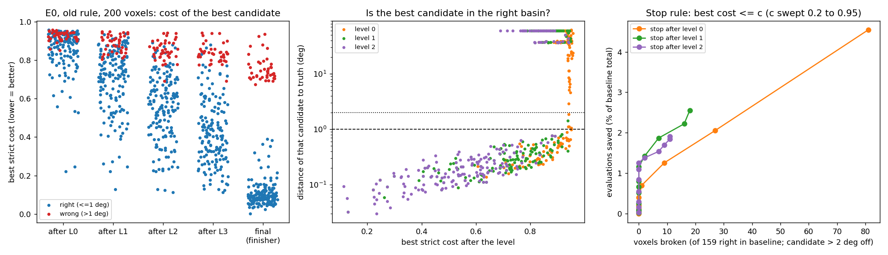
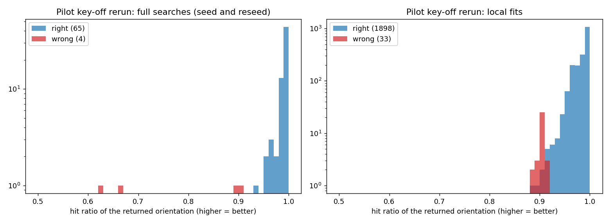

# AR0: what the stored results say about stopping a search early

Step AR0 of `docs/autoresearch/PLAN.md` (2026-11-09). No new search was run. The script
`scripts/autoresearch/ar0/stopping.py` reads stored results and writes
`benchmarks/autoresearch/ar0/` (`summary.json`, `tables.md`, two plots). The analysis and the
numbers are the AR0 implementer's (commit f4a1654). This page was written by the main session from
those files, because the implementer's write of this file was refused by the tool.

## Terms

- **Evaluation**: one call of the cost function for one voxel and one orientation.
- **Cost**: the strict cost of an orientation. Lower is better. 0 is a perfect match.
- **Right / wrong**: the returned orientation is within 1 degree of the truth, or not.
- **Level**: one pass of the adaptive grid search. Level 0 is the coarse grid; levels 1 to 3 refine
  the candidates kept from the level before. The finisher runs last.
- **Candidate**: an orientation that a level keeps after its screen.
- **True basin**: a candidate close enough to the truth that refinement can reach it.
- **Hit ratio**: the share of an orientation's predicted spots that are lit in the data. Higher is
  better.
- **E0**: 200 hard voxels, each searched once with no starting guess. Stored per voxel in
  `benchmarks/eval_reduction/E/cache/rank/e0_old_base/` (the default overlap rule) and
  `e0_cpp_base/` (the C++ overlap rule).
- **Pilot**: the 2,000-voxel BFS run (key-off rerun), stored in
  `benchmarks/eval_reduction/G/g2/bfs/runs/keyoff_rerun/`.

Scope. E0 voxels cost about 48,700 evaluations per search (9,739,905 over 200 voxels). A full search
on a full-sample voxel costs about 332,000, with a different split between the stages. The shares
below are E0's. They are not the pilot's.

## The answer in short

1. **The final cost tells right from wrong with no mistakes on E0.** All 159 right voxels end at a
   cost of 0.390 or less. All 41 wrong voxels end at 0.673 or more. So after a search we can tell
   that the answer is good. That is not the same as knowing, during the search, that more search
   will not help.
2. **The best cost after a level does not tell right from wrong.** After every level the two groups
   overlap.
3. **A rule "stop after level k when the best cost is at most c" saves almost nothing.** With no
   voxel broken it saves 1.3% of the evaluations at most. The reason is where the evaluations are:
   90.7% of them are the level-0 screen, which is over before the rule can act.
4. **The true basin is near the top of the level-0 list.** For the right voxels it sits at
   position 3 (median) in a list of 182 (median), and in the first tenth of the list for 9 voxels
   in 10. A stop rule can only pay inside the level-0 screen. Better still is to replace the
   screen with a proposer that names a few candidates (steps AR1 and AR4).
5. **On the pilot, the hit ratio flags every wrong answer.** At a cut of 0.93, all 37 wrong voxels
   fall below it, with 15 right ones. All 1,948 answers at or above it are right.

## E0: cost by level, and what a stop rule saves

Reading the plot. Left: the best cost after each level and the final cost, one dot per voxel; blue
is right, red is wrong. The groups overlap until the final column, where a gap opens. Middle: the
best candidate's distance to the truth against its cost, by level. A low cost means a candidate in
the true basin; a cost above about 0.8 says nothing. Right: for the stop rule, the evaluations
saved against the voxels broken, as the threshold `c` rises.

Reading the table: one row per threshold `c` on the final cost. `right_le` and `wrong_le` count the
right and wrong voxels at or below `c`; `right_gt` and `wrong_gt` count those above. Any `c` from
0.40 to 0.65 splits the groups with no mistake.

<!-- table:final_sep_old -->
| c | right_le | wrong_le | right_gt | wrong_gt |
|---|---|---|---|---|
| 0.20 | 149 | 0 | 10 | 41 |
| 0.30 | 153 | 0 | 6 | 41 |
| 0.40 | 159 | 0 | 0 | 41 |
| 0.50 | 159 | 0 | 0 | 41 |
| 0.60 | 159 | 0 | 0 | 41 |
| 0.65 | 159 | 0 | 0 | 41 |
| 0.70 | 159 | 4 | 0 | 37 |
| 0.75 | 159 | 24 | 0 | 17 |
| 0.80 | 159 | 34 | 0 | 7 |
| 0.85 | 159 | 36 | 0 | 5 |
| 0.90 | 159 | 39 | 0 | 2 |
| 0.95 | 159 | 41 | 0 | 0 |
<!-- /table:final_sep_old -->

Reading the table: one row per level, default rule. `best_le1_right` counts the right voxels whose
best candidate after the level is within 1 degree of the truth (of 159). `best_le2_right` and
`best_le2_wrong` count voxels whose best candidate is within 2 degrees, for the voxels that end
right and wrong. `kept_le2_right` and `kept_le2_wrong` count voxels with any kept candidate within
2 degrees. `evals_after_pct` is the share of all evaluations spent after the level.
`evals_after_right_mean` is the mean number of evaluations a right voxel spends after the level.

<!-- table:levels_old -->
| level | best_le1_right | best_le2_right | best_le2_wrong | kept_le2_right | kept_le2_wrong | evals_after_pct | evals_after_right_mean |
|---|---|---|---|---|---|---|---|
| 0 | 71 | 74 | 1 | 156 | 14 | 4.8 | 2411 |
| 1 | 141 | 141 | 1 | 159 | 7 | 2.6 | 1292 |
| 2 | 148 | 148 | 0 | 159 | 1 | 1.9 | 967 |
| 3 | 155 | 155 | 0 | 155 | 0 | 1.7 | 886 |
<!-- /table:levels_old -->

Two things to read from it. First, after level 0 the best candidate is within 1 degree for only 71
of the 159 right voxels; it takes level 1 to reach 141. Second, the search loses voxels it could
have solved: 14 wrong voxels still hold a candidate within 2 degrees after level 0, 7 after
level 1, 1 after level 2 and none after level 3. For those voxels the search dropped the true
basin. No stop rule helps them; a better ranking does (the smooth ranking key of Task E fixed 34 of
the 41).

Reading the table: one row per level, default rule. `screen_pct` and `quick_pct` are the shares of
all evaluations spent in the level's screen and re-cost, and in its quick Monte-Carlo.
`n_disc_median` is the median length of the level's candidate list. `right_with_basin` and
`wrong_with_basin` count voxels whose list holds the true basin. `basin_pos_median` is the true
basin's position in the list (0 is the top), for the right voxels. `basin_frac_median` and
`basin_frac_p90` are that position as a share of the list: the median and the value that 9 voxels
in 10 stay under.

<!-- table:stages_old -->
| level | screen_pct | quick_pct | n_disc_median | right_with_basin | right_no_basin | wrong_with_basin | basin_pos_median | basin_frac_median | basin_frac_p90 |
|---|---|---|---|---|---|---|---|---|---|
| 0 | 90.7 | 4.5 | 182 | 159 | 0 | 41 | 3 | 0.02 | 0.10 |
| 1 | 1.1 | 1.2 | 48 | 159 | 0 | 28 | 0 | 0.00 | 0.05 |
| 2 | 0.4 | 0.3 | 12 | 159 | 0 | 7 | 0 | 0.00 | 0.00 |
| 3 | 0.1 | 0.1 | 3 | 159 | 0 | 1 | 0 | 0.00 | 0.00 |
<!-- /table:stages_old -->

The finisher takes the remaining 1.7%.

Reading the table: one row per stop rule "stop after `level` when the best cost is at most `c`".
`n_stop` is the number of voxels the rule stops. `stop_ok` counts stopped voxels whose best
candidate is within 2 degrees (the finisher can reach the truth from there). `broken` counts
voxels that end right today and would stop more than 2 degrees off. `stop_wrong_base` counts
stopped voxels that end wrong today anyway. `saved_pct` is the share of all evaluations saved.

<!-- table:stop_grid_old -->
| level | c | n_stop | stop_ok | broken | stop_wrong_base | saved_pct |
|---|---|---|---|---|---|---|
| 0 | 0.30 | 2 | 2 | 0 | 0 | 0.0 |
| 0 | 0.40 | 2 | 2 | 0 | 0 | 0.0 |
| 0 | 0.50 | 2 | 2 | 0 | 0 | 0.0 |
| 0 | 0.60 | 5 | 5 | 0 | 0 | 0.1 |
| 0 | 0.70 | 9 | 9 | 0 | 0 | 0.2 |
| 0 | 0.80 | 28 | 27 | 1 | 0 | 0.7 |
| 0 | 0.90 | 83 | 53 | 27 | 3 | 2.1 |
| 1 | 0.30 | 6 | 6 | 0 | 0 | 0.1 |
| 1 | 0.40 | 7 | 7 | 0 | 0 | 0.1 |
| 1 | 0.50 | 19 | 19 | 0 | 0 | 0.3 |
| 1 | 0.60 | 38 | 38 | 0 | 0 | 0.5 |
| 1 | 0.70 | 61 | 61 | 0 | 0 | 0.8 |
| 1 | 0.80 | 107 | 105 | 2 | 0 | 1.4 |
| 1 | 0.90 | 170 | 135 | 16 | 19 | 2.2 |
| 2 | 0.30 | 16 | 16 | 0 | 0 | 0.2 |
| 2 | 0.40 | 30 | 30 | 0 | 0 | 0.3 |
| 2 | 0.50 | 55 | 55 | 0 | 0 | 0.5 |
| 2 | 0.60 | 85 | 85 | 0 | 0 | 0.8 |
| 2 | 0.70 | 127 | 126 | 0 | 1 | 1.3 |
| 2 | 0.80 | 155 | 142 | 7 | 6 | 1.5 |
| 2 | 0.90 | 192 | 148 | 11 | 33 | 1.8 |
<!-- /table:stop_grid_old -->

Reading the table: the best rule per level under a cap on broken voxels (`max_broken` 0 or 1).

<!-- table:safe_old -->
| max_broken | level | c | n_stop | broken | saved_pct |
|---|---|---|---|---|---|
| 0 | 0 | 0.75 | 17 | 0 | 0.4 |
| 0 | 1 | 0.75 | 88 | 0 | 1.2 |
| 0 | 2 | 0.70 | 127 | 0 | 1.3 |
| 1 | 0 | 0.80 | 28 | 1 | 0.7 |
| 1 | 1 | 0.75 | 88 | 0 | 1.2 |
| 1 | 2 | 0.70 | 127 | 0 | 1.3 |
<!-- /table:safe_old -->

Reading the table: the thresholds chosen on the default-rule results, applied unchanged to the
C++-rule results (a check that the thresholds are not fitted to one set of 200 searches). They
break no voxel there either, and save as little.

<!-- table:cross_old_to_cpp -->
| level | c | n_stop | broken | saved_pct |
|---|---|---|---|---|
| 0 | 0.75 | 14 | 0 | 0.3 |
| 1 | 0.75 | 64 | 0 | 0.6 |
| 2 | 0.70 | 108 | 0 | 0.8 |
<!-- /table:cross_old_to_cpp -->

The C++-rule results give the same picture: 144 right voxels all at a final cost of 0.338 or less,
56 wrong voxels all at 0.678 or more, and a largest safe saving of 0.9%. Their tables are in
`benchmarks/autoresearch/ar0/tables.md` (`final_sep_cpp`, `levels_cpp`, `stages_cpp`,
`stop_grid_cpp`, `safe_cpp`).

## Pilot: the hit ratio of the returned orientation

Reading the plot: the hit ratio of the returned orientation in the pilot's key-off rerun, for full
searches (left) and local fits (right); blue is right, red is wrong. The counts are on a log
scale.

Reading the table: one row per pilot run and kind of search. `n` and `n_wrong` are the voxel
counts. The other columns are the lowest and the median hit ratio of the right voxels, and the
median and the highest hit ratio of the wrong voxels.

<!-- table:pilot_hit -->
| run | group | n | n_wrong | hit_right_min | hit_right_median | hit_wrong_median | hit_wrong_max |
|---|---|---|---|---|---|---|---|
| keyoff_rerun | full_search | 69 | 4 | 0.936 | 1.000 | 0.777 | 0.904 |
| keyoff_rerun | local_fit | 1931 | 33 | 0.888 | 0.994 | 0.904 | 0.918 |
| outward_only | full_search | 250 | 3 | 0.951 | 0.997 | 0.890 | 0.908 |
| outward_only | local_fit | 1750 | 33 | 0.900 | 0.991 | 0.901 | 0.918 |
| integrated | full_search | 238 | 2 | 0.948 | 0.997 | 0.899 | 0.908 |
| integrated | local_fit | 1762 | 40 | 0.900 | 0.994 | 0.900 | 0.918 |
| smooth_only | full_search | 65 | 0 | 0.921 | 1.000 | n/a | n/a |
| smooth_only | local_fit | 1935 | 34 | 0.859 | 0.992 | 0.902 | 0.918 |
<!-- /table:pilot_hit -->

Reading the tables: the key-off rerun, one row per hit-ratio cut `h`. `right_ge` and `wrong_ge`
count right and wrong voxels at or above the cut; `right_lt` and `wrong_lt` count those below.
`evals_in_wrong_pct` is the share of the group's evaluations spent on voxels that end wrong. First
the 69 full searches, then the 1,931 local fits.

<!-- table:pilot_thr_full_search -->
| h | right_ge | wrong_ge | right_lt | wrong_lt | evals_in_wrong_pct |
|---|---|---|---|---|---|
| 0.90 | 65 | 1 | 0 | 3 | 5.8 |
| 0.93 | 65 | 0 | 0 | 4 | 5.8 |
| 0.95 | 64 | 0 | 1 | 4 | 5.8 |
| 0.96 | 62 | 0 | 3 | 4 | 5.8 |
| 0.97 | 59 | 0 | 6 | 4 | 5.8 |
| 0.98 | 57 | 0 | 8 | 4 | 5.8 |
| 0.99 | 44 | 0 | 21 | 4 | 5.8 |
<!-- /table:pilot_thr_full_search -->

<!-- table:pilot_thr_local_fit -->
| h | right_ge | wrong_ge | right_lt | wrong_lt | evals_in_wrong_pct |
|---|---|---|---|---|---|
| 0.90 | 1896 | 28 | 2 | 5 | 1.2 |
| 0.93 | 1883 | 0 | 15 | 33 | 1.2 |
| 0.95 | 1852 | 0 | 46 | 33 | 1.2 |
| 0.96 | 1789 | 0 | 109 | 33 | 1.2 |
| 0.97 | 1590 | 0 | 308 | 33 | 1.2 |
| 0.98 | 1393 | 0 | 505 | 33 | 1.2 |
| 0.99 | 1076 | 0 | 822 | 33 | 1.2 |
<!-- /table:pilot_thr_local_fit -->

At a cut of 0.93 no wrong voxel passes in either group. Below it are all 37 wrong voxels (4 full
searches, 33 local fits) and 15 right local fits. The wrong local fits sit in a narrow band: 28 of
the 33 have a hit ratio from 0.90 to 0.918, just above the BFS acceptance threshold of 0.9. The
same cut was not tested on a second region, so read it as a description of this run, not as a
tuned threshold.

## What this means for the plan

- A cost threshold between levels is not the early stop the owner asked for. It is safe and it
  saves about 1%.
- The saving is in the level-0 screen. Two ways to get at it: stop the screen once a candidate in
  a clear basin has shown up (the true basin is near the top of the list, but the list is ranked
  only after the whole grid is screened, so this needs an order to screen in); or do not screen
  the grid at all and let a proposer name the candidates (AR1, AR4).
- "Is this answer good" has a clean test: the final cost on E0, the hit ratio on the pilot. That
  is the accept test for a proposer's candidate, and the place to start the stop rule of AR5: stop
  as soon as a candidate passes it, search further only when none does.
- Not tested here: whether these thresholds hold on full-sample voxels with many more spots, and
  on images with noise.
