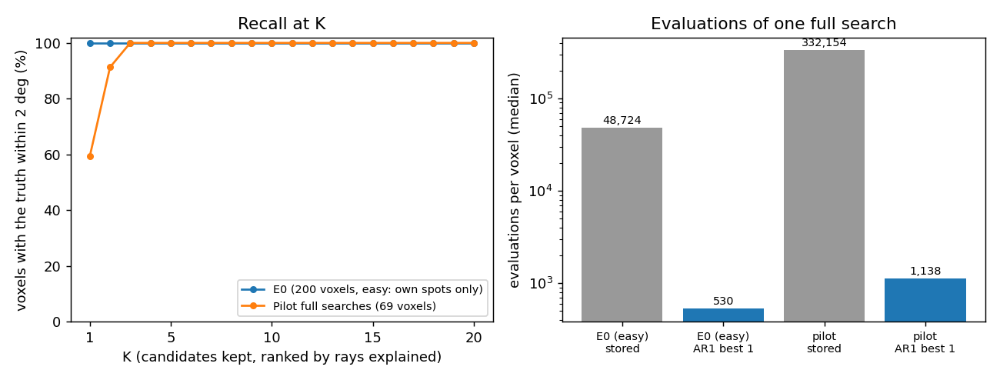

# AR1: can the rays be indexed instead of grid-searched?

Step AR1 of `docs/autoresearch/PLAN.md` (2026-11-09), hypothesis H1. Code:
`icenine/ray_indexing.py`. Scripts: `scripts/autoresearch/ar1/`. Results:
`benchmarks/autoresearch/ar1/`. The code, the runs and the numbers are the AR1 implementer's
(commits 3a35b30, 780dd97, d6dbbcd). This page was placed by the main session from the
implementer's draft, because the implementer's write of this file was refused by the tool.

## The result in one picture

Reading the picture. Left: for each K, the share of voxels whose true orientation is within
2 degrees of one of the first K candidates. Candidates are ranked by the number of rays they
explain. Right: evaluations per voxel for one full search, on a log axis. Grey is the stored grid
search. Blue is the indexing path: the strict cost on 5 candidates, then the usual finisher on the
best one.

- On the pilot's 69 full-search voxels the truth is among the first 3 candidates for every voxel.
- The first candidate alone is right for 41 of the 69. In the other 28 it is the true orientation
  of a neighbouring grain.
- The indexing path takes a median of 1,138 evaluations per voxel. The stored grid search took
  332,154 on the same voxels.
- Indexing one voxel takes a median of 0.18 s (timed on a busy machine).
- The plan's gate for step AR2 was a recall at K = 20 of at least 90% on these voxels. It is met:
  69 of 69.

## Terms

- **Ray**: one diffracted beam. It is known from a spot on detector 0 paired with its spot on
  detector 1.
- **Attached rays** of a voxel: the rays whose line through the sample passes the voxel. Most of
  them belong to other grains.
- **Scattering vector** of a ray: the ray's direction minus the beam's direction, scaled by the
  wave number, turned into the sample frame with the rotation angle (omega) of the ray's frame.
  For a crystal with orientation R it equals R h for one reciprocal-lattice vector h.
- **Family**: the reciprocal-lattice vectors that the crystal's own symmetry rotations map onto
  each other. The code takes the rotations from the crystal; nothing in it is specific to cubic
  crystals.
- **Vote**: two rays of different families give one orientation when the angle between their
  scattering vectors matches the angle between two crystal vectors of those families.
- **Explained ray**: a ray within 0.7 degrees and 1% in length of some R h.
- **Candidate**: a cluster of votes, refined by least squares on the rays it explains. Candidates
  are ranked by the number of rays they explain.
- **Recall at K**: the share of voxels whose true orientation is within 2 degrees of one of the
  first K candidates.
- **Wrong**: more than 1 degree from the truth.
- **Evaluation**: one call of the strict cost function for one voxel and one orientation.
- **E0**: 200 hard voxels. Its clean images hold only each voxel's own spots, so E0 is the easy
  case for indexing.
- **Pilot full searches**: the 69 voxels of the 2,000-voxel BFS pilot (key-off rerun) that took
  more than 100,000 evaluations. The images hold the spots of all grains, so this is the realistic
  test. By their final record 62 are seeds, 5 are revisits and 2 are unresolved; for those 7 the
  stored error is the later result.
- **Stored full search**: for E0 the arm `e0_old_base`; for the pilot the key-off rerun.

All runs use clean full-sample images and reconstruct at Q-max 8. Counts carry a Wilson 95%
interval in percent.

## Step 1: are the scattering vectors right?

This was checked before any voting.

Reading the table: one row per test set. `attached` is the number of attached rays over all
voxels. `t05` counts the rays within 0.5 degrees and 1% in length of a vector of the true
orientation. `c05` counts the same for a control orientation (the truth turned by 37 degrees).
`t1` and `c1` are the same within 1 degree. `ang50`, `ang95` and `angmax` are the median, the 95th
percentile and the largest angular error in degrees of the rays within 1 degree of the truth.
`len95` is the 95th percentile of their relative length error.

<!-- table:ar1_sanity -->
| set | voxels | attached | t05 | c05 | t1 | c1 | ang50 | ang95 | angmax | len95 |
|---|---|---|---|---|---|---|---|---|---|---|
| E0 (200 voxels) | 200 | 11312 | 11270 (99.6%) | 3 (0.03%) | 11312 | 14 | 0.203 | 0.439 | 0.559 | 0.0026 |
| Pilot full searches (69 voxels) | 69 | 27164 | 3065 (11.3%) | 4 (0.01%) | 3115 | 28 | 0.206 | 0.451 | 0.985 | 0.0056 |
<!-- /table:ar1_sanity -->

The convention is right. On E0 nearly all attached rays match the truth. On the pilot 11% match,
as expected, since most attached rays belong to other grains. The control matches 4 of 27,164
rays within 0.5 degrees. The angular errors stay below 0.6 degrees on E0. That is consistent with
the 1-degree frame width (omega is known to half a frame); the share due to spot centroids was not
tested. The tolerances were set from these errors before any recall was measured: 0.7 degrees to
explain a ray, 1 degree for the angle between two vectors, 1% in length, 1 degree for clustering.

## Step 2: recall

Reading the table: one row per test set. `K1`, `K5` and `K20` give the voxels whose truth is
within 2 degrees of one of the first 1, 5 or 20 candidates.

<!-- table:ar1_recall -->
| set | K1 | K5 | K20 |
|---|---|---|---|
| E0 (200 voxels) | 200/200 (100.0%, 98.1-100.0) | 200/200 (100.0%, 98.1-100.0) | 200/200 (100.0%, 98.1-100.0) |
| Pilot full searches (69 voxels) | 41/69 (59.4%, 47.6-70.2) | 69/69 (100.0%, 94.7-100.0) | 69/69 (100.0%, 94.7-100.0) |
<!-- /table:ar1_recall -->

Reading the table: the same counts when "within 2 degrees" is replaced by 0.5, 2 and 5 degrees.

<!-- table:ar1_recall_thr -->
| set | within | K1 | K5 | K20 |
|---|---|---|---|---|
| E0 (200 voxels) | 0.5 deg | 200/200 | 200/200 | 200/200 |
| E0 (200 voxels) | 2 deg | 200/200 | 200/200 | 200/200 |
| E0 (200 voxels) | 5 deg | 200/200 | 200/200 | 200/200 |
| Pilot full searches (69 voxels) | 0.5 deg | 41/69 | 69/69 | 69/69 |
| Pilot full searches (69 voxels) | 2 deg | 41/69 | 69/69 | 69/69 |
| Pilot full searches (69 voxels) | 5 deg | 41/69 | 69/69 | 69/69 |
<!-- /table:ar1_recall_thr -->

The counts do not change between 0.5 and 5 degrees. A candidate is at the truth or far from it.

Reading the table: `best_med`, `best_p90` and `best_max` are the median, the 90th percentile and
the largest distance in degrees from the truth to the nearest of the 20 candidates. `top1_med` is
the median distance of the first candidate where it is within 2 degrees. `n_cand_med` is the
median number of candidates.

<!-- table:ar1_dist -->
| set | best_med | best_p90 | best_max | top1_med | n_cand_med |
|---|---|---|---|---|---|
| E0 (200 voxels) | 0.038 | 0.076 | 0.125 | 0.038 | 20 |
| Pilot full searches (69 voxels) | 0.054 | 0.082 | 0.137 | 0.048 | 20 |
<!-- /table:ar1_dist -->

Reading the table: `med_ms` and `p90_ms` are the indexing time per voxel in milliseconds (busy
machine; no cost function is called). `med_votes` is the median number of votes. `med_att` is the
median number of attached rays. `med_true` is the median number of rays the truth explains.

<!-- table:ar1_index_time -->
| set | med_ms | p90_ms | med_votes | med_att | med_true |
|---|---|---|---|---|---|
| E0 (200 voxels) | 91 | 101 | 5022 | 57 | 57 |
| Pilot full searches (69 voxels) | 179 | 234 | 28248 | 413 | 44 |
<!-- /table:ar1_index_time -->

A pilot voxel has about ten times more attached rays than its own grain explains. The voting
still finds the grain.

## Step 3: why the first candidate is sometimes not the truth

The forward model records which grain drew each spot. That gives the true owner of every ray.

Reading the table: medians over the 69 pilot voxels of the attached rays, by who drew them.

<!-- table:ar1_ray_kinds -->
| quantity | median |
|---|---|
| attached rays | 413 |
| drawn only by the voxel's own grain | 45 |
| drawn by the own grain and another grain | 1 |
| drawn by other grains only | 366 |
| explained by the true orientation | 44 |
<!-- /table:ar1_ray_kinds -->

Reading the table: the 28 voxels whose first candidate is more than 2 degrees from the truth, by
reason, and the rank at which the truth appears.

<!-- table:ar1_misses -->
| what | n |
|---|---|
| rank-1 candidate is not the truth | 28/69 |
|   reason: too few rays (truth explains < 8) | 0 |
|   reason: another real grain explains more rays | 28 |
|   reason: matches no grain (coincidence of rays) | 0 |
| truth is candidate 1 / 2 / 3 (of 20) | 41 / 22 / 6 |
<!-- /table:ar1_misses -->

Every miss has the same reason. The first candidate is the true orientation of another grain
(within 1 degree), and it explains more of the attached rays than the voxel's own grain does: a
median of 5 more. One case is a tie at 41 rays each, broken by votes. No miss comes from too few
rays. No miss comes from a chance alignment of rays. Mixed spots are rare: 65 of the 3,095 rays
that the true orientations explain.

So the count of explained rays cannot tell two grains apart at a voxel near their boundary. The
strict cost can (step 5). This is consistent with the neighbour's rays being attached because
their lines pass the voxel; the attachment rule was not varied.

## Step 4: fewer rays, and other tolerances

Two stress tests on the pilot voxels. First, keep only every m-th attached ray (a fixed stride,
no random draw). Second, halve and double each tolerance.

Reading the table: one row per case. `rays` is the median number of rays the truth explains. The
other columns are as in the recall table. `stride m` keeps every m-th ray. `ang`, `pair` and
`cluster` name the tolerance that was changed and its new value in degrees.

<!-- table:ar1_sparse -->
| case | rays | K1 | K5 | K20 |
|---|---|---|---|---|
| stride 1 | 44 | 41/69 (59.4%, 47.6-70.2) | 69/69 (100.0%, 94.7-100.0) | 69/69 (100.0%, 94.7-100.0) |
| stride 2 | 23 | 42/69 (60.9%, 49.1-71.5) | 69/69 (100.0%, 94.7-100.0) | 69/69 (100.0%, 94.7-100.0) |
| stride 3 | 15 | 37/69 (53.6%, 42.0-64.9) | 69/69 (100.0%, 94.7-100.0) | 69/69 (100.0%, 94.7-100.0) |
| stride 4 | 11 | 33/69 (47.8%, 36.5-59.4) | 67/69 (97.1%, 90.0-99.2) | 68/69 (98.6%, 92.2-99.7) |
| stride 6 | 7 | 32/69 (46.4%, 35.1-58.0) | 62/69 (89.9%, 80.5-95.0) | 67/69 (97.1%, 90.0-99.2) |
| stride 8 | 5 | 30/69 (43.5%, 32.4-55.2) | 54/69 (78.3%, 67.2-86.4) | 66/69 (95.7%, 88.0-98.5) |
| ang 0.35 | 36 | 44/69 (63.8%, 52.0-74.1) | 69/69 (100.0%, 94.7-100.0) | 69/69 (100.0%, 94.7-100.0) |
| ang 1.4 | 46 | 41/69 (59.4%, 47.6-70.2) | 69/69 (100.0%, 94.7-100.0) | 69/69 (100.0%, 94.7-100.0) |
| pair 0.5 | 44 | 42/69 (60.9%, 49.1-71.5) | 69/69 (100.0%, 94.7-100.0) | 69/69 (100.0%, 94.7-100.0) |
| pair 2 | 44 | 42/69 (60.9%, 49.1-71.5) | 69/69 (100.0%, 94.7-100.0) | 69/69 (100.0%, 94.7-100.0) |
| cluster 0.5 | 44 | 42/69 (60.9%, 49.1-71.5) | 69/69 (100.0%, 94.7-100.0) | 69/69 (100.0%, 94.7-100.0) |
| cluster 2 | 44 | 42/69 (60.9%, 49.1-71.5) | 69/69 (100.0%, 94.7-100.0) | 69/69 (100.0%, 94.7-100.0) |
<!-- /table:ar1_sparse -->

With 5 true rays left (stride 8) the truth is still among 20 candidates for 66 of 69 voxels, and
among 5 for 54. The tolerance changes move the first-candidate count by at most 3 voxels (41 to
44) and leave K = 5 and K = 20 at 69 of 69.

## Step 5: end to end

The arms:

- the strict cost on the first 1, 5 or 20 candidates, with no finisher;
- "AR1": the strict cost on the first 5 candidates, then the usual finisher on the best one;
- the same with the finisher on the best 2 and the best 3, keeping the lowest final cost. The
  best-2 arm was added after the best-1 result was seen. It was not set in advance.

Reading the table: `wrong` is the voxels more than 1 degree from the truth. `fixed` is wrong in
the stored search and right here. `broken` is right in the stored search and wrong here. `both` is
wrong in both. `mean_ev` and `med_ev` are the evaluations per voxel (strict cost on the candidates
plus the finisher; the stored count includes the screen's calls). `med_err` is the median error in
degrees.

<!-- table:ar1_e2e -->
| set | arm | wrong | fixed | broken | both | mean_ev | med_ev | med_err |
|---|---|---|---|---|---|---|---|---|
| E0 (200 voxels) | stored full search | 41/200 (20.5%, 15.5-26.6) | 0 | 0 | 41 | 48,700 | 48,724 | 0.021 |
| E0 (200 voxels) | strict cost on first 1, no finisher | 0/200 (0.0%, 0.0-1.9) | 41 | 0 | 0 | 1 | 1 | 0.038 |
| E0 (200 voxels) | strict cost on first 5, no finisher | 0/200 (0.0%, 0.0-1.9) | 41 | 0 | 0 | 5 | 5 | 0.038 |
| E0 (200 voxels) | strict cost on first 20, no finisher | 0/200 (0.0%, 0.0-1.9) | 41 | 0 | 0 | 20 | 20 | 0.038 |
| E0 (200 voxels) | AR1: strict on 5, finisher on best 1 | 0/200 (0.0%, 0.0-1.9) | 41 | 0 | 0 | 519 | 530 | 0.017 |
| E0 (200 voxels) | AR1: strict on 5, finisher on best 2 (added after seeing the first arm) | 0/200 (0.0%, 0.0-1.9) | 41 | 0 | 0 | 950 | 951 | 0.017 |
| E0 (200 voxels) | AR1: strict on 5, finisher on best 3 | 0/200 (0.0%, 0.0-1.9) | 41 | 0 | 0 | 1,393 | 1,392 | 0.017 |
| Pilot full searches (69 voxels) | stored full search | 4/69 (5.8%, 2.3-14.0) | 0 | 0 | 4 | 332,380 | 332,154 | 0.015 |
| Pilot full searches (69 voxels) | strict cost on first 1, no finisher | 28/69 (40.6%, 29.8-52.4) | 2 | 26 | 2 | 1 | 1 | 0.073 |
| Pilot full searches (69 voxels) | strict cost on first 5, no finisher | 3/69 (4.3%, 1.5-12.0) | 4 | 3 | 0 | 5 | 5 | 0.054 |
| Pilot full searches (69 voxels) | strict cost on first 20, no finisher | 3/69 (4.3%, 1.5-12.0) | 4 | 3 | 0 | 20 | 20 | 0.054 |
| Pilot full searches (69 voxels) | AR1: strict on 5, finisher on best 1 | 3/69 (4.3%, 1.5-12.0) | 4 | 3 | 0 | 1,125 | 1,138 | 0.020 |
| Pilot full searches (69 voxels) | AR1: strict on 5, finisher on best 2 (added after seeing the first arm) | 0/69 (0.0%, 0.0-5.3) | 4 | 0 | 0 | 1,926 | 1,907 | 0.019 |
| Pilot full searches (69 voxels) | AR1: strict on 5, finisher on best 3 | 0/69 (0.0%, 0.0-5.3) | 4 | 0 | 0 | 2,546 | 2,512 | 0.019 |
<!-- /table:ar1_e2e -->

- E0: no voxel is wrong in any arm. The stored search has 41 wrong; all 41 are fixed and none is
  broken. The median is 530 evaluations against 48,724.
- Pilot, finisher on the best one: 3 wrong against 4 stored. It fixes the 4 stored wrong voxels
  (5876, 8866, 15749, 24334) and breaks 3 others (7141, 8848, 23942). In those 3 a neighbouring
  grain has the lower strict cost (0.183 against 0.201 in voxel 7141). These are boundary voxels.
- Pilot, finisher on the best two: all 69 right, at a mean of 1,926 evaluations against 1,125.
  This arm was chosen after the fact, so it needs a test on voxels it has not seen.
- The finisher starts within 0.2 degrees of the truth, so it is short (about 1,100 evaluations). A
  start more than 1 degree away was not tested.

## Time

Reading the table: seconds on the 69 pilot voxels, one process. The timing is labelled contended:
the timing preflight refused the machine as busy (load 2.59, one other process at 97% CPU; see
`preflight_timing.json`).

<!-- table:ar1_timing -->
| quantity | seconds |
|---|---|
| one-time pairing of all spots (26,019 rays) | 17.069 |
| attach rays to a voxel (median) | 0.002 |
| index a voxel (median) | 0.177 |
| index a voxel (90th percentile) | 0.230 |
|   of which voting (median) | 0.021 |
|   of which clustering (median) | 0.085 |
|   of which refining (median) | 0.069 |
<!-- /table:ar1_timing -->

Clustering is the largest part. It is a Python loop over seeds and could be shortened. The times
of the strict cost and the finisher are in the end-to-end JSON files, also contended.

## What this means for the plan

- The gate for AR2 and AR3 is met. Indexing can replace the grid search for seeds on this sample.
- A boundary voxel sees two real grains among its candidates. That is not an error of the
  indexing; both grains are there. It is the reason to cost more than one candidate, and it is the
  starting point of AR3: the candidates of a voxel are the grains around it.
- The comparison is in evaluations. The wall-time comparison of the whole path against the grid
  search, on a quiet machine, is still to do (AR2).

## Not tested

- Realistic images. The noise model is an open question; these are clean images.
- Another sample, material or geometry. This is one cubic copper sample and one region of about
  2,000 of 24,570 voxels with 60 grains.
- Voxels in small grains with few paired spots, except by thinning the rays.
- Local fits. Only full searches were indexed.
- The cause of the neighbour wins. It is consistent with the attachment rule, not tested.
- The 3 broken of 69 are counts on one region, not a rate.
- The full test suite was not run (no existing library file changed).
