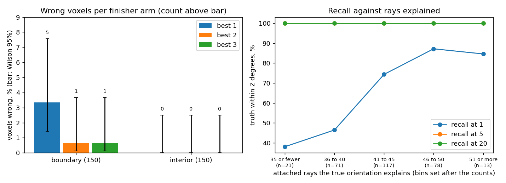

# AR2 step 1: does the finisher on the best 2 candidates hold up on new voxels?

Step 1 of "AR2" in `docs/autoresearch/PLAN.md` (2026-11-09), under D-20261109-N7. Scripts:
`scripts/autoresearch/ar2/` (`select_voxels.py`, `holdout_run.py`, `holdout_summary.py`). Results:
`benchmarks/autoresearch/ar2/holdout/`. The voxel sets were committed (35b2bab) before the run
(9bcf3b2). The code, the run and the numbers are the implementer's. This page was placed by the
main session from the implementer's draft, because the implementer's write of this file was
refused by the tool. Review fixes (2026-11-09, review `20261109-review-ar2a`, decision
D-20261109-N8) changed the reading of voxel 17361, the error metric, and added the boundary split
and the paired splits. The wrong counts did not change.

## The result in one picture

Reading the picture. Left: for each finisher arm, the share of the 150 voxels of a set that end
more than 1 degree from the true orientation, with a Wilson 95% interval. The count of wrong voxels
is written above each bar. Right: the share of all 300 voxels whose true orientation is within
2 degrees of one of the first K candidates, against the number of attached rays that the true
orientation explains. The bins of the right panel were set after the counts were seen. The lines
for K = 5 and K = 20 lie on top of each other at 100%.

- On 300 voxels that no arm had seen, "finisher on the best 2" gets 1 wrong, and so does "best 3".
  "Best 1" gets 5 wrong. All 5 are boundary voxels that share an edge with another grain.
  Interior voxels: 0 wrong in every arm.
- Paired by voxel, best 2 against best 1: 4 fixed, 0 broken, 1 wrong in both. Best 3 takes the
  same candidate as best 2 on all 300 voxels.
- The one voxel wrong in every arm (17361) is a failure of the path's finisher, not of the cost:
  the strict cost is lower at the true orientation than at the result taken. It counts against
  all three arms (D-20261109-N8).
- The truth is among the first 5 candidates for all 300 voxels. The first candidate alone is right
  for 207 of 300.
- The plan's rule: best 2 is kept unless it has more wrong voxels than best 3. It has 1 and best 3
  has 1. So best 2 stays the main arm for step 2.
- All times here are contended: 3 run processes ran at once; other load on the machine was not
  checked, and the timing preflight was not run.

## Terms

- **Holdout**: voxels chosen before the run, from outside the region the arms were tuned on.
- **Pilot region**: the 2,000 voxels of the BFS pilot. The holdout excludes all of them.
- **Boundary voxel**: a voxel that shares a corner with a voxel of another grain in the true map.
  Another grain means more than 1 degree away in orientation, with the crystal's symmetry taken
  into account. **Interior voxel**: any other voxel.
- **Edge-sharing and corner-only**: the voxels are triangles. A boundary voxel is edge-sharing if
  a voxel of another grain shares a whole edge (two corners) with it. It is corner-only if the
  other grain meets it only at a corner. The sets were fixed with the corner rule; the split was
  added after the run (review fix 4) and changes no set.
- **Candidates**: the 20 orientations that the ray indexing of AR1 proposes for a voxel, ranked by
  the number of rays they explain.
- **Strict cost**: the cost every search uses: one minus the share of predicted spots that land
  on lit pixels, with a hard cut. Lower is better. The literal C++ overlap rule (`CountQualifiedPeaks`,
  config key `CppOverlapRule`) is off here, as in the pilot config; the Python default overlap
  count is used.
- **Finisher**: the usual local refinement that starts from one candidate.
- **Arm "best N"**: take the strict cost of the first 5 candidates, run the finisher from each of
  the N candidates with the lowest strict cost, and keep the result with the lowest final strict
  cost.
- **Wrong**: the final orientation is more than 1 degree from the true orientation.
- **Error**: the angle of the rotation between a result and the true orientation, the smallest
  over the crystal's symmetry operators, in degrees.
- **Evaluations**: the strict cost on the 5 candidates plus the cost calls of the N finisher runs.
  Attaching rays and indexing are not counted.

## What was run

Data as in AR1: clean full-sample images of `Examples/Example2.ManyGrains` (the spots of all
grains), reconstruction at Q-max 8, and the default indexing tolerances (0.7 degrees to explain a
ray, 1 degree for the pair angle, 1% in length, 1 degree for clustering). Before the run, 3 pilot
voxels (11294, 4206, 983) were indexed again and compared with AR1's stored candidates. They were
identical.

The layer has 24,570 voxels. 22,570 are outside the pilot region. Of these, 15,359 are boundary
voxels and 7,211 are interior. Each set takes every s-th eligible voxel in index order, with
s = floor(count / 150): s = 102 for the boundary set and 48 for the interior set. There is no
random draw. The boundary set covers 134 grains and the interior set 116. Only 4 boundary voxels
and 5 interior voxels belong to a grain that also has voxels inside the pilot region. The sets are
in `voxels.json`, with each voxel's true grain; the grain counts per set are in `summary.json`.

The corner rule makes many voxels boundary voxels: a triangle away from the sample edge has 12
neighbours that share at least a corner with it, and only 3 of them share an edge. With the edge rule instead, 8,060 of the 22,570 eligible voxels would be
boundary voxels. Of the 150 boundary holdout voxels, 76 share an edge with another grain and 74
meet it only at a corner.

## Wrong voxels and evaluations

Reading the table: one row per set (`vset`) and arm. `wrong` is the count of wrong voxels out of
the set's size, with the Wilson 95% interval in percent. `mean_evals` and `median_evals` are
evaluations per voxel. `median_err` is the median final error in degrees. `both` is the two sets
together; the plan's rule reads that row.

<!-- table:ar2a_arms -->
| vset | arm | wrong | mean_evals | median_evals | median_err |
|---|---|---|---|---|---|
| boundary | best 1 | 5 of 150 (1.4 to 7.6%) | 1107 | 1121 | 0.0146 |
| boundary | best 2 | 1 of 150 (0.1 to 3.7%) | 1978 | 1931 | 0.0142 |
| boundary | best 3 | 1 of 150 (0.1 to 3.7%) | 2581 | 2551 | 0.0142 |
| interior | best 1 | 0 of 150 (0.0 to 2.5%) | 1497 | 1424 | 0.0264 |
| interior | best 2 | 0 of 150 (0.0 to 2.5%) | 2114 | 2028 | 0.0264 |
| interior | best 3 | 0 of 150 (0.0 to 2.5%) | 2687 | 2568 | 0.0264 |
| both | best 1 | 5 of 300 (0.7 to 3.8%) | 1302 | 1226 | 0.0190 |
| both | best 2 | 1 of 300 (0.1 to 1.9%) | 2046 | 1984 | 0.0184 |
| both | best 3 | 1 of 300 (0.1 to 1.9%) | 2634 | 2562 | 0.0184 |
<!-- /table:ar2a_arms -->

Best 1 is wrong on 5 of 150 boundary voxels. Best 2 and best 3 are wrong on 1. The interior set
has no wrong voxel; its interval (0.0 to 2.5%) says the rate is small, not that it is zero. Best 3
costs more evaluations than best 2 and gains no voxel here.

The median errors were recomputed after the review with a corrected angle function (fix 3, see
"The error metric" below). They moved by less than 0.001 degrees. The wrong counts did not change.

Reading the table: the boundary set split into edge-sharing and corner-only voxels (`sub`), with
the wrong count per arm and its Wilson 95% interval.

<!-- table:ar2a_split -->
| sub | arm | wrong |
|---|---|---|
| edge | best 1 | 5 of 76 (2.8 to 14.5%) |
| edge | best 2 | 1 of 76 (0.2 to 7.1%) |
| edge | best 3 | 1 of 76 (0.2 to 7.1%) |
| corner | best 1 | 0 of 74 (0.0 to 4.9%) |
| corner | best 2 | 0 of 74 (0.0 to 4.9%) |
| corner | best 3 | 0 of 74 (0.0 to 4.9%) |
<!-- /table:ar2a_split -->

All 5 wrong voxels share an edge with another grain. So best 1 is wrong on 5 of 76 edge-sharing
voxels and on 0 of 74 corner-only voxels. The boundary row of the first table mixes the two groups.

Reading the table: the arms compared voxel by voxel on all 300 voxels. `pair` names the arm with
more finisher runs first. `fixed` counts voxels wrong in the arm with fewer runs and right in the
arm with more; `broken` is the reverse; `both_wrong` counts voxels wrong in both.
`same_candidate` counts voxels where both arms keep the result from the same candidate.

<!-- table:ar2a_paired -->
| pair | n | fixed | broken | both_wrong | same_candidate |
|---|---|---|---|---|---|
| best 2 against best 1 | 300 | 4 | 0 | 1 | 296 |
| best 3 against best 2 | 300 | 0 | 0 | 1 | 300 |
<!-- /table:ar2a_paired -->

Best 2 against best 1: 4 fixed, 0 broken, 1 wrong in both. Best 3 against best 2: 0 fixed, 0
broken, 1 wrong in both, and best 3 keeps the same candidate as best 2 on all 300 voxels: its third
finisher run never gives the lowest final cost. That is the exact form of "best 3 has no gain".

For comparison, AR1 had best 1 wrong on 3 of 69 voxels of the pilot. That set was full-search
voxels, not a stride sample, so the two rates are not the same quantity.

## Recall of the indexing

Reading the table: one row per set and distance (`tol`). `at1`, `at5` and `at20` count the voxels
with one of the first 1, 5 or 20 candidates within that distance of the true orientation.

<!-- table:ar2a_recall -->
| vset | tol | at1 | at5 | at20 |
|---|---|---|---|---|
| boundary | 0.5 degrees | 78 of 150 (44.1 to 59.8%) | 150 of 150 (97.5 to 100.0%) | 150 of 150 (97.5 to 100.0%) |
| boundary | 2 degrees | 78 of 150 (44.1 to 59.8%) | 150 of 150 (97.5 to 100.0%) | 150 of 150 (97.5 to 100.0%) |
| boundary | 5 degrees | 78 of 150 (44.1 to 59.8%) | 150 of 150 (97.5 to 100.0%) | 150 of 150 (97.5 to 100.0%) |
| interior | 0.5 degrees | 129 of 150 (79.5 to 90.7%) | 150 of 150 (97.5 to 100.0%) | 150 of 150 (97.5 to 100.0%) |
| interior | 2 degrees | 129 of 150 (79.5 to 90.7%) | 150 of 150 (97.5 to 100.0%) | 150 of 150 (97.5 to 100.0%) |
| interior | 5 degrees | 129 of 150 (79.5 to 90.7%) | 150 of 150 (97.5 to 100.0%) | 150 of 150 (97.5 to 100.0%) |
| both | 0.5 degrees | 207 of 300 (63.6 to 74.0%) | 300 of 300 (98.7 to 100.0%) | 300 of 300 (98.7 to 100.0%) |
| both | 2 degrees | 207 of 300 (63.6 to 74.0%) | 300 of 300 (98.7 to 100.0%) | 300 of 300 (98.7 to 100.0%) |
| both | 5 degrees | 207 of 300 (63.6 to 74.0%) | 300 of 300 (98.7 to 100.0%) | 300 of 300 (98.7 to 100.0%) |
<!-- /table:ar2a_recall -->

Every voxel has the truth among its first 5 candidates. The first candidate alone is right less
often on boundary voxels (78 of 150) than on interior voxels (129 of 150). The three distances give
the same counts: a candidate is within 0.5 degrees of the truth or more than 5 degrees from it.

## Recall against the number of rays

Reading the table: voxels grouped by the number of attached rays that the true orientation
explains (`bin`). `n` is the number of voxels in the bin. The bins were set after the range of the
counts (30 to 57) was seen, because the bins planned first would have been empty. They change no
arm.

<!-- table:ar2a_explained -->
| bin | n | at1 | at5 | at20 |
|---|---|---|---|---|
| 35 or fewer | 21 | 8 of 21 | 21 of 21 | 21 of 21 |
| 36 to 40 | 71 | 33 of 71 | 71 of 71 | 71 of 71 |
| 41 to 45 | 117 | 87 of 117 | 117 of 117 | 117 of 117 |
| 46 to 50 | 78 | 68 of 78 | 78 of 78 | 78 of 78 |
| 51 or more | 13 | 11 of 13 | 13 of 13 | 13 of 13 |
<!-- /table:ar2a_explained -->

With bins set after the counts were seen, the first candidate is right less often when the truth
explains fewer rays: 8 of 21 voxels at 35 rays or fewer, 68 of 78 at 46 to 50. The top bin has only 13 voxels. Recall at 5 and at 20 is full
in every bin. No holdout voxel has fewer than 30 explained rays. So this run says nothing about
voxels with few rays. AR1's thinning test is the only evidence there (with 5 true rays left, the
truth was among 5 candidates for 54 of 69 voxels).

## The wrong voxels, traced

Reading the table: one row per voxel that is wrong in any arm. `boundary` says whether the voxel
shares an edge with another grain or only a corner. `wrong_in_best` lists the arms in which it is
wrong. `truth_rank` is the rank of the first candidate within 2 degrees of the truth.
`truth_refined_in_best` lists the finisher positions (1, 2 or 3, in order of strict cost) whose
candidate is within 2 degrees of the truth. Position N is refined by the arms best N and up, so
"2" means best 2 and best 3 refine the truth's candidate and best 1 does not. `taken` is the
grain whose true orientation the wrong result matches, and whether that grain touches the voxel;
"touches" is the boundary-crossing column of D-20261109-N6. `taken_err` and `truth_err` are the
final errors in degrees of the taken result and of the refined truth. `taken_cost` and
`truth_cost` are strict costs before and after the finisher. `cost_at_truth` is the strict cost at
the exact true orientation, computed after the review (fix 1). The stored final costs were
evaluated again and reproduce exactly.

<!-- table:ar2a_trace -->
| voxel | vset | boundary | wrong_in_best | truth_rank | truth_in_first5 | truth_refined_in_best | taken | taken_err | taken_cost | truth_cost | cost_at_truth | truth_err |
|---|---|---|---|---|---|---|---|---|---|---|---|---|
| 1687 | boundary | edge | 1 | 1 | yes | 2 | grain 110, touches | 53.166 | 0.137 to 0.137 | 0.165 to 0.061 | 0.0571 | 0.0042 |
| 8343 | boundary | edge | 1 | 1 | yes | 2 | grain 379, touches | 29.542 | 0.184 to 0.184 | 0.321 to 0.087 | 0.0625 | 0.0100 |
| 11568 | boundary | edge | 1 | 1 | yes | 2 | grain 257, touches | 22.196 | 0.218 to 0.141 | 0.223 to 0.122 | 0.0797 | 0.0127 |
| 17361 | boundary | edge | 1,2,3 | 1 | yes | 2 | grain 254, touches | 57.305 | 0.133 to 0.133 | 0.162 to 0.162 | 0.0949 | 0.0449 |
| 21535 | boundary | edge | 1 | 2 | yes | 2 | grain 165, touches | 47.622 | 0.299 to 0.279 | 0.346 to 0.081 | 0.0809 | 0.0029 |
<!-- /table:ar2a_trace -->

- In 4 of the 5 (1687, 8343, 11568, 21535) only best 1 is wrong. Its pick, the candidate with the
  lowest strict cost before the finisher, is the orientation of a grain that touches the voxel.
  The truth has the second-lowest cost. Best 2 refines it, and after the finisher the truth has
  the lower cost in all 4 (voxel 1687: 0.061 against 0.137). This is the same trace as AR1's 3
  broken voxels: the arm picks before it refines. These 4 count against best 1 (D-20261109-N7).
- Voxel 17361 is wrong in all three arms. The strict cost prefers the truth: 0.0949 at the exact
  true orientation, against 0.133 for the touching grain's result. The truth's candidate started
  0.045 degrees from the true orientation, with a strict cost of 0.162. The finisher did not move
  it: after 924 evaluations it ended at the same orientation and the same cost, 0.162. So the
  touching grain's 0.133 won. This is a failure of the path's finisher, and it counts against all
  three arms (D-20261109-N8). It is still listed as touching in the `taken` column, the
  boundary-crossing column, and that does not excuse it. Why the finisher did not move was not
  tested. Voxel 17361 is a named test case for AR2 step 2 and AR5.
- In the other 4, the finisher lowered the cost of the truth's candidate and ended within 0.013
  degrees of the true orientation.
- 17361's start distance is 0.045 degrees with the corrected angle; the review's 0.044 came from
  the old angle function.
- In all 5 the grain taken touches the voxel, and all 5 share an edge with another grain. No
  interior voxel is wrong.

## Indexing time

Reading the table: seconds per voxel to index (voting, clustering and refining the candidates;
rays already attached). Contended: the 3 run processes ran at once, other load on the machine was
not checked, and the timing preflight was not run.

<!-- table:ar2a_time -->
| vset | n | median_s | mean_s | p90_s | max_s |
|---|---|---|---|---|---|
| boundary | 150 | 0.19 | 0.19 | 0.25 | 0.32 |
| interior | 150 | 0.15 | 0.15 | 0.19 | 0.26 |
| both | 300 | 0.17 | 0.17 | 0.23 | 0.32 |
<!-- /table:ar2a_time -->

## The error metric

The review found that the angle function `misorientation_deg` of `icenine/ray_indexing.py` had a
floor of a few thousandths of a degree. It took the arccos of a cosine clipped to 1. The stored
true orientations are not exactly orthonormal (off by about 5e-8), so small angles were cut to 0
or shifted. It now takes the angle as atan2 of the sine part and the cosine part of the relative
rotation, still over the crystal's own symmetry operators. New unit tests cover 0.003 degrees and
inputs off orthonormal by 5e-8 (`tests/test_ray_indexing.py`).

The function has one use inside the library: the indexer drops a candidate within 1 degree of a
better one. The other callers are the AR1 and AR2 scripts, which use it for distances to the truth
and, in `select_voxels.py`, to decide whether two grains differ by more than 1 degree. To check
that only the reported error values change, every voxel was indexed again with the new function
(`scripts/autoresearch/ar2/fix3_check.py`, results `fix3_check_*.json`). The candidates are
identical on all 300 holdout voxels, on AR1's 69 pilot voxels and on AR1's 200 E0 voxels. No
candidate distance crosses 0.5, 1, 2 or 5 degrees. The voxel sets do not depend on small angles.

The AR2 errors were then recomputed from the stored final orientations; nothing was rerun. Before,
28 of the 900 finisher runs had an error of exactly 0; now none has. The largest change of a final
error is 0.0109 degrees, and of a candidate distance below 1 degree 0.0078 degrees. The wrong
flags and the recall counts are unchanged (the summary script stops if they change). Voxel 21535's
truth run, shown as 0.000 before, ends 0.0029 degrees from the truth.

## What was not tested

- There is no stored grid search for these voxels. So there is no fixed and broken pairing and no
  evaluation baseline here. The 332,154 evaluations of AR1 are for the pilot's voxels, not these.
- The BFS seed test and the grid-search fallback were not applied. In step 2 a result goes
  through them, so a wrong result that the seed test rejects would fall back to the grid search.
- The holdout is a stride sample of the layer. It is not the population that step 2 indexes (the
  BFS seeds and reseeds); AR1's 69 voxels were seeds.
- Why the finisher does not reach a nearby narrow minimum (voxel 17361) was not studied.
- Before the review fix, the errors had a floor of a few thousandths of a degree (see "The error
  metric"); the wrong counts never depended on it.
- Clean images only. Realistic images (neighbour overlap and detector noise) were not tried.
- One cubic copper sample, one layer.
- Voxels with few rays (see above).
- One finisher run per candidate, as AR1 built it. No other random seeds.
