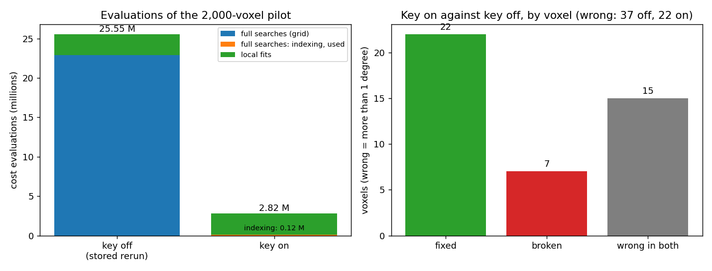

# AR2 step 2: does indexing work as the BFS seed search?

Step 2 of "AR2" in `docs/autoresearch/PLAN.md` (2026-11-09), under D-20261109-N5 and the finisher arm that step 1 fixed (`findings_ar2_holdout.md`, D-20261109-N7 and N8). Library: the opt-in config key `SeedByIndexing` in `icenine/config_file.py`, `icenine/orientation_search.py` and `icenine/reconstructor.py`, and `seed_by_indexing` in `icenine/ray_indexing.py`. Scripts: `scripts/autoresearch/ar2/key_*.py`. Results: `benchmarks/autoresearch/ar2/key/`. Branch `feature/eval-reduction-ar2b`. The code, the runs, the numbers and the text of this page are the implementer's. The main session placed the page from that text, because the tool refused the implementer's own write of a new page; it filled the tables with `scripts/dev/sync_doc_tables.py` and ran `scripts/dev/audit_numbers.py` (422 of 429 numbers matched; the 7 others are dates, the rounded "330,000" and "700" in the terms, and "95%"). All timings on this page are contended: the timing preflight refused (an editor process used about 200% of a CPU core), so the runs went ahead and are labelled.

## The result in one picture

Reading the picture. Left: cost evaluations of the 2,000-voxel BFS pilot, in millions, for the stored key-off run (grid search for every seed and reseed) and for the key-on run. Blue is the grid searches, orange the indexing path, green the local fits. Right: the key-on run against the key-off run, voxel by voxel. A voxel is wrong when its result is more than 1 degree from the true orientation. "Fixed" is wrong with the key off and right with it on. "Broken" is the reverse.

- With the key on, the pilot costs 2,819,906 evaluations. The stored key-off run costs 25,547,935. That is about 9.1 times fewer. The grid searches were 22,882,865 of the key-off total. The 64 indexing paths cost 122,198. The local fits cost about the same in both runs (2,697,708 on, 2,665,070 off).
- Wrong voxels: 22 of 2,000 with the key on, 37 with it off. Paired by voxel: 22 fixed, 7 broken, 15 wrong in both. All 7 breaks are boundary crossings. None is traced to a wrong indexing result (0 of the 64 indexed seeds and reseeds are wrong).
- The key-off wrong count is not stable. The same key-off configuration with `FusedCost` on has 24 wrong voxels, not 37. Against that run the key-on run has 14 fixed, 12 broken, 10 wrong in both. So the 37 to 22 gain depends on which key-off run is the baseline. The safe reading is "no worse than the grid search here, and not shown better".
- No seed or reseed fell back to the grid search. Every indexing result passed the seed test (64 of 64). So the fallback path ran on no real voxel. It is tested only with fakes.
- Costs outside the evaluation count: pairing the rays once took 17.6 s. Indexing took 0.186 s per voxel on average (11.9 s for all 64).
- Wall time (contended, FusedCost on, one worker each): 213 s with the key on and 1633 s with it off, about 7.7 times shorter. With FusedCost off the key-on run took 1272 s.
- The stored baseline reproduced before anything else: 37 wrong, 25,547,935 evaluations, 69 full searches.

## Terms

- **BFS**: breadth-first reconstruction. A seed voxel is searched in full. Its result is passed to its neighbours, which only get a local fit.
- **Seed**: a voxel that gets a full search because no fitted neighbour has reached it. **Reseed**: a full search on one voxel of a cluster of voxels the BFS could not fit.
- **Full search**: the grid search of the library (coarse grid, quick Monte Carlo, the finisher). About 330,000 evaluations each here. **Local fit**: a short search from the neighbour's orientation, about 700 evaluations.
- **Evaluation**: one call of the strict cost. Attaching rays and indexing are not evaluations.
- **Strict cost**: one minus the share of predicted spots that land on lit pixels. Lower is better.
- **Indexing**: proposing orientations from the observed rays (`findings_ar1_ray_indexing.md`). A **ray** is a spot seen on both detectors. **Pairing** matches the spots of the two detectors into rays. It is done once per run.
- **Candidate**: an orientation the indexer proposes for a voxel, ranked by the rays it explains.
- **Finisher**: the usual local refinement from one candidate (FindOptimal, then VarianceMinimizing).
- **The key's path**: index the voxel, take the strict cost of the first 5 candidates, run the finisher on the 2 with the lowest strict cost, keep the lower final cost. This is the arm of step 1 ("best 2").
- **Seed test**: a result is accepted when its hit ratio is at least `MinAccelerationThreshold` (0.80 here). The same test as for a grid-search seed.
- **Fallback**: no candidate, or the result fails the seed test, so the grid search runs.
- **Wrong**: more than 1 degree from the true orientation (symmetry taken into account).
- **Fixed, broken, wrong in both**: the paired split by voxel of the key-on run against the key-off run.
- **Boundary crossing**: a voxel whose wrong result is the orientation of a grain that touches it (D-20261109-N6). It counts neither for nor against a lever, but it does not excuse a break traced to the lever's own path (N7, N8).
- **Edge-sharing, corner-only**: the voxels are triangles. A voxel is edge-sharing if a voxel of another grain shares a whole edge with it. It is corner-only if the other grain meets it only at a corner.
- **Contended**: other work was running on the machine. **FusedCost**: an opt-in key that evaluates the strict cost in one C call.

## What was built

- The key `SeedByIndexing` (0 or 1, default 0). With it on, every seed and reseed of the BFS is indexed first. The pairing is built once per run (`AdaptiveVoxelReconstructor.index_seed`).
- The shared logic is `ray_indexing.seed_by_indexing`: the same path and parameters as `holdout_run.py` and `ar1/e2e.py`. The numbers of candidates costed (5) and refined (2) are function parameters, not config keys. The finisher uses `default_rng(0)` for each run, as the scripts do, so the BFS random stream is not used by it.
- The result goes through the seed test. If there is no candidate, or the test fails, the grid search runs. All cost evaluations of the indexing path count in the seed's evaluations (the reseed's, for a reseed), used or not. `stats["index_*"]` and `BFSReconstruction.index_log` split them: used, wasted, grid fallback, indexing time, and the one-time pairing.
- With the key off the code path is not entered. Tests (`tests/test_seed_by_indexing.py`, 12 tests): the key is parsed and off by default; with the key absent and with it written off, a small scripted BFS run gives the same orientations, evaluation counts, records and stats; the scripted 14 by 14 grid still matches its golden; with the key on the indexing result is taken and the grid search is skipped; with no candidate and with a failed seed test the grid search runs and its evaluations are counted; reseeds are indexed and counted in the reseed bucket; on the ThreeVoxels toy the library path equals the script path written out by hand (candidates, strict costs, finisher costs, evaluations, orientation, all exactly equal). Every existing test is untouched. The key-off test uses a fake reconstructor, not real images. On real images the key-off path is guarded by the same `if` on the key, and a real-image key-off run was not compared with an older commit.
- On real voxels (`key_path_check.py`, in the BFS pilot's setting) the library path equals the script path written out by hand, and equals the entry stored in the key-on run's log, on 6 of 6 voxels.

## What was run

Clean full-sample images of `Examples/Example2.ManyGrains`, Q-max 8, the 2,000-voxel pilot region, BFS random seed 0, one thread per run. The config of every run is the stored key-off pilot's (`ReconstructPhaseD_mc_clean.config` with `BFSReseed 1`) plus the key (and, where stated, `FusedCost 1`). Runs, one after the other: key on (FusedCost off), key on (FusedCost on), key off (FusedCost on; this is review item 14, run because the budget allowed it). The key-on FusedCost-off run overlapped, for about 2 minutes, with the voxel 17361 run and with short checks of mine. The key-off FusedCost-off arm is the stored rerun `benchmarks/eval_reduction/G/g2/bfs/runs/keyoff_rerun`.

The first table is the plain comparison. Reading the table: `wrong` is the count out of 2,000 with a Wilson 95% interval. `fixed`, `broken` and `both_wrong` are paired by voxel against the key-off run of the same FusedCost setting (the first two rows are the stored rerun and its key-on partner, the last two are the FusedCost-on pair). `unresolved` is the voxels no fit accepted.

<!-- table:ar2b_accuracy -->
| run | wrong | fixed | broken | both_wrong | unresolved |
|---|---|---|---|---|---|
| key off (stored rerun) | 37 of 2000 (1.3 to 2.5%) |  |  |  | 2 |
| key on | 22 of 2000 (0.7 to 1.7%) | 22 | 7 | 15 | 0 |
| key off, FusedCost on | 24 of 2000 (0.8 to 1.8%) |  |  |  | 1 |
| key on, FusedCost on | 22 of 2000 (0.7 to 1.7%) | 14 | 12 | 10 | 0 |
<!-- /table:ar2b_accuracy -->

Reading the table: how much the key-off run moves when only `FusedCost` is switched on, paired by voxel. `wrong_a` is the stored key-off rerun, `wrong_b` the FusedCost-on key-off run.

<!-- table:ar2b_noise -->
| pair | wrong_a | wrong_b | fixed | broken | both_wrong |
|---|---|---|---|---|---|
| key off with FusedCost on, against key off without | 37 | 24 | 20 | 7 | 17 |
<!-- /table:ar2b_noise -->

One setting change that should not alter the cost values moves 27 voxels (20 fixed, 7 broken) of a key-off run. That is the size of movement to keep in mind when reading 22 fixed and 7 broken. The cause of the movement was not tested. The key-on run's wrong voxels are the same 22 with FusedCost off and on (paired: 0 fixed, 0 broken, 22 wrong in both), although its orientations differ in the last digits.

## The breaks, traced

Reading the table: every voxel that is right with the key off and wrong with the key on, against the stored rerun. `kind` says whether another grain shares an edge or only a corner. `source_on` is how the key-on run got the voxel (a local fit from a neighbour, or a revisit). `taken` is the grain whose true orientation the result matches. `crossing` says whether that grain touches the voxel (the boundary-crossing column). `origin` says where the orientation came from: here, a full search of the key-on run that is right for its own voxel, carried to this voxel by local fits. `against_path` is "yes" only if the origin is a wrong indexing result.

<!-- table:ar2b_breaks -->
| voxel | kind | source_on | err_on | taken | crossing | origin | against_path |
|---|---|---|---|---|---|---|---|
| 7194 | edge | neighbor | 51.86 | grain 154 | yes | carried from a right full search (crossing) | no |
| 8890 | edge | neighbor | 42.27 | grain 148 | yes | carried from a right full search (crossing) | no |
| 14299 | edge | neighbor | 44.52 | grain 24 | yes | carried from a right full search (crossing) | no |
| 16508 | edge | revisit | 33.49 | grain 400 | yes | carried from a right full search (crossing) | no |
| 16534 | edge | neighbor | 29.65 | grain 24 | yes | carried from a right full search (crossing) | no |
| 17286 | edge | neighbor | 31.44 | grain 247 | yes | carried from a right full search (crossing) | no |
| 21180 | edge | neighbor | 33.73 | grain 396 | yes | carried from a right full search (crossing) | no |
<!-- /table:ar2b_breaks -->

Reading the table: the same 7 breaks in full. `result_cost` is the strict cost of the orientation the voxel ended with. `cost_at_truth` is the strict cost at the voxel's exact true orientation. `carrier` is the full-sample index of the nearest full search (an indexed seed or reseed) within 1 degree of the result. `carrier_err` is that search's error in degrees. `carrier_rank` is the candidate it took (1 is the first one the indexer proposed). `carrier_cost` is its strict cost before and after the finisher.

<!-- table:ar2b_break_trace -->
| voxel | source | err_deg | result_cost | cost_at_truth | carrier | carrier_err | carrier_rank | carrier_cost |
|---|---|---|---|---|---|---|---|---|
| 7194 | neighbor | 51.9 | 0.123 | 0.046 | 983 | 0.005 | 1 | 0.069 to 0.054 |
| 8890 | neighbor | 42.3 | 0.157 | 0.052 | 5876 | 0.023 | 1 | 0.123 to 0.078 |
| 14299 | neighbor | 44.5 | 0.137 | 0.053 | 9015 | 0.017 | 1 | 0.113 to 0.056 |
| 16508 | revisit | 33.5 | 0.192 | 0.057 | 8948 | 0.009 | 2 | 0.151 to 0.119 |
| 16534 | neighbor | 29.6 | 0.135 | 0.045 | 9015 | 0.017 | 1 | 0.113 to 0.056 |
| 17286 | neighbor | 31.4 | 0.121 | 0.024 | 6684 | 0.015 | 1 | 0.046 to 0.046 |
| 21180 | neighbor | 33.7 | 0.143 | 0.052 | 21170 | 0.004 | 1 | 0.086 to 0.066 |
<!-- /table:ar2b_break_trace -->

- All 7 breaks are edge-sharing boundary voxels that take the orientation of a grain that touches them. All 7 are carried from an indexed seed or reseed that is right for its own voxel (error 0.023 degrees or less). The carrier took the first candidate in 6 cases and the second in 1.
- In all 7 the strict cost at the exact truth (0.024 to 0.057) is lower than the cost of the result (0.121 to 0.192). So the local fit from the inherited orientation did not leave the touching grain's orientation, although the cost prefers the truth.
- None is traced to the key's path: no wrong indexing result is behind a break. Under D-20261109-N6 the 7 are boundary crossings, which count neither for nor against. That does not mean the key cannot have caused them: with the key on the seeds are different voxels, so the BFS takes a different route over the layer. Whether a key-off run with those seeds would break the same voxels was not tested.
- The grid search (the key-off arm) gives 2 wrong results among the 62 voxels whose result is their own full search. The indexing path gives 0 among 64 (table "The indexing path" below).

Reading the table: the breaks of the FusedCost-on pair (key on against key off, both with FusedCost on), with the same columns.

<!-- table:ar2b_breaks_fused -->
| voxel | kind | source_on | err_on | taken | crossing | origin | against_path |
|---|---|---|---|---|---|---|---|
| 1402 | edge | neighbor | 46.00 | grain 350 | yes | carried from a right full search (crossing) | no |
| 7179 | edge | neighbor | 30.74 | grain 350 | yes | carried from a right full search (crossing) | no |
| 7194 | edge | neighbor | 51.86 | grain 154 | yes | carried from a right full search (crossing) | no |
| 8866 | edge | revisit | 50.86 | grain 398 | yes | carried from a right full search (crossing) | no |
| 8890 | edge | neighbor | 42.27 | grain 148 | yes | carried from a right full search (crossing) | no |
| 14299 | edge | neighbor | 44.52 | grain 24 | yes | carried from a right full search (crossing) | no |
| 16508 | edge | revisit | 33.49 | grain 400 | yes | carried from a right full search (crossing) | no |
| 16534 | edge | neighbor | 29.65 | grain 24 | yes | carried from a right full search (crossing) | no |
| 17286 | edge | neighbor | 31.44 | grain 247 | yes | carried from a right full search (crossing) | no |
| 21180 | edge | neighbor | 33.73 | grain 396 | yes | carried from a right full search (crossing) | no |
| 21234 | edge | revisit | 46.81 | grain 300 | yes | carried from a right full search (crossing) | no |
| 21328 | edge | revisit | 47.23 | grain 151 | yes | carried from a right full search (crossing) | no |
<!-- /table:ar2b_breaks_fused -->

<!-- table:ar2b_break_trace_fused -->
| voxel | source | err_deg | result_cost | cost_at_truth | carrier | carrier_err | carrier_rank | carrier_cost |
|---|---|---|---|---|---|---|---|---|
| 1402 | neighbor | 46.0 | 0.111 | 0.051 | 19480 | 0.003 | 1 | 0.088 to 0.029 |
| 7179 | neighbor | 30.7 | 0.115 | 0.051 | 19480 | 0.003 | 1 | 0.088 to 0.029 |
| 7194 | neighbor | 51.9 | 0.123 | 0.046 | 983 | 0.005 | 1 | 0.069 to 0.054 |
| 8866 | revisit | 50.9 | 0.134 | 0.053 | 8889 | 0.012 | 1 | 0.063 to 0.063 |
| 8890 | neighbor | 42.3 | 0.157 | 0.052 | 5876 | 0.023 | 1 | 0.123 to 0.078 |
| 14299 | neighbor | 44.5 | 0.137 | 0.053 | 9015 | 0.017 | 1 | 0.113 to 0.056 |
| 16508 | revisit | 33.5 | 0.192 | 0.057 | 8948 | 0.009 | 2 | 0.151 to 0.119 |
| 16534 | neighbor | 29.6 | 0.135 | 0.045 | 9015 | 0.017 | 1 | 0.113 to 0.056 |
| 17286 | neighbor | 31.4 | 0.121 | 0.024 | 6684 | 0.015 | 1 | 0.046 to 0.046 |
| 21180 | neighbor | 33.7 | 0.143 | 0.052 | 21170 | 0.004 | 1 | 0.086 to 0.066 |
| 21234 | revisit | 46.8 | 0.118 | 0.057 | 3205 | 0.003 | 2 | 0.181 to 0.036 |
| 21328 | revisit | 47.2 | 0.131 | 0.045 | 9027 | 0.021 | 1 | 0.111 to 0.053 |
<!-- /table:ar2b_break_trace_fused -->

The 12 breaks of this pair are also all edge-sharing boundary crossings carried from right full searches (error 0.023 degrees or less). None is traced to a wrong indexing result. All 7 breaks of the first pair are in this list too.

Reading the table: where the wrong voxels lie (edge-sharing, corner-only or interior), for each run, and the fixed and broken voxels of the stored pair.

<!-- table:ar2b_kinds -->
| run | edge | corner | interior |
|---|---|---|---|
| key off (stored rerun) | 37 | 0 | 0 |
| key on | 22 | 0 | 0 |
<!-- /table:ar2b_kinds -->

<!-- table:ar2b_flip_kinds -->
| flip | edge | corner | interior |
|---|---|---|---|
| fixed | 22 | 0 | 0 |
| broken | 7 | 0 | 0 |
<!-- /table:ar2b_flip_kinds -->

Every wrong voxel, in both runs, and every fixed and broken voxel is edge-sharing. No corner-only or interior voxel is wrong. This matches the holdout of step 1.

## Evaluations

Reading the table: cost evaluations of the whole pilot. `full` is the seed and reseed bucket (grid searches for key off; the indexing path, and any grid fallback, for key on). `local` is the neighbour and revisit fits. `full_searches` counts seeds plus reseeds. `local_fits` counts the local fits. The rows are the stored key-off rerun, key on, and the two FusedCost-on runs.

<!-- table:ar2b_evals -->
| run | total | full | local | full_searches | local_fits |
|---|---|---|---|---|---|
| key off (stored rerun) | 25,547,935 | 22,882,865 | 2,665,070 | 69 | 4049 |
| key on | 2,819,906 | 122,198 | 2,697,708 | 64 | 4095 |
| key off, FusedCost on | 25,602,383 | 22,904,126 | 2,698,257 | 69 | 4092 |
| key on, FusedCost on | 2,816,897 | 122,154 | 2,694,743 | 64 | 4095 |
<!-- /table:ar2b_evals -->

The stored baseline: 22,882,865 evaluations in 69 full searches and 2,665,070 in 4,049 local fits, 25,547,935 in all. These are the numbers of the task and they reproduce. A grid search costs 331,636 evaluations on average. An indexing path costs 1,909.

The number of full searches is 64 with the key on, not 69. The key-off run had 40 seeds and 29 reseeds. Six of its seeds and one of its reseeds failed the seed test. The key-on run had 33 seeds and 31 reseeds and none failed. This is consistent with fewer seeds being needed when no seed is rejected, since a rejected seed leaves its voxel for a later reseed. The reason was not tested further. The FusedCost-on key-off run had 37 seeds and 32 reseeds (5 and 1 failed the seed test), so the count moves with the other setting too.

Reading the table: how every seed and reseed of the key-on run was handled, and how often the grid-search results and the indexing results are wrong.

<!-- table:ar2b_index -->
| item | value |
|---|---|
| seeds and reseeds | 64 |
| indexed (every seed and reseed) | 64 |
| used (passed the seed test) | 64 |
| fallbacks to the grid search | 0 |
|   no candidate | 0 |
|   failed the seed test | 0 |
| evaluations of used indexing paths | 122,198 |
| evaluations of indexing paths that fell back | 0 |
| evaluations of the grid fallbacks | 0 |
| key off: voxels whose result is their own grid search, wrong | 2 of 62 (0.9 to 11.0%) |
| key on: voxels whose result is their own indexed seed, wrong | 0 of 64 (0.0 to 5.7%) |
<!-- /table:ar2b_index -->

## The indexing path

Cost of the key's path, beside its gain: 1,909 evaluations per seed instead of 331,636, and 0 wrong results among 64 against 2 among 62 for the grid search. The path adds one-off pairing and per-voxel indexing time, which are outside the evaluation count (next section).

## Times outside the evaluation count

Reading the table: the cost of the rays and of indexing, in seconds, from the key-on run with FusedCost off. Contended. The pairing happens inside the first seed. It is not an evaluation. The indexing time is the voting, clustering and refining of one voxel, with the rays already attached. "Whole path" adds the strict costs and the finisher runs.

<!-- table:ar2b_times -->
| item | value |
|---|---|
| one-time pairing of the rays (s) | 17.6 |
| indexing, total (s) | 11.9 |
| indexing per voxel, mean (s) | 0.186 |
| indexing per voxel, median (s) | 0.181 |
| indexing per voxel, max (s) | 0.333 |
| whole path per voxel, mean (s) | 1.01 |
<!-- /table:ar2b_times -->

Pairing the rays took 17.1 s in the FusedCost-on run. Both times are one-off costs of about 17 s. Indexing is 11.9 s of the 1272 s of the key-on run with FusedCost off.

Reading the table: wall time of whole runs, with the conditions. All of this task's runs are contended: the preflight refused, and an editor process used about 200% of one core. The stored key-off rerun ran under different conditions (three BFS runs at once on 2026-10-29), so its time cannot be compared with the others.

<!-- table:ar2b_wall -->
| run | wall_s | conditions |
|---|---|---|
| key off, stored rerun (FusedCost off) | 8997 | contended: 3 BFS runs at once, 1 thread each, 2026-10-29 |
| key on (FusedCost off) | 1272 | contended: timing preflight refused (an editor process at about 200% CPU), single run |
| key on (FusedCost on) | 213 | contended: timing preflight refused (an editor process at about 200% CPU), single run |
| key off (FusedCost on) | 1633 | contended: timing preflight refused (an editor process at about 200% CPU), single run |
<!-- /table:ar2b_wall -->

The two FusedCost-on runs ran one after the other on the same machine, with the same editor process present in both (the load was not logged during the runs). They give 1633 s with the key off and 213 s with it on, about 7.7 times shorter. This is a contended time ratio, not a quiet one, and it is one run per arm. With the key on, the seeds and reseeds are about 36 s of the 213 s (17 s of it the pairing), and the local fits about 177 s. So the remaining wall time is the local fits. Their evaluation count is the same as before.

## Voxel 17361

This voxel (full-sample index, outside the pilot region) was wrong in all three arms of step 1. The library path was run on it. Reading the table: the truth candidate is the first candidate the indexer proposes. "Strict cost n deg from the truth" is the cost after turning the true orientation by n degrees about one axis. The ray Gauss-Newton step is `RayGaussNewton` (Task F's F4, one frame window, strict-cost acceptance 0.8).

<!-- table:ar2b_17361 -->
| item | value |
|---|---|
| truth candidate: rank in the indexer's list | 1 |
| truth candidate: distance from the truth (deg) | 0.0449 |
| truth candidate: strict cost | 0.1623 |
| strict cost at the exact truth | 0.0949 |
| strict cost 0.02 deg from the truth | 0.1556 |
| strict cost 0.045 deg from the truth | 0.2367 |
| strict cost 0.1 deg from the truth | 0.4356 |
| finisher, total evaluations (truth candidate) | 924 |
| stage 1 (FindOptimal, MC blocks): evaluations | 97 |
| stage 1: blocks run, blocks accepted | 3, 0 |
| stage 1: first MC step and box (deg) | 0.132, 0.329 |
| stage 1: cost before, after | 0.1623, 0.1623 |
| stage 2 (VarianceMinimizing): evaluations | 826 |
| stage 2: cost before, after | 0.1623, 0.1623 |
| restart of the finisher from its end point: cost, moved (deg) | 0.1623, 0.0000 |
| ray Gauss-Newton from the end point: cost, accepted | 0.1283, True |
| ray Gauss-Newton: moved (deg), distance from the truth after (deg) | 0.0627, 0.0190 |
| ray Gauss-Newton: strict, smooth evaluations | 2, 14 |
<!-- /table:ar2b_17361 -->

- The library path reproduces the step-1 numbers: the truth candidate starts 0.0449 degrees from the truth with strict cost 0.1623, the finisher uses 924 evaluations, and its end point equals its start.
- Both finisher stages ran. Stage 1 (FindOptimal, a Monte Carlo search in blocks of 31 steps) ran 3 blocks, accepted none, and stopped on its limit of successive failed blocks. Stage 2 (VarianceMinimizing) ran 826 evaluations and did not lower the cost.
- Restarting the finisher from its own end point gives the same end point. That restart used the same random stream (`default_rng(0)`), as the library does, so it is the same draws from the same place. No other random stream was tried.
- One `RayGaussNewton` step from the end point reaches strict cost 0.1283, accepted, 0.019 degrees from the truth. That is lower than 0.1623 and still above the 0.0949 of the exact truth. So it does not reach a cost near 0.095 in one call.
- The strict cost rises from 0.0949 at the exact truth to 0.1556 at 0.02 degrees and 0.2367 at 0.045 degrees. The first Monte Carlo step is 0.132 degrees. This is consistent with the cost having a minimum narrower than the finisher's first step. It was not tested with a smaller step. The arm was not changed because of this.
- With the key on, this voxel would take the touching grain's orientation (strict cost 0.1329, 57.3 degrees from the truth), as in step 1, if the seed test passes it. The seed test was not run on this voxel.

## How the indexing here differs from AR1's

AR1 and step 1 paired the rays with the hull of the whole sample. The BFS pilot's sample is the 2,000-voxel region, so its hull is smaller and the paired rays differ. Of the 47 voxels that are both an indexed seed here and one of AR1's 69 full-search voxels, 9 have the same number of attached rays; 8 of those 9 give the identical result (strict costs, finisher costs, evaluations), 24 of the other 38 also do (`summary.json`, `ar1_comparison`). The candidates in the tail of the list differ in some voxels. Indexing eight pilot voxels again in AR1's setting reproduces AR1's candidates and strict costs exactly (`thread_check_default.json`, 8 of 8). So the difference comes from the setting (the hull), not from the code path. This was inferred from the code (`SmoothCost.observed_rays` uses `sample_hull_points`), not tested by swapping the hull.

## Criteria of the task

- Off path bit-identical: shown with fakes and the golden grid; the real-image key-off run was not compared with an older commit.
- Stored baseline reproduces: yes (37, 25,547,935, 69).
- Wrong voxels, paired: 22 fixed, 7 broken, 15 wrong in both. 0 breaks traced to the path; 7 boundary crossings (all edge-sharing).
- Evaluations: 2,819,906 against 25,547,935.
- Fallbacks: 0 of 64; the fallback path has no real-image count.
- Wall time: 213 s against 1633 s (FusedCost on, contended); 1272 s with FusedCost off.
- Voxel 17361: diagnosed, the arm unchanged.

## What was not tested

- The fallback path on real images. No seed or reseed fell back, so its evaluation cost on this sample is not measured.
- Realistic images (neighbour overlap and detector noise). Clean images only.
- One sample (a copper sample, one layer, one 2,000-voxel region), one BFS random seed, one run per arm. No extra seeds were run. The key-off movement under `FusedCost` shows that one run is not a stable baseline.
- The whole layer. In a larger sample the hull is larger and the pairing differs from the pilot's.
- Whether the 7 (and 12) breaks come from the different seed voxels or from some other effect of the key. The trace shows only that a right full search is their origin.
- The cause of the key-off movement under `FusedCost`, and of the change in the number of seeds and reseeds.
- A real-image key-off run against an older commit (bit-identity on real images). The off path is tested with fakes, the golden grid and the unchanged existing tests.
- Quiet timing. The preflight refused, so every time is contended. The load during each run was not logged. The FusedCost-on pair ran in sequence, not interleaved.
- Voxels with few attached rays. Step 1 had none below 30 explained rays.
- Why the finisher misses the narrow minimum of voxel 17361 (see above for what was observed).
- Any change of the finisher, the candidate counts (5 and 2), or the seed test. None was tried.
- C++ comparison. The key is Python only.
