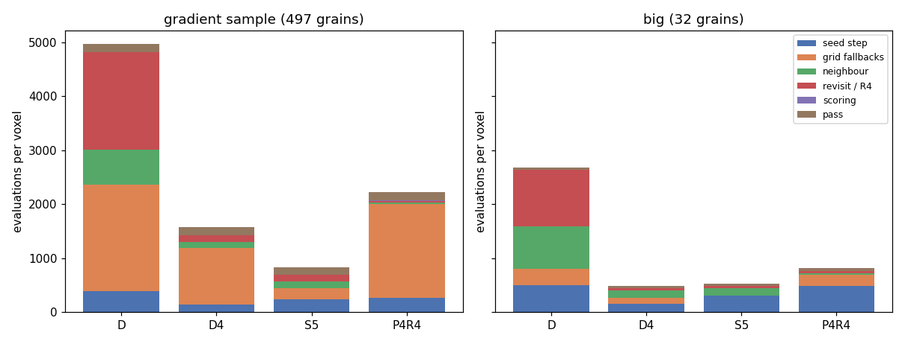
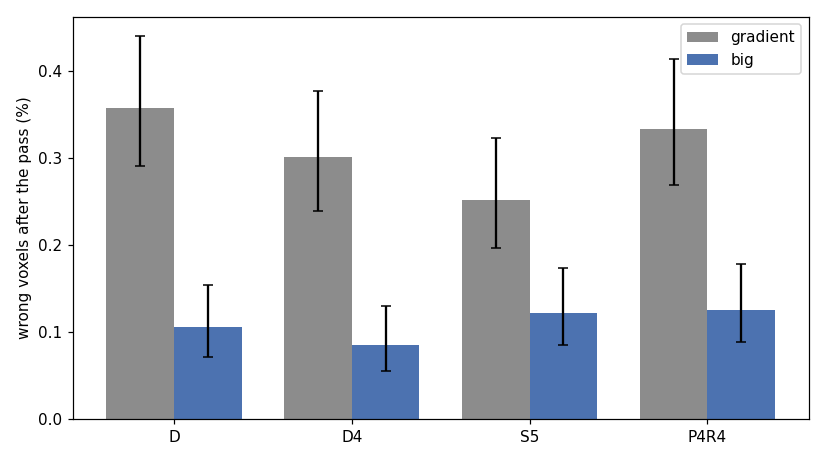

# AR3 step 7: the same pipelines on larger grains

Step 7 of "AR3" in `docs/autoresearch/PLAN.md`, task `ar3g`. No file under `icenine/` changed.
Scripts are in `scripts/autoresearch/ar3/` (`big_make_sample.py`, `big_stack_note.py`,
`big_seed_check.py`, `big_run.py`, `big_pass.py`, `big_errors.py`, `big_summary.py`). Results are
in `benchmarks/autoresearch/ar3/big/`. Every table below is filled from `tables.md` there.

**Scope.** One simulated sample, called `big`: 32 grains on the grid of step 3's gradient sample,
each grain with a small orientation gradient. One run of each pipeline, one voxel order. It does
not hold for a real sample. C++ was not run. No extra random seed was run. Counts carry a Wilson
95% interval; no p-values. A difference is a gain or a loss only when the intervals do not
overlap. Every wall time on this page was measured with other jobs running (contended) and is
not a timing result. The evaluation count is the cost that counts.

## The result in two pictures

Reading of the first picture: each bar is the mean number of evaluations per voxel for one
pipeline (calls of the strict cost, raw counts, the same counters as steps 3 to 6), with the
boundary pass included; the colours are the stages. Left: the
gradient sample of steps 3 to 6 (497 grains). Right: `big` (32 grains). The vertical axes are
shared. The grid fallbacks (orange) shrink on `big` for all four pipelines. The seed step (blue)
does not: per voxel it is higher on `big` for all four, and it is the largest part of the `S5`
bar.



Reading of the second picture: each bar is the share of wrong voxels after the pass (an error
above 1 degree), with its 95% interval. Grey: the gradient sample. Blue: `big`. On `big` every
pipeline has a lower share. The two samples differ in more than grain size (the levels differ),
so this is not a like-for-like comparison; the matched levels are in the section on wrong voxels.



## Short answers

1. **Do the pipelines cost less on `big`?** On `big` all four cost less than on the gradient
   sample. This is not credited to grain size alone: the two samples also differ in their
   levels and their orientations. With the pass, evaluations per voxel on `big` against the
   gradient sample: `D` 2,681 against 4,968 (65.87 million against 122.07 million), `D4` 486
   against 1,579 (11.94 against 38.81 million), `S5` 529 against 840 (13.00 against 20.63
   million), `P4R4` 812 against 2,221 (19.96 against 54.56 million).
2. **Does step 6's seed step still do no harm?** Wrong voxels after the pass: `S5` 30 of
   24,570 (0.09 to 0.17%), `D4` 21 (0.06 to 0.13%). The intervals overlap. By voxel, `S5`
   fixes 6 of `D4`'s 21 and breaks 15 (15 wrong in both). So there is no detectable difference
   in wrong voxels, and the raw count of `S5` (the count itself, without its interval) is
   higher.
3. **Is it cheaper than `D4`?** No, not here. `S5` with the pass costs 13.00 million
   evaluations, `D4` with the pass 11.94 million: 8.8% more. On the gradient sample `S5` cost
   20.63 million against 38.81 million. The grid fallbacks that `S5` removes were few on `big`
   (8 of 329 index runs in `D4`, 1.24 to 4.72%), and `S5` ran 20 more index runs than `D4`
   (see "Why `S5` is not cheaper than `D4` on `big`").
4. **What is the largest part of `S5` on `big`?** The seed step: 7.47 million of 13.00 million
   (57.5%). Local optimizations (neighbour and revisit) are 33.8%, the pass 8.7%. This is not
   what the plan expected (two of the three predictions below do not agree).
5. **Where are the reseeds?** 267 of the 349 seed steps of `S5` are in the 6 grains of level 4
   (the strongest gradient); 54 are in the 6 grains of level 2. The 5 grains with no gradient
   have 5 seed steps and no reseed. This is consistent with reseeds being needed where the
   orientation turns fast across the grain. It was not tested.

## Predictions written down before the runs

The page says for each whether the run agrees. The thresholds in the words "order of the
number of grains", "comes close" and "no higher" were fixed in `big_summary.py` before the
results were read: at most 3 times the 32 grains (96) reseeds; within 10%; no matched level
where the interval on `big` lies wholly above the interval on the gradient sample.

1. *Reseeds fall to the order of the number of grains, and the seed step and the grid
   fallbacks together take less than a tenth of the evaluations of `S5`.* **Does not agree.**
   `S5` has 314 reseeds on 32 grains (9.8 per grain; the gradient sample had 945 on 497, 1.9
   per grain). The seed step and grid fallbacks are 7,469,574 of 12,999,852 evaluations (57.5%).
   The reseeds did fall (314 against 945 on the same 24,570 voxels), by a factor of about 3,
   not to the number of grains.
2. *The cost of `S5` with the pass comes close to its local optimizations and pass alone, about
   390 evaluations per voxel on the gradient sample.* **Does not agree.** On `big` the whole
   costs 529.1 evaluations per voxel and the local optimizations and the pass alone 225.1: a
   ratio of 2.35. (On the gradient sample the same two numbers are 839.6 and 388.3.) The local
   optimizations and the pass are themselves cheaper per voxel on `big` (225.1, not about 390).
3. *At the levels with the same voxel-to-voxel change, the share of wrong voxels is no higher
   than on the gradient sample.* **Agrees**, judged first on the plan's two matched pairs:
   `big` level 2 against gradient level 0.5, and `big` level 4 against gradient level 1. For
   `S5` the counts are 4 of 4,700 against 13 of 4,625, and 25 of 4,184 against 48 of 5,539.
   Both pairs overlap, so neither interval on `big` lies above. In the raw counts the share on
   `big` is lower in both pairs. The other three pipelines agree on these two pairs too (at
   level 4 against 1 their intervals on `big` lie wholly below). Added beyond the plan: the
   pairs `big` 0.5 against 0.1 and `big` 1 against 0.2 (a factor of 5), and level 0 against 0.
   The plan calls 0.2 to 1 degree on `big` a gentler change, so these are not true matches,
   and a gentler change makes "no higher" easier to pass. They also agree. Each level holds 1
   to 9 grains (see the sample section), so each result is a result on those grains. How the
   levels are matched is in the section on wrong voxels.

## The sample and the checks

**Terms.** A **reseed** is a voxel the BFS (the breadth-first search that spreads from voxel to
voxel) cannot reach from a neighbour; it runs the seed step again. The **seed step** is: ray
indexing proposes candidate orientations and the best are refined. A **grid fallback** is a seed
step that fails the seed test (a hit ratio of at least 0.80), after which the full grid search
(a global search: no starting guess) runs. The **boundary pass** is step 5's pass, rule `hit`:
each voxel next to a neighbour with another orientation gets one local optimization from each
neighbour orientation, and the best end by hit ratio is kept. A **local optimization** is a fit
that starts from a guess. A **level** is the largest misorientation inside a grain from its
centre orientation, in degrees. **Error** is the symmetry-reduced misorientation to the voxel's
own true orientation; a voxel is **wrong** above 1 degree (the same threshold and function as
steps 5 and 6). **Fixed** and **broken** are counted against the baseline named second: fixed
is wrong in the baseline and right in the run; broken is the reverse. An **evaluation** is one
call of the strict cost (the share of predicted spots that miss lit pixels). The counts are raw
calls, not weighted by time, and they are the same counters as steps 3 to 6. Pairing (matching
the spots of the two detectors into rays) and indexing are not counted.

The sample. Each of the 24,570 voxels of the gradient sample's grid takes the orientation of
the voxel of `random_cubic_32grains.mic` (6,144 voxels, one size coarser) that holds its
centre. Checks (`big/gradient/sample/big_check.json`): all 24,570 voxels lie in exactly one
coarse voxel; there are 32 distinct orientations (33 to 430 coarse voxels each); the voxels
of one orientation form 32 connected sets, so there are 32 grains of 132 to 1,720 voxels (mean
768; the gradient sample has about 49). Gradients: `gradient_orientations` of step 3, seed 0,
one level per grain drawn uniformly from 0, 0.2, 0.5, 1, 2 and 4 degrees. That gave 5, 5, 1,
9, 6 and 6 grains (2,484, 4,112, 936, 8,154, 4,700 and 4,184 voxels). The measured spread
equals the level to 4.5e-5 degrees. The level 0.5 holds one grain only.

The images are clean, rendered with `render_full.py --mic` (tag `big`, 66 seconds, contended):
6,864,619 lit pixels in 18,814 spots (the gradient sample: 9,444,080 and 104,912). Fewer,
larger spots, consistent with larger grains. The packed stack has 6,864,619 non-zero pixels,
the render's count (`big/gradient/big_stack.json`). The sample and the images took a few
minutes of compute.

The seed-test check: at the true orientation, 200 voxels drawn with seed 0 all pass the seed
test on `big` (200 of 200; lowest hit ratio 0.956) and on the gradient sample (200 of 200;
lowest 0.961, read from step 3's stored Reading 0, so nothing was rerun there;
`big/seed_check.json`).

## Evaluations by stage

Reading of the table: one row per pipeline and sample, boundary pass included. The columns are
the mean evaluations per voxel in each stage; `revisit` holds the R4 fits for `P4R4`; `scoring`
is the paint run's scoring; `total_M` is the total in millions. `D` is the stock BFS with the
grid search, `D4` step 5's run (index seeds, CMA local optimization, grid fallback), `S5` `D4`
with step 6's seed step (refine the best 5 of 20 candidates), `P4R4` step 4's run (index the
layer, paint grains, CMA local optimization).

<!-- table:evals_per_voxel -->
| pipeline | sample | seed_step | grid_fallback | neighbour | revisit | scoring | pass_ | total | total_M |
|---|---|---|---|---|---|---|---|---|---|
| D | big | 497.8 | 310.1 | 778.6 | 1046.0 | 0.0 | 48.4 | 2681.0 | 65.87 |
| D | gradient | 397.1 | 1964.7 | 654.8 | 1800.2 | 0.0 | 151.4 | 4968.3 | 122.07 |
| D4 | big | 163.5 | 99.8 | 141.6 | 35.1 | 0.0 | 46.1 | 486.1 | 11.94 |
| D4 | gradient | 137.9 | 1051.4 | 114.7 | 125.7 | 0.0 | 149.7 | 1579.5 | 38.81 |
| S5 | big | 304.0 | 0.0 | 143.0 | 36.0 | 0.0 | 46.1 | 529.1 | 13.00 |
| S5 | gradient | 243.8 | 207.5 | 113.4 | 125.0 | 0.0 | 149.9 | 839.6 | 20.63 |
| P4R4 | big | 490.9 | 210.8 | 21.8 | 39.8 | 3.5 | 45.7 | 812.4 | 19.96 |
| P4R4 | gradient | 269.6 | 1729.5 | 29.5 | 37.1 | 5.6 | 149.4 | 2220.7 | 54.56 |
<!-- /table:evals_per_voxel -->

Reading of the table: counts of seeds, reseeds and grid fallbacks per run, and the wall time of
the run in minutes (the pass not included; contended, up to 4 jobs at once on `big`; the earlier
runs on the gradient sample were timed on other days with other jobs). `P4R4` does not reseed;
its `seeds` are grain entries; n/a means the run does not count it. No run hit its cap (180
minutes for `D`, 90 for the others).

<!-- table:counts -->
| pipeline | sample | seeds | reseeds | grid_fallbacks | wall_run_min |
|---|---|---|---|---|---|
| D | big | 52 | 1331 | 25 | 77.8 |
| D | gradient | 440 | 3415 | 142 | 156.2 |
| D4 | big | 38 | 291 | 8 | 16.2 |
| D4 | gradient | 344 | 954 | 76 | 52.1 |
| S5 | big | 35 | 314 | 0 | 17.1 |
| S5 | gradient | 348 | 945 | 15 | 30.9 |
| P4R4 | big | 1034 | n/a | n/a | 27.8 |
| P4R4 | gradient | 2535 | n/a | n/a | 76.7 |
<!-- /table:counts -->

Reading of the table: where the 13.00 million evaluations of `S5` with the pass go on `big`.

<!-- table:s5_split -->
| stage | evals | share_pct |
|---|---|---|
| seed_step | 7469574 | 57.5 |
| grid_fallback | 0 | 0.0 |
| neighbour | 3513895 | 27.0 |
| revisit | 884040 | 6.8 |
| pass_ | 1132343 | 8.7 |
| total | 12999852 | 100.0 |
<!-- /table:s5_split -->

## Why `S5` is not cheaper than `D4` on `big`

Reading of the table: the cost of one index run (the seed step's evaluations divided by the
number of index runs, in `D4` and in `S5`), how often `D4`'s seed step fails and goes to the grid
search, what one fallback costs, and the fallback rate at which `S5`'s dearer seed step breaks
even (extra evaluations per index run, divided by the cost of a fallback). The break-even rate
assumes that `S5` never falls back. This is arithmetic on the counters of two runs; it holds for
these two samples only.

<!-- table:seed_cost -->
| sample | index_runs_d4 | evals_per_index_run_d4 | evals_per_index_run_s5 | fallback_rate_d4 | evals_per_grid_fallback_d4 | break_even_pct |
|---|---|---|---|---|---|---|
| big | 329 | 12208 | 21403 | 8 of 329 (1.24 to 4.72%) | 306586 | 3.0 |
| gradient | 1298 | 2611 | 4633 | 76 of 1298 (4.70 to 7.27%) | 339914 | 0.6 |
<!-- /table:seed_cost -->

`S5`'s seed step costs 1.75 to 1.77 times `D4`'s per index run on the two samples. It pays when
`D4` falls back often. The break-even rate in the table assumes that `S5` never falls back. On
`big` that holds: `S5` fell back 0 times in 349 index runs (0.00 to 1.09%). On the gradient
sample it does not: `S5` fell back 15 times in 1,293 index runs (1.16%, interval 0.70 to
1.91%). One `S5` fallback there cost about the same as one `D4` fallback (339,890 against
339,914 evaluations). With `S5`'s own rate added, `D4`'s break-even rate on the gradient sample
is 1.75%, not 0.6%. `D4` fell back on 5.9% of its index runs there, above either value. On
`big` `D4` fell back on 2.4%, with a break-even of 3.0% that lies inside the interval of the
rate.

Added: the split of the difference on `big`. The seed step and the grid fallbacks of `S5` cost
7,469,574 evaluations, those of `D4` 6,469,147: 1,000,427 more in `S5`. `S5` also ran 20 more
index runs than `D4` (349 against 329: 314 against 291 reseeds, and 35 against 38 first
seeds). With the extra runs priced at `S5`'s cost per index run, the difference has three parts:

- +3.03 million: each of `D4`'s 329 index runs costs more in `S5`;
- -2.45 million: the 8 grid fallbacks of `D4` that `S5` did not need;
- +0.43 million: `S5`'s 20 extra index runs, about 43% of the 1.00 million.

The split depends on the pricing. Priced at `D4`'s cost per index run, the extra runs make
0.24 million (24%). Why `S5` needed 23 more reseeds than `D4` was not tested. So the higher
cost of `S5` on `big` is consistent with two things: too few grid fallbacks to repay the dearer
index run, and the extra reseeds. The fallback rate on `big` is too uncertain (8 fallbacks) to
say on which side of the break-even it lies.

An index run also costs 4.6 to 4.7 times as much on `big` as on the gradient sample, in both
`D4` and `S5`. Added, from `S5`'s seed log: the seed steps by the true level of the grain.
Reading of the tables: `seed_steps` is the number of seed steps (first seeds and reseeds) whose
voxel is in a grain of that level; `evals` their evaluations. First on `big`, then on the
gradient sample (levels 0, 0.1, 0.2, 0.5, 1).

<!-- table:seed_by_level -->
| level | grains | voxels | seed_steps | reseeds | per_1000_voxels | evals |
|---|---|---|---|---|---|---|
| 0 | 5 | 2484 | 5 | 0 | 2.0 | 42857 |
| 0.2 | 5 | 4112 | 5 | 0 | 1.2 | 69921 |
| 0.5 | 1 | 936 | 1 | 0 | 1.1 | 4799 |
| 1 | 9 | 8154 | 17 | 8 | 2.1 | 158602 |
| 2 | 6 | 4700 | 54 | 48 | 11.5 | 671323 |
| 4 | 6 | 4184 | 267 | 258 | 63.8 | 6522072 |
<!-- /table:seed_by_level -->

<!-- table:seed_by_level_gradient -->
| level | voxels | seed_steps | reseeds | per_1000_voxels | evals |
|---|---|---|---|---|---|
| 0 | 4877 | 101 | 30 | 20.7 | 382383 |
| 0.1 | 4488 | 82 | 22 | 18.3 | 323785 |
| 0.2 | 5041 | 112 | 42 | 22.2 | 436484 |
| 0.5 | 4625 | 237 | 168 | 51.2 | 1010712 |
| 1 | 5539 | 761 | 683 | 137.4 | 3837430 |
<!-- /table:seed_by_level_gradient -->

The cost of one seed step on `big` is `evals` divided by `seed_steps`. It is highest at level 4:
24,427 evaluations (6,522,072 over 267 seed steps). At the other levels it is 4,799 to 13,984:
level 0 8,571 (n = 5), level 0.2 13,984 (n = 5), level 0.5 4,799 (n = 1), level 1 9,330
(n = 17), level 2 12,432 (n = 54). It does not rise steadily with the level, and below level 4
the counts are small. At level 0 it is higher on `big` than on the gradient sample (8,571
against 3,786, which is 382,383 over 101). Why was not tested (this is a reading of two logs).

## Wrong voxels

Reading of the table: wrong voxels (an error above 1 degree) over all 24,570 voxels, before and
after the pass, on `big` and on the gradient sample (step 5 and 6's committed numbers for the
gradient sample).

<!-- table:wrong_all -->
| pipeline | big_before | big_after | gradient_before | gradient_after |
|---|---|---|---|---|
| D | 83 of 24570 (0.27 to 0.42%) | 26 of 24570 (0.07 to 0.16%) | 203 of 24570 (0.72 to 0.95%) | 88 of 24570 (0.29 to 0.44%) |
| D4 | 68 of 24570 (0.22 to 0.35%) | 21 of 24570 (0.06 to 0.13%) | 225 of 24570 (0.80 to 1.04%) | 74 of 24570 (0.24 to 0.38%) |
| S5 | 71 of 24570 (0.23 to 0.36%) | 30 of 24570 (0.09 to 0.17%) | 203 of 24570 (0.72 to 0.95%) | 62 of 24570 (0.20 to 0.32%) |
| P4R4 | 102 of 24570 (0.34 to 0.50%) | 31 of 24570 (0.09 to 0.18%) | 281 of 24570 (1.02 to 1.28%) | 82 of 24570 (0.27 to 0.41%) |
<!-- /table:wrong_all -->

Reading of the table: wrong voxels on `big` by level, before and after the pass. `grains` is the
number of grains at the level and `voxels` their voxels; `median_after_deg` is the median error
after the pass in degrees. Of `S5`'s 30 wrong voxels after the pass, 25 are in the 6 grains of
level 4 (`D4`: 17 of 21; `D`: 20 of 26; `P4R4`: 22 of 31).

<!-- table:wrong_level_big -->
| pipeline | level | grains | voxels | before | after | median_after_deg |
|---|---|---|---|---|---|---|
| D | 0 | 5 | 2484 | 6 of 2484 (0.11 to 0.53%) | 1 of 2484 (0.01 to 0.23%) | 0.0406 |
| D | 0.2 | 5 | 4112 | 7 of 4112 (0.08 to 0.35%) | 1 of 4112 (0.00 to 0.14%) | 0.0733 |
| D | 0.5 | 1 | 936 | 1 of 936 (0.02 to 0.60%) | 0 of 936 (0.00 to 0.41%) | 0.0947 |
| D | 1 | 9 | 8154 | 20 of 8154 (0.16 to 0.38%) | 3 of 8154 (0.01 to 0.11%) | 0.0846 |
| D | 2 | 6 | 4700 | 18 of 4700 (0.24 to 0.60%) | 1 of 4700 (0.00 to 0.12%) | 0.0818 |
| D | 4 | 6 | 4184 | 31 of 4184 (0.52 to 1.05%) | 20 of 4184 (0.31 to 0.74%) | 0.0580 |
| D4 | 0 | 5 | 2484 | 10 of 2484 (0.22 to 0.74%) | 0 of 2484 (0.00 to 0.15%) | 0.0165 |
| D4 | 0.2 | 5 | 4112 | 6 of 4112 (0.07 to 0.32%) | 0 of 4112 (0.00 to 0.09%) | 0.0272 |
| D4 | 0.5 | 1 | 936 | 0 of 936 (0.00 to 0.41%) | 0 of 936 (0.00 to 0.41%) | 0.0294 |
| D4 | 1 | 9 | 8154 | 6 of 8154 (0.03 to 0.16%) | 0 of 8154 (0.00 to 0.05%) | 0.0276 |
| D4 | 2 | 6 | 4700 | 20 of 4700 (0.28 to 0.66%) | 4 of 4700 (0.03 to 0.22%) | 0.0364 |
| D4 | 4 | 6 | 4184 | 26 of 4184 (0.42 to 0.91%) | 17 of 4184 (0.25 to 0.65%) | 0.0567 |
| S5 | 0 | 5 | 2484 | 12 of 2484 (0.28 to 0.84%) | 0 of 2484 (0.00 to 0.15%) | 0.0165 |
| S5 | 0.2 | 5 | 4112 | 5 of 4112 (0.05 to 0.28%) | 0 of 4112 (0.00 to 0.09%) | 0.0277 |
| S5 | 0.5 | 1 | 936 | 0 of 936 (0.00 to 0.41%) | 0 of 936 (0.00 to 0.41%) | 0.0294 |
| S5 | 1 | 9 | 8154 | 7 of 8154 (0.04 to 0.18%) | 1 of 8154 (0.00 to 0.07%) | 0.0277 |
| S5 | 2 | 6 | 4700 | 20 of 4700 (0.28 to 0.66%) | 4 of 4700 (0.03 to 0.22%) | 0.0361 |
| S5 | 4 | 6 | 4184 | 27 of 4184 (0.44 to 0.94%) | 25 of 4184 (0.41 to 0.88%) | 0.0572 |
| P4R4 | 0 | 5 | 2484 | 6 of 2484 (0.11 to 0.53%) | 0 of 2484 (0.00 to 0.15%) | 0.0165 |
| P4R4 | 0.2 | 5 | 4112 | 6 of 4112 (0.07 to 0.32%) | 0 of 4112 (0.00 to 0.09%) | 0.0300 |
| P4R4 | 0.5 | 1 | 936 | 2 of 936 (0.06 to 0.78%) | 0 of 936 (0.00 to 0.41%) | 0.0304 |
| P4R4 | 1 | 9 | 8154 | 25 of 8154 (0.21 to 0.45%) | 3 of 8154 (0.01 to 0.11%) | 0.0285 |
| P4R4 | 2 | 6 | 4700 | 26 of 4700 (0.38 to 0.81%) | 6 of 4700 (0.06 to 0.28%) | 0.0315 |
| P4R4 | 4 | 6 | 4184 | 37 of 4184 (0.64 to 1.22%) | 22 of 4184 (0.35 to 0.79%) | 0.0415 |
<!-- /table:wrong_level_big -->

How the levels are matched (prediction 3). A grain here is about 4 times wider than in the
gradient sample, so the same voxel-to-voxel change needs a level about 4 times higher. The
plan's matched pairs are the `big` levels 2 and 4 against the gradient levels 0.5 and 1
(factor 4); prediction 3 is judged on these first. Added beyond the plan: the `big` levels 0.5
and 1 against 0.1 and 0.2 (factor 5, a gentler change on `big`, so not a true match), and the
level 0 against 0. The level 0.2 has no match (gentler than any). The width factor was taken
from the plan; the voxel-to-voxel change itself was not measured.

Reading of the table: the share wrong after the pass at each matched pair of levels, with the
"reading" of the two intervals (overlap, or one wholly below the other). `big_level` and
`gradient_level` are the matched levels.

<!-- table:matched -->
| pipeline | big_level | big_after | gradient_level | gradient_after | reading |
|---|---|---|---|---|---|
| D | 0 | 1 of 2484 (0.01 to 0.23%) | 0 | 0 of 4877 (0.00 to 0.08%) | overlap |
| D | 0.5 | 0 of 936 (0.00 to 0.41%) | 0.1 | 6 of 4488 (0.06 to 0.29%) | overlap |
| D | 1 | 3 of 8154 (0.01 to 0.11%) | 0.2 | 11 of 5041 (0.12 to 0.39%) | lower (intervals do not overlap) |
| D | 2 | 1 of 4700 (0.00 to 0.12%) | 0.5 | 10 of 4625 (0.12 to 0.40%) | overlap |
| D | 4 | 20 of 4184 (0.31 to 0.74%) | 1 | 61 of 5539 (0.86 to 1.41%) | lower (intervals do not overlap) |
| D4 | 0 | 0 of 2484 (0.00 to 0.15%) | 0 | 0 of 4877 (0.00 to 0.08%) | overlap |
| D4 | 0.5 | 0 of 936 (0.00 to 0.41%) | 0.1 | 0 of 4488 (0.00 to 0.09%) | overlap |
| D4 | 1 | 0 of 8154 (0.00 to 0.05%) | 0.2 | 2 of 5041 (0.01 to 0.14%) | overlap |
| D4 | 2 | 4 of 4700 (0.03 to 0.22%) | 0.5 | 9 of 4625 (0.10 to 0.37%) | overlap |
| D4 | 4 | 17 of 4184 (0.25 to 0.65%) | 1 | 63 of 5539 (0.89 to 1.45%) | lower (intervals do not overlap) |
| S5 | 0 | 0 of 2484 (0.00 to 0.15%) | 0 | 0 of 4877 (0.00 to 0.08%) | overlap |
| S5 | 0.5 | 0 of 936 (0.00 to 0.41%) | 0.1 | 0 of 4488 (0.00 to 0.09%) | overlap |
| S5 | 1 | 1 of 8154 (0.00 to 0.07%) | 0.2 | 1 of 5041 (0.00 to 0.11%) | overlap |
| S5 | 2 | 4 of 4700 (0.03 to 0.22%) | 0.5 | 13 of 4625 (0.16 to 0.48%) | overlap |
| S5 | 4 | 25 of 4184 (0.41 to 0.88%) | 1 | 48 of 5539 (0.65 to 1.15%) | overlap |
| P4R4 | 0 | 0 of 2484 (0.00 to 0.15%) | 0 | 0 of 4877 (0.00 to 0.08%) | overlap |
| P4R4 | 0.5 | 0 of 936 (0.00 to 0.41%) | 0.1 | 0 of 4488 (0.00 to 0.09%) | overlap |
| P4R4 | 1 | 3 of 8154 (0.01 to 0.11%) | 0.2 | 1 of 5041 (0.00 to 0.11%) | overlap |
| P4R4 | 2 | 6 of 4700 (0.06 to 0.28%) | 0.5 | 9 of 4625 (0.10 to 0.37%) | overlap |
| P4R4 | 4 | 22 of 4184 (0.35 to 0.79%) | 1 | 72 of 5539 (1.03 to 1.63%) | lower (intervals do not overlap) |
<!-- /table:matched -->

Reading of the table: paired counts by voxel, with the pass on both sides unless the row says
`before`. The pair is run against baseline; `wrong_a` and `wrong_b` are the wrong counts of the
run and of the baseline; `fixed` is wrong in the baseline and right in the run; `broken` is the
reverse; `both_wrong` is wrong in both.

<!-- table:paired -->
| pair | wrong_a | wrong_b | fixed | broken | both_wrong |
|---|---|---|---|---|---|
| S5 vs D4 after | 30 | 21 | 6 | 15 | 15 |
| S5 vs D4 before | 71 | 68 | 5 | 8 | 63 |
| S5 vs D after | 30 | 26 | 12 | 16 | 14 |
| S5 vs D before | 71 | 83 | 40 | 28 | 43 |
| P4R4 vs S5 after | 31 | 30 | 11 | 12 | 19 |
| P4R4 vs S5 before | 102 | 71 | 20 | 51 | 51 |
<!-- /table:paired -->

`S5` against `D4` after the pass: 30 against 21 wrong, 6 fixed, 15 broken. `S5` against `D`: 30
against 26, 12 fixed, 16 broken. `P4R4` against `S5`: 31 against 30, 11 fixed, 12 broken. The
intervals overlap in each pair. Before the pass `P4R4` has more wrong voxels in the raw count
(102 against 71, 20 fixed and 51 broken), but the intervals overlap narrowly (0.34 to 0.50%
against 0.23 to 0.36%), so this is not called a loss. After the pass the counts are 31 against
30. The pass itself costs 1.12 to 1.19 million evaluations on
`big` (46 to 48 per voxel), for 10,999 to 11,478 boundary voxels, and about 2 minutes (contended).

## What the result decides

The plan says: if `S5` with the pass has no more wrong voxels than `D4` with the pass (intervals)
at fewer or equal evaluations, the opt-in keys step uses step 6's seed step; if it has more
wrong voxels, it uses `D4`'s.

On `big`, the first condition holds (30 against 21, intervals overlap) and the second does not
(13.00 against 11.94 million, 8.8% more). Neither branch covers this result. The facts for the
owner: on the gradient sample `S5` saves 47% of the evaluations of `D4` (20.63 against 38.81
million) with 62 against 74 wrong; on `big` it costs 8.8% more with 30 against 21 wrong (point
counts, intervals overlap in both). Which seed step the keys step uses is the owner's decision.
Both samples are simulated; the break-even above shows that the result depends on how often the
grid search is needed, which this study measured on two samples only.

The plan's other branch: if the seed step and grid fallbacks are a small part on `big`, the next
target is the local optimization and the pass. They are not small: the seed step is 57.5% of
`S5` (and, with the grid fallbacks, 54% of `D4`: 6,469,147 of 11,943,692 evaluations). On
`big` the next target is therefore the seed step itself, in particular the reseeds in the
grains with strong gradients (267 of 349 seed steps in 6 grains).

## How to reproduce

From `icenine_py/`. The summary needs only files in git:

```
uv run python scripts/autoresearch/ar3/big_summary.py
uv run python ../scripts/dev/sync_doc_tables.py --doc docs/autoresearch/findings_ar3_big.md \
  --tables benchmarks/autoresearch/ar3/big/tables.md
```

The full run needs files that are not in git. The sample's `.mic` files (6.5 MB each), the
images and the image stack (`ScatteringData_PhaseD/big/`, `stacks/big_clean.npy`), the full run
folders, the maps and the pass cache live in the worktree of this task (under
`.claude/worktrees/`; transient). The scripts switch to `big` with the environment variable
`AR3_SAMPLE=big` (`ar3_common.py`, `gradient_common.py`; unset, every earlier script behaves as
before). In order:

```
AR3_SAMPLE=big uv run python scripts/autoresearch/ar3/big_make_sample.py
uv run python scripts/phase_d/render_full.py --tag big --workers 6 --variants clean \
  --mic <absolute path of big/gradient/sample/gradient_truth.mic>
AR3_SAMPLE=big uv run python scripts/autoresearch/ar3/big_stack_note.py --build
AR3_SAMPLE=big uv run python scripts/autoresearch/ar3/big_seed_check.py
uv run python scripts/autoresearch/ar3/big_run.py --kind D      # also D4, S5, P4 (caps in file)
gzip -n benchmarks/autoresearch/ar3/big/fine/runs/P4/recon.mic  # the pass reads the .gz
uv run python scripts/autoresearch/ar3/big_pass.py --kind D     # also D4, S5, P4R4
uv run python scripts/autoresearch/ar3/big_errors.py
uv run python scripts/autoresearch/ar3/big_summary.py --slim
```

## Deviations from the plan

- The plan's smoke run ("a `--limit` of a few hundred voxels") was run with `--smoke 300`. For
  the BFS runs this does not limit the work: the BFS flooded the layer from its first voxels. I
  stopped those smoke runs after about 13 minutes (a path check, which they passed) and started
  the real runs. The paint run's smoke finished (300 voxels).
- The boundary passes ran as soon as each run finished, while the others were still running (at
  most 4 heavy processes at once, within the limit of 6), not after all four runs.
- `pass.json` says "side by side" with the number given by `--side-by-side`; that number counts
  the jobs that ran at the time, not four passes together.
- The plan's matched pairs are only `big` 2 against 0.5 and 4 against 1 (its 0.4 is not a
  level). The pairs 0.5 against 0.1 and 1 against 0.2 (a factor of 5, a gentler change) and 0
  against 0 were added; they were fixed in `big_summary.py` before the first whole-layer run
  ended.
  Prediction 3 is judged on the plan's two pairs first.
- Added beyond the plan (marked as added in the text): seed steps by level, the cost of an
  index run and the break-even rate, and the thresholds for "order of", "comes close" and "no
  higher" in the predictions.
- Not committed (over the 5 MB budget, or a home path): the sample `.mic` files (they can be
  made again; the sha256 is in `sample.json`), the timing preflight JSON files (they hold a
  home path; the timing label in each `run.json` names the busy program), the run maps
  and the full run records.

## Limits and not claimed

- That C++ behaves the same. That the gradient model, or these levels, match a real sample.
- That 32 grains stand for all large-grained samples: it is one sample and one run each.
- A tested wall time: the timing preflight was refused in every run (another program at about
  100% CPU), and several jobs ran at once.
- A cause for the reseeds, or for the higher cost of an index run on `big`: both are
  "consistent with" the levels and untested.
- A change of any default, or a decision on the keys step.

## What comes after

The keys step needs the owner's decision on the seed step (above). On `big` the seed step is
the largest stage of `S5` and `D4`; a study of why the BFS needs reseeds in the strongest-gradient
grains, and of what makes an index run dearer there, is the next measurement.
