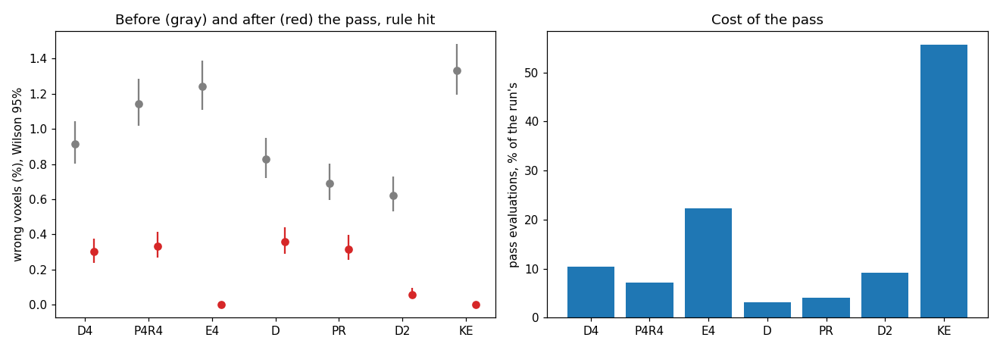

# AR3 step 5: neighbouring grains compete for the boundary voxels

Step 5 of "AR3" in `docs/autoresearch/PLAN.md`, task `ar3e`. No file under `icenine/` changed.
Scripts are in `scripts/autoresearch/ar3/` (`boundary_common.py`, `boundary_part0.py`,
`boundary_check.py`, `boundary_pass.py`, `boundary_lib.py`, `boundary_summary.py`,
`boundary_ratio.py`, `run_keys.py`, `keys_bg.py`). Results are in
`benchmarks/autoresearch/ar3/boundary/`. Every table below is filled from `tables.md` there.

**Scope.** Every result holds for the simulated linear-gradient sample of step 3 and for step 2's
one-orientation-per-grain sample. It does not hold for a real sample. C++ was not run. Each map is
one run with one voxel order. Each pass uses one generator state (`default_rng(0)`). No extra seed
was run. A difference is a gain or a loss only when the Wilson 95% intervals do not overlap.
All wall times come from a busy machine (several heavy processes at once, and the machine slept
during some runs, see "Deviations"). The evaluation count is the cost that counts here.

## Terms

- **Neighbours** of a voxel are the voxels the reconstructor's own relation gives
  (`mic.get_neighbors` within twice the voxel side).
- A **boundary voxel** has at least one neighbour whose orientation in the map differs from its own
  by more than 0.5 degrees (symmetry-reduced). Its **candidates** are those neighbours'
  orientations, with candidates within 0.5 degrees of each other counted once.
- A **try** is one CMA fit (first step 0.05 degrees, at most 60 evaluations plus the final one, so
  61) at the voxel, started from a candidate. The **pass** makes every try of every boundary
  voxel. Candidates are read from the map as it was before the pass.
- A **keep rule** decides between the old end and the ends of the tries. `cost`: the lowest strict
  cost. `hit`: the highest hit ratio (a tie: the lowest cost). `conf`: the highest confidence (a
  tie: the lowest cost). On every tie the old end wins.
- **Error**, **wrong** (error above 1 degree), **level** (the grain's gradient size),
  **set A** (grains with an even id, the pick set) and **set B** (odd ids, the test set) are as in
  step 3. **Fixed** is wrong before and right after; **broken** is right before and wrong after.
- The six maps: `D4`, `P4R4` (P4 plus R4) and `E4` are step 4's runs. `D`, `PR` (P plus R) and
  `D2` are the runs they were compared with (step 3's D, step 3's P plus R, step 2's D).

## Lead

The pass works on all six maps with the `hit` rule: a voxel that passed from the wrong side of a
boundary is tried again from the right side.
It cuts the wrong voxels of the three step 4 runs from 225, 281 and 305 to 74, 82 and 0. It costs
3.0 to 3.7 million evaluations, 7 to 22% of the step 4 runs. D4 plus the pass has fewer wrong
voxels than step 3's D (74 against 203, intervals do not overlap) with 38.8 million evaluations
against 118.4 million. But the same pass on step 3's runs also fixes them (88 and 78 wrong), so
against "the compared run plus the pass" the pipeline is no gain and no loss on D4 and P4R4.
Only on step 2's sample is it a gain on both sides (0 against 14 wrong). A skip rule that uses
only the hit ratios of the map skips 92% of the tries and loses no voxel the pass fixed on A, and
1 of 313 on B. The two whole-layer runs with the library keys: `KE` finished (5.4 million
evaluations against 13.6 million for `E4`; 0 wrong after the pass). `K` did not finish within its
cap of 60 minutes of awake time, so it has no map and no pass.

One caveat comes before everything else. In these samples a grain is about 50 voxels, so 94% of
the voxels are boundary voxels (see part 0). The pass is not aimed at a few voxels here; it is a
second look at nearly every voxel. How well a boundary-only pass works on a sample with large
grains is not tested.

## Part 0: can the pass work at all? (records and single scores, no search)

Reading. For each map: the boundary voxels, the candidates, the wrong voxels, how many wrong voxels
have a candidate within 1 degree of the truth (`wrong_cand1`), and on how many of the wrong voxels
the true orientation beats the voxel's end: `tr_cost` lower cost, `tr_hit` higher hit ratio,
`tr_conf` higher confidence (one strict score each). `newly` is the wrong voxels of a step 4 map
that were right in the map it was compared with; `newly_both` is those with a candidate within 1
degree of the truth and a truth that scores better on at least one of the three. The truth is used
here and in the scoring only.

<!-- table:ar3e_part0 -->
| map | boundary | cands | wrong | wrong_cand1 | tr_cost | tr_hit | tr_conf | newly | newly_both |
|---|---|---|---|---|---|---|---|---|---|
| D4 | 23,121 | 60,290 | 225 | 225 | 225 | 225 | 46 | 108 | 108 |
| P4R4 | 23,109 | 60,180 | 281 | 281 | 281 | 281 | 67 | 134 | 134 |
| E4 | 22,875 | 49,601 | 305 | 305 | 302 | 305 | 73 | 170 | 170 |
| D | 23,181 | 60,982 | 203 | 203 | 202 | 203 | 66 | 0 | 0 |
| PR | 23,183 | 61,031 | 170 | 170 | 168 | 170 | 44 | 0 | 0 |
| D2 | 22,956 | 50,009 | 153 | 153 | 152 | 153 | 38 | 0 | 0 |
<!-- /table:ar3e_part0 -->

**Gate.** 412 of 412 newly wrong voxels (108 in D4, 134 in P4R4, 170 in E4) meet both conditions.
The gate is passed (stop if fewer than half). Two readings keep this honest. First, a candidate
within 1 degree of the truth is almost guaranteed when 94% of the voxels are boundary voxels with
2.6 candidates each, so that half of the test says little. Second, the truth beats the end on the
hit ratio for every wrong voxel and on the cost for all but a few (3 of 305 in E4); the confidence
does not (it beats the end on 38 to 73 voxels per map). Every wrong voxel in every map is a
boundary voxel.

**Practical check.** One try reproduced a fit of step 4's run C on 200 of 200 voxels (same end
orientation rounded to 9 digits as stored, same evaluation count), and a strict re-score of
each end gave the same cost as the try returned (`check_try.json`).

**C++.** `BreadthFirstReconstructor.tmpl.cpp` `Fit()` fits a neighbour once (`LocalOptimization`)
and accepts it when its pixel overlap ratio over the running best is above 0.9. `InsertSeed`
queues only `NOT_VISITED` neighbours and `Pop` drops `FITTED` ones, so an accepted voxel is not
fitted again from the other side. The "keep the higher confidence" rule is `Push` in
`ReconstructionStrategies.tmpl.cpp`: when a voxel that already has a fit status gets a result, the
new result replaces it if its `fConfidence` (the peak overlap ratio) is at least the old one. In
the Python port the same holds for revisited `REFIT` voxels. Neither C++ nor the port tries an
accepted voxel from the other side, so the pass is not a port of something C++ does. The C++
program was not run.

## Part 1: the pass on the stored maps

### The pick

The pick is made on A over the three step 4 maps together: the rule with the fewest wrong voxels
after the pass, then, among rules whose intervals overlap with that one, the fewest voxels
changed. `hit` has the fewest wrong voxels on A (76 of 37,158); the intervals of `cost` (116) and
`conf` (4,634) do not overlap with it. So **`hit` is the pick**. On B, `hit` has 80 wrong of
36,552, `cost` 102, `conf` 4,139. The `conf` rule breaks thousands of right voxels (4,445 on A). I
did not test why. It is consistent with the confidence (a peak count) being a poor measure of
which end is better, but that is untested.

Reading. Left: the share of wrong voxels per map before (gray) and after (red) the pass with the
`hit` rule, with Wilson 95% intervals. Right: evaluations of the pass as a share of the evaluations
of the run that made the map. `KE` is the run with the library keys (part 2).

Reading of the table: rows are set A and set B, pooled over D4, P4R4 and E4. `changed` is the
voxels that took the end of a try.

<!-- table:ar3e_rules -->
| set | rule | wrong | changed | fixed | broken |
|---|---|---|---|---|---|
| A | cost | 116 of 37158 (0.26 to 0.37%) | 732 | 336 | 23 |
| A | hit | 76 of 37158 (0.16 to 0.26%) | 733 | 360 | 7 |
| A | conf | 4634 of 37158 (12.1 to 12.8%) | 5193 | 240 | 4445 |
| B | cost | 102 of 36552 (0.23 to 0.34%) | 855 | 304 | 24 |
| B | hit | 80 of 36552 (0.18 to 0.27%) | 861 | 313 | 11 |
| B | conf | 4139 of 36552 (11.0 to 11.7%) | 4869 | 215 | 3972 |
<!-- /table:ar3e_rules -->

### Reading 1: boundary voxels, tries, evaluations

Reading. `boundary` is the number of boundary voxels, `tries` the number of tries, `evals_pass` the
evaluations of the tries, `evals_run` those of the run that made the map (with the refine stage
for P4R4 and PR), `share` the ratio. The one strict score of each voxel's old end (24,570 per map)
is not counted, as the run already has that value from its own fit.

<!-- table:ar3e_pass -->
| map | boundary | tries | evals_pass | evals_run | share |
|---|---|---|---|---|---|
| D4 | 23,121 | 60,290 | 3,677,690 | 35,129,496 | 10.5% |
| P4R4 | 23,109 | 60,180 | 3,670,980 | 50,892,696 | 7.2% |
| E4 | 22,875 | 49,601 | 3,025,661 | 13,608,181 | 22.2% |
| D | 23,181 | 60,982 | 3,719,902 | 118,350,225 | 3.1% |
| PR | 23,183 | 61,031 | 3,722,891 | 90,985,770 | 4.1% |
| D2 | 22,956 | 50,009 | 3,050,549 | 33,040,126 | 9.2% |
| KE | 22,869 | 49,555 | 3,022,855 | 5,431,381 | 55.7% |
<!-- /table:ar3e_pass -->

### Reading 2: voxels changed, paired against the map before the pass

Reading. `changed` voxels took a try's end; `moved_gt01` moved by more than 0.1 degrees. The last
three columns split the voxels by wrong before and after.

<!-- table:ar3e_paired -->
| map | wrong_before | wrong_after | changed | moved_gt01 | fixed | broken | both_wrong |
|---|---|---|---|---|---|---|---|
| D4 | 225 | 74 | 739 | 493 | 164 | 13 | 61 |
| P4R4 | 281 | 82 | 550 | 423 | 204 | 5 | 77 |
| E4 | 305 | 0 | 305 | 305 | 305 | 0 | 0 |
| D | 203 | 88 | 1027 | 835 | 145 | 30 | 58 |
| PR | 170 | 78 | 932 | 718 | 107 | 15 | 63 |
| D2 | 153 | 14 | 167 | 167 | 153 | 14 | 0 |
| KE | 327 | 0 | 327 | 327 | 327 | 0 | 0 |
<!-- /table:ar3e_paired -->

The other two rules, per map, in the same terms:

<!-- table:ar3e_other_rules -->
| map | rule | wrong_after | changed | fixed | broken |
|---|---|---|---|---|---|
| D4 | cost | 106 | 740 | 150 | 31 |
| D4 | conf | 2810 | 3538 | 119 | 2704 |
| P4R4 | cost | 99 | 537 | 189 | 7 |
| P4R4 | conf | 2738 | 3189 | 133 | 2590 |
| E4 | cost | 13 | 310 | 301 | 9 |
| E4 | conf | 3225 | 3335 | 203 | 3123 |
| D | cost | 134 | 1045 | 136 | 67 |
| D | conf | 3426 | 4342 | 101 | 3324 |
| PR | cost | 117 | 912 | 94 | 41 |
| PR | conf | 2959 | 3720 | 63 | 2852 |
| D2 | cost | 85 | 224 | 146 | 78 |
| D2 | conf | 3855 | 3899 | 94 | 3796 |
| KE | cost | 5 | 326 | 324 | 2 |
| KE | conf | 3043 | 3204 | 240 | 2956 |
<!-- /table:ar3e_other_rules -->

### Reading 3: error before and after, all voxels and by level

Reading. `wrong` is the voxels above 1 degree and `gt01` those above 0.1 degrees, each with a
Wilson interval. `median` and `p95` are the error in degrees.

<!-- table:ar3e_error -->
| map | group | when | n | wrong | gt01 | median | p95 |
|---|---|---|---|---|---|---|---|
| D4 | all | before | 24,570 | 225 of 24570 (0.8 to 1.0%) | 1458 of 24570 (5.6 to 6.2%) | 0.0229 | 0.110 |
| D4 | all | after | 24,570 | 74 of 24570 (0.24 to 0.38%) | 1122 of 24570 (4.3 to 4.8%) | 0.0227 | 0.096 |
| P4R4 | all | before | 24,570 | 281 of 24570 (1.0 to 1.3%) | 1140 of 24570 (4.4 to 4.9%) | 0.0208 | 0.096 |
| P4R4 | all | after | 24,570 | 82 of 24570 (0.27 to 0.41%) | 796 of 24570 (3.0 to 3.5%) | 0.0206 | 0.082 |
| E4 | all | before | 24,570 | 305 of 24570 (1.1 to 1.4%) | 334 of 24570 (1.2 to 1.5%) | 0.0131 | 0.044 |
| E4 | all | after | 24,570 | 0 of 24570 (0.00 to 0.02%) | 29 of 24570 (0.08 to 0.17%) | 0.0129 | 0.040 |
| D | all | before | 24,570 | 203 of 24570 (0.72 to 0.95%) | 3545 of 24570 (14.0 to 14.9%) | 0.0427 | 0.146 |
| D | all | after | 24,570 | 88 of 24570 (0.29 to 0.44%) | 2983 of 24570 (11.7 to 12.6%) | 0.0416 | 0.132 |
| PR | all | before | 24,570 | 170 of 24570 (0.60 to 0.80%) | 2531 of 24570 (9.9 to 10.7%) | 0.0342 | 0.130 |
| PR | all | after | 24,570 | 78 of 24570 (0.25 to 0.40%) | 2013 of 24570 (7.9 to 8.5%) | 0.0338 | 0.117 |
| D2 | all | before | 24,570 | 153 of 24570 (0.53 to 0.73%) | 326 of 24570 (1.2 to 1.5%) | 0.0206 | 0.057 |
| D2 | all | after | 24,570 | 14 of 24570 (0.03 to 0.10%) | 186 of 24570 (0.66 to 0.87%) | 0.0204 | 0.056 |
| KE | all | before | 24,570 | 327 of 24570 (1.2 to 1.5%) | 352 of 24570 (1.3 to 1.6%) | 0.0110 | 0.039 |
| KE | all | after | 24,570 | 0 of 24570 (0.00 to 0.02%) | 25 of 24570 (0.07 to 0.15%) | 0.0107 | 0.036 |
<!-- /table:ar3e_error -->

By level (the gradient sample only; the step 2 sample has one orientation per grain):

<!-- table:ar3e_level -->
| map | group | when | n | wrong | gt01 | median | p95 |
|---|---|---|---|---|---|---|---|
| D4 | level 0 | before | 4,877 | 30 of 4877 (0.43 to 0.88%) | 30 of 4877 (0.43 to 0.88%) | 0.0136 | 0.042 |
| D4 | level 0 | after | 4,877 | 0 of 4877 (0.00 to 0.08%) | 0 of 4877 (0.00 to 0.08%) | 0.0134 | 0.038 |
| D4 | level 0.1 | before | 4,488 | 19 of 4488 (0.27 to 0.66%) | 26 of 4488 (0.40 to 0.85%) | 0.0182 | 0.051 |
| D4 | level 0.1 | after | 4,488 | 0 of 4488 (0.00 to 0.09%) | 7 of 4488 (0.08 to 0.32%) | 0.0182 | 0.050 |
| D4 | level 0.2 | before | 5,041 | 46 of 5041 (0.7 to 1.2%) | 74 of 5041 (1.2 to 1.8%) | 0.0201 | 0.060 |
| D4 | level 0.2 | after | 5,041 | 2 of 5041 (0.01 to 0.14%) | 30 of 5041 (0.42 to 0.85%) | 0.0200 | 0.057 |
| D4 | level 0.5 | before | 4,625 | 43 of 4625 (0.7 to 1.2%) | 282 of 4625 (5.4 to 6.8%) | 0.0323 | 0.108 |
| D4 | level 0.5 | after | 4,625 | 9 of 4625 (0.10 to 0.37%) | 246 of 4625 (4.7 to 6.0%) | 0.0320 | 0.102 |
| D4 | level 1 | before | 5,539 | 87 of 5539 (1.3 to 1.9%) | 1046 of 5539 (17.9 to 19.9%) | 0.0492 | 0.183 |
| D4 | level 1 | after | 5,539 | 63 of 5539 (0.9 to 1.5%) | 839 of 5539 (14.2 to 16.1%) | 0.0464 | 0.162 |
| P4R4 | level 0 | before | 4,877 | 3 of 4877 (0.02 to 0.18%) | 3 of 4877 (0.02 to 0.18%) | 0.0114 | 0.040 |
| P4R4 | level 0 | after | 4,877 | 0 of 4877 (0.00 to 0.08%) | 0 of 4877 (0.00 to 0.08%) | 0.0114 | 0.040 |
| P4R4 | level 0.1 | before | 4,488 | 25 of 4488 (0.38 to 0.82%) | 38 of 4488 (0.6 to 1.2%) | 0.0189 | 0.052 |
| P4R4 | level 0.1 | after | 4,488 | 0 of 4488 (0.00 to 0.09%) | 13 of 4488 (0.17 to 0.49%) | 0.0187 | 0.051 |
| P4R4 | level 0.2 | before | 5,041 | 56 of 5041 (0.9 to 1.4%) | 89 of 5041 (1.4 to 2.2%) | 0.0201 | 0.061 |
| P4R4 | level 0.2 | after | 5,041 | 1 of 5041 (0.00 to 0.11%) | 35 of 5041 (0.50 to 0.96%) | 0.0199 | 0.057 |
| P4R4 | level 0.5 | before | 4,625 | 71 of 4625 (1.2 to 1.9%) | 226 of 4625 (4.3 to 5.5%) | 0.0269 | 0.097 |
| P4R4 | level 0.5 | after | 4,625 | 9 of 4625 (0.10 to 0.37%) | 161 of 4625 (3.0 to 4.0%) | 0.0265 | 0.088 |
| P4R4 | level 1 | before | 5,539 | 126 of 5539 (1.9 to 2.7%) | 784 of 5539 (13.3 to 15.1%) | 0.0346 | 0.184 |
| P4R4 | level 1 | after | 5,539 | 72 of 5539 (1.0 to 1.6%) | 587 of 5539 (9.8 to 11.4%) | 0.0335 | 0.145 |
| D | level 0 | before | 4,877 | 17 of 4877 (0.22 to 0.56%) | 17 of 4877 (0.22 to 0.56%) | 0.0169 | 0.055 |
| D | level 0 | after | 4,877 | 0 of 4877 (0.00 to 0.08%) | 0 of 4877 (0.00 to 0.08%) | 0.0169 | 0.055 |
| D | level 0.1 | before | 4,488 | 23 of 4488 (0.34 to 0.77%) | 179 of 4488 (3.5 to 4.6%) | 0.0436 | 0.096 |
| D | level 0.1 | after | 4,488 | 6 of 4488 (0.06 to 0.29%) | 161 of 4488 (3.1 to 4.2%) | 0.0432 | 0.095 |
| D | level 0.2 | before | 5,041 | 38 of 5041 (0.5 to 1.0%) | 554 of 5041 (10.2 to 11.9%) | 0.0533 | 0.117 |
| D | level 0.2 | after | 5,041 | 11 of 5041 (0.12 to 0.39%) | 526 of 5041 (9.6 to 11.3%) | 0.0528 | 0.115 |
| D | level 0.5 | before | 4,625 | 47 of 4625 (0.8 to 1.3%) | 1251 of 4625 (25.8 to 28.3%) | 0.0665 | 0.162 |
| D | level 0.5 | after | 4,625 | 10 of 4625 (0.12 to 0.40%) | 1141 of 4625 (23.4 to 25.9%) | 0.0641 | 0.153 |
| D | level 1 | before | 5,539 | 78 of 5539 (1.1 to 1.8%) | 1544 of 5539 (26.7 to 29.1%) | 0.0535 | 0.196 |
| D | level 1 | after | 5,539 | 61 of 5539 (0.9 to 1.4%) | 1155 of 5539 (19.8 to 21.9%) | 0.0469 | 0.171 |
| PR | level 0 | before | 4,877 | 3 of 4877 (0.02 to 0.18%) | 3 of 4877 (0.02 to 0.18%) | 0.0161 | 0.052 |
| PR | level 0 | after | 4,877 | 0 of 4877 (0.00 to 0.08%) | 0 of 4877 (0.00 to 0.08%) | 0.0161 | 0.052 |
| PR | level 0.1 | before | 4,488 | 10 of 4488 (0.12 to 0.41%) | 41 of 4488 (0.7 to 1.2%) | 0.0313 | 0.070 |
| PR | level 0.1 | after | 4,488 | 2 of 4488 (0.01 to 0.16%) | 33 of 4488 (0.5 to 1.0%) | 0.0312 | 0.069 |
| PR | level 0.2 | before | 5,041 | 23 of 5041 (0.30 to 0.68%) | 152 of 5041 (2.6 to 3.5%) | 0.0401 | 0.090 |
| PR | level 0.2 | after | 5,041 | 3 of 5041 (0.02 to 0.17%) | 132 of 5041 (2.2 to 3.1%) | 0.0399 | 0.088 |
| PR | level 0.5 | before | 4,625 | 39 of 4625 (0.6 to 1.2%) | 770 of 4625 (15.6 to 17.7%) | 0.0570 | 0.137 |
| PR | level 0.5 | after | 4,625 | 12 of 4625 (0.15 to 0.45%) | 695 of 4625 (14.0 to 16.1%) | 0.0560 | 0.130 |
| PR | level 1 | before | 5,539 | 95 of 5539 (1.4 to 2.1%) | 1565 of 5539 (27.1 to 29.5%) | 0.0550 | 0.187 |
| PR | level 1 | after | 5,539 | 61 of 5539 (0.9 to 1.4%) | 1153 of 5539 (19.8 to 21.9%) | 0.0459 | 0.166 |
<!-- /table:ar3e_level -->

After the pass the wrong voxels that are left sit mostly in the grains with the largest gradient
(level 1: 63 of 74 left in D4, 72 of 82 in P4R4). That is consistent with a gradient grain whose
orientation range exceeds 1 degree across it; I did not test it.

### Reading 4: the whole pipeline

Reading. Each row compares a run plus the pass (`this`) with a compared run without the pass, or
with the pass on it too (the same pass on both sides is the fair comparison). Evaluations include
the pass. `fixed` and `broken` are paired counts by voxel. One run, one voxel order. `KE` rows
are part 2.

<!-- table:ar3e_pipeline -->
| this | against | evals_this | evals_against | wrong_this | wrong_against | fixed | broken | both_wrong | verdict |
|---|---|---|---|---|---|---|---|---|---|
| D4 plus pass | D (run only) | 38,807,186 | 118,350,225 | 74 of 24570 (0.24 to 0.38%) | 203 of 24570 (0.72 to 0.95%) | 155 | 26 | 48 | gain |
| D4 plus pass | D (run plus pass) | 38,807,186 | 122,070,127 | 74 of 24570 (0.24 to 0.38%) | 88 of 24570 (0.29 to 0.44%) | 45 | 31 | 43 | no gain or loss (intervals overlap) |
| P4R4 plus pass | PR (run only) | 54,563,676 | 90,985,770 | 82 of 24570 (0.27 to 0.41%) | 170 of 24570 (0.60 to 0.80%) | 113 | 25 | 57 | gain |
| P4R4 plus pass | PR (run plus pass) | 54,563,676 | 94,708,661 | 82 of 24570 (0.27 to 0.41%) | 78 of 24570 (0.25 to 0.40%) | 28 | 32 | 50 | no gain or loss (intervals overlap) |
| E4 plus pass | D2 (run only) | 16,633,842 | 33,040,126 | 0 of 24570 (0.00 to 0.02%) | 153 of 24570 (0.53 to 0.73%) | 153 | 0 | 0 | gain |
| E4 plus pass | D2 (run plus pass) | 16,633,842 | 36,090,675 | 0 of 24570 (0.00 to 0.02%) | 14 of 24570 (0.03 to 0.10%) | 14 | 0 | 0 | gain |
| KE plus pass | E4 (run only) | 8,454,236 | 13,608,181 | 0 of 24570 (0.00 to 0.02%) | 305 of 24570 (1.1 to 1.4%) | 305 | 0 | 0 | gain |
| KE plus pass | E4 (run plus pass) | 8,454,236 | 16,633,842 | 0 of 24570 (0.00 to 0.02%) | 0 of 24570 (0.00 to 0.02%) | 0 | 0 | 0 | no gain or loss (intervals overlap) |
| KE plus pass | D2 (run only) | 8,454,236 | 33,040,126 | 0 of 24570 (0.00 to 0.02%) | 153 of 24570 (0.53 to 0.73%) | 153 | 0 | 0 | gain |
| KE plus pass | D2 (run plus pass) | 8,454,236 | 36,090,675 | 0 of 24570 (0.00 to 0.02%) | 14 of 24570 (0.03 to 0.10%) | 14 | 0 | 0 | gain |
<!-- /table:ar3e_pipeline -->

### Reading 5: a second pass on the map the first pass made

Reading. `changed_again` is the voxels that took a try's end in the second pass; `changed_first`
the same in the first. `wrong_after_first` and `wrong_after_second` are the wrong voxels.

<!-- table:ar3e_second -->
| map | boundary | tries | changed_again | changed_first | wrong_after_first | wrong_after_second | fixed | broken |
|---|---|---|---|---|---|---|---|---|
| D4 | 23,192 | 60,442 | 389 | 739 | 74 | 57 | 20 | 3 |
| P4R4 | 23,191 | 60,562 | 283 | 550 | 82 | 63 | 24 | 5 |
| E4 | 23,002 | 50,435 | 0 | 305 | 0 | 0 | 0 | 0 |
| D | 23,196 | 60,715 | 515 | 1027 | 88 | 65 | 34 | 11 |
| PR | 23,181 | 60,722 | 497 | 932 | 78 | 56 | 27 | 5 |
| D2 | 23,000 | 50,393 | 16 | 167 | 14 | 4 | 13 | 3 |
<!-- /table:ar3e_second -->

A second pass still changes hundreds of voxels on the gradient maps. It lowers the wrong count by
17 to 23 on the four gradient maps (it fixes 20 to 34 and breaks 3 to 11), and from 14 to 4 on
step 2's D. On E4 it changes none.

### Reading 6: when is a try needed?

Where each rule gets its inputs. The keep rules read the strict score (cost, hit ratio,
confidence) of the old end and of the try ends. The candidates are the neighbours' orientations in
the map. The skip rule reads only the old hit ratios of the voxel and of its neighbours: the ratio
`rel_hit` is the voxel's hit ratio over the highest hit ratio among its neighbours. Its cost is the
other feature on the grid (the cost grid is the 25, 50, 75, 90 and 100th percentile of the cost
over the three maps; 100 means the cost is not used). No rule reads the truth. The truth scores
a rule (wrong counts, fixed, broken) and picks the keep rule and the threshold on A.

The skip rule: skip all tries of a voxel with `rel_hit` at least a threshold (and cost at most a
cost threshold). Grid: `rel_hit` 0.90 to 1.00 in steps of 0.02, cost percentile 25 to 100. The pick
is the rule that skips the most tries while losing at most 1% of the voxels the pass fixed on A
(pooled over the three step 4 maps). Ties: the fewer lost, then the higher `rel_hit`.
The pick is `rel_hit` at least 0.94 with the cost not used. It is not at the edge of the grid
(0.90 to 1.00). Reading of the first table: `skipped` is tries skipped (share of tries), `lost`
the fixed voxels whose tries were skipped, `broken_avoided` the broken voxels whose tries were
skipped, `wrong_noskip` and `wrong_skip` the wrong voxels after the pass without and with the skip.

<!-- table:ar3e_skip -->
| set | tries | skipped | fixed | lost | lost_ci | broken_avoided | wrong_noskip | wrong_skip |
|---|---|---|---|---|---|---|---|---|
| A | 84,245 | 77968 (92.5%) | 360 | 0 | 0 of 360 (0.0 to 1.1%) | 0 | 76 | 76 |
| B | 85,826 | 78599 (91.6%) | 313 | 1 | 1 of 313 (0.1 to 1.8%) | 0 | 80 | 81 |
<!-- /table:ar3e_skip -->

Reading of the second table: the rule on set A with `rel_hit` alone, for each threshold. Threshold
0.92 already loses 16 of 360, and 0.90 loses 244.

<!-- table:ar3e_skip_grid -->
| rel_hit | skipped | lost | fixed | broken_avoided |
|---|---|---|---|---|
| 0.9 | 98.4% | 244 | 360 | 2 |
| 0.92 | 95.6% | 16 | 360 | 0 |
| 0.94 | 92.5% | 0 | 360 | 0 |
| 0.96 | 86.6% | 0 | 360 | 0 |
| 0.98 | 68.3% | 0 | 360 | 0 |
| 1 | 19.4% | 0 | 360 | 0 |
<!-- /table:ar3e_skip_grid -->

**The stored acceptance ratio (from step 4's fix round).** In P4, every wrong voxel among the
accepted fits has an acceptance ratio below 0.95 (here: 135 wrong among 7,078 fit-settled voxels,
the highest ratio among them 0.9445). It is listed as a candidate feature. D4's and E4's records
do not store the entry's best hit ratio (the BFS keeps it in a local variable of `_expand`), so
there the skip rule above uses, in its place, the voxel's hit ratio over its best neighbour's.
On P4R4 only, with a fixed grid and nothing picked: skipping the fit-settled voxels with a stored
ratio of at least 0.95 skips 2,992 of 3,443 (A) and 3,130 of 3,635 (B) of them and loses none of
the fixed voxels. At 0.92 it loses 4 (A) and 9 (B); at 0.90, 52 and 48.

<!-- table:ar3e_ratio -->
| set | theta | fit_settled | skipped | wrong_skipped | tries_skipped | fixed_lost | fixed_in_set | broken_avoided |
|---|---|---|---|---|---|---|---|---|
| A | 0.90 | 3443 | 3443 | 67 | 9248 | 52 | 106 | 0 |
| A | 0.92 | 3443 | 3294 | 8 | 8771 | 4 | 106 | 0 |
| A | 0.95 | 3443 | 2992 | 0 | 7829 | 0 | 106 | 0 |
| A | 0.98 | 3443 | 2122 | 0 | 5297 | 0 | 106 | 0 |
| B | 0.90 | 3635 | 3635 | 68 | 10068 | 48 | 98 | 0 |
| B | 0.92 | 3635 | 3442 | 14 | 9450 | 9 | 98 | 0 |
| B | 0.95 | 3635 | 3130 | 0 | 8404 | 0 | 98 | 0 |
| B | 0.98 | 3635 | 2155 | 0 | 5524 | 0 | 98 | 0 |
<!-- /table:ar3e_ratio -->

## Part 2: the same saving with the library keys

Keys added to `key_on_fused.config` (every other key as in D4 and E4, which use the same file):
`LocalOptimizer cma`, `CMASigma0 0.05`, `CMANeighborMaxEvals 60`. `CMARetrySigma0` (1.5 degrees,
retry on) and `CMAMaxEvals` (1000) are at the library defaults.

**What the seed's own fit does in this mode** (read in `reconstructor.py`). With `SeedByIndexing`
the seed is the indexed candidate refined by the finisher (`refine_from_candidates`), and the grid
search of a failed index seed refines its candidates there too. With `LocalOptimizer cma` both use
the CMA run, with `CMASigma0` (0.05) and `CMAMaxEvals` (1000). D4's seed path used the stock
finisher and the stock refinement. So K and KE change the seed path too, not only the neighbour
fits. The retry (a second fit with a 1.5 degree first step when the caller rejects the first) is
on here; D4 and E4 ran in classic mode, with no retry but with the wrapper's stock-fit fallback.

**KE (step 2's sample) finished.** Reading of the stage table: evaluations by stage, entries (seeds
plus reseeds), grid fallbacks, retries. `K` is the unfinished run and is not in the table (see
below).

<!-- table:ar3e_stages -->
| run | seed | neighbor | revisit | reseed | total | entries | index_used | grid_fallbacks | grid_evals | neighbor_fits | first_accepted | retries | retries_accepted | wall_s |
|---|---|---|---|---|---|---|---|---|---|---|---|---|---|---|
| D4 | 1,556,905 | 2,817,382 | 3,089,366 | 27,665,843 | 35,129,496 | 1298 | 1222 | 76 | 25,833,494 | 24226 | 9516 | 0 | 0 | 3125 |
| D | 2,458,801 | 16,088,317 | 44,231,514 | 55,571,593 | 118,350,225 | 3855 | 3713 | 142 | 48,273,080 | 24130 | 7155 | 0 | 0 | 9369 |
| KE | 666,324 | 2,346,548 | 2,065,277 | 353,232 | 5,431,381 | 508 | 508 | 0 | 0 | 24238 | 10008 | 24132 | 1 | 681 |
| E4 | 649,395 | 6,219,398 | 6,439,797 | 299,591 | 13,608,181 | 507 | 507 | 0 | 0 | 24238 | 9985 | 0 | 0 | 1183 |
| D2 | 648,496 | 15,883,966 | 16,024,764 | 482,900 | 33,040,126 | 598 | 598 | 0 | 0 | 24238 | 9881 | 0 | 0 | 2264 |
<!-- /table:ar3e_stages -->

KE used 5,431,381 evaluations against 13,608,181 for E4 and 33,040,126 for step 2's D; the
neighbour and revisit fits cost 4.41 million against 12.66 million for E4. It made 24,132 retries
and one was accepted. KE has 327 wrong voxels before the pass (E4: 305; the intervals overlap) and
0 after. With the pass, KE has 8,454,236 evaluations against 16,633,842 for E4 plus the pass; both
end with 0 wrong. Against step 2's D plus the pass: 0 against 14 wrong (a gain), with fewer than a
quarter of the evaluations. One run, one voxel order.

**K (the gradient sample) did not finish.** It was stopped at its cap of 60 minutes of awake time
(the stop rule of the task). At the last progress record (3,300 seconds): 346 seeds and 660
reseeds, so 1,006 entries (D4 ended with 1,298), 90 grid fallbacks that used 31.07 million
evaluations, and 38.1 million evaluations in all, already more than the 35.1 million of D4. So no
map was written and no pass was run on K. The cost sits in the grid fallbacks of the reseed stage
(31.07 million evaluations), not in the neighbour and revisit fits (5.06 million). Why K has more
grid fallbacks than D4 (90 against 76) was not tested. D4's grid fallbacks cost 25.8 million.

## Deviations from the plan

- **Parts 0 and 1 took longer than 90 minutes**: about 145 minutes from the first command to the
  last second pass, under twice the budget. The six passes ran side by side (about 52 minutes),
  then the second passes (about 50 minutes), and the machine slept at times.
- **The second pass was run on all six maps** (the plan says "per map"). The first attempt at the
  step 4 second passes failed at once (a relative path after the script changes directory) and was
  rerun the same way with an absolute path.
- **K and KE were run twice.** The first attempt was stopped by the 60-minute wall-clock cap while
  the machine slept (both logs show the same six long gaps, 3,634 seconds in total, about 61
  minutes). Nothing from it is used. The launcher was changed to count awake time only (a gap of
  more than 60 seconds between two checks is taken as sleep) and `caffeinate -dimsu`. The second
  attempt is the one reported; KE finished, K hit the cap.
- The step 3 map `PR` is read from the stored `maps.npz` (float32), re-orthonormalised. The tries
  are stored with float32 ends and re-orthonormalised before use; the effect on an error is below
  0.0001 degrees (not measured; an estimate from float32 precision).
- The pass does not count the 24,570 strict scores of the old ends (they exist in the run).

## Not claimed

That C++ behaves the same (the source was read, the program was not run). That the gradient model
matches a real sample. A change of any default. A tested wall time (the timing preflight refused
every run). That a rule picked here holds on another sample, or on one with large grains. Why
`conf` fails, why K has more grid fallbacks, and why the remaining wrong voxels sit in the
level 1 grains were not tested.

## What comes after

The pass is a gain on the step 4 maps and on KE when judged against the compared run without the
pass. When judged against the compared run with the pass it is no gain on the gradient sample. The
next step the plan names is an opt-in key for the pass (a new module, the off path bit-identical),
with the skip rule above in it, and then the seed cost (the grid fallbacks, the largest part of
K's and D4's evaluations).
