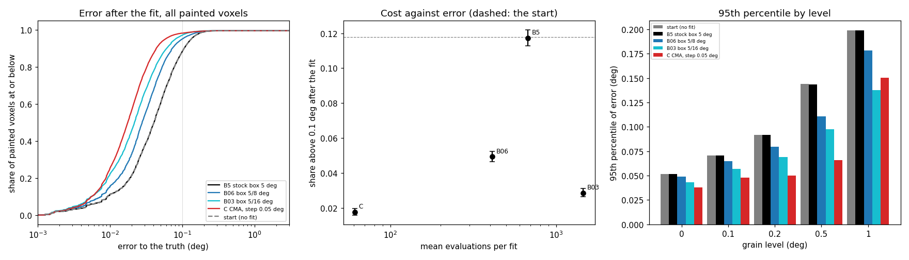
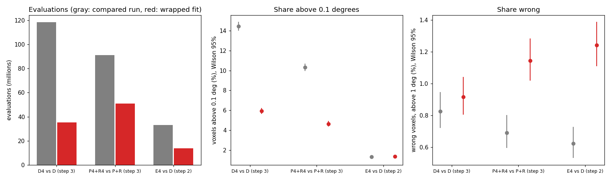

# AR3 step 4: a local fit whose step matches the error

Step 4 of "AR3" in `docs/autoresearch/PLAN.md`, task `ar3d`. No file under `icenine/` changed.
Scripts are in `scripts/autoresearch/ar3/` (`run_fine.py`, `fine_summary.py`, `fine_part2.py`,
`run_wrapped.py`, `wrapped_bg.py`, `wrapped_summary.py`). Results are in
`benchmarks/autoresearch/ar3/fine/`. Every table below is filled from `tables.md` there.
The main session placed this page from the draft the implementer left (the tool refused
the implementer's own write of the file). The numbers are the implementer's.

**Scope.** Every result holds for the simulated linear-gradient sample of step 3 (and, for run
`E4`, for step 2's one-orientation-per-grain sample). It does not hold for a real sample. C++ was
not run, and nothing here is a claim about it. Each arm is one run with one voxel order and one
generator state; no extra seeds were run. A difference is called a gain or a loss only when the
Wilson 95% intervals do not overlap.

## Terms

- The **start** is the orientation a voxel gets from painting. The **error** is the
  symmetry-reduced misorientation (degrees) to the voxel's own true orientation. **Wrong** means
  an error above 1 degree. **Above 0.1** means an error above 0.1 degrees.
- The **box** is the side of the region the local fit searches. It is the argument
  `search_box_side` of `MCOptimizer.variance_minimizing_optimize`, in radians (the code takes
  `tan(search_box_side)`). The script passed `math.radians(box in degrees)` to that argument. It
  did this by replacing the argument while its own call of `local_optimization` ran. No config
  key was used (the key `MinLocalResolution` also sets the Q range, the trial box and the final
  box). The **stock** box is 5 degrees.
- Arms: `B5` stock fit (step 3's run R, read from its stored record); `B06`, `B03`, `B015` the
  same fit with a box of 5/8, 5/16 and 5/32 degree; `L` a ladder (box 5/32; when the cost did
  not fall, 5/8; when it still did not fall, 5; all evaluations counted); `C` the existing CMA
  local fit (`local_optimizer` "cma"), first step 0.05 degrees, at most 60 evaluations. `C` could
  be called from a script with no library change, so it was run.
- **Set A** is the grains with an even id (the pick set), **set B** the odd ids (the test set).
- An evaluation is one call of the cost function. The final overlap evaluation of a fit is
  counted, as in step 3.

## Lead

- The stock fit does nothing here, and a smaller box makes the fit move. On the 19,013 painted
  voxels the share above 0.1 is 2230 of 19013 (11.3 to 12.2%) after the stock fit, the same as
  the start (2240 of 19013). It is 937 of 19013 (4.6 to 5.2%) after box 5/8, 542 of 19013
  (2.6 to 3.1%) after box 5/16 and 334 of 19013 (1.6 to 2.0%) after the CMA fit.
- A smaller box is not cheaper, contrary to the plan's estimate. The plan expected about 46
  evaluations per fit in a small box. Measured medians are 398 (box 5/8), 1,245 (5/16) and
  22,145 (5/32, on 600 voxels), against 662 for the stock box. The CMA fit costs 61 on every
  voxel. This is consistent with the budget rule of the fit: a block whose cost spread is above
  a limit extends the budget. In a look at two voxels (not tabulated) the spread of most
  blocks near the start was above that limit for the fine boxes. The rule was not changed, and
  no run tested it.
- The pick on A is the CMA fit (`C`). On B it is a gain over the start and over the stock box:
  204 of 9305 (1.9 to 2.5%) above 0.1, against 1304 of 9305 (13.3 to 14.7%) for the start.
  It uses 1,159,793 evaluations on the 19,013 voxels, against 12,843,129 for the stock fit.
  The gate was open, so parts 2 and 3 were run.
- No arm changed the wrong count: it is 87 of 19013 (0.37 to 0.56%) for the start and for every
  arm run on all voxels. These are voxels whose start is far from the truth; a local fit of
  this size does not reach them.
- Whole layer, wrapped fit ("CMA first, stock fit when the cost did not fall"): evaluations fall
  to 35,129,496 (`D4`, against 118,350,225), 50,892,696 (`P4` plus `R4`, against 90,985,770)
  and 13,608,181 (`E4`, against 33,040,126). Above 0.1 is a gain for `D4` and for `P4`+`R4`
  and no difference for `E4`. Wrong voxels are no different for `D4` (225 against 203), a loss
  for `P4`+`R4` (281 against 170) and a loss for `E4` (305 against 153).
- In `P4` the CMA fit settles 7,078 voxels in the paint, where the stock fit settled 184. Of
  those 7,078, 135 are wrong. This is consistent with the loss in wrong voxels coming from
  fits that now pass the acceptance test from a neighbouring grain's orientation. The
  other half of that claim (that the stock fit would have sent them to a seed and got them
  right) was not tested.
- All wall times of these runs are labelled "contended" (the timing preflight refused, and the
  runs also ran side by side). No timing comparison is claimed; the cost is in evaluations.

## Part 1: the arms, from step 3's stored starts

Check before the arms. The stock box, passed through this script's harness, reproduces step 3's
run R on its first 200 painted voxels: 200 of 200 identical ends and evaluation counts. The
box substitution is off for this check (the stock box is not replaced). For each of `B06`,
`B03`, `B015` and `L` the first 200 fits are identical with the trace on and off (200 of 200
each).

Reading the picture. Left: the error after each fit, as a share of the painted voxels at or
below an error (log axis); the dotted line is 0.1 degrees. Middle: share above 0.1 against mean
evaluations per fit, with Wilson 95% bars (dashed line: the start). Right: the 95th percentile of
the error, by grain level. `B015` and `L` are not in this picture; they ran on 600 voxels only
(see the table after the next one).

Reading the table. Arms run on every painted voxel (19,013). `closer`: ends more than 0.05 deg
nearer the truth than the start; `hurt`: more than 0.05 deg farther. `med`, `p95`: median and
95th percentile of the error (deg). `gt01`: above 0.1. `lowered`: the fit lowered the strict
cost. `le_true`: the end costs no more than the true orientation (the truth is used here for
analysis only). `ev_med`, `ev_tot`: evaluations per fit (median) and in total.

<!-- table:ar3d_main_full -->
| arm | n | closer | hurt | med | p95 | gt01 | wrong | lowered | le_true | ev_med | ev_tot |
|---|---|---|---|---|---|---|---|---|---|---|---|
| start (no fit) | 19,013 |  |  | 0.0406 | 0.1329 | 2240 of 19013 (11.3 to 12.2%) | 87 of 19013 (0.37 to 0.56%) |  | 2422 of 19013 (12.3 to 13.2%) |  |  |
| B5 stock box 5 deg | 19,013 | 9 of 19013 (0.02 to 0.09%) | 2 of 19013 (0.00 to 0.04%) | 0.0406 | 0.1325 | 2230 of 19013 (11.3 to 12.2%) | 87 of 19013 (0.37 to 0.56%) | 36 of 19013 (0.14 to 0.26%) | 2422 of 19013 (12.3 to 13.2%) | 662 | 12,843,129 |
| B06 box 5/8 deg | 19,013 | 2404 of 19013 (12.2 to 13.1%) | 28 of 19013 (0.10 to 0.21%) | 0.0279 | 0.0993 | 937 of 19013 (4.6 to 5.2%) | 87 of 19013 (0.37 to 0.56%) | 6353 of 19013 (32.7 to 34.1%) | 4332 of 19013 (22.2 to 23.4%) | 398 | 7,833,539 |
| B03 box 5/16 deg | 19,013 | 3076 of 19013 (15.7 to 16.7%) | 15 of 19013 (0.05 to 0.13%) | 0.0218 | 0.0803 | 542 of 19013 (2.6 to 3.1%) | 87 of 19013 (0.37 to 0.56%) | 11684 of 19013 (60.8 to 62.1%) | 7005 of 19013 (36.2 to 37.5%) | 1,245 | 27,659,741 |
| C CMA, step 0.05 deg | 19,013 | 3910 of 19013 (20.0 to 21.1%) | 15 of 19013 (0.05 to 0.13%) | 0.0176 | 0.0581 | 334 of 19013 (1.6 to 2.0%) | 87 of 19013 (0.37 to 0.56%) | 15478 of 19013 (80.8 to 82.0%) | 7537 of 19013 (38.9 to 40.3%) | 61 | 1,159,793 |
<!-- /table:ar3d_main_full -->

Reading the table. Evaluations per fit, for each arm and the voxels it ran on. The long tail
of the finer boxes is the cost: the box 5/16 has a fit of 17,657 evaluations and the box 5/32
has a fit of 380,954.

<!-- table:ar3d_evals -->
| arm | n | median | mean | p95 | max | total |
|---|---|---|---|---|---|---|
| B5 stock box 5 deg | 19,013 | 662 | 675 | 662 | 2,168 | 12,843,129 |
| B06 box 5/8 deg | 19,013 | 398 | 412 | 574 | 1,047 | 7,833,539 |
| B03 box 5/16 deg | 19,013 | 1,245 | 1,455 | 2,895 | 17,657 | 27,659,741 |
| C CMA, step 0.05 deg | 19,013 | 61 | 61 | 61 | 61 | 1,159,793 |
| B015 box 5/32 deg | 600 | 22,145 | 31,860 | 87,805 | 380,954 | 19,115,922 |
| L ladder 5/32, 5/8, 5 | 600 | 22,189 | 31,990 | 92,214 | 308,783 | 19,194,236 |
<!-- /table:ar3d_evals -->

`B015` and `L` ran on the first 600 painted voxels of the voxel order only (the order is a random
shuffle). At about 22,000 evaluations per fit, all 19,013 fits would have been hundreds of
millions of evaluations. Reading the table: every arm cut to the same 600 voxels.

<!-- table:ar3d_main_sub -->
| arm | n | closer | hurt | med | p95 | gt01 | wrong | lowered | le_true | ev_med | ev_tot |
|---|---|---|---|---|---|---|---|---|---|---|---|
| start (no fit) | 600 |  |  | 0.0325 | 0.1010 | 33 of 600 (3.9 to 7.6%) | 4 of 600 (0.3 to 1.7%) |  | 109 of 600 (15.3 to 21.5%) |  |  |
| B5 stock box 5 deg | 600 | 0 of 600 (0.00 to 0.64%) | 0 of 600 (0.00 to 0.64%) | 0.0325 | 0.1010 | 33 of 600 (3.9 to 7.6%) | 4 of 600 (0.3 to 1.7%) | 0 of 600 (0.00 to 0.64%) | 109 of 600 (15.3 to 21.5%) | 662 | 405,734 |
| B06 box 5/8 deg | 600 | 43 of 600 (5.4 to 9.5%) | 2 of 600 (0.1 to 1.2%) | 0.0250 | 0.0786 | 13 of 600 (1.3 to 3.7%) | 4 of 600 (0.3 to 1.7%) | 171 of 600 (25.0 to 32.2%) | 177 of 600 (26.0 to 33.3%) | 387 | 242,441 |
| B03 box 5/16 deg | 600 | 50 of 600 (6.4 to 10.8%) | 0 of 600 (0.00 to 0.64%) | 0.0201 | 0.0703 | 7 of 600 (0.6 to 2.4%) | 4 of 600 (0.3 to 1.7%) | 323 of 600 (49.8 to 57.8%) | 251 of 600 (38.0 to 45.8%) | 1,256 | 850,037 |
| C CMA, step 0.05 deg | 600 | 80 of 600 (10.8 to 16.3%) | 0 of 600 (0.00 to 0.64%) | 0.0165 | 0.0501 | 5 of 600 (0.4 to 1.9%) | 4 of 600 (0.3 to 1.7%) | 448 of 600 (71.0 to 78.0%) | 290 of 600 (44.4 to 52.3%) | 61 | 36,600 |
| B015 box 5/32 deg | 600 | 89 of 600 (12.2 to 17.9%) | 0 of 600 (0.00 to 0.64%) | 0.0157 | 0.0484 | 4 of 600 (0.3 to 1.7%) | 4 of 600 (0.3 to 1.7%) | 437 of 600 (69.1 to 76.2%) | 381 of 600 (59.6 to 67.3%) | 22,145 | 19,115,922 |
| L ladder 5/32, 5/8, 5 | 600 | 94 of 600 (13.0 to 18.8%) | 0 of 600 (0.00 to 0.64%) | 0.0154 | 0.0459 | 5 of 600 (0.4 to 1.9%) | 4 of 600 (0.3 to 1.7%) | 439 of 600 (69.5 to 76.6%) | 368 of 600 (57.4 to 65.1%) | 22,189 | 19,194,236 |
<!-- /table:ar3d_main_sub -->

On the odd-id half of these 600 voxels (301 voxels, set B) both `B015` and `L` are a gain over
the start: 3 of 301 above 0.1 against 21 of 301 for the start (`summary.json`, `pick`). They cost
far more than `C` for a similar share (4 and 5 of 600 against 5 of 600). The ladder's first rung
ended 439 of the 600 fits. Reading the table: where each ladder fit ended.

<!-- table:ar3d_ladder -->
| rung | ended | evals_med |
|---|---|---|
| box 0.15625 deg | 439 of 600 (69.5 to 76.6%) | 22,167 |
| box 0.625 deg | 0 of 600 (0.00 to 0.64%) | n/a |
| box 5 deg | 161 of 600 (23.4 to 30.5%) | 22,457 |
<!-- /table:ar3d_ladder -->

Reading the table. Share above 0.1 after the fit, by the grain's level (largest misorientation
from its centre orientation, degrees). Arms run on all voxels.

<!-- table:ar3d_level -->
| level | n | start | B5 | B06 | B03 | C |
|---|---|---|---|---|---|---|
| all | 19,013 | 2240 of 19013 (11.3 to 12.2%) | 2230 of 19013 (11.3 to 12.2%) | 937 of 19013 (4.6 to 5.2%) | 542 of 19013 (2.6 to 3.1%) | 334 of 19013 (1.6 to 2.0%) |
| level 0 | 4,774 | 3 of 4774 (0.02 to 0.18%) | 3 of 4774 (0.02 to 0.18%) | 3 of 4774 (0.02 to 0.18%) | 3 of 4774 (0.02 to 0.18%) | 3 of 4774 (0.02 to 0.18%) |
| level 0.1 | 4,152 | 38 of 4152 (0.7 to 1.3%) | 38 of 4152 (0.7 to 1.3%) | 36 of 4152 (0.6 to 1.2%) | 26 of 4152 (0.43 to 0.92%) | 12 of 4152 (0.17 to 0.50%) |
| level 0.2 | 4,332 | 141 of 4332 (2.8 to 3.8%) | 142 of 4332 (2.8 to 3.9%) | 82 of 4332 (1.5 to 2.3%) | 59 of 4332 (1.1 to 1.8%) | 28 of 4332 (0.45 to 0.93%) |
| level 0.5 | 3,196 | 721 of 3196 (21.1 to 24.0%) | 718 of 3196 (21.1 to 23.9%) | 230 of 3196 (6.4 to 8.1%) | 143 of 3196 (3.8 to 5.2%) | 60 of 3196 (1.5 to 2.4%) |
| level 1 | 2,559 | 1337 of 2559 (50.3 to 54.2%) | 1329 of 2559 (50.0 to 53.9%) | 586 of 2559 (21.3 to 24.6%) | 311 of 2559 (10.9 to 13.5%) | 231 of 2559 (8.0 to 10.2%) |
<!-- /table:ar3d_level -->

Reading the table. By the size of the start's error: for each arm, how many voxels came closer
by more than 0.05 deg, and in brackets how many were hurt. The stock fit moves almost nothing in
any bin. The CMA fit brings 2050 of the 5,350 voxels in the 0.05 to 0.1 bin and 1780 of the 2,042
voxels in the 0.1 to 0.2 bin closer.

<!-- table:ar3d_bins -->
| err | n | B5 | B06 | B03 | C |
|---|---|---|---|---|---|
| 0 to 0.05 | 11,423 | 0 (hurt 0) | 0 (hurt 13) | 0 (hurt 10) | 0 (hurt 12) |
| 0.05 to 0.1 | 5,350 | 1 (hurt 1) | 1140 (hurt 9) | 1557 (hurt 4) | 2050 (hurt 1) |
| 0.1 to 0.2 | 2,042 | 6 (hurt 1) | 1199 (hurt 5) | 1426 (hurt 1) | 1780 (hurt 1) |
| 0.2 to 0.5 | 111 | 2 (hurt 0) | 65 (hurt 0) | 93 (hurt 0) | 80 (hurt 0) |
| 0.5 and above | 87 | 0 (hurt 0) | 0 (hurt 1) | 0 (hurt 0) | 0 (hurt 1) |
<!-- /table:ar3d_bins -->

### The pick

The rule: on A, the arm with the lowest share above 0.1; among arms whose intervals overlap with
that one, the arm with the fewest evaluations. The candidates are the arms run on all voxels
(`B5`, `B06`, `B03`, `C`). On A the lowest share is `C`, and no other arm overlaps it, so the
pick is `C`. Reading the table: A, then B, with the same columns; `mark` on B says whether the
interval does not overlap the start's (gain over start) or the stock arm's (gain over B5).

<!-- table:ar3d_sets -->
| set | arm | n | med | gt01 | wrong | ev_tot | mark |
|---|---|---|---|---|---|---|---|
| A | start (no fit) | 9,708 | 0.0378 | 936 of 9708 (9.1 to 10.2%) | 43 of 9708 (0.33 to 0.60%) |  |  |
| A | B5 stock box 5 deg | 9,708 | 0.0378 | 931 of 9708 (9.0 to 10.2%) | 43 of 9708 (0.33 to 0.60%) | 6,531,175 |  |
| A | B06 box 5/8 deg | 9,708 | 0.0274 | 394 of 9708 (3.7 to 4.5%) | 43 of 9708 (0.33 to 0.60%) | 3,967,096 |  |
| A | B03 box 5/16 deg | 9,708 | 0.0216 | 231 of 9708 (2.1 to 2.7%) | 43 of 9708 (0.33 to 0.60%) | 13,621,466 |  |
| A | C CMA, step 0.05 deg | 9,708 | 0.0177 | 130 of 9708 (1.1 to 1.6%) | 43 of 9708 (0.33 to 0.60%) | 592,188 | picked |
| B | start (no fit) | 9,305 | 0.0433 | 1304 of 9305 (13.3 to 14.7%) | 44 of 9305 (0.35 to 0.63%) |  |  |
| B | B5 stock box 5 deg | 9,305 | 0.0433 | 1299 of 9305 (13.3 to 14.7%) | 44 of 9305 (0.35 to 0.63%) | 6,311,954 | no gain over start |
| B | B06 box 5/8 deg | 9,305 | 0.0287 | 543 of 9305 (5.4 to 6.3%) | 44 of 9305 (0.35 to 0.63%) | 3,866,443 | gain over start; gain over B5 |
| B | B03 box 5/16 deg | 9,305 | 0.0224 | 311 of 9305 (3.0 to 3.7%) | 44 of 9305 (0.35 to 0.63%) | 14,038,275 | gain over start; gain over B5 |
| B | C CMA, step 0.05 deg | 9,305 | 0.0176 | 204 of 9305 (1.9 to 2.5%) | 44 of 9305 (0.35 to 0.63%) | 567,605 | gain over start; gain over B5 |
<!-- /table:ar3d_sets -->

## Part 2: the stop readings again, on the CMA fit

Step 3's summary functions are called unchanged on the CMA fit's records. The fit's trace comes
from a second run of `C` (the `C_trace` run) that records the cost and the orientation of every
evaluation. It is cut into blocks of 7 evaluations (one CMA generation each, the start's own
evaluation not a block). The traced run gives the same ends and counts as the untraced run on
all 19,013 voxels (19013 of 19013). The second fit (4,768 voxels, every fourth voxel of the voxel
order) starts from the first fit's end. A pick at the edge of its grid would be called
uninformative; none of the picks below is at the edge.

Reading the table. Skip the fit from what is known before it. `hit`: skip when the start's hit
ratio is at least `t` times the best of its grain's entry; `cost`: skip when the start's cost is
at most `c`. The threshold is picked on A (at most 1% of A's voxels hurt) and reported on B.
`B_hurt` is the share of B's painted voxels that skipping leaves more than 0.05 deg worse than
the fit. `B_med` to `B_wrong` are over all 12,184 voxels of set B (the voxels not refined keep
their painted or seeded value).

<!-- table:ar3d_p2_skip -->
| rule | threshold | A_share | B_skipped | B_evals | B_hurt | B_med | B_p95 | B_gt01 | B_wrong |
|---|---|---|---|---|---|---|---|---|---|
| start hit ratio >= t x entry best | 0.99 | 0.359 | 3207 of 9305 | 195,627 of 567,605 | 103 of 9305 (0.9 to 1.3%) | 0.0191 | 0.0770 | 382 of 12184 (2.8 to 3.5%) | 86 of 12184 (0.57 to 0.87%) |
| start cost <= c | 0.06968 | 0.200 | 1986 of 9305 | 121,146 of 567,605 | 107 of 9305 (1.0 to 1.4%) | 0.0186 | 0.0778 | 392 of 12184 (2.9 to 3.5%) | 86 of 12184 (0.57 to 0.87%) |
<!-- /table:ar3d_p2_skip -->

Reading the table. Stop inside the fit. The rule "stop at the first block that does not
improve" has no feasible threshold (no setting keeps A's hurt share at 1% or below), so it has no
row. "Stop when the best cost is at most `c`" is picked at the 40th percentile of A's end costs.

<!-- table:ar3d_p2_stop -->
| rule | threshold | A_saved_share | B_saved | B_saved_share | B_hurt | B_med | B_p95 | B_gt01 | B_wrong |
|---|---|---|---|---|---|---|---|---|---|
| stop when best cost <= c | 0.0678 | 0.265 | 149,733 of 567,605 | 0.264 | 111 of 9305 (1.0 to 1.4%) | 0.0196 | 0.0789 | 391 of 12184 (2.9 to 3.5%) | 86 of 12184 (0.57 to 0.87%) |
<!-- /table:ar3d_p2_stop -->

Reading the table. Where the fit has already arrived: `share` is the share of all evaluations
spent after the best orientation is within 0.02 deg of the fit's end; `start_within`: voxels
whose start is already that close to the end.

<!-- table:ar3d_p2_converged -->
| level | n | med_evals | share | med_share | start_within |
|---|---|---|---|---|---|
| level 0 | 4,774 | 61 | 0.829 | 0.984 | 3498 of 4774 (72.0 to 74.5%) |
| level 0.1 | 4,152 | 61 | 0.580 | 0.639 | 1032 of 4152 (23.6 to 26.2%) |
| level 0.2 | 4,332 | 61 | 0.508 | 0.525 | 590 of 4332 (12.6 to 14.7%) |
| level 0.5 | 3,196 | 61 | 0.387 | 0.295 | 140 of 3196 (3.7 to 5.1%) |
| level 1 | 2,559 | 61 | 0.366 | 0.295 | 114 of 2559 (3.7 to 5.3%) |
| all | 19,013 | 61 | 0.565 | 0.525 | 5374 of 19013 (27.6 to 28.9%) |
<!-- /table:ar3d_p2_converged -->

Reading the table. The second fit, on every fourth voxel: how many voxels it moved, brought
closer, or pushed away by more than 0.05 deg.

<!-- table:ar3d_p2_second_wil -->
| what | v |
|---|---|
| moved by more than 0.05 deg | 185 of 4768 (3.4 to 4.5%) |
| brought closer by more than 0.05 deg | 73 of 4768 (1.2 to 1.9%) |
| pushed away by more than 0.05 deg | 3 of 4768 (0.02 to 0.18%) |
<!-- /table:ar3d_p2_second_wil -->

Reading the table. A rule for when a second fit helps: take it only when the first fit's end hit
ratio is below `t` times the entry's best. `B_right`: of the B voxels the rule says to skip, the
number the second fit did not help; `B_base`: the share of all B voxels in this sample the second
fit helped.

<!-- table:ar3d_p2_second_rule -->
| threshold | A_pred | A_helped | B_pred | B_right | B_base |
|---|---|---|---|---|---|
| 0.97 | 2429 | 21 | 2202 | 2179 of 2202 (98.4 to 99.3%) | 42 of 2292 (1.4 to 2.5%) |
<!-- /table:ar3d_p2_second_rule -->

What this part shows. With a fit that costs 61 evaluations, what a skip or a stop can save is
small in absolute terms: the best rule (skip by hit ratio) saves 195,627 of 567,605 evaluations
on B's painted voxels, and hurts about 1% of them. The expensive part of the layer is the seed
path, not the fit. The second fit helps few voxels (73 of 4,768); it is not worth running on
every voxel.

## Part 3: the whole layer with the wrapped fit

The wrapper (`run_wrapped.py`, class `Wrap`) replaces the instance method `local_optimization`
of the run's reconstructor object and nothing else. A call runs the CMA fit first (first step 0.05
degrees, 60 evaluations at most). When its end cost is not below the start cost, the stock fit
runs from the same start and the end with the lower cost is returned (the CMA end on a tie). The
evaluations of both are counted.

The caller's acceptance test. In the BFS (`_expand` in `reconstructor.py`) a fit is accepted when
its hit ratio divided by the best hit ratio of the expansion is above 0.9. In the paint
(`grain_paint.py`) it is accepted when its hit ratio divided by the larger of the entry's best
hit ratio and its own is above 0.9. Both need a best value that the wrapper does not see. So the
stock fit is started by "the cost did not fall", not by the caller's test.

Reading the table. The wrapper replaced the fit in no other place. `calls` and `callers`: calls
of the wrapper and the function that made each. `fell`: the CMA end cost was below the start
cost. `fallback`: the stock fit ran. `fallback_won`: its end cost was lower than the CMA
end's. `cma_calls`: all calls of the CMA optimizer in the run (equal to `calls`, so the seed
path, the grid search and the finisher made none). `vmo_in`, `vmo_out`: calls of the stock
optimizer inside and outside the wrapper (outside: the seed path and the finisher, unchanged).
The `P4` row counts the paint only; `R4` makes more CMA calls after it.

<!-- table:ar3d_p3_wrapper -->
| run | calls | callers | fell | fallback | fallback_won | cma_calls | vmo_in | vmo_out |
|---|---|---|---|---|---|---|---|---|
| D4 | 53,373 | _local_fit 53373 | 49,399 | 3,974 | 6 | 53,373 | 3,974 | 2,672 |
| P4 (paint) | 9,290 | local_fit 9290 | 9,058 | 232 | 2 | 9,290 | 232 | 5,203 |
| E4 | 48,237 | _local_fit 48237 | 33,628 | 14,609 | 0 | 48,237 | 14,609 | 1,014 |
<!-- /table:ar3d_p3_wrapper -->

Reading the picture. Left: evaluations of each compared run (gray) and the wrapped run (red).
Middle: share of voxels above 0.1 with Wilson bars. Right: share wrong with Wilson bars. One run
of each, one voxel order.

Reading the table. No run was killed at its cap.

<!-- table:ar3d_p3_status -->
| run | finished | killed |
|---|---|---|
| D4 | yes | no |
| P4 | yes | no |
| E4 | yes | no |
<!-- /table:ar3d_p3_status -->

Reading the table. Evaluations by stage. For the BFS runs (`D4`, `D`, `E4`): the seed path,
neighbour fits, revisit fits, reseeds. For the paint runs: `seed_index`, `seed_grid` and
`index_rejected` are the seed path; `fit_accepted` and `fit_rejected` the fit in the paint;
`score` the scoring; `refine` the refinement (`R4`, or step 3's `R`). `total` is the whole run.

<!-- table:ar3d_p3_evals -->
| run | seed | neighbor | revisit | reseed | restart | total | seed_index | score | fit_rejected | fit_accepted | index_rejected | seed_grid | grid_rejected | refine |
|---|---|---|---|---|---|---|---|---|---|---|---|---|---|---|
| D4 | 1,556,905 | 2,817,382 | 3,089,366 | 27,665,843 | 0 | 35,129,496 |  |  |  |  |  |  |  |  |
| D (step 3) | 2,458,801 | 16,088,317 | 44,231,514 | 55,571,593 | 0 | 118,350,225 |  |  |  |  |  |  |  |  |
| P4 plus R4 |  |  |  |  |  | 50,892,696 | 6,383,950 | 138,580 | 292,096 | 431,758 | 241,081 | 41,126,866 | 1,366,110 | 912,255 |
| P plus R (step 3) |  |  |  |  |  | 90,985,770 | 14,106,247 | 291,783 | 3,459,521 | 124,976 | 336,721 | 58,461,276 | 1,362,117 | 12,843,129 |
| E4 | 649,395 | 6,219,398 | 6,439,797 | 299,591 | 0 | 13,608,181 |  |  |  |  |  |  |  |  |
| D (step 2) | 648,496 | 15,883,966 | 16,024,764 | 482,900 | 0 | 33,040,126 |  |  |  |  |  |  |  |  |
<!-- /table:ar3d_p3_evals -->

Reading the table. Grain entries (accepted seeds, BFS: seeds plus reseeds) and grid
fallbacks (BFS: seeds that failed the index seed test and went to the grid search; paint: voxels
that failed all seed paths).

<!-- table:ar3d_p3_entries -->
| run | entries | seeds | reseeds | index_used | grid_fallbacks | grid_evals |
|---|---|---|---|---|---|---|
| D4 | 1,298 | 344 | 954 | 1,222 | 76 | 25,833,494 |
| D (step 3) | 3,855 | 440 | 3,415 | 3,713 | 142 | 48,273,080 |
| P4 | 2,535 | 2,535 | 0 | 0 | 4 | 0 |
| P (step 3) | 5,369 | 5,369 | 0 | 0 | 4 | 0 |
| E4 | 507 | 332 | 175 | 507 | 0 | 0 |
| D (step 2) | 598 | 332 | 266 | 598 | 0 | 0 |
<!-- /table:ar3d_p3_entries -->

Reading the table. The error after each run, over all voxels of the layer (24,570), by grain
level for the gradient sample. `D (step 3)`, `P plus R (step 3)` and `D (step 2)` are the stored
runs.

<!-- table:ar3d_p3_error -->
| run | group | n | median | p95 | gt01 | wrong |
|---|---|---|---|---|---|---|
| D4 | all | 24,570 | 0.0229 | 0.1097 | 1458 of 24570 (5.6 to 6.2%) | 225 of 24570 (0.8 to 1.0%) |
| D4 | level 0 | 4,877 | 0.0136 | 0.0419 | 30 of 4877 (0.43 to 0.88%) | 30 of 4877 (0.43 to 0.88%) |
| D4 | level 0.1 | 4,488 | 0.0182 | 0.0513 | 26 of 4488 (0.40 to 0.85%) | 19 of 4488 (0.27 to 0.66%) |
| D4 | level 0.2 | 5,041 | 0.0201 | 0.0601 | 74 of 5041 (1.2 to 1.8%) | 46 of 5041 (0.7 to 1.2%) |
| D4 | level 0.5 | 4,625 | 0.0323 | 0.1076 | 282 of 4625 (5.4 to 6.8%) | 43 of 4625 (0.7 to 1.2%) |
| D4 | level 1 | 5,539 | 0.0492 | 0.1835 | 1046 of 5539 (17.9 to 19.9%) | 87 of 5539 (1.3 to 1.9%) |
| D (step 3) | all | 24,570 | 0.0427 | 0.1459 | 3545 of 24570 (14.0 to 14.9%) | 203 of 24570 (0.72 to 0.95%) |
| D (step 3) | level 0 | 4,877 | 0.0169 | 0.0554 | 17 of 4877 (0.22 to 0.56%) | 17 of 4877 (0.22 to 0.56%) |
| D (step 3) | level 0.1 | 4,488 | 0.0436 | 0.0964 | 179 of 4488 (3.5 to 4.6%) | 23 of 4488 (0.34 to 0.77%) |
| D (step 3) | level 0.2 | 5,041 | 0.0533 | 0.1167 | 554 of 5041 (10.2 to 11.9%) | 38 of 5041 (0.5 to 1.0%) |
| D (step 3) | level 0.5 | 4,625 | 0.0665 | 0.1618 | 1251 of 4625 (25.8 to 28.3%) | 47 of 4625 (0.8 to 1.3%) |
| D (step 3) | level 1 | 5,539 | 0.0535 | 0.1960 | 1544 of 5539 (26.7 to 29.1%) | 78 of 5539 (1.1 to 1.8%) |
| P4 plus R4 | all | 24,570 | 0.0208 | 0.0956 | 1140 of 24570 (4.4 to 4.9%) | 281 of 24570 (1.0 to 1.3%) |
| P4 plus R4 | level 0 | 4,877 | 0.0114 | 0.0398 | 3 of 4877 (0.02 to 0.18%) | 3 of 4877 (0.02 to 0.18%) |
| P4 plus R4 | level 0.1 | 4,488 | 0.0189 | 0.0519 | 38 of 4488 (0.6 to 1.2%) | 25 of 4488 (0.38 to 0.82%) |
| P4 plus R4 | level 0.2 | 5,041 | 0.0201 | 0.0613 | 89 of 5041 (1.4 to 2.2%) | 56 of 5041 (0.9 to 1.4%) |
| P4 plus R4 | level 0.5 | 4,625 | 0.0269 | 0.0972 | 226 of 4625 (4.3 to 5.5%) | 71 of 4625 (1.2 to 1.9%) |
| P4 plus R4 | level 1 | 5,539 | 0.0346 | 0.1842 | 784 of 5539 (13.3 to 15.1%) | 126 of 5539 (1.9 to 2.7%) |
| P plus R (step 3) | all | 24,570 | 0.0342 | 0.1302 | 2531 of 24570 (9.9 to 10.7%) | 170 of 24570 (0.60 to 0.80%) |
| P plus R (step 3) | level 0 | 4,877 | 0.0161 | 0.0518 | 3 of 4877 (0.02 to 0.18%) | 3 of 4877 (0.02 to 0.18%) |
| P plus R (step 3) | level 0.1 | 4,488 | 0.0313 | 0.0699 | 41 of 4488 (0.7 to 1.2%) | 10 of 4488 (0.12 to 0.41%) |
| P plus R (step 3) | level 0.2 | 5,041 | 0.0401 | 0.0897 | 152 of 5041 (2.6 to 3.5%) | 23 of 5041 (0.30 to 0.68%) |
| P plus R (step 3) | level 0.5 | 4,625 | 0.0570 | 0.1374 | 770 of 4625 (15.6 to 17.7%) | 39 of 4625 (0.6 to 1.2%) |
| P plus R (step 3) | level 1 | 5,539 | 0.0550 | 0.1873 | 1565 of 5539 (27.1 to 29.5%) | 95 of 5539 (1.4 to 2.1%) |
| E4 | all | 24,570 | 0.0131 | 0.0437 | 334 of 24570 (1.2 to 1.5%) | 305 of 24570 (1.1 to 1.4%) |
| D (step 2) | all | 24,570 | 0.0206 | 0.0566 | 326 of 24570 (1.2 to 1.5%) | 153 of 24570 (0.53 to 0.73%) |
<!-- /table:ar3d_p3_error -->

Reading the table. Paired counts by voxel against the compared run. `wrong_base`: wrong in the
compared run; `wrong_other`: wrong in this step's run; `fixed`: wrong in the compared run and
right here; `broken`: the reverse; `both_wrong`: wrong in both.

<!-- table:ar3d_p3_paired -->
| pair | group | n | wrong_base | wrong_other | fixed | broken | both_wrong |
|---|---|---|---|---|---|---|---|
| D4 vs D | all | 24,570 | 203 | 225 | 86 | 108 | 117 |
| D4 vs D | level 0 | 4,877 | 17 | 30 | 1 | 14 | 16 |
| D4 vs D | level 0.1 | 4,488 | 23 | 19 | 15 | 11 | 8 |
| D4 vs D | level 0.2 | 5,041 | 38 | 46 | 19 | 27 | 19 |
| D4 vs D | level 0.5 | 4,625 | 47 | 43 | 23 | 19 | 24 |
| D4 vs D | level 1 | 5,539 | 78 | 87 | 28 | 37 | 50 |
| P4+R4 vs P+R | all | 24,570 | 170 | 281 | 23 | 134 | 147 |
| P4+R4 vs P+R | level 0 | 4,877 | 3 | 3 | 0 | 0 | 3 |
| P4+R4 vs P+R | level 0.1 | 4,488 | 10 | 25 | 2 | 17 | 8 |
| P4+R4 vs P+R | level 0.2 | 5,041 | 23 | 56 | 4 | 37 | 19 |
| P4+R4 vs P+R | level 0.5 | 4,625 | 39 | 71 | 5 | 37 | 34 |
| P4+R4 vs P+R | level 1 | 5,539 | 95 | 126 | 12 | 43 | 83 |
| E4 vs D (step 2) | all | 24,570 | 153 | 305 | 18 | 170 | 135 |
<!-- /table:ar3d_p3_paired -->

Reading the table. Where the wrong voxels are, by the stage that settled the voxel in the
paint. "Painted from a grain" voxels are those given a grain's orientation and then fitted once
by `R4` (or `R`).

<!-- table:ar3d_p3_stage -->
| run | stage | n | wrong |
|---|---|---|---|
| P4 plus R4 | seed | 2,535 | 58 of 2535 (1.8 to 2.9%) |
| P4 plus R4 | fit-settled | 7,078 | 135 of 7078 (1.6 to 2.3%) |
| P4 plus R4 | painted from a grain | 14,953 | 86 of 14953 (0.47 to 0.71%) |
| P4 plus R4 | failed | 4 | 2 of 4 (15.0 to 85.0%) |
| P plus R (step 3) | seed | 5,369 | 80 of 5369 (1.2 to 1.9%) |
| P plus R (step 3) | fit-settled | 184 | 0 of 184 (0.0 to 2.0%) |
| P plus R (step 3) | painted from a grain | 19,013 | 87 of 19013 (0.37 to 0.56%) |
| P plus R (step 3) | failed | 4 | 3 of 4 (30.1 to 95.4%) |
<!-- /table:ar3d_p3_stage -->

What this part shows.

- `D4` against step 3's `D`. Evaluations fall to 35,129,496 from 118,350,225. Above 0.1 is a
  gain: 1458 of 24570 (5.6 to 6.2%) against 3545 of 24570 (14.0 to 14.9%). Wrong voxels are not
  different (225 against 203, intervals overlap); the paired split is 86 fixed, 108 broken and
  117 wrong in both. At no single level are the wrong counts different (intervals overlap).
- `P4` plus `R4` against step 3's `P` plus `R`. Evaluations fall to 50,892,696 from 90,985,770.
  Above 0.1 is a gain: 1140 of 24570 (4.4 to 4.9%) against 2531 (9.9 to 10.7%). Wrong voxels are
  a loss: 281 against 170 (1.0 to 1.3% against 0.60 to 0.80%), with 23 fixed and 134 broken.
  The paint has 2,535 grain entries, against 5,369.
- `E4` against step 2's `D`. Evaluations fall to 13,608,181 from 33,040,126. Above 0.1 is no
  different (334 of 24570 against 326). Wrong voxels are a loss: 305 against 153, with 18 fixed
  and 170 broken. This is consistent with the small CMA step not following inherited
  orientations across grain boundaries as far as the wide stock fit does. A run that gives the
  stock fit back on the voxels the caller rejects would be needed to test it.
- In none of the runs did the stock fallback often win: it ended lower than the CMA end in 6 of
  3,974 fallbacks (`D4`), 2 of 232 (`P4`, paint) and 0 of 14,609 (`E4`). Where the CMA fit
  finds no lower cost, the stock fit almost never does either.

## Deviations from the plan

- The plan's estimate of about 46 evaluations for a fit in a small box was wrong. The measured
  mean is 412 per fit for box 5/8, 1,455 for 5/16 and 31,860 for 5/32 (the last on 600 voxels).
  `B015` and `L` were therefore run on the first 600 painted voxels only, and the pick is made
  among the arms run on all voxels.
- For part 2 the CMA fit has no blocks like the MC fit's. Its trace is built from a second run
  of `C`, with blocks of one CMA generation (7 evaluations). The ends of that run equal the
  untraced run's on all 19,013 voxels.
- The trigger of the stock fallback is "the cost did not fall" (see Part 3), not the caller's test.
- `P4` needed a refinement stage after the paint; `R4` is one CMA fit (no stock fallback) from
  each painted start of `P4`. The number of painted starts differs from step 3's (14,953 against
  19,013), because the paint settles more voxels by a fit.
- The timing script is `scripts/dev/timing_preflight.py` (there is no `.sh`); it refused in
  every run, so every wall time is "contended".

## Not claimed

That C++ behaves the same. That the gradient model matches a real sample. That a change of
default is justified. A wall-time comparison. Why the wrapped fit adds wrong voxels in the
paint and in `E4` beyond what is stated as "consistent with" above.

## What comes after

The CMA fit is a gain on the share above 0.1 and cuts the evaluations in each of the three runs,
but adds wrong voxels in two of them. Before any library key: a variant that hands the voxels the
caller rejects to the stock fit, and a check of whether the extra wrong voxels were fit-settled
from a neighbouring grain. The owner decides.
