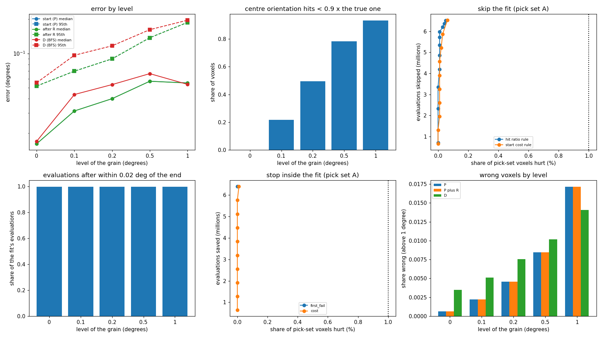

# AR3 step 3: paint as a start, then refine, on grains with gradients

Step 3 of "AR3" in `docs/autoresearch/PLAN.md`, task `ar3c` (D-20261110-N4). New:
`icenine/gradient_sample.py` (no config key, no reconstructor change). Scripts
`scripts/autoresearch/ar3/`; results `benchmarks/autoresearch/ar3/gradient/`. This page was placed
by the main session from the text the implementer returned (the tool refused the implementer's own
write of the file); the tables are filled from the committed `tables.md`.

Terms: a **grain entry** is one accepted seed; to **paint** is to give each voxel the passing grain
of lowest strict cost; the **start** is the painted orientation; the **refinement** is one BFS
local fit from the start; a grain's **level** is its largest misorientation from its centre
orientation (0, 0.1, 0.2, 0.5, 1.0 deg); **error** is the symmetry-reduced misorientation to the
voxel's own truth, "wrong" above 1 deg; a voxel is **hurt** by a shortcut when it ends more than
0.05 deg farther from the truth than the full fit. Counts by voxel, Wilson 95% intervals, no
p-values; a difference is called a gain or loss only when intervals do not overlap.

The sample: the layer's truth (24,570 voxels, 497 grains); each grain keeps its orientation at its
centre and turns linearly with position to its level (98/81/101/101/116 grains at
0/0.1/0.2/0.5/1.0). Measured spread equals the level to 5.1e-5 deg. Clean images rendered with
`render_full.py --mic` (tag `grad`): 9,444,080 lit pixels and 104,912 spots, against 7,414,841 and
57,389 for the stored images. The gradient is a modelling choice, not measured on a real sample.

Runs (Q-max 8, FusedCost, one worker, voxel order of default_rng(0)): P paint through the key; R
one fit from the start on each of the 19,013 painted voxels; R2 a second fit on every fourth
(4,768); D the BFS with indexed seeds. Trace check: first 200 fits identical with trace on and off
(200 of 200).

## The result in one picture

Reading the picture. Top left: error by level (median solid, 95th dashed) for start, after R, and
D. Top middle: share of voxels where the centre orientation hits under 0.9 times the true one
(Reading 0). Top right: evaluations skipped against share hurt for the skip rules (dotted line:
1%). Bottom left: share of a fit's evaluations after it is within 0.02 deg of its end. Bottom
middle: stop inside the fit. Bottom right: wrong voxels by level.

- The start is good only because painting seeded a lot: 5,369 entries for 497 grains (21.9% of
  voxels are seeds). Median error 0.0342 deg, 170 wrong of 24,570 (0.60 to 0.80%). Cost 78,142,641
  evaluations, 76.6% of them in 172 grid-fallback entries.
- The refinement did nothing detectable: of 19,013 painted voxels, 9 came closer by more than 0.05
  deg and 2 were hurt; the fit ended within 0.02 deg of its start on 18,977 (99.7 to 99.9%).
- So skipping or stopping the fit saves almost everything at no measured cost. That is the fit not
  moving anything here, not a finding about when a fit can stop.
- P plus R (90,985,770 evaluations) against D (118,350,225): 170 against 203 wrong; intervals
  overlap, so neither is called a gain.

## Reading 0: what an offset costs (truth used; analysis only)

Reading the table. One strict score of each voxel's true orientation and of its grain's centre
orientation. `ht`, `hc`: median hit ratios; `rm`: median of hc/ht; `r5` its 5th percentile;
`below`: voxels under the 0.9 test; `ct`, `cc`: median costs. The images took the gradient: level 0
is unchanged, higher levels lose more hit ratio.

<!-- table:ar3c_reading0 -->
| level | n | ht | hc | rm | r5 | below | ct | cc |
|---|---|---|---|---|---|---|---|---|
| level 0 | 4,877 | 1.000 | 1.000 | 1.000 | 1.000 | 0 of 4877 (0.00 to 0.08%) | 0.073 | 0.073 |
| level 0.1 | 4,488 | 1.000 | 0.951 | 0.957 | 0.815 | 979 of 4488 (20.6 to 23.0%) | 0.074 | 0.118 |
| level 0.2 | 5,041 | 1.000 | 0.897 | 0.901 | 0.667 | 2498 of 5041 (48.2 to 50.9%) | 0.063 | 0.159 |
| level 0.5 | 4,625 | 1.000 | 0.763 | 0.767 | 0.451 | 3618 of 4625 (77.0 to 79.4%) | 0.068 | 0.285 |
| level 1 | 5,539 | 1.000 | 0.594 | 0.596 | 0.281 | 5168 of 5539 (92.6 to 93.9%) | 0.068 | 0.449 |
<!-- /table:ar3c_reading0 -->

A flood from a centre orientation stops early at high levels: about half the voxels at level 0.2,
about 93% at level 1.0, would fail the 0.9 test against their own true orientation.

## 1. The start

Reading the table. Error of the painted orientation of every voxel by level.

<!-- table:ar3c_start -->
| group | n | median | p95 | gt01 | wrong |
|---|---|---|---|---|---|
| all voxels | 24,570 | 0.0342 | 0.1304 | 2541 of 24570 (10.0 to 10.7%) | 170 of 24570 (0.60 to 0.80%) |
| level 0 | 4,877 | 0.0161 | 0.0518 | 3 of 4877 (0.02 to 0.18%) | 3 of 4877 (0.02 to 0.18%) |
| level 0.1 | 4,488 | 0.0313 | 0.0699 | 41 of 4488 (0.7 to 1.2%) | 10 of 4488 (0.12 to 0.41%) |
| level 0.2 | 5,041 | 0.0401 | 0.0896 | 151 of 5041 (2.6 to 3.5%) | 23 of 5041 (0.30 to 0.68%) |
| level 0.5 | 4,625 | 0.0571 | 0.1375 | 773 of 4625 (15.7 to 17.8%) | 39 of 4625 (0.6 to 1.2%) |
| level 1 | 5,539 | 0.0551 | 0.1875 | 1573 of 5539 (27.2 to 29.6%) | 95 of 5539 (1.4 to 2.1%) |
<!-- /table:ar3c_start -->

Reading the table. Where voxels came from by level (`grain` painted, `fit` settled by a fit before
seeding, `seed` an entry, `failed`).

<!-- table:ar3c_sources -->
| group | n | grain | fit | seed | failed | none |
|---|---|---|---|---|---|---|
| all voxels | 24,570 | 19013 | 184 | 5369 | 4 | 0 |
| level 0 | 4,877 | 4774 | 0 | 103 | 0 | 0 |
| level 0.1 | 4,488 | 4152 | 2 | 334 | 0 | 0 |
| level 0.2 | 5,041 | 4332 | 1 | 707 | 1 | 0 |
| level 0.5 | 4,625 | 3196 | 48 | 1381 | 0 | 0 |
| level 1 | 5,539 | 2559 | 133 | 2844 | 3 | 0 |
<!-- /table:ar3c_sources -->

Reading the table. Entries per true grain (`multi`: grains with more than one entry; `none`: grains
with no entry; `grid`: grid-fallback entries).

<!-- table:ar3c_entries -->
| level | grains | entries | mean | mx | multi | none | grid |
|---|---|---|---|---|---|---|---|
| level 0 | 98 | 103 | 1.05 | 2 | 5 of 98 (2.2 to 11.4%) | 0 | 1 |
| level 0.1 | 81 | 334 | 4.12 | 7 | 81 of 81 (95.5 to 100.0%) | 0 | 1 |
| level 0.2 | 101 | 707 | 7.00 | 13 | 101 of 101 (96.3 to 100.0%) | 0 | 2 |
| level 0.5 | 101 | 1381 | 13.67 | 29 | 101 of 101 (96.3 to 100.0%) | 0 | 31 |
| level 1 | 116 | 2844 | 24.52 | 48 | 116 of 116 (96.8 to 100.0%) | 0 | 137 |
<!-- /table:ar3c_entries -->

Of 5,369 entries, 4,844 are within 1 deg of an earlier entry (the same grain turning). The median
entry floods to 3 voxels. The fit-settled branch was tried 5,263 times and accepted 184 times (all
at levels 0.1 and above).

Reading the tables. Evaluations by stage, then per entry.

<!-- table:ar3c_evals_stage -->
| stage | evals |
|---|---|
| seed_index | 14,106,247 |
| score | 291,783 |
| fit_rejected | 3,459,521 |
| fit_accepted | 124,976 |
| index_rejected | 336,721 |
| seed_grid | 58,461,276 |
| grid_rejected | 1,362,117 |
| total | 78,142,641 |
<!-- /table:ar3c_evals_stage -->

<!-- table:ar3c_seed_cost -->
| what | n | per |
|---|---|---|
| entries from the seed path | 5,197 | 2,714 |
| entries from the grid search (fallback) | 172 | 339,891 |
<!-- /table:ar3c_seed_cost -->

The whole-layer paint on step 2's sample (one orientation per grain) cost 1,316,345 evaluations
with 528 entries; here 78,142,641 with 5,369. The key-on BFS of that sample (33,040,126) is not a
like-for-like comparison.

## 2. The refinement

Reading the table. The 19,013 painted voxels only. Error at the start, after R, and in D.

<!-- table:ar3c_refine_all -->
| group | n | median | p95 | gt01 | wrong |
|---|---|---|---|---|---|
| start, painted voxels | 19,013 | 0.0406 | 0.1329 | 2240 of 19013 (11.3 to 12.2%) | 87 of 19013 (0.37 to 0.56%) |
| after R | 19,013 | 0.0406 | 0.1325 | 2230 of 19013 (11.3 to 12.2%) | 87 of 19013 (0.37 to 0.56%) |
| D (BFS) | 19,013 | 0.0440 | 0.1397 | 2601 of 19013 (13.2 to 14.2%) | 105 of 19013 (0.46 to 0.67%) |
<!-- /table:ar3c_refine_all -->

Reading the table. By level (`closer`, `hurt`: moved more than 0.05 deg toward or away from the
truth; `med`, `p95`, `w`: median, 95th percentile, wrong count of start (s), R (r), D (d)).

<!-- table:ar3c_refine_level -->
| level | n | closer | hurt | med_s | med_r | med_d | p95_s | p95_r | p95_d | w_s | w_r | w_d |
|---|---|---|---|---|---|---|---|---|---|---|---|---|
| level 0 | 4,774 | 0 of 4774 (0.00 to 0.08%) | 0 of 4774 (0.00 to 0.08%) | 0.0161 | 0.0161 | 0.0170 | 0.0518 | 0.0518 | 0.0554 | 3 | 3 | 16 |
| level 0.1 | 4,152 | 0 of 4152 (0.00 to 0.09%) | 0 of 4152 (0.00 to 0.09%) | 0.0324 | 0.0324 | 0.0448 | 0.0704 | 0.0704 | 0.0968 | 9 | 9 | 20 |
| level 0.2 | 4,332 | 0 of 4332 (0.00 to 0.09%) | 1 of 4332 (0.00 to 0.13%) | 0.0433 | 0.0433 | 0.0559 | 0.0917 | 0.0917 | 0.1185 | 20 | 20 | 27 |
| level 0.5 | 3,196 | 2 of 3196 (0.02 to 0.23%) | 0 of 3196 (0.00 to 0.12%) | 0.0719 | 0.0718 | 0.0765 | 0.1440 | 0.1432 | 0.1647 | 25 | 25 | 26 |
| level 1 | 2,559 | 7 of 2559 (0.13 to 0.56%) | 1 of 2559 (0.01 to 0.22%) | 0.1022 | 0.1018 | 0.0723 | 0.1989 | 0.1986 | 0.1914 | 30 | 30 | 16 |
| all | 19,013 | 9 of 19013 (0.02 to 0.09%) | 2 of 19013 (0.00 to 0.04%) | 0.0406 | 0.0406 | 0.0440 | 0.1329 | 0.1325 | 0.1397 | 87 | 87 | 105 |
<!-- /table:ar3c_refine_level -->

Reading the table. By the size of the start's error (`moved`: more than 0.02 deg).

<!-- table:ar3c_refine_bins -->
| err | n | moved | closer | hurt |
|---|---|---|---|---|
| 0 to 0.05 | 11,423 | 3 of 11423 (0.01 to 0.08%) | 0 of 11423 (0.00 to 0.03%) | 0 of 11423 (0.00 to 0.03%) |
| 0.05 to 0.1 | 5,350 | 11 of 5350 (0.11 to 0.37%) | 1 of 5350 (0.00 to 0.11%) | 1 of 5350 (0.00 to 0.11%) |
| 0.1 to 0.2 | 2,042 | 20 of 2042 (0.6 to 1.5%) | 6 of 2042 (0.13 to 0.64%) | 1 of 2042 (0.01 to 0.28%) |
| 0.2 to 0.5 | 111 | 2 of 111 (0.5 to 6.3%) | 2 of 111 (0.5 to 6.3%) | 0 of 111 (0.0 to 3.3%) |
| 0.5 and above | 87 | 0 of 87 (0.0 to 4.2%) | 0 of 87 (0.0 to 4.2%) | 0 of 87 (0.0 to 4.2%) |
<!-- /table:ar3c_refine_bins -->

Reading the table. Evaluations of each run.

<!-- table:ar3c_evals -->
| arm | evals |
|---|---|
| P (paint) | 78,142,641 |
| R (one fit on each painted voxel) | 12,843,129 |
| P plus R | 90,985,770 |
| R2 (second fit, every fourth voxel) | 3,217,669 |
| D (BFS, indexed seeds) | 118,350,225 |
<!-- /table:ar3c_evals -->

## 3. Stop before the fit

Skip when the start's hit ratio is at least t times the entry's best (t 0.90 to 1.00) or when its
strict cost is at most c (deciles of A's start costs). Picked on pick set A (even grain ids): the
rule skipping the most evaluations while hurting at most 1% of A's painted voxels; reported on test
set B (odd ids), threshold fixed. Both picks sit at the grid edge (t = 0.90; c at the highest
decile): every threshold was within the limit because the fit moved nothing worth the name.

Reading the tables. The picked rules on B, then by level. `A_share`: share of A's fit evaluations
skipped.

<!-- table:ar3c_skip -->
| rule | threshold | A_share | B_skipped | B_evals | B_hurt | B_med | B_p95 | B_gt01 | B_wrong |
|---|---|---|---|---|---|---|---|---|---|
| start hit ratio >= t x entry best | 0.9 | 0.998 | 9299 of 9305 | 6,307,982 of 6,311,954 | 3 of 9305 (0.01 to 0.09%) | 0.0365 | 0.1378 | 1467 of 12184 (11.5 to 12.6%) | 86 of 12184 (0.57 to 0.87%) |
| start cost <= c | 0.3054 | 1.000 | 9305 of 9305 | 6,311,954 of 6,311,954 | 3 of 9305 (0.01 to 0.09%) | 0.0365 | 0.1378 | 1467 of 12184 (11.5 to 12.6%) | 86 of 12184 (0.57 to 0.87%) |
<!-- /table:ar3c_skip -->

<!-- table:ar3c_skip_level -->
| rule | level | n | skipped | hurt | skipped_evals |
|---|---|---|---|---|---|
| hit | level 0 | 2170 | 2170 | 0 | 1,451,098 |
| hit | level 0.1 | 1921 | 1920 | 0 | 1,287,104 |
| hit | level 0.2 | 2097 | 2097 | 0 | 1,410,390 |
| hit | level 0.5 | 1459 | 1456 | 1 | 990,108 |
| hit | level 1 | 1658 | 1656 | 2 | 1,169,282 |
| cost | level 0 | 2170 | 2170 | 0 | 1,451,098 |
| cost | level 0.1 | 1921 | 1921 | 0 | 1,287,766 |
| cost | level 0.2 | 2097 | 2097 | 0 | 1,410,390 |
| cost | level 0.5 | 1459 | 1459 | 1 | 992,094 |
| cost | level 1 | 1658 | 1658 | 2 | 1,170,606 |
<!-- /table:ar3c_skip_level -->

## 4. Stop inside the fit

Reading the table. From the traces of 19,013 fits. `share`: share of a level's fit evaluations
after the fit is within 0.02 deg of its end; `start_within`: fits whose start already is. A fit has
a median 662 evaluations at every level.

<!-- table:ar3c_converged -->
| level | n | med_evals | share | med_share | start_within |
|---|---|---|---|---|---|
| level 0 | 4,774 | 662 | 0.999 | 0.998 | 4774 of 4774 (99.9 to 100.0%) |
| level 0.1 | 4,152 | 662 | 0.999 | 0.998 | 4152 of 4152 (99.9 to 100.0%) |
| level 0.2 | 4,332 | 662 | 0.998 | 0.998 | 4325 of 4332 (99.7 to 99.9%) |
| level 0.5 | 3,196 | 662 | 0.998 | 0.998 | 3186 of 3196 (99.4 to 99.8%) |
| level 1 | 2,559 | 662 | 0.998 | 0.998 | 2540 of 2559 (98.8 to 99.5%) |
| all | 19,013 | 662 | 0.998 | 0.998 | 18977 of 19013 (99.7 to 99.9%) |
<!-- /table:ar3c_converged -->

Two simulated rules at block ends: stop at the first failed block; stop when the best cost is at
most c (deciles of A's end costs). Picked on A, reported on B. A simulated stop is exact for its
own voxel; in a real run the shared generator would differ for later voxels (not simulated).

Reading the tables. The picked rules on B, then by level.

<!-- table:ar3c_stop -->
| rule | threshold | A_saved_share | B_saved | B_saved_share | B_hurt | B_med | B_p95 | B_gt01 | B_wrong |
|---|---|---|---|---|---|---|---|---|---|
| stop at the first failed block | none | 0.981 | 6,190,769 of 6,311,954 | 0.981 | 0 of 9305 (0.00 to 0.04%) | 0.0364 | 0.1376 | 1462 of 12184 (11.4 to 12.6%) | 86 of 12184 (0.57 to 0.87%) |
| stop when best cost <= c | 0.3054 | 0.981 | 6,190,989 of 6,311,954 | 0.981 | 0 of 9305 (0.00 to 0.04%) | 0.0364 | 0.1376 | 1462 of 12184 (11.4 to 12.6%) | 86 of 12184 (0.57 to 0.87%) |
<!-- /table:ar3c_stop -->

<!-- table:ar3c_stop_level -->
| rule | level | n | saved | total | hurt |
|---|---|---|---|---|---|
| first_fail | level 0 | 2170 | 1,422,888 | 1,451,098 | 0 |
| first_fail | level 0.1 | 1921 | 1,262,793 | 1,287,766 | 0 |
| first_fail | level 0.2 | 2097 | 1,383,085 | 1,410,390 | 0 |
| first_fail | level 0.5 | 1459 | 973,061 | 992,094 | 0 |
| first_fail | level 1 | 1658 | 1,148,942 | 1,170,606 | 0 |
| cost | level 0 | 2170 | 1,422,888 | 1,451,098 | 0 |
| cost | level 0.1 | 1921 | 1,262,793 | 1,287,766 | 0 |
| cost | level 0.2 | 2097 | 1,383,129 | 1,410,390 | 0 |
| cost | level 0.5 | 1459 | 973,127 | 992,094 | 0 |
| cost | level 1 | 1658 | 1,149,052 | 1,170,606 | 0 |
<!-- /table:ar3c_stop_level -->

## 5. Does a second fit help?

R2 on 4,768 voxels moved 9 by more than 0.05 deg and brought 4 closer; none pushed away.

Reading the tables. The counts with intervals, then by level.

<!-- table:ar3c_second_wil -->
| what | v |
|---|---|
| moved by more than 0.05 deg | 9 of 4768 (0.10 to 0.36%) |
| brought closer by more than 0.05 deg | 4 of 4768 (0.03 to 0.22%) |
| pushed away by more than 0.05 deg | 0 of 4768 (0.00 to 0.08%) |
<!-- /table:ar3c_second_wil -->

<!-- table:ar3c_second -->
| level | n | moved | helped | hurt |
|---|---|---|---|---|
| level 0 | 1206 | 0 | 0 | 0 |
| level 0.1 | 1052 | 0 | 0 | 0 |
| level 0.2 | 1088 | 1 | 1 | 0 |
| level 0.5 | 754 | 1 | 0 | 0 |
| level 1 | 668 | 7 | 3 | 0 |
| all | 4768 | 9 | 4 | 0 |
<!-- /table:ar3c_second -->

A threshold on the first fit's end hit ratio over the entry's best ("a second fit will not help"),
picked on A (lowest t with at most 1% of predicted voxels helped), reported on B. It sits at the
grid edge and says "will not help" for almost every voxel, so its 99.7% is near the base rate
(`B_base`). Both B voxels a second fit helped were predicted not to need it. The rule is not
informative.

Reading the table. The picked rule on B.

<!-- table:ar3c_second_rule -->
| threshold | A_pred | A_helped | B_pred | B_right | B_base |
|---|---|---|---|---|---|
| 0.90 | 2471 | 2 | 2290 | 2288 of 2290 (99.7 to 100.0%) | 2 of 2292 (0.02 to 0.32%) |
<!-- /table:ar3c_second_rule -->

## 6. The BFS under gradients

Reading the table. D's fit log by voxel level (`fits`: every local fit of D, all phases; `same`:
returned the start exactly; `mv`: distance moved; `s_med`, `e_med`: median error of the start and
end of the fit; `e_wrong`: fits whose end is wrong; a wrong fit end is not a wrong voxel, since
later visits change it).

<!-- table:ar3c_dfits -->
| level | fits | evals | med_evals | mv_med | mv_p95 | same | s_med | e_med | e_p95 | e_wrong |
|---|---|---|---|---|---|---|---|---|---|---|
| level 0 | 8,617 | 5,695,834 | 662 | 0.0000 | 0.3226 | 4908 of 8617 (55.9 to 58.0%) | 0.0484 | 0.0484 | 53.2871 | 3846 of 8617 (43.6 to 45.7%) |
| level 0.1 | 11,893 | 7,875,695 | 662 | 0.0000 | 0.3705 | 6865 of 11893 (56.8 to 58.6%) | 0.1953 | 0.1954 | 54.0878 | 5930 of 11893 (49.0 to 50.8%) |
| level 0.2 | 18,608 | 12,369,093 | 662 | 0.0000 | 0.3983 | 10077 of 18608 (53.4 to 54.9%) | 20.7688 | 20.7151 | 54.3637 | 9843 of 18608 (52.2 to 53.6%) |
| level 0.5 | 22,516 | 15,059,166 | 662 | 0.0000 | 0.4481 | 11119 of 22516 (48.7 to 50.0%) | 0.4467 | 0.3998 | 53.4110 | 10847 of 22516 (47.5 to 48.8%) |
| level 1 | 28,558 | 19,320,043 | 662 | 0.0000 | 0.6240 | 12484 of 28558 (43.1 to 44.3%) | 0.6528 | 0.5059 | 53.8450 | 12963 of 28558 (44.8 to 46.0%) |
| all | 90,192 | 60,319,831 | 662 | 0.0000 | 0.5093 | 45453 of 90192 (50.1 to 50.7%) | 0.6252 | 0.4857 | 53.9183 | 43429 of 90192 (47.8 to 48.5%) |
<!-- /table:ar3c_dfits -->

Reading the tables. P plus R against D on the maps by level (`fixed`, `broken`, `both`), then the
four-way counts.

<!-- table:ar3c_map_vs_D -->
| level | n | P_wrong | PR_wrong | D_wrong | fixed | broken | both | iv |
|---|---|---|---|---|---|---|---|---|
| level 0 | 4,877 | 3 of 4877 (0.02 to 0.18%) | 3 of 4877 (0.02 to 0.18%) | 17 of 4877 (0.22 to 0.56%) | 16 | 2 | 1 | do not overlap |
| level 0.1 | 4,488 | 10 of 4488 (0.12 to 0.41%) | 10 of 4488 (0.12 to 0.41%) | 23 of 4488 (0.34 to 0.77%) | 16 | 3 | 7 | overlap |
| level 0.2 | 5,041 | 23 of 5041 (0.30 to 0.68%) | 23 of 5041 (0.30 to 0.68%) | 38 of 5041 (0.5 to 1.0%) | 23 | 8 | 15 | overlap |
| level 0.5 | 4,625 | 39 of 4625 (0.6 to 1.2%) | 39 of 4625 (0.6 to 1.2%) | 47 of 4625 (0.8 to 1.3%) | 22 | 14 | 25 | overlap |
| level 1 | 5,539 | 95 of 5539 (1.4 to 2.1%) | 95 of 5539 (1.4 to 2.1%) | 78 of 5539 (1.1 to 1.8%) | 14 | 31 | 64 | overlap |
| all | 24,570 | 170 of 24570 (0.60 to 0.80%) | 170 of 24570 (0.60 to 0.80%) | 203 of 24570 (0.72 to 0.95%) | 91 | 58 | 112 | overlap |
<!-- /table:ar3c_map_vs_D -->

<!-- table:ar3c_map_four -->
| group | n | median | p95 | gt01 | wrong |
|---|---|---|---|---|---|
| P plus R, all | 24,570 | 0.0342 | 0.1302 | 2531 of 24570 (9.9 to 10.7%) | 170 of 24570 (0.60 to 0.80%) |
| D, all | 24,570 | 0.0427 | 0.1459 | 3545 of 24570 (14.0 to 14.9%) | 203 of 24570 (0.72 to 0.95%) |
| P (start), all | 24,570 | 0.0342 | 0.1304 | 2541 of 24570 (10.0 to 10.7%) | 170 of 24570 (0.60 to 0.80%) |
| P plus R, level 0 | 4,877 | 0.0161 | 0.0518 | 3 of 4877 (0.02 to 0.18%) | 3 of 4877 (0.02 to 0.18%) |
| D, level 0 | 4,877 | 0.0169 | 0.0554 | 17 of 4877 (0.22 to 0.56%) | 17 of 4877 (0.22 to 0.56%) |
| P plus R, level 0.1 | 4,488 | 0.0313 | 0.0699 | 41 of 4488 (0.7 to 1.2%) | 10 of 4488 (0.12 to 0.41%) |
| D, level 0.1 | 4,488 | 0.0436 | 0.0964 | 179 of 4488 (3.5 to 4.6%) | 23 of 4488 (0.34 to 0.77%) |
| P plus R, level 0.2 | 5,041 | 0.0401 | 0.0897 | 152 of 5041 (2.6 to 3.5%) | 23 of 5041 (0.30 to 0.68%) |
| D, level 0.2 | 5,041 | 0.0533 | 0.1167 | 554 of 5041 (10.2 to 11.9%) | 38 of 5041 (0.5 to 1.0%) |
| P plus R, level 0.5 | 4,625 | 0.0570 | 0.1374 | 770 of 4625 (15.6 to 17.7%) | 39 of 4625 (0.6 to 1.2%) |
| D, level 0.5 | 4,625 | 0.0665 | 0.1618 | 1251 of 4625 (25.8 to 28.3%) | 47 of 4625 (0.8 to 1.3%) |
| P plus R, level 1 | 5,539 | 0.0550 | 0.1873 | 1565 of 5539 (27.1 to 29.5%) | 95 of 5539 (1.4 to 2.1%) |
| D, level 1 | 5,539 | 0.0535 | 0.1960 | 1544 of 5539 (26.7 to 29.1%) | 78 of 5539 (1.1 to 1.8%) |
<!-- /table:ar3c_map_four -->

Scale: two key-off pilot runs of step 2 differ by 20 voxels one way and 7 the other, of 2,000; the
run-to-run difference on the whole layer is not measured.

## 7. The control

Reading the table. Level-0 grains (4,877 voxels) in P and D here against the same voxels in step
2's C and D. Neighbours differ, so this is a reading, not a repeat.

<!-- table:ar3c_control -->
| group | n | median | p95 | gt01 | wrong |
|---|---|---|---|---|---|
| this run P (paint) | 4,877 | 0.0161 | 0.0518 | 3 of 4877 (0.02 to 0.18%) | 3 of 4877 (0.02 to 0.18%) |
| this run P plus R | 4,877 | 0.0161 | 0.0518 | 3 of 4877 (0.02 to 0.18%) | 3 of 4877 (0.02 to 0.18%) |
| this run D (BFS) | 4,877 | 0.0169 | 0.0554 | 17 of 4877 (0.22 to 0.56%) | 17 of 4877 (0.22 to 0.56%) |
| step 2 C (paint) | 4,877 | 0.0177 | 0.0486 | 1 of 4877 (0.00 to 0.12%) | 1 of 4877 (0.00 to 0.12%) |
| step 2 D (BFS) | 4,877 | 0.0194 | 0.0486 | 37 of 4877 (0.6 to 1.0%) | 37 of 4877 (0.6 to 1.0%) |
<!-- /table:ar3c_control -->

## 8. Wall time

Reading the table. P and D ran side by side with a busy editor helper process; every wall time is
contended and no timing comparison is claimed.

<!-- table:ar3c_wall -->
| run | wall | label |
|---|---|---|
| P (paint, with set-up of pairing) | 7390 | contended: timing preflight refused (cpptools at 100% CPU, Python at 99% CPU); single run, one worker |
| R (one fit per painted voxel) | 841 | same process as P |
| R2 (second fit, every fourth voxel) | 219 | same process as P |
| D (BFS) | 9369 | contended: timing preflight refused (cpptools at 114% CPU, Python at 100% CPU); single run, one worker |
<!-- /table:ar3c_wall -->

## What is and is not claimed

Claimed: on this gradient sample, at these settings, the painted start is close to the truth only
because painting seeded a fifth of the voxels, and the BFS local fit moved almost none of the
19,013 painted voxels. Consistent with, cause untested: a flat or quantised cost at this scale, or
a step too coarse for 0.05 deg; step 2's sample showed the same inertness.

Not claimed: that the gradient model matches a real sample (the owner is asked which sizes and
shapes are typical); sharp sub-grain boundaries; realistic images, another Q-max, layer or voxel
order; a tested stop rule (the rules are simulated from records, at grid edges); a tested wall
time; another local optimizer (the CMA key exists, not run); the run-to-run difference of one arm
on the layer.

Deviations: P ran 7,390 s against a 90-minute stop (output is written only at the end, so it was
left to finish, under twice the budget); D 9,369 s against 150 minutes. R and R2 ran as a stage
loading P's stored paint and generator state; the P map outside painted voxels is read from
`recon.mic` (Euler angles to 1e-4 deg).
