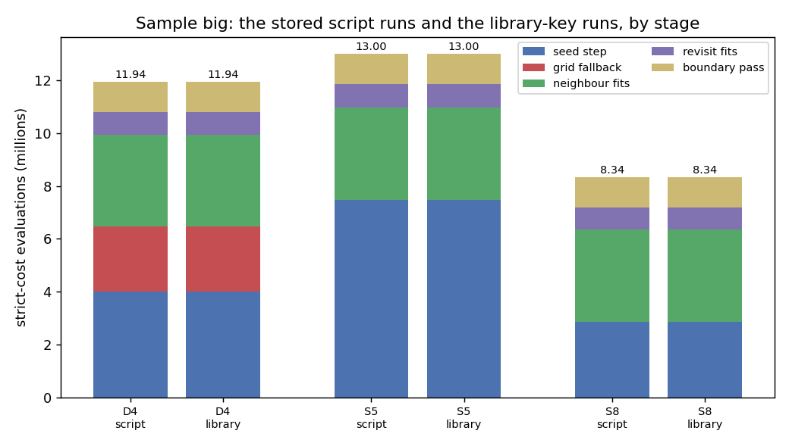

# AR3 step 10: opt-in keys for the indexed seed step and the boundary pass

Step 10 of "AR3" in `docs/autoresearch/PLAN.md`, task `ar3j`. This is the first AR3 step that
changes files under `icenine/`. It adds four opt-in config keys and one new module. Every key is
off by default, and with every key absent the library does what it did before. No default
changed, no golden changed, no dependency was added. The step **recommends no setting**: it says
what each key does and what was measured; the choice is the owner's.

Scripts are in `scripts/autoresearch/ar3/` (`libkeys_*.py`). Results are in
`benchmarks/autoresearch/ar3/keys/`. Every table below is filled from `tables.md` there.

**Why.** Steps 4 to 9 ran their seed steps, their local-optimization rule and their boundary pass
as script code wrapped around the library's BFS. A user could not switch any of it on from a
config file. Now they can. The check is that a config file alone reproduces the stored script
runs.

**Scope.** One sample (`big`: 32 grains, 24,570 voxels, clean images, Q-max 8), one run of each
pipeline, one voxel order (`default_rng(0)`). The runs are not new science: each library run
should give the stored script run of the same name. No real sample, no C++. No extra random seed.
Two more simulated samples appear only in the table of earlier script runs: `grad`, step 3's
gradient sample (497 grains, orientation gradients up to 1 degree), and `mid`, step 9's sample
(120 grains); both are on the same 24,570-voxel grid. Which counts carry an interval: the wrong
counts of the table of earlier runs and of "Scores" have a Wilson 95% interval (in percent of the
24,570 voxels). The wrong columns of the evaluation table repeat those numbers without one. The
in-run pass is compared by paired counts by voxel (fixed, broken, both wrong). Evaluation and try
counts have no interval: they are exact counts of one run. There are no p-values. Every wall
time here was measured with other jobs running (contended) and is not a timing result.

## Terms

- **Evaluation**: one call of the strict cost function (a raw count). Indexing is not counted.
- **BFS**: `BFSReconstruction`; it spreads from voxel to voxel. **Neighbour fit**: the local
  optimization of a voxel from a fitted neighbour's orientation. A **revisit** is a later fit of a
  voxel the BFS had rejected. A **reseed** is a new seed placed in a leftover cluster of rejected
  voxels.
- **Seed step**: ray indexing proposes candidate orientations; the first ones get the strict cost,
  the cheapest are refined by a local optimization. **Seed test**: the result passes if its hit
  ratio is at least 0.80. **Grid fallback**: the full grid search that runs when the seed step
  gives no candidate or fails the seed test.
- **Hit ratio**: the share of an orientation's predicted detector pixels that fall on observed
  intensity, in a voxel (0 to 1).
- **Early stop**: the seed step stops at the first refinement whose end has a hit ratio of at
  least a threshold (`S8`: 0.95) and keeps that end.
- **Boundary pass**: for each voxel with a neighbour more than 0.5 degree away, one try from each
  distinct neighbour orientation; the voxel keeps the best end (rule `hit`).
- **Wrong**: a voxel whose error against the truth is above 1 degree. Only the scoring script
  sees the truth.
- **Off path**: a run with every new key absent or written at its default.
- `D4`: indexed seeds (5 candidates costed, 2 refined) with the CMA-first neighbour fit. `S5`:
  `D4` with 20 costed and 5 refined. `S8`: `S5` with the early stop at 0.95. Each with the
  boundary pass. `D4L`, `S5L`, `S8L` are the same pipelines run by the library keys.

## The four keys

All four are in the config file, parsed in `config_file.py`, carried by `SearchParameters`, and
checked together by `check_bfs_keys` when a `BFSReconstruction` is made. A bad value raises
`ValueError` when the file is read. A bad combination raises `ValueError` before any search.

- **`BFSNeighborCMAFirst 0|1`** (default 0). Each neighbour and revisit fit first runs a CMA fit
  (first step `CMASigma0`, at most `CMANeighborMaxEvals` evaluations; the stored runs used 0.05
  degrees and 60). If its end cost is not below its start cost, the stock MC fit runs from the same
  start, and the lower cost is kept (the CMA end on a tie). Needs `LocalOptimizer mc`. Refused
  with `LocalOptimizer cma`, `OutwardSearch 1`, the hybrid optimizer and `PaintGrains 1`. The seed
  path and the grid search do not change. The library has the older `LocalOptimizer cma` with
  `CMARetrySigma0`; that is a different mode (it also changes the seed path and retries a
  rejection), and it was not used here.
- **`SeedIndexCandidates n_cost n_refine`** (default `5 2`). The seed step costs `n_cost`
  candidates and refines the `n_refine` cheapest. Valid: 1 <= `n_refine` <= `n_cost` <= 20.
  Needs `SeedByIndexing 1` when not at the default, and is then refused with `PaintGrains 1`
  (as is `SeedIndexStopHitRatio`).
- **`SeedIndexStopHitRatio t`** (default 0, off). With 0 < t <= 1, the early stop at hit ratio t.
  If no refinement reaches t, all are refined and the lowest cost is kept, as before. The hit
  ratio of each end is one overlap evaluation that is not counted in the totals (as in the stored
  `S8` run and in the seed test); the table "Costs left out of the totals" gives the number for
  `S8L`. Needs `SeedByIndexing 1`.
- **`BoundaryPass 0|1`** (default 0). After the reseeds (and the restart pass, if on), before the
  `.mic` is written, the pass runs once on the whole map with rule `hit`. Its settings are
  constants of `icenine/boundary_pass.py`, not keys: 0.5 degree threshold, a CMA fit of first
  step 0.05 degrees and at most 60 evaluations per try, its own generator `default_rng(0)`,
  voxels in index order, candidates in neighbour-index order. Every voxel that has a fitted
  orientation is a target and a source; a voxel that was never fitted is skipped in both roles.
  The pass keeps no truth. It is refused with `PaintGrains 1`.

The three runs of this page are `key_on_fused.config` plus:

```
D4L:  BFSNeighborCMAFirst 1, CMASigma0 0.05, CMANeighborMaxEvals 60, BoundaryPass 1
S5L:  as D4L, plus SeedIndexCandidates 20 5
S8L:  as S5L, plus SeedIndexStopHitRatio 0.95
```

New stats (only when the key is on): `cma_first_fallback_runs` and `cma_first_fallback_won`
(MC fits run after the CMA fit, and the ones that won); `index_stopped_early` and `stopped_at` in
each `index_log` entry; `boundary_voxels`, `boundary_tries`, `boundary_changed`,
`n_evals_boundary_pass`, `n_evals_boundary_score` and a wall time. `bfs.boundary_log` keeps the old
and new orientation of each voxel the pass changed, so the map before the pass can be rebuilt.

## The plot: the same pipelines, by script and by library keys

Reading line: each pair of bars is one pipeline on `big`; the left bar is the stored script run,
the right bar the library-key run. The height is millions of evaluations; the colours are the
stages. The script and library bars are the same height to two decimals in every pair.



Reading line for the table: the same numbers in full. `pass` is the evaluations of the boundary
pass's tries; the strict scoring of each boundary voxel's old end is one more evaluation per
boundary voxel and is left out of `total`, as in step 8 (the next table gives the numbers).
The `wrong` columns count voxels above 1 degree.

<!-- table:keys_evals -->
| run | code | seeds | reseeds | grid | seed_step | grid_fallback | neighbour | revisit | pass | total | wrong_before | wrong_after |
|---|---|---|---|---|---|---|---|---|---|---|---|---|
| D4 | script | 38 | 291 | 8 | 4016458 | 2452689 | 3479526 | 863042 | 1131977 | 11943692 | 68 | 21 |
| D4 | library | 38 | 291 | 8 | 4016458 | 2452689 | 3479526 | 863042 | 1131977 | 11943692 | 68 | 22 |
| S5 | script | 35 | 314 | 0 | 7469574 | 0 | 3513895 | 884040 | 1132343 | 12999852 | 71 | 30 |
| S5 | library | 35 | 314 | 0 | 7469574 | 0 | 3513895 | 884040 | 1132343 | 12999852 | 71 | 30 |
| S8 | script | 37 | 292 | 0 | 2856712 | 0 | 3491437 | 853714 | 1138565 | 8340428 | 67 | 24 |
| S8 | library | 37 | 292 | 0 | 2856712 | 0 | 3491437 | 853714 | 1138504 | 8340367 | 67 | 24 |
<!-- /table:keys_evals -->

Before the pass, every number is equal. After the pass, the evaluation total of `S8` differs by
one try (61 evaluations), and the wrong count of `D4` is 22 against 21. Check 2 gives a reading
that fits and the test of it.

**Costs left out of the totals.** Reading line: one row per library run.
`boundary_score_evals` is the strict scoring of each boundary voxel's old end (one evaluation per
boundary voxel). `early_stop_hit_evals` is the overlap evaluation that gives the hit ratio of
each refinement end in a seed step with the early stop (0 where the key is off; the `S8L` number
is from the fixes-round rerun of `S8L`, whose map before the pass equals step 10's byte for
byte). Neither
is in `total`. The wall times are contended (other jobs were running) and are not timings.

<!-- table:keys_uncounted -->
| run | boundary_score_evals | early_stop_hit_evals | wall_s | pass_wall_s |
|---|---|---|---|---|
| D4L | 11,087 | 0 | 1,090 | 125.4 |
| S5L | 11,049 | 0 | 1,156 | 123.5 |
| S8L | 11,054 | 465 | 865 | 128.0 |
<!-- /table:keys_uncounted -->

## What was measured before (steps 7 to 9)

Reading line: one row per sample and pipeline; "evals with pass" is all strict-cost evaluations
of the BFS plus the pass's tries; "wrong" counts voxels above 1 degree, before and after the
pass, each with its Wilson 95% interval in percent of the 24,570 voxels. These came from the
script runs, not from the keys; `S5` on `mid` is from step 9's page. `grad` and `mid` are defined
under "Scope".

<!-- table:keys_measured -->
| sample | run | evals_with_pass | wrong_before | before_ci_pct | wrong_after | after_ci_pct |
|---|---|---|---|---|---|---|
| big | D4 | 11943692 | 68 | 0.22 to 0.35 | 21 | 0.06 to 0.13 |
| big | S5 | 12999852 | 71 | 0.23 to 0.36 | 30 | 0.09 to 0.17 |
| big | S8 | 8340428 | 67 | 0.21 to 0.35 | 24 | 0.07 to 0.15 |
| grad | D4 | 38807186 | 225 | 0.80 to 1.04 | 74 | 0.24 to 0.38 |
| grad | S5 | 20629760 | 203 | 0.72 to 0.95 | 62 | 0.20 to 0.32 |
| grad | S8 | 18000230 | 210 | 0.75 to 0.98 | 63 | 0.20 to 0.33 |
| mid | D4 | 40560874 | 94 | 0.31 to 0.47 | 48 | 0.15 to 0.26 |
| mid | S5 | 39093613 | 87 | 0.29 to 0.44 | 34 | 0.10 to 0.19 |
| mid | S8 | 26443074 | 84 | 0.28 to 0.42 | 31 | 0.09 to 0.18 |
<!-- /table:keys_measured -->

## Check 1: exact numbers of the BFS before the pass

Written down before the runs: each library run gives the stored run's numbers exactly. The
numbers were also compared counter by counter (every numeric counter except wall times), voxel by
voxel (the 24,570 records, all fields except the wall time) and byte by byte (the map before the
pass, rebuilt from `bfs.boundary_log` and written as a `.mic`, against the stored run's
`recon.mic.gz`).

Reading line: one row per number and run; "library" is this step's run, "stored" the script run.
`wrapper` rows compare the stored fit wrapper's counts with the library's counters.

<!-- table:keys_exact -->
| run | number | library | stored | verdict |
|---|---|---|---|---|
| D4L | seeds | 38 | 38 | exact |
| D4L | reseeds | 291 | 291 | exact |
| D4L | grid | 8 | 8 | exact |
| D4L | evals_before_pass | 10,811,715 | 10,811,715 | exact |
| D4L | counters (all numeric, no wall times) | 0 differ | 36 compared | exact |
| D4L | per-voxel records | equal | 24,570 voxels | exact |
| D4L | map before the pass vs stored recon.mic | equal | 6,535,568 bytes | exact |
| D4L | wrapper: fits | 32,562 | 32,562 | exact |
| D4L | wrapper: mc_fallbacks | 3,194 | 3,194 | exact |
| D4L | wrapper: fallback_won | 4 | 4 | exact |
| S5L | seeds | 35 | 35 | exact |
| S5L | reseeds | 314 | 314 | exact |
| S5L | grid | 0 | 0 | exact |
| S5L | evals_before_pass | 11,867,509 | 11,867,509 | exact |
| S5L | counters (all numeric, no wall times) | 0 differ | 33 compared | exact |
| S5L | per-voxel records | equal | 24,570 voxels | exact |
| S5L | map before the pass vs stored recon.mic | equal | 6,535,568 bytes | exact |
| S5L | wrapper: fits | 32,673 | 32,673 | exact |
| S5L | wrapper: mc_fallbacks | 3,235 | 3,235 | exact |
| S5L | wrapper: fallback_won | 3 | 3 | exact |
| S8L | seeds | 37 | 37 | exact |
| S8L | reseeds | 292 | 292 | exact |
| S8L | grid | 0 | 0 | exact |
| S8L | evals_before_pass | 7,201,863 | 7,201,863 | exact |
| S8L | counters (all numeric, no wall times) | 0 differ | 33 compared | exact |
| S8L | per-voxel records | equal | 24,570 voxels | exact |
| S8L | map before the pass vs stored recon.mic | equal | 6,535,568 bytes | exact |
| S8L | early stop: stopped_early | 322 | 322 | exact |
| S8L | early stop: seed_steps | 329 | 329 | exact |
| S8L | early stop: seed_step_evals | 2,856,712 | 2,856,712 | exact |
<!-- /table:keys_exact -->

All 30 rows are exact. The library has 7, 7 and 8 more counters than the stored runs (the new
ones listed above); no stored counter is missing and none differs. One label in the result files
looks wrong but is not: `check_S8L.json` names the stored run "S5". That is the name inside the
stored `S8` run's `run.json`, because the step 8 script ran the `S5` runner with the early stop
added. Its `s8.json` reads "S8 = S5 + E1", and the totals compared are `S8`'s.

## Check 2: the boundary pass

The pass is checked twice; part (3) tests the reading of the second check (fixes round).

**(1) On the stored map.** The script read the BFS's `.mic` file, whose angles are rounded to 4 and
6 decimals. The library pass was applied to the same rounded map (`before_<run>.npy`, with every
voxel marked fitted). Reading line: one row per stored map; every try is compared in voxel,
candidate, end orientation (as float32, the way the script stored it), cost, hit ratio,
confidence and evaluations.

<!-- table:keys_pass1 -->
| stored map | tries | tries_stored | evals | evals_stored | tries_differing | voxels_changed | other_end |
|---|---|---|---|---|---|---|---|
| D4 | 18,557 | 18,557 | 1,131,977 | 1,131,977 | 0 | 1057 | 0 |
| S5 | 18,563 | 18,563 | 1,132,343 | 1,132,343 | 0 | 1038 | 0 |
| S8 | 18,665 | 18,665 | 1,138,565 | 1,138,565 | 0 | 1056 | 0 |
<!-- /table:keys_pass1 -->

All three are exact: the tries, the evaluations, the voxels that changed, and the map after rule
`hit` (compared after the script's own float32 rounding and orthonormalization; the unrounded
library ends are at most 5.6e-8 from the stored ones).

**(2) In the run.** The library pass reads the map in memory, so its input is not rounded. The plan
predicted that the tries would start a tiny angle apart, and said the same tries and counts were
not guaranteed. Reading line: one row per run; "same_voxel_and_cand" counts the tries made from
the same (voxel, candidate) pair in both lists; "same_end" counts tries whose end is equal to
the last bit; `fixed`, `broken` and `both_wrong` count voxels wrong in the stored map only, in
the library map only, or in both (paired by voxel).

<!-- table:keys_pass2 -->
| run | tries | tries_stored | evals | evals_stored | same_voxel_and_cand | same_end | wrong_after | wrong_after_stored | fixed | broken | both_wrong |
|---|---|---|---|---|---|---|---|---|---|---|---|
| D4L | 18,557 | 18,557 | 1,131,977 | 1,131,977 | 18556 | 14 | 22 | 21 | 0 | 1 | 21 |
| S5L | 18,563 | 18,563 | 1,132,343 | 1,132,343 | 18563 | 11 | 30 | 30 | 0 | 0 | 30 |
| S8L | 18,664 | 18,665 | 1,138,504 | 1,138,565 | 18661 | 5 | 24 | 24 | 5 | 5 | 19 |
<!-- /table:keys_pass2 -->

What happened:

- `S5L`: the same tries and evaluations, and the same 30 wrong voxels (0 fixed, 0 broken, 30
  both wrong).
- `D4L`: the same number of tries and evaluations. The candidate lists agree except for one
  pair. Few ends are equal to the last bit, as the table shows: the ends differ in the small
  digits, and the largest cost difference between a library try and the stored one is 0.458 (a
  try that took another path). The wrong count is 22 against 21: voxel 19614 is wrong in the
  library map and right in the stored one (1 broken, 0 fixed, 21 both wrong).
- `S8L`: one try fewer (18,664 against 18,665) and 61 fewer evaluations. Voxels 8679 and 8687 had
  a different candidate list (3 pairs only in the library, 4 only in the stored run). The wrong
  count is 24 in both, but 5 voxels are fixed and 5 broken against the stored map (19 both
  wrong).

These are small counts. The differences are reported as they are; no setting was changed to
remove them. Check (1) and the in-run pass differ in two ways. One is the input map: check (1)
read the map rounded to the `.mic`'s decimals, the in-run pass reads it unrounded. The other is
the process: check (1) ran in a fresh process, while the in-run pass runs after the whole BFS in
the same process. The reading was that the rounding gives the difference. Step 10 did not test
it; the fixes round did (next part).

**(3) The reading, tested (fixes round, decision D-20261111-N9).** The step 10 cache does not
hold the map the in-run pass read: the records carry no orientations, the `.mic` is rounded, and
the stored tries keep their ends as float32. So `S8L` and `D4L` were run again with the same keys
(`libkeys_fresh.py`, side by side, contended). The script saves the map just before the in-run
pass (every voxel's orientation as float64, its state, cost, confidence and hit ratio). After the
BFS, in the same process, it writes that map as a `.mic`, reads it back as the step 5 script did,
and applies the pass to the rounded map. A second, fresh process puts the saved unrounded map
into a new BFS's map and applies the pass. Every try is compared voxel by voxel (candidate, end,
cost, hit ratio, confidence, evaluations). The prediction, written before the runs: all four
comparisons (i) to (iv) below are equal. Row (v) was added after the pilot, to show the size of
the rounding's effect; it is not a prediction.

Reading line: one row per run and comparison. "a" is the first pass named, "b" the second.
`voxels_differing` counts boundary voxels whose list of tries differs in any field (ends compared
as float64 where both passes kept them, otherwise as float32). The two (ii) rows compare the map
files: the rerun's map before the pass against step 10's, and the map read back from the `.mic`
against the map the stored pass script read (`before_<run>.npy`).

<!-- table:keys_fresh -->
| run | compared | tries_a | tries_b | evals_a | evals_b | voxels_differing | verdict |
|---|---|---|---|---|---|---|---|
| D4L | (i) rerun's in-run pass vs step 10's in-run pass | 18,557 | 18,557 | 1,131,977 | 1,131,977 | 0 | equal |
| D4L | (iii) same process, rounded map vs script tries | 18,557 | 18,557 | 1,131,977 | 1,131,977 | 0 | equal |
| D4L | (iv) fresh process, unrounded map vs in-run pass | 18,557 | 18,557 | 1,131,977 | 1,131,977 | 0 | equal |
| D4L | (v) same process, rounded map vs in-run pass | 18,557 | 18,557 | 1,131,977 | 1,131,977 | 11087 | differ |
| D4L | (ii) before-pass .mic vs step 10's (bytes) |  |  |  |  |  | equal |
| D4L | (ii) map read back vs the script's before_*.npy |  |  |  |  |  | equal |
| S8L | (i) rerun's in-run pass vs step 10's in-run pass | 18,664 | 18,664 | 1,138,504 | 1,138,504 | 0 | equal |
| S8L | (iii) same process, rounded map vs script tries | 18,665 | 18,665 | 1,138,565 | 1,138,565 | 0 | equal |
| S8L | (iv) fresh process, unrounded map vs in-run pass | 18,664 | 18,664 | 1,138,504 | 1,138,504 | 0 | equal |
| S8L | (v) same process, rounded map vs in-run pass | 18,665 | 18,664 | 1,138,565 | 1,138,504 | 11054 | differ |
| S8L | (ii) before-pass .mic vs step 10's (bytes) |  |  |  |  |  | equal |
| S8L | (ii) map read back vs the script's before_*.npy |  |  |  |  |  | equal |
<!-- /table:keys_fresh -->

The prediction held for both runs. (i) The rerun gives step 10's in-run pass again, try for try,
so the run is repeatable. (iii) In the same process, after the BFS, the pass on the rounded map
gives the script's stored tries exactly, as check (1) did in a fresh process. (iv) In a fresh
process, the pass on the unrounded map gives the in-run pass exactly, ends equal as float64.
(v) The rounded and the unrounded map, in the same process, give different tries in every
boundary voxel (11,087 for `D4L`, 11,054 for `S8L`) and a different set of changed voxels. So,
for these two runs, tested: running after the BFS in the same process does not change the pass;
the input rounding alone accounts for the difference between the in-run pass and the stored one.
`S5L` was not rerun, so for it this stays a reading (its in-run pass had the stored counts and
the same wrong voxels, with ends that differ in the small digits).

## Check 3: the off path

The BFS on the 2,000-voxel pilot region with `key_on_fused.config`, every new key absent, clean
images, `default_rng(0)`. It ran once on the parent commit's package and once on this branch's.
Reading line: one row per output file; equal means the files are byte-identical (the stats and
logs without their wall times).

<!-- table:keys_off -->
| file | parent vs branch | bytes |
|---|---|---|
| recon.mic | equal | 530,981 |
| orient.npy | equal | 144,128 |
| records.json | equal | 505,215 |
| stats.json | equal | 843 |
| logs.json | equal | 31,917 |
<!-- /table:keys_off -->

All five files are equal. The test file `tests/test_bfs_ar3_keys.py` also compares key absent with
the keys written at their defaults (orientations, records, stats, no new stats key, no new
`index_log` field), and the scripted-grid golden with the keys written at their defaults.

## Tests

`tests/test_bfs_ar3_keys.py` had 57 tests, written and committed before the code. They cover the
defaults and parsing, the bad values and combinations, the off path, the arguments of the seed
step, the early stop on scripted refinements, the neighbour fit and the pass against the script
code written out by hand on the ThreeVoxels toy (real images), and the boundary pass on a scripted
grid and on the toy. The fixes round added two cases (a third number after `SeedIndexCandidates`
is refused; the seed-step call with its defaults written out). Two tests now compare with values
recorded from the parent code (commit 4ff3ce6): the CMA run's orientation, cost, evaluations and
stop reason, and the toy's seed step without the stop. One test was renamed to what it checks
(`refine_from_candidates` makes no CMA call with `BFSNeighborCMAFirst` on). The file now has 59
tests, all passed. The full suite on this branch after the fixes: 1576 passed, 47 skipped, 1
deselected (`keys/suite.json`).

## What is not claimed

- That the keys give the same result on a real sample, or with realistic images. The sample is a
  simulation with clean images.
- That any of the three pipelines should be the default or the recommended setting.
- A timing. Every run was contended. The wall times were 1,090 s (`D4L`), 1,156 s (`S5L`) and
  865 s (`S8L`), each with a pass of 123.5 to 128.0 s (table "Costs left out of the totals").
  The planned single-worker pair (`D4L` and `S8L` without the pass) was not run: the timing
  preflight refused because another process held a CPU, in step 10 and again in the fixes round.
- That three or one sample stand for all samples.

## Scores

The wrong counts after the pass, with Wilson 95% intervals over the 24,570 voxels: `D4L` 22 (0.059%
to 0.136%), `S5L` 30 (0.086% to 0.174%), `S8L` 24 (0.066% to 0.145%). The stored script runs had 21,
30 and 24. Before the pass the counts are 68, 71 and 67 in both, voxel for voxel.
