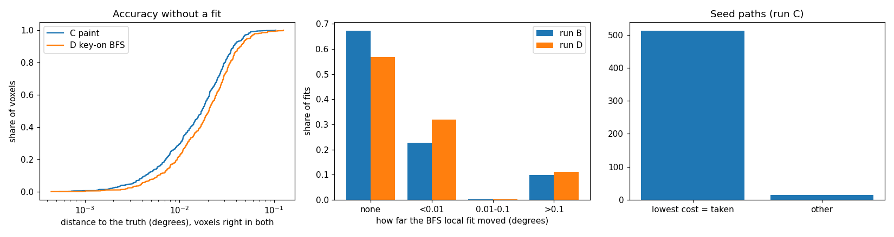

# AR3 step 2: the key PaintGrains and the whole layer

Step 2 of "AR3: index the layer and paint grains" in `docs/autoresearch/PLAN.md` (2026-11-10),
under D-20261110-N2, task `ar3b`. New: the opt-in config key `PaintGrains` (default off), which
runs `icenine/grain_paint.py` in place of the BFS. Scripts: `scripts/autoresearch/ar3/`. Results:
`benchmarks/autoresearch/ar3/layer/` (`summary.json`, `tables.md`, `ar3_layer.png`, `runs/A` to
`runs/D`). The tables are copied from `tables.md` by `scripts/dev/sync_doc_tables.py`. The
implementer's write of this `.md` was refused by the tool, so the main session placed it from the
implementer's returned text.

Terms (as in step 1). A **grain entry** is one accepted seed. To **score** a grain on a voxel is
one strict evaluation of its orientation there, with no fit. A grain **passes** by the BFS's own
neighbour test. A voxel is **contested** when two or more grains pass on it. To **paint** is to
give a voxel the passing grain with the lowest strict cost. "Wrong" means more than 1 degree from
the truth (symmetry-reduced). Counts are by voxel; intervals are Wilson 95%; no p-values.

Runs (clean images, Q-max 8, `FusedCost` on, one worker, one fixed voxel order). **A**: pilot
region (2,000 voxels), paint through the key. **B**: pilot, key-on BFS with the fit log. **C**:
whole layer (24,570 voxels, 497 true grains), paint through the key. **D**: whole layer, key-on
BFS with the fit log. In C and D the rays are paired with the layer's own hull, so the pilot
voxels inside C and D do not see the same rays as in A and B.

## The result in one picture

Reading the picture. Left: distance to the truth of the 24,411 voxels right in both C and D,
painted without a fit (C) and fitted by the BFS (D); cumulative shares. Middle: how far the BFS's
local fits moved from their start, runs B (pilot) and D (layer). Right: in the 528 seed paths of
C, how often the candidate with the lowest strict cost is the one the finisher ends on.

- Painting the whole layer costs 1,316,345 evaluations. The key-on BFS costs 33,040,126. Painting
  is 4.0% of it (pilot region 4.4%, the other 22,570 voxels 3.9%).
- Painting has 14 wrong voxels of 24,570 (0.03 to 0.10%). The key-on BFS has 153 (0.53 to 0.73%).
  Paired against D: 145 fixed, 6 broken, 8 wrong in both. The two error rates' intervals do not
  overlap, in the layer and in each part, so by the plan's wording rule this is called a gain.
  Scale: two runs of the same key-off arm on the pilot differ by 20 voxels one way and 7 the
  other (of 2,000). The run-to-run difference of one arm on the whole layer is not measured; no
  extra seeds are run.
- The rest of the layer (22,570 voxels, not seen while the method was worked out): 13 wrong for
  C, 134 for D; fixed 126, broken 5, both wrong 8.
- The direct test holds: on 363 contested voxels whose passing grains are over 1 degree apart,
  the lowest strict cost names the true grain on 350 (94.0 to 97.9%). All 13 misses are
  edge-sharing boundary voxels. 2,023 more contested voxels are passed only by entries of one
  grain; the test cannot fail there.
- All 14 wrong voxels of C and all 153 of D carry the orientation of a grain that touches the
  voxel (all edge-sharing). None is interior or corner-only.
- The rule "no fit on a contested voxel" holds: one local fit from each of the two lowest-cost
  grains fixes 0 and breaks 0 of the 363 voxels, at every margin, for 482,493 evaluations (36.7%
  of C's).
- No local fit was accepted (0 of 372 tried), no voxel failed or stayed unpainted, the grid
  search never ran.
- A BFS local fit rarely moves its start. In D, 56.8% of the 48,639 fits end exactly where they
  started and 31.9% move under 0.01 degrees; together 89.8% of D's local-fit evaluations. A
  reading on a sample where each grain has one orientation.
- Wall time (contended): C 194.3 s, D 2,263.8 s.

## Checks before C and D

- **A gives step 1 again**: 156,766 evaluations, same split (seed paths 119,033; scoring 6,697;
  rejected fits 31,036; grid 0), 62 entries, same orientation on every voxel as
  `runs/paint/recon.mic` (0 of 2,000 differ). Passed.
- **B is the stored run**: 2,816,897 evaluations, same orientation on every voxel as the stored
  `key_on_fused` map (0 of 2,000 differ). So the off path is unchanged and the fit log does not
  disturb the run. Passed.
- **Tests**: `tests/test_paint_key.py` (6: key parses, default off; the two refused settings
  raise a `ValueError` naming the keys; key off never calls the loop and a small BFS run is
  unchanged; key on gives the same map and stage evaluations as a direct call, and the stages
  sum to the cost function's and seed paths' counts). Full suite: 1511 passed, 44 skipped, 1
  deselected.

## Evaluations

Reading the table. One row per run on the whole layer. "seed" is seed paths, "score" single
strict scores of the floods, "fit" local fits, "grid" grid searches; "pilot" and "rest" split the
total by the voxel the work was spent on; last column: wrong voxels of the layer.

<!-- table:ar3b_evals -->
| run | total | seed | score | fit | grid | pilot | rest | wrong |
|---|---|---|---|---|---|---|---|---|
| C paint (key PaintGrains) | 1,316,345 | 990,350 | 79,979 | 246,016 | 0 | 124,324 | 1,192,021 | 14 of 24570 (0.03 to 0.10%) |
| D key-on BFS | 33,040,126 | 1,131,396 | 0 | 31,908,730 | 0 | 2,829,045 | 30,211,081 | 153 of 24570 (0.53 to 0.73%) |
<!-- /table:ar3b_evals -->

- C: 528 seed paths (75.2% of its evaluations, 1,875.7 each), 79,979 scores (6.1%), 372 rejected
  local fits (18.7%). The cost function's own count is 79,979, equal to the scores.
- D: seed paths 1,131,396 (3.4%), local fits 31,908,730 (96.6%); the per-voxel records add up to
  the same total.
- One-time pairing of the two detectors' spots: 19.1 s in C, 17.5 s in D.

## Wrong voxels

Reading the tables. C is painting, D the key-on BFS. "fixed" is wrong in D and right in C,
"broken" the reverse, "both" wrong in both. The kinds table splits wrong voxels by position
(edge: a voxel of another grain shares an edge; corner; interior); "crossC" and "crossD" count
wrong voxels that carry the orientation of a grain touching the voxel.

<!-- table:ar3b_paired -->
| region | voxels | C | D | fixed | broken | both | intervals |
|---|---|---|---|---|---|---|---|
| layer | 24,570 | 14 of 24570 (0.03 to 0.10%) | 153 of 24570 (0.53 to 0.73%) | 145 | 6 | 8 | do not overlap |
| pilot | 2,000 | 1 of 2000 (0.01 to 0.28%) | 19 of 2000 (0.6 to 1.5%) | 19 | 1 | 0 | do not overlap |
| rest | 22,570 | 13 of 22570 (0.03 to 0.10%) | 134 of 22570 (0.50 to 0.70%) | 126 | 5 | 8 | do not overlap |
<!-- /table:ar3b_paired -->

<!-- table:ar3b_kinds -->
| region | kind | voxels | C | D | crossC | crossD |
|---|---|---|---|---|---|---|
| layer | edge | 8,873 | 14 | 153 | 14 | 153 |
| layer | corner | 8,022 | 0 | 0 | 0 | 0 |
| layer | interior | 7,675 | 0 | 0 | 0 | 0 |
| pilot | edge | 813 | 1 | 19 | 1 | 19 |
| pilot | corner | 723 | 0 | 0 | 0 | 0 |
| pilot | interior | 464 | 0 | 0 | 0 | 0 |
| rest | edge | 8,060 | 13 | 134 | 13 | 134 |
| rest | corner | 7,299 | 0 | 0 | 0 | 0 |
| rest | interior | 7,211 | 0 | 0 | 0 | 0 |
<!-- /table:ar3b_kinds -->

- The pilot voxels inside C have 1 wrong voxel (step 1: 0), inside D 19 (stored run: 22). The
  rays differ (the layer's hull), so this is not the same experiment as step 1.
- **The 6 breaks** (wrong in C, right in D): 1 in the pilot, 5 in the rest; all edge-sharing, all
  carry the orientation of a touching grain. In all 6 the true grain's entry passes on the voxel
  and loses on strict cost.
- **The 145 fixes**: in 125 the grain D gave the voxel passes in paint and loses on strict cost;
  in 20 it does not pass at all. 0 have no entry near D's orientation. Why D's fit left the
  passing grain in those 20 was not traced.

## The direct test

Reading the table. Every contested voxel whose passing grains are over 1 degree apart: is the
lowest-cost grain the true grain? "highest_hit" is the same for the highest hit ratio; "differ"
counts voxels where the two rules name different grains. All 363 are edge-sharing voxels, so the
corner and interior rows are empty.

<!-- table:ar3b_direct -->
| region | n | lowest_cost | highest_hit | differ |
|---|---|---|---|---|
| layer | 363 | 350 of 363 (94.0 to 97.9%) | 360 of 363 (97.6 to 99.7%) | 14 of 363 (2.3 to 6.4%) |
| layer, edge | 363 | 350 of 363 (94.0 to 97.9%) |  |  |
| layer, corner | 0 | 0 of 0 |  |  |
| layer, interior | 0 | 0 of 0 |  |  |
| pilot | 47 | 46 of 47 (88.9 to 99.6%) | 47 of 47 (92.4 to 100.0%) | 1 of 47 (0.4 to 11.1%) |
| pilot, edge | 47 | 46 of 47 (88.9 to 99.6%) |  |  |
| pilot, corner | 0 | 0 of 0 |  |  |
| pilot, interior | 0 | 0 of 0 |  |  |
| rest | 316 | 304 of 316 (93.5 to 97.8%) | 313 of 316 (97.2 to 99.7%) | 13 of 316 (2.4 to 6.9%) |
| rest, edge | 316 | 304 of 316 (93.5 to 97.8%) |  |  |
| rest, corner | 0 | 0 of 0 |  |  |
| rest, interior | 0 | 0 of 0 |  |  |
<!-- /table:ar3b_direct -->

- The true grain is among the passing grains on all 363. The lowest cost is wrong on 13, the
  highest hit ratio on 3; the two differ on 14. The intervals (94.0 to 97.9% and 97.6 to 99.7%)
  overlap slightly, so no ranking of the two rules is claimed; the key keeps the lowest cost (the
  rule of step 1).
- Contested voxels between two entries of one grain: 2,023 (155 in the pilot). They cannot fail.

## The rule "no fit on a contested voxel"

Reading the table. The side arm of step 1 on C's 363 contested voxels (passing grains over 1
degree apart, none fit-settled): one local fit from each of the two lowest-cost grains, the lower
final cost kept. "m": the rule "fit when the two lowest costs are closer than m"; "evals" the
fits' evaluations. Fixed and broken are against C. The curve is read on this run; it does not
test a margin.

<!-- table:ar3b_side -->
| m | voxels | evals | fixed | broken |
|---|---|---|---|---|
| 0.001 | 1 | 1,324 | 0 | 0 |
| 0.003 | 4 | 5,296 | 0 | 0 |
| 0.01 | 36 | 47,664 | 0 | 0 |
| 0.03 | 76 | 101,126 | 0 | 0 |
| 0.1 | 337 | 448,196 | 0 | 0 |
| 0.3 | 363 | 482,493 | 0 | 0 |
| 1 | 363 | 482,493 | 0 | 0 |
| all | 363 | 482,493 | 0 | 0 |
<!-- /table:ar3b_side -->

- Fixed 0, broken 0 at every margin: the rule holds by the plan's test. All 363 kept fits end
  within 0.01 degrees of the entry they started from (186 exactly at it; none over 0.1).
  Consistent with the local fit not leaving its start on these voxels; why was not tested.
- Cost: 482,493 evaluations for no change in the map.

## The grain list

- 497 true grains, 528 entries (all from the seed path, none from the grid). Every true grain has
  an entry; every entry matches a true grain within 1 degree. 31 grains hold two entries.
- 32 entries are within 1 degree of an earlier entry: 31 are a second entry of the same true
  grain (0.003 to 0.124 degrees apart); 1 is a different true grain 0.749 degrees away (grains
  341 and 11). 3 are in the pilot (step 1: 2).
- Cost of the duplicates: 61,977 evaluations in seed paths and 5,872 scores in floods, 67,849 in
  all, 5.2% of C's.
- Which test let a duplicate become a seed: all 32 first got a local fit from a grain that
  already scored the voxel, and it was rejected: its hit ratio over that grain's best was 0.674
  to 0.900 (31 of 32 between 0.849 and 0.900, just under the 0.9 line); the seed's own hit ratio
  was 0.896 to 1.0. No merge rule is built here.

## Voxels no grain paints, and fit-settled voxels

- Unpainted 0, failed 0, grid fallbacks that ran 0. The fallback is still untested on real
  voxels, now on 24,570.
- Fit-settled: 0 accepted of 372 tried. The choice between "the fit is kept" and "the lowest cost
  wins" changed no voxel; the numbers favour neither; the key keeps step 1's rule.

## Accuracy without a fit

Reading the picture above (left) first, then the table: distance to the truth in degrees of
voxels right in both runs. C's map holds one value per entry (528), so the percentiles are
weighted by grain size, not independent.

<!-- table:ar3b_accuracy -->
| region | n | C_p50 | C_p90 | C_p99 | D_p50 | D_p90 | D_p99 |
|---|---|---|---|---|---|---|---|
| layer | 24411 | 0.0172 | 0.0374 | 0.0566 | 0.0205 | 0.0446 | 0.0858 |
| pilot | 1980 | 0.0126 | 0.0349 | 0.0571 | 0.0142 | 0.0351 | 0.0814 |
| rest | 22431 | 0.0177 | 0.0374 | 0.0566 | 0.0207 | 0.0451 | 0.0858 |
<!-- /table:ar3b_accuracy -->

- Layer: median 0.0172 degrees for C, 0.0205 for D; 90th percentile 0.0374 against 0.0446; over
  0.1 degrees 53 voxels in C and 171 in D (of 24,411). Painting without a final fit is as
  accurate as the BFS's fits on this sample (one orientation per grain); a final fit is not
  needed here for accuracy at this scale.

## The fit log (a reading for an early stop)

Reading the tables. Every local fit of the BFS: how far it moved from its start (crystal symmetry
applied), the share of fits and their evaluations. B is the pilot, D the layer. The start's
strict score is one extra evaluation per fit on a second cost function (4,095 and 48,639),
counted apart.

<!-- table:ar3b_fitlog_B -->
| moved | fits | share | evals | evals_share |
|---|---|---|---|---|
| not at all | 2,756 | 0.673 | 1,830,998 | 0.679 |
| under 0.01 | 932 | 0.228 | 619,494 | 0.230 |
| 0.01 to 0.1 | 6 | 0.001 | 3,752 | 0.001 |
| over 0.1 | 401 | 0.098 | 240,499 | 0.089 |
<!-- /table:ar3b_fitlog_B -->

<!-- table:ar3b_fitlog_D -->
| moved | fits | share | evals | evals_share |
|---|---|---|---|---|
| not at all | 27,644 | 0.568 | 18,345,781 | 0.575 |
| under 0.01 | 15,501 | 0.319 | 10,317,886 | 0.323 |
| 0.01 to 0.1 | 91 | 0.002 | 51,420 | 0.002 |
| over 0.1 | 5,403 | 0.111 | 3,193,643 | 0.100 |
<!-- /table:ar3b_fitlog_D -->

- In D, 88.7% of fits fall in the first two bins (89.8% of local-fit evaluations). Median start
  hit ratio 0.879 in D, 0.731 in B.
- The cost fall is 0 for 88.7% of D's fits (90.1% in B). By quartile of start cost it is largest
  in the top quartile (mean 0.0254 in D; 0.0001 in the third; under 0.00001 in the lowest two).
- For the 5,403 fits that moved over 0.1 degrees in D, the voxel is wrong at the end in 27 (0.34
  to 0.73%); for the other 43,236, in 209 (0.42 to 0.55%). In B: 6 of 401 and 27 of 3,694. A
  voxel whose fit moved a lot is not detectably more often wrong at the end.
- This says how much of the BFS's work could have been skipped on this sample. It picks a stop
  rule for AR5; it does not test one. Paint is the simplest such rule run for real.

## The seed record (a reading for a cheaper seed)

In the 528 seed paths of C (strict cost on up to 5 candidates, then the finisher on the best 2):

- The lowest-strict-cost candidate is the one the finisher ends on in 513 of 528 (95.4 to 98.3%).
- The finisher moves the taken candidate by a median 0.053 degrees (90th percentile 0.100, 99th
  0.156, largest 0.476) and lowers its strict cost by a median 0.054 (90th percentile 0.126).
- The finisher is 99.7% of a seed path's evaluations (1,875.7 on average).
- Consistent with: a finisher on the lowest-cost candidate alone would end on the same candidate
  in 513 of 528 and cut about half of the seed-path evaluations if the two finisher runs cost
  about the same. Not tested (accuracy of the shorter path was not measured); it is tested later
  (AR5).

## Wall time

Contended, one worker: the timing preflight was refused in every run because an editor process
(cpptools) used about 98 to 100% of one core (the same cause as step 1), so these are single runs
under contention, not clean timings. C 194.3 s (19.1 s the one-time pairing); D 2,263.8 s (17.5 s
pairing). A and B: 38.2 s and 215.5 s. The loop scores one voxel at a time in Python, so C's time
is a first reading of an unbatched loop. D took 11.7 times as long as C. Preflight JSONs are
beside the results.

## Not claimed

Nothing about realistic images or another Q-max; another voxel order; samples whose grains hold
more than one orientation (the truth map has exactly one per grain, so the premise holds by
construction); other layers; a tested stop rule or cheaper seed (both are readings); a tested
wall time; a parallel run. The fallback and the fit-settled branch still ended no voxel. The 8
voxels wrong in both runs were not traced.
