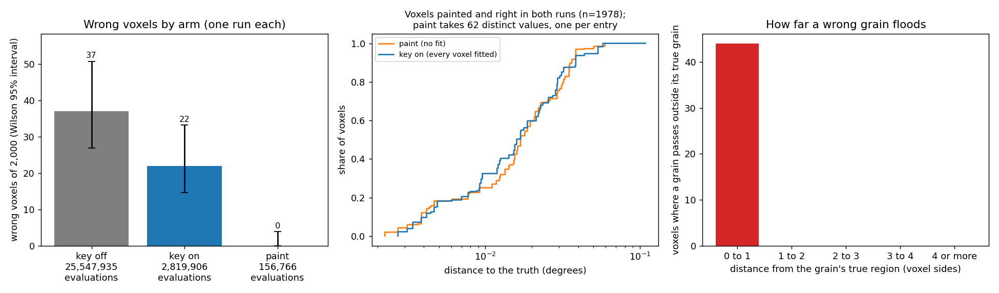

# AR3 step 1: painting grains on the pilot region

Step 1 of "AR3: index the layer and paint grains" in `docs/autoresearch/PLAN.md` (2026-11-10),
under D-20261110-N1. This is a study: `icenine/grain_paint.py` runs outside the reconstructor, and
no config key switches it on. Scripts: `scripts/autoresearch/ar3/`. Results:
`benchmarks/autoresearch/ar3/` (`summary.json`, `tables.md`, `ar3_paint.png`).

How this page was made. The implementer's write of a new `.md` file is refused by the tool, so it
returned the text and the main session wrote the file. The tables are copied from `tables.md` by
`scripts/dev/sync_doc_tables.py`, not typed. The review fixes of 2026-11-10 were edited into this
file by an implementer.

## The result in one picture

Reading the picture. Left: wrong voxels of 2,000 for each arm (one run each), with a Wilson 95%
interval and the evaluations under each bar. Middle: distance to the truth of the 1,978 voxels
that are painted and right in both runs, painted without a fit (orange) and in the key-on BFS
(blue). Both curves are steps: paint takes 62 distinct values (one per entry), and the key-on map
holds only 64 distinct orientations. Right: voxels where a grain passes outside its own true grain,
by distance from that grain.

- Painting the 2,000-voxel pilot costs 156,766 evaluations. The key-on BFS costs 2,819,906, the
  key-off BFS 25,547,935. Painting is 5.6% of the first and 0.6% of the second.
- Painting has 0 wrong voxels of 2,000 (0.0 to 0.2%). Key on has 22, key off 37. Against key on:
  22 fixed, 0 broken. That is about the size of the BFS's own run-to-run churn (20 voxels one way,
  7 the other), so the count alone is not called a gain. The one-sided split (22 and 0) is an
  observation of one run.
- What supports painting is the direct test. On the 44 contested voxels whose passing grains are
  over 1 degree apart, the lowest strict cost names the true grain in 44 of 44 (92 to 100%). The
  other 82 contested voxels are passed only by two entries of one grain, so the test cannot fail
  there.
- For 19 of the 22 key-on wrong voxels, the wrong grain passes in paint too and loses on cost. For
  the other 3, the wrong grain does not pass without a fit.
- Without a fit, the painted voxels' distances to the truth are close to the key-on run's: median
  0.0169 degrees against 0.0159, 90th percentile 0.0362 against 0.0384, largest 0.0594 against
  0.1085. These are 62 distinct values weighted by grain size, not 1,978 independent ones.
- The gate for step 2 is met: 0 breaks against key on (limit 20), and 5.6% of key on's evaluations
  (limit 50%).
- Main caveat: the truth of this sample has exactly one orientation per grain. So the premise of
  painting is true by construction here.

## Terms

- **Grain entry**: one accepted seed (voxel, orientation, hit ratio).
- **Hit ratio**: the share of predicted spots that fall on lit pixels.
- **Score** a grain on a voxel: one strict evaluation of the grain's orientation there, with no
  fit. It gives a cost and a hit ratio.
- A grain **passes** on a voxel by the BFS neighbour test, unchanged: hit ratio above 0.9 times the
  best seen so far in that grain's flood.
- **Flood**: score a grain on the neighbours of its seed, then on the neighbours of every voxel
  where it passes. A flood does not depend on other grains.
- **Contested**: two or more grains pass. **Unpainted**: none passes.
- **Paint**: give the voxel the passing grain with the lowest strict cost.
- **Wrong**: over 1 degree from the truth (crystal symmetry counted).
- **Edge-sharing**, **corner-only**, **interior**: another true grain shares an edge with the
  voxel, only a corner, or no vertex.
- **Key on**, **key off**: the BFS run with and without the indexing seed of AR2.

## What was built and run

`grain_paint.paint_grains` takes the voxels in the shuffled order of the AR2 BFS runs (no new
draw). For the next voxel that is unpainted and not settled:

1. If a grain was scored on it, one local fit starts from the lowest-cost such grain. If the fit
   passes the neighbour test, the voxel is settled by a fit.
2. Otherwise the seed path runs (index, strict cost on 5 candidates, finisher on 2). If the result
   passes the seed test, it becomes a grain entry and is flooded.
3. Otherwise the grid search runs (the fallback). A voxel it rejects is failed.

Then each voxel takes the passing grain of lowest cost. Two choices of the loop are not in the
plan's text. Neither changed a voxel here (no fit was accepted), but both matter for step 2:

- A voxel settled by a fit keeps its fit, even if a grain seeded later passes there with a lower
  cost.
- The fit test compares the fit's hit ratio with the grain's best hit ratio over its whole flood,
  not with a running best at the moment the voxel is reached, as the BFS does. The flood is
  finished before any fit runs, so the whole-flood best is the only one there is.

Evaluations of a rejected seed path and of a rejected grid search are counted apart
(`index_rejected`, `grid_rejected`); both are 0 here. The side arm fits each contested voxel from
its two lowest-cost grains and keeps the lower final cost. Clean images, Q-max 8, FusedCost on, one
worker.

Baseline reproduced: the key-on profile rerun made 2,816,897 evaluations, equal to the stored
FusedCost key-on run. The stored key-off numbers were recomputed: 37 wrong, 25,547,935
evaluations, 69 full searches (grid searches; `evals.key_off.full_searches` in `summary.json`).

## Evaluations

Reading the table. One row per arm, with the evaluations by stage. The two stored key-on rows
differ only in FusedCost. The last row adds the side arm to paint.

<!-- table:ar3_evals -->
| arm | total | seed paths | scoring | local fits | grid searches | wrong |
|---|---|---|---|---|---|---|
| key off (stored rerun) | 25,547,935 | 0 | 0 | 2,665,070 | 22,882,865 | 37 of 2000 (1.3 to 2.5%) |
| key on (stored) | 2,819,906 | 122,198 | 0 | 2,697,708 | 0 | 22 of 2000 (0.7 to 1.7%) |
| key on, FusedCost (stored) | 2,816,897 | 122,154 | 0 | 2,694,743 | 0 | 22 of 2000 (0.7 to 1.7%) |
| paint (FusedCost) | 156,766 | 119,033 | 6,697 | 31,036 | 0 | 0 of 2000 (0.0 to 0.2%) |
| paint + fit the contested (side arm) | 324,092 | 119,033 | 6,697 | 198,362 | 0 | 0 of 2000 (0.0 to 0.2%) |
<!-- /table:ar3_evals -->

- Seed paths are the largest share of paint: 119,033 of 156,766 (76%), for 62 seeds (1,920 each).
- 48 local fits were rejected before their voxels became seeds: 31,036 evaluations (20%, 647
  each). None was accepted, so "settled by a fit" ended no voxel.
- Scoring: 6,697 evaluations (4.3%). That is about 108 scores per entry, and 33 passes on average.
- The grid search ran on no voxel: all 62 seeds passed the seed test.
- The one-time pairing (17.2 s) is outside the count.

## Wrong voxels, paired

Reading the table. Each row compares paint with a stored run, voxel by voxel. Fixed: wrong there,
right in paint. Broken: the opposite.

<!-- table:ar3_paired -->
| vs | wrong there | wrong in paint | fixed | broken | wrong in both |
|---|---|---|---|---|---|
| key on (stored) | 22 | 0 | 22 | 0 | 0 |
| key on, FusedCost (stored) | 22 | 0 | 22 | 0 | 0 |
| key off (stored) | 37 | 0 | 37 | 0 | 0 |
<!-- /table:ar3_paired -->

Reading the table. The wrong voxels of paint by kind. All rows are 0.

<!-- table:ar3_wrong -->
| what | n |
|---|---|
| wrong voxels of paint | 0 |
|   of which crossing a boundary, sharing an edge | 0 |
|   of which crossing a boundary, corner only | 0 |
|   of which interior voxels | 0 |
<!-- /table:ar3_wrong -->

- The 22 voxels wrong in key on all share an edge with another grain. In paint, 18 of them are
  contested between two grains, 1 between three, and 3 have one passing grain. All 22 are painted
  right.
- On 19 of the 22, the key-on run's wrong orientation passes in paint too, and loses on cost. On
  the other 3 (the voxels with one passing grain), the wrong grain is scored but does not pass
  under a single score; in the BFS, a local fit from it did pass. For those 3, the fix comes from
  not fitting, not from the lowest-cost choice.
- Paint has 0 wrong voxels, so there is no break to trace and no boundary crossing to split by
  edge or corner.
- Two key-off runs alone differ by 20 voxels one way and 7 the other (AR2). 22 fixed, 0 broken is
  about the size of that churn, and paint is one run whose own run-to-run spread is unknown. So
  the count alone is not called a gain. What supports painting is the direct test below (44 of
  44), and that the true grain passes on all 22 voxels. Paint and the BFS also differ in two ways
  at once (the route and the per-voxel fit), and neither is credited alone.
- Entries: 62 for 60 true grains. Every true grain has one. 2 grains have two (0.055 and 0.041
  degrees apart, kept as their own entries). No entry is wrong.

## The direct test of the boundary failure

Reading the table. Each row is a set of contested voxels. The columns say how often the true grain
passes, how often the lowest cost names it, how often the highest hit ratio names it, and how often
those two rules name grains over 1 degree apart. The first rows are the informative set: contested
voxels where at least two passing grains are over 1 degree apart. The next row holds the voxels
passed only by duplicate entries of one grain; every rule picks that grain there, so they carry
no interval. The last row is both sets together.

<!-- table:ar3_direct -->
| set | n | true grain passes | lowest cost is the true grain | highest hit is the true grain | lowest cost and highest hit name grains over 1 degree apart |
|---|---|---|---|---|---|
| passing grains over 1 degree apart: all kinds | 44 | 44 of 44 (92 to 100%) | 44 of 44 (92 to 100%) | 44 of 44 (92 to 100%) | 0 of 44 (0 to 8%) |
| passing grains over 1 degree apart: edge | 44 | 44 of 44 (92 to 100%) | 44 of 44 (92 to 100%) | 44 of 44 (92 to 100%) | 0 of 44 (0 to 8%) |
| passing entries all of one grain (duplicates within 1 degree; rules cannot differ) | 82 | 82 of 82 (no interval) | 82 of 82 (any rule; no interval) | 82 of 82 (any rule; no interval) | 0 of 82 (by construction) |
| all contested (the two sets above) | 126 | 126 of 126 | 126 of 126 | 126 of 126 | 0 of 126 |
<!-- /table:ar3_direct -->

- Of the 126 contested voxels, 44 lie between grains over 1 degree apart, and all 44 are
  edge-sharing. On the 44, the true grain passes and has the lowest cost in 44 of 44 (92 to 100%).
- The other 82 are voxels of the two grains that have two entries (19 edge-sharing, 32
  corner-only, 31 interior). They are passed only by those two entries, 0.041 and 0.055 degrees
  apart, so any rule names the true grain there. The test cannot fail on them, and the 126-voxel
  row is not informative.
- On these 44 voxels, the cost told the touching grains apart once both were scored. This sample
  has one orientation per grain and clean images, and the entries are close to their grain's true
  orientation (99th percentile of the entry error 0.0539 degrees). The highest hit ratio also names the true grain in 44 of 44, so the
  cost is not the only rule that works here.
- The lowest cost and the highest hit ratio never name grains over 1 degree apart on the 44: 0 of
  44 (0 to 8%).

## How far a wrong grain floods

Reading the table. Voxels where a grain passes outside its own true grain, by distance from that
grain (in voxel sides).

<!-- table:ar3_flood -->
| distance from the grain's true region (voxel sides) | n |
|---|---|
| 0 to 1 | 44 |
| 1 to 2 | 0 |
| 2 to 3 | 0 |
| 3 to 4 | 0 |
| 4 or more | 0 |
<!-- /table:ar3_flood -->

- 44 passes lie outside the true grain, against 2,021 inside. All 44 are within 1 side and
  edge-sharing. 26 of the 62 entries have at least one; the most is 6.
- No wrong grain passes beyond its neighbours on this sample (same relative test as the BFS).

## Accuracy without a fit

Reading the table. Distance to the truth (degrees) over the 1,978 voxels painted by a grain that
are right in both runs. Painted voxels carry their entry's orientation unchanged, and the truth is
one orientation per grain. So a painted voxel's distance is its entry's error: the 1,978 voxels
carry 62 distinct values, one per entry, weighted by grain size.

<!-- table:ar3_accuracy -->
| arm | median | 90th | 99th | largest |
|---|---|---|---|---|
| paint (no fit) | 0.0169 | 0.0362 | 0.0594 | 0.0594 |
| key on (fitted) | 0.0159 | 0.0384 | 0.0577 | 0.1085 |
<!-- /table:ar3_accuracy -->

- Paint's median is higher (0.0169 against 0.0159 degrees). Its 90th percentile (0.0362 against
  0.0384) and its largest value (0.0594 against 0.1085) are lower.
- The key-on map is not one fit result per voxel either. It holds only 64 distinct orientations
  over its 2,000 voxels (63 with FusedCost), so its local fits nearly always kept the orientation
  they started from. This is consistent with a pixel-overlap cost that is flat near the optimum;
  it was not traced. So this table compares entry orientations in both arms more than fitted
  against unfitted voxels.
- On this sample, the numbers are consistent with no final fit per voxel being needed (goal 4).
  A fit per grain was not run, so nothing is said about it. Nothing is shown for samples whose
  grains hold several orientations.

## The side arm

Reading the table. The rule: fit a contested voxel when its two lowest costs differ by less than
m. Columns: voxels fitted, fits, evaluations, fixed, broken, wrong after.

<!-- table:ar3_margin -->
| fit if the two lowest costs differ by less than | voxels | fits | evals | fixed | broken | wrong |
|---|---|---|---|---|---|---|
| 0.001 | 8 | 16 | 11,094 | 0 | 0 | 0 |
| 0.003 | 12 | 24 | 16,390 | 0 | 0 | 0 |
| 0.01 | 20 | 40 | 26,982 | 0 | 0 | 0 |
| 0.03 | 66 | 132 | 87,886 | 0 | 0 | 0 |
| 0.1 | 120 | 240 | 159,382 | 0 | 0 | 0 |
| 0.3 | 126 | 252 | 167,326 | 0 | 0 | 0 |
| 1 | 126 | 252 | 167,326 | 0 | 0 | 0 |
| all | 126 | 252 | 167,326 | 0 | 0 | 0 |
<!-- /table:ar3_margin -->

- 252 fits on 126 contested voxels cost 167,326 evaluations and 11.0 s (contended). 0 fixed, 0
  broken: paint has nothing to fix on this run. Paint plus the side arm is 324,092 evaluations,
  11.5% of key on.
- The curve picks no margin: every m gives 0 wrong. A margin rule is tested on voxels outside the
  pilot (step 2).

## Where the time goes

Reading the table. The key-on pilot (FusedCost, one worker, timers only, contended), split by
part. Under cProfile the same run took 235.6 s with the same evaluations. Its top functions by own
time are the fused evaluation (106 s) and the orientation sampling in the local fits (`slerp`,
39 s).

<!-- table:ar3_profile -->
| part | s | calls or evaluations | share |
|---|---|---|---|
| local fits, cost evaluations | 121.2 | 2,694,743 | 54.1% |
| local fits, optimizer's own work | 65.5 | 4,095 | 29.2% |
| seed path: indexing | 11.9 | 64 | 5.3% |
| seed path: finisher, cost evaluations | 4.3 | 121,834 | 1.9% |
| seed path: finisher, optimizer's own work | 3.1 | 128 | 1.4% |
| seed path: strict costs on candidates and the rest of the seed path | 0.0 | 64 | 0.0% |
| overlap evaluations (the BFS's own) | 0.0 | 64 | 0.0% |
| grid search | 0.0 | 0 | 0.0% |
| one-time pairing (inside the first seed path) | 17.6 | n/a | 7.8% |
| everything else (BFS bookkeeping, neighbours, records) | 0.5 | n/a | 0.2% |
<!-- /table:ar3_profile -->

- Cost evaluations inside local fits are 54% of the key-on time. The optimizer's own work in them
  is 29%. So batching the evaluations alone could save at most a little over half.
- Indexing plus finisher is 9%, and the pairing 8%.

Reading the table. Wall times of this session, in seconds. All are contended, one worker each.

<!-- table:ar3_wall -->
| what | s |
|---|---|
| paint run (FusedCost, unbatched loop) | 37.9 |
|   of which the one-time pairing | 17.2 |
| key on, FusedCost, timers only, this session | 224.3 |
| key on, FusedCost, stored (AR2 step 2) | 213.1 |
| key on under cProfile (not a timing) | 235.6 |
| side arm (fits on the contested voxels) | 11.0 |
<!-- /table:ar3_wall -->

- The paint loop scores one voxel at a time in Python. Its time is a first reading of an unbatched
  loop, not a tested wall time.
- The timing preflight refused every run (an editor process, cpptools, at about 98% CPU, as in
  AR2). So every time here is labelled contended.

## Is the premise true on this sample

Reading the table. For the pilot region and the whole layer: the number of true grains and voxels,
the largest spread of orientation inside one true grain, and how many grains spread over 0.001 and
over 1 degree.

<!-- table:ar3_premise -->
| scope | n_grains | n_voxels | max_spread_deg | n_grains_over_1e3_deg | n_grains_over_1_deg |
|---|---|---|---|---|---|
| region | 60 | 2000 | 0.00000 | 0 | 0 |
| layer | 497 | 24570 | 0.00000 | 0 | 0 |
<!-- /table:ar3_premise -->

- The truth holds exactly one orientation per grain (largest spread 0.0 degrees). This says
  nothing for samples with several orientations per grain.

## Criteria

- Evaluations by stage against key on and key off: met.
- Wrong voxels with intervals, paired, breaks traced: met (none to trace).
- Direct test with intervals: met (44 of 44).
- Gate for step 2: met.

## What was not tested

- The whole layer (a larger hull pairs rays differently).
- Samples with several orientations per grain.
- Realistic images, another Q-max, another voxel order (one fixed order was used).
- The fallback and the "settled by a fit" branch (they ended no voxel). The unit tests run both
  on a fake cost.
- The paint seed rule's blind spot. A voxel where any grain passes never becomes a seed. So a small
  grain whose voxels are all passed by its neighbours' floods gets no entry and is painted wrong,
  as with the BFS seed rule. Here, wrong passes reach at most 1 voxel side, and all 60 grains got
  an entry. Missing grains are worth counting on the whole layer (497 grains) in step 2.
- A margin rule (none was needed here).
- A tested wall time, and a batched version.
- Why 2 grains got two entries (not traced).
