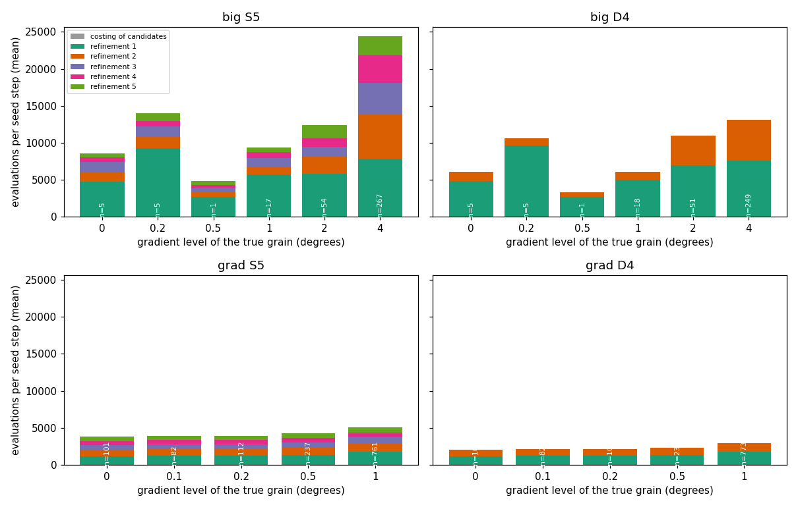
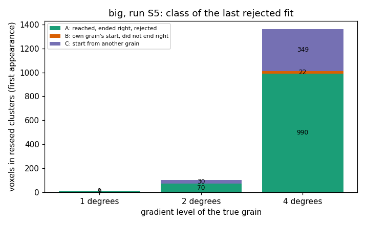
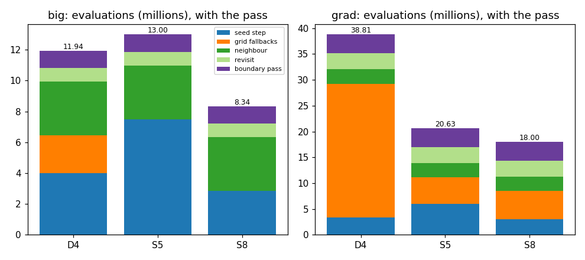

# AR3 step 8: why the seed step costs so much in grains with strong gradients

Step 8 of "AR3" in `docs/autoresearch/PLAN.md`, task `ar3h`. No file under `icenine/` changed. No
key was added and no default changed. Scripts are in `scripts/autoresearch/ar3/` (`reseed_*.py`).
Results are in `benchmarks/autoresearch/ar3/reseed/`. Every table below is filled from `tables.md`
there.

**Scope.** Two simulated samples, one run of each pipeline, one voxel order. `big` is step 7's
sample (32 grains, six levels of orientation gradient inside the grains). `grad` is the first
gradient sample of steps 3 to 6 (497 grains, levels up to 1 degree). Neither is a real sample, and
C++ was not run. No extra random seed was run. Counts carry a Wilson 95% interval; there are no
p-values. The intervals count voxels as independent, but wrong voxels cluster in a few grains, so
the intervals are too narrow for statements across grains. A gradient level holds 1 to 9 grains
on `big`: a result by level is a result on those grains. Every wall time here was measured with
other jobs running (contended) and is not a timing result. The cost that counts is the
evaluation count.

## Terms

- **Evaluation**: one call of the strict cost function (a raw count, not weighted by time). The
  same counters as steps 3 to 7. Indexing and attaching rays are not evaluations.
- **BFS**: the breadth-first search. It spreads from voxel to voxel. Each voxel gets a **local
  optimization** (a fit that starts from a fitted neighbour's orientation).
- **Relative test**: the BFS accepts a local optimization if its hit ratio is above 0.9 times the
  best hit ratio seen so far in the same flood. Otherwise the voxel is **rejected** and stays
  unresolved.
- **Seed step**: ray indexing proposes candidate orientations, the candidates are costed, and
  the best are refined by a local optimization. `D4` costs 5 candidates and refines 2. `S5` costs
  20 and refines 5. The **refinements** run in the order of the strict cost.
- **Seed test**: a hit ratio of at least 0.80 at the end of the seed step.
- **Reseed**: after the BFS, the rejected voxels form connected **clusters**. The seed step runs
  on the voxel nearest the centre of one cluster, and a flood starts from it.
- **Grid fallback**: the seed step fails the seed test and the full grid search runs (a global
  search: no starting guess).
- **Right**: within 1 degree of the truth (the limit step 7's page uses). **Wrong**: above it.
- **Boundary pass**: step 5's pass, rule `hit`.
- **Pick set** and **test set**: the true grains with an even index and with an odd index.
- `S8`: `S5` with a variant of remedy `E1` that stops at hit ratio 0.95 (below). The variant was
  added after results; the plan's own `E1` stops at 0.80.

## Written down before the runs

The plan wrote down three predictions. Whether the result agrees:

1. *Most rejected fits in the clusters of the grains at 2 and 4 degrees are of class A or B, not
   C.* **Agrees.** Counted by voxel at its first appearance in a cluster, class A or B is 70 of
   100 voxels at 2 degrees and 1,012 of 1,361 at 4 degrees. Class C is 380 of 1,471 voxels in
   all. The classes are defined in the section on rejected fits.
2. *A seed step is dearer on `big` because of the refinements, not because of the costing of
   candidates.* **Agrees.** The costing is 20 evaluations of a mean 21,403 per seed step in `S5` on
   `big`. The refinements are 99.9% of the evaluations.
3. *`S8` with the pass needs under 9.0 million evaluations on `big` and no more than `S5`'s 20.6
   million on the first gradient sample, with intervals of wrong voxels that overlap `D4`'s on
   `big` and `S5`'s on the first gradient sample.* **Met by the variant only, not a confirmed
   prediction of the plan.** By the plan's own rule the listed remedy `E1` (stop at the seed
   test, hit ratio 0.80) failed Part 2, so no listed remedy passed. `S8` is `S5` plus a variant
   of `E1` (stop at hit ratio 0.95) whose stop test was added after results. Its whole-layer
   numbers stand as measured and meet the three parts: 8.34 million on `big` and 18.00 million
   on `grad`; wrong voxels after the pass 24 on `big` (`D4`: 21) and 63 on `grad` (`S5`: 62),
   with overlapping intervals. The variant is not confirmed until it is an arm of a whole-layer
   run on a sample it was not chosen on.

Chosen after I had seen results (so not predictions):

- The stop tests that `E1` tried (hit ratio at least 0.80, 0.85, 0.90, 0.95, 0.98) and the rule
  that picks one. The plain `E1` of the plan (stop at the seed test, 0.80) was run first and its
  numbers were printed on the pick and the test sets together for the first gradient sample.
  The grid and the rule were written into `reseed_e1.py` after that; the pick itself reads the
  pick set only.
- Counting voxels at their first appearance in a cluster (a voxel can be in several clusters,
  see below), and the cluster's class by its most common class (used to read "cost share").
- Judging a remedy on the test set of each sample separately, and requiring both to pass.
- The unit of "distance to the boundary": the centre-to-centre distance to the nearest voxel of
  another true grain, in voxel side lengths (1.0 means a neighbouring voxel is of another grain).

## The result in pictures

Reading of the first picture: each bar is the mean number of evaluations in one seed step, by
gradient level of the voxel's true grain, split into the costing of the candidates (grey, too
thin to see) and the refinements in the order they ran (colours). Top: `big`. Bottom: `grad`.
Left: `S5`. Right: `D4`. The vertical axes are shared. Bars on `big` are taller than on `grad`
at every level shown, mostly by a factor of 2 to 5 (level 0.5 has one step on `big`), and the tall
part is the later refinements.



Reading of the second picture: for `S5` on `big`, each bar counts the voxels that ended in a
reseed cluster, by the class of their last rejected fit (A green, B orange, C purple). The
number inside each part is its count.



Reading of the third picture: each bar is the evaluations of one pipeline with the boundary pass,
by stage (millions). `S8` is the third bar of each panel.



## Short answers

1. **Where do the evaluations of a seed step go?** To the refinements. In `S5` on `big` the 349
   seed steps cost 7,469,574 evaluations, a mean of 21,403. The costing is 20 of them; the
   refinements are 99.9%. On `grad` it is 99.6% of a mean of 4,633.
2. **Why is a seed step dearer on `big`?** Two things show in the numbers, neither with a tested
   cause. First, each refinement is dearer on `big`, also where there is no gradient: the first
   refinement costs a mean 4,710 evaluations at level 0 on `big` (5 steps) and 1,115 on `grad`
   (101 steps). Second, in the grains at 4 degrees the later refinements cost a lot: refinements
   2 to 5 are 16,554 of the 24,427 evaluations of a step (267 steps).
3. **How much of that is not needed?** In `S5` on `big`, 62.2% of the seed-step evaluations
   (4,645,742 of 7,469,574) are spent on refinements that run after one refinement already
   passed the seed test at a right orientation. On `grad` it is 55.5%. In 279 of 349 steps on
   `big` the first refinement is already that one (Wilson 95% interval of the share, 0.75 to
   0.84).
4. **Why does the BFS reject fits that start in the right grain?** In the clusters of `S5` on
   `big`, 72.7% of the voxels (1,069 of 1,471) were reached by a local optimization that ended
   right (median error 0.294 degrees) and was still rejected: its median hit ratio is 0.835 while
   the flood's best is 1.000. This is class A. It is consistent with a fit that stops a few
   tenths of a degree from the truth, where the hit ratio has already dropped below 0.9 times
   the best. That the fit would pass if it ran longer is untested.
5. **What does a reseed buy?** The 314 reseeds on `big` cost 6,892,620 evaluations in seed steps
   and 197,122 in their floods; 91.1% of that is in the 258 clusters of level 4. They settle
   1,471 voxels in all, 4.7 voxels per reseed. A median cluster has 3 voxels and 102 are a single
   voxel. The flood from a reseed accepts a median 1 voxel.
6. **Which remedy works?** None of the listed remedies, by the plan's rule. The plan's `E1` (stop
   the refinements at the first that passes the seed test, 0.80) fails: on the test sets it
   breaks 6 cases and fixes 0 on `big`, and breaks 51 and fixes 2 on `grad`. A variant of `E1`,
   with a stop test of 0.95 added after those results and chosen on the pick set, passes: on the
   test sets it cuts the seed step's evaluations by 58.4% on `big` and 48.4% on `grad` and
   breaks no case. `E2` (keep a rejected fit that passes a second test) fails: no second test
   breaks no more cases than it fixes. `E3` was not tried (class B is 22 of 1,471 voxels).
7. **Does `S8` do no harm?** `S8` with the pass costs 8,340,428 evaluations on `big` (`D4`
   11,943,692, `S5` 12,999,852) and 18,000,230 on `grad` (`S5` 20,629,760, `D4` 38,807,186).
   Wrong voxels after the pass: 24 of 24,570 on `big` (`D4` 21, `S5` 30) and 63 on `grad` (`S5` 62,
   `D4` 74). The intervals overlap in both. By voxel the paired splits are in the last section
   of the results.

## Part 1.1: where the evaluations of one seed step go

Reading of the table: one row per run and sample. `steps` is the number of seed steps (first
seeds and reseeds); `evals` their evaluations; `mean` per step; `costing` the evaluations that
cost the candidates (a mean per step); `r1` to `r5` the mean evaluations of the first to the
fifth refinement (`n/a` where the run refines fewer); `refine_share` the percent of evaluations
that are refinements; `first_ok` the steps in which the first refinement already ended with a hit
ratio of at least 0.80 at a right orientation (`first_ok_ci`: Wilson 95% interval of that share);
`after_ok` the percent of the step's evaluations spent on refinements after the first that did
so. `big S5` is a logged rerun of step 7's run (it reproduced the stored counts exactly); the
other three are replays of the stored seed steps (the seed step reads only the voxel's rays, so it
can run again at a voxel). For `D4` the stored run also made grid fallbacks (8 on `big`, 76 on
`grad`); they are not in this table.

<!-- table:step_split -->
| run | steps | evals | mean | costing | r1 | r2 | r3 | r4 | r5 | refine_share | first_ok | first_ok_ci | after_ok |
|---|---|---|---|---|---|---|---|---|---|---|---|---|---|
| big S5 | 349 | 7469574 | 21403 | 20.0 | 7391 | 5044 | 3550 | 3042 | 2355 | 99.9 | 279 of 349 | 0.75 to 0.84 | 62.2 |
| big D4 | 329 | 4016458 | 12208 | 5.0 | 7311 | 4892 | n/a | n/a | n/a | 100.0 | 259 of 329 | 0.74 to 0.83 | 34.8 |
| grad S5 | 1293 | 5990794 | 4633 | 20.0 | 1538 | 1043 | 762 | 653 | 617 | 99.6 | 917 of 1293 | 0.68 to 0.73 | 55.5 |
| grad D4 | 1298 | 3389254 | 2611 | 5.0 | 1556 | 1050 | n/a | n/a | n/a | 99.8 | 929 of 1298 | 0.69 to 0.74 | 26.1 |
<!-- /table:step_split -->

Reading of the table: the same, by the gradient level of the voxel's true grain.

<!-- table:step_by_level -->
| run | level | steps | mean | costing | r1 | r2 | r3 | r4 | r5 | first_ok | after_ok |
|---|---|---|---|---|---|---|---|---|---|---|---|
| big S5 | 0.0 | 5 | 8571 | 20.0 | 4710 | 1354 | 1322 | 652 | 514 | 5 of 5 | 44.8 |
| big S5 | 0.2 | 5 | 13984 | 20.0 | 9246 | 1557 | 1379 | 751 | 1031 | 5 of 5 | 33.7 |
| big S5 | 0.5 | 1 | 4799 | 20.0 | 2671 | 595 | 536 | 507 | 470 | 1 of 1 | 43.9 |
| big S5 | 1.0 | 17 | 9330 | 20.0 | 5671 | 1062 | 1145 | 802 | 630 | 17 of 17 | 39.0 |
| big S5 | 2.0 | 54 | 12432 | 20.0 | 5810 | 2404 | 1192 | 1191 | 1814 | 39 of 54 | 45.4 |
| big S5 | 4.0 | 267 | 24427 | 20.0 | 7853 | 5983 | 4274 | 3656 | 2641 | 212 of 267 | 64.9 |
| big D4 | 0.0 | 5 | 6033 | 5.0 | 4804 | 1224 | n/a | n/a | n/a | 5 of 5 | 20.3 |
| big D4 | 0.2 | 5 | 10632 | 5.0 | 9633 | 994 | n/a | n/a | n/a | 5 of 5 | 9.3 |
| big D4 | 0.5 | 1 | 3271 | 5.0 | 2671 | 595 | n/a | n/a | n/a | 1 of 1 | 18.2 |
| big D4 | 1.0 | 18 | 6056 | 5.0 | 4990 | 1061 | n/a | n/a | n/a | 17 of 18 | 15.0 |
| big D4 | 2.0 | 51 | 10959 | 5.0 | 6922 | 4032 | n/a | n/a | n/a | 40 of 51 | 30.0 |
| big D4 | 4.0 | 249 | 13100 | 5.0 | 7581 | 5514 | n/a | n/a | n/a | 191 of 249 | 36.8 |
| grad S5 | 0.0 | 101 | 3786 | 20.0 | 1115 | 900 | 610 | 571 | 570 | 100 of 101 | 69.4 |
| grad S5 | 0.1 | 82 | 3949 | 20.0 | 1238 | 860 | 627 | 613 | 590 | 80 of 82 | 67.0 |
| grad S5 | 0.2 | 112 | 3897 | 20.0 | 1236 | 844 | 673 | 580 | 544 | 106 of 112 | 66.5 |
| grad S5 | 0.5 | 237 | 4265 | 20.0 | 1343 | 933 | 756 | 625 | 587 | 179 of 237 | 59.6 |
| grad S5 | 1.0 | 761 | 5043 | 20.0 | 1732 | 1145 | 812 | 687 | 646 | 452 of 761 | 50.8 |
| grad D4 | 0.0 | 100 | 2036 | 5.0 | 1121 | 910 | n/a | n/a | n/a | 100 of 100 | 44.7 |
| grad D4 | 0.1 | 82 | 2172 | 5.0 | 1243 | 924 | n/a | n/a | n/a | 81 of 82 | 41.8 |
| grad D4 | 0.2 | 108 | 2112 | 5.0 | 1235 | 872 | n/a | n/a | n/a | 104 of 108 | 39.8 |
| grad D4 | 0.5 | 235 | 2330 | 5.0 | 1357 | 968 | n/a | n/a | n/a | 183 of 235 | 30.7 |
| grad D4 | 1.0 | 773 | 2887 | 5.0 | 1751 | 1131 | n/a | n/a | n/a | 461 of 773 | 20.7 |
<!-- /table:step_by_level -->

Which refinement was kept (the one with the lowest final cost) in `S5` on `big`: the first in 188
of 349 steps, the second in 76, the third in 37, the fourth in 25, the fifth in 23. On `grad`:
923, 261, 82, 19 and 8 of 1,293. The kept end is right in all 349 steps on `big` and in 1,267 of
1,293 on `grad`.

## Part 1.2: why the BFS rejected

For each voxel in a reseed cluster the last rejected fit before that reseed is judged with the
truth, in this order:

- **A**, reached and rejected: the fit ended right, and the relative test rejected it.
- **B**, not reached: not A, and the start came from a neighbour in the voxel's own true grain.
  `B1` to `B4` split it by the start's angle from the truth: under 0.1, 0.1 to 0.2, 0.2 to 0.5,
  over 0.5 degrees.
- **C**, other grain: the start came from a neighbour in another true grain.
- **N**: no fit before the reseed (none occurred).

A voxel is listed in several clusters (a cluster that is reseeded leaves its unsettled voxels to
form the next one): there are 10,956 entries for 1,471 voxels. The tables count each voxel once,
at its first appearance. Counting every entry gives A 9,285, B 300, C 1,371. Only `big` and `S5`
have this detail: the first gradient sample has no per-fit log, and the plan allowed one rerun.

Reading of the table: one row per level of the true grain. `voxels` is the voxels that ended in
a reseed cluster; `A_ci` the 95% interval of the share of class A (percent); `AB_share` the
share of A and B together (percent).

<!-- table:classes_by_level -->
| level | voxels | A | B1 | B2 | B3 | B4 | C | N | A_share | A_ci | AB_share |
|---|---|---|---|---|---|---|---|---|---|---|---|
| 1 | 10 | 9 | 0 | 0 | 0 | 0 | 1 | 0 | 90.0 | 59.6 to 98.2 | 90.0 |
| 2 | 100 | 70 | 0 | 0 | 0 | 0 | 30 | 0 | 70.0 | 60.4 to 78.1 | 70.0 |
| 4 | 1361 | 990 | 0 | 0 | 0 | 22 | 349 | 0 | 72.7 | 70.3 to 75.0 | 74.4 |
| all | 1471 | 1069 | 0 | 0 | 0 | 22 | 380 | 0 | 72.7 | 70.3 to 74.9 | 74.2 |
<!-- /table:classes_by_level -->

Reading of the table: medians over the voxels of each class: the fit's hit ratio `hit`, the
flood's best hit ratio at that moment `best`, the fit's error to the truth `err`, the start's
angle from the truth `start` (degrees), the voxel's distance to the nearest other true grain
`dist` (voxel side lengths). Suffixes A, B, C name the class. The levels 1 and 2 hold 10 and 100
voxels.

<!-- table:classes_numbers -->
| level | hit_A | best_A | err_A | start_A | dist_A | hit_B | start_B | hit_C | err_C | dist_C |
|---|---|---|---|---|---|---|---|---|---|---|
| 1 | 0.832 | 1.000 | 0.224 | 0.286 | 4.0 | n/a | n/a | 0.378 | 34.5 | 1.0 |
| 2 | 0.870 | 1.000 | 0.199 | 0.363 | 1.0 | n/a | n/a | 0.471 | 34.0 | 1.0 |
| 4 | 0.832 | 1.000 | 0.306 | 0.564 | 3.5 | 0.516 | 31.6 | 0.431 | 32.3 | 1.0 |
| all | 0.835 | 1.000 | 0.294 | 0.553 | 3.5 | 0.516 | 31.6 | 0.433 | 32.3 | 1.0 |
<!-- /table:classes_numbers -->

What the numbers say. Class A is the bulk: the fit ended at a median 0.294 degrees from the truth
and its hit ratio is a median 0.835 against a best of 1.000, so the 0.9 limit rejects it. Class
C voxels start from another grain and end a median 32.3 degrees from their own truth: these are
the ordinary boundary rejections, and they sit next to a boundary (median distance 1.0). All 22
class-B voxels have a start that is itself far off (median 31.6 degrees: the neighbour's own fit
was wrong); none started within 0.5 degrees. So in these data "not reached from a good start" is
rare, and the cost is in class A. The cause of class A is untested: it is consistent with a fit
that stops a few tenths of a degree short, but a longer fit was not run.

## Part 1.3: the clusters

Reading of the table: one row per level of the reseed voxel's true grain. `single` is clusters
of one voxel; `size_med` and `size_max` the number of voxels in a cluster; `dist_med` the
reseed voxel's distance to the nearest other grain; `settled_med` the cluster voxels that are
fitted after the reseed (median per cluster); `members` the cluster entries and `settled_sum`
the voxels settled; `flood_acc_med` the voxels the flood from the reseed accepts (median);
`seed_evals` and `flood_evals` the evaluations of the seed steps and of the floods; `share` the
percent of the reseed cost (both together); `two_grains` the clusters that reach into more than
one true grain.

<!-- table:clusters_by_level -->
| level | clusters | single | size_med | size_max | dist_med | settled_med | members | settled_sum | flood_acc_med | seed_evals | flood_evals | share | two_grains |
|---|---|---|---|---|---|---|---|---|---|---|---|---|---|
| 1 | 8 | 6 | 1 | 2 | 3.8 | 1 | 10 | 10 | 0 | 70207 | 122 | 1.0 | 0 |
| 2 | 48 | 31 | 1 | 18 | 1.0 | 1 | 117 | 100 | 0 | 556681 | 4087 | 7.9 | 5 |
| 4 | 258 | 65 | 5 | 508 | 1.0 | 2 | 10829 | 1361 | 1 | 6265732 | 192913 | 91.1 | 44 |
| all | 314 | 102 | 3 | 508 | 1.0 | 2 | 10956 | 1471 | 1 | 6892620 | 197122 | 100.0 | 49 |
<!-- /table:clusters_by_level -->

Reading of the table: each cluster is given the class that has most of its voxels (ties go to
the lower letter), and the table adds the cluster's reseed cost (seed step and flood). This is
how the plan's "cost share" is read below. It was chosen after the classes were seen.

<!-- table:clusters_by_class -->
| cls | clusters | evals | share |
|---|---|---|---|
| A | 288 | 6823586 | 96.2 |
| B | 0 | 0 | 0.0 |
| C | 26 | 266156 | 3.8 |
<!-- /table:clusters_by_class -->

The 258 clusters of level 4 are 91.1% of the reseed cost. A reseed is one seed step of about
22,000 evaluations on average (6,892,620 over 314) and it settles few voxels, so most of the cost
is the seed step itself.

## Part 2: remedies on stored cases

The rule of the plan: a remedy is tried only if its class, or its cost share, is at least a fifth
of its total; it goes to Part 3 if, on the test set, it cuts the evaluations of its target by at
least a third and breaks no more cases than it fixes. I judged the two samples separately, and a
remedy has to pass on both. Cases are paired with what the stored run did on the same cases:
`fixed` is wrong in the stored run and right with the remedy, `broken` is the reverse.

### E1: refine in order of cost, stop at the first that passes a test

Nothing is run again for `E1`. The replay logged each refinement's evaluations, hit ratio and
error, so the evaluations of `E1` at a step are the costing plus the refinements up to the first
that passes; its result is that refinement's end. (A check in the last section shows that a run
of this loop gives the same numbers.) The target is the seed step. The step's cost share is 99.9%
(refinements) on `big` and 99.6% on `grad`, so `E1` is tried.

The plain test is the seed test, 0.80. It breaks many cases on `grad` (see the table), so I tried
stop tests 0.80, 0.85, 0.90, 0.95 and 0.98 on the pick set, pooled over `S5` on both samples. The
rule, written in code before the test sets were summed: the test with the largest cut among
those with broken at most fixed; if none, the plain 0.80.

Reading of the table: pooled pick set of `S5` on both samples (780 seed steps). `stored` is the
evaluations of the stored seed steps, `e1` those with the stop test `tau`, `cut` the percent
saved.

<!-- table:e1_pick -->
| tau | n | stored | e1 | cut | fixed | broken | chosen |
|---|---|---|---|---|---|---|---|
| 0.80 | 780 | 7404705 | 2831623 | 61.8 | 1 | 45 |  |
| 0.85 | 780 | 7404705 | 2881935 | 61.1 | 0 | 34 |  |
| 0.90 | 780 | 7404705 | 3034886 | 59.0 | 0 | 3 |  |
| 0.95 | 780 | 7404705 | 3245408 | 56.2 | 0 | 0 | yes |
| 0.98 | 780 | 7404705 | 4068788 | 45.1 | 0 | 0 |  |
<!-- /table:e1_pick -->

The stop test 0.95 was chosen. Reading of the table: each row is a run and a stop test on one set.
`n` is the seed steps; `both_wrong` is wrong in both; `switched` is the steps where the kept end
is not the stored one. The rows for `D4` (5 candidates costed, 2 refined) are for reference; the
rule is judged on `S5`.

<!-- table:e1_sets -->
| run | tau | set | n | stored | e1 | cut | fixed | broken | both_wrong | switched |
|---|---|---|---|---|---|---|---|---|---|---|
| big S5 | 0.80 | pick | 174 | 4681047 | 1721104 | 63.2 | 0 | 2 | 0 | 61 |
| big S5 | 0.80 | test | 175 | 2788527 | 1075181 | 61.4 | 0 | 6 | 0 | 56 |
| big S5 | 0.95 | pick | 174 | 4681047 | 1840265 | 60.7 | 0 | 0 | 0 | 51 |
| big S5 | 0.95 | test | 175 | 2788527 | 1161285 | 58.4 | 0 | 0 | 0 | 43 |
| big D4 | 0.80 | pick | 169 | 2402196 | 1563745 | 34.9 | 0 | 5 | 10 | 26 |
| big D4 | 0.80 | test | 160 | 1614262 | 1030674 | 36.2 | 0 | 2 | 1 | 24 |
| big D4 | 0.95 | pick | 169 | 2402196 | 1603296 | 33.3 | 0 | 0 | 10 | 17 |
| big D4 | 0.95 | test | 160 | 1614262 | 1079032 | 33.2 | 0 | 0 | 1 | 18 |
| grad S5 | 0.80 | pick | 606 | 2723658 | 1110519 | 59.2 | 1 | 43 | 14 | 50 |
| grad S5 | 0.80 | test | 687 | 3267136 | 1372275 | 58.0 | 2 | 51 | 9 | 66 |
| grad S5 | 0.95 | pick | 606 | 2723658 | 1405143 | 48.4 | 0 | 0 | 15 | 1 |
| grad S5 | 0.95 | test | 687 | 3267136 | 1685701 | 48.4 | 1 | 0 | 10 | 10 |
| grad D4 | 0.80 | pick | 631 | 1548296 | 1055797 | 31.8 | 2 | 38 | 61 | 42 |
| grad D4 | 0.80 | test | 667 | 1840958 | 1304429 | 29.1 | 0 | 37 | 44 | 39 |
| grad D4 | 0.95 | pick | 631 | 1548296 | 1168357 | 24.5 | 0 | 0 | 63 | 1 |
| grad D4 | 0.95 | test | 667 | 1840958 | 1415074 | 23.1 | 0 | 0 | 44 | 1 |
<!-- /table:e1_sets -->

The plan's `E1` (the plain 0.80) fails the plan's rule: 6 broken against 0 fixed on the `big`
test set and 51 against 2 on the `grad` test set. So by the plan's rule no listed remedy passes.
The variant with 0.95, added after those results, cuts the evaluations of `S5`'s seed steps on
the test sets by 58.4% on `big` and 48.4% on `grad`. It fixes 0 and breaks 0 on `big`, and
fixes 1 and breaks 0 on `grad`, so the variant passes the rule on both samples. A seed step that
stops at 0.80 can keep a refinement that is not the lowest-cost one, and some of these end past
the 1 degree limit.
This is an observed pattern in the replay; the cause was not tested.

### E2: keep a rejected fit that passes a second test

The target is class A, which is 72.7% of the voxels and 96.2% of the reseed cost by the plurality
reading, so `E2` is tried. Stored cases only, and only on `big`: only the logged rerun has the
per-fit detail. A case is a voxel with a rejected neighbour fit (its first one). `E2` keeps that
fit if the second test passes. The tests: the fit's hit ratio at least `T` for `T` in 0.60 to 0.85
(0.80 is the seed test), or at least `f` times the hit ratio of the neighbour it started from, for
`f` in 0.7, 0.8, 0.9. The cut is an estimate: a cluster would not exist if all its voxels had been
kept, so only such clusters count as saved (their seed step and flood). It leaves out smaller
savings, and it does not follow a kept voxel's flood. Clusters belong to the set of the reseed
voxel's grain.

Reading of the table: pick set (even grains). `cases` is the voxels with a rejected neighbour
fit; `kept` those the test keeps; `wrong` kept ends above 1 degree; `fixed` and `broken` as
above against the stored final map before the pass; `gone` the clusters (of `clusters`) whose
voxels are all kept; `cut` the percent of the pick set's reseed cost that those clusters cost.

<!-- table:e2_pick -->
| test | cases | kept | wrong | fixed | broken | gone | clusters | cut |
|---|---|---|---|---|---|---|---|---|
| abs-0.60 | 2615 | 1129 | 461 | 5 | 461 | 84 | 155 | 35.8 |
| abs-0.65 | 2615 | 1037 | 395 | 5 | 395 | 74 | 155 | 29.3 |
| abs-0.70 | 2615 | 807 | 214 | 4 | 214 | 65 | 155 | 24.9 |
| abs-0.75 | 2615 | 581 | 71 | 3 | 71 | 53 | 155 | 19.2 |
| abs-0.80 | 2615 | 420 | 16 | 3 | 16 | 38 | 155 | 14.1 |
| abs-0.85 | 2615 | 262 | 11 | 3 | 11 | 18 | 155 | 7.0 |
| nb-0.7 | 2615 | 875 | 241 | 5 | 241 | 68 | 155 | 25.9 |
| nb-0.8 | 2615 | 526 | 24 | 3 | 24 | 45 | 155 | 16.3 |
| nb-0.9 | 2615 | 212 | 3 | 2 | 3 | 10 | 155 | 4.4 |
<!-- /table:e2_pick -->

No test has broken at most fixed on the pick set. The test that keeps the fewest wrong (`nb-0.9`)
breaks 3 and fixes 2 and its cut is 4.4%; the tests with a cut near a third break hundreds. The
test set was therefore not summed for `E2`, and `E2` does not go to Part 3. This is what step 6
saw with tries from the neighbours: a boundary voxel keeps the orientation of the grain next to
it. Here the kept wrong fits are at voxels whose stored result is right; why a wrong fit can pass
the second test at a boundary voxel is untested.

### E3: try a rejected fit again from a better start

Not tried. The plan tries a remedy only when its class or cost share is at least a fifth. Class
B, the target of `E3`, is 22 of 1,471 voxels (1.5%) and the most common class of none of the 314
clusters (0.0% of the reseed cost).

## Part 3: whole-layer runs

The plan runs Part 3 only if a listed remedy passes, and none did: the plan's `E1` (0.80) failed.
Part 3 was run on the variant of `E1` with the stop test 0.95, which was added after the results
of Part 2. So these runs test the variant, not a remedy of the plan. `S8` is `S5` with that
variant, on `big` and on `grad`, each followed by the boundary pass. It changes one thing, in a
script: the loop of the library's seed step stops at the first refinement whose end has hit
ratio at least 0.95 (`reseed_s8.py`; the library's own indexing, costing and refinement
functions are called). If none passes, all 5 are refined and the lowest final cost is kept, as
in `S5`. The hit ratio of each refinement's end is one overlap evaluation, not counted in the
totals (the library's own seed test is not counted either); there are at most 5 per seed step.
Before the runs the loop was checked against the library's `index_seed` on 12 steps per sample
(identical results with the stop test off, and the same evaluations as the replay with it on).
Each run ended well inside its cap of 90 minutes.

Reading of the table: evaluations by stage with the pass, `seeds` and `reseeds` as counted by the
run, `grid` the grid fallbacks. `seed_step` is the evaluations of all seed steps, `grid_fallback`
those of the grid searches, `neighbour` and `revisit` the BFS's local optimizations, `pass_` the
boundary pass.

<!-- table:s8_stages -->
| sample | run | seeds | reseeds | grid | seed_step | grid_fallback | neighbour | revisit | pass_ | total |
|---|---|---|---|---|---|---|---|---|---|---|
| big | D4 + pass | 38 | 291 | 8 | 4016458 | 2452689 | 3479526 | 863042 | 1131977 | 11943692 |
| big | S5 + pass | 35 | 314 | 0 | 7469574 | 0 | 3513895 | 884040 | 1132343 | 12999852 |
| big | S8 + pass | 37 | 292 | 0 | 2856712 | 0 | 3491437 | 853714 | 1138565 | 8340428 |
| grad | D4 + pass | 344 | 954 | 76 | 3389254 | 25833494 | 2817382 | 3089366 | 3677690 | 38807186 |
| grad | S5 + pass | 348 | 945 | 15 | 5990794 | 5098353 | 2786526 | 3072127 | 3681960 | 20629760 |
| grad | S8 + pass | 347 | 932 | 16 | 3008757 | 5449501 | 2798001 | 3060730 | 3683241 | 18000230 |
<!-- /table:s8_stages -->

`S8` costs 8,340,428 evaluations on `big` (the seed step is 2,856,712), against 12,999,852 for
`S5` and 11,943,692 for `D4`: 35.8% and 30.2% fewer. On `grad` it costs 18,000,230 against
20,629,760 and 38,807,186: 12.7% and 53.6% fewer. The grid fallbacks stay: 5,449,501 of the 18.0
million on `grad` (16 fallbacks), which this step does not address.

Reading of the table: wrong voxels (error above 1 degree) of 24,570, before the pass and after
it, with a Wilson 95% interval (percent).

<!-- table:s8_wrong -->
| sample | run | before | before_ci | after | after_ci |
|---|---|---|---|---|---|
| big | D4 | 68 | 0.22 to 0.35 | 21 | 0.06 to 0.13 |
| big | S5 | 71 | 0.23 to 0.36 | 30 | 0.09 to 0.17 |
| big | S8 | 67 | 0.21 to 0.35 | 24 | 0.07 to 0.15 |
| grad | D4 | 225 | 0.80 to 1.04 | 74 | 0.24 to 0.38 |
| grad | S5 | 203 | 0.72 to 0.95 | 62 | 0.20 to 0.32 |
| grad | S8 | 210 | 0.75 to 0.98 | 63 | 0.20 to 0.33 |
<!-- /table:s8_wrong -->

The intervals of `S8` overlap those of `D4` on `big` and of `S5` on `grad`. They count voxels as
independent.

Reading of the table: paired by voxel, `S8` against each stored run, with the same pass on both.
`fixed` is wrong in the baseline and right in `S8`, `broken` the reverse, `both_wrong` wrong in
both.

<!-- table:s8_paired -->
| sample | vs | when | wrong_S8 | wrong_base | fixed | broken | both_wrong |
|---|---|---|---|---|---|---|---|
| big | S5 | before | 67 | 71 | 8 | 4 | 63 |
| big | S5 | after | 24 | 30 | 12 | 6 | 18 |
| big | D4 | before | 67 | 68 | 6 | 5 | 62 |
| big | D4 | after | 24 | 21 | 5 | 8 | 16 |
| grad | S5 | before | 210 | 203 | 28 | 35 | 175 |
| grad | S5 | after | 63 | 62 | 25 | 26 | 37 |
| grad | D4 | before | 210 | 225 | 34 | 19 | 191 |
| grad | D4 | after | 63 | 74 | 38 | 27 | 36 |
<!-- /table:s8_paired -->

After the pass on `big`, `S8` against `S5`: 12 fixed, 6 broken, 18 wrong in both. Against `D4`:
5 fixed, 8 broken, 16 wrong in both. On `grad`, against `S5` 25 fixed and 26 broken, against `D4`
38 fixed and 27 broken. So there is no detectable difference in wrong voxels, in either direction.

Reading of the table: wrong voxels after the pass, by the gradient level of the true grain, on
`big`.

<!-- table:s8_wrong_by_level_big -->
| sample | level | voxels | D4 | S5 | S8 |
|---|---|---|---|---|---|
| big | 0 | 2484 | 0 | 0 | 0 |
| big | 0.2 | 4112 | 0 | 0 | 0 |
| big | 0.5 | 936 | 0 | 0 | 0 |
| big | 1 | 8154 | 0 | 1 | 0 |
| big | 2 | 4700 | 4 | 4 | 4 |
| big | 4 | 4184 | 17 | 25 | 20 |
<!-- /table:s8_wrong_by_level_big -->

Reading of the table: the same on `grad`.

<!-- table:s8_wrong_by_level_grad -->
| sample | level | voxels | D4 | S5 | S8 |
|---|---|---|---|---|---|
| grad | 0 | 4877 | 0 | 0 | 0 |
| grad | 0.1 | 4488 | 0 | 0 | 0 |
| grad | 0.2 | 5041 | 2 | 1 | 0 |
| grad | 0.5 | 4625 | 9 | 13 | 10 |
| grad | 1 | 5539 | 63 | 48 | 53 |
<!-- /table:s8_wrong_by_level_grad -->

## What the result decides

By the plan's own rule the listed remedy `E1` (stop at the seed test, hit ratio 0.80) failed
Part 2, so no listed remedy passed. Prediction 3 is met by the variant only (`S5`'s seed step,
20 candidates costed and 5 refined, with the stop at hit ratio 0.95). It is not a confirmed
prediction of the plan, so I do not make the recommendation that the plan ties to it. The
variant's numbers stand as measured: it costs less than both stored pipelines on both samples,
with no detectable change in wrong voxels. The variant is not confirmed until it is an arm of a
whole-layer run on a sample it was not chosen on. The choice of the seed step for the opt-in key
stays the owner's: the old seed step (`D4`'s), `S5`'s, or the variant. The key step also has to
decide what to do with the grid fallbacks that remain on `grad`.

What is left on `big` after `S8`: neighbour and revisit local optimizations (4.35 million) and
the pass (1.14 million) are now more than half of the 8.34 million; the reseeds still cost
2.52 million in seed steps. The reseed cost comes from class A (a fit that ended right and was
rejected); `E2` did not reach it without keeping wrong fits at boundary voxels. The next step
for those cases is AR4 or AR5 (a learned proposer, or a stop rule): a test that tells a right
fit from a wrong one at a boundary voxel is what is missing.

## Checks on the stored runs

- Replay against the stored runs: every replayed seed step has the same evaluation count as the
  stored step (349 of 349 for `S5` on `big`, from the logged rerun; 1,293 of 1,293 for `S5` on
  `grad`; 321 of 321 non-fallback steps of `D4` on `big`; 1,222 of 1,222 on `grad`). The 8 and 76
  grid fallback steps of `D4` cannot be compared (their stored count includes the grid search).
- The logged rerun of `S5` on `big` reproduced the stored run: the same counters
  (35 seeds, 314 reseeds, 7,469,574 index evaluations, 11,867,509 in all), and the same reseed
  list (voxel, cluster size, evaluations, accepted). It took 1,033 s with other jobs running; the
  cap was 90 minutes.
- The `E1` loop of `S8` against the library's `index_seed`, 12 steps per sample: identical
  evaluations and orientation with the stop test off, and the evaluations of part 2 with it on
  (`s8_check_big.json`, `s8_check_grad.json`).

## How to reproduce

From `icenine_py/`. The summary needs only files in git:

```
uv run python scripts/autoresearch/ar3/reseed_summary.py
uv run python ../scripts/dev/sync_doc_tables.py --doc docs/autoresearch/findings_ar3_reseed.md \
  --tables benchmarks/autoresearch/ar3/reseed/tables.md
```

The runs need files that are not in git (the stored runs and images of steps 6 and 7, in their
worktrees, linked and never copied; the scripts find them from `reseed_common.py`). In order:

```
RESEED_SAMPLE=big  uv run python scripts/autoresearch/ar3/reseed_logged_run.py     # cap 90 min
RESEED_SAMPLE=<big|grad> uv run python scripts/autoresearch/ar3/reseed_replay.py --run <S5|D4> \
  --shard <i> --of <n>
RESEED_SAMPLE=<big|grad> uv run python scripts/autoresearch/ar3/reseed_slim.py --steps S5 D4 \
  [--logged]                  # for big use --steps S5L D4 (the logged run's seed steps)
uv run python scripts/autoresearch/ar3/reseed_e1.py        # pick, then the sets
uv run python scripts/autoresearch/ar3/reseed_e2.py
RESEED_SAMPLE=<big|grad> uv run python scripts/autoresearch/ar3/reseed_s8_check.py --n 12
RESEED_SAMPLE=<big|grad> uv run python scripts/autoresearch/ar3/reseed_s8.py       # cap 90 min
RESEED_SAMPLE=<big|grad> uv run python scripts/autoresearch/ar3/reseed_pass.py
RESEED_SAMPLE=<big|grad> uv run python scripts/autoresearch/ar3/reseed_s8_slim.py
```

## Deviations from the plan

- The plan's Part 1 allowed one logged rerun of `S5` on `big`. The seed-step split for the other
  three runs (`D4` on `big`, both on `grad`) was made by replaying their stored seed steps, which
  the brief of this step allowed. The classes (1.2) and the clusters in detail (1.3) exist for
  `S5` on `big` only (the one rerun).
- The plan's `E1` (stop at the seed test, 0.80) failed Part 2: on the test sets it broke 6 and
  fixed 0 on `big`, and broke 51 and fixed 2 on `grad`. By the plan's rule no listed remedy
  passed, and there was no Part 3 to run. Instead a stop test was tuned on the pick set (0.80 to
  0.98) after the plain test had been seen to break cases (see "Chosen after I had seen
  results"), and Part 3 ran `S8` with that variant (0.95). Prediction 3 is judged on the variant
  only.
- `E2` was evaluated at the level of stored fits and clusters, not by a rerun; its saving is an
  estimate. `E3` was not tried.
- The classes count voxels at their first appearance; the plan did not say how to count a voxel
  that is in several clusters.
- Not committed (over the 5 MB budget, or a home path): replay and run caches, the logged run's
  fit log, the run folders and maps, and the timing preflight files.

## Limits and not claimed

- That C++ behaves the same. That the gradient model or these levels match a real sample. That two
  samples stand for all samples.
- A tested wall time: the timing preflight was refused in every run (other jobs at high CPU), and
  several jobs ran at once.
- A cause for the class-A rejections, for the dearer refinement on `big`, or for the stop test
  0.80 breaking cases: all three are "consistent with" the numbers, untested.
- That `E1`'s 0.95 is the best stop test: it is the best of five tried on one pick set.
- A change of any default, or a decision on the key.

## What comes after

The keys step needs the owner's choice of seed step. For the rejections of fits that ended right
(class A, 96.2% of the reseed cost), the next measurement is AR4 or AR5 on these cases.
