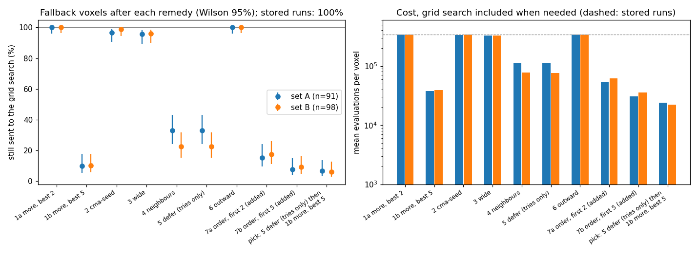
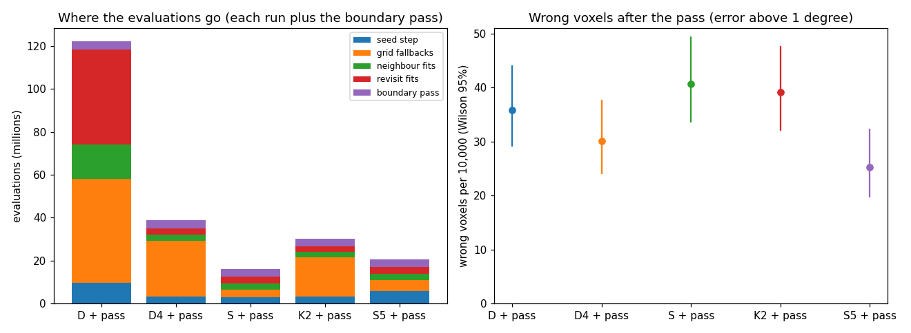

# AR3 step 6: why the index seed fails, and what replaces the grid fallback

Step 6 of "AR3" in `docs/autoresearch/PLAN.md`, task `ar3f`. No file under `icenine/` changed.
Scripts are in `scripts/autoresearch/ar3/` (`seed_common.py`, `seed_replay.py`,
`seed_part01.py`, `seed_extra.py`, `seed_summary.py`, `seed_pick.py`, `run_seed.py`, `seed_bg.py`,
`seed_pass.py`, `seed_summary2.py`). Results are in `benchmarks/autoresearch/ar3/seed/`. Every
table below is filled from `tables_part01.md` and `tables_part2.md` there.

**Scope.** Every result holds for the simulated gradient sample of step 3 (about 50 voxels per
grain, a small orientation gradient inside each grain). It does not hold for a real sample. C++
was not run. Each whole-layer run is one run with one voxel order. No extra random seed was run.
Counts carry a Wilson 95% interval. A difference is a gain or a loss only when the intervals do
not overlap, and only when the boundary pass is on both sides. Every wall time on this page
was measured with other jobs running and is not a timing result. The evaluation count is the
cost that counts.

## The result in one plot

Reading of the plot: each pair of points (left) is the share of the fallback voxels (the
voxels where a stored run had to run a grid search) that a remedy still sends to the grid search;
blue is the pick set A (91 voxels), orange the test set B (98 voxels). The stored runs send all of
them (100%). The bars on the right are the mean evaluations per voxel, with the grid search
counted when the remedy fails. Remedy 1b and the pick (the last pair) leave 6 to 10% of the
voxels to the grid search; most other remedies leave almost all of them.



## Short answers

1. **Why does the index seed fail where the grid search succeeds?** On 188 of the 189 fallback
   voxels the indexer did find an orientation within 1 degree of the truth, among its first 5
   candidates. The seed step costs those 5 candidates as they are and refines only the 2 with the
   lowest cost. On 175 voxels the near-truth candidate was costed and not among those 2. On the
   controls (ordinary index seeds that passed) it was among the 2 on 196 of 200. The near-truth
   candidates of the fallback voxels are a median 0.449 degrees from the truth; those of the
   controls 0.220 degrees. The cost is sharp in angle, so a candidate 0.45 degrees off scores
   poorly before it is refined. Consistent with this; not tested: why the indexer is further off
   on these voxels (the gradient inside the grain is one candidate).
2. **Which cheaper step reaches an end as good as the grid search's?** In the replay, the seed
   step with the strict cost on 20 candidates and the local optimization on the best 5 (remedy
   1b) passes the seed test on 82 of the 91 voxels of A at about 4,300 evaluations. The grid
   search costs about 340,000. In a whole-layer run (`S5`, an added run) it cuts the grid
   fallbacks from 76 to 15 and the evaluations of run plus pass from 38.8 to 20.6 million, with
   62 wrong voxels after the pass against 74 for `D4` plus the pass (intervals overlap).
3. **Do small clusters need a seed at all?** Not on the evidence here. Tries from the
   neighbours alone end within 0.1 degrees of the stored end, with a hit ratio that is not lower,
   on 1 of 36 voxels (cluster of one, fallback) and on 26 of 224 (cluster of one, index seed used).
   They pass the seed test with a right end on 24 of 36 and 176 of 224.

One result went against the plan's pick. The pick (tries from the neighbours, then remedy 1b)
removes most grid fallbacks in the whole-layer run (`S`: 11 against 76), but the voxels that the
tries settle are wrong more often than in `D4`. `S` plus the pass has 100 wrong voxels against 74
(intervals overlap). The tries step is the cause that the data point to; the run `S5` without it
did not show the loss.

## How to reproduce

From `icenine_py/`, with the image stacks of `Examples/Example2.ManyGrains/ScatteringData_PhaseD/`
in place (they are not in git) and the untracked run files of steps 3 and 4 in the sibling
worktrees named in `seed_common.py`:

```
uv run python scripts/autoresearch/ar3/seed_part01.py --workers 5   # parts 0 and 1 (about 4 min)
uv run python scripts/autoresearch/ar3/seed_extra.py                # facts about the voxels
uv run python scripts/autoresearch/ar3/seed_summary.py --slim       # tables, plot, summary
uv run python scripts/autoresearch/ar3/seed_bg.py S K2 S5           # part 2 runs, 60 min caps
uv run python scripts/autoresearch/ar3/seed_pass.py --kind S        # the pass, once per run
uv run python scripts/autoresearch/ar3/seed_summary2.py --pack      # part 2 summary
uv run python ../scripts/dev/sync_doc_tables.py --doc docs/autoresearch/findings_ar3_seed.md \
  --tables benchmarks/autoresearch/ar3/seed/tables_part01.md \
  benchmarks/autoresearch/ar3/seed/tables_part2.md
```

## Terms

- The **seed step** of a voxel is what `seed_by_indexing` does. It indexes the voxel (the
  **candidates**, ranked by the number of observed rays they explain), takes the strict cost of
  the first 5 candidates, runs a local optimization from the best 2 and keeps the lowest cost.
- The **seed test** is the caller's: the end must have a hit ratio of at least 0.80 (read from
  the run's config, `MinAccelerationThreshold`). The **hit ratio** is the share of the voxel's
  predicted detector pixels that fall on observed intensity (pixel overlap over pixels on the
  detector).
- A **local optimization** is a search that starts at a given orientation and looks only near it.
  A **fit** is one run of a local optimization. A **global search** is a search with no starting
  guess; here the grid search.
- A **grid fallback** is the full grid search that the caller runs when the seed step returns no
  candidate or its end fails the seed test. A **fallback voxel** is a voxel where a stored run
  made one. A **cluster** is the set of unsettled voxels that one reseed is made for.
- **Error** is the angle to the true orientation (symmetry-reduced, analysis only). **Wrong** is
  an error above 1 degree; **right** is not wrong. **Level** is the size of the grain's gradient.
  **Set A** (grains with an even id) is the pick set, **set B** (odd ids) the test set.
- A **try** is one CMA fit (first step 0.05 degrees, at most 60 evaluations plus the final one, so
  61) from a neighbour's orientation. **Fixed** is wrong before and right after; **broken** is
  right before and wrong after. The **pass** is the boundary pass of step 5 with its `hit` keep
  rule; **one footing** is the same pass on both sides.
- **Controls** are 200 index seeds of `D4` that passed the seed test (a fixed draw,
  `default_rng(0)`, from the 1,222 that `D4` used).

## Part 0: why the index seed fails

**How the fallback voxels were found.** The runs keep no per-seed log. A fallback voxel of a BFS
run (`D4`, step 3's `D`) is a reseed in `run.json` with more than 100,000 evaluations in its
full-search entry (a grid search costs about 340,000, an index seed about 2,600), or a first seed
whose record has more than 100,000 evaluations. The counts equal each run's own counter
`index_fallback_seed_test`. In the paint runs (`P4`, `P`) it is a row of the paint log with
`seed == "grid"`. The four runs share many voxels: 511 listings are 189 different voxels. The
replay below runs once per voxel.

Reading of the table: rows are the stored runs; `counter` is the run's own count.

<!-- table:ar3f_lists -->
| run | listed | counter | at_seed | at_reseed | at_paint |
|---|---|---|---|---|---|
| D4 | 76 | 76 | 2 | 74 | n/a |
| D | 142 | 142 | 4 | 138 | n/a |
| P4 | 121 | n/a | n/a | n/a | 121 |
| P | 172 | n/a | n/a | n/a | 172 |
<!-- /table:ar3f_lists -->

Of the 954 reseeds of `D4`, 74 are fallbacks and 2 of the 344 first seeds are. The grid searches
cost 25,833,494 of `D4`'s 35,129,496 evaluations.

Reading of the table: rows are the cluster size of a `D4` reseed; `evals_all` is the evaluations
of all reseeds of that size, `evals_fallbacks` the part spent in grid fallbacks.

<!-- table:ar3f_cluster -->
| cluster | reseeds | fallbacks | evals_all | evals_fallbacks | evals_per_voxel |
|---|---|---|---|---|---|
| 1 | 260 | 36 | 12,900,978 | 12,315,955 | 49,619 |
| 2 | 101 | 11 | 3,984,483 | 3,755,994 | 19,725 |
| 3 to 5 | 130 | 10 | 3,724,448 | 3,414,981 | 7,570 |
| 6 or more | 463 | 17 | 7,055,934 | 5,808,028 | 118 |
<!-- /table:ar3f_cluster -->

A grid search settles one or two voxels in 47 of the 76 `D4` fallbacks. Reseeds of a cluster of
one or two voxels cost about 49,619 and 19,725 evaluations per voxel; reseeds of 6 or more voxels
about 118.

Reading of the table: rows are the true level and then the controls; `at_boundary` means a voxel
of the nearest ring (within 1.5 times the nearest-neighbour distance) belongs to another true
grain. The reconstructor's own neighbour relation reaches about 27 voxels, which is too wide.

<!-- table:ar3f_levels -->
| level | voxels | at_boundary | inside |
|---|---|---|---|
| 0 | 1 | 1 | 0 |
| 0.1 | 1 | 1 | 0 |
| 0.2 | 3 | 3 | 0 |
| 0.5 | 34 | 34 | 0 |
| 1 | 150 | 150 | 0 |
| all | 189 | 189 | 0 |
| controls, level 0 | 14 | 11 | 3 |
| controls, level 0.1 | 9 | 7 | 2 |
| controls, level 0.2 | 21 | 18 | 3 |
| controls, level 0.5 | 36 | 31 | 5 |
| controls, level 1 | 120 | 111 | 9 |
| controls, all | 200 | 178 | 22 |
<!-- /table:ar3f_levels -->

All 189 fallback voxels are at a true grain boundary, against 178 of 200 controls. In this sample
nearly every voxel is at a boundary, so that is a weak signal. Level 1 holds 150 of the 189
fallback voxels and 120 of the 200 controls.

**Check of the replay.** The seed step does not read the BFS state, so it can be run again at
any voxel. Reading of the table: the replay must fail the test on the fallback voxels and pass
on the controls; the plan stops the task if more than 5% of either group disagree.

<!-- table:ar3f_check -->
| group | n | agree | disagree |
|---|---|---|---|
| fallback voxels (stored: fail) | 189 | 189 | 0 |
| control index seeds (stored: pass) | 200 | 200 | 0 |
<!-- /table:ar3f_check -->

No voxel disagrees (0 of 189, 0 of 200). The replayed evaluations equal the stored ones on 200
of 200 controls. The first 20 candidates of the 50-candidate list equal the stock list on every
one of the 389 voxels.

**Where the seed step loses the voxel.** Reading of the table: each fallback voxel is in one
class, in this order. (a) the truth itself fails the seed test; (b) no candidate within 1 degree
of the truth; (c) one exists but beyond the first 5; (d) it was costed but not among the 2
refined; (e) it was refined and the local optimization ends away from the truth or below the
test; (f) the replay passes.

<!-- table:ar3f_classes -->
| set | n | a | b | c | d | e | f |
|---|---|---|---|---|---|---|---|
| all fallback voxels | 189 | 0 | 1 | 0 | 175 | 13 | 0 |
| set A | 91 | 0 | 0 | 0 | 85 | 6 | 0 |
| set B | 98 | 0 | 1 | 0 | 90 | 7 | 0 |
<!-- /table:ar3f_classes -->

Class (a) holds 0 of 189 voxels, so the gate of the plan (more than half) did not stop part 1.
The truth passes the seed test everywhere. Class (d) holds 175 voxels: a good candidate was
costed and not refined. Class (e) holds 13: the 2 refinements ended at a wrong orientation or
below the test. Class (b) holds 1 voxel (set B): the indexer had no candidate near the truth.

Reading of the table: the first candidate within 1 degree of the truth, by its place in the
indexer's list (`rank0` is the first). The indexer puts it first on 145 fallback voxels and 151
controls. The seed step then re-orders the first 5 by strict cost, and that is where it is lost.

<!-- table:ar3f_rank -->
| set | n | none | rank0 | rank1_4 | rank5_19 | rank20_49 | median_cand | truth_hit_below | median_truth_hit | median_first_hit |
|---|---|---|---|---|---|---|---|---|---|---|
| fallback voxels | 189 | 1 | 145 | 43 | 0 | 0 | 50 | 0 | 1.000 | 0.435 |
| controls | 200 | 0 | 151 | 49 | 0 | 0 | 50 | 0 | 1.000 | 0.650 |
<!-- /table:ar3f_rank -->

After the re-ordering by strict cost, the near-truth candidate is among the 2 refined on 13 of
188 fallback voxels (it is the lowest of the 5 on 7) and on 196 of 200 controls (the lowest on
149). Its hit ratio before refinement has a median of 0.411 on the fallback voxels (0 of 188
reach 0.80) and 0.728 on the controls (75 of 200 reach 0.80). Its distance from the truth has a
median of 0.449 degrees (quartiles 0.365 and 0.572) against 0.220 (0.105 and 0.399). The 378
refined ends of the fallback voxels are within 1 degree of the truth in 14 cases, with a median
hit ratio of 0.650.

**The grid search's end.** Reading of the table: the end the stored run kept after its grid
search, per run; `with_nbr_within1` counts the voxels that have at least one neighbour in the
final map within 1 degree of the voxel's truth (a try from that neighbour could have started
near the answer).

<!-- table:ar3f_gridend -->
| run | n | right_s | hit_ge_080 | median_err | with_nbr_within1 | median_nbr_within1 | median_nbr |
|---|---|---|---|---|---|---|---|
| D4 | 76 | 74 of 76 (91 to 99%) | 74 | 0.0046 | 76 | 7 | 27 |
| D | 142 | 141 of 142 (96 to 100%) | 140 | 0.0039 | 142 | 7 | 27 |
| P4 | 121 | 121 of 121 (97 to 100%) | 121 | 0.0032 | 121 | 7 | 27 |
| P | 172 | 172 of 172 (98 to 100%) | 172 | 0.0047 | 172 | 8 | 27 |
<!-- /table:ar3f_gridend -->

The grid search's end is right on 74 of 76 (`D4`) and on 172 of 172 (`P`) voxels, so the grid
search is a good reference. Every fallback voxel has a neighbour within 1 degree of its truth in
the final map, a median of 7 of 27. This is the limit named below: the final map was made after
the voxel was settled.

## Part 1: remedies, by replay

The remedies, each at one voxel with the images and Q-max of the stored run, one worker, a fixed
generator:

- **1a, 1b more**: strict cost on the first 20 candidates in place of 5; local optimization
  (stock) from the best 2 (1a) or the best 5 (1b).
- **2 cma-seed**: the seed step of `LocalOptimizer cma`, as run `KE` used it. It takes the
  strict cost of 5 candidates and runs one CMA run (first step 0.05 degrees, 1,000 evaluations)
  from each of the best 2 in place of the stock Monte Carlo search; it skips the variance
  minimizing stage.
- **3 wide**: after a failed seed step, one CMA fit from its best end, first step 1.5
  degrees, at most 1,000 evaluations.
- **4 neighbours**: before the seed step, one try from each distinct orientation (0.5 degree
  merge) among the voxel's neighbours in the final map; keep rule `hit`; the seed step runs only
  if no try passes.
- **5 defer**: the tries of remedy 4 alone, with no seed step and no grid search.
- **6 outward**: after a failed seed step, the library's outward search from its best end, then a
  stock local optimization from its end. A script can call it without a library change
  (`AdaptiveVoxelReconstructor.outward_search`).
- **7a, 7b order** (added, not in the plan, not in the pick): the local optimization on the first 2
  or 5 candidates in the indexer's own order, with no strict cost.

A remedy hands over its own end when it passes the seed test; otherwise the voxel goes to the
grid search and keeps the grid search's end. The paired counts compare that end with the
grid search's end at the same voxel (`fixed`: the grid search's end is wrong and the remedy's is
right; `broken`: the reverse). Remedy 4 reads the final map, which the run did not have at that
moment: it shows what a try from a neighbour can reach, not what the run would have had.

Reading of the table (set A, 91 voxels): `pass_s` is the voxels that pass the seed test;
`need_grid` the voxels sent to the grid search; `right_s` the voxels that end right after the grid
search takes the rest; the evaluation columns are the remedy's own, without the grid search.

<!-- table:ar3f_rem_A -->
| remedy | n | pass_s | need_grid | right_s | fixed | broken | both_right | both_wrong | ev_median | ev_mean | ev_max |
|---|---|---|---|---|---|---|---|---|---|---|---|
| 1a more, best 2 | 91 | 0 of 91 (0 to 4%) | 91 | 90 of 91 (94 to 100%) | 0 | 0 | 90 | 1 | 1,844 | 1,944 | 3,795 |
| 1b more, best 5 | 91 | 82 of 91 (82 to 95%) | 9 | 91 of 91 (96 to 100%) | 1 | 0 | 90 | 0 | 4,257 | 4,307 | 5,985 |
| 2 cma-seed | 91 | 3 of 91 (1 to 9%) | 88 | 90 of 91 (94 to 100%) | 0 | 0 | 90 | 1 | 2,007 | 2,007 | 2,007 |
| 3 wide | 91 | 4 of 91 (2 to 11%) | 87 | 89 of 91 (92 to 99%) | 0 | 1 | 89 | 1 | 2,830 | 2,931 | 4,781 |
| 4 neighbours | 91 | 61 of 91 (57 to 76%) | 30 | 91 of 91 (96 to 100%) | 1 | 0 | 90 | 0 | 305 | 952 | 3,956 |
| 5 defer (tries only) | 91 | 61 of 91 (57 to 76%) | 30 | 91 of 91 (96 to 100%) | 1 | 0 | 90 | 0 | 305 | 297 | 610 |
| 6 outward | 91 | 0 of 91 (0 to 4%) | 91 | 90 of 91 (94 to 100%) | 0 | 0 | 90 | 1 | 2,493 | 2,594 | 4,444 |
| 7a order, first 2 (added) | 91 | 77 of 91 (76 to 91%) | 14 | 91 of 91 (96 to 100%) | 1 | 0 | 90 | 0 | 2,092 | 2,162 | 3,775 |
| 7b order, first 5 (added) | 91 | 84 of 91 (85 to 96%) | 7 | 91 of 91 (96 to 100%) | 1 | 0 | 90 | 0 | 4,307 | 4,395 | 6,161 |
<!-- /table:ar3f_rem_A -->

Reading of the table: the same for set B (98 voxels).

<!-- table:ar3f_rem_B -->
| remedy | n | pass_s | need_grid | right_s | fixed | broken | both_right | both_wrong | ev_median | ev_mean | ev_max |
|---|---|---|---|---|---|---|---|---|---|---|---|
| 1a more, best 2 | 98 | 0 of 98 (0 to 4%) | 98 | 97 of 98 (94 to 100%) | 0 | 0 | 97 | 1 | 1,886 | 1,919 | 3,385 |
| 1b more, best 5 | 98 | 88 of 98 (82 to 94%) | 10 | 97 of 98 (94 to 100%) | 0 | 0 | 97 | 1 | 4,217 | 4,362 | 6,837 |
| 2 cma-seed | 98 | 1 of 98 (0 to 6%) | 97 | 97 of 98 (94 to 100%) | 0 | 0 | 97 | 1 | 2,007 | 2,007 | 2,007 |
| 3 wide | 98 | 4 of 98 (2 to 10%) | 94 | 97 of 98 (94 to 100%) | 0 | 0 | 97 | 1 | 2,872 | 2,903 | 4,371 |
| 4 neighbours | 98 | 76 of 98 (68 to 85%) | 22 | 97 of 98 (94 to 100%) | 0 | 0 | 97 | 1 | 305 | 745 | 3,736 |
| 5 defer (tries only) | 98 | 76 of 98 (68 to 85%) | 22 | 97 of 98 (94 to 100%) | 0 | 0 | 97 | 1 | 305 | 306 | 549 |
| 6 outward | 98 | 0 of 98 (0 to 4%) | 98 | 97 of 98 (94 to 100%) | 0 | 0 | 97 | 1 | 2,534 | 2,566 | 4,034 |
| 7a order, first 2 (added) | 98 | 81 of 98 (74 to 89%) | 17 | 97 of 98 (94 to 100%) | 0 | 0 | 97 | 1 | 2,139 | 2,215 | 4,163 |
| 7b order, first 5 (added) | 98 | 89 of 98 (83 to 95%) | 9 | 97 of 98 (94 to 100%) | 0 | 0 | 97 | 1 | 4,348 | 4,507 | 7,330 |
<!-- /table:ar3f_rem_B -->

Remedies 1a, 2, 3 and 6 each leave 87 or more of the 91 voxels of A to the grid search. Remedy
1b leaves 9, and the tries (4, 5) leave 30. The tries cost about 300 evaluations at the median.
No remedy breaks a right end on A except remedy 3 (1 voxel). The counts are small; a difference of
a few voxels is not a gain.

**On the controls.** Reading of the table: 200 index seeds that the stock seed step settled
(193 of them right); `broken` and `fixed` are against the stock seed step's end; the `add_*`
columns are the evaluations the remedy adds (a negative value saves evaluations).

<!-- table:ar3f_controls -->
| remedy | n | pass_s | stock_right | broken | fixed | add_median | add_mean | add_max |
|---|---|---|---|---|---|---|---|---|
| 1a more, best 2 | 200 | 200 of 200 (98 to 100%) | 193 | 0 | 0 | 15 | -1 | 281 |
| 1b more, best 5 | 200 | 200 of 200 (98 to 100%) | 193 | 1 | 3 | 1,912 | 2,042 | 4,447 |
| 2 cma-seed | 200 | 187 of 200 (89 to 96%) | 193 | 3 | 1 | -442 | -586 | 772 |
| 3 wide | 200 | 200 of 200 (98 to 100%) | 193 | 0 | 0 | 0 | 0 | 0 |
| 4 neighbours | 200 | 200 of 200 (98 to 100%) | 193 | 6 | 1 | -2,121 | -2,152 | 549 |
| 5 defer (tries only) | 200 | 187 of 200 (89 to 96%) | 193 | 6 | 1 | -2,137 | -2,312 | -869 |
| 6 outward | 200 | 200 of 200 (98 to 100%) | 193 | 0 | 0 | 0 | 0 | 0 |
| 7a order, first 2 (added) | 200 | 188 of 200 (90 to 97%) | 193 | 1 | 3 | -5 | 81 | 3,933 |
| 7b order, first 5 (added) | 200 | 200 of 200 (98 to 100%) | 193 | 1 | 4 | 2,024 | 2,162 | 6,224 |
<!-- /table:ar3f_controls -->

Remedy 1b changes 1 right end to wrong and 3 wrong ends to right, and adds a median 1,912
evaluations. Remedies 4 and 5 break 6 right ends of 200, because a try from a neighbour can
pass the seed test at the wrong orientation (and they save about 2,100 evaluations). This is the
signal that the whole-layer run `S` below confirms.

**Small clusters (question 3).** Reading of the table: every `D4` reseed with a cluster of one or
two voxels; `ok_s` counts the voxels where remedy 5 ends within 0.1 degrees of the stored end
with a hit ratio no lower; `pass_right` counts the ones whose tries end right and pass the seed
test; `hit_gap_median` is the stored hit ratio minus the tries' (a positive value means the tries
end lower); the evaluation columns are over the `ok_s` voxels.

<!-- table:ar3f_small -->
| group | n | ok_s | pass_right | hit_gap_median | stored_ev | tries_ev | saved | stored_ev_all |
|---|---|---|---|---|---|---|---|---|
| cluster 1, fallback | 36 | 1 of 36 (0 to 14%) | 24 of 36 (50 to 80%) | 0.126 | 345,168 | 305 | 344,863 | 12,315,955 |
| cluster 1, index seed used | 224 | 26 of 224 (8 to 16%) | 176 of 224 (73 to 83%) | 0.034 | 63,024 | 6,405 | 56,619 | 585,023 |
| cluster 2, fallback | 11 | 0 of 11 (0 to 26%) | 8 of 11 (43 to 90%) | 0.116 | 0 | 0 | 0 | 3,755,994 |
| cluster 2, index seed used | 90 | 8 of 90 (5 to 17%) | 69 of 90 (67 to 84%) | 0.032 | 21,452 | 2,440 | 19,012 | 228,489 |
<!-- /table:ar3f_small -->

By the plan's strict rule, remedy 5 is not a replacement for the seed: it ends within 0.1 degrees
with no lower hit ratio on 1 of 36 and 26 of 224 voxels of a cluster of one. The tries stop at
60 evaluations, and the stored end had a longer local optimization behind it.

**The pick.** The plan's rule: on set A, among the remedies and the chains of two (cheapest
first), the one with the fewest voxels that still need the grid search, among those that break
no more right ends than they fix; a tie goes to fewer evaluations. Reading of the table: the best
six; `total_*` is the mean evaluations per voxel with the grid search counted when needed.

<!-- table:ar3f_pick -->
| chain | need_A | broken_A | fixed_A | total_A | need_B | broken_B | fixed_B | total_B |
|---|---|---|---|---|---|---|---|---|
| neighbours_only then more20_5 | 6 of 91 (3 to 14%) | 0 | 1 | 24,124 | 6 of 98 (3 to 13%) | 0 | 0 | 22,114 |
| neighbours then more20_5 | 6 of 91 (3 to 14%) | 0 | 1 | 24,779 | 6 of 98 (3 to 13%) | 0 | 0 | 22,553 |
| cma_seed then more20_5 | 6 of 91 (3 to 14%) | 0 | 1 | 28,587 | 10 of 98 (6 to 18%) | 0 | 0 | 41,001 |
| wide then more20_5 | 6 of 91 (3 to 14%) | 1 | 1 | 29,445 | 7 of 98 (4 to 14%) | 0 | 0 | 31,352 |
| more20_5 | 9 of 91 (5 to 18%) | 0 | 1 | 37,924 | 10 of 98 (6 to 18%) | 0 | 0 | 39,047 |
| more20_2 then more20_5 | 9 of 91 (5 to 18%) | 0 | 1 | 39,869 | 10 of 98 (6 to 18%) | 0 | 0 | 40,966 |
<!-- /table:ar3f_pick -->

The pick is the tries from the neighbours, then remedy 1b. On set B it leaves 6 of 98 (3 to 13%)
and breaks none. The stored runs spent a mean of 341,893 evaluations per voxel on A and 341,820
on B. About 93% of the grid fallbacks on A are removed, so the plan's condition for part 2 was
met. Counts of 6 of 91 against 9 of 91 are not a gain; the three chains at the top differ by 0
to 4 voxels.

With the two added remedies (not the plan's pick):

<!-- table:ar3f_pick_extras -->
| chain | need_A | broken_A | fixed_A | total_A | need_B | broken_B | fixed_B | total_B |
|---|---|---|---|---|---|---|---|---|
| neighbours_only then order5 | 4 of 91 (2 to 11%) | 0 | 1 | 16,684 | 6 of 98 (3 to 13%) | 0 | 0 | 22,160 |
| neighbours then order5 | 4 of 91 (2 to 11%) | 0 | 1 | 17,339 | 6 of 98 (3 to 13%) | 0 | 0 | 22,599 |
| cma_seed then order5 | 4 of 91 (2 to 11%) | 0 | 1 | 21,199 | 9 of 98 (5 to 17%) | 0 | 0 | 37,679 |
| neighbours_only then order2 | 5 of 91 (2 to 12%) | 0 | 1 | 19,691 | 8 of 98 (4 to 15%) | 0 | 0 | 28,556 |
| neighbours then order2 | 5 of 91 (2 to 12%) | 0 | 1 | 20,347 | 8 of 98 (4 to 15%) | 0 | 0 | 28,995 |
| wide then order5 | 5 of 91 (2 to 12%) | 1 | 1 | 25,795 | 6 of 98 (3 to 13%) | 0 | 0 | 28,031 |
<!-- /table:ar3f_pick_extras -->

Reading of the table: the same columns with remedies 7a and 7b allowed. Remedy 7b alone (the
indexer's own order, 5 candidates refined) leaves 7 of 91 on A and 9 of 98 on B at about 4,400
evaluations, which is 2 voxels fewer than remedy 1b on each set, within counting noise.

## Part 2: whole-layer runs

The seed remedy was wrapped around the seed step by a script (`seed_pick.py`; no library change).
Three runs on the gradient sample, each followed by the same boundary pass (`seed_pass.py`,
rule `hit`, one generator `default_rng(0)`), each with a coded cap of 60 minutes of awake time
that none reached:

- **`S`**: `D4`'s setting (indexed seeds, the step 4 fit wrapper) with the pick: tries from the
  neighbours that are fitted at that moment, then remedy 1b. This is the run the plan asks for.
- **`K2`**: run `K` of step 5 again (the library's CMA keys, no fit wrapper) with the pick. The
  seed steps run in CMA mode here, so remedy 1b is a different local optimization from the one
  measured in part 1.
- **`S5`** (added, not in the plan): `S` without the tries; remedy 1b alone.

The plan's second run compares with `S` and `D4` plus the pass; step 3's `D` plus the pass is the
other reference. The pass on `D4` and `D` is step 5's, and was checked to give the stored maps
(`compare_check.json`).

Reading of the plot: the left panel stacks the evaluations of each run plus its pass by stage;
the right panel is the number of wrong voxels after the pass per 10,000 voxels with a Wilson 95%
interval.



Reading of the table: evaluations by stage; `grid_fallbacks` is the count, `grid_fallback` its
evaluations; `wall_min` is the run's wall time on a machine with other jobs (the timing preflight
refused each start), so it is not a timing result.

<!-- table:ar3f_stages -->
| run | seeds | reseeds | grid_fallbacks | seed_step | grid_fallback | neighbour | revisit | pass_ | total | wall_min |
|---|---|---|---|---|---|---|---|---|---|---|
| D + pass | 440 | 3415 | 142 | 9,757,314 | 48,273,080 | 16,088,317 | 44,231,514 | 3,719,902 | 122,070,127 | 156.2 |
| D4 + pass | 344 | 954 | 76 | 3,389,254 | 25,833,494 | 2,817,382 | 3,089,366 | 3,677,690 | 38,807,186 | 52.1 |
| S + pass | 348 | 865 | 11 | 2,900,218 | 3,741,087 | 2,786,526 | 3,064,094 | 3,648,837 | 16,140,762 | 21.3 |
| K2 + pass | 353 | 891 | 53 | 3,372,608 | 18,310,455 | 2,373,510 | 2,654,171 | 3,633,038 | 30,343,782 | 39.3 |
| S5 + pass | 348 | 945 | 15 | 5,990,794 | 5,098,353 | 2,786,526 | 3,072,127 | 3,681,960 | 20,629,760 | 30.9 |
<!-- /table:ar3f_stages -->

Run plus pass costs 16.1 million evaluations for `S`, 20.6 for `S5` and 30.3 for `K2`, against
38.8 for `D4` and 122.1 for `D`. The grid fallbacks fall from 76 (`D4`) to 11 (`S`), 15 (`S5`)
and 53 (`K2`). In `S5` the grid search still takes 5.10 million evaluations, 25% of the run plus
pass; the seed step takes 5.99 million.

Reading of the table: counters of the picked remedy; `by_tries` is the seed steps the tries
settled, `to_seed_step` the ones that went on to remedy 1b.

<!-- table:ar3f_pickrun -->
| run | seed_steps | by_tries | to_seed_step | tries_evals | grid_fallbacks | grid_evals | seed_evals |
|---|---|---|---|---|---|---|---|
| S | 1213 | 602 | 611 | 226,432 | 11 | 3,741,087 | 2,900,218 |
| K2 | 1244 | 619 | 625 | 231,983 | 53 | 18,310,455 | 3,372,608 |
| S5 | 1293 | 0 | 1293 | 0 | 15 | 5,098,353 | 5,990,794 |
<!-- /table:ar3f_pickrun -->

Reading of the table: wrong voxels (and the median error in degrees) of every map before and
after the pass, by level.

<!-- table:ar3f_levels2 -->
| level | D before | D after | D4 before | D4 after | S before | S after | K2 before | K2 after | S5 before | S5 after |
|---|---|---|---|---|---|---|---|---|---|---|
| all | 203 (0.043) | 88 (0.042) | 225 (0.023) | 74 (0.023) | 265 (0.024) | 100 (0.023) | 268 (0.023) | 96 (0.023) | 203 (0.023) | 62 (0.023) |
| level 0 | 17 (0.017) | 0 (0.017) | 30 (0.014) | 0 (0.013) | 32 (0.014) | 0 (0.013) | 27 (0.011) | 0 (0.011) | 29 (0.014) | 0 (0.013) |
| level 0.1 | 23 (0.044) | 6 (0.043) | 19 (0.018) | 0 (0.018) | 23 (0.018) | 0 (0.018) | 20 (0.018) | 0 (0.018) | 19 (0.018) | 0 (0.018) |
| level 0.2 | 38 (0.053) | 11 (0.053) | 46 (0.020) | 2 (0.020) | 49 (0.020) | 0 (0.020) | 50 (0.020) | 0 (0.020) | 43 (0.020) | 1 (0.020) |
| level 0.5 | 47 (0.067) | 10 (0.064) | 43 (0.032) | 9 (0.032) | 51 (0.033) | 14 (0.033) | 52 (0.033) | 14 (0.033) | 43 (0.032) | 13 (0.032) |
| level 1 | 78 (0.054) | 61 (0.047) | 87 (0.049) | 63 (0.046) | 110 (0.055) | 86 (0.051) | 119 (0.054) | 82 (0.051) | 69 (0.049) | 48 (0.046) |
<!-- /table:ar3f_levels2 -->

After the pass, `S` has 100 wrong voxels, `S5` 62, `K2` 96, `D4` 74 and `D` 88 of 24,570.

Reading of the table: paired by voxel, `a` against `b`; `fixed` is wrong in `b` and right in `a`,
`broken` the reverse; `_A` and `_B` split by set. The rows with `after` have the pass on both
sides; the rows with `before` have it on neither.

<!-- table:ar3f_paired -->
| a | b | wrong_a_s | wrong_b_s | fixed | broken | both_wrong | fixed_A | broken_A | fixed_B | broken_B |
|---|---|---|---|---|---|---|---|---|---|---|
| S after | D4 after | 100 (33 to 49 per 10,000) | 74 (24 to 38 per 10,000) | 26 | 52 | 48 | 15 | 30 | 11 | 22 |
| S5 after | D4 after | 62 (20 to 32 per 10,000) | 74 (24 to 38 per 10,000) | 38 | 26 | 36 | 18 | 18 | 20 | 8 |
| S5 after | D after | 62 (20 to 32 per 10,000) | 88 (29 to 44 per 10,000) | 60 | 34 | 28 | 29 | 22 | 31 | 12 |
| S5 after | S after | 62 (20 to 32 per 10,000) | 100 (33 to 49 per 10,000) | 57 | 19 | 43 | 28 | 13 | 29 | 6 |
| S5 before | D4 before | 203 (72 to 95 per 10,000) | 225 (80 to 104 per 10,000) | 56 | 34 | 169 | 27 | 20 | 29 | 14 |
| S after | D after | 100 (33 to 49 per 10,000) | 88 (29 to 44 per 10,000) | 44 | 56 | 44 | 21 | 29 | 23 | 27 |
| K2 after | S after | 96 (32 to 48 per 10,000) | 100 (33 to 49 per 10,000) | 46 | 42 | 54 | 21 | 17 | 25 | 25 |
| K2 after | D4 after | 96 (32 to 48 per 10,000) | 74 (24 to 38 per 10,000) | 31 | 53 | 43 | 15 | 26 | 16 | 27 |
| K2 after | D after | 96 (32 to 48 per 10,000) | 88 (29 to 44 per 10,000) | 47 | 55 | 41 | 23 | 27 | 24 | 28 |
| S before | D4 before | 265 (96 to 122 per 10,000) | 225 (80 to 104 per 10,000) | 41 | 81 | 184 | 24 | 47 | 17 | 34 |
| K2 before | S before | 268 (97 to 123 per 10,000) | 265 (96 to 122 per 10,000) | 85 | 88 | 180 | 44 | 46 | 41 | 42 |
<!-- /table:ar3f_paired -->

On one footing (the pass on both sides):

- `S5` against `D4`: 62 against 74 wrong; the intervals overlap, so no detectable difference;
  paired, 38 fixed and 26 broken. It costs 20.6 against 38.8 million evaluations.
- `S` against `D4`: 100 against 74; the intervals overlap; paired, 26 fixed and 52 broken. The
  direction is worse, and the paired split points the same way, but the interval rule gives no
  detectable difference.
- `K2` against `S`: 96 against 100, no detectable difference. `K2` against `D4`: 96 against 74,
  intervals overlap.

Reading of the table: the voxels each seed path settled, in the run's own map before the pass,
against the same voxels in `D4`'s map.

<!-- table:ar3f_bypath -->
| run | settled_by | voxels | wrong_in_run | wrong_in_D4 | run_wrong_D4_right | run_right_D4_wrong |
|---|---|---|---|---|---|---|
| S | tries | 602 | 59 | 27 | 36 | 4 |
| S | seed_step | 611 | 2 | 2 | 0 | 0 |
| K2 | tries | 619 | 65 | 27 | 42 | 4 |
| K2 | seed_step | 625 | 4 | 3 | 3 | 2 |
| S5 | seed_step | 1293 | 24 | 39 | 7 | 22 |
<!-- /table:ar3f_bypath -->

In `S`, the 602 voxels whose seed result came from the tries are wrong on 59, against 27 for the
same voxels in `D4` (36 wrong in `S` and right in `D4`). The 611 voxels that went on to the seed
step are wrong on 2, as in `D4`. In `K2` the same split is 65 of 619 and 4 of 625. In `S5`, with no
tries, the 1,293 seed steps leave 24 wrong voxels against 39 for the same voxels in `D4`. This is
consistent with a try from a neighbour passing the seed test at the orientation of the wrong
grain on a boundary voxel, which the part 1 controls also showed (6 of 200). Not tested: whether
every one of the 36 extra wrong voxels in `S` comes that way, and whether the wrong ends of the
tries flood to the neighbours (the pass repaired most of them: 265 to 100).

## Deviations from the plan

- Two remedies (7a, 7b) and one whole-layer run (`S5`) were added, because the replay of the
  controls (remedies 4 and 5 break 6 of 200 right ends) and then run `S` pointed at the tries.
  The pick of the plan is unchanged by them and is reported as it came out.
- The cap of 60 minutes covers the BFS run; each pass (about 6.6 minutes) was run after it.
  No run reached its cap (`S` 21.3, `S5` 30.9, `K2` 39.3 minutes for the run alone).
- Part 0 pooled the fallback voxels of `D4`, `D`, `P4` and `P` (189 different voxels) and split
  them into A and B by true grain parity; `D4` alone has 76. The four first seeds of `D` were
  found in the untracked `records.json` of a sibling worktree.
- "At a true grain boundary" uses the nearest ring of voxels, not the reconstructor's
  neighbour relation (it reaches about 27 voxels and makes every voxel a boundary voxel).
- Parts 0 and 1 took about 8 minutes of compute (two replays of 750 tasks on 5 workers; the
  first lacked the added remedies), well inside the 90 minutes.

## Limits and not claimed

- Remedies 4 and 5 read the final map. Neighbours of a fallback voxel in it include voxels that
  were propagated from the voxel's own grid result, so part 1 overstates what a try can reach
  at that moment. Part 2 uses only the neighbours fitted at that moment and shows the
  difference: the tries settled voxels, but wrongly more often.
- Part 1 measured remedy 1b with the stock local optimization; `K2` runs it in CMA mode.
- The pick was made on 91 voxels of set A. That it holds on another sample is not claimed. That
  C++ behaves the same is not claimed. The gradient model is a choice, not measured on a real
  sample. No default changed, and no timing result is claimed.
- One run per setting and one voxel order: a change of the seed step changes the whole later
  BFS, so the paired counts of two runs include that spread. `S` against `D4` could be partly
  that; no repeat was run (no extra random seeds).

## What comes after

The grid fallbacks are not gone: 15 remain in `S5`, 11 in `S`. If the owner wants a remedy
built in, the evidence here favours remedy 1b (or 7b) without the tries from neighbours, behind
an opt-in key, and a check on a sample with larger grains. The learned proposer (AR4) is a
candidate for the voxels that every remedy leaves to the grid search. The stop rule inside the
grid search (AR5) follows.
