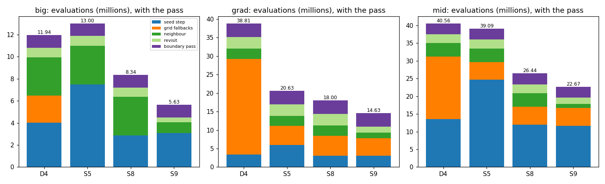
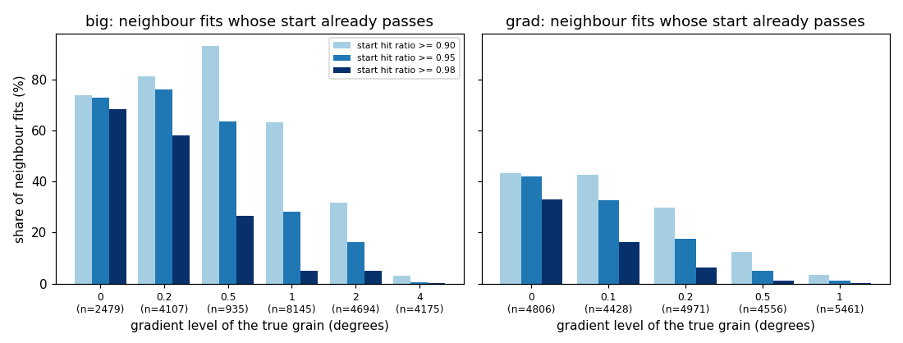

# AR3 step 9: a start test for the neighbour fits, class A, and a third sample

Step 9 of "AR3" in `docs/autoresearch/PLAN.md`, task `ar3i`. No file under `icenine/` changed. No
key was added and no default changed. Scripts are in `scripts/autoresearch/ar3/` (`start_*.py`).
Results are in `benchmarks/autoresearch/ar3/start/`. Every table below is filled from `tables.md`
there.

**Scope.** Three simulated samples, one run of each pipeline, one voxel order. `big` is step 7's
sample (32 grains, six levels of orientation gradient). `grad` is the first gradient sample (497
grains, levels up to 1 degree). `mid` is new: 120 grains on the same 24,570-voxel grid. None is a
real sample, and C++ was not run. No extra random seed was run. Counts carry a Wilson 95% interval
or a paired count; there are no p-values. The intervals count voxels, fits and seed steps as
independent, but they cluster in grains, so they are too narrow for statements across grains. A
gradient level holds few grains (1 to 25): a result by level is a result on those grains. Every
wall time here was measured with other jobs running (contended) and is not a timing result. The
cost that counts is the evaluation count.

## Terms

- **Evaluation**: one call of the strict cost function (a raw count). Indexing is not counted.
- **BFS**: the breadth-first search; it spreads from voxel to voxel, and each voxel gets a **local
  optimization** (a fit that starts from a fitted neighbour's orientation).
- **Neighbour fit**: the local optimization of a voxel started from a fitted neighbour's
  orientation. **Revisit**: a later fit of a voxel the BFS marked for another try.
- **Relative test**: the BFS accepts a fit if its hit ratio is above 0.9 times the best hit ratio
  seen so far in the same flood. Otherwise the voxel is **rejected**.
- **Start test** (`F1`): one evaluation of the start before a fit; if its hit ratio is at least a
  threshold, the start is kept and the fit is skipped.
- **Seed step**, **seed test** (hit ratio 0.80), **reseed**, **grid fallback**, **boundary pass**:
  as on step 8's page (`findings_ar3_reseed.md`).
- **Class A**: a voxel of a reseed cluster whose last fit before the reseed ended right (within 1
  degree of the truth) and was still rejected by the relative test. Classes B and C are the other
  rejected voxels (step 8).
- **Right**: within 1 degree of the truth. **Error**: the angle between a voxel's orientation and
  the truth.
- `D4`, `S5`: step 8's baselines. `S8`: `S5` with a seed step that stops its refinements at the
  first one with hit ratio at least 0.95. `S9`: `S8` plus every remedy that passed Part 2.
- **Pick set** and **test set**: true grains with an even and with an odd index (step 8's split).

## Written down before the runs

The plan wrote down four predictions. Whether the result agrees:

1. *In most class A voxels the truth passes the relative test: the fit stopped short.* **Agrees,
   by construction.** The truth passes the relative test in 1,069 of 1,069 class A voxels on
   `big` and in 589 of 589 on `grad`. But on these clean images this check cannot fail: the truth
   has a hit ratio of at least 0.954 (`big`) and 0.961 (`grad`) in every class A voxel, and any
   hit ratio above 0.90 passes, whatever the flood's best. Only realistic images could test it.
   The real evidence that the fits stopped short is the extra fit (Part 1.2).
2. *In `S5` on `big`, more than half of the neighbour fits in the grains at 1 degree or less
   start with a hit ratio of at least 0.95, and fewer than a quarter in the grains at 4 degrees.*
   **Does not agree.** The prediction has two parts joined by "and", and the first part fails. At
   1 degree or less it is 7,818 of 15,666 fits (49.9%, Wilson 95% interval 49.1 to 50.7): just
   under half, not more than half (the interval includes one half). The second part holds: at 4
   degrees it is 25 of 4,175 (0.6%, interval 0.4 to 0.9), fewer than a quarter.
3. *On `mid`, `S8` with the pass needs fewer evaluations than `S5` and than `D4` with the pass,
   and its interval of wrong voxels overlaps that of the one with fewer wrong voxels.*
   **Agrees.** `S8` needs 26,443,074 evaluations, `S5` 39,093,613, `D4` 40,560,874. After the
   pass `S8` has 31 wrong voxels (interval 0.09 to 0.18%), `S5` 34 (0.10 to 0.19%), `D4` 48.
   `S8` is itself the one with the fewest wrong voxels, and its interval overlaps `S5`'s.
4. *`S9` with the pass needs under 6.5 million evaluations on `big` (`S8`: 8.34), with an
   interval of wrong voxels that overlaps `S8`'s and a median error no more than 0.05 degrees
   above `S8`'s.* **Agrees on `big`.** 5,634,362 evaluations; 29 wrong voxels (0.08 to 0.17%)
   against `S8`'s 24 (0.07 to 0.15%); median error 0.0550 against 0.0316 degrees, 0.0234 above.
   (The prediction names `big` only. On `grad` and `mid` the same three numbers are in Part 3.)

Chosen after I had seen results: nothing in the plan's tables. Some rules were fixed in the
scripts after Part 1 and before the pick; they are listed under "Deviations" so a reader can
judge them.

## The result in pictures

Reading of the first picture: each bar is the evaluations of one pipeline with the boundary
pass, by stage (millions). `S9` is the fourth bar of each panel. `S9` is `S8` with the start
test at hit ratio 0.90 (the only remedy that passed). Its start tests are inside the neighbour
and revisit stages. The bars of `D4`, `S5` and `S8` are step 8's on `big` and `grad`, and this
task's on `mid`.



Reading of the second picture: for each gradient level, the share of neighbour fits (in `S5`)
whose start already has a hit ratio of at least 0.90, 0.95 and 0.98. Left `big`, right `grad`.
The share falls as the gradient grows. On `grad` it is low at every level: most neighbour fits
there start more than 1 degree from the truth (Part 1).



## Short answers

1. **Is `S8` confirmed on a sample it was not chosen on?** Yes on `mid`, by prediction 3: fewer
   evaluations than `S5` and `D4` with the pass, with an interval of wrong voxels that overlaps
   `S5`'s. `mid` is one sample with 120 grains; the cut against `S5` is 32.4% (26.44 against
   39.09 million).
2. **Does the start test save evaluations?** Yes. `S9` against `S8`, with the pass: `big` 5.63
   against 8.34 million (-32.4%), `grad` 14.63 against 18.00 (-18.7%), `mid` 22.67 against 26.44
   (-14.3%). On the neighbour fits and revisits alone the cut is 68.1%, 47.2% and 53.9%.
3. **What does it cost in accuracy?** A small rise in error and a few more wrong voxels. Median
   error after the pass rises from 0.0316 to 0.0550 degrees on `big`, from 0.0226 to 0.0360 on
   `grad` and from 0.0297 to 0.0429 on `mid`. Wrong voxels after the pass: 29 against 24, 70
   against 63 and 40 against 31. The intervals overlap on all three samples. Paired with `S8`
   after the pass: `big` 10 fixed and 15 broken, `grad` 31 and 38, `mid` 9 and 18.
4. **Why were the class A fits rejected?** The data are consistent with fits that stop short. In
   every class A voxel (1,069 on `big`, 589 on `grad`) the true orientation itself passes the
   relative test, so the second explanation (the truth scores below 0.9 times the flood's best)
   holds for none of them. On clean images that is by construction (the truth scores at least
   0.954), so it is not a test of that explanation. The evidence is the extra fit: one more local
   optimization from the rejected end (0.1 degrees, at most 60 evaluations) passes the test in
   807 of 1,069 and 451 of 589. This is consistent with fits that stop a few tenths of a degree
   short. That a fit that ran longer would pass is tested only in this form (one more fit).
5. **Does `F2` (one more fit before rejecting) pay?** No, under the pooled rule. Pooled over the
   two samples, on the test set it cuts the seed-step evaluations of the reseed clusters by 4.8%
   (0.2 degrees, the pick), not by the third the plan asks for. By sample it differs: on `big`
   alone the cut is 34.1%, above a third; on `grad` it is negative (-11.8%). The pass rule is
   judged on the pooled test set, so the pooled rule decides the fail (Part 2). The cut is small
   because a reseed cluster vanishes only if every member's last rejected fit passes: 137 of the
   672 test clusters do. Even if `F2` cost nothing, the pooled cut would be 21.5% at 0.2 degrees
   and 26.2% at 0.1, under a third. It runs on every rejected fit (38,438 in the two sets, 61
   evaluations each), and class A is 1,658 voxels in all.
6. **Does a kept start add up error across a grain?** A little. The median error after the pass
   rises by 0.013 to 0.023 degrees (answer 3). The one large change by level is `grad` at 1
   degree: the 99th percentile error is 0.339 degrees for `S8` and 5.872 for `S9` (5,539 voxels;
   53 and 56 wrong voxels). The number of grains behind it was not counted.

## Part 1: what the stored runs say

Source: step 8's logged run of `S5` on `big`, and this task's rerun of `S5` on `grad` (the one
logged rerun the plan allows: `grad` had seed steps stored, but not the neighbour fits). The
rerun reproduced the stored run exactly: 16,947,800 evaluations, 945 reseeds, 348 seeds, and every
counter of `check_logged_grad.json` equal. The start hit ratio of each fit is one fresh strict
evaluation at the stored start orientation (it is not in any total). As a check, the same
evaluation at the stored end orientation gives the stored hit ratio of the fit to within
0.0028 (`big`, 16 of 32,673 rows differ by more than 0.001) and 0.0039 (`grad`, 72 of 53,263);
the orientations are stored as 32-bit numbers.

### 1.1 The start of every neighbour fit and revisit

Reading of the table: one row per sample, phase and gradient level of the voxel's true grain.
`s90`, `s95` and `s98` are the fits whose start already has a hit ratio of at least 0.90, 0.95
and 0.98 (count and share); `ci95` is the 95% interval of the share at 0.95, in percent.

<!-- table:p1_start_share -->
| sample | phase | level | fits | evals | s90 | s95 | s98 | ci95 |
|---|---|---|---|---|---|---|---|---|
| big | neighbour | all | 24535 | 3513895 | 12820 (52.3%) | 8610 (35.1%) | 4995 (20.4%) | 34.5 to 35.7 |
| big | neighbour | 0.0 | 2479 | 1179241 | 1830 (73.8%) | 1812 (73.1%) | 1695 (68.4%) | 71.3 to 74.8 |
| big | neighbour | 0.2 | 4107 | 1086999 | 3341 (81.3%) | 3124 (76.1%) | 2391 (58.2%) | 74.7 to 77.3 |
| big | neighbour | 0.5 | 935 | 99811 | 873 (93.4%) | 594 (63.5%) | 249 (26.6%) | 60.4 to 66.6 |
| big | neighbour | 1.0 | 8145 | 560005 | 5159 (63.3%) | 2288 (28.1%) | 416 (5.1%) | 27.1 to 29.1 |
| big | neighbour | 2.0 | 4694 | 311672 | 1489 (31.7%) | 767 (16.3%) | 242 (5.2%) | 15.3 to 17.4 |
| big | neighbour | 4.0 | 4175 | 276167 | 128 (3.1%) | 25 (0.6%) | 2 (0.0%) | 0.4 to 0.9 |
| big | revisit | all | 8138 | 884040 | 2249 (27.6%) | 1555 (19.1%) | 958 (11.8%) | 18.3 to 20.0 |
| big | revisit | 0.0 | 704 | 276900 | 638 (90.6%) | 627 (89.1%) | 505 (71.7%) | 86.5 to 91.2 |
| big | revisit | 0.2 | 811 | 156113 | 729 (89.9%) | 614 (75.7%) | 387 (47.7%) | 72.6 to 78.5 |
| big | revisit | 1.0 | 1113 | 75837 | 428 (38.5%) | 164 (14.7%) | 33 (3.0%) | 12.8 to 16.9 |
| big | revisit | 2.0 | 1439 | 91751 | 368 (25.6%) | 137 (9.5%) | 32 (2.2%) | 8.1 to 11.1 |
| big | revisit | 4.0 | 4071 | 283439 | 86 (2.1%) | 13 (0.3%) | 1 (0.0%) | 0.2 to 0.5 |
| grad | neighbour | all | 24222 | 2786526 | 6202 (25.6%) | 4621 (19.1%) | 2693 (11.1%) | 18.6 to 19.6 |
| grad | neighbour | 0.0 | 4806 | 1179352 | 2077 (43.2%) | 2015 (41.9%) | 1585 (33.0%) | 40.5 to 43.3 |
| grad | neighbour | 0.1 | 4428 | 437776 | 1895 (42.8%) | 1443 (32.6%) | 726 (16.4%) | 31.2 to 34.0 |
| grad | neighbour | 0.2 | 4971 | 406923 | 1478 (29.7%) | 875 (17.6%) | 315 (6.3%) | 16.6 to 18.7 |
| grad | neighbour | 0.5 | 4556 | 342130 | 571 (12.5%) | 224 (4.9%) | 56 (1.2%) | 4.3 to 5.6 |
| grad | neighbour | 1.0 | 5461 | 420345 | 181 (3.3%) | 64 (1.2%) | 11 (0.2%) | 0.9 to 1.5 |
| grad | revisit | all | 29041 | 3072127 | 7324 (25.2%) | 4958 (17.1%) | 2633 (9.1%) | 16.6 to 17.5 |
| grad | revisit | 0.0 | 4542 | 1218056 | 2677 (58.9%) | 2507 (55.2%) | 1809 (39.8%) | 53.7 to 56.6 |
| grad | revisit | 0.1 | 3858 | 338450 | 2053 (53.2%) | 1336 (34.6%) | 506 (13.1%) | 33.1 to 36.1 |
| grad | revisit | 0.2 | 4975 | 372323 | 1728 (34.7%) | 861 (17.3%) | 263 (5.3%) | 16.3 to 18.4 |
| grad | revisit | 0.5 | 4890 | 349970 | 591 (12.1%) | 185 (3.8%) | 38 (0.8%) | 3.3 to 4.4 |
| grad | revisit | 1.0 | 10776 | 793328 | 275 (2.6%) | 69 (0.6%) | 17 (0.2%) | 0.5 to 0.8 |
<!-- /table:p1_start_share -->

Reading of the table: how far the fits with a passing start moved (the angle between start and
end, degrees, median / 90th percentile), and `w90`, `w95`, `w98`, how many of those starts were
wrong (error above 1 degree).

<!-- table:p1_move -->
| sample | phase | level | m90 | m95 | m98 | w90 | w95 | w98 |
|---|---|---|---|---|---|---|---|---|
| big | neighbour | all | 0.060 / 0.130 | 0.040 / 0.095 | 0.000 / 0.068 | 15 | 0 | 0 |
| big | neighbour | 0.0 | 0.000 / 0.037 | 0.000 / 0.036 | 0.000 / 0.028 | 2 | 0 | 0 |
| big | neighbour | 0.2 | 0.031 / 0.074 | 0.029 / 0.072 | 0.022 / 0.067 | 3 | 0 | 0 |
| big | neighbour | 0.5 | 0.072 / 0.125 | 0.062 / 0.107 | 0.042 / 0.086 | 0 | 0 | 0 |
| big | neighbour | 1.0 | 0.084 / 0.138 | 0.065 / 0.110 | 0.048 / 0.088 | 1 | 0 | 0 |
| big | neighbour | 2.0 | 0.101 / 0.168 | 0.075 / 0.127 | 0.057 / 0.098 | 4 | 0 | 0 |
| big | neighbour | 4.0 | 0.135 / 0.242 | 0.069 / 0.126 | 0.057 / 0.073 | 5 | 0 | 0 |
| big | revisit | all | 0.042 / 0.117 | 0.027 / 0.078 | 0.008 / 0.052 | 9 | 0 | 0 |
| big | revisit | 0.0 | 0.000 / 0.036 | 0.000 / 0.036 | 0.000 / 0.029 | 0 | 0 | 0 |
| big | revisit | 0.2 | 0.036 / 0.073 | 0.034 / 0.070 | 0.027 / 0.064 | 0 | 0 | 0 |
| big | revisit | 1.0 | 0.084 / 0.125 | 0.060 / 0.108 | 0.036 / 0.083 | 1 | 0 | 0 |
| big | revisit | 2.0 | 0.091 / 0.159 | 0.066 / 0.118 | 0.052 / 0.081 | 1 | 0 | 0 |
| big | revisit | 4.0 | 0.109 / 0.242 | 0.083 / 0.157 | 0.029 / 0.029 | 7 | 0 | 0 |
| grad | neighbour | all | 0.035 / 0.084 | 0.025 / 0.063 | 0.000 / 0.046 | 36 | 0 | 0 |
| grad | neighbour | 0.0 | 0.000 / 0.034 | 0.000 / 0.032 | 0.000 / 0.028 | 9 | 0 | 0 |
| grad | neighbour | 0.1 | 0.038 / 0.067 | 0.034 / 0.062 | 0.028 / 0.057 | 5 | 0 | 0 |
| grad | neighbour | 0.2 | 0.053 / 0.089 | 0.043 / 0.073 | 0.031 / 0.059 | 11 | 0 | 0 |
| grad | neighbour | 0.5 | 0.083 / 0.135 | 0.062 / 0.111 | 0.044 / 0.070 | 8 | 0 | 0 |
| grad | neighbour | 1.0 | 0.089 / 0.153 | 0.057 / 0.112 | 0.037 / 0.060 | 3 | 0 | 0 |
| grad | revisit | all | 0.035 / 0.089 | 0.023 / 0.061 | 0.000 / 0.043 | 18 | 0 | 0 |
| grad | revisit | 0.0 | 0.000 / 0.032 | 0.000 / 0.030 | 0.000 / 0.025 | 0 | 0 | 0 |
| grad | revisit | 0.1 | 0.041 / 0.071 | 0.036 / 0.064 | 0.029 / 0.058 | 0 | 0 | 0 |
| grad | revisit | 0.2 | 0.056 / 0.098 | 0.044 / 0.077 | 0.034 / 0.060 | 3 | 0 | 0 |
| grad | revisit | 0.5 | 0.087 / 0.138 | 0.061 / 0.103 | 0.037 / 0.074 | 6 | 0 | 0 |
| grad | revisit | 1.0 | 0.078 / 0.164 | 0.051 / 0.081 | 0.038 / 0.060 | 9 | 0 | 0 |
<!-- /table:p1_move -->

Reading of the table: the median hit ratio and error at the start and at the end of the fit, and
the mean evaluations per fit, by level (all fits, not only those that pass).

<!-- table:p1_start_end -->
| sample | phase | level | fits | hit_start | hit_end | err_start | err_end | evals_per_fit |
|---|---|---|---|---|---|---|---|---|
| big | neighbour | 0 | 2479 | 0.994 | 0.994 | 0.041 | 0.041 | 475.7 |
| big | neighbour | 0.2 | 4107 | 0.985 | 1.000 | 0.042 | 0.034 | 264.7 |
| big | neighbour | 0.5 | 935 | 0.962 | 1.000 | 0.078 | 0.029 | 106.7 |
| big | neighbour | 1 | 8145 | 0.922 | 0.990 | 0.110 | 0.031 | 68.8 |
| big | neighbour | 2 | 4694 | 0.835 | 0.986 | 0.225 | 0.051 | 66.4 |
| big | neighbour | 4 | 4175 | 0.695 | 0.926 | 0.469 | 0.155 | 66.1 |
| big | revisit | 0 | 704 | 0.992 | 0.994 | 0.017 | 0.016 | 393.3 |
| big | revisit | 0.2 | 811 | 0.978 | 0.999 | 0.044 | 0.025 | 192.5 |
| big | revisit | 1 | 1113 | 0.876 | 0.988 | 0.113 | 0.028 | 68.1 |
| big | revisit | 2 | 1439 | 0.826 | 0.984 | 0.205 | 0.042 | 63.8 |
| big | revisit | 4 | 4071 | 0.595 | 0.833 | 0.521 | 0.211 | 69.6 |
| grad | neighbour | 0 | 4806 | 0.621 | 0.684 | 26.627 | 26.645 | 245.4 |
| grad | neighbour | 0.1 | 4428 | 0.696 | 0.739 | 20.049 | 20.036 | 98.9 |
| grad | neighbour | 0.2 | 4971 | 0.581 | 0.651 | 29.006 | 29.001 | 81.9 |
| grad | neighbour | 0.5 | 4556 | 0.554 | 0.655 | 29.115 | 29.098 | 75.1 |
| grad | neighbour | 1 | 5461 | 0.465 | 0.605 | 29.225 | 29.197 | 77.0 |
| grad | revisit | 0 | 4542 | 0.965 | 0.979 | 0.032 | 0.025 | 268.2 |
| grad | revisit | 0.1 | 3858 | 0.915 | 0.981 | 0.065 | 0.031 | 87.7 |
| grad | revisit | 0.2 | 4975 | 0.825 | 0.971 | 0.124 | 0.041 | 74.8 |
| grad | revisit | 0.5 | 4890 | 0.658 | 0.919 | 0.332 | 0.096 | 71.6 |
| grad | revisit | 1 | 10776 | 0.505 | 0.731 | 0.718 | 0.399 | 73.6 |
<!-- /table:p1_start_end -->

What the three tables say. On `big`, 8,610 of 24,535 neighbour fits (35.1%) start at a hit ratio
of at least 0.95, 12,820 (52.3%) at least 0.90 and 4,995 (20.4%) at least 0.98. The neighbour fits
cost 3,513,895 evaluations and the revisits 884,040. A fit with a passing start moves little: at
0.95 the median move is 0.040 degrees (90th percentile 0.095). At 0.95 and 0.98 no passing start
is wrong, on either sample. At 0.90 there are 15 wrong starts among the neighbour fits on `big`
and 36 on `grad`. On `grad` only 19.1% of the neighbour fits start at 0.95 (4,621 of 24,222), and
58.7% of them start more than 1 degree from the truth. This is consistent with small grains (49
voxels on average): many voxels are reached first from another grain. The stored counters agree
with the fit log (9,508 of 24,222 neighbour fits accepted at the first try on `grad`; 19,119 of
24,535 on `big`).

### 1.2 Class A, the check

Reading of the table: for the class A voxels of the reseed clusters of `S5` (a voxel counted at
its first cluster). `truth_pass` is the number whose true orientation passes the relative test
against the flood's best at that moment; `after_pass` is the number that passes after one more
local optimization from the rejected end (first step 0.1 degrees, at most 60 evaluations);
`after_ci` is its 95% interval in percent. The other columns are medians.

<!-- table:p1_class_a -->
| sample | voxels | class_a | truth_pass | truth_fail | after_pass | after_ci | hit_stored | hit_truth | best | hit_after | err_end | err_after | extra_evals |
|---|---|---|---|---|---|---|---|---|---|---|---|---|---|
| big | 1471 | 1069 | 1069 | 0 | 807 | 72.8 to 78.0 | 0.835 | 1.000 | 1.000 | 0.952 | 0.294 | 0.069 | 65209 |
| grad | 6140 | 589 | 589 | 0 | 451 | 73.0 to 79.8 | 0.839 | 1.000 | 0.998 | 0.948 | 0.227 | 0.052 | 35929 |
<!-- /table:p1_class_a -->

The two explanations: (a) the fit stopped a few tenths of a degree short of the best
orientation, (b) the true orientation scores under 0.9 times the flood's best. `truth_fail` is 0
on both samples: (b) holds for no class A voxel. But on these clean images (b) could not hold.
The lowest hit ratio at the truth in class A is 0.954 on `big` and 0.961 on `grad`, and a hit
ratio above 0.90 passes the relative test whatever the flood's best (a hit ratio is at most 1).
So this check passes by construction and has no power here; only realistic images could test
(b). The evidence for (a) is the extra fit. The stored fits end at a median error of 0.294
degrees (`big`) and 0.227 (`grad`) with a median hit ratio of 0.835 and 0.839, and the extra fit
brings the median error to 0.069 and 0.052 and the hit ratio to 0.952 and 0.948. It passes in
75.5% (807 of 1,069) and 76.6% (451 of 589). The 262 and 138 that still fail were not tried with a longer or wider
fit; that is untested. Class A is 1,069 of the 1,471 cluster voxels on `big` (72.7%) but 589 of
the 6,140 on `grad` (9.6%); the other 5,551 voxels on `grad` are not class A.

Whether the stored rejected fit includes the BFS's own retry: it does not. The retry runs only
when the local optimizer is `cma` (`retry_on` in `_expand`), and `S5` runs in the classic mode (the
run's configuration has no `LocalOptimizer` key; `run_seed.py` asserts it). What is stored is the
step 4 fit: a CMA fit of at most 61 evaluations and, if its cost did not fall, the stock fit
from the same start. So the extra fit here is a second CMA fit from the end of that.

The gate for `F2` ("stopped short in at least half of class A") is met by the extra fit, which
passes in more than half of class A on both samples. That the truth passes in all of class A
adds nothing here, because it passes by construction.

## Part 2: remedies on stored cases

The split is step 8's. The pick was written to `f_pick.json` from the pick set only and committed
(commit `55b7323`) before the script that reads the test set ran (the test script and the test
run of `F2` refuse to start unless that file is committed); the test results are in commit
`91c48a6`. Both samples with a logged run are pooled (`big` and `grad`).

`F1`: per fit, the stored evaluations against 1 plus (0 if kept, else the stored evaluations). A
case is *fixed* if the stored fit ended wrong and the kept start is right, *broken* if the stored
fit ended right and the kept start is wrong, *both wrong* if both are wrong (not counted by the
plan's rule). `F2`: one more fit from every rejected fit's end (60 evaluations at most, always
reached), judged by the relative test, and replacing the end if its hit ratio is higher. A reseed
cluster vanishes if every member's last rejected fit passes; the saving is the seed-step
evaluations of the vanishing clusters less `F2`'s own evaluations on all rejected fits; fixed and
broken are counted on the voxels of vanishing clusters against the stored final map.

Reading of the table: pick set first, then test set, pooled over the two samples. For `F1`,
`kept` is the fits that keep their start and `cut` the percentage cut of the evaluations of the
neighbour fits and revisits. For `F2`, `kept` is the clusters that vanish, `evals` is `F2`'s own
cost on all rejected fits, and `cut` the net percentage cut of the seed-step evaluations of the
reseed clusters.

<!-- table:p2_remedies -->
| set | remedy | setting | kept | evals | cut | fixed | broken | both_wrong |
|---|---|---|---|---|---|---|---|---|
| pick | F1 | hit >= 0.9 | 15699 | 2094485 | 58.7 | 0 | 0 | 37 |
| pick | F1 | hit >= 0.95 | 10666 | 2418710 | 52.4 | 0 | 0 | 0 |
| pick | F1 | hit >= 0.98 | 5543 | 2915999 | 42.6 | 0 | 0 | 0 |
| pick | F2 | 0.05 deg | 96 | 1161135 | 1.2 | 0 | 0 | 0 |
| pick | F2 | 0.1 deg | 107 | 1161135 | 3.1 | 0 | 0 | 0 |
| pick | F2 | 0.2 deg | 93 | 1161135 | 3.3 | 0 | 0 | 0 |
| test | F1 | hit >= 0.9 | 12896 | 2190746 | 57.7 | 0 | 0 | 41 |
| test | F1 | hit >= 0.95 | 9078 | 2440856 | 52.9 | 0 | 0 | 0 |
| test | F1 | hit >= 0.98 | 5736 | 2716054 | 47.6 | 0 | 0 | 0 |
| test | F2 | 0.05 deg | 134 | 1183583 | 8.2 | 0 | 0 | 0 |
| test | F2 | 0.1 deg | 145 | 1183583 | 9.5 | 0 | 0 | 0 |
| test | F2 | 0.2 deg | 137 | 1183583 | 4.8 | 0 | 0 | 0 |
<!-- /table:p2_remedies -->

The pick. `F1`: all three thresholds break no case. The largest cut on the pick set is at 0.90
(58.7%), so 0.90 is the pick. `F2`: the largest net saving is at 0.2 degrees (293,068 evaluations,
3.3%), so 0.2 is the pick (pooled; on `grad` alone `F2`'s own cost, 904,264 evaluations, is more
than the 580,103 it saves at 0.05 degrees).

The verdict on the test set. `F1` at 0.90 **passes**: the neighbour fits and revisits need 57.7%
fewer evaluations (2,190,746 against 5,180,340), 0 fixed and 0 broken. By sample: `big` 73.8%,
`grad` 45.0%. `F2` at 0.2 degrees **fails**: 4.8% net cut (341,218 of 7,090,641), 0 fixed and 0
broken; no setting reaches a third on the pooled test set.

The pooled rule decides `F2`'s verdict. By sample the result differs (table below). On `big`
alone, `F2` at 0.2 degrees cuts 34.1%: (1,134,114 - 258,701) / 2,570,539, with 0 fixed and 0
broken. That is above a third. On `big`'s pick set alone the pick would also be 0.2 degrees. On
`grad` the net cut is negative at every setting. The rule that the pass is judged on the pooled
test set was written in the scripts (commit `5cfff2f`) before any `F2` result. So it was not
chosen after a result, but it decides the verdict; the owner can weigh the by-sample numbers.

Reading of the table: `F2` on the test set, by sample and pooled. `clusters` is the reseed
clusters and `vanish` those whose every member's last rejected fit passes after the extra fit.
`seed_evals` is the seed-step evaluations of all clusters, `seed_evals_vanish` those of the
vanishing clusters, `f2_evals` `F2`'s own cost on all rejected fits. `net_cut` is the pass rule's
cut in percent; `gross_cut` leaves out `F2`'s own cost, as if `F2` were free.

<!-- table:p2_f2_by_sample -->
| set | sample | setting | clusters | vanish | seed_evals | seed_evals_vanish | f2_evals | net_cut | gross_cut |
|---|---|---|---|---|---|---|---|---|---|
| test | big | 0.05 deg | 159 | 58 | 2570539 | 1040658 | 258701 | 30.4 | 40.5 |
| test | big | 0.1 deg | 159 | 63 | 2570539 | 1088839 | 258701 | 32.3 | 42.4 |
| test | big | 0.2 deg | 159 | 60 | 2570539 | 1134114 | 258701 | 34.1 | 44.1 |
| test | grad | 0.05 deg | 513 | 76 | 4520102 | 726430 | 924882 | -4.4 | 16.1 |
| test | grad | 0.1 deg | 513 | 82 | 4520102 | 766868 | 924882 | -3.5 | 17.0 |
| test | grad | 0.2 deg | 513 | 77 | 4520102 | 390687 | 924882 | -11.8 | 8.6 |
| test | pooled | 0.05 deg | 672 | 134 | 7090641 | 1767088 | 1183583 | 8.2 | 24.9 |
| test | pooled | 0.1 deg | 672 | 145 | 7090641 | 1855707 | 1183583 | 9.5 | 26.2 |
| test | pooled | 0.2 deg | 672 | 137 | 7090641 | 1524801 | 1183583 | 4.8 | 21.5 |
<!-- /table:p2_f2_by_sample -->

Two accounting facts explain why the cut is small. First, a cluster vanishes only if every member's
last rejected fit passes, and only 137 of the 672 test clusters do at 0.2 degrees. Clusters also
hold voxels of classes B and C, so "the truth passes in all of class A" does not make clusters
vanish. Second, even with `F2`'s own cost set to zero the pooled cut is
21.5% at 0.2 degrees and 26.2% at 0.1, under a third. These are counts, not a tested cause.

Two things the stored cases do not show. They cannot show the accumulation of error along a
grain (Part 3 does). And the pass rule counts *broken* only where the stored fit ended right: at
0.90, 41 kept starts on the test set are wrong where the stored fit was also wrong (*both
wrong*), and 7 kept starts fail the relative test; at 0.95 and 0.98 there are none of either. The
pick rule chose 0.90 by the evaluations it saves, as written; 0.95 cuts 52.9% on the test set with
none of these.

## Part 3: whole-layer runs

`mid`: 120 grains (sizes 22 to 623 voxels, median 191, mean 204.75), levels 0, 0.2, 0.5, 1, 2
and 4 degrees on 20, 16, 18, 22, 25 and 19 grains. The images are clean: 9,053,073 lit pixels in
70,649 spots (`big`: 6,864,619 and 18,814). No setting was chosen on it. Each run has the
boundary pass. All runs ended before their 90 minute cap (the longest, `D4` on `mid`, 3,605
seconds, contended). Part 1 and Part 2 needed a few minutes of compute besides the 32 minutes of
the one rerun.

Reading of the table: evaluations by stage with the pass (the pass counts its tries). `seeds`
and `reseeds` are the seed steps of the first seeds and of the reseeds; `grid` the grid fallbacks.
The rows for `D4`, `S5` and `S8` on `big` and `grad` are step 8's stored runs (no rerun; see
"Checks").

<!-- table:p3_stages -->
| sample | run | seeds | reseeds | grid | seed_step | grid_fallback | neighbour | revisit | pass_ | total |
|---|---|---|---|---|---|---|---|---|---|---|
| big | D4 + pass | 38 | 291 | 8 | 4016458 | 2452689 | 3479526 | 863042 | 1131977 | 11943692 |
| big | S5 + pass | 35 | 314 | 0 | 7469574 | 0 | 3513895 | 884040 | 1132343 | 12999852 |
| big | S8 + pass | 37 | 292 | 0 | 2856712 | 0 | 3491437 | 853714 | 1138565 | 8340428 |
| big | S9 + pass | 36 | 339 | 0 | 3097413 | 0 | 960109 | 425526 | 1151314 | 5634362 |
| grad | D4 + pass | 344 | 954 | 76 | 3389254 | 25833494 | 2817382 | 3089366 | 3677690 | 38807186 |
| grad | S5 + pass | 348 | 945 | 15 | 5990794 | 5098353 | 2786526 | 3072127 | 3681960 | 20629760 |
| grad | S8 + pass | 347 | 932 | 16 | 3008757 | 5449501 | 2798001 | 3060730 | 3683241 | 18000230 |
| grad | S9 + pass | 347 | 973 | 14 | 3088444 | 4756980 | 1423346 | 1672968 | 3689524 | 14631262 |
| mid | D4 + pass | 159 | 1391 | 53 | 13551359 | 17640347 | 3821439 | 2498156 | 3049573 | 40560874 |
| mid | S5 + pass | 162 | 1446 | 15 | 24678413 | 4996273 | 3806891 | 2572406 | 3039630 | 39093613 |
| mid | S8 + pass | 156 | 1455 | 15 | 12007352 | 5002750 | 3859661 | 2517272 | 3056039 | 26443074 |
| mid | S9 + pass | 157 | 1443 | 15 | 11666873 | 4997389 | 1167148 | 1773692 | 3067690 | 22672792 |
<!-- /table:p3_stages -->

Reading of the table: the effect of the start test. `nr_s8` and `nr_s9` are the evaluations of the
neighbour fits and revisits (start tests included in `S9`); `nr_change` and `total_change` are the
changes in percent.

<!-- table:p3_f1_effect -->
| sample | nr_s8 | nr_s9 | nr_change | total_s8 | total_s9 | total_change | reseeds_s8 | reseeds_s9 |
|---|---|---|---|---|---|---|---|---|
| big | 4345151 | 1385635 | -68.1 | 8340428 | 5634362 | -32.4 | 292 | 339 |
| grad | 5858731 | 3096314 | -47.2 | 18000230 | 14631262 | -18.7 | 932 | 973 |
| mid | 6376933 | 2940840 | -53.9 | 26443074 | 22672792 | -14.3 | 1455 | 1443 |
<!-- /table:p3_f1_effect -->

Reading of the table: counters of `S9`'s start test. `f1_tests` is the number of start tests (one
evaluation each), `f1_kept` the starts kept. `F2` did not pass, so its columns are empty.

<!-- table:p3_s9 -->
| sample | f1 | f2 | f1_tests | f1_kept | f2_runs | f2_evals | f2_replaced |
|---|---|---|---|---|---|---|---|
| big | 0.9 | n/a | 32599 | 11477 | 0 | 0 | 0 |
| grad | 0.9 | n/a | 53312 | 11910 | 0 | 0 | 0 |
| mid | 0.9 | n/a | 51706 | 10198 | 0 | 0 | 0 |
<!-- /table:p3_s9 -->

Reading of the table: wrong voxels (error above 1 degree) before and after the pass, with the
Wilson 95% interval in percent of the 24,570 voxels.

<!-- table:p3_wrong -->
| sample | run | before | before_ci | after | after_ci |
|---|---|---|---|---|---|
| big | D4 | 68 | 0.22 to 0.35 | 21 | 0.06 to 0.13 |
| big | S5 | 71 | 0.23 to 0.36 | 30 | 0.09 to 0.17 |
| big | S8 | 67 | 0.21 to 0.35 | 24 | 0.07 to 0.15 |
| big | S9 | 68 | 0.22 to 0.35 | 29 | 0.08 to 0.17 |
| grad | D4 | 225 | 0.80 to 1.04 | 74 | 0.24 to 0.38 |
| grad | S5 | 203 | 0.72 to 0.95 | 62 | 0.20 to 0.32 |
| grad | S8 | 210 | 0.75 to 0.98 | 63 | 0.20 to 0.33 |
| grad | S9 | 215 | 0.77 to 1.00 | 70 | 0.23 to 0.36 |
| mid | D4 | 94 | 0.31 to 0.47 | 48 | 0.15 to 0.26 |
| mid | S5 | 87 | 0.29 to 0.44 | 34 | 0.10 to 0.19 |
| mid | S8 | 84 | 0.28 to 0.42 | 31 | 0.09 to 0.18 |
| mid | S9 | 76 | 0.25 to 0.39 | 40 | 0.12 to 0.22 |
<!-- /table:p3_wrong -->

Reading of the table: the error of all voxels after the pass, in degrees: median, 90th and 99th
percentile.

<!-- table:p3_error -->
| sample | run | med | p90 | p99 |
|---|---|---|---|---|
| big | D4 | 0.0316 | 0.0803 | 0.1799 |
| big | S5 | 0.0318 | 0.0809 | 0.1819 |
| big | S8 | 0.0316 | 0.0805 | 0.1775 |
| big | S9 | 0.0550 | 0.1260 | 0.2050 |
| grad | D4 | 0.0227 | 0.0697 | 0.1731 |
| grad | S5 | 0.0227 | 0.0695 | 0.1710 |
| grad | S8 | 0.0226 | 0.0691 | 0.1746 |
| grad | S9 | 0.0360 | 0.0943 | 0.1875 |
| mid | D4 | 0.0301 | 0.0950 | 0.2210 |
| mid | S5 | 0.0300 | 0.0902 | 0.2121 |
| mid | S8 | 0.0297 | 0.0906 | 0.2115 |
| mid | S9 | 0.0429 | 0.1157 | 0.2246 |
<!-- /table:p3_error -->

Reading of the table: the paired count of wrong voxels. `fixed` are voxels wrong in `vs` and right
in `run`, `broken` the reverse.

<!-- table:p3_paired -->
| sample | run | vs | when | wrong_run | wrong_vs | fixed | broken | both_wrong |
|---|---|---|---|---|---|---|---|---|
| big | S8 | S5 | before | 67 | 71 | 8 | 4 | 63 |
| big | S8 | S5 | after | 24 | 30 | 12 | 6 | 18 |
| big | S8 | D4 | before | 67 | 68 | 6 | 5 | 62 |
| big | S8 | D4 | after | 24 | 21 | 5 | 8 | 16 |
| big | S5 | D4 | before | 71 | 68 | 5 | 8 | 63 |
| big | S5 | D4 | after | 30 | 21 | 6 | 15 | 15 |
| big | S9 | S8 | before | 68 | 67 | 11 | 12 | 56 |
| big | S9 | S8 | after | 29 | 24 | 10 | 15 | 14 |
| big | S9 | S5 | before | 68 | 71 | 12 | 9 | 59 |
| big | S9 | S5 | after | 29 | 30 | 13 | 12 | 17 |
| big | S9 | D4 | before | 68 | 68 | 13 | 13 | 55 |
| big | S9 | D4 | after | 29 | 21 | 12 | 20 | 9 |
| grad | S8 | S5 | before | 210 | 203 | 28 | 35 | 175 |
| grad | S8 | S5 | after | 63 | 62 | 25 | 26 | 37 |
| grad | S8 | D4 | before | 210 | 225 | 34 | 19 | 191 |
| grad | S8 | D4 | after | 63 | 74 | 38 | 27 | 36 |
| grad | S5 | D4 | before | 203 | 225 | 56 | 34 | 169 |
| grad | S5 | D4 | after | 62 | 74 | 38 | 26 | 36 |
| grad | S9 | S8 | before | 215 | 210 | 48 | 53 | 162 |
| grad | S9 | S8 | after | 70 | 63 | 31 | 38 | 32 |
| grad | S9 | S5 | before | 215 | 203 | 44 | 56 | 159 |
| grad | S9 | S5 | after | 70 | 62 | 31 | 39 | 31 |
| grad | S9 | D4 | before | 215 | 225 | 63 | 53 | 162 |
| grad | S9 | D4 | after | 70 | 74 | 42 | 38 | 32 |
| mid | S8 | S5 | before | 84 | 87 | 20 | 17 | 67 |
| mid | S8 | S5 | after | 31 | 34 | 14 | 11 | 20 |
| mid | S8 | D4 | before | 84 | 94 | 32 | 22 | 62 |
| mid | S8 | D4 | after | 31 | 48 | 29 | 12 | 19 |
| mid | S5 | D4 | before | 87 | 94 | 23 | 16 | 71 |
| mid | S5 | D4 | after | 34 | 48 | 24 | 10 | 24 |
| mid | S9 | S8 | before | 76 | 84 | 28 | 20 | 56 |
| mid | S9 | S8 | after | 40 | 31 | 9 | 18 | 22 |
| mid | S9 | S5 | before | 76 | 87 | 27 | 16 | 60 |
| mid | S9 | S5 | after | 40 | 34 | 13 | 19 | 21 |
| mid | S9 | D4 | before | 76 | 94 | 37 | 19 | 57 |
| mid | S9 | D4 | after | 40 | 48 | 23 | 15 | 25 |
<!-- /table:p3_paired -->

Reading of the table: `S8` and `S9` by gradient level of the voxel's true grain, after the pass:
wrong voxels, median and 99th percentile error. A level holds 1 to 25 grains; this is a result on
those grains.

<!-- table:p3_by_level -->
| sample | level | voxels | wrong_s8 | wrong_s9 | med_s8 | med_s9 | p99_s8 | p99_s9 |
|---|---|---|---|---|---|---|---|---|
| big | 0 | 2484 | 0 | 0 | 0.0165 | 0.0406 | 0.0811 | 0.0811 |
| big | 0.2 | 4112 | 0 | 2 | 0.0272 | 0.0596 | 0.0961 | 0.1453 |
| big | 0.5 | 936 | 0 | 0 | 0.0294 | 0.0711 | 0.1071 | 0.1785 |
| big | 1 | 8154 | 0 | 5 | 0.0277 | 0.0544 | 0.1032 | 0.1875 |
| big | 2 | 4700 | 4 | 3 | 0.0366 | 0.0588 | 0.1532 | 0.2094 |
| big | 4 | 4184 | 20 | 19 | 0.0564 | 0.0601 | 0.2654 | 0.2680 |
| grad | 0 | 4877 | 0 | 1 | 0.0135 | 0.0186 | 0.0523 | 0.0554 |
| grad | 0.1 | 4488 | 0 | 2 | 0.0180 | 0.0377 | 0.0721 | 0.1103 |
| grad | 0.2 | 5041 | 0 | 1 | 0.0200 | 0.0395 | 0.0876 | 0.1312 |
| grad | 0.5 | 4625 | 10 | 10 | 0.0317 | 0.0449 | 0.1587 | 0.1764 |
| grad | 1 | 5539 | 53 | 56 | 0.0468 | 0.0524 | 0.3386 | 5.8721 |
| mid | 0 | 5287 | 0 | 0 | 0.0195 | 0.0290 | 0.0657 | 0.0962 |
| mid | 0.2 | 2871 | 0 | 0 | 0.0198 | 0.0427 | 0.0654 | 0.1288 |
| mid | 0.5 | 3492 | 0 | 0 | 0.0247 | 0.0498 | 0.1041 | 0.1688 |
| mid | 1 | 4669 | 0 | 0 | 0.0358 | 0.0507 | 0.1594 | 0.1999 |
| mid | 2 | 4290 | 11 | 16 | 0.0560 | 0.0614 | 0.2595 | 0.2724 |
| mid | 4 | 3961 | 20 | 24 | 0.0478 | 0.0524 | 0.2594 | 0.2953 |
<!-- /table:p3_by_level -->

What the tables say.

- **`mid`.** `S8` needs 26,443,074 evaluations with the pass against 39,093,613 for `S5` and
  40,560,874 for `D4`. The seed step is the largest stage in all three (`S8`: 12.0 million, with
  5.0 million more in grid fallbacks). `S8` has 31 wrong voxels after the pass, `S5` 34, `D4` 48.
  Paired, `S8` against `S5`: 14 fixed, 11 broken, 20 both wrong.
- **`S9`.** The start test cuts the neighbour and revisit stages by 47 to 68% (table above). The
  total falls less because the seed step and the pass are not touched: 32.4% on `big`, 18.7% on
  `grad`, 14.3% on `mid`. On `big` and `grad` the number of reseeds rises (292 to 339, 932 to
  973); on `mid` it falls (1,455 to 1,443). Kept starts that the BFS rejects cannot explain it. The
  relative test accepts a fit if its hit ratio divided by the flood's best is above 0.9, and a
  hit ratio is at most 1. So a start kept at a hit ratio of 0.90 or more fails the test only on
  the tie of a hit ratio of exactly 0.90 against a best of 1.0. All 7 kept starts on the test set
  that fail the test (3 on the pick set) are that tie. The extra reseeds therefore come from
  something downstream of the kept starts. What it is was not measured.
- **Accuracy.** The median error rises on every sample and at every level (table by level), by
  0.013 to 0.023 degrees overall. The wrong voxels rise by 5 (`big`), 7 (`grad`) and 9 (`mid`);
  the intervals overlap, and the change has the same direction on all three. The one large change
  by level is `grad` at 1 degree: the 99th percentile error is 0.339 degrees for `S8` and 5.872
  for `S9`. A few voxels moved far; how many grains they lie in was not counted.
- **Prediction 4 on the other two samples.** `grad`: 14.63 million, 70 wrong (0.23 to 0.36%)
  against 63 (0.20 to 0.33%), median error 0.0134 above. `mid`: 22.67 million, 40 wrong (0.12 to
  0.22%) against 31 (0.09 to 0.18%), 0.0132 above.

## What the result decides

Prediction 3 holds, so `S8`'s seed step (stop the refinements at the first with hit ratio at
least 0.95) counts as confirmed on a sample it was not chosen on. By the plan's rule that is the
recommendation for the opt-in key. The plan's other branch ("both numbers as settings, no stop
test") is not needed.

`F1` passed Part 2 and prediction 4 holds on `big`, so by the plan's rule the start test is a
candidate for a second opt-in key. The numbers the owner should weigh: 14 to 32% of the
evaluations saved on three samples; a small rise in error that has the same direction on every
sample and level (0.013 to 0.023 degrees at the median) and 5 to 9 more wrong voxels per sample;
a threshold (0.90) that won the pick under a rule that does not count a kept start that is wrong
where the stored fit was wrong too. The choice of what a key recommends stays the owner's.

AR5 proper (a stop rule inside the grid search) is not part of this step. The grid fallbacks are
still large on `mid`: 5.0 of `S9`'s 22.67 million evaluations.

## Checks on the stored runs

- The rerun of `S5` on `grad` (the baseline check) reproduced the stored run exactly: 16,947,800
  evaluations, 945 reseeds, every counter in `check_logged_grad.json`.
- Step 8's stored runs of `D4`, `S5` and `S8` on `big` and `grad` were not rerun. `S8` with the
  pass on `big` is 8,340,428 evaluations and 24 wrong, on `grad` 18,000,230 and 63, as stored.
  The `S9` runs use the class `E1Pick` of `reseed_s8.py` with one more replaced method, and the
  same voxel order. A run of `S9` with the start test off was not made, so that it then equals `S8`
  is untested.
- On `mid`, `D4`, `S5` and `S8` were run once each, in this task.

## How to reproduce

All from `icenine_py/`, with `scripts/autoresearch/ar3/start_bg.sh <sample> <name> <script> ...`
(it sets `RESEED_SAMPLE` and `RESEED_CACHE`, runs under `caffeinate` with a log and a `.done`
marker). Stored runs of steps 7 and 8 are read from their worktrees (untracked).

```
AR3_SAMPLE=mid uv run python scripts/autoresearch/ar3/start_make_mid.py     # sample
uv run python scripts/phase_d/render_full.py --tag mid --workers 5 --variants clean --mic <truth>
AR3_SAMPLE=mid uv run python scripts/autoresearch/ar3/start_stack_note.py --build
start_bg.sh grad S5_grad_logged start_logged_grad.py                      # the one rerun
start_bg.sh <big|grad> part1_<s> start_part1.py                           # part 1
start_bg.sh <big|grad> f2_pick_<s> start_part2.py --set pick              # part 2, F2 pick
uv run python scripts/autoresearch/ar3/start_part2_pick.py                # the pick; commit it
start_bg.sh <big|grad> f2_test_<s> start_part2.py --set test              # after the commit
uv run python scripts/autoresearch/ar3/start_part2_test.py
start_bg.sh mid D4_mid start_run.py --kind D4  (and --kind S5; reseed_s8.py for S8)
start_bg.sh <s> S9_<s> start_s9.py                       # reads part2_verdict.json
start_bg.sh <s> pass_<kind> start_pass.py --kind D4|S5|S8|S9
start_bg.sh <s> slim_<s> start_slim.py; uv run python scripts/autoresearch/ar3/start_summary.py
```

Reused from earlier steps: step 8's logged run and recorders (`reseed_logged_run.py`, run
unchanged for `grad`), the class definitions (`reseed_slim.py`), `reseed_s8.E1Pick` (the `S8` seed
step), `reseed_common` (sample set-up; two small changes: `mid`, and an environment variable
`RESEED_CACHE` for the cache folder), step 7's run drivers (`run_wrapped.run_bfs` for `D4`,
`run_seed.run` for `S5`), step 5's boundary pass (`boundary_pass.py`, unchanged) and step 8's
accounting (the stages of `reseed_summary2.py`). `ar3_common` and `gradient_common` accept the
sample name `mid`; nothing else changed there.

## Deviations from the plan

- **The grain map of `mid`.** Step 7's generator reads a 32-grain file; no file with about 120
  grains exists. The map is a Voronoi tessellation of the 24,570 voxel centres around 120 centres
  drawn with `default_rng(0)`; orientations are drawn with the phase D helper (seed 0) and
  redrawn if an adjacent pair is closer than 5 degrees (none was redrawn). The gradients are
  step 7's code with its seed 0 and six levels, drawn uniformly (20, 16, 18, 22, 25 and 19 grains;
  step 7 drew 5, 5, 1, 9, 6 and 6 the same way). "Step 7's proportions" is read as this draw.
- **A logged rerun on `grad`.** I used the one allowed rerun (32 minutes), because `grad` has no
  stored neighbour-fit log. The pooled pick uses both samples.
- **Rules fixed in the scripts before the pick** (commit `5cfff2f`, before `55b7323`): a setting
  must save more than zero evaluations to qualify; `F2` replaces the rejected end only if its hit
  ratio is higher; the vanishing-cluster accounting of `F2`; the pass rule is judged on the pooled
  test set; the start evaluation of `F1` is counted (the fit does not reuse it).
- **A pilot that flooded the layer.** The first pilot of `S9` (`--smoke 400`, `big`) did not
  stop at 400 voxels (the BFS floods the layer), and I ended it after about two minutes; it is not
  a result. The second pilot (150 seconds, `F1` 0.95 and `F2` 0.1 set by hand, before the pick) is
  kept in `pilot_notes/` for the record and used nowhere.
- **Part 1 was run on all fits** (both sets), so the shares at 0.90, 0.95 and 0.98 had been seen
  on the test set before the pick. The thresholds were fixed by the plan.

## Limits and not claimed

Not claimed: that C++ behaves the same; that the gradient model or these levels match a real
sample; a change of any default; a tested wall time (every wall time here is contended); that three
samples stand for all samples; a cause for the rise in reseeds under `F1` (a kept start can fail
the relative test only on a tie, so the cause is downstream and was not measured) or for the rise
in error. `mid` is a different grain size, not a repeat;
there is no repeat of any run. Stored-case results do not show downstream effects: a kept start is
passed on to the next voxel in the whole-layer run only.

## What comes after

Left for the owner and the next step: whether `F1` is worth a key at 0.90, or at 0.95 (both are in
the Part 2 table; 0.95 keeps no wrong start in the stored cases and was not run on the whole
layer); whether a rule that also counts a kept wrong start belongs in the pass rule; AR5 (the grid
fallbacks) and the reseed cost, which is the largest stage on `mid`.
