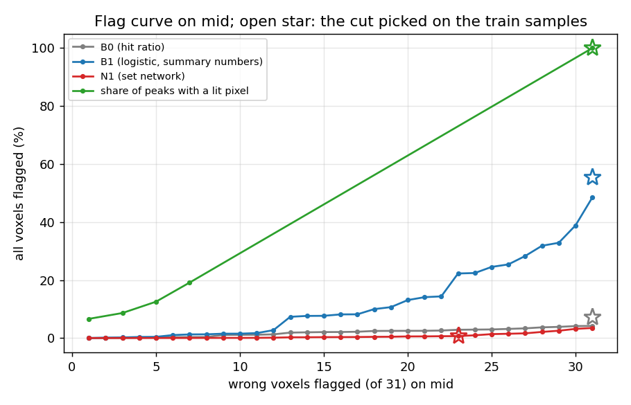
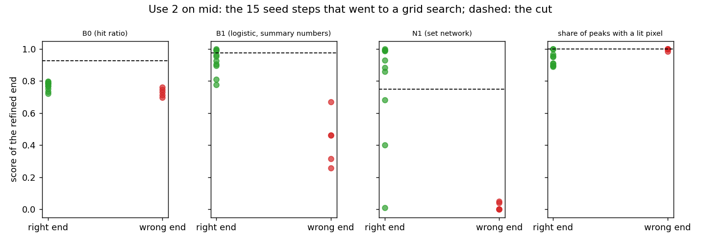

# AR4 step 1: a learned verifier, measured offline against the hit ratio

Step 1 of "AR4" in `docs/autoresearch/PLAN.md`, task `ar4a`. No file under `icenine/` changed. No
key was added and no default changed. Scripts are in `scripts/autoresearch/ar4/` (`verify_*.py`).
Results are in `benchmarks/autoresearch/ar4/`. Every table below is filled from `tables.md`
there, and every number in the text comes from `summary.json` or `thresholds.json` there.

The question: can a small model, fitted once on two samples, tell a right orientation from a wrong
one at a voxel better than the hit ratio does? The hit ratio is the only test today. It sees one
number per evaluation: the share of predicted pixels that fall on observed intensity. The model
sees the same evaluation split by predicted peak.

**Short answer.** The set network `N1` is a better judge of a finished seed than the hit ratio,
but it does not meet the plan's rule for flagging unfinished voxels. On `mid`, use 1 (flag the
unfinished voxels) is not passed by any model. Use 2 (accept a seed without a grid search) gives
`N1` 7 of 10 right ends accepted and 0 of 5 wrong ends accepted; the hit ratio gives 0 of 10.
Predictions 1 and 3 agree with the numbers; predictions 2 and 4 do not.

The plot below leads because it shows the effect that decides use 1. Reading it: each line is
one score. Each dot is one cut that flags a given number of the 31 wrong voxels of `mid`
(x axis) at the smallest cost in flagged voxels; the y axis is the share of all 24,570 voxels
that this cut flags. A line near the bottom is a cheap flag. The open star is the cut that was
picked on the train samples (before `mid` was touched); it is the point the pass rule judges.
The star of `N1` is at 23 of 31 wrong voxels, left of where it would have to be (31).

## Terms

- A **pair** is one voxel with one orientation.
- A pair is **right** if its orientation is within 1 degree of the voxel's truth, by the library's
  symmetry-reduced angle. Nothing here is specific to one crystal system. The peak-family input is
  a rank by the length of the reciprocal vector, not Miller indices.
- A **verifier** reads numbers from one evaluation of a pair (no truth) and returns a score from
  0 to 1 that the pair is right. A pair is **flagged** when its score is at or under a **cut**.
- **Local optimization** is the refinement that follows a candidate orientation.
- A **seed step** is one call of the library's `index_seed`: index the voxel from its rays, cost
  20 candidates, refine up to 5. If the best end fails the seed test (hit ratio 0.80), the voxel
  goes to a full **grid search**. These are the **grid-fallback** cases.
- The **hit ratio** is the share of predicted pixels on observed intensity. `S8` is the stored run
  with the boundary pass; "after the pass" is its final map.
- `B0` is the hit ratio alone (today's rule). `B1` is a logistic regression on six summary
  numbers. `N1` is a set network: one shared layer for each predicted peak, then the mean and the
  maximum over the peaks, then two layers, with the summary numbers added. It has 21,953
  parameters. `lit` is the share of predicted peaks with any lit pixel, with no training.

## What was run

Train samples: `big` and the first gradient sample (`grad`). Test sample: `mid`. No model was
trained and no cut was picked on `mid`. The pairs are of eight kinds (plan, "Pairs"): every voxel
after the pass and, where it differs, before it; every distinct neighbour orientation at each
boundary voxel (`try_start`); the refined ends of every stored seed step (`seed_end`); the costed
candidates of every 10th seed step (`seed_cand`); the truth turned by 0.1, 0.3 and 0.5 degree
about a random axis at every 20th voxel.

Reading the next table: one row per sample, the number of pairs of each kind. Each pair costs one
evaluation of the strict cost function. The three samples hold 229,651 pairs and so 229,651
evaluations.

<!-- table:ar4_pairs -->
| sample | pairs | after | before | try_start | seed_end | seed_cand | turn_01 | turn_03 | turn_05 |
|---|---|---|---|---|---|---|---|---|---|
| big | 49103 | 24570 | 1056 | 18665 | 465 | 660 | 1229 | 1229 | 1229 |
| grad | 94306 | 24570 | 752 | 60381 | 2356 | 2560 | 1229 | 1229 | 1229 |
| mid | 86242 | 24570 | 1429 | 50099 | 3217 | 3240 | 1229 | 1229 | 1229 |
<!-- /table:ar4_pairs -->

The library's cost function returns only the totals of one evaluation. The script takes the
per-peak pixel counts from the same overlap data (it calls the same C function once per predicted
peak) and the library is not changed. Each pair therefore takes two library calls: the fused
evaluation that the stored runs use (the score of the pair) and the per-peak breakdown. Checks on
all 229,651 pairs: the per-peak counts sum exactly to the totals of the per-peak path (largest
difference 0 pixels). Against the fused evaluation they differ on 2,271 of the 86,242 pairs of
`mid`, by at most 6 pixels, and the hit ratios differ by at most 0.0047 (0.0039 on `big`, 0.0043
on the first gradient sample). I did not trace why the two paths differ by a few pixels. The
replay of the seed steps reproduced the stored finisher evaluations and hit ratios in all 329,
1,279 and 1,611 steps of `big`, the first gradient sample and `mid` (0 mismatches).

One planned summary number is missing. The best vote count among the rays an orientation does not
explain costs 50 to 200 ms a pair (a pilot on 40 voxels of `big`; its output was not kept).
That is hours for this many pairs and over the 45-minute budget. It was not computed, and no
model uses it. The number
of attached rays that the orientation explains was computed and is used. The inputs took about 17
minutes for the two train samples (run side by side) and 31 minutes for `mid`, with two processes
at most and other jobs running (contended; not timing results).

## Models and cuts (train samples only)

Each model was trained once on all 143,409 pairs of the two train samples, with generator seed 0.
`N1` ran 20 epochs in 125 s. The layer sizes, loss and epochs were committed before the run. The
cut of each score is the one that flags the fewest voxels while flagging at least 95% of the 87
wrong voxels (24 and 63) of the maps after the pass, the two samples pooled. Ties at the cut are
all flagged. The thresholds file was committed (`669b9a3`) before any script read `mid`. The
cuts are picked on the same voxels the models trained on, so the train numbers are in-sample.

Reading the next table: one row per score. `cut` is the picked cut; `flagged` is the number of the
49,140 train voxels flagged; `wrong` is how many of the 87 wrong voxels that includes.

<!-- table:ar4_cuts -->
| score | cut | flagged | wrong | share |
|---|---|---|---|---|
| B0 (hit ratio) | 0.926 | 1741 | 83 | 3.54% |
| B1 (logistic, summary numbers) | 0.976 | 25009 | 83 | 50.89% |
| N1 (set network) | 0.749 | 110 | 83 | 0.22% |
| share of peaks with a lit pixel | 1.000 | 49140 | 87 | 100.00% |
<!-- /table:ar4_cuts -->

The `lit` cut is 1.000: 20 of the 87 wrong voxels have a lit share under 1, so no cut under 1.0
flags 83 of the 87, and the cut flags every voxel.

## Use 1: flag the unfinished voxels on `mid`

Reading the next table: one row per score, on the 24,570 voxels of the `S8` map after the pass.
There are 31 wrong voxels. `wrong` is how many of them the train cut flags, with a Wilson 95%
interval. `flagged` is all voxels flagged. `auc` is the share of (right, wrong) voxel pairs in
which the right voxel scores higher (a tie counts one half); it is a count of ordered pairs, not a
test. `rule` is the plan's pass rule: flag at least as many of the 31 as `B0` does, and at most
half as many voxels as `B0` does (880).

<!-- table:ar4_use1_mid -->
| score | wrong | flagged | share | auc | rule |
|---|---|---|---|---|---|
| B0 (hit ratio) | 31 of 31 (0.89 to 1.00) | 1760 of 24570 | 7.16% | 0.981 | no |
| B1 (logistic, summary numbers) | 31 of 31 (0.89 to 1.00) | 13653 of 24570 | 55.57% | 0.875 | no |
| N1 (set network) | 23 of 31 (0.57 to 0.86) | 190 of 24570 | 0.77% | 0.994 | no |
| share of peaks with a lit pixel | 31 of 31 (0.89 to 1.00) | 24570 of 24570 | 100.00% | 0.506 | no |
<!-- /table:ar4_use1_mid -->

`B0` flags all 31 and 1,760 voxels. `N1` flags 190 voxels, far under half, but only 23 of the 31
wrong voxels: it fails the first half of the rule. `B1` flags all 31 but 13,653 voxels. No model
passes. The same cuts on the train samples (in-sample) flag 21 and 22 of the 24 wrong voxels of
`big` for `B0` and `N1`, and 62 and 61 of the 63 of the first gradient sample.

The 8 wrong voxels that `N1` does not flag are all boundary voxels with errors of 34 to 56
degrees. Their hit ratios are 0.889 to 0.910 and their `N1` scores 0.83 to 0.99.

Reading the next table: one row per missed voxel; `err` in degrees, `hit` the hit ratio, `n1` the
`N1` score (the cut is 0.749), `bnd` whether the voxel has a try in the boundary pass.

<!-- table:ar4_missed -->
| voxel | err | hit | n1 | bnd |
|---|---|---|---|---|
| 97 | 55.06 | 0.903 | 0.986 | yes |
| 2995 | 34.40 | 0.908 | 0.959 | yes |
| 3302 | 54.20 | 0.889 | 0.912 | yes |
| 4758 | 52.10 | 0.904 | 0.982 | yes |
| 5807 | 38.94 | 0.905 | 0.828 | yes |
| 6419 | 52.50 | 0.910 | 0.899 | yes |
| 8427 | 55.99 | 0.899 | 0.973 | yes |
| 21630 | 54.73 | 0.900 | 0.926 | yes |
<!-- /table:ar4_missed -->

A what-if, not a result: the same scores with the cut picked on `mid` itself. Reading the next
table: `p95` is the cut that flags 30 of the 31 wrong voxels (95%), `p100` the cut that flags all
31; each cell is the voxels flagged and their share of all voxels. This is hindsight; the cut
moves between samples (the cut of `B0` picked on `mid` flags fewer voxels than its train cut).

<!-- table:ar4_whatif -->
| score | p95 | p100 |
|---|---|---|
| B0 (hit ratio) | 1016 (4.14%) | 1029 (4.19%) |
| B1 (logistic, summary numbers) | 9548 (38.86%) | 11910 (48.47%) |
| N1 (set network) | 779 (3.17%) | 854 (3.48%) |
| share of peaks with a lit pixel | 24570 (100.00%) | 24570 (100.00%) |
<!-- /table:ar4_whatif -->

## Boundary voxels and the share of lit peaks (prediction 4)

A boundary voxel is a voxel with at least one try in the boundary pass: 17,859 of the voxels of
`mid`, holding all 31 wrong ones. Reading the next table: the same scores on those voxels alone.
`auc` as above; `wrong` and `flagged` at the train cuts.

<!-- table:ar4_boundary -->
| score | auc | wrong | flagged |
|---|---|---|---|
| B0 (hit ratio) | 0.974 | 31 of 31 | 1735 of 17859 |
| B1 (logistic, summary numbers) | 0.882 | 31 of 31 | 9487 of 17859 |
| N1 (set network) | 0.991 | 23 of 31 | 189 of 17859 |
| share of peaks with a lit pixel | 0.496 | 31 of 31 | 17859 of 17859 |
<!-- /table:ar4_boundary -->

The share of lit peaks does not separate right from wrong here (`auc` 0.496 against 0.974 for the
hit ratio). Reading the next table: after the pass, the share of voxels whose predicted peaks are
all lit, the number of wrong voxels with all peaks lit, and the lowest and median lit share of the
wrong voxels.

<!-- table:ar4_lit -->
| sample | all_lit | wrong_all_lit | lowest | median |
|---|---|---|---|---|
| big | 77.1% | 19 of 24 | 0.972 | 1.000 |
| grad | 69.8% | 48 of 63 | 0.900 | 1.000 |
| mid | 79.1% | 24 of 31 | 0.984 | 1.000 |
<!-- /table:ar4_lit -->

On these clean images most predicted peaks of a wrong orientation still touch some observed
intensity (consistent with dense clean images; not tested with a sparser image). The count of
peaks with a lit pixel therefore carries almost no signal. `N1` scores higher than the hit ratio
on `auc` (0.991 against 0.974), by a small margin.

## Use 2: accept a seed without a grid search

The seed steps whose best refined end failed the seed test are the 31 grid-fallback cases of the
plan (16 on the first gradient sample, 15 on `mid`; the voxels are the same as in AR5 step 1). The
"end" of a step is the one the library takes (the first end that reaches hit ratio 0.95, else the
lowest final cost). A seed is accepted when its score is at or above the cut of use 1. As a
control, the same scores are applied to the seed steps that passed (1,596 on `mid`).

Reading the plot: each dot is the score of the end of one of the 15 fallback seed steps of `mid`.
Green dots are right ends (10), red dots wrong ends (5). The dashed line is the cut. A dot above
the line is accepted.

Reading the next table: `right` and `wrong` are the ends accepted, of the 10 right and 5 wrong
ends, with a Wilson 95% interval. `saved` is a what-if: the stored evaluations of the grid
searches that accepting the right ends would have skipped (not a result; the scoring evaluation
and the cost of the refused passing seeds are not counted). `refused` is the passing seeds that
the cut would now refuse, and how many of those ends are right.

<!-- table:ar4_use2_mid -->
| score | right | wrong | saved | refused |
|---|---|---|---|---|
| B0 (hit ratio) | 0 of 10 (0.00 to 0.28) | 0 of 5 (0.00 to 0.43) | 0 | 141 of 1596 (130 right) |
| B1 (logistic, summary numbers) | 3 of 10 (0.11 to 0.60) | 0 of 5 (0.00 to 0.43) | 1,017,386 | 582 of 1596 (571 right) |
| N1 (set network) | 7 of 10 (0.40 to 0.89) | 0 of 5 (0.00 to 0.43) | 2,365,778 | 29 of 1596 (20 right) |
| share of peaks with a lit pixel | 2 of 10 (0.06 to 0.51) | 4 of 5 (0.38 to 0.96) | 665,115 | 476 of 1596 (472 right) |
<!-- /table:ar4_use2_mid -->

These are small counts and are read as counts. On `mid`, `N1` accepts 7 of the 10 right ends and
none of the 5 wrong ones; its 7 skip stored grid searches of 2,365,778 evaluations, out of
5,087,764 stored for the 15 cases. It refuses 29 of the 1,596 passing seeds, 20 of them right and
9 wrong (11 of the 1,596 passing ends are wrong). `B0` at its cut accepts none of the 10 right
ends (their hit ratios are under 0.80, so none can reach 0.926) and would refuse 141 passing
seeds, 130 of them right. `lit` accepts 4 of the 5 wrong ends.

The same table for the first gradient sample, where `N1`'s training pairs included these ends
(in-sample, so not evidence):

<!-- table:ar4_use2_grad -->
| score | right | wrong | saved | refused |
|---|---|---|---|---|
| B0 (hit ratio) | 0 of 13 (0.00 to 0.23) | 0 of 3 (0.00 to 0.56) | 0 | 116 of 1263 (94 right) |
| B1 (logistic, summary numbers) | 6 of 13 (0.23 to 0.71) | 0 of 3 (0.00 to 0.56) | 2,061,839 | 356 of 1263 (337 right) |
| N1 (set network) | 11 of 13 (0.58 to 0.96) | 0 of 3 (0.00 to 0.56) | 3,787,006 | 31 of 1263 (10 right) |
| share of peaks with a lit pixel | 4 of 13 (0.13 to 0.58) | 1 of 3 (0.06 to 0.79) | 1,380,986 | 347 of 1263 (340 right) |
<!-- /table:ar4_use2_grad -->

## Predictions

1. `B1` does not pass use 1: **agrees.** It flags all 31 wrong voxels but 13,653 voxels (55.57%).
2. `N1` passes use 1 on `mid`: **does not agree.** It flags 23 of 31 (0.57 to 0.86).
3. `N1` accepts at least two thirds of the 10 right fallback ends and at most one wrong end:
   **agrees.** 7 of 10 (0.40 to 0.89), 0 of 5. Seven is just over the two-thirds line (6.7).
4. The share of lit peaks separates right from wrong better than the hit ratio: **does not
   agree.** `auc` 0.496 against 0.974.

## Scope and limits

- Simulated samples with clean images only. **Realistic images (overlap and detector noise) are
  untested**, so nothing here says how a verifier behaves on them.
- One run per model, generator seed 0, no other seed. Counts and Wilson intervals; no p-values.
  Voxels in a grain are not independent, so the intervals are too narrow across grains.
- The numbers 31 (wrong voxels of `mid`) and 15 (its fallbacks) were known from AR5 step 1 and the
  plan before the run. The order of work for `mid` was: model definitions, training on the train
  samples and the thresholds file committed (`669b9a3`, 12:43 on 11 Nov 2026); the first
  script that read `mid` started at 12:44. Before that, no script touched `mid`, not even to fill
  a cache or test a loader. (Links to `mid`'s stored files were made just before the run.)
- The cuts were picked in-sample (same voxels as the training pairs); the test on `mid` is not.
- `best_votes` was not computed (see above). A model with it is untested.
- The result is for one set of 31 wrong voxels, 8 of which `N1` misses. I describe the misses; I
  did not test why `N1` scores them high.
- Wall times were measured with other jobs running and are not timing results.

## What it means for the next step

By the plan's rule step 2 (wire a verifier in as a script layer and run the three samples) is run
only for a model that passes use 1. None did. Use 2 alone is a separate question for the owner:
`N1` accepted most right fallback ends without a wrong one on `mid`, on 15 cases, with a wide
interval, and with a cut picked for use 1.
