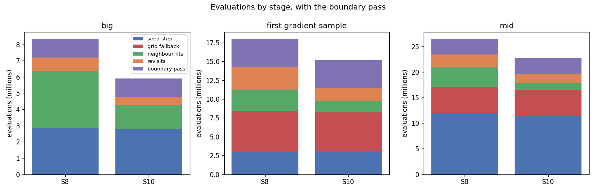
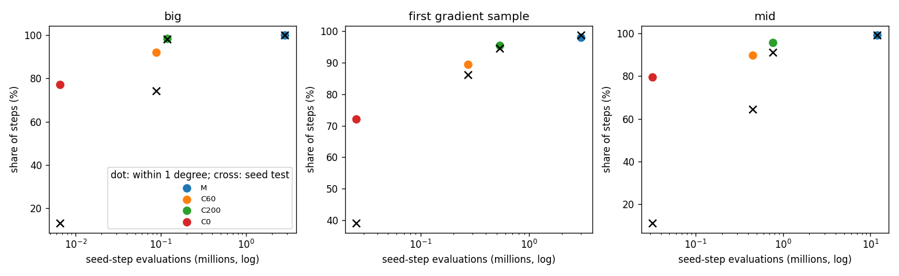

# AR5 step 2: two long local optimizations that rarely change the result

Step 2 of "AR5" in `docs/autoresearch/PLAN.md`, task `ar5b`. Scripts and results only: nothing
under `icenine/` changed, no key was added, no default changed. Scripts are in
`scripts/autoresearch/ar5/` (`fit_*.py`), results in `benchmarks/autoresearch/ar5/fit/`. Every
table below is filled from `tables.md` there. Every wall time was measured with other jobs
running (contended) and is not a timing result.

**The question.** Run `S8` (the best run so far, with the boundary pass) spends evaluations in two
places where it starts close to the answer and still runs the stock MC optimizer
(`FindOptimal`, then the variance-minimizing stage). Can a short CMA fit do the same work?

- The **seed step** indexes a voxel from its rays, costs 20 candidate orientations, and refines
  the best ones (at most 5, with an early stop). The stock refinement is the MC optimizer.
- A **neighbour fit** runs a short CMA fit first. If the CMA end cost is not below the start
  cost, the stock MC fit runs from the same start. That second run is the **MC fallback**.

## Short answer

1. The two places are large. The seed refinements and the MC fallbacks together are 62.5%,
   31.1% and 57.5% of the evaluations of `S8` with the pass (`big`, the first gradient sample,
   `mid`). The MC fallback ended lower than the CMA end in 3 of 3,197, 3 of 3,903 and 45 of
   4,568 runs.
2. **Seed refinement by CMA does not work.** No CMA arm met the plan's rule: each lost more than
   1% of all steps against the stock refinement, in seed-test passes and in steps that end within
   1 degree. The nearest, a CMA fit of at most 200 evaluations, lost 60 passes net of 1,608 steps
   (the limit was 16). The pick is the stock refinement, so change (i) was not applied.
3. **Dropping the MC fallback keeps the accuracy but saves enough only on `big`.** Run `S10`
   (no MC fallback, `S8`'s seed step) used 29.3% fewer evaluations than `S8` on `big`, 15.7% on the
   first gradient sample and 14.3% on `mid`. The plan asked for 20%. `S10` passes its rule on
   `big` and fails it on the other two, on the evaluation rule only. Wrong voxels after the pass
   and the median error stay within the rule on all three.

## First plot: evaluations by stage, `S8` and `S10`

Reading line: one bar per run and sample, split into the stages of the run; the boundary pass is
on top. `S10` is lower than `S8` in the neighbour-fit and revisit stages (green and orange). The
seed step (blue) and the grid fallback (red) are about the same height in both.

Reading line for the table: where the evaluations of `S8` are (percent of its total with the
pass), and how much `S10` saved. The change touches only the neighbour-fit and revisit stage.

<!-- table:shares -->
| sample | S8 total | S10 total | saved | S8 seed step (% of total) | S8 grid fallback (%) | S8 neighbour + revisit (%) | S8 boundary pass (%) | saved in neighbour + revisit (% of S8 total) |
|---|---|---|---|---|---|---|---|---|
| big | 8340428 | 5898258 | 2442170 | 34.3 | 0.0 | 52.1 | 13.7 | 28.4 |
| first gradient sample | 18000230 | 15167998 | 2832232 | 16.7 | 30.3 | 32.5 | 20.5 | 14.5 |
| mid | 26443074 | 22668704 | 3774370 | 45.4 | 18.9 | 24.1 | 11.6 | 12.1 |
<!-- /table:shares -->

## Terms

- **Evaluation**: one call of the strict cost function. Indexing is not counted.
- **Seed step, seed test, early stop, grid fallback, neighbour fit, revisit, boundary pass,
  wrong**: as in `findings_ar3_keys.md`. The seed test passes at hit ratio 0.80 or more; the
  early stop keeps the first refinement end with hit ratio 0.95 or more; **wrong** is an error
  above 1 degree against the truth.
- **Hit ratio**: the share of the predicted detector pixels that fall on observed intensity.
- **Replay**: the seed step of a stored `S8` step run again on its voxel. The seed step reads only
  the voxel's rays and uses `default_rng(0)`, so it can be run again at any voxel.
- **Arms of Part 1**: `M` is the stock MC refinement. `C60` is one CMA fit, first step 0.05
  degree, at most 60 evaluations. `C200` is the same with at most 200. `C0` is no refinement: the
  candidate as costed.
- **Wilson interval**: the 95% Wilson score interval of a count. There are no p-values.
- **Samples**: `big` (32 grains) and the first gradient sample (497 grains) are the pick samples.
  `mid` (about 120 grains) is the test sample. All have 24,570 voxels, clean images, Q-max 8.
  One run per arm with the stored seeds; no extra random seeds.

## Part 0: the stored numbers

Reading line: for each sample, the seed refinements (count, evaluations) and the MC fallbacks of
the neighbour fits (runs, evaluations, runs that ended lower than the CMA end), all from the
stored `S8` runs. The last column is the share of the total of `S8` with the pass.

<!-- table:part0 -->
| sample | seed steps | refinements | refinement evaluations | mean per refinement | MC fallbacks | share of fits (%) | fallback evaluations | mean per fallback | ended lower than CMA | Wilson 95% interval | evaluations of S8 with the pass | refinements + fallbacks (% of total) |
|---|---|---|---|---|---|---|---|---|---|---|---|---|
| big | 329 | 465 | 2850132 | 6129 | 3197 | 9.8 | 2358808 | 738 | 3 | 0.03 to 0.28% | 8340428 | 62.5 |
| first gradient sample | 1279 | 2356 | 2983177 | 1266 | 3903 | 7.3 | 2607431 | 668 | 3 | 0.03 to 0.23% | 18000230 | 31.1 |
| mid | 1611 | 3217 | 11975132 | 3722 | 4568 | 8.8 | 3223477 | 706 | 45 | 0.74 to 1.32% | 26443074 | 57.5 |
<!-- /table:part0 -->

The stored runs hold every count. The MC fallback ended lower than the CMA end in under 1% of its
runs on every sample, but `mid` is close to the line: 45 of 4,568 has a Wilson interval that
spans 1%. Seed refinements cost 6,129, 1,266 and 3,722 evaluations on average.

## Part 1: a CMA seed refinement (replay)

Order rule: the pick was made from `big` and the first gradient sample only. `mid` was not read
by any script before `pick.json` was committed (commit `e5f422f`, 12:00 on 2026-11-11). The first
`mid` run started at 12:00:47 the same day. `fit_common.py` refuses to import for `mid` while
`pick.json` is not committed.

Check of the replay: all 3,219 stored seed steps (329, 1,279 and 1,611) were indexed again, and
the arm `M` was run on every step, not only every 10th. Candidates, costed candidates,
refinement evaluations, hit ratios and stop positions equal the stored log on every step.

Reading line for the plot: each dot is an arm. Height is the share of steps whose end is within 1
degree of the truth; a cross is the share that passes the seed test. Left is cheaper. `C60` and
`C0` sit well below `M`; `C200` is close to `M` but not equal.

Reading line for the table: per sample and arm, the steps that pass the seed test (with a Wilson
interval), the paired split against `M` (steps where only `M` passes, where only the arm passes),
the same split for "within 1 degree", the seed-step evaluations and how much fewer they are than
`M`'s.

<!-- table:part1 -->
| sample | arm | steps | pass the seed test | Wilson 95% interval | passes: M only | passes: arm only | within 1 degree | within 1 deg: M only | within 1 deg: arm only | seed-step evaluations | fewer than M (%) |
|---|---|---|---|---|---|---|---|---|---|---|---|
| big | M | 329 | 329 | 98.8 to 100.0% | 0 | 0 | 329 | 0 | 0 | 2856712 | 0.0 |
| big | C60 | 329 | 244 | 69.2 to 78.6% | 85 | 0 | 303 | 26 | 0 | 88503 | 96.9 |
| big | C200 | 329 | 323 | 96.1 to 99.2% | 6 | 0 | 324 | 5 | 0 | 117733 | 95.9 |
| big | C0 | 329 | 43 | 9.8 to 17.1% | 286 | 0 | 254 | 75 | 0 | 6580 | 99.8 |
| first gradient sample | M | 1279 | 1263 | 98.0 to 99.2% | 0 | 0 | 1254 | 0 | 0 | 3008757 | 0.0 |
| first gradient sample | C60 | 1279 | 1103 | 84.2 to 88.0% | 162 | 2 | 1145 | 111 | 2 | 273789 | 90.9 |
| first gradient sample | C200 | 1279 | 1209 | 93.1 to 95.6% | 58 | 4 | 1222 | 40 | 8 | 532703 | 82.3 |
| first gradient sample | C0 | 1279 | 499 | 36.4 to 41.7% | 764 | 0 | 923 | 335 | 4 | 25580 | 99.1 |
| mid | M | 1611 | 1596 | 98.5 to 99.4% | 0 | 0 | 1595 | 0 | 0 | 12007352 | 0.0 |
| mid | C60 | 1611 | 1037 | 62.0 to 66.7% | 559 | 0 | 1445 | 154 | 4 | 447142 | 96.3 |
| mid | C200 | 1611 | 1467 | 89.6 to 92.4% | 133 | 4 | 1542 | 58 | 5 | 765267 | 93.6 |
| mid | C0 | 1611 | 180 | 9.7 to 12.8% | 1416 | 0 | 1280 | 319 | 4 | 32220 | 99.7 |
<!-- /table:part1 -->

Reading line for the table: the error of the end each arm keeps, over the steps that have
candidates. `C0` is the error of the candidate as costed, which is the start of each refinement.
The `mid` rows come from the replay of `mid`, run after the pick was committed.

<!-- table:err -->
| sample | arm | steps with candidates | median error (deg) | 90th percentile (deg) | within 0.2 deg (%) |
|---|---|---|---|---|---|
| big | M | 329 | 0.016 | 0.056 | 100.0 |
| big | C60 | 329 | 0.126 | 0.542 | 68.7 |
| big | C200 | 329 | 0.013 | 0.050 | 97.0 |
| big | C0 | 329 | 0.453 | 38.956 | 13.1 |
| first gradient sample | M | 1279 | 0.017 | 0.080 | 95.9 |
| first gradient sample | C60 | 1279 | 0.058 | 17.465 | 74.2 |
| first gradient sample | C200 | 1279 | 0.010 | 0.234 | 87.3 |
| first gradient sample | C0 | 1279 | 0.276 | 44.539 | 40.3 |
| mid | M | 1611 | 0.020 | 0.076 | 97.8 |
| mid | C60 | 1611 | 0.160 | 23.341 | 56.0 |
| mid | C200 | 1611 | 0.013 | 0.317 | 85.5 |
| mid | C0 | 1611 | 0.423 | 41.431 | 16.1 |
<!-- /table:err -->

The start is far from the truth more often than the AR1 medians suggested. Those medians were for
the candidate nearest to the truth. The seed step does not know which candidate that is: it keeps
the first with a high hit ratio, or the one of lowest cost. This is consistent with the large
90th percentiles of `C0`; the link to the failures of the CMA arms was not tested.

**Pick.** Reading line: the pick rule on the two pick samples pooled (1,608 steps; 1% is 16
steps). Rule (a): passes at most 1% of steps fewer than `M`. Rule (b): steps within 1 degree at
most 1% of steps fewer than `M`. The pick is the cheapest arm that meets both.

<!-- table:pick -->
| arm | pass the seed test | within 1 degree | seed-step evaluations | rule (a) | rule (b) | picked |
|---|---|---|---|---|---|---|
| M | 1592 | 1583 | 5865469 | reference | reference | yes |
| C60 | 1347 | 1448 | 362292 | False | False | no |
| C200 | 1532 | 1546 | 650436 | False | False | no |
| C0 | 542 | 1177 | 32160 | False | False | no |
<!-- /table:pick -->

No arm meets either rule, so the pick is `M`. `C200` loses 60 passes and 37 steps within 1
degree; `C60` loses 245 and 135. `C0` fails by a wide margin. The paired splits are in the
Part 1 table and in `pick.json`.

**Pass rule on `mid`.** The rule applies to the picked arm. The pick is `M`, so there is nothing to
test. For information, reading line: the rule applied to every arm on `mid`. Rule (c) is a fall of
at least 80% of the seed-step evaluations. The arms fall by 93.6% or more, and fail (a) and (b).

<!-- table:mid_pass -->
| arm | rule (a) | rule (b) | evaluations fall (%) | rule (c) | passes |
|---|---|---|---|---|---|
| C60 | False | False | 96.3 | True | False |
| C200 | False | False | 93.6 | True | False |
| C0 | False | False | 99.7 | True | False |
<!-- /table:mid_pass -->

## Part 2: the whole layer

**Base check.** Run `fit_run.py --name S8x` on `big`, with both changes off, gives the stored `S8`
exactly: the same evaluations in every stage, the same seed-step log, the same wrapper counts and
the same map, bit for bit. Reading line: the three numbers the plan names.

<!-- table:base -->
| item | new | stored |
|---|---|---|
| evaluations before the pass | 7201863 | 7201863 |
| wrong voxels before the pass | 67 | 67 |
| seed steps | 329 | 329 |
<!-- /table:base -->

**`S10`.** With no CMA arm picked, `S10` is `S8` with one change: a neighbour fit or revisit
returns what its CMA fit returned (script `fit_run.py --no-mc-fallback`). The seed step is `S8`'s.
Because the pick is `M`, the plan's runs `S10a` (seed refinement only) and `S10b` (no MC fallback
only) are not separate runs: `S10a` would be `S8` and `S10b` is `S10`. They were not run again.

Reading line for the table: for each run and sample, the evaluations by stage and in total (with
the boundary pass), the grid fallbacks, the wrong voxels before and after the pass with Wilson
95% intervals, "fixed / broken" against `S8` paired by voxel (fixed: wrong in `S8`, right in the
run), and the median error after the pass over all 24,570 voxels of the sample (not only the
right ones). The `S8` rows are the stored runs.

<!-- table:part2 -->
| run | sample | seed step | grid fallback | neighbour fits | revisits | boundary pass | total | grid fallbacks (count) | wrong before the pass | wrong after the pass | fixed / broken before | fixed / broken after | median error after, all 24570 voxels (deg) |
|---|---|---|---|---|---|---|---|---|---|---|---|---|---|
| S8 | big | 2856712 | 0 | 3491437 | 853714 | 1138565 | 8340428 | 0 | 67 (0.21 to 0.35%) | 24 (0.07 to 0.15%) |  |  | 0.0316 |
| S8 | first gradient sample | 3008757 | 5449501 | 2798001 | 3060730 | 3683241 | 18000230 | 16 | 210 (0.75 to 0.98%) | 63 (0.20 to 0.33%) |  |  | 0.0226 |
| S8 | mid | 12007352 | 5002750 | 3859661 | 2517272 | 3056039 | 26443074 | 15 | 84 (0.28 to 0.42%) | 31 (0.09 to 0.18%) |  |  | 0.0297 |
| S10 | big | 2790857 | 0 | 1496574 | 479704 | 1131123 | 5898258 | 0 | 77 (0.25 to 0.39%) | 22 (0.06 to 0.14%) | 10 / 20 | 11 / 9 | 0.0318 |
| S10 | first gradient sample | 3122117 | 5108107 | 1477481 | 1779065 | 3681228 | 15167998 | 15 | 198 (0.70 to 0.93%) | 67 (0.21 to 0.35%) | 51 / 39 | 29 / 33 | 0.0224 |
| S10 | mid | 11431628 | 5008366 | 1489254 | 1687748 | 3051708 | 22668704 | 15 | 73 (0.24 to 0.37%) | 35 (0.10 to 0.20%) | 25 / 14 | 11 / 15 | 0.0300 |
<!-- /table:part2 -->

Reading line: the plan's pass rule for `S10`. Rule (a): at least 20% fewer evaluations than `S8`
with the pass. Rule (b): broken minus fixed, after the pass, at most 5 voxels. Rule (c): median
error after the pass, over all 24,570 voxels, at most 0.005 degree above `S8`'s.

<!-- table:rule -->
| run | sample | fewer than S8 (%) | rule (a) | broken minus fixed | rule (b) | median error minus S8's, all 24570 voxels (deg) | rule (c) | passes |
|---|---|---|---|---|---|---|---|---|
| S10 | big | 29.3 | True | -2 | True | +0.0002 | True | True |
| S10 | first gradient sample | 15.7 | False | 4 | True | -0.0002 | True | False |
| S10 | mid | 14.3 | False | 4 | True | +0.0002 | True | False |
<!-- /table:rule -->

`S10` passes on `big` and fails on the first gradient sample and on `mid`, on rule (a) only. The
change cannot remove the stages it does not touch: in `S8` the grid fallback is 30.3% of the total
on the first gradient sample and the seed step is 45.4% on `mid`.

**Accuracy.** After the pass `S10` has 22, 67 and 35 wrong voxels against 24, 63 and 31 for `S8`;
the Wilson intervals overlap on every sample. Against `S8`, paired by voxel, `S10` fixes 11, 29
and 11 and breaks 9, 33 and 15. Both numbers are large next to the net change. The two runs take
different paths (the seed steps are 333, 1,327 and 1,604 against 329, 1,279 and 1,611), which is
consistent with the many voxels that go either way; this was not tested further. Before the pass,
`S10` has 77, 198 and 73 wrong against 67, 210 and 84.

Reading line for the table: what the fallback did. `S8 fits` is the neighbour and revisit fits
(each ran CMA first). `S10 CMA cost did not fall` is the number of fits where `S8` would have run
the MC fallback.

<!-- table:fits -->
| sample | S8 fits | S8 MC fallbacks | S8 MC ended lower | S10 fits | S10 CMA cost did not fall | S8 neighbour + revisit evaluations | S10 neighbour + revisit evaluations | S8 seed steps | S10 seed steps |
|---|---|---|---|---|---|---|---|---|---|
| big | 32563 | 3197 | 3 | 32398 | 3152 | 4345151 | 1976278 | 329 | 333 |
| first gradient sample | 53300 | 3903 | 3 | 53386 | 3876 | 5858731 | 3256546 | 1279 | 1327 |
| mid | 51696 | 4568 | 45 | 52082 | 4496 | 6376933 | 3177002 | 1611 | 1604 |
<!-- /table:fits -->

`S10` saved slightly more evaluations than the fallback runs of `S8` cost (2,442,170 against
2,358,808 on `big`; see the shares table and Part 0). The extra is not explained: the two runs
visit voxels in different orders and fit different numbers of voxels.

## Predictions of the plan

Reading line: each prediction, the observed numbers and the verdict.

<!-- table:pred -->
| prediction | observed | verdict |
|---|---|---|
| 1 | big 3 of 3197 (0.09%); first gradient sample 3 of 3903 (0.08%); mid 45 of 4568 (0.99%) | agrees |
| 2 | pick M; C60 cuts the seed step by big 96.9%, first gradient sample 90.9%, mid 96.3% | no (the pick is M); the cut holds |
| 3 | C0 passes the seed test in 542 of 1608 steps, M in 1592 | agrees |
| 4 | big 5898258 (limit 4000000; rule passes True); first gradient sample 15167998 (limit 14000000; rule passes False); mid 22668704 (limit 13500000; rule passes False) | no |
| 5 | big 0 against 0; first gradient sample 15 against 16; mid 15 against 15 | agrees |
<!-- /table:pred -->

- 1 agrees. On `mid` the point value is 0.99%, just under the line, with an interval that spans it.
- 2 does not agree: no CMA arm is the pick. The cut of at least 90% holds for `C60` on all three.
- 3 agrees. `C0` passes the seed test in 542 of the 1,608 pick steps, `M` in 1,592.
- 4 does not agree. The totals are above the predicted limits on all three samples, and `S10`
  fails its rule on two samples. Prediction 2 expected `C60` as the pick; the pick is `M`, so
  `S10` kept `S8`'s seed refinement. A what-if by arithmetic, not run: `S10`'s total with its
  seed-step evaluations replaced by those of the `C60` replay is about 3.20, 12.32 and 11.68
  million, under the limits of 4.0, 14 and 13.5 million. `C60` fails the pick rules, and a real
  run would take a different path.
- 5 agrees.

## What this does not show

- It does not show that a CMA seed refinement cannot work. It shows that these settings
  (first step 0.05 degree, at most 60 or 200 evaluations) lose more than 1% of steps against the
  stock refinement on all three samples. Other settings, or a CMA fit with an MC fallback only when
  the end hit ratio is below 0.95, were not run.
- The no-fallback change was tested on one run per sample with the stored seeds. The wrong counts
  have intervals and paired splits, but a different seed could move them; none was run.
- Clean simulated images; no real sample, no realistic images, no C++, no timing.
- The change exists only in the script layer. Making it a key is a later step, if the owner wants
  it. On this evidence it passes the plan's rule on one sample of three.

## Reproduce

From `icenine_py/` (the launcher sets the sample and the cache):

- Inputs: the scripts read the stored `S8` runs and their boundary passes from two sibling
  worktrees under `.claude/worktrees/` (paths set in `fit_common.py`; untracked, read only).
  `big` and the first gradient sample: `agent-a635b2f904279bdc9`, folder
  `icenine_py/benchmarks/autoresearch/ar3/reseed/cache/` (`S8_big`, `S8_grad`, `passes_big`,
  `passes_grad`). `mid`: `agent-a9c88b610fb10e1b6`, folder
  `icenine_py/benchmarks/autoresearch/ar3/start/cache/` (`S8_mid`, `passes_mid`). These worktrees
  are temporary: if they are removed, Parts 0 to 2 cannot be run again from git alone.
- Part 0: `fit_bg.sh <sample> part0_<sample> fit_part0.py`.
- Part 1: `fit_bg.sh <sample> replay_<sample> fit_part1_replay.py`, then `fit_part1_pick.py`
  (writes `pick.json`, commit it), then the same replay on `mid` and `fit_part1_mid.py`.
- Part 2: `fit_run.py --name S8x` (base check) and `fit_base_check.py`;
  `fit_chain.sh <sample> S10 --seed-arm M --no-mc-fallback` (run, pass, numbers).
- Summary: `fit_summary.py` (tables, plots, `summary.json`), `fit_pareto_rows.py` (rows for the
  cost-against-accuracy plots in `docs/autoresearch/pareto/pareto_rows.json`).
