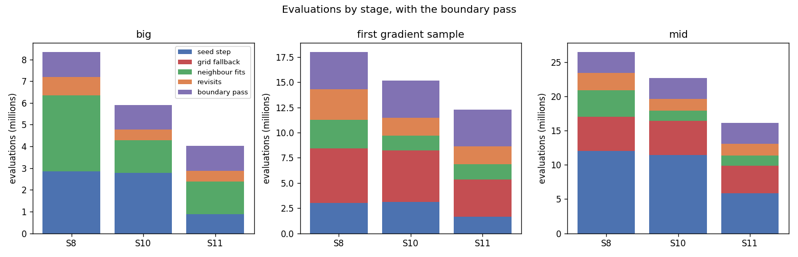
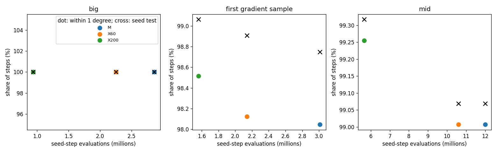

# AR5 step 3: a mixed seed refinement, tested on whole layers

Step 3 of "AR5" in `docs/autoresearch/PLAN.md`, task `ar5c`. Scripts and results only: nothing
under `icenine/` changed, no key was added, no default changed. Scripts are in
`scripts/autoresearch/ar5/` (`mix_*.py`, which use the step 2 scripts `fit_*.py` unchanged),
results in `benchmarks/autoresearch/ar5/mix/`. Every table below is filled from `tables.md`
there. Every wall time was measured with other jobs running (contended) and is not a timing
result.

**The question.** In step 2 no short CMA fit could replace the stock MC optimizer in the seed
step on its own. The review of step 2 found why: the CMA fit loses only on the steps where its
end stays under a hit ratio of 0.95. So the mixed rule is: run the short CMA fit first, and run
the stock MC optimizer from the same start only when the CMA end is under 0.95. This step tests
that rule, first on the stored replay (no new evaluation) and then on whole layers.

## Short answer

1. **Part 1 (stored replay).** The mixed rule with a CMA fit of at most 200 evaluations (`X200`)
   keeps the seed-test passes and the ends within 1 degree of the stock refinement, and needs
   57.3% fewer seed-step evaluations on the two pick samples. The version with at most 60
   (`X60`) also meets step 2's two rules but saves only 25.2%. The pick is `X200`.
2. **Part 2 (whole layers).** Run `S11` (`S10` plus the mixed seed refinement `X200`) passes its
   rule on all three samples: 51.9%, 31.6% and 39.2% fewer evaluations than `S8` (`big`, the
   first gradient sample, `mid`), with the boundary pass in all three. Against `S10` it is
   31.9%, 18.9% and 29.1% fewer.
3. **Accuracy.** Wrong voxels after the pass: 18, 62 and 36 (`S8`: 24, 63 and 31). Broken minus
   fixed against `S8` is -6, -1 and 5. The rule allows 5, so `mid` is exactly at the limit.
4. **Caution.** The mixed rule was found in a replay that included `mid`, so no sample is held
   out for it. The grid-fallback stage also moved: `S11` has fewer grid fallbacks than `S8`
   on two samples. About 30% of the saving on the first gradient sample comes from that
   stage (see the second table).

## First plot: evaluations by stage, `S8`, `S10` and `S11`

Reading line: one bar per run and sample, split into the stages of the run; the boundary pass is
on top. `S11` is lower than `S10` in the seed step (blue) on all three samples. The
neighbour-fit and revisit stages (green and orange) are about the same height as in `S10`. The
grid-fallback stage (red) is lower in `S11` on the first gradient sample and on `mid`.

Reading line for the table: one row per run and sample, evaluations by stage. "Fewer than S8"
and "fewer than S10" compare the total with the pass. A grid fallback is a full grid search
after a seed result failed the seed test.

<!-- table:stages -->
| sample | run | seed step | grid fallback | neighbour fits | revisits | before the pass | boundary pass | total with the pass | fewer than S8 (%) | fewer than S10 (%) | grid fallbacks (count) |
|---|---|---|---|---|---|---|---|---|---|---|---|
| big | S8 | 2856712 | 0 | 3491437 | 853714 | 7201863 | 1138565 | 8340428 | 0.0 | n/a | 0 |
| big | S10 | 2790857 | 0 | 1496574 | 479704 | 4767135 | 1131123 | 5898258 | 29.3 | 0.0 | 0 |
| big | S11 | 888360 | 0 | 1496635 | 494710 | 2879705 | 1135637 | 4015342 | 51.9 | 31.9 | 0 |
| first gradient sample | S8 | 3008757 | 5449501 | 2798001 | 3060730 | 14316989 | 3683241 | 18000230 | 0.0 | n/a | 16 |
| first gradient sample | S10 | 3122117 | 5108107 | 1477481 | 1779065 | 11486770 | 3681228 | 15167998 | 15.7 | 0.0 | 15 |
| first gradient sample | S11 | 1626738 | 3741408 | 1477542 | 1776503 | 8622191 | 3685803 | 12307994 | 31.6 | 18.9 | 11 |
| mid | S8 | 12007352 | 5002750 | 3859661 | 2517272 | 23387035 | 3056039 | 26443074 | 0.0 | n/a | 15 |
| mid | S10 | 11431628 | 5008366 | 1489254 | 1687748 | 19616996 | 3051708 | 22668704 | 14.3 | 0.0 | 15 |
| mid | S11 | 5825184 | 4004585 | 1489620 | 1715137 | 13034526 | 3048170 | 16082696 | 39.2 | 29.1 | 12 |
<!-- /table:stages -->

Reading line: the same totals with the grid-fallback stage taken out of all three runs. The
last two columns say how much of the saving of `S11` against `S8` is the grid-fallback stage.

<!-- table:nogrid -->
| sample | S8 without grid fallbacks | S10 without grid fallbacks | S11 without grid fallbacks | S11 fewer than S8 (%) | S11 fewer than S10 (%) | grid-fallback evaluations S11 saves against S8 | all evaluations S11 saves against S8 |
|---|---|---|---|---|---|---|---|
| big | 8340428 | 5898258 | 4015342 | 51.9 | 31.9 | 0 | 4325086 |
| first gradient sample | 12550729 | 10059891 | 8566586 | 31.7 | 14.8 | 1708093 | 5692236 |
| mid | 21440324 | 17660338 | 12078111 | 43.7 | 31.6 | 998165 | 10360378 |
<!-- /table:nogrid -->

The seed step's own saving is the largest single piece: the seed-step evaluations of `S11` are
888,360 against 2,856,712 for `S8` on `big` (first table). The grid-fallback stage of `S11` is
lower on the first gradient sample (11 fallbacks against 16) and on `mid` (12 against 15). We did
not test why. It is consistent with the mixed seed refinement passing the seed test on a few more
seed steps (Part 1 below: 4 more on each of those two samples), but later steps also depend on the
seed ends, so this is untested.

## Terms

- **Evaluation**: one call of the strict cost function. Indexing is not counted.
- **Seed step, seed test, early stop, grid fallback, neighbour fit, revisit, boundary pass,
  wrong**: as in `findings_ar3_keys.md` and `findings_ar5_fits.md`. The seed test passes at hit
  ratio 0.80 or more. The early stop keeps the first refinement end with hit ratio 0.95 or more.
  **Wrong** is an error above 1 degree against the truth. The step that fits a neighbour voxel
  from its neighbour's orientation is called the neighbour fit here; in general this page means
  the local optimization of a voxel.
- **Hit ratio**: the share of the predicted detector pixels that fall on observed intensity.
- **Mixed seed refinement** (`X60`, `X200`): for each indexed candidate, in the order of `S8`,
  a CMA fit with a first step of 0.05 degree and at most 60 or 200 evaluations. If its end hit
  ratio is at least 0.95, that end is kept and the seed step stops. If not, the stock MC
  optimizer runs from the same candidate, and the candidate's end is the one of the two with the
  lower cost (a tie keeps the CMA end). The early stop is then tested on the kept end. If no
  end reaches 0.95, the lowest cost of up to 5 ends is kept, as in `S8`. Evaluations count both.
- **Arms**: `M` is the stock MC refinement; `C60` and `C200` are the CMA fits alone.
- **Runs**: `S8` is the best earlier run (indexed seeds, early stop at 0.95, boundary pass).
  `S10` (step 2) is `S8` with no MC fallback after a CMA fit in a neighbour local optimization
  or a revisit. `S11` is `S10` with the seed refinement `X200`. `S11a` (the seed refinement
  with the MC fallback kept) was to run only if `S11` failed on a sample; it was not needed.
- **Fixed and broken**: paired by voxel against another run: fixed means wrong in the other run
  and right in `S11`; broken means right in the other run and wrong in `S11`.
- **Wilson interval**: the 95% Wilson score interval of a count. There are no p-values.
- **Samples**: `big` (32 grains) and the first gradient sample (497 grains) are the pick
  samples. `mid` (about 120 grains) was read by step 2. All have 24,570 voxels, clean images,
  Q-max 8. One run per sample with the stored seeds.

## Part 1: the mixed rule from the stored replay

Order rule and its limit. The pick was made from `big` and the first gradient sample only, by
`mix_part1.py --pick`, and `pick.json` was committed (commit `22db075`, 13:57 on 2026-11-11)
before any whole-layer run. The 20-step check below ran after that commit. The first
whole-layer run started at 14:05:51 the same day. `mix_part1.py --all`, which reads `mid`,
refuses to run before the pick commit. But the mixed rule itself came from the review of step 2,
which had read all three samples including `mid` in the replay. So no sample is held out for
the rule.

The numbers come from the stored replay of step 2 (rows per seed step with the arms `M`, `C60`,
`C200` on the same candidates; linked, not copied). The mixed arms are built from them with
the tested function `mix_rules.mixed_step` (12 tests, committed before the module). One step of
`X60` on the first gradient sample needed an MC end that the replay had not computed (the stock
refinement had stopped earlier in the replay); the table counts such steps, and it does not
change the pick.

Reading line for the plot: each dot is an arm. Height is the share of steps whose end is within
1 degree of the truth; a cross is the share that passes the seed test. Left is cheaper. The mixed
arms sit at about the same height as `M` and to the left of it.

Reading line for the table: the two pick samples pooled (1,608 steps). Rules (a) and (b) are
step 2's: the arm may lose at most 1% of the steps (16) against `M`, in seed-test passes (a) and
in ends within 1 degree (b). Both mixed arms meet both rules. The pick is the cheaper of them.

<!-- table:pick -->
| arm | seed-test passes | ends within 1 degree | seed-step evaluations | fewer than M (%) | candidates where MC ran (%) | steps with a missing MC end | rule (a) | rule (b) |
|---|---|---|---|---|---|---|---|---|
| M | 1592 | 1583 | 5865469 | 0.0 | 100.0 | 0 | n/a | n/a |
| X60 | 1594 | 1584 | 4390198 | 25.2 | 75.7 | 1 | True | True |
| X200 | 1596 | 1589 | 2501991 | 57.3 | 47.3 | 0 | True | True |
<!-- /table:pick -->

Reading line for the table: per sample and arm. "Passes with M only" is the number of steps that
pass the seed test with `M` and not with the arm; the next column is the reverse. The same
paired split follows for the ends within 1 degree. The last two columns say how often the MC
optimizer still ran and how many steps could not be computed from the replay.

<!-- table:part1 -->
| sample | arm | steps | seed-test passes | passes with M only | passes with the arm only | ends within 1 degree | M only | arm only | seed-step evaluations | fewer than M (%) | candidates where MC ran (%) | steps with a missing MC end |
|---|---|---|---|---|---|---|---|---|---|---|---|---|
| big | M | 329 | 329 | n/a | n/a | 329 | n/a | n/a | 2856712 | 0.0 | 100.0 | 0 |
| big | X60 | 329 | 329 | 0 | 0 | 329 | 0 | 0 | 2251212 | 21.2 | 83.9 | 0 |
| big | X200 | 329 | 329 | 0 | 0 | 329 | 0 | 0 | 938875 | 67.1 | 37.5 | 0 |
| first gradient sample | M | 1279 | 1263 | n/a | n/a | 1254 | n/a | n/a | 3008757 | 0.0 | 100.0 | 0 |
| first gradient sample | X60 | 1279 | 1265 | 0 | 2 | 1255 | 0 | 1 | 2138986 | 28.9 | 74.1 | 1 |
| first gradient sample | X200 | 1279 | 1267 | 0 | 4 | 1260 | 1 | 7 | 1563116 | 48.0 | 49.3 | 0 |
| mid | M | 1611 | 1596 | n/a | n/a | 1595 | n/a | n/a | 12007352 | 0.0 | 100.0 | 0 |
| mid | X60 | 1611 | 1596 | 0 | 0 | 1595 | 0 | 0 | 10600545 | 11.7 | 90.2 | 0 |
| mid | X200 | 1611 | 1600 | 0 | 4 | 1599 | 0 | 4 | 5643575 | 53.0 | 59.2 | 0 |
<!-- /table:part1 -->

The mixed arms lose no step against `M` on `big` and `mid`; on the first gradient sample `X200`
loses one end within 1 degree and gains seven. These are counts, not tests. The MC optimizer ran
on 47.3% of the candidates of `X200` on the pick samples and on 75.7% of those of `X60`. `X60`
reaches 0.95 too rarely, so MC runs on most of its candidates and it saves less.

Check of the script layer: before any whole-layer run, 20 seed steps of `big` (10 where Part 1
says the MC optimizer runs on some candidate, 10 where it does not) were run through the script
layer's mixed refinement, with the real cost function. Reading line: all 20 give the same
end hit ratio, end error, stop position and evaluation count as Part 1 computed from the cache.

<!-- table:check -->
| seed steps checked | with MC run on a candidate | identical to Part 1 | evaluations, script layer | evaluations, Part 1 |
|---|---|---|---|---|
| 20 | 10 | 20 | 121659 | 121659 |
<!-- /table:check -->

One difference from the what-if in the plan: on `mid`, `X200` needs 5,643,575 seed-step
evaluations here against 5,643,374 in the plan's what-if. The two differ in one step. There the
CMA end (hit ratio 0.9475) has the lower cost and the MC end has hit ratio 0.953; this page
keeps the lower-cost end and tests the early stop on it, as the plan's definition says, so that
step goes on to the next candidate. The pick samples are not affected (2,501,991 in both).

## Part 2: whole layers

`S11` = `S8` with the mixed seed refinement `X200` and with no MC fallback after CMA in a
neighbour local optimization or a revisit; then the boundary pass. Three samples, one run each,
each far under the 90-minute cap. Wall times (contended, three runs at once): 502, 1,485 and
2,144 seconds for the runs and 132, 398 and 320 seconds for the pass, on `big`, the first
gradient sample and `mid`. They are not timing results.

Reading line for the table: wrong voxels (error above 1 degree) before and after the boundary
pass, with the Wilson interval of `S11`'s counts, next to the counts of `S8` and `S10`.

<!-- table:accuracy -->
| sample | run | wrong before the pass | 95% interval | wrong after the pass | 95% interval | S8 before the pass | S8 after the pass | S10 before the pass | S10 after the pass |
|---|---|---|---|---|---|---|---|---|---|
| big | S11 | 70 | 0.23 to 0.36% | 18 | 0.05 to 0.12% | 67 | 24 | 77 | 22 |
| first gradient sample | S11 | 207 | 0.74 to 0.96% | 62 | 0.20 to 0.32% | 210 | 63 | 198 | 67 |
| mid | S11 | 77 | 0.25 to 0.39% | 36 | 0.11 to 0.20% | 84 | 31 | 73 | 35 |
<!-- /table:accuracy -->

Reading line for the table: fixed and broken voxels paired by voxel, against `S8` and against
`S10`, before and after the pass.

<!-- table:paired -->
| sample | run | fixed vs S8, before the pass | broken vs S8, before the pass | fixed vs S8, after the pass | broken vs S8, after the pass | wrong in both, after the pass | fixed vs S10, before the pass | broken vs S10, before the pass | fixed vs S10, after the pass | broken vs S10, after the pass |
|---|---|---|---|---|---|---|---|---|---|---|
| big | S11 | 10 | 13 | 13 | 7 | 11 | 16 | 9 | 9 | 5 |
| first gradient sample | S11 | 54 | 51 | 30 | 29 | 33 | 53 | 62 | 39 | 34 |
| mid | S11 | 25 | 18 | 10 | 15 | 21 | 24 | 28 | 12 | 13 |
<!-- /table:paired -->

Reading line for the table: the pass rule of step 2, not re-tuned: at least 20% fewer evaluations
than `S8` with the pass; broken minus fixed against `S8` at most 5 voxels; the median error
over all 24,570 voxels at most 0.005 degree above `S8`'s. `S11` passes on all three samples.
`mid` is at the limit of the second rule: 5 against at most 5.

<!-- table:rule -->
| sample | run | broken minus fixed vs S8 (after the pass) | median error, S11 (deg) | median error, S8 (deg) | difference (deg) | rule: at least 20% fewer evaluations | rule: broken minus fixed at most 5 | rule: median at most 0.005 degree above | passes | fewer evaluations than S8 (%) |
|---|---|---|---|---|---|---|---|---|---|---|
| big | S11 | -6 | 0.03077 | 0.03161 | -0.00084 | True | True | True | True | 51.9 |
| first gradient sample | S11 | -1 | 0.02104 | 0.02264 | -0.00160 | True | True | True | True | 31.6 |
| mid | S11 | 5 | 0.02913 | 0.02972 | -0.00060 | True | True | True | True | 39.2 |
<!-- /table:rule -->

Against `S10`, `S11` fixes 9, 39 and 12 voxels after the pass and breaks 5, 34 and 13. The
counts of wrong voxels after the pass are close to `S8`'s on every sample; we do not test them.

## Predictions

Written before any run (plan, AR5 step 3).

1. `X200` is the pick, because `X60` reaches 0.95 too rarely and MC runs on most of its
   candidates. **Agrees.** `X200` is the pick, and MC ran on 75.7% of `X60`'s candidates against
   47.3% of `X200`'s (pick samples).
2. `S11` with the pass needs under 4.4, 14.2 and 17.5 million evaluations and passes its rule on
   all three. **Agrees.** 4.02, 12.31 and 16.08 million (table below); the rule is met on all
   three.
3. The number of grid fallbacks of `S11` is within 2 of `S8`'s on every sample (0, 16, 15).
   **Does not agree.** 0, 11 and 12: the difference is 0, 5 and 3.
4. The seed-step evaluations of `S11` in the whole layer are within 15% of Part 1's count for
   the same sample. **Agrees.** The differences are -5.4%, 4.1% and 3.2%.

Reading line for the table: for each sample, the total against prediction 2's limit, the grid
fallbacks (prediction 3), the seed-step evaluations against Part 1's count (prediction 4), and
how often the MC optimizer ran in the whole layer.

<!-- table:predictions -->
| sample | S11 total with the pass | prediction 2: below | S11 grid fallbacks | S8 grid fallbacks | S11 seed-step evaluations | Part 1 count, same sample | difference (%) | candidates where MC ran (%) | candidates refined |
|---|---|---|---|---|---|---|---|---|---|
| big | 4015342 | 4400000 | 0 | 0 | 888360 | 938875 | -5.4 | 39.0 | 436 |
| first gradient sample | 12307994 | 14200000 | 11 | 16 | 1626738 | 1563116 | 4.1 | 48.8 | 2158 |
| mid | 16082696 | 17500000 | 12 | 15 | 5825184 | 5643575 | 3.2 | 60.7 | 2814 |
<!-- /table:predictions -->

## What this does and does not show

- On these three clean samples the mixed seed refinement with local optimizations that never
  call the MC optimizer saves evaluations against `S8` and against `S10` and stays within step
  2's accuracy rule. This is one run per sample.
- The seed rule was found after the samples were read. `mid` cannot count as a held-out test of
  the rule. A held-out sample is the next step of the plan (a sample no choice has read).
- The saving of the grid-fallback stage is a path effect that this step did not isolate.
- No timing, no real sample, no realistic images, no library key (the key is the next step, for
  both changes together).

## Reproduce

From `icenine_py/`, with the same untracked inputs as step 2 (the stored `S8` runs in two
sibling worktrees, the replay cache of step 2, and the image stacks and sample files, all linked
and never copied; paths are in `fit_common.py`):

- Part 1: `mix_part1.py --pick` (writes `pick.json`, commit it), then `mix_part1.py --all`.
- Check: `mix_bg.sh big check mix_check.py`.
- Part 2: `mix_chain.sh <sample> S11 --seed-arm X200 --no-mc-fallback` (run, pass, numbers).
- Summary: `mix_summary.py` (tables, plots, `summary.json`), `mix_pareto_rows.py` (rows for the
  cost-against-accuracy plots in `docs/autoresearch/pareto/pareto_rows.json`).
- Tests: `tests/test_ar5_mix_rules.py`.
