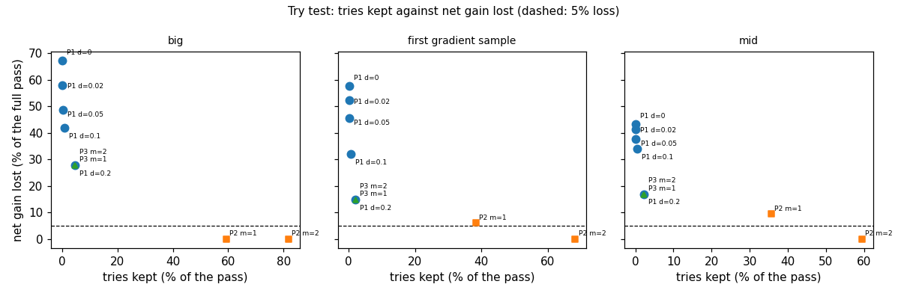
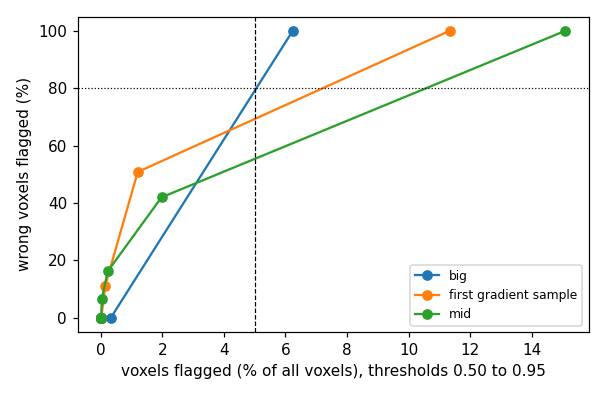
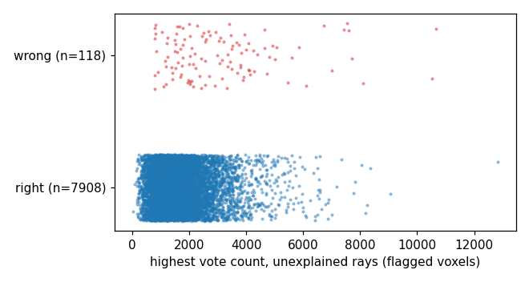

# AR5 step 1: stop rules for the boundary pass, the grid fallbacks and the finished map

Step 1 of "AR5" in `docs/autoresearch/PLAN.md`, task `ar5a`. No file under `icenine/` changed. No
key was added and no default changed. Scripts are in `scripts/autoresearch/ar5/` (`stop_*.py`).
Results are in `benchmarks/autoresearch/ar5/`. Every table below is filled from `tables.md`
there.

The owner asked for a way to tell whether more optimization can still improve a voxel, so that
the search can stop earlier. This step tried three ideas on stored runs of `S8`: skip tries of
the boundary pass, put cheaper searches before the grid search, and flag the voxels that are not
finished. **None of the three passed its rule.** The whole-layer run `T1` was not run, because it
is only run for a rule that passed.

The plot below leads because no rule passed. Reading it: each dot is one setting of the try test
(a rule that skips some tries of the boundary pass). The x axis is the share of the pass's tries
that the setting still runs. The y axis is the share of the pass's net gain that the setting
loses. The dashed line is the 5% loss the rule allows. The goal is a dot at the left and under the
line. The only dots under the line are the settings that keep most tries.

## Scope

Three simulated samples, one run of `S8` on each, one voxel order, clean images, Q-max 8. `big` is
32 grains, the first gradient sample is 497 grains, `mid` is 120 grains; all have 24,570 voxels.
None is a real sample, and C++ was not run. No extra random seed was run. Counts carry a Wilson
95% interval or a paired count; there are no p-values. The intervals count voxels, tries and
cases as independent, but they cluster in grains, so they are too narrow for statements across
grains. Every wall time was measured with other jobs running (contended) and is not a timing
result. The cost that counts is the evaluation count.

Settings were picked on `big` and the first gradient sample (the pick samples). Nothing was
changed after the pick. Each pick is written to a results file (`part1_pick.json`,
`part3_pick.json`) that was committed before any script read `mid` for that part.

## Terms

- **Evaluation**: one call of the strict cost function (a raw count).
- **BFS**: the breadth-first search. It spreads from voxel to voxel; each voxel gets a **local
  optimization**, a fit that starts from a neighbour's orientation.
- **Hit ratio**: the share of an orientation's predicted detector pixels that land on observed
  intensity in a voxel. It is between 0 and 1. The true orientation scores near 1 on clean images.
- **Seed step**: index the voxel from its observed rays, cost the 20 best candidates, run local
  optimization on up to 5, and stop at the first end with hit ratio 0.95 or more.
- **Seed test**: the BFS accepts a seed step's end if its hit ratio is at least 0.80.
- **Grid fallback**: a seed step whose end fails the seed test, so a full grid search runs
  (about 340,000 evaluations).
- **Boundary pass**: after the run, every voxel with a neighbour of another orientation gets one
  try from each distinct neighbour orientation. It keeps the end with the highest hit ratio.
- **Try**: one local optimization of a boundary voxel from one neighbour's orientation, up to 61
  evaluations. **Start score**: the hit ratio and cost of the try's start, one evaluation.
  **Try test**: a rule that reads the start score and skips the try.
- **Net gain of the pass**: wrong voxels before the pass minus wrong voxels after it.
- **Right**, **wrong**, **error**: a voxel is right if its orientation is within 1 degree of the
  truth; the error is that angle. The truth is read only by the scoring code, never by a rule.
- **Rung** and **ladder**: a rung is a cheaper search tried before the full grid search; the
  ladder is the rungs in order, then the grid search if all fail.
- **Flag**: a rule without the truth that marks a voxel as possibly not finished.
- **Unexplained rays**: the rays attached to a voxel that the voxel's orientation does not
  explain (`explained_mask` in `icenine/ray_indexing.py`).
- `S8`: the run of AR3 step 8 (indexed seeds, seed step as above, then the boundary pass).
  Its evaluations are 8,340,428 on `big`, 18,000,230 on the first gradient sample and 26,443,074
  on `mid`, with the pass.

## Part 1: a try test for the boundary pass

The pass is 12% to 20% of a run. For every stored try the start score was computed (one
evaluation each) and the stored tries were replayed under each rule. With no test, the replay
reproduced the stored map after the pass on every sample (24, 63 and 31 wrong voxels).

The rules are fixed by the plan. `P1` skips a try whose start hit ratio is more than `d` under the
voxel's hit ratio. `P2` keeps, per voxel, only the `m` tries with the highest start hit ratio.
`P3` is both. A rule's cost is one evaluation per try plus the evaluations of the kept tries.

Reading the next table: pooled over the two pick samples, each setting's evaluations, the share of
the pass's evaluations it cuts, its net gain, and the share of the gain it loses. "ok" means it
loses at most 5% of the gain. The pick is the cheapest setting that is ok.

<!-- table:p1_pick -->
| setting | evals | cut | gain | lost | ok |
|---|---|---|---|---|---|
| full pass | 4,821,806 | 0.0 | 190 | 0.0 | yes |
| P1 d=0 | 84,963 | 98.2 | 76 | 60.0 | no |
| P1 d=0.02 | 87,037 | 98.2 | 88 | 53.7 | no |
| P1 d=0.05 | 91,429 | 98.1 | 102 | 46.3 | no |
| P1 d=0.1 | 115,036 | 97.6 | 125 | 34.2 | no |
| P1 d=0.2 | 205,804 | 95.7 | 156 | 17.9 | no |
| P2 m=1 | 2,164,026 | 55.1 | 181 | 4.7 | yes |
| P2 m=2 | 3,521,825 | 27.0 | 190 | 0.0 | yes |
| P3 d=0.2 m=1 | 204,401 | 95.8 | 156 | 17.9 | no |
| P3 d=0.2 m=2 | 205,438 | 95.7 | 156 | 17.9 | no |
<!-- /table:p1_pick -->

`P1` and `P3` cut 95.7% to 98.2% of the evaluations and lose 17.9% to 60.0% of the gain. `P3` took
`d` = 0.2 because no `P1` setting qualified (the code takes the `P1` setting with the highest net
gain in that case; written before the pick). `P2` with `m` = 1 is the pick: it cuts 55.1% and
loses 4.7% of the gain (181 of 190). The cut is far under the 70% of prediction 1.

Reading the next table: one row per setting and sample. `kept` is the tries run, `fixed` and
`broken` are voxels paired against the full pass (wrong with the full pass and right with the rule;
the reverse), `gain` is the net gain, `lost` is the share of the full pass's gain lost.

<!-- table:p1_rules -->
| setting | sample | kept | of | evals | wrong | fixed | broken | gain | lost |
|---|---|---|---|---|---|---|---|---|---|
| full | big | 18,665 | 18,665 | 1,138,565 | 24 | 0 | 0 | 43 | 0.0 |
| full | first gradient sample | 60,381 | 60,381 | 3,683,241 | 63 | 0 | 0 | 147 | 0.0 |
| full | mid | 50,099 | 50,099 | 3,056,039 | 31 | 0 | 0 | 53 | 0.0 |
| P1 d=0 | big | 20 | 18,665 | 19,885 | 53 | 2 | 31 | 14 | 67.4 |
| P1 d=0 | first gradient sample | 77 | 60,381 | 65,078 | 148 | 7 | 92 | 62 | 57.8 |
| P1 d=0 | mid | 35 | 50,099 | 52,234 | 54 | 1 | 24 | 30 | 43.4 |
| P1 d=0.02 | big | 32 | 18,665 | 20,617 | 49 | 1 | 26 | 18 | 58.1 |
| P1 d=0.02 | first gradient sample | 99 | 60,381 | 66,420 | 140 | 6 | 83 | 70 | 52.4 |
| P1 d=0.02 | mid | 43 | 50,099 | 52,722 | 53 | 1 | 23 | 31 | 41.5 |
| P1 d=0.05 | big | 56 | 18,665 | 22,081 | 45 | 0 | 21 | 22 | 48.8 |
| P1 d=0.05 | first gradient sample | 147 | 60,381 | 69,348 | 130 | 4 | 71 | 80 | 45.6 |
| P1 d=0.05 | mid | 80 | 50,099 | 54,979 | 51 | 1 | 21 | 33 | 37.7 |
| P1 d=0.1 | big | 171 | 18,665 | 29,096 | 42 | 0 | 18 | 25 | 41.9 |
| P1 d=0.1 | first gradient sample | 419 | 60,381 | 85,940 | 110 | 2 | 49 | 100 | 32.0 |
| P1 d=0.1 | mid | 203 | 50,099 | 62,482 | 49 | 0 | 18 | 35 | 34.0 |
| P1 d=0.2 | big | 855 | 18,665 | 70,820 | 36 | 0 | 12 | 31 | 27.9 |
| P1 d=0.2 | first gradient sample | 1,223 | 60,381 | 134,984 | 85 | 1 | 23 | 125 | 15.0 |
| P1 d=0.2 | mid | 1,106 | 50,099 | 117,565 | 40 | 0 | 9 | 44 | 17.0 |
| P2 m=1 | big | 11,054 | 18,665 | 692,959 | 24 | 0 | 0 | 43 | 0.0 |
| P2 m=1 | first gradient sample | 23,126 | 60,381 | 1,471,067 | 72 | 0 | 9 | 138 | 6.1 |
| P2 m=1 | mid | 17,859 | 50,099 | 1,139,498 | 36 | 0 | 5 | 48 | 9.4 |
| P2 m=2 | big | 15,257 | 18,665 | 949,342 | 24 | 0 | 0 | 43 | 0.0 |
| P2 m=2 | first gradient sample | 41,182 | 60,381 | 2,572,483 | 63 | 0 | 0 | 147 | 0.0 |
| P2 m=2 | mid | 29,774 | 50,099 | 1,866,313 | 31 | 0 | 0 | 53 | 0.0 |
| P3 d=0.2 m=1 | big | 841 | 18,665 | 69,966 | 36 | 0 | 12 | 31 | 27.9 |
| P3 d=0.2 m=1 | first gradient sample | 1,214 | 60,381 | 134,435 | 85 | 1 | 23 | 125 | 15.0 |
| P3 d=0.2 m=1 | mid | 1,068 | 50,099 | 115,247 | 40 | 0 | 9 | 44 | 17.0 |
| P3 d=0.2 m=2 | big | 854 | 18,665 | 70,759 | 36 | 0 | 12 | 31 | 27.9 |
| P3 d=0.2 m=2 | first gradient sample | 1,218 | 60,381 | 134,679 | 85 | 1 | 23 | 125 | 15.0 |
| P3 d=0.2 m=2 | mid | 1,103 | 50,099 | 117,382 | 40 | 0 | 9 | 44 | 17.0 |
<!-- /table:p1_rules -->

On `mid` the pick cuts 62.7% of the pass but loses 9.4% of its gain (48 of 53): 5 voxels broken,
none fixed. **The pass rule is not met** (at least half cut and at most 5% of the gain lost).

Why `P1` breaks voxels: the next table gives, per sample, the tries that won (the voxel took the
try's end). Winning tries start well below the voxel's own hit ratio, so a rule that reads the
start score against the voxel's score throws many of them away. This is a description of the
stored tries, not a test of a cause.

<!-- table:p1_winners -->
| sample | tries | changed | median_start_all | median_start_winners | median_old_hit_winners | winners_start_within_0_2 | winners_start_below_0_5 |
|---|---|---|---|---|---|---|---|
| big | 18,665 | 1,056 | 0.466 | 0.681 | 0.934 | 350 | 152 |
| first gradient sample | 60,381 | 752 | 0.306 | 0.578 | 0.917 | 181 | 249 |
| mid | 50,099 | 1,429 | 0.409 | 0.606 | 0.922 | 222 | 276 |
<!-- /table:p1_winners -->

## Part 2: a ladder before the grid search

The cases are the seed steps of `S8` that ended in a grid fallback: 16 on the first gradient
sample and 15 on `mid` (31 in all; none on `big`). They are few, so the page lists every case and
picks no setting on them.

What failed. Reading the next table: one row per case. `rank` is the place of the first candidate
within 2 degrees of the truth in the indexer's list. `c20` and `r5` say whether it was among the
20 costed and among the 5 refined. `s8best` is the best hit ratio of the 5 refinements in `S8`
(a replay of the seed step reproduced the stored refinement counts and hit ratios in all 31
cases). `gridhit` and `griderr` are the hit ratio and the error (degrees) of the grid search's
end, read from the map of `S8` before the pass.

<!-- table:p2_failed -->
| sample | voxel | kind | cand | rank | c20 | r5 | s8best | gridhit | griderr |
|---|---|---|---|---|---|---|---|---|---|
| first gradient sample | 19058 | first seed | 45 | 1 | yes | yes | 0.792 | 0.971 | 0.02 |
| first gradient sample | 367 | reseed | 48 | 1 | yes | yes | 0.783 | 0.980 | 0.00 |
| first gradient sample | 18267 | reseed | 49 | 1 | yes | yes | 0.774 | 1.000 | 0.00 |
| first gradient sample | 20136 | reseed | 53 | 3 | yes | yes | 0.721 | 0.984 | 0.01 |
| first gradient sample | 1672 | reseed | 38 | 1 | yes | yes | 0.786 | 0.984 | 0.00 |
| first gradient sample | 3957 | reseed | 46 | 1 | yes | yes | 0.795 | 0.993 | 0.01 |
| first gradient sample | 8146 | reseed | 49 | 1 | yes | yes | 0.758 | 0.990 | 0.01 |
| first gradient sample | 2740 | reseed | 38 | 1 | yes | yes | 0.784 | 0.996 | 0.00 |
| first gradient sample | 2744 | reseed | 54 | 1 | yes | yes | 0.784 | 0.966 | 0.01 |
| first gradient sample | 3494 | reseed | 36 | 1 | yes | yes | 0.689 | 0.401 | 1.40 |
| first gradient sample | 19063 | reseed | 44 | 1 | yes | yes | 0.791 | 0.988 | 0.03 |
| first gradient sample | 6768 | reseed | 51 | 1 | yes | yes | 0.800 | 0.984 | 0.00 |
| first gradient sample | 11536 | reseed | 39 | 1 | yes | yes | 0.784 | 1.000 | 0.00 |
| first gradient sample | 11654 | reseed | 58 | 1 | yes | yes | 0.791 | 0.997 | 0.00 |
| first gradient sample | 24194 | reseed | 32 | 1 | yes | yes | 0.656 | 0.995 | 0.01 |
| first gradient sample | 23825 | reseed | 45 | 1 | yes | yes | 0.756 | 0.998 | 0.01 |
| mid | 17538 | first seed | 40 | 1 | yes | yes | 0.779 | 0.996 | 0.01 |
| mid | 7134 | reseed | 47 | 1 | yes | yes | 0.711 | 0.967 | 0.01 |
| mid | 7167 | reseed | 42 | 1 | yes | yes | 0.723 | 0.988 | 0.00 |
| mid | 20676 | reseed | 42 | 1 | yes | yes | 0.734 | 1.000 | 0.00 |
| mid | 1339 | reseed | 47 | 1 | yes | yes | 0.747 | 0.751 | 34.96 |
| mid | 1158 | reseed | 36 | 1 | yes | yes | 0.799 | 0.969 | 0.01 |
| mid | 17608 | reseed | 53 | 1 | yes | yes | 0.787 | 1.000 | 0.00 |
| mid | 15577 | reseed | 48 | 1 | yes | yes | 0.763 | 0.853 | 0.10 |
| mid | 13439 | reseed | 39 | 1 | yes | yes | 0.771 | 0.986 | 0.03 |
| mid | 8425 | reseed | 44 | 1 | yes | yes | 0.741 | 0.997 | 0.00 |
| mid | 10395 | reseed | 61 | 2 | yes | yes | 0.796 | 0.970 | 0.01 |
| mid | 10603 | reseed | 62 | 2 | yes | yes | 0.783 | 1.000 | 0.01 |
| mid | 12282 | reseed | 47 | 1 | yes | yes | 0.785 | 0.977 | 0.00 |
| mid | 16731 | reseed | 57 | 1 | yes | yes | 0.742 | 0.992 | 0.01 |
| mid | 20251 | reseed | 55 | 2 | yes | yes | 0.769 | 0.734 | 45.70 |
<!-- /table:p2_failed -->

In 27 of 31 cases the first candidate is within 2 degrees of the truth; in the other four it is
second or third. In all 31 it was among the 20 costed and the 5 refined. So no candidate was
missing: the refinement of the right candidate ended under hit ratio 0.80. The grid search ended
right in 28 of 31 cases (15 of 16 and 13 of 15). The page does not test why the refinements end
low. This is consistent with a seed test of 0.80 that is strict for voxels in grains with
orientation gradients; the untested part is any change of the test.

The rungs, each run on every case. `R1`: cost the first 100 candidates, refine the 5 cheapest with
the seed step's local optimization, stop at the first end with hit ratio 0.95. `R3`: run level 0
of the grid search alone, refine its 5 best orientations the same way. The library's level loop
was used with the number of levels set to 0 for that call and its final refinement replaced by a
stub that keeps the candidates; no library file changed. The library cannot continue a search after
level 0, so when `R3` fails the full grid search pays level 0 again. A rung passes a case if its
end passes the seed test (0.80).

Reading the next table: one row per case. `r1hit`, `r1err` and `r1ev` are `R1`'s end hit ratio,
error (degrees) and evaluations; `r3...` the same for `R3`; `ends` is the rung where the ladder
stops; `ladev` is the ladder's evaluations and `gridev` the stored grid fallback's.

<!-- table:p2_rungs -->
| sample | voxel | r1hit | r1ev | r1err | r3hit | r3ev | r3err | ends | ladev | gridev |
|---|---|---|---|---|---|---|---|---|---|---|
| first gradient sample | 19058 | 0.792 | 4,350 | 0.26 | 0.797 | 210,151 | 0.21 | grid | 557,093 | 342,592 |
| first gradient sample | 367 | 0.783 | 3,561 | 0.33 | 0.620 | 209,558 | 47.71 | grid | 557,965 | 344,846 |
| first gradient sample | 18267 | 0.774 | 5,218 | 52.54 | 0.864 | 212,299 | 0.11 | R3 | 217,517 | 343,763 |
| first gradient sample | 20136 | 0.721 | 4,773 | 0.21 | 0.673 | 209,577 | 24.34 | grid | 560,222 | 345,872 |
| first gradient sample | 1672 | 0.786 | 5,317 | 25.88 | 0.967 | 208,144 | 0.03 | R3 | 213,461 | 347,730 |
| first gradient sample | 3957 | 0.795 | 3,762 | 0.43 | 1.000 | 207,507 | 0.00 | R3 | 211,269 | 346,279 |
| first gradient sample | 8146 | 0.752 | 5,495 | 18.02 | 0.757 | 209,962 | 18.02 | grid | 562,048 | 346,591 |
| first gradient sample | 2740 | 0.784 | 5,483 | 0.07 | 0.877 | 211,540 | 0.05 | R3 | 217,023 | 345,796 |
| first gradient sample | 2744 | 0.784 | 4,288 | 0.06 | 0.726 | 208,260 | 0.19 | grid | 558,590 | 346,042 |
| first gradient sample | 3494 | 0.689 | 4,092 | 0.57 | 0.997 | 207,132 | 0.00 | R3 | 211,224 | 343,279 |
| first gradient sample | 19063 | 0.791 | 5,469 | 0.18 | 0.926 | 210,505 | 0.08 | R3 | 215,974 | 347,701 |
| first gradient sample | 6768 | 0.800 | 4,415 | 0.10 | 0.802 | 211,105 | 0.10 | R3 | 215,520 | 346,340 |
| first gradient sample | 11536 | 0.784 | 4,715 | 0.15 | 0.999 | 207,049 | 0.00 | R3 | 211,764 | 339,153 |
| first gradient sample | 11654 | 0.791 | 4,342 | 0.25 | 0.980 | 207,732 | 0.01 | R3 | 212,074 | 345,632 |
| first gradient sample | 24194 | 0.656 | 3,590 | 0.58 | 0.655 | 209,128 | 0.58 | grid | 557,060 | 344,342 |
| first gradient sample | 23825 | 0.756 | 4,387 | 0.16 | 0.845 | 209,810 | 0.09 | R3 | 214,197 | 342,629 |
| mid | 17538 | 0.752 | 7,630 | 0.33 | 0.758 | 202,240 | 0.33 | grid | 542,616 | 332,746 |
| mid | 7134 | 0.711 | 8,320 | 37.59 | 0.948 | 205,521 | 0.01 | R3 | 213,841 | 347,951 |
| mid | 7167 | 0.723 | 6,980 | 0.08 | 0.757 | 208,501 | 0.10 | grid | 556,571 | 341,090 |
| mid | 20676 | 0.734 | 5,813 | 0.58 | 0.809 | 204,078 | 0.07 | R3 | 209,891 | 332,369 |
| mid | 1339 | 0.747 | 6,692 | 34.96 | 0.729 | 207,345 | 35.02 | grid | 554,245 | 340,208 |
| mid | 1158 | 0.799 | 6,061 | 0.24 | 0.707 | 203,782 | 0.33 | grid | 551,380 | 341,537 |
| mid | 17608 | 0.787 | 7,442 | 0.20 | 0.863 | 211,212 | 0.15 | R3 | 218,654 | 340,577 |
| mid | 15577 | 0.763 | 5,089 | 36.67 | 0.747 | 203,739 | 36.69 | grid | 544,411 | 335,583 |
| mid | 13439 | 0.771 | 4,868 | 0.05 | 0.792 | 203,631 | 0.04 | grid | 548,421 | 339,922 |
| mid | 8425 | 0.696 | 7,772 | 56.26 | 0.702 | 204,150 | 56.30 | grid | 553,968 | 342,046 |
| mid | 10395 | 0.796 | 5,214 | 0.11 | 0.974 | 201,128 | 0.01 | R3 | 206,342 | 339,552 |
| mid | 10603 | 0.783 | 4,234 | 0.28 | 0.999 | 201,648 | 0.01 | R3 | 205,882 | 335,381 |
| mid | 12282 | 0.785 | 4,921 | 0.11 | 0.516 | 200,675 | 0.59 | grid | 540,868 | 335,272 |
| mid | 16731 | 0.731 | 6,145 | 53.41 | 0.859 | 210,412 | 0.15 | R3 | 216,557 | 342,091 |
| mid | 20251 | 0.769 | 5,853 | 0.09 | 0.989 | 201,643 | 0.02 | R3 | 207,496 | 341,439 |
<!-- /table:p2_rungs -->

Reading the next table: totals. `r1pass` and `r3pass` count rungs whose end passes the seed test;
`r1right` and `r3right` count ends right; `ends` counts cases that stop at `R1`, at `R3`, at the
grid; `rl` and `rg` are the cases ended right by the ladder and by the grid search.

<!-- table:p2_totals -->
| group | n | r1pass | r1right | r3pass | r3right | ends | ladev | gridev | share | rl | rg |
|---|---|---|---|---|---|---|---|---|---|---|---|
| first gradient sample | 16 | 0 | 13 | 10 | 13 | 0 / 10 / 6 | 5,493,001 | 5,518,587 | 99.5 | 16 | 15 |
| mid | 15 | 0 | 10 | 7 | 12 | 0 / 7 / 8 | 5,871,143 | 5,087,764 | 115.4 | 14 | 13 |
| both | 31 | 0 | 23 | 17 | 25 | 0 / 17 / 14 | 11,364,144 | 10,606,351 | 107.1 | 30 | 28 |
<!-- /table:p2_totals -->

`R1` passes the seed test in no case, although 23 of 31 of its ends are right. The hit ratios of
its 23 right ends run from 0.656 to 0.800 and those of its 8 wrong ends from 0.696 to 0.786. The
ranges overlap, so the hit ratio does not tell them apart (as AR0 found for the grid levels).
`R3` passes in 17 cases, but level 0 alone costs 6,290,498 evaluations over the 31 cases. The
ladder needs 11,364,144 evaluations against 10,606,351 for
the grid fallbacks it replaces (107.1%), and ends right in 30 cases against 28. The two cases the
ladder got right and the grid search wrong are voxels 3494 and 20251. No case was right with the
grid search and wrong with the ladder. **The pass rule is not met**: it needs at most two thirds
of the evaluations.

## Part 3: is a voxel finished?

All of Part 3 reads the map of `S8` after the boundary pass. The hit ratio of each voxel comes
from the stored scores and tries.

**A flag from the hit ratio.** A voxel is flagged if its hit ratio is under a threshold. The pick
is the lowest threshold from 0.50 to 0.95 (step 0.05) that flags at least 80% of the wrong voxels
on the pick samples pooled. That is 0.95, the top of the grid.

Reading the plot: each line is one sample; each dot is one threshold. The x axis is the share of
voxels flagged, the y axis the share of wrong voxels flagged. The dashed vertical line is the 5%
limit of prediction 4; the dotted horizontal line is 80%.

Reading the next table: one row per sample and threshold. `flagged` is the voxels under the
threshold, `share` is that as a percent of all voxels, `wf` the wrong voxels among them, `wu` the
wrong voxels above the threshold, `nw` all wrong voxels.

<!-- table:p3_flag -->
| sample | thr | flagged | share | wf | wu | nw |
|---|---|---|---|---|---|---|
| big | 0.50 | 0 | 0.0 | 0 | 24 | 24 |
| big | 0.55 | 0 | 0.0 | 0 | 24 | 24 |
| big | 0.60 | 0 | 0.0 | 0 | 24 | 24 |
| big | 0.65 | 0 | 0.0 | 0 | 24 | 24 |
| big | 0.70 | 0 | 0.0 | 0 | 24 | 24 |
| big | 0.75 | 0 | 0.0 | 0 | 24 | 24 |
| big | 0.80 | 0 | 0.0 | 0 | 24 | 24 |
| big | 0.85 | 1 | 0.0 | 0 | 24 | 24 |
| big | 0.90 | 80 | 0.3 | 0 | 24 | 24 |
| big | 0.95 | 1,532 | 6.2 | 24 | 0 | 24 |
| first gradient sample | 0.50 | 0 | 0.0 | 0 | 63 | 63 |
| first gradient sample | 0.55 | 0 | 0.0 | 0 | 63 | 63 |
| first gradient sample | 0.60 | 0 | 0.0 | 0 | 63 | 63 |
| first gradient sample | 0.65 | 0 | 0.0 | 0 | 63 | 63 |
| first gradient sample | 0.70 | 1 | 0.0 | 0 | 63 | 63 |
| first gradient sample | 0.75 | 1 | 0.0 | 0 | 63 | 63 |
| first gradient sample | 0.80 | 3 | 0.0 | 0 | 63 | 63 |
| first gradient sample | 0.85 | 34 | 0.1 | 7 | 56 | 63 |
| first gradient sample | 0.90 | 294 | 1.2 | 32 | 31 | 63 |
| first gradient sample | 0.95 | 2,785 | 11.3 | 63 | 0 | 63 |
| mid | 0.50 | 0 | 0.0 | 0 | 31 | 31 |
| mid | 0.55 | 0 | 0.0 | 0 | 31 | 31 |
| mid | 0.60 | 0 | 0.0 | 0 | 31 | 31 |
| mid | 0.65 | 0 | 0.0 | 0 | 31 | 31 |
| mid | 0.70 | 0 | 0.0 | 0 | 31 | 31 |
| mid | 0.75 | 2 | 0.0 | 0 | 31 | 31 |
| mid | 0.80 | 7 | 0.0 | 2 | 29 | 31 |
| mid | 0.85 | 54 | 0.2 | 5 | 26 | 31 |
| mid | 0.90 | 484 | 2.0 | 13 | 18 | 31 |
| mid | 0.95 | 3,709 | 15.1 | 31 | 0 | 31 |
<!-- /table:p3_flag -->

At 0.95 the flag catches every wrong voxel on all three samples, but it flags 6.2%, 11.3% and
15.1% of all voxels. Just under it, at 0.90, it catches 0 of 24, 32 of 63 and 13 of 31. The
threshold sits at the edge of the grid tried here, and the seed step stops at hit ratio 0.95, so
many right voxels end just under it. A threshold above 0.95 was not tried.

Reading the next table: at 0.95, by the voxel's source in `S8` (first seed, neighbour fit,
revisit, reseed) and for boundary voxels alone (voxels that had at least one try). `wrong` is
the wrong voxels in the group, `wf` those flagged.

<!-- table:p3_source -->
| sample | group | n | flagged | wrong | wf |
|---|---|---|---|---|---|
| big | seed | 37 | 0 | 0 | 0 |
| big | neighbor | 19,135 | 768 | 13 | 13 |
| big | revisit | 5,106 | 757 | 11 | 11 |
| big | reseed | 292 | 7 | 0 | 0 |
| big | boundary | 11,054 | 1,348 | 24 | 24 |
| big | all | 24,570 | 1,532 | 24 | 24 |
| first gradient sample | seed | 347 | 14 | 0 | 0 |
| first gradient sample | neighbor | 9,511 | 687 | 20 | 20 |
| first gradient sample | revisit | 13,780 | 1,928 | 23 | 23 |
| first gradient sample | reseed | 931 | 155 | 20 | 20 |
| first gradient sample | boundary | 23,126 | 2,766 | 63 | 63 |
| first gradient sample | all | 24,570 | 2,785 | 63 | 63 |
| mid | seed | 156 | 4 | 0 | 0 |
| mid | neighbor | 14,205 | 1,100 | 12 | 12 |
| mid | revisit | 8,754 | 2,378 | 10 | 10 |
| mid | reseed | 1,453 | 225 | 8 | 8 |
| mid | boundary | 17,859 | 3,621 | 31 | 31 |
| mid | all | 24,570 | 3,709 | 31 | 31 |
<!-- /table:p3_source -->

All wrong voxels are boundary voxels (24 of 24, 63 of 63, 31 of 31). No first seed is wrong. The
wrong voxels come from neighbour fits, revisits and reseeds.

What "finished" would mean. Reading the next table: at 0.95, the wrong voxels left among the
unflagged ones, with the Wilson 95% interval of their share (`lo` and `hi`, in percent). This is
what a user who stops at the flag leaves behind.

<!-- table:p3_left -->
| sample | n | flagged | share | wrong | caught | left | unflagged | lo | hi |
|---|---|---|---|---|---|---|---|---|---|
| big | 24,570 | 1,532 | 6.2 | 24 | 24 | 0 | 23,038 | 0.000 | 0.017 |
| first gradient sample | 24,570 | 2,785 | 11.3 | 63 | 63 | 0 | 21,785 | 0.000 | 0.018 |
| mid | 24,570 | 3,709 | 15.1 | 31 | 31 | 0 | 20,861 | 0.000 | 0.018 |
<!-- /table:p3_left -->

Nothing wrong is left behind on any sample (0 of 23,038, 0 of 21,785 and 0 of 20,861 unflagged
voxels). The upper ends of the intervals are 0.017%, 0.018% and 0.018%. The price is the share of
voxels that must be treated as not finished.

**The vote count of H3.** For every flagged voxel and every 20th unflagged boundary voxel, the
rays attached to the voxel that its orientation does not explain were indexed (`index_rays`) and
the highest vote count was kept. Reading the plot: each dot is a flagged voxel on the three
samples, wrong on the top strip and right on the bottom strip, placed by its count. The vertical
spread is only for visibility.

Reading the next table: per sample and for all three, the wrong and right flagged voxels (`nw`,
`nr`), their median counts (`mw`, `mr`), and the counts at the cut that separates best.
**The cut was chosen after the result**: it is the cut with the largest share of wrong voxels at
or above it minus the share of right voxels at or above it. `above` is the voxels at or above
the cut. `sep` is yes when the Wilson 95% intervals of the two shares do not overlap.

<!-- table:p3_votes -->
| group | nw | nr | mw | mr | cut | w | r | above | sep |
|---|---|---|---|---|---|---|---|---|---|
| big | 24 | 1508 | 2516 | 1476 | 2446 | 13 of 24 (35 to 72%) | 173 of 1508 (10 to 13%) | 186 | yes |
| first gradient sample | 63 | 2722 | 2707 | 1714 | 3035 | 31 of 63 (37 to 61%) | 324 of 2722 (11 to 13%) | 355 | yes |
| mid | 31 | 3678 | 2553 | 1412 | 1975 | 25 of 31 (64 to 91%) | 955 of 3678 (25 to 27%) | 980 | yes |
| all three | 118 | 7908 | 2573 | 1535 | 2369 | 67 of 118 (48 to 65%) | 1410 of 7908 (17 to 19%) | 1477 | yes |
<!-- /table:p3_votes -->

The vote count separates the groups, but weakly. Of 118 wrong voxels, 67 are at or above the cut;
of 7,908 right voxels, 1,410 are. So of the 1,477 voxels at or above the cut, 67 are wrong. The
other 51 wrong voxels are under it. The unflagged boundary voxels that were sampled have a
median count of 1,445 and none is wrong. Prediction 5 said no separation; it does not agree. The
count is not a useful stop rule on this evidence. What replaced it is the hit-ratio flag, which
is cheaper (no indexing) and catches all wrong voxels, at the price above.

**Check V1, on `mid`.** At each of the 3,709 voxels flagged at 0.95, the seed step was run and
its end was kept if its hit ratio was higher than the voxel's. All 3,709 were run (no cap was
hit). Reading the next table: `ev` is the evaluations, `mean` per voxel, `share` the percent of
the evaluations of the whole `S8` run (26,443,074); `kept` the voxels whose end was kept; `wrong`
the wrong voxels among the flagged; `fixed` and `broken` the voxels paired against the map after
the pass; `after` the wrong voxels among them after `V1`.

<!-- table:p3_v1 -->
| thr | flagged | done | ev | mean | share | kept | wrong | fixed | broken | after |
|---|---|---|---|---|---|---|---|---|---|---|
| 0.95 | 3,709 | 3,709 | 27,882,533 | 7,518 | 105.4 | 3,485 | 31 | 13 | 0 | 18 |
<!-- /table:p3_v1 -->

`V1` fixed 13 of the 31 wrong voxels (41.9%, interval 26.4% to 59.2%) and broke none: the wrong
voxels went from 31 to 18. It cost 27,882,533 evaluations, 105.4% of the whole run. **The pass
rule is not met**: the first two parts hold (more fixed than broken, at least a quarter fixed) but
the cost is not under 5% of the run.

## Part 4: whole-layer run `T1`

Not run. It runs only with a rule that passed, and none did. Prediction 6 is therefore not
evaluated.

## Predictions and rules

Reading the next table: the six predictions written before the runs, and whether the result agrees.

<!-- table:predictions -->
| n | what | result | numbers |
|---|---|---|---|
| 1 | a try-test setting cuts 70% of the pass and loses at most 5% of its gain | does not agree | best cut within the 5% loss: 55.1% |
| 2 | a candidate near the truth is in the first 100 and not the 20 costed, in half the cases | does not agree | 0 of 31 |
| 3 | the ladder passes its rule | does not agree | 107.1% of the grid evaluations |
| 4 | a hit-ratio threshold flags 80% of wrong voxels and at most 5% of voxels | does not agree | first part holds (100% of wrong voxels caught); second part fails (8.8% of voxels flagged on the pick samples, 15.1% on mid) |
| 5 | the vote count does not separate wrong from right among flagged voxels | does not agree | a weak separation exists; cut 2369: 67 of 118 wrong, 1410 of 7908 right at or above |
| 6 | T1 needs under 14 M (gradient) and 22 M (mid) evaluations | not evaluated | no rule passed, so T1 was not run |
<!-- /table:predictions -->

Reading the next table: the pass rules of the plan.

<!-- table:rules -->
| rule | what | verdict | numbers |
|---|---|---|---|
| try test (Part 1) | on mid: at least half of the pass cut, at most 5% of the gain lost | not met | 62.7% cut, 9.4% of the gain lost (48 of 53) |
| ladder (Part 2) | at most 2/3 of the grid evaluations, at most one case fewer right | not met | 107.1% of the evaluations; right 30 against 28 |
| V1 (Part 3) | fixes more than it breaks, fixes a quarter, costs under 5% of the run | not met | fixed 13, broken 0, 31 wrong processed; about 105% of the run |
<!-- /table:rules -->

## What the result decides

No rule passed, so none is a candidate for an opt-in key. They are reported as failed with their
numbers. Whether `V1` after a flag is worth its cost for a final quality pass stays the owner's
choice; this step recommends no setting.

## Numbers chosen after a result

The cut on the vote count (above). Nothing else was chosen after a result. `P3`'s `d` came from
a rule written into the code before the pick.

## Notes on the data

- The start scores of `mid` were computed after the pick was committed (a first computation was
  deleted and redone, so that git shows the order).
- A grid fallback's end is read from the map of `S8` before the pass. A revisit may have refit
  the voxel after its grid search; the stored data do not separate them. The grid search's
  evaluations are its stored `full_search_evaluations` (reseeds) or the voxel's record minus the
  seed step's evaluations (first seeds).
- `mid` has 50,099 tries, not 18,664 as a first reading of the stored files said.
- Part 3 ran on a hit-ratio grid only up to 0.95.

## Not claimed

That C++ behaves the same. That the gradient model matches a real sample. A change of any default.
A tested wall time (every time here is contended). That three samples stand for all samples. That
realistic images give the same thresholds. A cause for why the refinements of the right candidate
end under 0.80.
