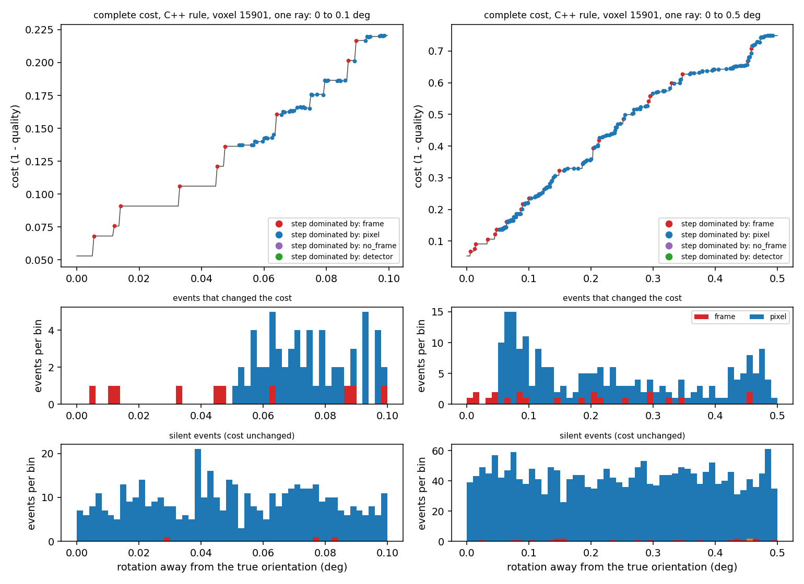
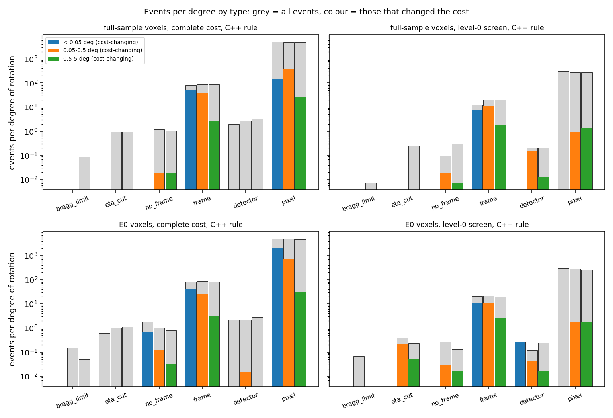
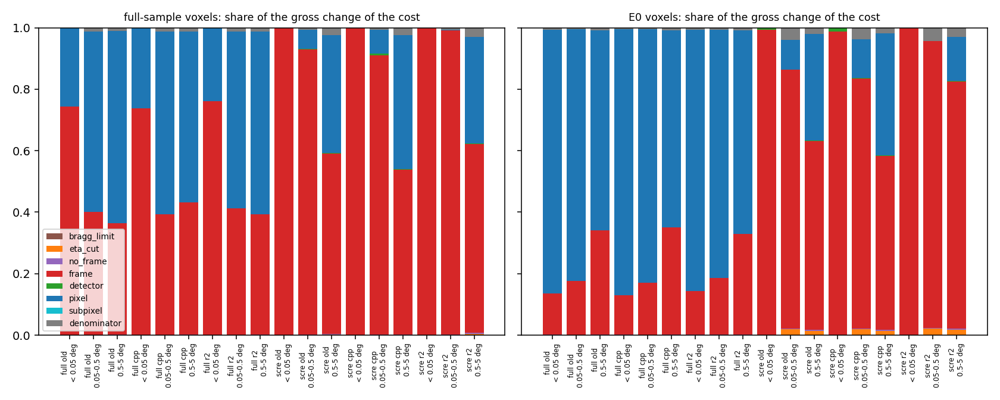
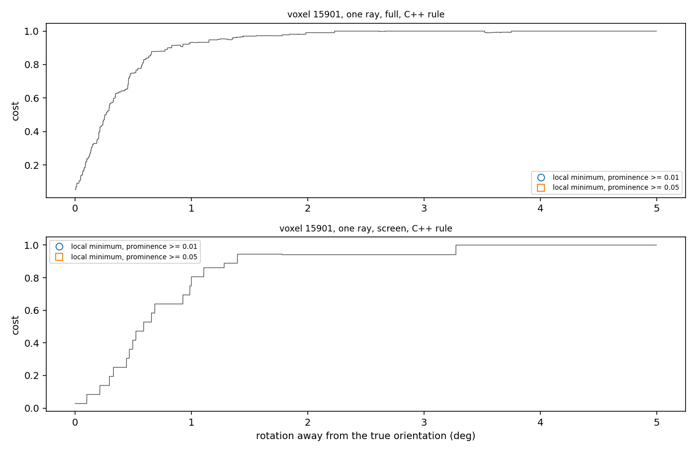
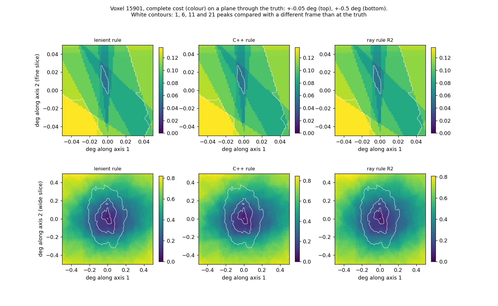

# Findings: the edges of the cost function (Task B, 2026-10-14)

Branch `feature/eval-reduction-B`. Run record: `benchmarks/eval_reduction/B/RUN_LOG.md`. Scripts:
`scripts/eval_reduction/cost_edges*.py`, `peak_rejects.py`, `truth_cost_anatomy.py`, `interp_levels*.py`.
Tables below are generated (`benchmarks/eval_reduction/B/tables.md`, `benchmarks/eval_reduction/B/levels/tables.md`);
figures are in `benchmarks/eval_reduction/B/figures/`. All images are clean simulated images, Q-max 8
configuration, no library change.

## Short answer

The cost is a ratio of pixel counts, so it can only change in steps. Walking away from the true orientation, the
steps come from two main events, and a handful of rarer ones:

1. **A predicted spot moves to the neighbouring frame (image).** The spot is compared with a different image, so
   its whole contribution is usually lost at once. This is about 80 to 90 events per degree of rotation, and each
   moves the cost by about one peak's share (the largest single steps; typical size in the table below). It is
   physics (a spot has a finite omega width and the frame boundary is real), but the cut is hard because the
   cost uses one frame per spot. The images here were made with the same one-frame rule, so on this data the cut is
   exact; on real data a spot is spread over neighbouring frames (not tested).
2. **A vertex of the predicted triangle moves to another pixel.** About 5,000 events per degree, almost all of
   them silent: the pixel it enters is lit like the one it left. Those that do change the cost are small steps,
   several times smaller than a frame crossing. This is the finest-scale artefact of binary pixels.
3. Rare: a spot leaves the detector area, the eta window removes a peak, or its omega leaves the scanned range
   (a few events per degree in all). They almost never change the cost.

Share of the total change of the cost, complete cost with the C++ rule (table "gross share" below): frame
crossings dominate under 0.05 degree on the full-sample images (73.7%), pixel crossings dominate beyond it
(59.5% at 0.05 to 0.5 degree) and on the E0 per-voxel images in every regime measured (86.5% under 0.05 degree; E0
is sampled beyond 0.5 degree only in four 0.05-degree windows per ray). The metric's own ratio (the number of peaks
in the denominator changing) is 1.2 to 1.3% of the change of the complete cost on the full-sample images and never
the main effect.

Other results that were not asked for but change the picture:

* **The cost at the true orientation is not zero** (median 0.0703 over the six full-sample voxels, 0.0606 over the
  30 E0 voxels with the C++ rule). 85.5% (full-sample) and 87.6% (E0) of that loss is peaks whose spot falls off
  detector 1: such a peak overlaps on one detector only and scores 1/2 in `quality`, forever. Most of the rest is
  peaks with no qualified overlap at the truth (4 peaks in the six voxels, 15 in E0), consistent with the "omega
  below the first frame" convention of Task A: `CppEdgeRules` removes all but one of them, but that switch bundles
  three conventions (omega floor, pixel coordinate, vertex-lit rule) and the omegas were not checked.
* **The 3 of 524 real peaks rejected at the truth are a detector-edge effect of the screen**, which follows C++'s
  own lit rule for the search box (details and the C++ source lines below).
* **Non-monotone basins**: with the complete cost no local minimum of depth 0.05 or more exists on any ray; at
  depth 0.01 the full-sample images have one on 72 of 120 rays (95% Wilson 51.1-68.3%, C++ rule), at a median
  2.96 degrees from the truth. With the level-0 screen, minima of depth 0.05 or more exist on 68 of 120 full-sample
  rays (47.7-65.2%), around 2.68 degrees. These far dips cannot be compared with E0, which was walked densely only
  to 0.5 degree; over 0 to 0.5 degree the two image sets look alike (section 7).
* **Pass-set parity of the omega interpolation with C++ at levels 1 to 3**: with `CppOmegaInterp` and
  `CppEdgeRules` the FZ points with identical pass sets are 11,504 of 11,508 at level 1, 3,497 of 3,498 at level 2
  and 963 of 963 at level 3 (details below).

## What was measured

For each case a ray leaves the true orientation in one of 20 random rotation directions. At every point the
complete cost (pixel radius 0, all reflections) and the level-0 screen (pixel radius 3, Q-max 5, centroid) are
evaluated under four overlap settings: the lenient rule (library default), the C++ rule, the C++ rule with
`CppEdgeRules`, and the ray rule with the 2-pixel window (R2). Per peak the trace keeps the frame, the detector
hits, the pixel signature and the overlap counts. Between two neighbouring points every peak that changed is an
event of one type (priority order: not evaluated any more or newly evaluated = `bragg_limit`, `eta_cut` or
`no_frame`; frame changed = `frame`; a vertex moved in or out of the detector area = `detector`; a vertex moved to
another pixel = `pixel`; only the rasteriser counts changed = `subpixel`; only the ray-rule cases changed =
`rule`). The change of the cost is split exactly into per-peak terms plus one denominator term. On every evaluation
the per-peak values recombine to the library's own quality, peak counts and pixel counts (largest quality
difference over all 720 walk files 9.99e-16, `summary.json` `full_trace_check` / `e0_trace_check`), so the parts
sum to the change of the cost to float precision.

* Six interior full-sample voxels (15901, 17034, 18558, 19889, 22867, 5242), 20 rays each = 120 rays, each walked
  from 0 to 5 degrees at 0.0005 degree (10,001 points).
* The first 30 voxels of the E0 set (per-voxel clean images), 20 rays each = 600 rays: 0 to 0.5 degree at 0.0005,
  plus four windows of 0.05 degree at 0.5, 1.5, 3.0 and 4.95 degrees, plus 121 log-spaced points (cost only).
  The 0.5-to-5 degree regime of E0 is therefore sampled in 0.2 degree of window per ray, not continuously.
* Deviation from the plan: the plan asked for log-spaced radii. A log grid puts several events into one step at
  large radius, so events per degree cannot be counted on it; the walks use equal steps of 0.0005 degree instead
  (decision recorded in `RUN_LOG.md` section 3). The E0 log-spaced profile (121 points) is kept for the cost only;
  minima found on it have a position and depth but no width.
* Regimes: under 0.05 degree (the finisher), 0.05 to 0.5 degree (the quick MC), 0.5 to 5 degrees (the coarse
  grid; on E0, four windows of 0.05 degree). Two-dimensional slices through the truth (+-0.05 and +-0.5 degree) for the six voxels.
* Timing is not a claim here; the walks are cost evaluations only (8 workers, contended).

## 1. Catalogue: events per degree of rotation

Cell = cost-changing events per degree **of** all events per degree (so "0 of 5,091" is silent). Full-sample
voxels (120 rays), then E0 (600 rays).

<!-- table:evalB_edges_per_deg_full -->
| event type | kind | complete cost, under 0.05 deg | complete cost, 0.05 to 0.5 deg | complete cost, 0.5 to 5 deg | level-0 screen, under 0.05 deg | level-0 screen, 0.05 to 0.5 deg | level-0 screen, 0.5 to 5 deg |
|---|---|---|---|---|---|---|---|
| bragg_limit | geometry, hard cut | 0 of 0 | 0 of 0 | 0 of 0.09 | 0 of 0 | 0 of 0 | 0 of 0.01 |
| eta_cut | geometry, hard cut | 0 of 0 | 0 of 0.96 | 0 of 0.97 | 0 of 0 | 0 of 0 | 0 of 0.25 |
| no_frame | geometry, hard cut | 0 of 0 | 0.02 of 1.2 | 0.02 of 1.0 | 0 of 0 | 0.02 of 0.09 | 0.01 of 0.31 |
| frame | physics, hard cut | 51 of 81 | 39 of 86 | 2.7 of 86 | 7.8 of 13 | 11 of 20 | 1.8 of 20 |
| detector | geometry, hard cut | 0 of 2.0 | 0 of 2.8 | 0 of 3.2 | 0 of 0 | 0.15 of 0.20 | 0.01 of 0.20 |
| pixel | artefact | 150 of 5,091 | 372 of 4,982 | 26 of 4,975 | 0 of 308 | 0.91 of 272 | 1.4 of 277 |
| subpixel | artefact | 0 of 0 | 0 of 0 | 0 of 0 | 0 of 0 | 0 of 0 | 0 of 0 |
| rule | rule design | 0 of 0 | 0 of 0 | 0 of 0 | 0 of 0 | 0 of 0 | 0 of 0 |
<!-- /table:evalB_edges_per_deg_full -->

<!-- table:evalB_edges_per_deg_e0 -->
| event type | kind | complete cost, under 0.05 deg | complete cost, 0.05 to 0.5 deg | complete cost, 0.5 to 5 deg (4 windows of 0.05 deg) | level-0 screen, under 0.05 deg | level-0 screen, 0.05 to 0.5 deg | level-0 screen, 0.5 to 5 deg (4 windows of 0.05 deg) |
|---|---|---|---|---|---|---|---|
| bragg_limit | geometry, hard cut | 0 of 0 | 0 of 0.15 | 0 of 0.05 | 0 of 0 | 0 of 0.07 | 0 of 0 |
| eta_cut | geometry, hard cut | 0 of 0.60 | 0 of 1.00 | 0 of 1.1 | 0 of 0 | 0.23 of 0.40 | 0.05 of 0.23 |
| no_frame | geometry, hard cut | 0.67 of 1.8 | 0.12 of 1.0 | 0.03 of 0.79 | 0 of 0 | 0.03 of 0.26 | 0.02 of 0.13 |
| frame | physics, hard cut | 43 of 82 | 26 of 86 | 3.0 of 83 | 11 of 21 | 11 of 22 | 2.6 of 19 |
| detector | geometry, hard cut | 0 of 2.1 | 0.01 of 2.1 | 0 of 2.8 | 0.27 of 0.27 | 0.04 of 0.12 | 0.02 of 0.24 |
| pixel | artefact | 2,066 of 4,876 | 750 of 4,878 | 31 of 4,814 | 0 of 296 | 1.7 of 282 | 1.8 of 266 |
| subpixel | artefact | 0 of 0 | 0 of 0 | 0 of 0 | 0 of 0 | 0 of 0 | 0 of 0 |
| rule | rule design | 0 of 0 | 0 of 0 | 0 of 0 | 0 of 0 | 0 of 0 | 0 of 0 |
<!-- /table:evalB_edges_per_deg_e0 -->

What each type is, from the diagrams (all drawn from real traces):

* **frame**: `diagram_frame_crossing.png`. The predicted omega of a peak drifts linearly with the rotation and
  crosses a frame edge (frames are 1 degree wide). At the crossing the peak is compared with the neighbouring
  image. Physics (finite omega width) with a hard cut.
* **pixel**: `diagram_pixel_crossing.png`. A vertex of the predicted triangle moves into another pixel; if that
  pixel is dark the overlap drops by that pixel. Artefact of binary pixels.
* **detector**: `diagram_detector_edge.png`. The triangle crosses the edge of the image. Geometry, a hard cut;
  silent on these data (almost always nothing lit beyond the edge).
* **eta_cut, no_frame, bragg_limit**: a peak appears or disappears from the evaluated set (eta window, omega
  outside the scanned range, no Bragg solution). Geometry, hard cuts, 1 event per degree or fewer.
* **subpixel, rule**: none were seen (0 events in every table). The overlap counts only changed together with a
  pixel or frame event, and the ray rule's cases never changed alone.

## 2. Sizes of the steps, and which type dominates where

Size of the change of the cost caused by one peak's event (the quarter-decade bin holding the median / the 90th
percentile, as a range; events that changed the cost only), complete cost, C++ rule, full-sample voxels, then E0. The denominator term has no per-peak size and is in the share table.

<!-- table:evalB_jumps_full -->
| type | under 0.05 deg | 0.05 to 0.5 deg | 0.5 to 5 deg |
|---|---|---|---|
| frame | 0.018-0.032 / 0.018-0.032 (n=308) | 0.018-0.032 / 0.018-0.032 (n=2109) | 0.018-0.032 / 0.018-0.032 (n=1472) |
| pixel | 0.0018-0.0032 / 0.0056-0.01 (n=900) | 0.0018-0.0032 / 0.01-0.018 (n=20081) | 0.001-0.0018 / 0.0056-0.01 (n=14018) |
| detector | none | none | none |
| eta_cut | none | none | none |
| no_frame | none | 0.018-0.032 / 0.018-0.032 (n=1) | 0.01-0.018 / 0.018-0.032 (n=10) |
| bragg_limit | none | none | none |
<!-- /table:evalB_jumps_full -->

<!-- table:evalB_jumps_e0 -->
| type | under 0.05 deg | 0.05 to 0.5 deg | 0.5 to 5 deg (4 windows of 0.05 deg) |
|---|---|---|---|
| frame | 0.018-0.032 / 0.018-0.032 (n=1277) | 0.01-0.018 / 0.018-0.032 (n=7078) | 0.01-0.018 / 0.018-0.032 (n=365) |
| pixel | 0.0018-0.0032 / 0.0056-0.01 (n=61988) | 0.001-0.0018 / 0.0056-0.01 (n=202622) | 0.001-0.0018 / 0.0056-0.01 (n=3765) |
| detector | none | 0.0056-0.01 / 0.0056-0.01 (n=4) | none |
| eta_cut | none | none | none |
| no_frame | 0.018-0.032 / 0.018-0.032 (n=20) | 0.018-0.032 / 0.018-0.032 (n=32) | 0.0032-0.0056 / 0.01-0.018 (n=4) |
| bragg_limit | none | none | none |
<!-- /table:evalB_jumps_e0 -->

Share of the gross change of the cost by type (each peak's change counted in absolute value, summed over steps;
"net variation" is the sum of the absolute changes of the cost itself). Net and gross are almost equal, so
cancelling pairs are rare. C++ rule.

<!-- table:evalB_gross_share_full -->
| cost | regime | net variation | gross change | bragg_limit | eta_cut | no_frame | frame | detector | pixel | subpixel | rule | denominator | unattributed |
|---|---|---|---|---|---|---|---|---|---|---|---|---|---|
| complete cost | under 0.05 deg | 5.8 | 5.8 | 0.0% | 0.0% | 0.0% | 73.7% | 0.0% | 26.3% | 0.0% | 0.0% | 0.0% | 0.0% |
| complete cost | 0.05 to 0.5 deg | 75 | 75 | 0.0% | 0.0% | 0.0% | 39.3% | 0.0% | 59.5% | 0.0% | 0.0% | 1.2% | 0.0% |
| complete cost | 0.5 to 5 deg | 43 | 43 | 0.0% | 0.0% | 0.2% | 42.9% | 0.0% | 55.6% | 0.0% | 0.0% | 1.3% | 0.0% |
| level-0 screen | under 0.05 deg | 2.3 | 2.3 | 0.0% | 0.0% | 0.0% | 100.0% | 0.0% | 0.0% | 0.0% | 0.0% | 0.0% | 0.0% |
| level-0 screen | 0.05 to 0.5 deg | 35 | 35 | 0.0% | 0.0% | 0.2% | 90.9% | 0.6% | 7.8% | 0.0% | 0.0% | 0.6% | 0.0% |
| level-0 screen | 0.5 to 5 deg | 88 | 89 | 0.0% | 0.0% | 0.3% | 53.6% | 0.2% | 43.5% | 0.0% | 0.0% | 2.4% | 0.0% |
<!-- /table:evalB_gross_share_full -->

<!-- table:evalB_gross_share_e0 -->
| cost | regime | net variation | gross change | bragg_limit | eta_cut | no_frame | frame | detector | pixel | subpixel | rule | denominator | unattributed |
|---|---|---|---|---|---|---|---|---|---|---|---|---|---|
| complete cost | under 0.05 deg | 134 | 134 | 0.0% | 0.0% | 0.2% | 12.8% | 0.0% | 86.5% | 0.0% | 0.0% | 0.5% | 0.0% |
| complete cost | 0.05 to 0.5 deg | 404 | 405 | 0.0% | 0.0% | 0.1% | 17.0% | 0.0% | 82.4% | 0.0% | 0.0% | 0.5% | 0.0% |
| complete cost | 0.5 to 5 deg (4 windows of 0.05 deg) | 8.1 | 8.1 | 0.0% | 0.0% | 0.2% | 34.9% | 0.0% | 64.2% | 0.0% | 0.0% | 0.8% | 0.0% |
| level-0 screen | under 0.05 deg | 18 | 18 | 0.0% | 0.0% | 0.0% | 98.7% | 1.3% | 0.0% | 0.0% | 0.0% | 0.0% | 0.0% |
| level-0 screen | 0.05 to 0.5 deg | 197 | 205 | 0.0% | 1.9% | 0.2% | 81.4% | 0.2% | 12.6% | 0.0% | 0.0% | 3.7% | 0.0% |
| level-0 screen | 0.5 to 5 deg (4 windows of 0.05 deg) | 29 | 30 | 0.0% | 1.3% | 0.4% | 56.5% | 0.2% | 39.7% | 0.0% | 0.0% | 1.9% | 0.0% |
<!-- /table:evalB_gross_share_e0 -->

Reading it:

* Under 0.05 degree the level-0 screen sees almost only frame crossings (its 7 x 7 pixel search box hides pixel
  crossings): 100% on the full-sample voxels. The complete cost sees pixel crossings as well.
* The per-voxel (E0) images are much more edgy for the complete cost: 2,066 cost-changing pixel events per degree
  under 0.05 degree against 150 on the full-sample images (both from the first table). A consistent reading is that
  the per-voxel image is lit exactly where the true triangle is, so a vertex crossing nearly always leaves the lit
  region, while on the full-sample images neighbouring voxels' spots surround it. Not tested separately.
* Which of these shares are "artefact" depends on the label. With pixel events and the denominator counted as
  artefacts and frame events as physics with a hard cut, read the pixel and denominator columns: on the full-sample
  voxels the pixel share is 26.3%, 59.5% and 55.6% (under 0.05, 0.05 to 0.5 and 0.5 to 5 degrees) and the
  denominator share 0%, 1.2% and 1.3%; on E0 the pixel share is 86.5%, 82.4% and 64.2% (the last over four
  0.05-degree windows per ray) and the denominator share 0.5%, 0.5% and 0.8%. The rest is mostly frame crossings, with a little from the geometry cuts.

## 3. Rules compared

Cost-changing events per degree (all types), and the steps (of 0.0005 degree) on which the cost changed. The
complete cost with the lenient rule changes the cost on more steps than the C++ rule beyond 0.05 degree. This is
consistent with partial credit keeping the cost off its ceiling longer (fewer steps on the cost = 1 plateau with
the lenient rule); the mechanism was not isolated.

<!-- table:evalB_rules_full -->
| cost | rule | under 0.05 deg: cost-changing events/deg | under 0.05 deg: steps with a cost change | under 0.05 deg: steps on the cost = 1 plateau | 0.05 to 0.5 deg: cost-changing events/deg | 0.05 to 0.5 deg: steps with a cost change | 0.05 to 0.5 deg: steps on the cost = 1 plateau | 0.5 to 5 deg: cost-changing events/deg | 0.5 to 5 deg: steps with a cost change | 0.5 to 5 deg: steps on the cost = 1 plateau |
|---|---|---|---|---|---|---|---|---|---|---|
| complete cost | lenient | 210 | 1064 of 12000 | 0 | 645 | 29171 of 108000 | 0 | 141 | 72628 of 1080000 | 46723 |
| complete cost | C++ | 201 | 1026 of 12000 | 0 | 411 | 19898 of 108000 | 0 | 29 | 15575 of 1080000 | 405232 |
| complete cost | C++ + CppEdgeRules | 201 | 1026 of 12000 | 0 | 411 | 19891 of 108000 | 0 | 29 | 15487 of 1080000 | 410844 |
| complete cost | ray rule R2 | 203 | 1032 of 12000 | 0 | 619 | 28222 of 108000 | 0 | 64 | 33332 of 1080000 | 285050 |
| level-0 screen | lenient | 7.8 | 47 of 12000 | 0 | 13 | 680 of 108000 | 0 | 6.4 | 3638 of 1080000 | 81706 |
| level-0 screen | C++ | 7.8 | 47 of 12000 | 0 | 12 | 666 of 108000 | 0 | 3.2 | 1879 of 1080000 | 343775 |
| level-0 screen | C++ + CppEdgeRules | 7.8 | 47 of 12000 | 0 | 12 | 669 of 108000 | 0 | 3.2 | 1838 of 1080000 | 343775 |
| level-0 screen | ray rule R2 | 7.8 | 47 of 12000 | 0 | 11 | 612 of 108000 | 0 | 3.3 | 1939 of 1080000 | 278639 |
<!-- /table:evalB_rules_full -->

<!-- table:evalB_rules_e0 -->
| cost | rule | under 0.05 deg: cost-changing events/deg | under 0.05 deg: steps with a cost change | under 0.05 deg: steps on the cost = 1 plateau | 0.05 to 0.5 deg: cost-changing events/deg | 0.05 to 0.5 deg: steps with a cost change | 0.05 to 0.5 deg: steps on the cost = 1 plateau | 0.5 to 5 deg (4 windows of 0.05 deg): cost-changing events/deg | 0.5 to 5 deg (4 windows of 0.05 deg): steps with a cost change | 0.5 to 5 deg (4 windows of 0.05 deg): steps on the cost = 1 plateau |
|---|---|---|---|---|---|---|---|---|---|---|
| complete cost | lenient | 2,140 | 38931 of 60000 | 0 | 1,107 | 214581 of 540000 | 0 | 71 | 8039 of 240000 | 113878 |
| complete cost | C++ | 2,109 | 38661 of 60000 | 0 | 777 | 157989 of 540000 | 0 | 34 | 4044 of 240000 | 135130 |
| complete cost | C++ + CppEdgeRules | 2,109 | 38650 of 60000 | 0 | 776 | 157736 of 540000 | 0 | 34 | 4025 of 240000 | 135530 |
| complete cost | ray rule R2 | 2,138 | 38920 of 60000 | 0 | 1,105 | 214358 of 540000 | 0 | 71 | 8024 of 240000 | 113878 |
| level-0 screen | lenient | 11 | 335 of 60000 | 0 | 13 | 3585 of 540000 | 0 | 5.1 | 630 of 240000 | 96690 |
| level-0 screen | C++ | 11 | 335 of 60000 | 0 | 13 | 3574 of 540000 | 0 | 4.5 | 549 of 240000 | 110941 |
| level-0 screen | C++ + CppEdgeRules | 11 | 335 of 60000 | 0 | 13 | 3569 of 540000 | 0 | 4.4 | 546 of 240000 | 110941 |
| level-0 screen | ray rule R2 | 11 | 327 of 60000 | 0 | 11 | 3126 of 540000 | 0 | 3.4 | 429 of 240000 | 96690 |
<!-- /table:evalB_rules_e0 -->

`CppEdgeRules` changes almost nothing in the edge statistics (same rows to within a few events). The ray rule R2
changes the cost less than the lenient rule beyond 0.05 degree but more than the C++ rule.

Qualification flips (a peak's peak-overlap flag flips) per cause, complete cost and screen, full-sample voxels:

<!-- table:evalB_flips_full -->
| cost | rule | cause: frame | cause: pixel | cause: detector | cause: eta_cut | cause: no_frame | cause: rule | cause: unattributed | per degree |
|---|---|---|---|---|---|---|---|---|---|
| complete cost | lenient | 5972 | 5729 | 0 | 4 | 19 | 0 | 0 | 20 |
| level-0 screen | lenient | 2538 | 857 | 4 | 10 | 14 | 0 | 0 | 5.7 |
| complete cost | C++ | 3878 | 4736 | 0 | 0 | 11 | 0 | 0 | 14 |
| level-0 screen | C++ | 1610 | 797 | 14 | 0 | 5 | 0 | 0 | 4.0 |
| complete cost | ray rule R2 | 4524 | 4147 | 0 | 0 | 15 | 0 | 0 | 14 |
| level-0 screen | ray rule R2 | 1779 | 633 | 4 | 6 | 7 | 0 | 0 | 4.0 |
<!-- /table:evalB_flips_full -->

## 4. The denominator

Cell = steps where the number of peaks in the ratio changed **and** the sum of the numerator did not, of the
steps where it changed. In the 0.5 to 5 degree regime most of these steps sit on the plateau where the cost is
already 1 (the "plateau" columns of the rules table).

<!-- table:evalB_denominator_full -->
| cost | rule | under 0.05 deg | 0.05 to 0.5 deg | 0.5 to 5 deg |
|---|---|---|---|---|
| complete cost | lenient | 0 of 0 | 42 of 84 | 810 of 909 |
| complete cost | C++ | 0 of 0 | 44 of 84 | 868 of 909 |
| complete cost | ray rule R2 | 0 of 0 | 42 of 84 | 844 of 909 |
| level-0 screen | lenient | 0 of 0 | 3 of 6 | 221 of 264 |
| level-0 screen | C++ | 0 of 0 | 3 of 6 | 240 of 264 |
| level-0 screen | ray rule R2 | 0 of 0 | 3 of 6 | 229 of 264 |
<!-- /table:evalB_denominator_full -->

## 5. Why the cost at the truth is not zero

`truth_cost_anatomy.py`, complete cost at the true orientation, C++ rule (without and with `CppEdgeRules`): the six
full-sample voxels have cost 0.0703 (median; max 0.0923), 0.0578 with `CppEdgeRules`. In E0, 29 of 30 voxels have
a cost above zero (median 0.0606, 0.0556 with `CppEdgeRules`). The loss is peaks that overlap on one detector only
(48 peaks in the six voxels, every one with all detector-1 vertices off the image; 216 of 217 in E0). The rest is
peaks with pixels on a detector and no qualified overlap: 4 in the six voxels and 15 in E0 (with `CppEdgeRules`: 0
and 1). This is consistent with the omega-below-the-first-frame convention of Task A, but not shown:
`CppEdgeRules` bundles three conventions (omega floor, pixel coordinate, vertex-lit rule) and
`truth_cost_anatomy.py` does not look at the omegas or frames of these peaks. In E0 the two shares (87.6% and
11.8%) leave about 0.6% (their difference from 100%), from peaks with a pixel ratio below 1. In E0, 38 of 600 rays
(95% Wilson 4.6-8.6%) reach a cost below the truth's within 0.001 degree (5 voxels), all by pixel events: the
discrete minimum is not exactly at the truth, on the scale of the pixel quantisation. On the full-sample images the
truth is the lowest point on all 120 rays (0 of 120 below, 0.0-3.1%).

## 6. The 3 of 524 real peaks (and 8 more under exact C++ edge rules)

`peak_rejects.py`, `benchmarks/eval_reduction/B/step3/summary.json`. Voxel set: the 30 voxels of the Phase D
ray-overlap study (`ray_overlap_study.select_voxels()`) on the full-sample clean images, not the 30 E0 voxels of
the walks above. Over them the screen at the true orientation has 524 detector-0 overlaps (lenient rule), and the
C++ rule and R2 keep 521.
The three rejected peaks are in voxels 3188, 13333 and 12263 (frames 32, 108, 110). In all three:

* the predicted detector-1 centre lies at row 2050, 2048 and 2048, that is 1 to 3 rows past the last image row
  (2047); the whole predicted triangle is off the image (`diagram_detector_edge.png`);
* the screen's 7 x 7 search box reaches back into rows 2045 to 2047, so detector 1 counts as lit, with no bright
  pixel there (no lit pixel within 40 pixels in that frame): lit and not overlapping makes the C++ rule reject the
  peak;
* the complete cost (triangle) does not reject them (0 rejects without `CppEdgeRules`).

Of the 524 peaks, exactly 3 have a detector-1 centre outside the image with the box still reaching in, and all 3 are
rejected (3 of 3, 95% Wilson 43.8-100%); 66 more have the centre outside with the box not reaching in, and none of
those is rejected (0 of 66, 0.0-5.5%). The rule that does this is C++'s own, not a port artefact:
`PixelBasedPeakOverlapCounter::ProcessPoint` (`Src/OverlapInfo.h:345-382`) lights the detector for any in-bounds
pixel of the search box, bright or not, and `CountQualifiedPeaks` (`Src/OverlapInfo.tmpl.cpp:113-130`) rejects a
peak whose detector 1 is lit without an overlap. So it is the detector-edge effect of the pixel-radius screen, shown
from the traces and the C++ source; a counterfactual run (a screen that ignores the box when the centre is off the
image) was not done.

With the exact C++ lit rule (`CppEdgeRules`) the complete cost rejects 8 of 1,972 real peaks at the truth (0 without).
All 8 have a detector-1 triangle on the last image row (vertex rows 2047 to 2048) with the same frame and vertex
pixels in both arms: the triangle produces no pixel there, a vertex is in bounds, so the C++ rule lights the
detector with no overlap. That C++ rejects these 8 too is inferred from the source, not from a C++ run at these
orientations: the triangle counter lights the detector on an in-bounds vertex (`Src/OverlapInfo.h:501-516`) and
`Src/OverlapInfo.tmpl.cpp:113-130` rejects lit without overlap on detector 1; Task A-exact verified this lit rule
against C++ runs. So these 8 are consistent with C++'s own edge artefact, reproduced.

## 7. Non-monotone basins

Local minima along a ray, not the truth, by prominence (depth below the lower of the two surrounding maxima).
Position = median distance from the truth. Cause = the event type that lowers the cost on the way into the dip
(the type with the largest lowering over the descending run before the minimum). Rays with a minimum carry a 95%
Wilson interval. Walks: the full-sample rows are given for the whole dense walk (0 to 5 degrees) and for its 0 to
0.5 degree part only, the range E0 was walked densely, so that the two image sets are compared on the same range.
The E0 log-spaced profile (121 points) has no width (uneven grid) and is too coarse beyond 0.5 degree to resolve
dips as narrow as those on the full-sample walk.

<!-- table:evalB_minima_full -->
| cost | rule | walk | prominence | rays with a minimum (95% Wilson) | minima | median depth | median width (deg) | median position (deg) | cause of the dip (top 3) |
|---|---|---|---|---|---|---|---|---|---|
| complete cost | lenient | dense, 0 to 5 deg | 0.001 | 120 of 120 (96.9-100.0%) | 3641 | 0.0018 | 0.019 | 1.98 | pixel 3120, frame 414, denominator 104 |
| complete cost | lenient | dense, 0 to 5 deg | 0.01 | 97 of 120 (72.9-86.9%) | 171 | 0.0138 | 0.204 | 3.24 | pixel 140, frame 24, denominator 7 |
| complete cost | lenient | dense, 0 to 5 deg | 0.05 | 0 of 120 (0.0-3.1%) | 0 | n/a | n/a | n/a | none |
| complete cost | lenient | dense, 0 to 0.5 deg only | 0.001 | 95 of 120 (71.1-85.5%) | 353 | 0.0016 | 0.002 | 0.34 | pixel 316, denominator 23, frame 14 |
| complete cost | lenient | dense, 0 to 0.5 deg only | 0.01 | 5 of 120 (1.8-9.4%) | 5 | 0.0115 | 0.005 | 0.20 | denominator 5 |
| complete cost | lenient | dense, 0 to 0.5 deg only | 0.05 | 0 of 120 (0.0-3.1%) | 0 | n/a | n/a | n/a | none |
| complete cost | C++ | dense, 0 to 5 deg | 0.001 | 118 of 120 (94.1-99.5%) | 1040 | 0.0022 | 0.011 | 0.97 | pixel 880, denominator 99, frame 59 |
| complete cost | C++ | dense, 0 to 5 deg | 0.01 | 72 of 120 (51.1-68.3%) | 109 | 0.0132 | 0.136 | 2.96 | pixel 90, frame 14, denominator 5 |
| complete cost | C++ | dense, 0 to 5 deg | 0.05 | 0 of 120 (0.0-3.1%) | 0 | n/a | n/a | n/a | none |
| complete cost | C++ | dense, 0 to 0.5 deg only | 0.001 | 88 of 120 (64.8-80.4%) | 244 | 0.0015 | 0.003 | 0.32 | pixel 215, denominator 23, frame 6 |
| complete cost | C++ | dense, 0 to 0.5 deg only | 0.01 | 6 of 120 (2.3-10.5%) | 6 | 0.0116 | 0.006 | 0.20 | denominator 5, pixel 1 |
| complete cost | C++ | dense, 0 to 0.5 deg only | 0.05 | 0 of 120 (0.0-3.1%) | 0 | n/a | n/a | n/a | none |
| complete cost | ray rule R2 | dense, 0 to 5 deg | 0.001 | 120 of 120 (96.9-100.0%) | 2862 | 0.0016 | 0.006 | 0.83 | pixel 2663, denominator 111, frame 82 |
| complete cost | ray rule R2 | dense, 0 to 5 deg | 0.01 | 74 of 120 (52.7-69.9%) | 131 | 0.0132 | 0.187 | 3.14 | pixel 107, frame 13, denominator 10 |
| complete cost | ray rule R2 | dense, 0 to 5 deg | 0.05 | 0 of 120 (0.0-3.1%) | 0 | n/a | n/a | n/a | none |
| complete cost | ray rule R2 | dense, 0 to 0.5 deg only | 0.001 | 113 of 120 (88.4-97.1%) | 724 | 0.0015 | 0.002 | 0.34 | pixel 692, denominator 26, frame 6 |
| complete cost | ray rule R2 | dense, 0 to 0.5 deg only | 0.01 | 7 of 120 (2.9-11.6%) | 7 | 0.0116 | 0.006 | 0.20 | denominator 7 |
| complete cost | ray rule R2 | dense, 0 to 0.5 deg only | 0.05 | 0 of 120 (0.0-3.1%) | 0 | n/a | n/a | n/a | none |
| level-0 screen | lenient | dense, 0 to 5 deg | 0.001 | 120 of 120 (96.9-100.0%) | 577 | 0.0156 | 0.140 | 2.54 | frame 341, pixel 169, denominator 65 |
| level-0 screen | lenient | dense, 0 to 5 deg | 0.01 | 120 of 120 (96.9-100.0%) | 536 | 0.0190 | 0.142 | 2.55 | frame 331, pixel 169, denominator 34 |
| level-0 screen | lenient | dense, 0 to 5 deg | 0.05 | 71 of 120 (50.2-67.5%) | 92 | 0.0614 | 0.386 | 2.96 | pixel 49, frame 42, denominator 1 |
| level-0 screen | lenient | dense, 0 to 0.5 deg only | 0.001 | 7 of 120 (2.9-11.6%) | 7 | 0.0147 | 0.013 | 0.40 | frame 4, denominator 2, pixel 1 |
| level-0 screen | lenient | dense, 0 to 0.5 deg only | 0.01 | 7 of 120 (2.9-11.6%) | 7 | 0.0147 | 0.013 | 0.40 | frame 4, denominator 2, pixel 1 |
| level-0 screen | lenient | dense, 0 to 0.5 deg only | 0.05 | 0 of 120 (0.0-3.1%) | 0 | n/a | n/a | n/a | none |
| level-0 screen | C++ | dense, 0 to 5 deg | 0.001 | 103 of 120 (78.5-91.0%) | 210 | 0.0394 | 0.291 | 2.50 | pixel 80, denominator 66, frame 64 |
| level-0 screen | C++ | dense, 0 to 5 deg | 0.01 | 92 of 120 (68.3-83.3%) | 180 | 0.0526 | 0.303 | 2.54 | pixel 79, frame 61, denominator 40 |
| level-0 screen | C++ | dense, 0 to 5 deg | 0.05 | 68 of 120 (47.7-65.2%) | 98 | 0.0556 | 0.333 | 2.68 | pixel 69, frame 28, denominator 1 |
| level-0 screen | C++ | dense, 0 to 0.5 deg only | 0.001 | 2 of 120 (0.5-5.9%) | 2 | 0.0441 | 0.020 | 0.36 | denominator 2 |
| level-0 screen | C++ | dense, 0 to 0.5 deg only | 0.01 | 2 of 120 (0.5-5.9%) | 2 | 0.0441 | 0.020 | 0.36 | denominator 2 |
| level-0 screen | C++ | dense, 0 to 0.5 deg only | 0.05 | 0 of 120 (0.0-3.1%) | 0 | n/a | n/a | n/a | none |
| level-0 screen | ray rule R2 | dense, 0 to 5 deg | 0.001 | 108 of 120 (83.3-94.2%) | 215 | 0.0385 | 0.299 | 2.57 | frame 76, pixel 72, denominator 66 |
| level-0 screen | ray rule R2 | dense, 0 to 5 deg | 0.01 | 100 of 120 (75.7-88.9%) | 184 | 0.0526 | 0.300 | 2.59 | frame 73, pixel 72, denominator 38 |
| level-0 screen | ray rule R2 | dense, 0 to 5 deg | 0.05 | 74 of 120 (52.7-69.9%) | 96 | 0.0556 | 0.394 | 2.72 | pixel 59, frame 37 |
| level-0 screen | ray rule R2 | dense, 0 to 0.5 deg only | 0.001 | 2 of 120 (0.5-5.9%) | 2 | 0.0376 | 0.020 | 0.36 | denominator 2 |
| level-0 screen | ray rule R2 | dense, 0 to 0.5 deg only | 0.01 | 2 of 120 (0.5-5.9%) | 2 | 0.0376 | 0.020 | 0.36 | denominator 2 |
| level-0 screen | ray rule R2 | dense, 0 to 0.5 deg only | 0.05 | 0 of 120 (0.0-3.1%) | 0 | n/a | n/a | n/a | none |
<!-- /table:evalB_minima_full -->

<!-- table:evalB_minima_e0 -->
| cost | rule | walk | prominence | rays with a minimum (95% Wilson) | minima | median depth | median width (deg) | median position (deg) | cause of the dip (top 3) |
|---|---|---|---|---|---|---|---|---|---|
| complete cost | lenient | dense, 0 to 0.5 deg | 0.001 | 524 of 600 (84.4-89.8%) | 1727 | 0.0016 | 0.000 | 0.19 | pixel 1520, denominator 199, frame 7 |
| complete cost | lenient | dense, 0 to 0.5 deg | 0.01 | 13 of 600 (1.3-3.7%) | 17 | 0.0105 | 0.002 | 0.14 | denominator 12, frame 5 |
| complete cost | lenient | dense, 0 to 0.5 deg | 0.05 | 0 of 600 (0.0-0.6%) | 0 | n/a | n/a | n/a | none |
| complete cost | lenient | log-spaced, 121 points | 0.001 | 189 of 600 (27.9-35.3%) | 272 | 0.0021 | n/a (log grid) | 0.00 | none |
| complete cost | lenient | log-spaced, 121 points | 0.01 | 1 of 600 (0.0-0.9%) | 1 | 0.0106 | n/a (log grid) | 0.04 | none |
| complete cost | lenient | log-spaced, 121 points | 0.05 | 0 of 600 (0.0-0.6%) | 0 | n/a | n/a (log grid) | n/a | none |
| complete cost | C++ | dense, 0 to 0.5 deg | 0.001 | 525 of 600 (84.6-89.9%) | 1780 | 0.0016 | 0.000 | 0.19 | pixel 1569, denominator 203, frame 7 |
| complete cost | C++ | dense, 0 to 0.5 deg | 0.01 | 12 of 600 (1.1-3.5%) | 16 | 0.0119 | 0.002 | 0.13 | denominator 11, frame 5 |
| complete cost | C++ | dense, 0 to 0.5 deg | 0.05 | 0 of 600 (0.0-0.6%) | 0 | n/a | n/a | n/a | none |
| complete cost | C++ | log-spaced, 121 points | 0.001 | 197 of 600 (29.2-36.7%) | 285 | 0.0021 | n/a (log grid) | 0.00 | none |
| complete cost | C++ | log-spaced, 121 points | 0.01 | 2 of 600 (0.1-1.2%) | 2 | 0.0102 | n/a (log grid) | 0.03 | none |
| complete cost | C++ | log-spaced, 121 points | 0.05 | 0 of 600 (0.0-0.6%) | 0 | n/a | n/a (log grid) | n/a | none |
| complete cost | ray rule R2 | dense, 0 to 0.5 deg | 0.001 | 563 of 600 (91.6-95.5%) | 2200 | 0.0015 | 0.001 | 0.22 | pixel 1993, denominator 199, frame 7 |
| complete cost | ray rule R2 | dense, 0 to 0.5 deg | 0.01 | 11 of 600 (1.0-3.3%) | 15 | 0.0105 | 0.002 | 0.14 | denominator 10, frame 5 |
| complete cost | ray rule R2 | dense, 0 to 0.5 deg | 0.05 | 0 of 600 (0.0-0.6%) | 0 | n/a | n/a | n/a | none |
| complete cost | ray rule R2 | log-spaced, 121 points | 0.001 | 196 of 600 (29.0-36.5%) | 281 | 0.0020 | n/a (log grid) | 0.00 | none |
| complete cost | ray rule R2 | log-spaced, 121 points | 0.01 | 1 of 600 (0.0-0.9%) | 1 | 0.0107 | n/a (log grid) | 0.04 | none |
| complete cost | ray rule R2 | log-spaced, 121 points | 0.05 | 0 of 600 (0.0-0.6%) | 0 | n/a | n/a (log grid) | n/a | none |
| level-0 screen | lenient | dense, 0 to 0.5 deg | 0.001 | 38 of 600 (4.6-8.6%) | 46 | 0.0386 | 0.041 | 0.23 | denominator 28, detector 13, frame 5 |
| level-0 screen | lenient | dense, 0 to 0.5 deg | 0.01 | 37 of 600 (4.5-8.4%) | 45 | 0.0404 | 0.042 | 0.23 | denominator 27, detector 13, frame 5 |
| level-0 screen | lenient | dense, 0 to 0.5 deg | 0.05 | 6 of 600 (0.5-2.2%) | 11 | 0.0714 | 0.015 | 0.23 | denominator 6, frame 5 |
| level-0 screen | lenient | log-spaced, 121 points | 0.001 | 159 of 600 (23.1-30.2%) | 171 | 0.0087 | n/a (log grid) | 1.69 | none |
| level-0 screen | lenient | log-spaced, 121 points | 0.01 | 78 of 600 (10.5-15.9%) | 80 | 0.0207 | n/a (log grid) | 0.60 | none |
| level-0 screen | lenient | log-spaced, 121 points | 0.05 | 6 of 600 (0.5-2.2%) | 6 | 0.0646 | n/a (log grid) | 0.18 | none |
| level-0 screen | C++ | dense, 0 to 0.5 deg | 0.001 | 37 of 600 (4.5-8.4%) | 45 | 0.0404 | 0.042 | 0.23 | denominator 27, detector 13, frame 5 |
| level-0 screen | C++ | dense, 0 to 0.5 deg | 0.01 | 37 of 600 (4.5-8.4%) | 45 | 0.0404 | 0.042 | 0.23 | denominator 27, detector 13, frame 5 |
| level-0 screen | C++ | dense, 0 to 0.5 deg | 0.05 | 6 of 600 (0.5-2.2%) | 11 | 0.0714 | 0.015 | 0.23 | denominator 6, frame 5 |
| level-0 screen | C++ | log-spaced, 121 points | 0.001 | 158 of 600 (23.0-30.0%) | 170 | 0.0107 | n/a (log grid) | 1.63 | none |
| level-0 screen | C++ | log-spaced, 121 points | 0.01 | 84 of 600 (11.5-17.0%) | 86 | 0.0283 | n/a (log grid) | 0.70 | none |
| level-0 screen | C++ | log-spaced, 121 points | 0.05 | 8 of 600 (0.7-2.6%) | 8 | 0.0554 | n/a (log grid) | 0.45 | none |
| level-0 screen | ray rule R2 | dense, 0 to 0.5 deg | 0.001 | 23 of 600 (2.6-5.7%) | 29 | 0.0460 | 0.063 | 0.23 | denominator 24, frame 5 |
| level-0 screen | ray rule R2 | dense, 0 to 0.5 deg | 0.01 | 23 of 600 (2.6-5.7%) | 29 | 0.0460 | 0.063 | 0.23 | denominator 24, frame 5 |
| level-0 screen | ray rule R2 | dense, 0 to 0.5 deg | 0.05 | 6 of 600 (0.5-2.2%) | 10 | 0.0714 | 0.008 | 0.22 | denominator 5, frame 5 |
| level-0 screen | ray rule R2 | log-spaced, 121 points | 0.001 | 151 of 600 (21.9-28.8%) | 159 | 0.0104 | n/a (log grid) | 1.83 | none |
| level-0 screen | ray rule R2 | log-spaced, 121 points | 0.01 | 79 of 600 (10.7-16.1%) | 81 | 0.0250 | n/a (log grid) | 0.91 | none |
| level-0 screen | ray rule R2 | log-spaced, 121 points | 0.05 | 8 of 600 (0.7-2.6%) | 8 | 0.0611 | n/a (log grid) | 0.48 | none |
<!-- /table:evalB_minima_e0 -->

<!-- table:evalB_truth_lowest_full -->
| cost | rule | walk | rays whose lowest cost is below the truth's (95% Wilson) |
|---|---|---|---|
| complete cost | lenient | dense, 0 to 5 deg | 0 of 120 (0.0-3.1%) |
| complete cost | C++ | dense, 0 to 5 deg | 0 of 120 (0.0-3.1%) |
| complete cost | ray rule R2 | dense, 0 to 5 deg | 0 of 120 (0.0-3.1%) |
| level-0 screen | lenient | dense, 0 to 5 deg | 0 of 120 (0.0-3.1%) |
| level-0 screen | C++ | dense, 0 to 5 deg | 0 of 120 (0.0-3.1%) |
| level-0 screen | ray rule R2 | dense, 0 to 5 deg | 0 of 120 (0.0-3.1%) |
<!-- /table:evalB_truth_lowest_full -->

<!-- table:evalB_truth_lowest_e0 -->
| cost | rule | walk | rays whose lowest cost is below the truth's (95% Wilson) |
|---|---|---|---|
| complete cost | lenient | dense, 0 to 0.5 deg | 38 of 600 (4.6-8.6%) |
| complete cost | C++ | dense, 0 to 0.5 deg | 38 of 600 (4.6-8.6%) |
| complete cost | ray rule R2 | dense, 0 to 0.5 deg | 38 of 600 (4.6-8.6%) |
| level-0 screen | lenient | dense, 0 to 0.5 deg | 13 of 600 (1.3-3.7%) |
| level-0 screen | C++ | dense, 0 to 0.5 deg | 13 of 600 (1.3-3.7%) |
| level-0 screen | ray rule R2 | dense, 0 to 0.5 deg | 4 of 600 (0.3-1.7%) |
<!-- /table:evalB_truth_lowest_e0 -->

* Shallow dips (prominence 0.001) are everywhere (one step wide, median depth about 0.002) and come from pixel
  events: the staircase has small steps up and down.
* Dips of depth 0.01 appear on the full-sample images far from the truth (median position 2.96 degrees with the C++
  rule, 109 minima on 72 of 120 rays, 95% Wilson 51.1-68.3%, median width 0.136 degree). Over 0 to 0.5 degree, the
  range walked densely on both image sets, the two are alike: 6 of 120 full-sample rays (2.3-10.5%) and 12 of 600
  E0 rays (1.1-3.5%). Whether E0 has the far dips is not measured (E0 beyond 0.5 degree: four 0.05-degree windows,
  not used for minima, and the coarse log profile). One possible reading of the far dips is chance overlap with
  spots of neighbouring grains, which only the full-sample images have; not tested.
* The level-0 screen has deep dips (0.05 or more): 98 minima on 68 of 120 full-sample rays with the C++ rule
  (47.7-65.2%), median position 2.68 degrees, width 0.333 degree; created by pixel events (69) and frame events
  (28). Under 0.5 degree they are rare on both image sets: 0 of 120 full-sample rays (0.0-3.1%) and 6 of 600 E0
  rays (0.5-2.2%).
* The ray rule R2 has about as many dips as the C++ rule at the screen.

## 8. What smoothing would remove (input to Task E)

From the shares and sizes above, with the caveats of the next section:

* A smoother treatment of the **frame** edge (spreading a spot over its neighbouring frames in proportion to its
  omega position, as a real omega integration does) would act on the biggest single steps and on 74% of the change
  under 0.05 degree and 39 to 43% beyond it (full-sample images). This is physics, not only an artefact, and would
  need the images to be rendered with the same integration (they are not).
* Smoothing the **pixel** edge (soft overlap in pixels) acts on the fine staircase; its steps are several times
  smaller and most of its events are silent anyway (150 of 5,091 per degree change the cost under 0.05 degree). It matters most for the E0-style images (86.5% under 0.05
  degree).
* The **detector-count factor** (1/2 for a peak that cannot appear on detector 1) sets the cost at the truth and
  would be removed by not counting a detector the spot cannot reach; it is a constant at the truth but moves as a
  spot crosses the detector edge.
* The edge effect of the **screen's search box** at the detector edge is a rule-design artefact with 3 of 524 real
  peaks affected; the fix would be at the rule (not testing detector 1 when the centre is off the image).

## Pass-set parity of the omega interpolation with C++ at levels 0 to 3

Task A measured `CppOmegaInterp` against C++ at level 0 only. A scratch C++ build prints, for each level of the
discrete search of a no-start reconstruction (`benchmarks/eval_reduction/B/levels/cpp_levels_patch.py.txt`), each FZ
point's search centre, the local grid and the peak overlap of each of its nine local-grid points. The Python screen is
run on the same centres and grid with the level's Q-max (5, 6, 7, 8), C++ overlap rule, centroid screen, over the six
full-sample voxels (the C++ choice of FZ points at each level, so no drift). A pair passes when its peak overlap is
above 0; an FZ point has an identical pass set when all nine pairs agree. Columns: `fz` = FZ points with an
identical pass set; "pairs with equal peak overlap" = pairs whose peak-overlap count (not only pass or fail) is
equal in C++ and Python, a stricter test (at level 3 with both switches: 963 of 963 identical pass sets, 8,657 of
8,667 equal counts). The same code run at level 0 reproduces Task A's 4,885 of 4,886 for voxel 15901.

<!-- table:evalB_levels_parity -->
| level | q_max | arm | fz | pairs_differ | cpp_only | py_only | pairs with equal peak overlap |
|---|---|---|---|---|---|---|---|
| 0 | 5 | Python interpolated omegas + CppEdgeRules (both switches) | 29303 / 29316 | 13 | 8 | 5 | 263818 / 263844 |
| 0 | 5 | Python interpolated omegas, edge rules off | 29050 / 29316 | 276 | 8 | 268 | 263466 / 263844 |
| 0 | 5 | Python exact omegas + CppEdgeRules | 26985 / 29316 | 2424 | 1241 | 1183 | 260584 / 263844 |
| 0 | 5 | Python exact omegas, edge rules off (default) | 26749 / 29316 | 2689 | 1241 | 1448 | 260236 / 263844 |
| 1 | 6 | Python interpolated omegas + CppEdgeRules (both switches) | 11504 / 11508 | 4 | 3 | 1 | 103557 / 103572 |
| 1 | 6 | Python interpolated omegas, edge rules off | 11370 / 11508 | 154 | 3 | 151 | 103259 / 103572 |
| 1 | 6 | Python exact omegas + CppEdgeRules | 10818 / 11508 | 705 | 364 | 341 | 102048 / 103572 |
| 1 | 6 | Python exact omegas, edge rules off (default) | 10687 / 11508 | 857 | 363 | 494 | 101751 / 103572 |
| 2 | 7 | Python interpolated omegas + CppEdgeRules (both switches) | 3497 / 3498 | 1 | 1 | 0 | 31476 / 31482 |
| 2 | 7 | Python interpolated omegas, edge rules off | 3433 / 3498 | 78 | 1 | 77 | 31225 / 31482 |
| 2 | 7 | Python exact omegas + CppEdgeRules | 3409 / 3498 | 91 | 41 | 50 | 31149 / 31482 |
| 2 | 7 | Python exact omegas, edge rules off (default) | 3348 / 3498 | 167 | 40 | 127 | 30904 / 31482 |
| 3 | 8 | Python interpolated omegas + CppEdgeRules (both switches) | 963 / 963 | 0 | 0 | 0 | 8657 / 8667 |
| 3 | 8 | Python interpolated omegas, edge rules off | 937 / 963 | 35 | 0 | 35 | 8181 / 8667 |
| 3 | 8 | Python exact omegas + CppEdgeRules | 956 / 963 | 7 | 6 | 1 | 8541 / 8667 |
| 3 | 8 | Python exact omegas, edge rules off (default) | 930 / 963 | 42 | 6 | 36 | 8081 / 8667 |
<!-- /table:evalB_levels_parity -->

<!-- table:evalB_levels_parity_per_voxel -->
| voxel | arm | L0 | L1 | L2 | L3 |
|---|---|---|---|---|---|
| 15901 | Python interpolated omegas + CppEdgeRules (both switches) | 4885 / 4886 | 2035 / 2037 | 631 / 631 | 172 / 172 |
| 15901 | Python exact omegas, edge rules off (default) | 4466 / 4886 | 1892 / 2037 | 619 / 631 | 171 / 172 |
| 17034 | Python interpolated omegas + CppEdgeRules (both switches) | 4883 / 4886 | 2071 / 2071 | 622 / 622 | 165 / 165 |
| 17034 | Python exact omegas, edge rules off (default) | 4488 / 4886 | 1936 / 2071 | 598 / 622 | 164 / 165 |
| 18558 | Python interpolated omegas + CppEdgeRules (both switches) | 4885 / 4886 | 1756 / 1756 | 541 / 541 | 153 / 153 |
| 18558 | Python exact omegas, edge rules off (default) | 4487 / 4886 | 1639 / 1756 | 506 / 541 | 137 / 153 |
| 19889 | Python interpolated omegas + CppEdgeRules (both switches) | 4882 / 4886 | 1917 / 1918 | 578 / 579 | 161 / 161 |
| 19889 | Python exact omegas, edge rules off (default) | 4414 / 4886 | 1761 / 1918 | 552 / 579 | 160 / 161 |
| 22867 | Python interpolated omegas + CppEdgeRules (both switches) | 4882 / 4886 | 2058 / 2058 | 613 / 613 | 167 / 167 |
| 22867 | Python exact omegas, edge rules off (default) | 4450 / 4886 | 1927 / 2058 | 595 / 613 | 163 / 167 |
| 5242 | Python interpolated omegas + CppEdgeRules (both switches) | 4886 / 4886 | 1667 / 1668 | 512 / 512 | 145 / 145 |
| 5242 | Python exact omegas, edge rules off (default) | 4444 / 4886 | 1532 / 1668 | 478 / 512 | 135 / 145 |
<!-- /table:evalB_levels_parity_per_voxel -->

With both switches the pass set is identical on all but 13 pairs of 263,844 at level 0 (8 pass in C++ only, 5 in
Python only), 4 of 103,572 at level 1, 1 of 31,482 at level 2, and none at level 3. Exact omegas without the switches
differ on 2,689, 857, 167 and 42 pairs. The residual differences were not traced to a cause. The same six voxels
were the only voxels run; the C++ run is one process per voxel.

## Limits

* One image family (clean simulated images, Q-max 8 configuration, one Phase D sample), no realistic images (noise
  model not yet redone), no extra seeds. 120 and 600 rays, 20 directions per voxel; per-ray spread is large in the
  0.05 degree window (full-sample complete cost, cost-changing events per degree: median 80, range 0 to 1,600 over
  rays), so quote the pooled rates, not single rays. The pooled frame share under 0.05 degree (73.7%) ranges from
  44.8% to 97.9% over the six full-sample voxels (`summary.json` `full_frame_share_per_voxel`).
* The step is 0.0005 degree. A step with several events of one type for one peak counts one; the pixel events
  per degree are lower bounds at the finest scale.
* Float32 arithmetic (as in the library) means two orientations a rounding apart can flicker; the 0.0005 degree
  step is well above that. Not separately tested.
* Event types are attributed by a priority order (presence, frame, detector, pixel, subpixel, rule); a peak that
  crosses a frame and a pixel in one step is counted as a frame event.
* "Artefact" and "physics" labels are the plan's; they are not tested against real data.
