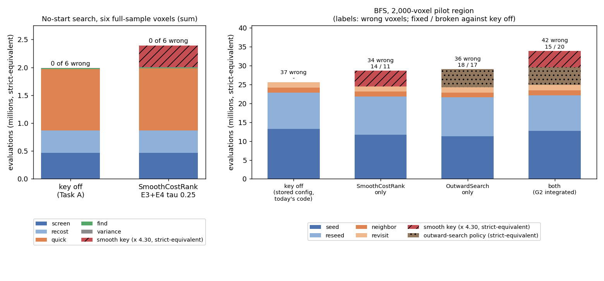
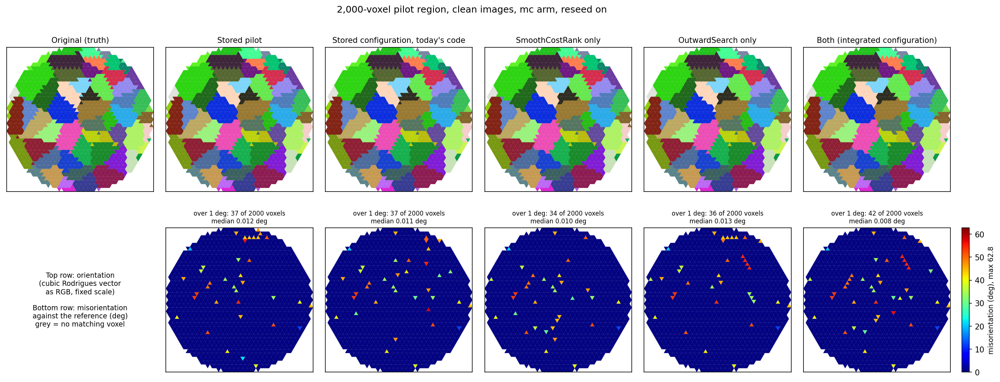

# Findings: reducing cost evaluations, the total (Task G, 2026-10)

Plan: `~/.claude/plans/eval-reduction.md`, Task G (sub-tasks G1, G2, G3). The full technical record is
MIGRATION_HISTORY "Task G". This doc is the plain-English summary of the whole evaluation-reduction work
(Tasks A to G).

## What we asked

The orientation search spends nearly all its time evaluating the cost function. The owner asked for
fewer evaluations at the same or better accuracy, and, where the physics allows it, a smoother cost.
Five questions became Tasks A to F:

| Task | Question |
|---|---|
| A | Why do C++ and Python make different numbers of evaluations for the same method? |
| B | Where are the odd edges of the cost function, and where do they come from? |
| C | The candidate list grows across levels and overlaps. Can we shrink it without losing accuracy? |
| D | Which spots on the two detectors are one peak, and which peaks belong to a voxel? |
| E | Can geometry and physics smooth the cost? |
| F | How efficiently can we search outward from a known start, 2 to 5 degrees out? |

Task G put the levers that passed together. It measured the total on two kinds of run: a no-start
search (one voxel searched from scratch) and a BFS run (the reconstruction grows from seed voxels into
their neighbours).

## What we found, in short

1. **No lever cut the total evaluations at the same accuracy.** The levers that save evaluations cost
   accuracy on E0. The C++ rule makes 332,046 -> 228,146 evaluations per full-sample voxel but 41 -> 56
   wrong on E0. The best de-duplication arm makes 75.8% of the evaluations but 41 -> 55 wrong.
2. **The one lever kept, the smooth ranking key, buys accuracy for time.** `SmoothCostRank E3+E4,tau=0.25`
   fixes 34 of the 41 wrong E0 voxels and breaks none. It adds few strict evaluations (+0.7% on the six
   full-sample voxels) but 90,183 smooth ones, which are slower. In strict-equivalent units that is
   +20.2% on the six voxels and +21.0% on Task E's other 24.
3. **On the BFS pilot region the key alone is slightly better and about 12% dearer.** It has 34 wrong
   voxels against 37 with the key off (14 fixed, 11 broken), and no grain lost. All 25 flips trace to
   the draw, none to the key. It makes fewer strict evaluations (24,490,331 against 25,547,935, because
   it needed fewer full searches) plus 980,594 smooth ones: +12.4% in strict-equivalent units.
4. **Every wrong voxel in the BFS runs is a boundary voxel with its neighbour's orientation.** In all
   five pilot-region runs, each wrong voxel carries the orientation of a grain it touches. With the key
   on, none of them comes from a wrong full search. All come from a neighbour fit that crossed a grain
   boundary, where the key does not act.
5. **The outward search for BFS neighbours and reseeds does not pay.** Alone it gives 36 wrong against
   37 (18 fixed, 17 broken) for +13.9% strict-equivalent and one lost grain. With the smooth key it
   gives 42 wrong (+32.6%). It stays off (D-20261029-N2).
6. **A full-sample BFS run would take about a day on one process.** Scaling the pilot linearly gives
   22.0 h with the key off and 26.9 h with the key on. This scaling is an assumption, not tested.

## Terms

* **Evaluation.** One call of the cost function for one orientation of one voxel.
* **Strict cost.** The cost every search uses: the share of predicted spots that land on lit pixels,
  with a hard cut at each pixel and frame edge. It judges every result.
* **Smooth cost, smooth key.** Task E's softer costs. `SmoothCostRank` uses one only to rank the
  candidates at levels 0 to 2, where a quarter of the list is kept. E3+E4 means soft peak weights (E3)
  plus a distance to the observed rays (E4); tau 0.25 is E4's width in degrees.
* **Strict-equivalent.** Evaluations of other kinds converted to strict ones by measured time. One
  E3+E4 evaluation takes as long as about 4.3 strict ones on the full-sample images (Task E, batches
  of 256).
* **Full search** (no-start search). The coarse-to-fine search of a voxel from scratch: the screen,
  its recost, the quick Monte Carlo (MC) at each level, then FindOptimal and the final MC
  (`variance`).
* **BFS.** Breadth-first reconstruction. A **seed** voxel gets a full search. Its neighbours start
  from the seed's orientation and get a short local fit (**neighbour fit**). A fit that fails is
  tried again later (**revisit**). A cluster of voxels that stays unfitted gets a new full search
  (**reseed**).
* **Wrong.** More than 1 degree from the true orientation, after cubic symmetry.
* **Fixed / broken / both wrong.** Two runs compared voxel by voxel: fixed = wrong in the first run,
  right in the second; broken = the reverse.
* **Traced to the arm / to the draw** (owner rule D-20261014-N13). A change also flips voxels just by
  changing the random draws. A broken voxel counts against a change only if the change itself caused
  it (for example its key dropped the truth's basin), or if nobody could trace it.
* **Voxel sets.** *Six full-sample voxels*: six interior voxels of the clean full-sample images.
  *Task E's other 24*: the rest of a 30-voxel set on the same images. *E0*: 200 voxels with their own
  clean images, the set where the strict search is often wrong. *Pilot region*: 2,000 voxels (60
  grains) of the full sample, reconstructed by BFS.
* **Lenient rule / C++ rule.** Two overlap rules of the cost. Lenient is the Python default; the C++
  rule (`CppOverlapRule 1`) copies C++.
* **Intervals.** Counts out of n come with a 95% Wilson interval in brackets.

## Evaluations by stage, before and after

Reading the plot: each bar is one run, split by stage. Smooth and outward-search evaluations are
converted to strict-equivalent units, so bar heights compare cost. Left: the no-start search of the
six full-sample voxels, summed. Right: the 2,000-voxel BFS pilot region; the labels give the wrong
voxels and, under them, fixed / broken against the key-off run.

The smooth key adds the hatched red block and changes the strict stages very little. The outward
search (brown, dotted) costs about as much as the smooth key, and they add up.

Reading the table: one row per voxel set, the key off ("before") against `SmoothCostRank E3+E4,tau=0.25`
("after"). Strict evaluations are sums for the six voxels and the BFS run, and means per voxel for the
24 and for E0. The last column is the change in strict-equivalent units.

<!-- table:evalG3_total_sets -->
| set | n | wrong_before | wrong_after | fixed_broken | strict_before | strict_after | smooth | equiv_change |
|---|---|---|---|---|---|---|---|---|
| six full-sample voxels (sum) | 6 | 0 (0.0-39.0%) | 0 (0.0-39.0%) | 0 / 0 | 1,992,278 | 2,006,917 | 90,183 | +20.2% |
| Task E's other 24 full-sample voxels (per voxel) | 24 | 1 (0.7-20.2%) | 0 (0.0-13.8%) | 1 / 0 | 330,584 | 335,047 | 15,119 | +21.0% |
| E0 200 voxels (per voxel) | 200 | 41 (15.5-26.6%) | 7 (1.7-7.0%) | 34 / 0 | 48,700 | 49,215 | 252 | +1.7% |
| BFS pilot region, 2,000 voxels (whole run) | 2000 | 37 (1.3-2.5%) | 34 (1.2-2.4%) | 14 / 11 | 25,547,935 | 24,490,331 | 980,594 | +12.4% |
<!-- /table:evalG3_total_sets -->

Reading the table: the six full-sample voxels by stage, summed. "screen" and "recost" are the coarse
screen and its recost, "quick" the quick MC, "find" FindOptimal, "variance" the final MC.

<!-- table:evalG3_total_nostart_stages -->
| stage | before | after | change |
|---|---|---|---|
| screen | 465,057 | 466,695 | +0.4% |
| recost | 402,506 | 404,295 | +0.4% |
| quick | 1,098,888 | 1,110,036 | +1.0% |
| find | 17,312 | 15,792 | -8.8% |
| variance | 8,509 | 10,093 | +18.6% |
| final | 6 | 6 | +0.0% |
| strict, all stages | 1,992,278 | 2,006,917 | +0.7% |
| smooth key (E3+E4) | 0 | 90,183 | n/a |
| strict-equivalent (smooth x 4.297) | 1,992,278 | 2,394,433 | +20.2% |
<!-- /table:evalG3_total_nostart_stages -->

Reading the table: the BFS runs by stage (seed = full searches of seeds, reseed = full searches of
reseeds, neighbor and revisit = local fits). "smooth" is the smooth key's evaluations. In the
OutwardSearch runs the neighbour and revisit counts are mostly cheap screen evaluations; the
strict-equivalent column weighs them by time (Task F's weights). Wall times are contended at
different levels, so they do not compare across runs.

<!-- table:evalG3_total_bfs -->
| run | wrong | fixed_broken | grains_lost | seed | reseed | neighbor | revisit | total | smooth | strict_equivalent | equiv_change | wall_s | timing |
|---|---|---|---|---|---|---|---|---|---|---|---|---|---|
| stored configuration, today's code | 37 (1.3-2.5%) | - | 0 | 13,264,873 | 9,617,992 | 1,293,861 | 1,371,209 | 25,547,935 | 0 | 25,547,935 | +0.0% | 8,997 | contended: 3 concurrent 2000-voxel BFS runs (Task G2) |
| SmoothCostRank only | 34 (1.2-2.4%) | 14 / 11 | 0 | 11,743,593 | 10,066,910 | 1,289,656 | 1,390,172 | 24,490,331 | 980,594 | 28,703,943 | +12.4% | 11,136 | contended: one 2000-voxel BFS run (Task G3); preflight quiet at the start, other jobs on the machine not controlled |
| OutwardSearch only | 36 (1.3-2.5%) | 18 / 17 | 1 | 11,265,144 | 10,415,877 | 19,987,665 | 19,950,797 | 61,619,483 | 0 | 29,102,899 | +13.9% | 10,980 | contended: 2 concurrent 2000-voxel BFS runs plus the E0 run (2 workers) and a 150-voxel pilot at the start (Task G2) |
| both (Task G2's integrated configuration) | 42 (1.6-2.8%) | 15 / 20 | 1 | 12,747,993 | 9,493,718 | 19,736,111 | 18,843,288 | 60,821,110 | 996,303 | 33,867,545 | +32.6% | 13,822 | contended: 2 concurrent 2000-voxel BFS runs plus the E0 run (2 workers) and a 150-voxel pilot at the start (Task G2) |
<!-- /table:evalG3_total_bfs -->

The strict-equivalent weight of a smooth evaluation (4.297) is Task E's measured time ratio in batches
of 256. In the BFS runs a full search took longer than that weight predicts. Reading the table: time
per full search, and the time per smooth evaluation it implies if a strict evaluation took as long as
in the key-off run.

<!-- table:evalG3_full_search_time -->
| run | full_searches | wall_per_full_search_s | strict_per_full_search | smooth_per_full_search | implied_ms_per_smooth | timing |
|---|---|---|---|---|---|---|
| stored configuration, today's code | 69 | 114 | 331,636 | 0 | n/a | contended: 3 concurrent 2000-voxel BFS runs (Task G2) |
| SmoothCostRank only | 65 | 154 | 335,546 | 15,086 | 2.58 | contended: one 2000-voxel BFS run (Task G3); preflight quiet at the start, other jobs on the machine not controlled |
| both (Task G2's integrated configuration) | 70 | 147 | 317,739 | 14,233 | 2.66 | contended: 2 concurrent 2000-voxel BFS runs plus the E0 run (2 workers) and a 150-voxel pilot at the start (Task G2) |
<!-- /table:evalG3_full_search_time -->

That implied cost is about 2.6 ms, against 1.639 ms in Task E's timing. A scratch check showed that the
BFS reconstructor does reuse the cached `SmoothCost` (one build, then a hit on the second full search;
`G/g3/cache_check.json`), so a rebuild per search is not the cause. The runs were contended at
different levels; the cause was not tested. So the true time cost of the key in a BFS may be higher
than +12.4%.

## The integrated configuration

Task G2 wrote the levers that passed into one config file
(`benchmarks/eval_reduction/G/integrated_mc_clean.config`). Each choice comes from a decision on
record:

| Lever | Choice | Why |
|---|---|---|
| overlap rule | lenient (the default) | the C++ rule stays off (D-20261013-I6) |
| candidate de-duplication | off | no arm saved evaluations at equal accuracy (D-20261014-N4) |
| ranking key of levels 0-2 | `SmoothCostRank E3+E4,tau=0.25`, with the cache | Task G1's rule (D-20261029-N1) |
| finisher | the classic MC | the finisher study |
| BFS neighbours and reseeds | `OutwardSearch 1` (F4, then F5 and F4 where F4 fails) | Task F's comparison (D-20261028-N4) |

On the pilot region `OutwardSearch` added evaluations and broke reseeds (below). It stays off
(D-20261029-N2). So the configuration left on the table is the stored one plus `SmoothCostRank`
alone. Task G3 ran exactly that on the pilot region (D-20261029-N3), with the config file
`benchmarks/eval_reduction/G/g3/smooth_only_mc_clean.config`.

## No-start search: six full-sample voxels and E0

`OutwardSearch` does nothing in a no-start search, so here the integrated configuration is the
smooth key alone.

On the six full-sample voxels no voxel was wrong before or after. The key adds 0.7% strict
evaluations and 90,183 smooth ones; in time that is about +20% (table "Evaluations by stage" above).
The key-off search gave exactly Task A's ledger on every voxel, so the comparison is like for like.

On E0 the key fixes 34 of the 41 wrong voxels and breaks none, for 1.1% more strict evaluations and
252 smooth ones per voxel. Task G2's run equals Task E's own run of the key on all 200 voxels.

Reading the table: one row, E0, the key against the strict search. "broken_traced" is traced to the
arm / to the draw / untraced; evaluations are means per voxel.

<!-- table:evalG2_e0 -->
| n | wrong_base | wrong_integrated | fixed | broken | both_wrong | broken_traced | evals_base | evals_integrated | smooth | identical_to_task_e |
|---|---|---|---|---|---|---|---|---|---|---|
| 200 | 41 (15.5-26.6%) | 7 (1.7-7.0%) | 34 | 0 | 7 | 0 / 0 / 0 | 48700 | 49215 | 252 | 200 of 200 |
<!-- /table:evalG2_e0 -->

## BFS pilot region

The pilot region is 2,000 voxels and 60 grains of the full sample, clean images, the classic MC
finisher, revisit and reseed on, one BFS seed order (rng seed 0). Five runs:

* the **stored pilot** (2026-10-10);
* the **stored configuration on today's code** ("key off"), the like-for-like baseline. The stored
  pilot no longer reproduces: same 37 wrong, but 14 fixed and 14 broken by voxel. This is consistent
  with the centroid screen becoming the default on 2026-10-12 (not tested);
* **SmoothCostRank only** (Task G3);
* **OutwardSearch only** and **both** (Task G2).

The maps show the five runs next to the truth (top: orientation; bottom: misorientation to the truth).
The page is `benchmarks/eval_reduction/G/maps/index.html` (published by the main session); the
figure is below.

The wrong voxels are single triangles at grain boundaries in every run. The runs differ in which
boundary voxels go wrong, not in how many grains are found.

Reading the table: one row per run. "wrong" with the Wilson interval; "grains_lost" = grains with no
voxel within 1 degree; "median_err_right" = median error of the right voxels (degrees); seeds,
reseeds (accepted), neighbour fits, neighbour fits accepted at the first try, revisits (accepted).

<!-- table:evalG3_bfs_accuracy -->
| run | n | wrong | unresolved | grains_lost | median_err_right | seeds | reseeds | neighbor_fits | accepted_first | revisits |
|---|---|---|---|---|---|---|---|---|---|---|
| mc_clean | 2000 | 37 (1.3-2.5%) | 1 | 0 | 0.0118 | 34 | 35 (32 accepted) | 1966 | 770 | 2126 (1165 accepted) |
| keyoff_rerun | 2000 | 37 (1.3-2.5%) | 2 | 0 | 0.0101 | 40 | 29 (28 accepted) | 1960 | 769 | 2089 (1167 accepted) |
| smooth_only | 2000 | 34 (1.2-2.4%) | 0 | 0 | 0.0082 | 35 | 30 (30 accepted) | 1965 | 768 | 2108 (1170 accepted) |
| outward_only | 2000 | 36 (1.3-2.5%) | 1 | 1 | 0.0113 | 34 | 36 (35 accepted) | 1966 | 764 | 2166 (1168 accepted) |
| integrated | 2000 | 42 (1.6-2.8%) | 0 | 1 | 0.0077 | 38 | 32 (32 accepted) | 1962 | 762 | 2140 (1173 accepted) |
<!-- /table:evalG3_bfs_accuracy -->

Reading the table: runs paired by voxel. Each row compares run b against run a (`mc_clean` = the
stored pilot, `keyoff_rerun` = the stored configuration on today's code).

<!-- table:evalG3_bfs_paired -->
| a | b | wrong_a | wrong_b | fixed | broken | both_wrong |
|---|---|---|---|---|---|---|
| mc_clean | keyoff_rerun | 37 | 37 | 14 | 14 | 23 |
| mc_clean | smooth_only | 37 | 34 | 13 | 10 | 24 |
| mc_clean | outward_only | 37 | 36 | 9 | 8 | 28 |
| mc_clean | integrated | 37 | 42 | 11 | 16 | 26 |
| keyoff_rerun | smooth_only | 37 | 34 | 14 | 11 | 23 |
| keyoff_rerun | outward_only | 37 | 36 | 18 | 17 | 19 |
| keyoff_rerun | integrated | 37 | 42 | 15 | 20 | 22 |
| smooth_only | integrated | 34 | 42 | 5 | 13 | 29 |
<!-- /table:evalG3_bfs_paired -->

The smooth key alone is 3 wrong voxels better than the key off, on one seed order. Its 14 fixed and
11 broken are about the size of the 14 and 14 that a code change alone produced between the stored
pilot and today's code. So the gain is within the flips a change of draw makes.

**Where the wrong voxels come from.** Every wrong voxel, in every run, carries the orientation of
another grain to within 0.01 degree, and touches that grain (its corner is at most one voxel side,
9.4 µm, from it). We traced where that orientation came from:

* *own full search*: the voxel's own full search (a seed or a reseed) ended on the neighbour grain;
* *carried from a wrong full search*: a local fit took it from a full search that was itself wrong;
* *boundary crossing*: a local fit carried a right full search's orientation over a grain boundary.

Reading the table: every wrong voxel of each run, split by origin; "full_searches" is the number of
voxels whose record is a full search.

<!-- table:evalG3_wrong_by_origin -->
| run | n | another grain | own full search | carried from a wrong full search | boundary crossing | untraced | max_distance_um | full_searches |
|---|---|---|---|---|---|---|---|---|
| stored pilot (2026-10-10) | 37 | 37 | 1 | 5 | 31 | 0 | 9.4 | 67 |
| stored configuration, today's code | 37 | 37 | 2 | 3 | 32 | 0 | 9.4 | 63 |
| SmoothCostRank only | 34 | 34 | 0 | 0 | 34 | 0 | 0.0 | 62 |
| OutwardSearch only | 36 | 36 | 5 | 4 | 27 | 0 | 9.4 | 68 |
| both (Task G2's integrated configuration) | 42 | 42 | 4 | 9 | 29 | 0 | 0.0 | 65 |
<!-- /table:evalG3_wrong_by_origin -->

With the key off, 5 of the 37 wrong voxels come from wrong full searches. With the key on, none of the
34 do. The OutwardSearch runs have more of them (9 and 13), from reseeds that took a neighbouring
grain (Task G2).

Reading the table: the flips of each pair split the same way. "broken" voxels are classed in run b,
"fixed" ones in run a.

<!-- table:evalG3_trace -->
| a | b | flip | n | another grain | own full search | carried from a wrong full search | boundary crossing | untraced |
|---|---|---|---|---|---|---|---|---|
| stored configuration, today's code | SmoothCostRank only | broken (wrong in b) | 11 | 11 | 0 | 0 | 11 | 0 |
| stored configuration, today's code | SmoothCostRank only | fixed (wrong in a) | 14 | 14 | 1 | 3 | 10 | 0 |
| stored configuration, today's code | OutwardSearch only | broken (wrong in b) | 17 | 17 | 5 | 3 | 9 | 0 |
| stored configuration, today's code | OutwardSearch only | fixed (wrong in a) | 18 | 18 | 1 | 3 | 14 | 0 |
| stored configuration, today's code | both (Task G2's integrated configuration) | broken (wrong in b) | 20 | 20 | 4 | 4 | 12 | 0 |
| stored configuration, today's code | both (Task G2's integrated configuration) | fixed (wrong in a) | 15 | 15 | 1 | 3 | 11 | 0 |
| stored pilot (2026-10-10) | stored configuration, today's code | broken (wrong in b) | 14 | 14 | 1 | 3 | 10 | 0 |
| stored pilot (2026-10-10) | stored configuration, today's code | fixed (wrong in a) | 14 | 14 | 1 | 5 | 8 | 0 |
| SmoothCostRank only | both (Task G2's integrated configuration) | broken (wrong in b) | 13 | 13 | 2 | 4 | 7 | 0 |
| SmoothCostRank only | both (Task G2's integrated configuration) | fixed (wrong in a) | 5 | 5 | 0 | 0 | 5 | 0 |
<!-- /table:evalG3_trace -->

**The broken-voxel trace (D-20261014-N13) for the smooth key.** The key acts only in full searches.
All 11 voxels it breaks are boundary crossings from right full searches, so they trace to the draw
(the BFS took a different path). Of the 14 it fixes, 4 came from two wrong full searches of the key-off
run. We re-ran those two full searches through Task E's probe with the key off and on. Both came out
right either way, so those fixes also trace to the draw, not to the key.

Reading the table: the totals by verdict.

<!-- table:evalG3_trace_n13 -->
| flip | n | traced_to_arm | traced_to_draw | untraced |
|---|---|---|---|---|
| broken | 11 | 0 | 11 | 0 |
| fixed | 14 | 0 | 14 | 0 |
<!-- /table:evalG3_trace_n13 -->

Reading the table: the probe re-runs (full-sample voxel index, error in degrees with the key off and on).

<!-- table:evalG3_trace_probe -->
| full_sample_voxel | err_key_off | err_key_on | outcome |
|---|---|---|---|
| 8866 | 0.001 | 0.025 | both right |
| 15749 | 0.020 | 0.007 | both right |
<!-- /table:evalG3_trace_probe -->

**What the key changed in the BFS.** It needed fewer full searches: 35 seeds and 30 reseeds against
40 and 29, with 3 seeds rejected against 6. That is why its strict evaluations went down. Neighbour
acceptance did not change (768 accepted at the first try against 769).

**OutwardSearch.** Task G2's result stands. Alone it fixes 18 and breaks 17; Task G2 traced 8 of the
breaks to reseeds whose outward search took a neighbouring grain. It costs about as much as the smooth
key. Added on top of the smooth key it gives 42 wrong against 34 (5 fixed, 13 broken).

## Smooth ranking on the full sample (Task E's 24 voxels)

Task E's big gain was on E0, where the strict search is often wrong. Task G1 asked whether it carries
over to the full-sample images. On Task E's other 24 full-sample voxels the strict search is wrong
on only 1 (lenient rule) and on none (C++ rule), so there was little to fix.

* E3+E4 (tau 0.25) fixed that one voxel (1729) and broke none, under both rules. The fix is traced to
  the key: at level 1 it kept a candidate in the truth's basin that the strict cost ranked below the
  cut.
* E1+E2+E3+E4 fixed none and broke none.
* So E3+E4 went on to G2 (net +1 against 0). The margin is one voxel; this test has little power.

Reading the table: one row per rule and key. Wrong counts with Wilson intervals; evaluations per
voxel; the smooth evaluations are on top of the strict ones.

<!-- table:evalG1_full24 -->
| rule | arm (SmoothCostRank) | n | wrong, strict | wrong, arm | fixed | broken | both wrong | broken: traced to arm / draw / untraced | fixed: traced to arm / draw | median error, right in both (deg), strict / arm | strict evaluations per voxel, strict search | strict evaluations per voxel, arm | smooth evaluations per voxel |
|---|---|---|---|---|---|---|---|---|---|---|---|---|---|
| lenient | E3+E4,tau=0.25 | 24 | 1 (0.7-20.2%) | 0 (0.0-13.8%) | 1 | 0 | 0 | 0 / 0 / 0 | 1 / 0 | 0.0062 / 0.0112 | 330584 | 335047 | 15119 |
| lenient | E1+E2+E3+E4 | 24 | 1 (0.7-20.2%) | 1 (0.7-20.2%) | 0 | 0 | 1 | 0 / 0 / 0 | 0 / 0 | 0.0062 / 0.0077 | 330584 | 347207 | 15762 |
| C++ | E3+E4,tau=0.25 | 24 | 0 (0.0-13.8%) | 0 (0.0-13.8%) | 0 | 0 | 0 | 0 / 0 / 0 | 0 / 0 | 0.0096 / 0.0123 | 232124 | 240463 | 11404 |
| C++ | E1+E2+E3+E4 | 24 | 0 (0.0-13.8%) | 0 (0.0-13.8%) | 0 | 0 | 0 | 0 / 0 / 0 | 0 / 0 | 0.0096 / 0.0082 | 232124 | 249960 | 11919 |
<!-- /table:evalG1_full24 -->

Task G1 also built the cache. A `SmoothCost` is now built once per image set instead of once per
voxel. The build takes 16.7 s. With the cache the key costs about a fifth more time per full-sample
voxel, not a third. The results are bit-identical with and without the cache.

Reading the table: two full-sample voxels (15901, 17034), single-worker, with the key off, a cold or
fresh cache and a warm cache.

<!-- table:evalG1_cache_timing -->
| arm (SmoothCostRank) | timing | key off, 15901 / 17034 (s) | 15901: cold cache / warm cache (s) | 17034: fresh build / warm cache (s) | saved per voxel by the cache (s), A / B | extra time over key off, as before (fresh build), B | extra time over key off, warm cache, A / B | warm equals fresh (B), cold equals warm (A) |
|---|---|---|---|---|---|---|---|---|
| E3+E4,tau=0.25 | single-worker | 112.1 / 119.2 | 157.3 / 139.7 | 161.6 / 144.4 | 17.6 / 17.2 | +35.5% | +24.6% / +21.1% | yes / yes |
| E1+E2+E3+E4 | single-worker | 112.1 / 119.2 | 257.1 / 239.3 | 263.9 / 246.8 | 17.8 / 17.1 | +121.3% | +113.5% / +106.9% | yes / yes |
<!-- /table:evalG1_cache_timing -->

## What each lever contributed

Each task measured its lever alone. This table collects those single-lever results, read from each
task's own tables. Tasks B and D are measurements, not levers, so they have no row:

* **Task B** found where the cost's edges come from: a spot moving to the next frame (physics, with a
  hard cut) and a triangle vertex moving to the next pixel (an artefact). It also found that the cost
  at the truth is not zero. These findings shaped Task E's smooth costs.
* **Task D** showed that spots on the two detectors can be paired (98.7% of one-grain pairs found),
  but that a spot belongs to a grain, not to a voxel. Its observed rays became Task E's E4 term and
  Task F's F4 search.

Reading the table: one row per lever. "Evaluations" and "wrong" are before -> after for the lever
alone, on the sets named in the cell. "Carried" says whether it is in Task G's configuration.

<!-- table:evalG3_levers -->
| lever | task | evaluations | wrong | time | carried |
|---|---|---|---|---|---|
| C++ overlap rule (`CppOverlapRule 1`) | A | 332,046 -> 228,146 per voxel (six full-sample voxels) | E0: 41 -> 56 (15 fixed / 30 broken) | 173 -> 116 s per voxel (mixed labels) | no (lenient rule stays, D-20261013-I6) |
| C++ edge rules, omega interpolation, batched screen (`CppEdgeRules`, `CppOmegaInterp`, `BatchedScreen`) | A | 332,046 -> 329,595 per voxel (six voxels, lenient rule, all three) | E0 (lenient rule, edge rules and interpolation): 41 -> 40 (21 fixed / 20 broken) | 122.5 -> 96.2 s, voxel 15901, C++ rule with `CppEdgeRules`, adding the other two (single-worker) | `BatchedScreen` on by default since 2026-10-13; the other two opt-in |
| candidate de-duplication, best arm (`CandidateDedup clique=cpp:1`) | C | 75.8% of the base (six voxels); 99.4% on E0 | E0: 41 -> 55 (10 fixed / 24 broken) | not measured single-worker | no (D-20261014-N4) |
| smooth ranking key of levels 0-2 (`SmoothCostRank E3+E4,tau=0.25`) | E, G1 | E0 48,700 -> 49,215 strict + 252 smooth per voxel; six voxels 332,046 -> 334,486 + 15,030 | E0: 41 -> 7 (34 fixed / 0 broken) | +21.1% per full-sample voxel with the cache (voxel 17034, single-worker) | yes (D-20261029-N1) |
| smooth ranking key of levels 0-2 (`SmoothCostRank E1+E2+E3+E4`) | E, G1 | E0 48,700 -> 49,653 strict + 263 smooth per voxel; six voxels 332,046 -> 348,018 + 15,755 | E0: 41 -> 5 (36 fixed / 0 broken) | +106.9% per full-sample voxel with the cache (voxel 17034, single-worker) | no (G1 default rule: fewer net fixes on the full sample) |
| SmoothCost cache per image set | G1 | none (the same results) | no change (bit-identical) | saves the 16.7 s build per voxel (17.6 / 17.2 s measured, single-worker) | yes, under the key |
| outward search for BFS neighbours and reseeds (`OutwardSearch 1`) | F, G2 | BFS region 25.5M -> 61.6M (mostly screen evaluations) | BFS region: 37 -> 36 (18 fixed / 17 broken) | 8,997 -> 10,980 s (contended) | no (D-20261029-N2) |
<!-- /table:evalG3_levers -->

In short, the levers that save evaluations (the C++ rule, de-duplication) cost accuracy on E0. The
lever that gains accuracy (the smooth key) costs time. No lever reduced the total number of
evaluations at equal accuracy. Task A's batched screen made each search faster without changing its
evaluations; it has been the default since 2026-10-13, so every run here already has it.

The two levers carried into Task G2 did interact on the BFS region: the smooth key alone has 34 wrong,
the outward search alone 36, both together 42. That is why Task G3 ran the smooth key alone
(D-20261029-N3).

## Decisions for the owner

No default was flipped and no golden test changed in any task. These are proposals.

1. **`SmoothCostRank E3+E4,tau=0.25` as the default?** For: E0 41 -> 7 wrong with 0 broken; on the
   full sample 1 fixed, 0 broken; on the BFS region 34 against 37, with no flip traced to the key. Against:
   about +20% time per full-sample full search, and in the BFS +12.4% strict-equivalent, perhaps more
   (see the full-search time above). On the full sample the strict search is already rarely wrong, so the
   gain there is small and within the draw. Proposal: keep it opt-in, and turn it on for runs where
   full searches are often wrong (E0-like voxels). If it becomes the default, the goldens that pin a
   default full search would move. By reading (not run), these are likely the `reconstruct_voxel` golden
   of `test_findoptimal_refactor.py`, the recorded BFS result of `test_bfs_refit.py`, the coarse-proxy
   features of `test_coarse_proxy.py`, the counts of `test_ray_overlap.py` and the profiling test (the
   tests Task A's `default_flip_would_change.md` lists for its switches). The SmoothCost cache should
   stay on under the key; it changes no result.
2. **`OutwardSearch`** stays off (D-20261029-N2). If revisited: F4 alone for neighbours, and no outward
   search for reseeds.
3. **`CppOverlapRule`, `CandidateDedup`** stay off: each saves evaluations but costs accuracy on E0.
4. **Is the full-sample BFS run affordable?** About a day on one process by the scaling below
   (22.0 h key off, 26.9 h key on). That is affordable as one long background run. Several arms at
   once fit the machine's limit of 6 heavy processes. The estimate assumes full searches grow with the
   number of grains and local fits with the number of voxels; that is not tested.

Reading the table: the pilot region's full searches and local fits, their wall time, the scale factors
to the full sample (24,570 voxels, 497 grains) and the estimate in hours on one process.

<!-- table:evalG3_full_sample_estimate -->
| run | full_searches | full_search_wall_s | local_fit_wall_s | grain_scale | voxel_scale | estimate_h | timing |
|---|---|---|---|---|---|---|---|
| stored configuration, today's code | 69 | 7,848 | 1,149 | 8.28 | 12.29 | 22.0 | contended: 3 concurrent 2000-voxel BFS runs (Task G2) |
| SmoothCostRank only | 65 | 10,011 | 1,125 | 8.28 | 12.29 | 26.9 | contended: one 2000-voxel BFS run (Task G3); preflight quiet at the start, other jobs on the machine not controlled |
<!-- /table:evalG3_full_sample_estimate -->

## Limits

* **One seed order.** Each BFS run used one seed order. A code change alone (stored pilot against
  today's code) flipped 14 voxels each way, so a difference of 3 wrong voxels is within that scale.
* **Clean images only.** No realistic images, until the noise model is redone.
* **Timing.** All BFS wall times are contended, at different levels (three runs at once in Task G2, one
  run in Task G3), so they do not compare across runs. The strict-equivalent weights come from separate
  single-worker timings (Task E for the smooth key, Task F for the outward search). The BFS full
  searches imply a slower smooth evaluation than Task E measured; the cause is not known.
* **The trace.** Which grain's orientation a wrong voxel carries is measured directly (within 0.01
  degree of one grain). Where it came from is read from the records and the run's full-search voxels
  within 1 degree of it. Saying that a boundary
  crossing is "the draw" rests on the key acting only in full searches. The probe re-runs repeat the
  same search on the same images, with their own random draws, not the BFS's.
* **The full-sample estimate** is a linear scaling of one 2,000-voxel region.
* **The stored pilot** does not reproduce on today's code; the like-for-like baseline is the rerun.
* **Small full-sample sets.** The strict search is wrong on 0 of 6 and 1 of 24 full-sample voxels, so
  those sets cannot show much gain.
