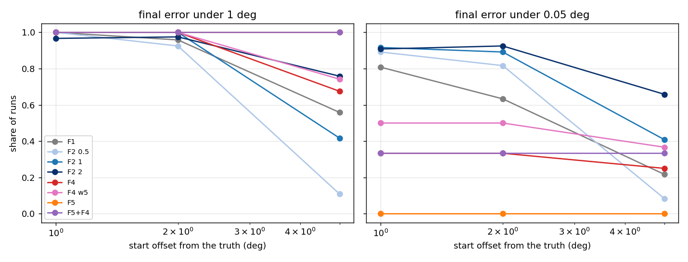
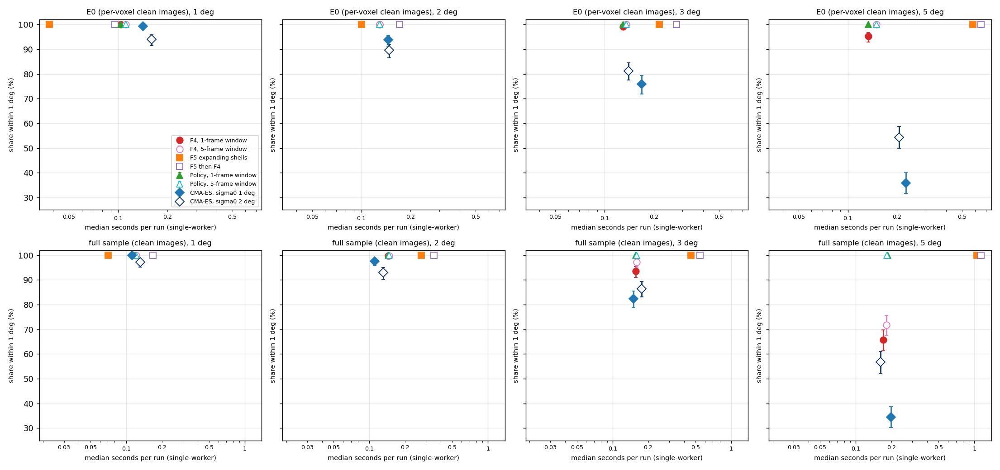

# Findings: searching outward from a start (Task F, 2026-10-20)

Run record: `benchmarks/eval_reduction/F/RUN_LOG.md`. Library: `icenine/outward_search.py` (`RayGaussNewton` is F4,
`ShellSearch` is F5). It is a separate module: the reconstructor does not call it and there is no config key. The full
technical record, with every table, is MIGRATION_HISTORY "Task F". This doc is the plain-English reading of it.

## What we asked

Several parts of a reconstruction start from an orientation that is already close. A breadth-first neighbour starts
from the orientation of the voxel next to it. A reseed starts from a stored guess. The hybrid finisher starts from the
network's answer. In each case the right orientation is usually within a few degrees of the start.

Nothing in the search is built for this case. The coarse grid covers the whole fundamental zone at 5 degree spacing,
and the finisher's box is only 0.33 degrees wide. So we asked: if a method starts 0.1 to 5 degrees away, how often does
it reach the truth, and how many cost evaluations does it spend?

## What we found, in short

1. **The two new methods reach furthest.** From a 5 degree start on the E0 set, F4 ended within 1 degree of the truth
   in 95% of runs and F5 in 100%. CMA-ES reached 11% to 46%, depending on its first step size. FindOptimal with its
   box widened to the offset reached 42%.

2. **F4 is cheap; F5 is cheaper per evaluation but makes many more of them.** From 5 degrees on E0, F4 makes a
   median of 33 evaluations: 13 E4 values with their gradient, 18 plain E4 values and 2 strict costs. One value with
   its gradient takes as long as about 26 strict evaluations, so the gradients are about 92% of F4's cost. Counted in
   time, F4 costs about 358 strict evaluations from 5 degrees, about half of CMA-ES. F5 makes about 22,000
   evaluations from 5 degrees, mostly cheap screen ones. Weighted at the batch sizes F5 uses, they come to about 1,364
   strict evaluations, or 0.58 seconds per run on one worker.

3. **F4 stops 0.02 to 0.05 degrees short.** This is consistent with the resolution of the ray-based cost it follows.
   We did not save whether each run converged, so a failure to converge is not ruled out (untested). A finisher is
   still needed after it.

4. **F4 knew when it had failed, on these runs.** Its acceptance test (the strict cost at its end point is at most
   0.8) was right in every run. From 5 degrees on E0 it rejected 24 runs, and none of them was within 1 degree (0 of 24;
   95% interval 0 to 14%). It accepted 456, and none of them was wrong (0 of 456; 0 to 0.8%). On the full sample the
   counts are 0 of 39 rejected (0 to 9%) and 0 of 81 accepted (0 to 4.5%). The two groups were far apart: every
   rejected run ended at least 3.37 degrees out, with a strict cost of at least 0.95. So the test was only tried on
   clearly separated outcomes. We do not know how it does when a wrong end point is close to the truth.

5. **F4, with F5 as a fallback, found every voxel (in-sample).** The rule "run F4; if F4 is rejected, run F5 and then
   F4 from F5's answer" ended within 1 degree in every run, at every offset, on both sets. This rule was written down
   after the tables were read, on the same runs, so it still needs fresh voxels to confirm it.

6. **The full sample is harder for F4 from far away.** From 5 degrees F4 reached 68% on the full sample (95% on E0).
   Up to 2 degrees it reached 100% on both.

7. **A wider matching window helps F4 on E0, less so on the full sample.** F4 matches each predicted spot to an
   observed ray at most one omega frame away. With a 5-frame window, F4 reached 100% from 5 degrees on E0 and 74% on
   the full sample.

8. **The carry rule now picks F4 and F5 on E0.** The plan's rule carries the two methods with the most captures per
   unit of cost. Our first cost weights overstated F5's time by a factor of 1.2 to 1.6. They timed the screen in
   batches of 64 and each E4 value on its own, while F5 screens a whole shell at once and asks for 32 E4 values at a
   time. With F5 timed at its own batch sizes, the rule carries **F4 and F5**. With the first weights it carried F4
   and CMA-ES with a 1 degree first step, and that second place was decided by a tie. On the full sample the rule
   still prefers two CMA-ES variants.

9. **Nothing in the reconstructor changed.** No shared file, golden test or default was touched.

## Terms

* **Strict cost.** The search's normal score: one minus the share of predicted spot pixels that land on lit pixels.
* **Observed ray.** From Task D: a spot seen on both detectors defines a line in the lab, pointing back to the voxel.
  Task D attaches to each voxel the rays that pass near it.
* **E4 cost.** From Task E: for each predicted spot, the distance to the nearest observed ray attached to the voxel.
  It changes smoothly with orientation, so it has a gradient. The strict cost does not.
* **Start, offset.** The orientation a method begins from, and its angle from the truth. We used offsets of 0.1, 0.5,
  1, 2, 3 and 5 degrees, each in 20 random directions.
* **Within X degrees.** The method's final orientation is within X degrees of the truth. Only the scoring uses the
  truth; no method sees it, except that F1 is told the offset to size its box.
* **Evaluation kinds.** A *strict* evaluation is one strict cost. A *screen* evaluation is one orientation in the
  coarse, batched pixel-radius screen, which is cheap. A *smooth* evaluation is one E4 value, with or without its
  gradient.
* **Strict-equivalent.** Evaluations of every kind, each weighted by its measured time and expressed in strict
  evaluations. Each kind is timed at the batch size the method uses it at: F4 asks for one E4 value at a time, F5 for
  32 at a time. This is the fair way to compare methods that use different kinds.
* **E0 set.** Single voxels, each with its own simulated images holding only that voxel's spots. We used 8 voxels near
  the rotation axis and 16 far from it.
* **Full sample.** Simulated images of the whole sample, so neighbouring grains add spots. We used the six interior test
  voxels.

## The methods

* **F1, FindOptimal.** The existing Monte Carlo search with variance-minimizing steps, its box widened to the offset.
* **F2, CMA-ES.** The existing evolution strategy, with a first step size (sigma0) of 0.5, 1 or 2 degrees.
* **F3, centroid Gauss-Newton.** The hybrid finisher without the network, on E0 only. Its spot windows were rendered
  from the true orientation, so it is an optimistic reference, not a fair competitor.
* **F4 (new), Gauss-Newton on observed rays.** Each predicted spot is matched to the nearest attached ray within one
  frame in omega. The method then takes damped Gauss-Newton steps, at most 2 degrees each, using the exact gradient of
  the E4 cost. The strict cost is computed only at the start and the end.
* **F5 (new), expanding shells.** The method places points evenly on shells of growing radius around the start, 0.3
  degrees apart. On each shell it screens every point, re-ranks the best 32 by the E4 cost, and computes the strict
  cost of the best 2. It stops at the first point with a strict cost of 0.8 or less, or at 6 degrees out.
* **F5 then F4.** F4 started from the point F5 accepted.
* **F6, Riemannian Adam,** was not run. The plan included it only as a cheap reference, and Task E's costs are not
  wired into it.

The settings (acceptance 0.8, the E4 width 0.25 degrees, shell spacing 0.3 degrees, the 5-frame window) were chosen on
four E0 voxels that the benchmark does not use. Two of them, the acceptance level and the shell spacing, also rest on
how fast the costs rise away from the truth (`pilot/half_rise.json`). That file was computed from Task B's ray walks.
Those walks include three benchmark E0 voxels (3108, 10531 and 17451) and all six full-sample voxels. So these two
settings are not fully independent of the test voxels.

## Results on E0

The first plot shows how far out each method still reaches the truth. Each curve is one method. A curve that stays at 1
as the start moves out keeps finding the truth.

The next plot shows the share of runs within 1 degree against the number of evaluations made so far, one panel per
offset. Its x-axis is a raw count, not time: one F4 gradient counts 1 but costs about 26 strict evaluations, and one F5
screen counts 1 but costs about 0.04. So read it for the order in which runs come in, and a curve that levels off below
1 for lost runs. Use the cost tables below, not this plot, to compare cost.

Read the next table across a row: it shows how far out each method still finds the truth. Each cell is the share of
480 runs that ended within 1 degree, with a 95% interval. A start exactly 1 degree out counts only if the method moved
inward. The interval treats the 480 runs as independent. They are not quite: they come from 24 voxels, 20 runs each,
and runs on the same voxel share its images. A per-voxel table follows below.

<!-- table:evalF_e0_cap1 -->
| method | 0.1 deg | 0.5 deg | 1 deg | 2 deg | 3 deg | 5 deg |
|---|---|---|---|---|---|---|
| F1 FindOptimal, box = offset | 100% (99-100) | 100% (99-100) | 99% (98-100) | 85% (81-88) | 66% (62-70) | 42% (38-47) |
| F2 CMA-ES, sigma0 0.5 deg | 100% (99-100) | 100% (99-100) | 100% (99-100) | 82% (78-85) | 47% (43-52) | 11% (9-14) |
| F2 CMA-ES, sigma0 1 deg | 100% (99-100) | 100% (99-100) | 99% (98-100) | 98% (96-99) | 80% (76-84) | 32% (28-37) |
| F2 CMA-ES, sigma0 2 deg | 100% (99-100) | 99% (98-100) | 93% (91-95) | 89% (86-92) | 81% (77-84) | 46% (42-51) |
| F3 centroid Gauss-Newton (windows) | 100% (99-100) | 100% (99-100) | 100% (99-100) | 100% (99-100) | 100% (99-100) | 88% (85-91) |
| F4 Gauss-Newton on E4 rays | 100% (99-100) | 100% (99-100) | 100% (99-100) | 100% (99-100) | 100% (98-100) | 95% (93-97) |
| F4 with a 5-frame matching window | 100% (99-100) | 100% (99-100) | 100% (99-100) | 100% (99-100) | 100% (99-100) | 100% (99-100) |
| F5 expanding shells | 100% (99-100) | 100% (99-100) | 100% (99-100) | 100% (99-100) | 100% (99-100) | 100% (99-100) |
| F5 then F4 | 100% (99-100) | 100% (99-100) | 100% (99-100) | 100% (99-100) | 100% (99-100) | 100% (99-100) |
<!-- /table:evalF_e0_cap1 -->

The next table uses a tighter bar, 0.05 degrees. F4 sits near 90% at every offset. This is consistent with the ray
cost not resolving finer than that, but we did not test it. F5 alone almost never passes this bar, because it stops on its 0.3 degree shell grid. CMA-ES is sharper than
F4 when it gets there at all.

<!-- table:evalF_e0_cap005 -->
| method | 0.1 deg | 0.5 deg | 1 deg | 2 deg | 3 deg | 5 deg |
|---|---|---|---|---|---|---|
| F1 FindOptimal, box = offset | 86% (83-89) | 66% (62-70) | 58% (53-62) | 32% (28-36) | 21% (18-25) | 7% (5-9) |
| F2 CMA-ES, sigma0 0.5 deg | 100% (99-100) | 99% (98-100) | 99% (98-100) | 81% (77-84) | 46% (42-51) | 11% (8-14) |
| F2 CMA-ES, sigma0 1 deg | 99% (98-100) | 99% (98-100) | 98% (96-99) | 96% (94-98) | 79% (75-82) | 32% (28-36) |
| F2 CMA-ES, sigma0 2 deg | 94% (92-96) | 90% (87-93) | 92% (89-94) | 86% (83-89) | 80% (76-83) | 43% (39-48) |
| F3 centroid Gauss-Newton (windows) | 96% (94-97) | 96% (94-97) | 96% (94-97) | 96% (94-97) | 96% (94-97) | 87% (83-89) |
| F4 Gauss-Newton on E4 rays | 91% (88-93) | 90% (87-93) | 91% (88-93) | 91% (89-94) | 90% (87-92) | 87% (84-90) |
| F4 with a 5-frame matching window | 92% (89-94) | 90% (87-93) | 93% (90-95) | 93% (91-95) | 93% (91-95) | 93% (90-95) |
| F5 expanding shells | 0% (0-1) | 0% (0-1) | 0% (0-1) | 0% (0-1) | 6% (4-8) | 0% (0-1) |
| F5 then F4 | 91% (88-93) | 91% (88-93) | 90% (87-92) | 91% (88-93) | 91% (88-93) | 90% (87-92) |
<!-- /table:evalF_e0_cap005 -->

Different methods use different kinds of evaluation, so we timed each kind on one worker, after a check that the
machine was quiet (`timing/preflight_e0.json`, load 1.39; `timing/preflight_e0_f5.json`, load 1.37). Read the last
column: one E4 value with its gradient costs about 26 strict evaluations. F5's screen and E4 evaluations are timed the
way F5 makes them, a shell at a time. The 64-batch screen row gave the first weights and is no longer used. All the
weights come from one E0 voxel (10531).

<!-- table:evalF_e0_timing -->
| kind of evaluation | used for | milliseconds | times a strict evaluation |
|---|---|---|---|
| strict cost | all methods | 0.4219 | 1.000 |
| screen (pixel radius 3), per orientation, batches of 64 | v1 weights only | 0.0230 | 0.054 |
| E4 value, one rotation per call | F4 | 0.6584 | 1.561 |
| E4 value and Jacobian, one rotation per call | F4 | 10.7970 | 25.592 |
| screen, per orientation, a shell at a time (chunks of up to 256) | F5 | 0.0175 | 0.042 |
| E4 value, per orientation, 32 rotations per call | F5 | 0.3670 | 0.870 |
<!-- /table:evalF_e0_timing -->

A second E0 voxel (3108) shows how much the times vary. Its gradient took 8.76 ms against 11.04 ms on voxel 10531. Its
F5 times are within 5%.

<!-- table:evalF_e0_timing_voxels -->
| voxel | weights from it | F4 E4 value (ms) | F4 E4 value and Jacobian (ms) | F5 screen (ms per orientation) | F5 E4 (ms per orientation) | strict inside F5 (ms) |
|---|---|---|---|---|---|---|
| 10531 | yes | 0.649 | 11.04 | 0.0175 | 0.367 | 0.443 |
| 3108 |  | 0.630 | 8.76 | 0.0168 | 0.352 | 0.464 |
<!-- /table:evalF_e0_timing_voxels -->

To check the weights, we compared each method's strict-equivalent count with its measured single-worker time, on the
timing run's cases (2 voxels, 5 directions, 10 runs per cell). Each cell shows the median ratio with the first weights,
then with the current ones. A ratio of 1 means the weights match the clock. The first weights made F5 look 1.5 to 1.6
times dearer than it was. The current ones agree with the clock to within 11% for every method.

<!-- table:evalF_e0_se_vs_wall -->
| method | 1 deg | 2 deg | 5 deg |
|---|---|---|---|
| F1 FindOptimal, box = offset | 1.04 -> 1.04 | 1.03 -> 1.03 | 1.03 -> 1.03 |
| F2 CMA-ES, sigma0 0.5 deg | 0.99 -> 0.99 | 0.99 -> 0.99 | 0.99 -> 0.99 |
| F2 CMA-ES, sigma0 1 deg | 0.99 -> 0.99 | 0.99 -> 0.99 | 1.00 -> 1.00 |
| F2 CMA-ES, sigma0 2 deg | 1.00 -> 1.00 | 1.00 -> 1.00 | 0.99 -> 0.99 |
| F4 Gauss-Newton on E4 rays | 1.06 -> 1.06 | 1.08 -> 1.08 | 1.11 -> 1.11 |
| F4 with a 5-frame matching window | 1.05 -> 1.05 | 1.05 -> 1.05 | 1.05 -> 1.05 |
| F5 expanding shells | 1.62 -> 0.96 | 1.61 -> 0.99 | 1.48 -> 1.02 |
| F5 then F4 | 1.25 -> 1.01 | 1.41 -> 1.02 | 1.43 -> 1.02 |
<!-- /table:evalF_e0_se_vs_wall -->

With the current weights, the next table gives the cost of a run until the method stops, as a median with the 90th percentile
in brackets. F4 is the cheapest method that still works at 5 degrees. F5 is cheap near the start and grows quickly with
the offset, since each shell is larger than the last.

<!-- table:evalF_e0_stop_se -->
| method | 0.1 deg | 0.5 deg | 1 deg | 2 deg | 3 deg | 5 deg |
|---|---|---|---|---|---|---|
| F1 FindOptimal, box = offset | 573 (650) | 496 (540) | 452 (474) | 467 (505) | 529 (551) | 870 (870) |
| F2 CMA-ES, sigma0 0.5 deg | 225 (281) | 239 (302) | 260 (323) | 323 (562) | 456 (1030) | 715 (1422) |
| F2 CMA-ES, sigma0 1 deg | 267 (330) | 267 (330) | 274 (345) | 309 (407) | 365 (786) | 659 (1919) |
| F2 CMA-ES, sigma0 2 deg | 316 (457) | 330 (582) | 330 (541) | 344 (758) | 379 (1054) | 684 (2544) |
| F3 centroid Gauss-Newton (windows) | 426 (426) | 426 (426) | 426 (426) | 426 (426) | 426 (426) | 426 (426) |
| F4 Gauss-Newton on E4 rays | 141 (205) | 214 (288) | 268 (340) | 304 (377) | 331 (404) | 358 (431) |
| F4 with a 5-frame matching window | 141 (216) | 214 (288) | 268 (359) | 304 (377) | 331 (395) | 358 (425) |
| F5 expanding shells | 1 (1) | 15.7 (48) | 83.2 (83.2) | 219 (279) | 516 (516) | 1364 (1568) |
| F5 then F4 | 142 (206) | 184 (255) | 224 (314) | 388 (452) | 647 (713) | 1533 (1709) |
<!-- /table:evalF_e0_stop_se -->

The next plot splits E0 into near-axis and far-from-axis voxels. The panels look alike for F4, F5 and CMA-ES. With 8
and 16 voxels, we see no detectable difference between the two groups at the 1 degree bar. At the 0.05 degree bar F4
does a little worse far from the axis: from 5 degrees 147 of 160 near-axis runs against 270 of 320 far-from-axis runs,
and from 2 degrees 154 of 160 against 285 of 320. We did not look into why.

Runs on one voxel share its images, so a lost run on one voxel says less about the next voxel. The next table counts
voxels instead of runs. For each method and offset it shows on how many of the 24 voxels at least one run was lost,
and the smallest number of the 20 runs that ended within 1 degree on any voxel. F4 lost runs on 14 of the 24 voxels
from 5 degrees, but never more than 3 on one voxel.

<!-- table:evalF_e0_pervoxel_cap1 -->
| method | 2 deg: voxels with a lost run | 2 deg: fewest within 1 deg | 3 deg: voxels with a lost run | 3 deg: fewest within 1 deg | 5 deg: voxels with a lost run | 5 deg: fewest within 1 deg |
|---|---|---|---|---|---|---|
| F1 FindOptimal, box = offset | 23 of 24 | 12 of 20 | 24 of 24 | 7 of 20 | 24 of 24 | 6 of 20 |
| F2 CMA-ES, sigma0 1 deg | 10 of 24 | 18 of 20 | 24 of 24 | 13 of 20 | 24 of 24 | 3 of 20 |
| F2 CMA-ES, sigma0 2 deg | 22 of 24 | 16 of 20 | 24 of 24 | 13 of 20 | 24 of 24 | 3 of 20 |
| F4 Gauss-Newton on E4 rays | 0 of 24 | 20 of 20 | 2 of 24 | 19 of 20 | 14 of 24 | 17 of 20 |
| F4 with a 5-frame matching window | 0 of 24 | 20 of 20 | 0 of 24 | 20 of 20 | 0 of 24 | 20 of 20 |
| F5 expanding shells | 0 of 24 | 20 of 20 | 0 of 24 | 20 of 20 | 0 of 24 | 20 of 20 |
| F5 then F4 | 0 of 24 | 20 of 20 | 0 of 24 | 20 of 20 | 0 of 24 | 20 of 20 |
<!-- /table:evalF_e0_pervoxel_cap1 -->

## Can a method tell when it has failed?

A method that knows when it has failed can hand over to a slower method. The next table compares each method's
acceptance test with the truth. Read each cell as: how many runs were accepted, how many of those ended more than 1
degree out, and how many of the rejected runs were in fact within 1 degree. Zeros in both places mean the test was
always right.

<!-- table:evalF_e0_acc -->
| method | 0.1 deg | 0.5 deg | 1 deg | 2 deg | 3 deg | 5 deg |
|---|---|---|---|---|---|---|
| F4 Gauss-Newton on E4 rays | 480 accepted, 0 of them wrong; 0 of 0 rejected were right | 480 accepted, 0 of them wrong; 0 of 0 rejected were right | 480 accepted, 0 of them wrong; 0 of 0 rejected were right | 480 accepted, 0 of them wrong; 0 of 0 rejected were right | 478 accepted, 0 of them wrong; 0 of 2 rejected were right | 456 accepted, 0 of them wrong; 0 of 24 rejected were right |
| F5 expanding shells | 480 accepted, 0 of them wrong; 0 of 0 rejected were right | 480 accepted, 0 of them wrong; 0 of 0 rejected were right | 480 accepted, 0 of them wrong; 0 of 0 rejected were right | 480 accepted, 0 of them wrong; 0 of 0 rejected were right | 480 accepted, 0 of them wrong; 0 of 0 rejected were right | 480 accepted, 0 of them wrong; 0 of 0 rejected were right |
| F5 then F4 | 480 accepted, 0 of them wrong; 0 of 0 rejected were right | 480 accepted, 0 of them wrong; 0 of 0 rejected were right | 480 accepted, 0 of them wrong; 0 of 0 rejected were right | 480 accepted, 0 of them wrong; 0 of 0 rejected were right | 480 accepted, 0 of them wrong; 0 of 0 rejected were right | 480 accepted, 0 of them wrong; 0 of 0 rejected were right |
<!-- /table:evalF_e0_acc -->

The next table puts counts and intervals on the same test and shows how far apart the two groups were. "Accepted but
wrong" is an accepted run that ended 1 degree or more out. The intervals are 95% Wilson intervals and treat the runs as
independent. The last four columns give the margin. On E0 every accepted strict cost was at most 0.602, and every
rejected one at least 0.951. Every rejected run ended at least 3.14 degrees out. The test therefore only had to tell
apart two outcomes far from each other. It is untested where a wrong end point lies close to the truth.

<!-- table:evalF_e0_acc_margin -->
| method | runs | accepted but wrong | rejected but right | largest accepted strict cost | smallest rejected strict cost | largest error accepted (deg) | smallest error rejected (deg) |
|---|---|---|---|---|---|---|---|
| F4 Gauss-Newton on E4 rays | all offsets | 0 of 2854 (0.0-0.1%) | 0 of 26 (0.0-12.9%) | 0.602 | 0.951 | 0.168 | 3.14 |
| F4 Gauss-Newton on E4 rays | 5 deg | 0 of 456 (0.0-0.8%) | 0 of 24 (0.0-13.8%) | 0.472 | 0.951 | 0.168 | 3.71 |
| F4 with a 5-frame matching window | all offsets | 0 of 2880 (0.0-0.1%) | none | 0.797 | n/a | 0.245 | n/a |
| F4 with a 5-frame matching window | 5 deg | 0 of 480 (0.0-0.8%) | none | 0.469 | n/a | 0.169 | n/a |
<!-- /table:evalF_e0_acc_margin -->

That suggested a simple rule: run F4, and where F4 is rejected, run F5 and then F4. The next table shows the rule on
the same E0 runs. The third column counts the runs that needed the fallback. Every run ended within 1 degree. This rule
was made up after reading the table above, so these numbers are in-sample.

<!-- table:evalF_e0_policy -->
| offset | runs | F4 rejected, F5+F4 run | within 1 deg | within 0.1 deg | within 0.05 deg | median evals (strict-equivalent) | 90th percentile |
|---|---|---|---|---|---|---|---|
| 0.1 deg | 480 | 0 | 100% (99-100) | 99% (98-100) | 91% (88-93) | 141 | 205 |
| 0.5 deg | 480 | 0 | 100% (99-100) | 99% (97-99) | 90% (87-93) | 214 | 288 |
| 1 deg | 480 | 0 | 100% (99-100) | 99% (98-100) | 91% (88-93) | 268 | 340 |
| 2 deg | 480 | 0 | 100% (99-100) | 98% (97-99) | 91% (89-94) | 304 | 377 |
| 3 deg | 480 | 2 | 100% (99-100) | 98% (97-99) | 90% (87-93) | 331 | 410 |
| 5 deg | 480 | 24 | 100% (99-100) | 99% (97-99) | 91% (89-94) | 358 | 468 |
<!-- /table:evalF_e0_policy -->

## Why F4 fails from far starts

We looked at 240 F4 runs from 5 degrees on 12 E0 voxels. Ten ended more than 1 degree out. In these ten, the E4 cost
at the end was a median of 0.97 above its value at the truth, so it was close to 1. That is consistent with few
predicted spots having an observed ray within one frame, so that the cost gives little direction to step in; but a cost
near 1 can also come from spots matched to rays far away, and we did not test which. In the lost runs, a median of 2% of predicted
spots started on the truth's own ray. In the captured runs the median was 25%. These are medians
(`diag/e0_w1.json`); we did not store each run's values.

Widening the window to 5 frames captured all 240 runs. On the full sample it helped less: 31 of 120 runs were still lost
(39 with one frame). From 5 degrees, paired run by run, the 5-frame window fixed 24 runs that one frame lost and broke none on E0 (none were wrong with both). On the full sample it fixed 10, broke 2, and 29 were wrong with both. A full-sample voxel has a median of 217.5 attached rays for 58 predicted spots, against 58 for 58 on
E0. One possible reason is that a wide window picks up rays from other grains; we have not tested this.

## Results on the full sample

The full sample adds neighbouring grains. The first plot shows capture against the start offset.

The next plot shows capture against evaluations, as for E0. Its x-axis is a raw count, not time.

Read the next table the same way as for E0. Each cell is the share of 120 runs that ended within 1 degree. F4 is still
perfect up to 2 degrees but drops to 68% at 5. F5, alone or followed by F4, reaches every run. These 120 runs come from
only six voxels, so the intervals, which treat the runs as independent, are too narrow if the voxels differ.

<!-- table:evalF_full_cap1 -->
| method | 1 deg | 2 deg | 5 deg |
|---|---|---|---|
| F1 FindOptimal, box = offset | 100% (97-100) | 96% (91-98) | 56% (47-64) |
| F2 CMA-ES, sigma0 0.5 deg | 100% (97-100) | 92% (86-96) | 11% (6-18) |
| F2 CMA-ES, sigma0 1 deg | 100% (97-100) | 100% (97-100) | 42% (33-51) |
| F2 CMA-ES, sigma0 2 deg | 97% (92-99) | 98% (93-99) | 76% (67-83) |
| F4 Gauss-Newton on E4 rays | 100% (97-100) | 100% (97-100) | 68% (59-75) |
| F4 with a 5-frame matching window | 100% (97-100) | 100% (97-100) | 74% (66-81) |
| F5 expanding shells | 100% (97-100) | 100% (97-100) | 100% (97-100) |
| F5 then F4 | 100% (97-100) | 100% (97-100) | 100% (97-100) |
<!-- /table:evalF_full_cap1 -->

The next table gives the same counts for each of the six voxels, from 5 degrees. F4 loses runs on every voxel, from 2
to 10 of the 20. F5 and F5 then F4 lose none.

<!-- table:evalF_full_pervoxel_cap1_5 -->
| method | voxel 5242 | voxel 15901 | voxel 17034 | voxel 18558 | voxel 19889 | voxel 22867 |
|---|---|---|---|---|---|---|
| F1 FindOptimal, box = offset | 11 of 20 | 12 of 20 | 10 of 20 | 15 of 20 | 7 of 20 | 12 of 20 |
| F2 CMA-ES, sigma0 1 deg | 9 of 20 | 9 of 20 | 6 of 20 | 7 of 20 | 7 of 20 | 12 of 20 |
| F2 CMA-ES, sigma0 2 deg | 15 of 20 | 14 of 20 | 18 of 20 | 15 of 20 | 15 of 20 | 14 of 20 |
| F4 Gauss-Newton on E4 rays | 14 of 20 | 18 of 20 | 14 of 20 | 12 of 20 | 13 of 20 | 10 of 20 |
| F4 with a 5-frame matching window | 14 of 20 | 19 of 20 | 17 of 20 | 14 of 20 | 14 of 20 | 11 of 20 |
| F5 expanding shells | 20 of 20 | 20 of 20 | 20 of 20 | 20 of 20 | 20 of 20 | 20 of 20 |
| F5 then F4 | 20 of 20 | 20 of 20 | 20 of 20 | 20 of 20 | 20 of 20 | 20 of 20 |
<!-- /table:evalF_full_pervoxel_cap1_5 -->

At the tight 0.05 degree bar, F4 does worse here than on E0: about a third of runs, against about 90%. CMA-ES does
better than F4 at this bar. So on the full sample, the finisher after F4 matters more.

<!-- table:evalF_full_cap005 -->
| method | 1 deg | 2 deg | 5 deg |
|---|---|---|---|
| F1 FindOptimal, box = offset | 81% (73-87) | 63% (54-71) | 22% (15-30) |
| F2 CMA-ES, sigma0 0.5 deg | 89% (82-94) | 82% (74-88) | 8% (5-15) |
| F2 CMA-ES, sigma0 1 deg | 92% (85-95) | 89% (82-94) | 41% (32-50) |
| F2 CMA-ES, sigma0 2 deg | 91% (84-95) | 92% (86-96) | 66% (57-74) |
| F4 Gauss-Newton on E4 rays | 33% (26-42) | 33% (26-42) | 25% (18-33) |
| F4 with a 5-frame matching window | 50% (41-59) | 50% (41-59) | 37% (29-46) |
| F5 expanding shells | 0% (0-3) | 0% (0-3) | 0% (0-3) |
| F5 then F4 | 33% (26-42) | 33% (26-42) | 33% (26-42) |
<!-- /table:evalF_full_cap005 -->

The full-sample costs use weights timed on one full-sample voxel (15901), on one worker after a quiet-machine check
(`timing/preflight_full.json`, `timing/preflight_full_f5.json`). Read the last column. An E4 value costs more here than
on E0 (about 3.4 strict evaluations against 1.6). This is consistent with a full-sample voxel having more rays
attached (a median of 217.5 against 58), but we did not test it. The gradient
costs about 27 strict evaluations.

<!-- table:evalF_full_timing -->
| kind of evaluation | used for | milliseconds | times a strict evaluation |
|---|---|---|---|
| strict cost | all methods | 0.4398 | 1.000 |
| screen (pixel radius 3), per orientation, batches of 64 | v1 weights only | 0.0224 | 0.051 |
| E4 value, one rotation per call | F4 | 1.4978 | 3.406 |
| E4 value and Jacobian, one rotation per call | F4 | 12.0732 | 27.452 |
| screen, per orientation, a shell at a time (chunks of up to 256) | F5 | 0.0175 | 0.040 |
| E4 value, per orientation, 32 rotations per call | F5 | 1.2144 | 2.761 |
<!-- /table:evalF_full_timing -->

The same check against the clock as for E0 (1 voxel, 5 directions, 5 runs per cell):

<!-- table:evalF_full_se_vs_wall -->
| method | 1 deg | 2 deg | 5 deg |
|---|---|---|---|
| F1 FindOptimal, box = offset | 1.05 -> 1.05 | 1.04 -> 1.04 | 1.04 -> 1.04 |
| F2 CMA-ES, sigma0 0.5 deg | 1.02 -> 1.02 | 1.00 -> 1.00 | 1.01 -> 1.01 |
| F2 CMA-ES, sigma0 1 deg | 1.01 -> 1.01 | 1.01 -> 1.01 | 1.02 -> 1.02 |
| F2 CMA-ES, sigma0 2 deg | 1.02 -> 1.02 | 1.02 -> 1.02 | 1.01 -> 1.01 |
| F4 Gauss-Newton on E4 rays | 1.07 -> 1.07 | 1.06 -> 1.06 | 1.05 -> 1.05 |
| F4 with a 5-frame matching window | 1.06 -> 1.06 | 1.06 -> 1.06 | 1.05 -> 1.05 |
| F5 expanding shells | 1.18 -> 0.96 | 1.19 -> 0.97 | 1.22 -> 0.98 |
| F5 then F4 | 1.10 -> 1.02 | 1.15 -> 0.99 | 1.20 -> 0.99 |
<!-- /table:evalF_full_se_vs_wall -->

The next table gives the cost until the method stops, in strict-equivalent evaluations, median (90th percentile).

<!-- table:evalF_full_stop_se -->
| method | 1 deg | 2 deg | 5 deg |
|---|---|---|---|
| F1 FindOptimal, box = offset | 496 (540) | 467 (553) | 870 (902) |
| F2 CMA-ES, sigma0 0.5 deg | 281 (422) | 323 (527) | 393 (569) |
| F2 CMA-ES, sigma0 1 deg | 288 (415) | 312 (478) | 438 (625) |
| F2 CMA-ES, sigma0 2 deg | 334 (499) | 326 (464) | 418 (682) |
| F4 Gauss-Newton on E4 rays | 317 (431) | 372 (499) | 444 (658) |
| F4 with a 5-frame matching window | 319 (403) | 367 (465) | 461 (657) |
| F5 expanding shells | 137 (137) | 437 (438) | 2026 (2027) |
| F5 then F4 | 392 (474) | 709 (813) | 2292 (2436) |
<!-- /table:evalF_full_stop_se -->

The acceptance test was again right in every run. From 5 degrees, F4 rejected 39 runs, and none of them was within 1
degree (0 of 39; 95% interval 0 to 9%). It accepted 81, none of them wrong (0 to 4.5%). The groups were again far apart:
every accepted strict cost from 5 degrees was at most 0.16, every rejected one at least 0.95, and every rejected run
ended at least 3.37 degrees out.

<!-- table:evalF_full_acc_margin -->
| method | runs | accepted but wrong | rejected but right | largest accepted strict cost | smallest rejected strict cost | largest error accepted (deg) | smallest error rejected (deg) |
|---|---|---|---|---|---|---|---|
| F4 Gauss-Newton on E4 rays | all offsets | 0 of 321 (0.0-1.2%) | 0 of 39 (0.0-9.0%) | 0.437 | 0.953 | 0.295 | 3.37 |
| F4 Gauss-Newton on E4 rays | 5 deg | 0 of 81 (0.0-4.5%) | 0 of 39 (0.0-9.0%) | 0.159 | 0.953 | 0.086 | 3.37 |
| F4 with a 5-frame matching window | all offsets | 0 of 329 (0.0-1.2%) | 0 of 31 (0.0-11.0%) | 0.437 | 0.953 | 0.295 | 3.42 |
| F4 with a 5-frame matching window | 5 deg | 0 of 89 (0.0-4.1%) | 0 of 31 (0.0-11.0%) | 0.264 | 0.953 | 0.244 | 3.42 |
<!-- /table:evalF_full_acc_margin -->

Next is the F4-then-fallback rule on the full sample (in-sample: the rule was written after the tables were read). From
5 degrees, 39 runs fell back. The median cost rose to 547 strict-equivalent evaluations, and the 90th percentile to
2,806; the fallback runs make up that tail.

<!-- table:evalF_full_policy -->
| offset | runs | F4 rejected, F5+F4 run | within 1 deg | within 0.1 deg | within 0.05 deg | median evals (strict-equivalent) | 90th percentile |
|---|---|---|---|---|---|---|---|
| 1 deg | 120 | 0 | 100% (97-100) | 98% (94-100) | 33% (26-42) | 317 | 431 |
| 2 deg | 120 | 0 | 100% (97-100) | 99% (95-100) | 33% (26-42) | 372 | 499 |
| 5 deg | 120 | 39 | 100% (97-100) | 99% (95-100) | 33% (26-42) | 547 | 2806 |
<!-- /table:evalF_full_policy -->

## Which methods go on to Task G

The plan asked us to carry forward the two methods with the best capture rate per evaluation at 2 and 5 degrees. The
score is the share within 1 degree per 1,000 strict-equivalent evaluations. At each offset a method's rank is 1 plus the
number of methods with a higher score, so tied methods share the better rank. We added the two ranks, and the two
lowest sums win. If two sums are equal, the larger mean of the two scores wins. The rule was fixed on E0 before the
full-sample results were read.

The plot shows the trade-off on E0: each point is one method, placed by its median cost and its share of runs within 1
degree. Up and to the left is better.

The next table is the rule on E0, with F5 costed at its own batch sizes. It carries **F4** and **F5**. Both have a rank
sum of 3, so the tie between them only sets their order. The next method, CMA-ES with a 2 degree first step, has 7.
So this carry does not depend on the tie rule.

<!-- table:evalF_e0_choice -->
| method | score 2 deg | score 5 deg | rank sum | mean score (tie-break) | carried |
|---|---|---|---|---|---|
| F4 Gauss-Newton on E4 rays | 3.29 | 2.65 | 3 | 2.97 | yes |
| F5 expanding shells | 4.56 | 0.733 | 3 | 2.65 | yes |
| F2 CMA-ES, sigma0 2 deg | 2.6 | 0.677 | 7 | 1.64 |  |
| F2 CMA-ES, sigma0 1 deg | 3.16 | 0.493 | 8 | 1.82 |  |
| F5 then F4 | 2.58 | 0.652 | 9 | 1.61 |  |
| F2 CMA-ES, sigma0 0.5 deg | 2.53 | 0.154 | 13 | 1.34 |  |
| F1 FindOptimal, box = offset | 1.81 | 0.489 | 13 | 1.15 |  |
<!-- /table:evalF_e0_choice -->

This is a change from our first report. There, F5's evaluations were weighted as if made one at a time, which made F5
look 1.5 to 1.6 times dearer than its clock time. The next table is the same rule with those first weights. It carried
**F4** and **CMA-ES with a 1 degree first step**. Three methods tied for second place with a rank sum of 6: CMA-ES with
a 1 degree first step, F5, and CMA-ES with a 2 degree first step. The tie went to the larger mean score: 1.82 against
1.65 and 1.64. Nearly all of that margin came from the 2 degree score. So the first carry hung on the cost weights and
on the tie rule.

<!-- table:evalF_e0_choice_v1 -->
| method | score 2 deg | score 5 deg | rank sum | mean score (tie-break) | carried |
|---|---|---|---|---|---|
| F4 Gauss-Newton on E4 rays | 3.29 | 2.65 | 2 | 2.97 | yes |
| F2 CMA-ES, sigma0 1 deg | 3.16 | 0.493 | 6 | 1.82 | yes |
| F5 expanding shells | 2.8 | 0.503 | 6 | 1.65 |  |
| F2 CMA-ES, sigma0 2 deg | 2.6 | 0.677 | 6 | 1.64 |  |
| F2 CMA-ES, sigma0 0.5 deg | 2.53 | 0.154 | 12 | 1.34 |  |
| F5 then F4 | 1.9 | 0.464 | 12 | 1.18 |  |
| F1 FindOptimal, box = offset | 1.81 | 0.489 | 12 | 1.15 |  |
<!-- /table:evalF_e0_choice_v1 -->

As a check, the next table costs every method by its measured clock time instead: each method's strict-equivalent
count is scaled by its ratio to the clock from the timing runs. It carries F4 and F5 too. This check is in-sample:
the F5 timing run re-ran the same cases the weights were measured on, so it does not support carrying F5 on its own.

<!-- table:evalF_e0_choice_wall -->
| method | score 2 deg | score 5 deg | rank sum | mean score (tie-break) | carried |
|---|---|---|---|---|---|
| F4 Gauss-Newton on E4 rays | 3.56 | 2.95 | 3 | 3.25 | yes |
| F5 expanding shells | 4.51 | 0.746 | 3 | 2.63 | yes |
| F5 then F4 | 2.62 | 0.665 | 8 | 1.64 |  |
| F2 CMA-ES, sigma0 2 deg | 2.59 | 0.672 | 8 | 1.63 |  |
| F2 CMA-ES, sigma0 1 deg | 3.13 | 0.492 | 9 | 1.81 |  |
| F1 FindOptimal, box = offset | 1.87 | 0.501 | 12 | 1.19 |  |
| F2 CMA-ES, sigma0 0.5 deg | 2.51 | 0.154 | 13 | 1.33 |  |
<!-- /table:evalF_e0_choice_wall -->

The same rule applied to the full-sample runs would pick differently: the two CMA-ES variants with 2 and 1 degree first
steps, with F4 third. This did not change with the new weights. The strict cost's basin is wider on the full sample: it
rises half-way to its far value at 0.33 degrees from the truth, against 0.11 on E0 (`pilot/half_rise.json`, computed in
Task F from Task B's ray walks). That would explain why CMA-ES reaches further there, but we have not tested it.

<!-- table:evalF_full_choice -->
| method | score 2 deg | score 5 deg | rank sum | mean score (tie-break) | carried |
|---|---|---|---|---|---|
| F2 CMA-ES, sigma0 2 deg | 2.99 | 1.82 | 3 | 2.4 | yes |
| F2 CMA-ES, sigma0 1 deg | 3.2 | 0.95 | 4 | 2.08 | yes |
| F4 Gauss-Newton on E4 rays | 2.69 | 1.52 | 6 | 2.1 |  |
| F2 CMA-ES, sigma0 0.5 deg | 2.86 | 0.276 | 10 | 1.57 |  |
| F5 expanding shells | 2.29 | 0.494 | 10 | 1.39 |  |
| F1 FindOptimal, box = offset | 2.05 | 0.642 | 10 | 1.35 |  |
| F5 then F4 | 1.41 | 0.436 | 13 | 0.923 |  |
<!-- /table:evalF_full_choice -->

The rule does not reward the property that matters most for a fallback: F5, alone or followed by F4, was the only
method that found the truth from 5 degrees in every run on both sets. On E0 F5 now ranks second because it is cheap
from 2 degrees. On the full sample it still scores low, because it is expensive at 5 degrees.

## What this means

* For a start within 2 degrees, F4 alone found the truth to within 1 degree in every run on both sets, in about 0.1
  seconds per run on E0 (one worker). It stops 0.02 to 0.05 degrees out, so the finisher still runs after it.
* For a start up to 5 degrees, F4 with F5 as a fallback found every voxel here (in-sample). It cost a median of 358
  strict-equivalent evaluations on E0 and 547 on the full sample.
* CMA-ES with a 1 degree first step costs about as much as F4 from 1 and 2 degree starts on E0 (274 and 309 against 268
  and 304). From closer starts F4 is cheaper (141 and 214 against 267 and 267 at 0.1 and 0.5 degrees). On the full
  sample CMA-ES is the cheaper of the two at 1 and 2 degrees (288 and 312 against 317 and 372). From 5 degrees CMA-ES
  falls away: 32% on E0 and 42% on the full sample. FindOptimal with a widened box costs more and is less precise even
  from 0.1 degrees.
* With F5 costed at its own batch sizes, the plan's rule carries F4 and F5 on E0. That is close to the F4-then-F5
  policy. Two choices are open for the owner. First, should Task G carry F4 and F5 as the rule now says (or the
  F4-then-F5 policy), given that on the full sample the same rule would prefer CMA-ES? Second, should F4's matching
  window stay at 1 frame (the library default, as in E4), or be 5 frames for far starts?

## Limits

* E0 images hold one voxel each, so matching spots to rays is easy there. The full-sample numbers come from six voxels
  and one image set. The intervals treat runs as independent, though runs on one voxel share its images; the per-voxel
  tables show the spread.
* The fallback rule and the 5-frame window were chosen after the first tables were read. Their numbers above are
  in-sample. The last section runs them on 24 other voxels per set.
* F3 is optimistic (its windows come from the truth). F1 is told the offset; the other methods are not. F5 gives up at
  6 degrees.
* F4 inherits the assumptions of Tasks D and E: two detectors, binary centroids, pairing settings fitted on one sample,
  and E4's matching rule.
* Clean images only. The capture rates and the acceptance test are not known on realistic images.
* The main-run times were taken with five workers (contended). The per-evaluation weights come from one voxel per set
  (E0: 10531; full sample: 15901). The single-worker check against the clock covers two E0 voxels and one full-sample
  voxel. F5's weights were measured after the first report, when the review found the first ones overstated its time.
  F6 was not run. No method was tried inside a breadth-first sweep.

## Comparing the carry options (D-20261021-N1)

The owner asked for every option to be run side by side before Task G chooses what to carry. The earlier sections
chose the policy and the 5-frame window after reading the first tables, so their numbers are in-sample. This section
runs all the options again on voxels Task F never used. It states counts and does not recommend a carry.

### What was run

* **The eight options.**
  1. F4 with the 1-frame matching window (the library default).
  2. F4 with the 5-frame window.
  3. F5, the expanding shells.
  4. F5 then F4 (1-frame window), run from the start.
  5. **Policy, 1-frame window.** Run F4. If F4's own acceptance test rejects its end point (strict cost above 0.8),
     run F5 then F4 from the original start instead. The cost is F4's plus, where F4 was rejected, F5 then F4's.
  6. **Policy, 5-frame window.** The same, with the 5-frame window in both F4 parts. (Task F's earlier "policy with
     the 5-frame window" used the 1-frame F4 after F5. This one uses the 5-frame window in both parts.)
  7. CMA-ES with a first step (sigma0) of 1 degree.
  8. CMA-ES with sigma0 of 2 degrees.

  Settings are Task F's: acceptance 0.8, E4 scale 0.25 degrees, shell spacing 0.3 degrees, CMA-ES stops at 0.005
  degrees of step size or 4,000 evaluations. The policies are formed run by run from the stored F4 and F5-then-F4
  runs, so every option sees the same starts.
* **Voxels, E0.** 24 voxels with per-voxel clean images, none of them among Task F's 24 benchmark and 4 pilot voxels.
  The request asked for 8 near-axis voxels (r_perp below 120 um). Only 10 of the 200 E0 voxels are that close to the
  axis, and Task F used all 10. So the "near-axis" group here is the 8 unused voxels closest to the axis
  (r_perp 122 to 150 um), and the 16 far voxels (r_perp 250 um or more) are spread evenly over the unused ones. This
  was set before any result was read. The near group is therefore a little farther from the axis than in Task F.
* **Voxels, full sample.** The 24 voxels of Task E's 30-voxel list that are not the six interior voxels, on the clean
  full-sample images. Task F used only the six interior voxels.
* **Starts.** Offsets of 1, 2, 3 and 5 degrees, 20 random directions each (the seeding of Task F, no extra seeds). That
  is 480 runs per option, offset and set.
* **Counting.** *Within X degrees* means the end point is within X degrees of the truth (tolerance 0.001 degrees, as
  in Task F). A start exactly 1 degree out counts as captured at 1 degree only if the method moved in. The intervals
  are 95% Wilson intervals that treat the 480 runs as independent. They are too narrow, because the 20 runs of a
  voxel share its images. So the tables below give per-voxel counts where a share is below 100%.
* **Evaluations.** *Raw* counts are listed by kind: strict, screen (the cheap batched screen), smooth value (one E4
  value) and smooth Jacobian (one E4 value with its gradient). *Strict-equivalent* weights each kind by its measured
  time, as defined above, with Task F's current weights. The tables give the median and the 90th percentile over
  the 480 runs.
* **Time.** The main runs ran six processes at once (two workers on E0, four on the full sample), so their wall
  times are **contended**. The seconds in the tables come from a separate **single-worker** pass, run alone on the
  machine after the main runs, with the timing preflight passing (1-minute load 1.35 at the start of the E0 pass and
  1.48 at the start of the full-sample pass, against a limit of 1.5, no busy processes). It covers 2 voxels per set
  (E0: voxels 22863 and 2910; full sample: 3156 and 14489), the first 5 of the 20 directions, all four offsets, all
  eight options. That is only **10 runs per option, offset and set**, so the 90th percentile is close to the slowest
  run and differences of a few hundredths of a second between options are not resolved. In every option these 40
  runs per set gave the same end points and evaluation counts as the same runs in the main pass (40 of 40).
  Contended against single-worker medians on the same runs differ by a factor of 1.07 to 1.29 (the contention
  table at the end).

### The plot

Reading it: each panel is one offset and one set (top row E0, bottom row full sample). Each point is one option.
Left is faster (median single-worker seconds per run, log scale), up is more runs within 1 degree. Bars are the 95%
Wilson intervals. The vertical axis runs from 25% to 100% in every panel. Points at 100% sit on the top edge.
Policy 5 lies under F4 with the 5-frame window wherever it never fell back.

### Summary tables, E0

Reading them: one row per option. "Within 1 deg" and "within 0.05 deg" are counts of runs (of 480) with the Wilson
interval in percent. "Fell back" is how many policy runs went on to F5 then F4. The strict-equivalent columns are
evaluations to stop. The seconds are the single-worker pass (10 runs).

<!-- table:evalFc_e0_main_1deg -->
| option | within 1 deg | within 0.05 deg | fell back | strict-equivalent, median | strict-equivalent, 90th pct | seconds per run, median | seconds per run, 90th pct |
|---|---|---|---|---|---|---|---|
| F4, 1-frame window | 480 of 480, 100.0% (99.2-100.0) | 377 of 480, 78.5% (74.6-82.0) | n/a | 268 | 342 | 0.10 | 0.15 |
| F4, 5-frame window | 480 of 480, 100.0% (99.2-100.0) | 394 of 480, 82.1% (78.4-85.3) | n/a | 274 | 391 | 0.11 | 0.20 |
| F5 expanding shells | 480 of 480, 100.0% (99.2-100.0) | 0 of 480, 0.0% (0.0-0.8) | n/a | 83.2 | 83.2 | 0.04 | 0.04 |
| F5 then F4 | 480 of 480, 100.0% (99.2-100.0) | 368 of 480, 76.7% (72.7-80.2) | n/a | 243 | 320 | 0.10 | 0.11 |
| Policy, 1-frame window | 480 of 480, 100.0% (99.2-100.0) | 377 of 480, 78.5% (74.6-82.0) | 0 of 480 | 268 | 342 | 0.10 | 0.15 |
| Policy, 5-frame window | 480 of 480, 100.0% (99.2-100.0) | 394 of 480, 82.1% (78.4-85.3) | 0 of 480 | 274 | 391 | 0.11 | 0.20 |
| CMA-ES, sigma0 1 deg | 477 of 480, 99.4% (98.2-99.8) | 476 of 480, 99.2% (97.9-99.7) | n/a | 281 | 358 | 0.14 | 0.18 |
| CMA-ES, sigma0 2 deg | 451 of 480, 94.0% (91.5-95.8) | 442 of 480, 92.1% (89.3-94.2) | n/a | 337 | 526 | 0.16 | 0.35 |
<!-- /table:evalFc_e0_main_1deg -->

1 degree start (E0). Only runs that moved in count at 1 degree.

<!-- table:evalFc_e0_main_2deg -->
| option | within 1 deg | within 0.05 deg | fell back | strict-equivalent, median | strict-equivalent, 90th pct | seconds per run, median | seconds per run, 90th pct |
|---|---|---|---|---|---|---|---|
| F4, 1-frame window | 480 of 480, 100.0% (99.2-100.0) | 379 of 480, 79.0% (75.1-82.4) | n/a | 304 | 385 | 0.13 | 0.15 |
| F4, 5-frame window | 480 of 480, 100.0% (99.2-100.0) | 392 of 480, 81.7% (78.0-84.9) | n/a | 304 | 429 | 0.13 | 0.21 |
| F5 expanding shells | 480 of 480, 100.0% (99.2-100.0) | 0 of 480, 0.0% (0.0-0.8) | n/a | 219 | 279 | 0.10 | 0.12 |
| F5 then F4 | 480 of 480, 100.0% (99.2-100.0) | 372 of 480, 77.5% (73.6-81.0) | n/a | 390 | 474 | 0.17 | 0.32 |
| Policy, 1-frame window | 480 of 480, 100.0% (99.2-100.0) | 379 of 480, 79.0% (75.1-82.4) | 0 of 480 | 304 | 385 | 0.13 | 0.15 |
| Policy, 5-frame window | 480 of 480, 100.0% (99.2-100.0) | 392 of 480, 81.7% (78.0-84.9) | 0 of 480 | 304 | 429 | 0.13 | 0.21 |
| CMA-ES, sigma0 1 deg | 450 of 480, 93.8% (91.2-95.6) | 442 of 480, 92.1% (89.3-94.2) | n/a | 323 | 435 | 0.15 | 0.16 |
| CMA-ES, sigma0 2 deg | 430 of 480, 89.6% (86.5-92.0) | 416 of 480, 86.7% (83.3-89.4) | n/a | 344 | 709 | 0.15 | 0.17 |
<!-- /table:evalFc_e0_main_2deg -->

2 degree start (E0).

<!-- table:evalFc_e0_main_3deg -->
| option | within 1 deg | within 0.05 deg | fell back | strict-equivalent, median | strict-equivalent, 90th pct | seconds per run, median | seconds per run, 90th pct |
|---|---|---|---|---|---|---|---|
| F4, 1-frame window | 476 of 480, 99.2% (97.9-99.7) | 380 of 480, 79.2% (75.3-82.6) | n/a | 331 | 404 | 0.13 | 0.14 |
| F4, 5-frame window | 480 of 480, 100.0% (99.2-100.0) | 396 of 480, 82.5% (78.8-85.6) | n/a | 331 | 447 | 0.14 | 0.21 |
| F5 expanding shells | 480 of 480, 100.0% (99.2-100.0) | 35 of 480, 7.3% (5.3-10.0) | n/a | 516 | 516 | 0.22 | 0.23 |
| F5 then F4 | 480 of 480, 100.0% (99.2-100.0) | 377 of 480, 78.5% (74.6-82.0) | n/a | 648 | 730 | 0.28 | 0.31 |
| Policy, 1-frame window | 480 of 480, 100.0% (99.2-100.0) | 384 of 480, 80.0% (76.2-83.3) | 4 of 480 | 331 | 412 | 0.13 | 0.14 |
| Policy, 5-frame window | 480 of 480, 100.0% (99.2-100.0) | 396 of 480, 82.5% (78.8-85.6) | 0 of 480 | 331 | 447 | 0.14 | 0.21 |
| CMA-ES, sigma0 1 deg | 364 of 480, 75.8% (71.8-79.4) | 358 of 480, 74.6% (70.5-78.3) | n/a | 376 | 911 | 0.17 | 0.21 |
| CMA-ES, sigma0 2 deg | 390 of 480, 81.2% (77.5-84.5) | 382 of 480, 79.6% (75.7-82.9) | n/a | 379 | 1109 | 0.14 | 0.87 |
<!-- /table:evalFc_e0_main_3deg -->

3 degree start (E0).

<!-- table:evalFc_e0_main_5deg -->
| option | within 1 deg | within 0.05 deg | fell back | strict-equivalent, median | strict-equivalent, 90th pct | seconds per run, median | seconds per run, 90th pct |
|---|---|---|---|---|---|---|---|
| F4, 1-frame window | 457 of 480, 95.2% (92.9-96.8) | 369 of 480, 76.9% (72.9-80.4) | n/a | 358 | 454 | 0.13 | 0.15 |
| F4, 5-frame window | 480 of 480, 100.0% (99.2-100.0) | 401 of 480, 83.5% (80.0-86.6) | n/a | 370 | 475 | 0.15 | 0.23 |
| F5 expanding shells | 480 of 480, 100.0% (99.2-100.0) | 0 of 480, 0.0% (0.0-0.8) | n/a | 1364 | 1568 | 0.58 | 0.66 |
| F5 then F4 | 480 of 480, 100.0% (99.2-100.0) | 373 of 480, 77.7% (73.8-81.2) | n/a | 1533 | 1709 | 0.65 | 0.73 |
| Policy, 1-frame window | 480 of 480, 100.0% (99.2-100.0) | 388 of 480, 80.8% (77.1-84.1) | 23 of 480 | 377 | 489 | 0.13 | 0.15 |
| Policy, 5-frame window | 480 of 480, 100.0% (99.2-100.0) | 401 of 480, 83.5% (80.0-86.6) | 0 of 480 | 370 | 475 | 0.15 | 0.23 |
| CMA-ES, sigma0 1 deg | 172 of 480, 35.8% (31.7-40.2) | 165 of 480, 34.4% (30.3-38.7) | n/a | 606 | 1591 | 0.23 | 0.48 |
| CMA-ES, sigma0 2 deg | 261 of 480, 54.4% (49.9-58.8) | 248 of 480, 51.7% (47.2-56.1) | n/a | 554 | 2220 | 0.21 | 0.95 |
<!-- /table:evalFc_e0_main_5deg -->

5 degree start (E0). In E0 the 5-frame window captured every run, so policy 5 never fell back and costs the same as F4
with the 5-frame window.

Reading the raw counts: medians of each kind over the 480 runs (so the columns need not add up to one run). By count, the F5 options are
mostly screen evaluations. F4's smooth values number about twice its Jacobians (24 against 13 on E0 at 5 degrees).

<!-- table:evalFc_e0_raw_2deg -->
| option | strict | screen | smooth value | smooth Jacobian | strict-equivalent, median | strict-equivalent, 90th pct |
|---|---|---|---|---|---|---|
| F4, 1-frame window | 2.00 | 0.00 | 15.0 | 11.0 | 304 | 385 |
| F4, 5-frame window | 2.00 | 0.00 | 18.5 | 11.0 | 304 | 429 |
| F5 expanding shells | 12.0 | 1324 | 175 | 0.00 | 219 | 279 |
| F5 then F4 | 14.0 | 1324 | 184 | 6.00 | 390 | 474 |
| Policy, 1-frame window | 2.00 | 0.00 | 15.0 | 11.0 | 304 | 385 |
| Policy, 5-frame window | 2.00 | 0.00 | 18.5 | 11.0 | 304 | 429 |
| CMA-ES, sigma0 1 deg | 323 | 0.00 | 0.00 | 0.00 | 323 | 435 |
| CMA-ES, sigma0 2 deg | 344 | 0.00 | 0.00 | 0.00 | 344 | 709 |
<!-- /table:evalFc_e0_raw_2deg -->

Raw counts at 2 degrees (E0).

<!-- table:evalFc_e0_raw_5deg -->
| option | strict | screen | smooth value | smooth Jacobian | strict-equivalent, median | strict-equivalent, 90th pct |
|---|---|---|---|---|---|---|
| F4, 1-frame window | 2.00 | 0.00 | 24.0 | 13.0 | 358 | 454 |
| F4, 5-frame window | 2.00 | 0.00 | 25.0 | 13.0 | 370 | 475 |
| F5 expanding shells | 32.0 | 21717 | 495 | 0.00 | 1364 | 1568 |
| F5 then F4 | 34.0 | 21717 | 504 | 6.00 | 1533 | 1709 |
| Policy, 1-frame window | 2.00 | 0.00 | 25.0 | 13.0 | 377 | 489 |
| Policy, 5-frame window | 2.00 | 0.00 | 25.0 | 13.0 | 370 | 475 |
| CMA-ES, sigma0 1 deg | 606 | 0.00 | 0.00 | 0.00 | 606 | 1591 |
| CMA-ES, sigma0 2 deg | 554 | 0.00 | 0.00 | 0.00 | 554 | 2220 |
<!-- /table:evalFc_e0_raw_5deg -->

Raw counts at 5 degrees (E0).

Reading the per-voxel counts: for each of the 24 voxels, how many of its 20 runs ended within 1 degree. The columns
are F4 (1-frame), F4w (5-frame), F5, F54 (F5 then F4), P1 and P5 (the two policies), C1 and C2 (CMA-ES sigma0 1 and 2
degrees). Only voxels where some option missed a run are listed. The other offsets are in `doc_tables_all.md`.

<!-- table:evalFc_e0_pervoxel_5deg -->
| voxel | F4 | F4w | F5 | F54 | P1 | P5 | C1 | C2 |
|---|---|---|---|---|---|---|---|---|
| 121 | 17 of 20 | 20 of 20 | 20 of 20 | 20 of 20 | 20 of 20 | 20 of 20 | 5 of 20 | 11 of 20 |
| 1053 | 18 of 20 | 20 of 20 | 20 of 20 | 20 of 20 | 20 of 20 | 20 of 20 | 6 of 20 | 6 of 20 |
| 1078 | 19 of 20 | 20 of 20 | 20 of 20 | 20 of 20 | 20 of 20 | 20 of 20 | 9 of 20 | 12 of 20 |
| 1260 | 19 of 20 | 20 of 20 | 20 of 20 | 20 of 20 | 20 of 20 | 20 of 20 | 10 of 20 | 11 of 20 |
| 2906 | 19 of 20 | 20 of 20 | 20 of 20 | 20 of 20 | 20 of 20 | 20 of 20 | 7 of 20 | 8 of 20 |
| 2910 | 20 of 20 | 20 of 20 | 20 of 20 | 20 of 20 | 20 of 20 | 20 of 20 | 9 of 20 | 12 of 20 |
| 6094 | 20 of 20 | 20 of 20 | 20 of 20 | 20 of 20 | 20 of 20 | 20 of 20 | 8 of 20 | 11 of 20 |
| 6674 | 18 of 20 | 20 of 20 | 20 of 20 | 20 of 20 | 20 of 20 | 20 of 20 | 12 of 20 | 13 of 20 |
| 7109 | 19 of 20 | 20 of 20 | 20 of 20 | 20 of 20 | 20 of 20 | 20 of 20 | 3 of 20 | 12 of 20 |
| 7577 | 20 of 20 | 20 of 20 | 20 of 20 | 20 of 20 | 20 of 20 | 20 of 20 | 3 of 20 | 14 of 20 |
| 8214 | 18 of 20 | 20 of 20 | 20 of 20 | 20 of 20 | 20 of 20 | 20 of 20 | 11 of 20 | 12 of 20 |
| 8814 | 18 of 20 | 20 of 20 | 20 of 20 | 20 of 20 | 20 of 20 | 20 of 20 | 9 of 20 | 11 of 20 |
| 11086 | 20 of 20 | 20 of 20 | 20 of 20 | 20 of 20 | 20 of 20 | 20 of 20 | 8 of 20 | 14 of 20 |
| 11774 | 19 of 20 | 20 of 20 | 20 of 20 | 20 of 20 | 20 of 20 | 20 of 20 | 7 of 20 | 11 of 20 |
| 12416 | 19 of 20 | 20 of 20 | 20 of 20 | 20 of 20 | 20 of 20 | 20 of 20 | 3 of 20 | 9 of 20 |
| 12695 | 18 of 20 | 20 of 20 | 20 of 20 | 20 of 20 | 20 of 20 | 20 of 20 | 10 of 20 | 14 of 20 |
| 16166 | 19 of 20 | 20 of 20 | 20 of 20 | 20 of 20 | 20 of 20 | 20 of 20 | 7 of 20 | 11 of 20 |
| 19526 | 19 of 20 | 20 of 20 | 20 of 20 | 20 of 20 | 20 of 20 | 20 of 20 | 11 of 20 | 8 of 20 |
| 21741 | 19 of 20 | 20 of 20 | 20 of 20 | 20 of 20 | 20 of 20 | 20 of 20 | 5 of 20 | 11 of 20 |
| 21831 | 19 of 20 | 20 of 20 | 20 of 20 | 20 of 20 | 20 of 20 | 20 of 20 | 6 of 20 | 10 of 20 |
| 22863 | 20 of 20 | 20 of 20 | 20 of 20 | 20 of 20 | 20 of 20 | 20 of 20 | 5 of 20 | 14 of 20 |
| 24299 | 20 of 20 | 20 of 20 | 20 of 20 | 20 of 20 | 20 of 20 | 20 of 20 | 8 of 20 | 10 of 20 |
| 24339 | 20 of 20 | 20 of 20 | 20 of 20 | 20 of 20 | 20 of 20 | 20 of 20 | 3 of 20 | 6 of 20 |
| 24550 | 20 of 20 | 20 of 20 | 20 of 20 | 20 of 20 | 20 of 20 | 20 of 20 | 7 of 20 | 10 of 20 |
<!-- /table:evalFc_e0_pervoxel_5deg -->

5 degree start, E0, runs within 1 degree out of 20 per voxel.

### Summary tables, full sample

<!-- table:evalFc_full_main_1deg -->
| option | within 1 deg | within 0.05 deg | fell back | strict-equivalent, median | strict-equivalent, 90th pct | seconds per run, median | seconds per run, 90th pct |
|---|---|---|---|---|---|---|---|
| F4, 1-frame window | 480 of 480, 100.0% (99.2-100.0) | 414 of 480, 86.2% (82.9-89.0) | n/a | 317 | 427 | 0.12 | 0.17 |
| F4, 5-frame window | 480 of 480, 100.0% (99.2-100.0) | 372 of 480, 77.5% (73.6-81.0) | n/a | 317 | 413 | 0.12 | 0.15 |
| F5 expanding shells | 480 of 480, 100.0% (99.2-100.0) | 0 of 480, 0.0% (0.0-0.8) | n/a | 137 | 138 | 0.07 | 0.08 |
| F5 then F4 | 480 of 480, 100.0% (99.2-100.0) | 411 of 480, 85.6% (82.2-88.5) | n/a | 392 | 483 | 0.17 | 0.19 |
| Policy, 1-frame window | 480 of 480, 100.0% (99.2-100.0) | 414 of 480, 86.2% (82.9-89.0) | 0 of 480 | 317 | 427 | 0.12 | 0.17 |
| Policy, 5-frame window | 480 of 480, 100.0% (99.2-100.0) | 372 of 480, 77.5% (73.6-81.0) | 0 of 480 | 317 | 413 | 0.12 | 0.15 |
| CMA-ES, sigma0 1 deg | 480 of 480, 100.0% (99.2-100.0) | 476 of 480, 99.2% (97.9-99.7) | n/a | 267 | 337 | 0.11 | 0.18 |
| CMA-ES, sigma0 2 deg | 466 of 480, 97.1% (95.2-98.3) | 463 of 480, 96.5% (94.4-97.8) | n/a | 309 | 414 | 0.13 | 0.15 |
<!-- /table:evalFc_full_main_1deg -->

1 degree start (full sample).

<!-- table:evalFc_full_main_2deg -->
| option | within 1 deg | within 0.05 deg | fell back | strict-equivalent, median | strict-equivalent, 90th pct | seconds per run, median | seconds per run, 90th pct |
|---|---|---|---|---|---|---|---|
| F4, 1-frame window | 479 of 480, 99.8% (98.8-100.0) | 414 of 480, 86.2% (82.9-89.0) | n/a | 379 | 482 | 0.14 | 0.17 |
| F4, 5-frame window | 479 of 480, 99.8% (98.8-100.0) | 375 of 480, 78.1% (74.2-81.6) | n/a | 379 | 471 | 0.15 | 0.17 |
| F5 expanding shells | 480 of 480, 100.0% (99.2-100.0) | 0 of 480, 0.0% (0.0-0.8) | n/a | 437 | 548 | 0.27 | 0.28 |
| F5 then F4 | 480 of 480, 100.0% (99.2-100.0) | 410 of 480, 85.4% (82.0-88.3) | n/a | 738 | 834 | 0.35 | 0.37 |
| Policy, 1-frame window | 480 of 480, 100.0% (99.2-100.0) | 415 of 480, 86.5% (83.1-89.2) | 1 of 480 | 379 | 483 | 0.14 | 0.17 |
| Policy, 5-frame window | 480 of 480, 100.0% (99.2-100.0) | 376 of 480, 78.3% (74.4-81.8) | 1 of 480 | 379 | 471 | 0.15 | 0.17 |
| CMA-ES, sigma0 1 deg | 468 of 480, 97.5% (95.7-98.6) | 462 of 480, 96.2% (94.2-97.6) | n/a | 288 | 372 | 0.11 | 0.12 |
| CMA-ES, sigma0 2 deg | 446 of 480, 92.9% (90.3-94.9) | 440 of 480, 91.7% (88.9-93.8) | n/a | 323 | 450 | 0.13 | 0.23 |
<!-- /table:evalFc_full_main_2deg -->

2 degree start (full sample).

<!-- table:evalFc_full_main_3deg -->
| option | within 1 deg | within 0.05 deg | fell back | strict-equivalent, median | strict-equivalent, 90th pct | seconds per run, median | seconds per run, 90th pct |
|---|---|---|---|---|---|---|---|
| F4, 1-frame window | 449 of 480, 93.5% (91.0-95.4) | 387 of 480, 80.6% (76.9-83.9) | n/a | 410 | 536 | 0.16 | 0.18 |
| F4, 5-frame window | 466 of 480, 97.1% (95.2-98.3) | 363 of 480, 75.6% (71.6-79.3) | n/a | 410 | 530 | 0.16 | 0.18 |
| F5 expanding shells | 480 of 480, 100.0% (99.2-100.0) | 0 of 480, 0.0% (0.0-0.8) | n/a | 931 | 931 | 0.46 | 0.47 |
| F5 then F4 | 480 of 480, 100.0% (99.2-100.0) | 411 of 480, 85.6% (82.2-88.5) | n/a | 1146 | 1249 | 0.54 | 0.57 |
| Policy, 1-frame window | 480 of 480, 100.0% (99.2-100.0) | 415 of 480, 86.5% (83.1-89.2) | 31 of 480 | 417 | 595 | 0.16 | 0.18 |
| Policy, 5-frame window | 480 of 480, 100.0% (99.2-100.0) | 373 of 480, 77.7% (73.8-81.2) | 14 of 480 | 410 | 537 | 0.16 | 0.18 |
| CMA-ES, sigma0 1 deg | 395 of 480, 82.3% (78.6-85.4) | 388 of 480, 80.8% (77.1-84.1) | n/a | 337 | 457 | 0.15 | 0.21 |
| CMA-ES, sigma0 2 deg | 415 of 480, 86.5% (83.1-89.2) | 407 of 480, 84.8% (81.3-87.7) | n/a | 351 | 540 | 0.18 | 0.23 |
<!-- /table:evalFc_full_main_3deg -->

3 degree start (full sample).

<!-- table:evalFc_full_main_5deg -->
| option | within 1 deg | within 0.05 deg | fell back | strict-equivalent, median | strict-equivalent, 90th pct | seconds per run, median | seconds per run, 90th pct |
|---|---|---|---|---|---|---|---|
| F4, 1-frame window | 315 of 480, 65.6% (61.3-69.7) | 279 of 480, 58.1% (53.7-62.5) | n/a | 461 | 657 | 0.17 | 0.20 |
| F4, 5-frame window | 344 of 480, 71.7% (67.5-75.5) | 274 of 480, 57.1% (52.6-61.4) | n/a | 472 | 668 | 0.18 | 0.26 |
| F5 expanding shells | 480 of 480, 100.0% (99.2-100.0) | 0 of 480, 0.0% (0.0-0.8) | n/a | 2026 | 2265 | 1.05 | 1.09 |
| F5 then F4 | 480 of 480, 100.0% (99.2-100.0) | 409 of 480, 85.2% (81.8-88.1) | n/a | 2353 | 2547 | 1.14 | 1.17 |
| Policy, 1-frame window | 480 of 480, 100.0% (99.2-100.0) | 410 of 480, 85.4% (82.0-88.3) | 165 of 480 | 562 | 2841 | 0.19 | 1.28 |
| Policy, 5-frame window | 480 of 480, 100.0% (99.2-100.0) | 368 of 480, 76.7% (72.7-80.2) | 136 of 480 | 530 | 2891 | 0.18 | 0.36 |
| CMA-ES, sigma0 1 deg | 165 of 480, 34.4% (30.3-38.7) | 162 of 480, 33.8% (29.7-38.1) | n/a | 421 | 659 | 0.20 | 0.40 |
| CMA-ES, sigma0 2 deg | 272 of 480, 56.7% (52.2-61.0) | 261 of 480, 54.4% (49.9-58.8) | n/a | 428 | 785 | 0.16 | 0.29 |
<!-- /table:evalFc_full_main_5deg -->

5 degree start (full sample).

<!-- table:evalFc_full_raw_2deg -->
| option | strict | screen | smooth value | smooth Jacobian | strict-equivalent, median | strict-equivalent, 90th pct |
|---|---|---|---|---|---|---|
| F4, 1-frame window | 2.00 | 0.00 | 20.0 | 11.0 | 379 | 482 |
| F4, 5-frame window | 2.00 | 0.00 | 17.0 | 11.0 | 379 | 471 |
| F5 expanding shells | 10.0 | 801 | 143 | 0.00 | 437 | 548 |
| F5 then F4 | 12.0 | 801 | 162 | 8.00 | 738 | 834 |
| Policy, 1-frame window | 2.00 | 0.00 | 20.0 | 11.0 | 379 | 483 |
| Policy, 5-frame window | 2.00 | 0.00 | 17.0 | 11.0 | 379 | 471 |
| CMA-ES, sigma0 1 deg | 288 | 0.00 | 0.00 | 0.00 | 288 | 372 |
| CMA-ES, sigma0 2 deg | 323 | 0.00 | 0.00 | 0.00 | 323 | 450 |
<!-- /table:evalFc_full_raw_2deg -->

Raw counts at 2 degrees (full sample).

<!-- table:evalFc_full_raw_5deg -->
| option | strict | screen | smooth value | smooth Jacobian | strict-equivalent, median | strict-equivalent, 90th pct |
|---|---|---|---|---|---|---|
| F4, 1-frame window | 2.00 | 0.00 | 23.0 | 14.0 | 461 | 657 |
| F4, 5-frame window | 2.00 | 0.00 | 22.0 | 14.0 | 472 | 668 |
| F5 expanding shells | 30.0 | 18002 | 463 | 0.00 | 2026 | 2265 |
| F5 then F4 | 32.0 | 18002 | 483 | 8.00 | 2353 | 2547 |
| Policy, 1-frame window | 2.00 | 0.00 | 28.0 | 16.0 | 562 | 2841 |
| Policy, 5-frame window | 2.00 | 0.00 | 26.0 | 16.0 | 530 | 2891 |
| CMA-ES, sigma0 1 deg | 421 | 0.00 | 0.00 | 0.00 | 421 | 659 |
| CMA-ES, sigma0 2 deg | 428 | 0.00 | 0.00 | 0.00 | 428 | 785 |
<!-- /table:evalFc_full_raw_5deg -->

Raw counts at 5 degrees (full sample). The policies' 90th percentile is above F5's because a fallback run pays for F4
and then for F5 then F4.

<!-- table:evalFc_full_pervoxel_5deg -->
| voxel | F4 | F4w | F5 | F54 | P1 | P5 | C1 | C2 |
|---|---|---|---|---|---|---|---|---|
| 704 | 15 of 20 | 17 of 20 | 20 of 20 | 20 of 20 | 20 of 20 | 20 of 20 | 3 of 20 | 13 of 20 |
| 1729 | 16 of 20 | 16 of 20 | 20 of 20 | 20 of 20 | 20 of 20 | 20 of 20 | 4 of 20 | 10 of 20 |
| 3156 | 11 of 20 | 12 of 20 | 20 of 20 | 20 of 20 | 20 of 20 | 20 of 20 | 4 of 20 | 14 of 20 |
| 3188 | 15 of 20 | 15 of 20 | 20 of 20 | 20 of 20 | 20 of 20 | 20 of 20 | 4 of 20 | 12 of 20 |
| 3285 | 9 of 20 | 9 of 20 | 20 of 20 | 20 of 20 | 20 of 20 | 20 of 20 | 9 of 20 | 15 of 20 |
| 3633 | 12 of 20 | 12 of 20 | 20 of 20 | 20 of 20 | 20 of 20 | 20 of 20 | 7 of 20 | 5 of 20 |
| 3634 | 11 of 20 | 15 of 20 | 20 of 20 | 20 of 20 | 20 of 20 | 20 of 20 | 10 of 20 | 12 of 20 |
| 9861 | 10 of 20 | 11 of 20 | 20 of 20 | 20 of 20 | 20 of 20 | 20 of 20 | 5 of 20 | 13 of 20 |
| 9864 | 15 of 20 | 15 of 20 | 20 of 20 | 20 of 20 | 20 of 20 | 20 of 20 | 7 of 20 | 11 of 20 |
| 11924 | 10 of 20 | 13 of 20 | 20 of 20 | 20 of 20 | 20 of 20 | 20 of 20 | 6 of 20 | 12 of 20 |
| 11927 | 15 of 20 | 14 of 20 | 20 of 20 | 20 of 20 | 20 of 20 | 20 of 20 | 7 of 20 | 7 of 20 |
| 12260 | 16 of 20 | 16 of 20 | 20 of 20 | 20 of 20 | 20 of 20 | 20 of 20 | 7 of 20 | 13 of 20 |
| 12263 | 5 of 20 | 7 of 20 | 20 of 20 | 20 of 20 | 20 of 20 | 20 of 20 | 6 of 20 | 11 of 20 |
| 13333 | 14 of 20 | 16 of 20 | 20 of 20 | 20 of 20 | 20 of 20 | 20 of 20 | 6 of 20 | 15 of 20 |
| 13455 | 16 of 20 | 16 of 20 | 20 of 20 | 20 of 20 | 20 of 20 | 20 of 20 | 7 of 20 | 13 of 20 |
| 14489 | 14 of 20 | 17 of 20 | 20 of 20 | 20 of 20 | 20 of 20 | 20 of 20 | 9 of 20 | 10 of 20 |
| 14492 | 16 of 20 | 17 of 20 | 20 of 20 | 20 of 20 | 20 of 20 | 20 of 20 | 8 of 20 | 11 of 20 |
| 14771 | 15 of 20 | 18 of 20 | 20 of 20 | 20 of 20 | 20 of 20 | 20 of 20 | 8 of 20 | 9 of 20 |
| 17490 | 12 of 20 | 12 of 20 | 20 of 20 | 20 of 20 | 20 of 20 | 20 of 20 | 8 of 20 | 11 of 20 |
| 18535 | 17 of 20 | 17 of 20 | 20 of 20 | 20 of 20 | 20 of 20 | 20 of 20 | 9 of 20 | 13 of 20 |
| 19572 | 8 of 20 | 13 of 20 | 20 of 20 | 20 of 20 | 20 of 20 | 20 of 20 | 8 of 20 | 14 of 20 |
| 19577 | 13 of 20 | 13 of 20 | 20 of 20 | 20 of 20 | 20 of 20 | 20 of 20 | 7 of 20 | 14 of 20 |
| 22800 | 14 of 20 | 16 of 20 | 20 of 20 | 20 of 20 | 20 of 20 | 20 of 20 | 8 of 20 | 7 of 20 |
| 23300 | 16 of 20 | 17 of 20 | 20 of 20 | 20 of 20 | 20 of 20 | 20 of 20 | 8 of 20 | 7 of 20 |
<!-- /table:evalFc_full_pervoxel_5deg -->

5 degree start, full sample, runs within 1 degree out of 20 per voxel (same columns as the E0 table above).

### Paired comparisons

Reading it: each row compares two options on the same 480 runs at one offset, by whether the end point is within 1
degree. *Fixed*: the first option missed and the second captured. *Broken*: the first captured and the second
missed. *Both wrong* and *both right* are the rest. The last two columns count the voxels (of 24) that have at least
one fixed or broken run. "Policy 1 against F4 (1-frame)" is policy 1 compared with F4 alone.

<!-- table:evalFc_e0_paired -->
| offset (deg) | comparison | fixed | broken | both wrong | both right | voxels with a fixed run | voxels with a broken run |
|---|---|---|---|---|---|---|---|
| 1 | Policy 1 against F4 (1-frame) | 0 | 0 | 0 | 480 | 0 | 0 |
| 1 | Policy 5 against F4 (5-frame) | 0 | 0 | 0 | 480 | 0 | 0 |
| 1 | F4 5-frame against F4 1-frame | 0 | 0 | 0 | 480 | 0 | 0 |
| 1 | Policy 5 against policy 1 | 0 | 0 | 0 | 480 | 0 | 0 |
| 2 | Policy 1 against F4 (1-frame) | 0 | 0 | 0 | 480 | 0 | 0 |
| 2 | Policy 5 against F4 (5-frame) | 0 | 0 | 0 | 480 | 0 | 0 |
| 2 | F4 5-frame against F4 1-frame | 0 | 0 | 0 | 480 | 0 | 0 |
| 2 | Policy 5 against policy 1 | 0 | 0 | 0 | 480 | 0 | 0 |
| 3 | Policy 1 against F4 (1-frame) | 4 | 0 | 0 | 476 | 4 | 0 |
| 3 | Policy 5 against F4 (5-frame) | 0 | 0 | 0 | 480 | 0 | 0 |
| 3 | F4 5-frame against F4 1-frame | 4 | 0 | 0 | 476 | 4 | 0 |
| 3 | Policy 5 against policy 1 | 0 | 0 | 0 | 480 | 0 | 0 |
| 5 | Policy 1 against F4 (1-frame) | 23 | 0 | 0 | 457 | 16 | 0 |
| 5 | Policy 5 against F4 (5-frame) | 0 | 0 | 0 | 480 | 0 | 0 |
| 5 | F4 5-frame against F4 1-frame | 23 | 0 | 0 | 457 | 16 | 0 |
| 5 | Policy 5 against policy 1 | 0 | 0 | 0 | 480 | 0 | 0 |
<!-- /table:evalFc_e0_paired -->

E0.

<!-- table:evalFc_full_paired -->
| offset (deg) | comparison | fixed | broken | both wrong | both right | voxels with a fixed run | voxels with a broken run |
|---|---|---|---|---|---|---|---|
| 1 | Policy 1 against F4 (1-frame) | 0 | 0 | 0 | 480 | 0 | 0 |
| 1 | Policy 5 against F4 (5-frame) | 0 | 0 | 0 | 480 | 0 | 0 |
| 1 | F4 5-frame against F4 1-frame | 0 | 0 | 0 | 480 | 0 | 0 |
| 1 | Policy 5 against policy 1 | 0 | 0 | 0 | 480 | 0 | 0 |
| 2 | Policy 1 against F4 (1-frame) | 1 | 0 | 0 | 479 | 1 | 0 |
| 2 | Policy 5 against F4 (5-frame) | 1 | 0 | 0 | 479 | 1 | 0 |
| 2 | F4 5-frame against F4 1-frame | 0 | 0 | 1 | 479 | 0 | 0 |
| 2 | Policy 5 against policy 1 | 0 | 0 | 0 | 480 | 0 | 0 |
| 3 | Policy 1 against F4 (1-frame) | 31 | 0 | 0 | 449 | 17 | 0 |
| 3 | Policy 5 against F4 (5-frame) | 14 | 0 | 0 | 466 | 10 | 0 |
| 3 | F4 5-frame against F4 1-frame | 17 | 0 | 14 | 449 | 14 | 0 |
| 3 | Policy 5 against policy 1 | 0 | 0 | 0 | 480 | 0 | 0 |
| 5 | Policy 1 against F4 (1-frame) | 165 | 0 | 0 | 315 | 24 | 0 |
| 5 | Policy 5 against F4 (5-frame) | 136 | 0 | 0 | 344 | 24 | 0 |
| 5 | F4 5-frame against F4 1-frame | 33 | 4 | 132 | 311 | 15 | 3 |
| 5 | Policy 5 against policy 1 | 0 | 0 | 0 | 480 | 0 | 0 |
<!-- /table:evalFc_full_paired -->

Full sample.

### Which option is cheapest at each capture level

Reading it: for a start offset and a level, the options whose share within 1 degree (the point estimate, with no
interval) reaches the level are listed, and the one with the lowest median cost is named, with that cost in
brackets. Cost ties go to the larger share, then to the first option in the table order. Policy 5 has the same cost
as F4 with the 5-frame window wherever it never fell back, so only one of them shows. The seconds column rests on 10
runs per cell, as above.

<!-- table:evalFc_e0_cheapest -->
| offset (deg) | share within 1 deg at least | fewest strict-equivalent evaluations (median) | fewest seconds per run (median) |
|---|---|---|---|
| 1 | 100% | F5 expanding shells (83.2) | F5 expanding shells (0.04) |
| 1 | 99% | F5 expanding shells (83.2) | F5 expanding shells (0.04) |
| 1 | 95% | F5 expanding shells (83.2) | F5 expanding shells (0.04) |
| 1 | 90% | F5 expanding shells (83.2) | F5 expanding shells (0.04) |
| 2 | 100% | F5 expanding shells (219) | F5 expanding shells (0.10) |
| 2 | 99% | F5 expanding shells (219) | F5 expanding shells (0.10) |
| 2 | 95% | F5 expanding shells (219) | F5 expanding shells (0.10) |
| 2 | 90% | F5 expanding shells (219) | F5 expanding shells (0.10) |
| 3 | 100% | F4, 5-frame window (331) | Policy, 1-frame window (0.13) |
| 3 | 99% | F4, 5-frame window (331) | Policy, 1-frame window (0.13) |
| 3 | 95% | F4, 5-frame window (331) | Policy, 1-frame window (0.13) |
| 3 | 90% | F4, 5-frame window (331) | Policy, 1-frame window (0.13) |
| 5 | 100% | F4, 5-frame window (370) | Policy, 1-frame window (0.13) |
| 5 | 99% | F4, 5-frame window (370) | Policy, 1-frame window (0.13) |
| 5 | 95% | F4, 1-frame window (358) | Policy, 1-frame window (0.13) |
| 5 | 90% | F4, 1-frame window (358) | Policy, 1-frame window (0.13) |
<!-- /table:evalFc_e0_cheapest -->

E0.

<!-- table:evalFc_full_cheapest -->
| offset (deg) | share within 1 deg at least | fewest strict-equivalent evaluations (median) | fewest seconds per run (median) |
|---|---|---|---|
| 1 | 100% | F5 expanding shells (137) | F5 expanding shells (0.07) |
| 1 | 99% | F5 expanding shells (137) | F5 expanding shells (0.07) |
| 1 | 95% | F5 expanding shells (137) | F5 expanding shells (0.07) |
| 1 | 90% | F5 expanding shells (137) | F5 expanding shells (0.07) |
| 2 | 100% | Policy, 1-frame window (379) | Policy, 1-frame window (0.14) |
| 2 | 99% | Policy, 1-frame window (379) | Policy, 1-frame window (0.14) |
| 2 | 95% | CMA-ES, sigma0 1 deg (288) | CMA-ES, sigma0 1 deg (0.11) |
| 2 | 90% | CMA-ES, sigma0 1 deg (288) | CMA-ES, sigma0 1 deg (0.11) |
| 3 | 100% | Policy, 5-frame window (410) | Policy, 1-frame window (0.16) |
| 3 | 99% | Policy, 5-frame window (410) | Policy, 1-frame window (0.16) |
| 3 | 95% | Policy, 5-frame window (410) | Policy, 1-frame window (0.16) |
| 3 | 90% | Policy, 5-frame window (410) | Policy, 1-frame window (0.16) |
| 5 | 100% | Policy, 5-frame window (530) | Policy, 5-frame window (0.18) |
| 5 | 99% | Policy, 5-frame window (530) | Policy, 5-frame window (0.18) |
| 5 | 95% | Policy, 5-frame window (530) | Policy, 5-frame window (0.18) |
| 5 | 90% | Policy, 5-frame window (530) | Policy, 5-frame window (0.18) |
<!-- /table:evalFc_full_cheapest -->

Full sample.

### What the counts show

* **At 1 and 2 degrees.** On E0 every option except CMA-ES captured all 480 runs at 1 and 2 degrees; CMA-ES with sigma0
  1 degree captured 477 and 450, with sigma0 2 degrees 451 and 430. On the full sample F4 with either window missed one run
  at 2 degrees (479 of 480), the policies and F5 captured all 480, CMA-ES 468 (sigma0 1) and 446 (sigma0 2). At 1 degree on
  both sets F5 is the cheapest to stop (83 strict-equivalent evaluations on E0, 137 on the full sample), and its end
  point is not refined: it is within 0.05 degrees in none of its runs.
* **3 degrees.** F4 with the 1-frame window missed 4 runs on E0 (476 of 480, 4 voxels) and 31 on the full sample (449
  of 480, 17 of 24 voxels). The 5-frame window missed none on E0 and 14 on the full sample (466 of 480). Both
  policies captured all 480 on both sets, falling back in 4 runs (policy 1, E0), none (policy 5, E0), 31 (policy 1,
  full sample) and 14 (policy 5, full sample).
* **5 degrees.** F4 alone: 457 of 480 on E0 with the 1-frame window and 480 with the 5-frame window; 315 and 344 on the
  full sample. F5, F5 then F4 and both policies captured all 480 on both sets. Policy 1 fell back in 23 E0 runs and
  165 full-sample runs; policy 5 in 0 and 136. CMA-ES captured 172 and 261 of 480 on E0 (sigma0 1 and 2 degrees) and
  165 and 272 on the full sample.
* **Cost at 5 degrees (median strict-equivalent, then single-worker seconds).** E0: F4 358 (0.13 s), F4 5-frame 370
  (0.15 s), F5 1,364 (0.58 s), F5 then F4 1,533 (0.65 s), policy 1 377 (0.13 s), policy 5 370 (0.15 s), CMA-ES 606
  (0.23 s) and 554 (0.21 s). Full sample: F4 461 (0.17 s), F4 5-frame 472 (0.18 s), F5 2,026 (1.05 s), F5 then F4
  2,353 (1.14 s), policy 1 562 (0.19 s), policy 5 530 (0.18 s), CMA-ES 421 (0.20 s) and 428 (0.16 s). The policies'
  medians stay near F4's because most runs do not fall back (E0 policy 1: 23 of 480). On the full sample 165 of 480
  and 136 of 480 fall back, so their 90th percentile (2,841 and 2,891) is above that of F5 then F4 (2,547).
* **F4's acceptance test, out of sample.** In every cell the number of policy fallbacks equals the number of runs F4
  missed, and no run was broken: where F4 rejected its end point, it had missed, and where it accepted, it had
  captured (0 broken in all policy-against-F4 rows; fixed equals fallbacks, for example 165 and 136 at 5 degrees on
  the full sample). Both policies reached 100% within 1 degree at every offset on both sets. Their intervals reach
  down to 99.2%.
* **Window, F4 alone.** The 5-frame window fixed 23 E0 runs from 5 degrees (16 of 24 voxels) and broke none. On the
  full sample at 5 degrees it fixed 33 runs and broke 4 (3 voxels), with 132 runs wrong with both windows. At 3
  degrees on the full sample it fixed 17 and broke none (14 both wrong). At 1 and 2 degrees the two windows gave the same result in
  every run on both sets (0 fixed, 0 broken).
* **CMA-ES.** It has no acceptance test here. Its share falls with the offset on both sets and every one of the 24
  voxels has at least one missed run from 5 degrees. At 2 degrees on the full sample CMA-ES with sigma0 1 degree
  is the cheapest option that reaches 95% (288 strict-equivalent evaluations, 0.11 s), but it reaches only 97.5%.
* **Within 0.05 degrees.** F5 alone ends within 0.05 degrees in 0 runs at 1, 2 and 5 degrees on both sets (35 of 480 at 3
  degrees on E0), since it stops at the first shell point that passes the test. In the cells where an F4-based option
  (F4, F4 5-frame, F5 then F4, either policy) captured all 480 runs, it ended within 0.05 degrees in 76.7% to 86.5% of
  them. CMA-ES ended within 0.05 degrees in at least 95% of the runs it captured. The earlier sections already note
  that the F4 and F5 end points are refined by the finisher afterwards.

### Contended against single-worker time

Reading it: the medians of the same runs in the main (contended) pass and in the single-worker pass. A ratio above 1
means the contended run was slower.

<!-- table:evalFc_e0_contention -->
| offset (deg) | option | single-worker, median (s) | contended, same runs, median (s) | ratio of medians |
|---|---|---|---|---|
| 1 | F4, 1-frame window | 0.10 | 0.13 | 1.26 |
| 1 | F4, 5-frame window | 0.11 | 0.14 | 1.22 |
| 1 | F5 expanding shells | 0.04 | 0.04 | 1.15 |
| 1 | F5 then F4 | 0.10 | 0.11 | 1.18 |
| 1 | Policy, 1-frame window | 0.10 | 0.13 | 1.26 |
| 1 | Policy, 5-frame window | 0.11 | 0.14 | 1.22 |
| 1 | CMA-ES, sigma0 1 deg | 0.14 | 0.17 | 1.20 |
| 1 | CMA-ES, sigma0 2 deg | 0.16 | 0.19 | 1.21 |
| 2 | F4, 1-frame window | 0.13 | 0.15 | 1.16 |
| 2 | F4, 5-frame window | 0.13 | 0.15 | 1.16 |
| 2 | F5 expanding shells | 0.10 | 0.11 | 1.13 |
| 2 | F5 then F4 | 0.17 | 0.20 | 1.14 |
| 2 | Policy, 1-frame window | 0.13 | 0.15 | 1.16 |
| 2 | Policy, 5-frame window | 0.13 | 0.15 | 1.16 |
| 2 | CMA-ES, sigma0 1 deg | 0.15 | 0.18 | 1.23 |
| 2 | CMA-ES, sigma0 2 deg | 0.15 | 0.17 | 1.18 |
| 3 | F4, 1-frame window | 0.13 | 0.15 | 1.14 |
| 3 | F4, 5-frame window | 0.14 | 0.16 | 1.18 |
| 3 | F5 expanding shells | 0.22 | 0.24 | 1.11 |
| 3 | F5 then F4 | 0.28 | 0.31 | 1.14 |
| 3 | Policy, 1-frame window | 0.13 | 0.15 | 1.14 |
| 3 | Policy, 5-frame window | 0.14 | 0.16 | 1.18 |
| 3 | CMA-ES, sigma0 1 deg | 0.17 | 0.19 | 1.14 |
| 3 | CMA-ES, sigma0 2 deg | 0.14 | 0.18 | 1.29 |
| 5 | F4, 1-frame window | 0.13 | 0.17 | 1.23 |
| 5 | F4, 5-frame window | 0.15 | 0.18 | 1.19 |
| 5 | F5 expanding shells | 0.58 | 0.68 | 1.16 |
| 5 | F5 then F4 | 0.65 | 0.75 | 1.15 |
| 5 | Policy, 1-frame window | 0.13 | 0.17 | 1.23 |
| 5 | Policy, 5-frame window | 0.15 | 0.18 | 1.19 |
| 5 | CMA-ES, sigma0 1 deg | 0.23 | 0.29 | 1.26 |
| 5 | CMA-ES, sigma0 2 deg | 0.21 | 0.26 | 1.26 |
<!-- /table:evalFc_e0_contention -->

E0.

<!-- table:evalFc_full_contention -->
| offset (deg) | option | single-worker, median (s) | contended, same runs, median (s) | ratio of medians |
|---|---|---|---|---|
| 1 | F4, 1-frame window | 0.12 | 0.14 | 1.17 |
| 1 | F4, 5-frame window | 0.12 | 0.14 | 1.13 |
| 1 | F5 expanding shells | 0.07 | 0.08 | 1.11 |
| 1 | F5 then F4 | 0.17 | 0.19 | 1.10 |
| 1 | Policy, 1-frame window | 0.12 | 0.14 | 1.17 |
| 1 | Policy, 5-frame window | 0.12 | 0.14 | 1.13 |
| 1 | CMA-ES, sigma0 1 deg | 0.11 | 0.13 | 1.20 |
| 1 | CMA-ES, sigma0 2 deg | 0.13 | 0.15 | 1.11 |
| 2 | F4, 1-frame window | 0.14 | 0.16 | 1.12 |
| 2 | F4, 5-frame window | 0.15 | 0.16 | 1.13 |
| 2 | F5 expanding shells | 0.27 | 0.30 | 1.10 |
| 2 | F5 then F4 | 0.35 | 0.38 | 1.09 |
| 2 | Policy, 1-frame window | 0.14 | 0.16 | 1.12 |
| 2 | Policy, 5-frame window | 0.15 | 0.16 | 1.13 |
| 2 | CMA-ES, sigma0 1 deg | 0.11 | 0.13 | 1.13 |
| 2 | CMA-ES, sigma0 2 deg | 0.13 | 0.15 | 1.17 |
| 3 | F4, 1-frame window | 0.16 | 0.18 | 1.12 |
| 3 | F4, 5-frame window | 0.16 | 0.18 | 1.12 |
| 3 | F5 expanding shells | 0.46 | 0.50 | 1.08 |
| 3 | F5 then F4 | 0.54 | 0.59 | 1.08 |
| 3 | Policy, 1-frame window | 0.16 | 0.18 | 1.12 |
| 3 | Policy, 5-frame window | 0.16 | 0.18 | 1.12 |
| 3 | CMA-ES, sigma0 1 deg | 0.15 | 0.17 | 1.10 |
| 3 | CMA-ES, sigma0 2 deg | 0.18 | 0.20 | 1.15 |
| 5 | F4, 1-frame window | 0.17 | 0.19 | 1.11 |
| 5 | F4, 5-frame window | 0.18 | 0.19 | 1.07 |
| 5 | F5 expanding shells | 1.05 | 1.18 | 1.12 |
| 5 | F5 then F4 | 1.14 | 1.28 | 1.12 |
| 5 | Policy, 1-frame window | 0.19 | 0.20 | 1.08 |
| 5 | Policy, 5-frame window | 0.18 | 0.20 | 1.11 |
| 5 | CMA-ES, sigma0 1 deg | 0.20 | 0.22 | 1.13 |
| 5 | CMA-ES, sigma0 2 deg | 0.16 | 0.18 | 1.13 |
<!-- /table:evalFc_full_contention -->

Full sample.

### Limits of this comparison

* The seconds rest on 10 runs per option, offset and set from two voxels per set. The strict-equivalent counts use
  all 480 runs but come from weights measured on one voxel per set (Task F's), so they are not this comparison's own
  timings. The single-worker pass was one pass, not repeated.
* The near-axis E0 group is not the one the plan named: the 8 voxels are 122 to 150 um from the axis, because Task
  F used all 10 voxels closer than 120 um.
* The full-sample images are one simulated sample and clean. The acceptance rate and the capture rates are not known
  on realistic images. The 24 voxels include voxels the strict search gets wrong in Task E; that does not enter this
  comparison, which starts from offsets of the truth.
* The intervals treat runs as independent. The per-voxel tables show how the misses spread over voxels.
* No option was run inside a breadth-first sweep, and nothing here chooses a carry.
