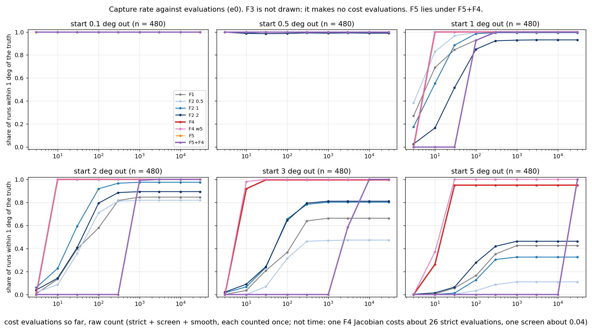
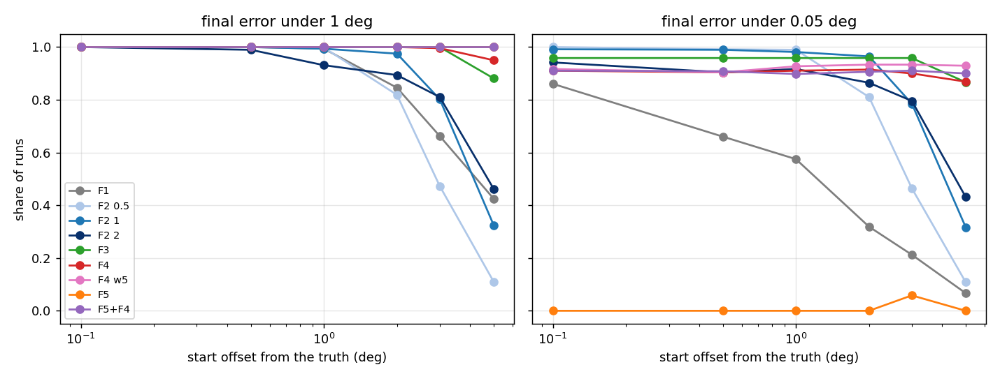
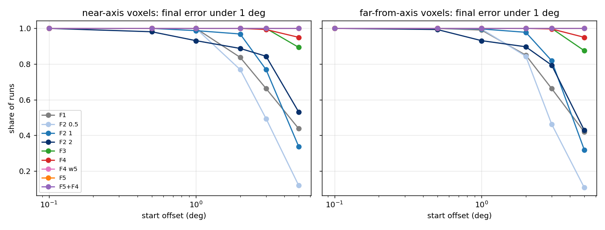
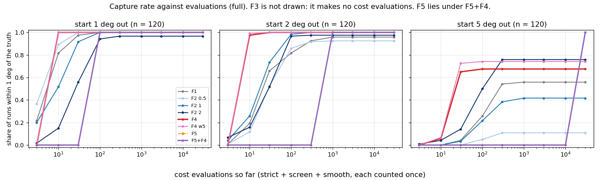
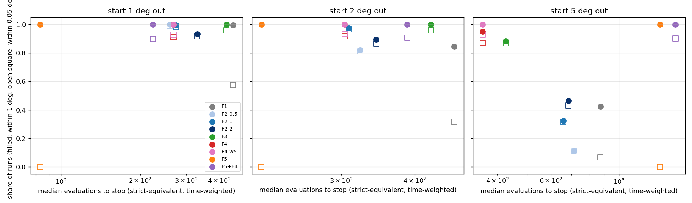

# Findings: searching outward from a start (Task F, 2026-10-20)

Run record: `benchmarks/eval_reduction/F/RUN_LOG.md`. Library: `icenine/outward_search.py` (`RayGaussNewton` is F4,
`ShellSearch` is F5). It is a separate module: the reconstructor does not call it and there is no config key. The full
technical record, with every table, is MIGRATION_HISTORY "Task F". This doc is the plain-English reading of it.

## What we asked

Several parts of a reconstruction start from an orientation that is already close. A breadth-first neighbour starts
from the orientation of the voxel next to it. A reseed starts from a stored guess. The hybrid finisher starts from the
network's answer. In each case the right orientation is usually within a few degrees of the start.

Nothing in the search is built for this case. The coarse grid covers the whole fundamental zone at 5 degree spacing,
and the finisher's box is only 0.33 degrees wide. So we asked: if a method starts 0.1 to 5 degrees away, how often does
it reach the truth, and how many cost evaluations does it spend?

## What we found, in short

1. **The two new methods reach furthest.** From a 5 degree start on the E0 set, F4 ended within 1 degree of the truth
   in 95% of runs and F5 in 100%. CMA-ES reached 11% to 46%, depending on its first step size. FindOptimal with its
   box widened to the offset reached 42%.

2. **F4 is cheap; F5 is cheaper per evaluation but makes many more of them.** F4 needs a median of 33 evaluations from
   5 degrees, but each one with its gradient takes as long as about 26 strict evaluations. Counted in time, F4 costs
   about 358 strict evaluations from 5 degrees, about half of CMA-ES. F5 makes about 22,000 evaluations from 5 degrees,
   mostly cheap screen ones, for about 0.6 seconds per run on one worker.

3. **F4 stops 0.02 to 0.05 degrees short.** That is the resolution of the ray-based cost it follows, not a failure to
   converge. A finisher is still needed after it.

4. **F4 knows when it has failed.** Its acceptance test (the strict cost at its end point is at most 0.8) rejected
   every run that ended more than 1 degree out, and accepted every run that ended within 1 degree. This held on both
   test sets.

5. **F4, with F5 as a fallback, found every voxel.** The rule "run F4; if F4 is rejected, run F5 and then F4 from F5's
   answer" ended within 1 degree in every run, at every offset, on both sets. This rule was written down after the
   tables were read, on the same runs, so it still needs fresh voxels to confirm it.

6. **The full sample is harder for F4 from far away.** From 5 degrees F4 reached 68% on the full sample (95% on E0).
   Up to 2 degrees it reached 100% on both.

7. **A wider matching window helps F4 on E0, less so on the full sample.** F4 matches each predicted spot to an
   observed ray at most one omega frame away. With a 5-frame window, F4 reached 100% from 5 degrees on E0 and 74% on
   the full sample.

8. **Nothing in the reconstructor changed.** No shared file, golden test or default was touched.

## Terms

* **Strict cost.** The search's normal score: one minus the share of predicted spot pixels that land on lit pixels.
* **Observed ray.** From Task D: a spot seen on both detectors defines a line in the lab, pointing back to the voxel.
  Task D attaches to each voxel the rays that pass near it.
* **E4 cost.** From Task E: for each predicted spot, the distance to the nearest observed ray attached to the voxel.
  It changes smoothly with orientation, so it has a gradient. The strict cost does not.
* **Start, offset.** The orientation a method begins from, and its angle from the truth. We used offsets of 0.1, 0.5,
  1, 2, 3 and 5 degrees, each in 20 random directions.
* **Within X degrees.** The method's final orientation is within X degrees of the truth. Only the scoring uses the
  truth; no method sees it, except that F1 is told the offset to size its box.
* **Evaluation kinds.** A *strict* evaluation is one strict cost. A *screen* evaluation is one orientation in the
  coarse, batched pixel-radius screen, which is cheap. A *smooth* evaluation is one E4 value, with or without its
  gradient.
* **Strict-equivalent.** Evaluations of every kind, each weighted by its measured time and expressed in strict
  evaluations. This is the fair way to compare methods that use different kinds.
* **E0 set.** Single voxels, each with its own simulated images holding only that voxel's spots. We used 8 voxels near
  the rotation axis and 16 far from it.
* **Full sample.** Simulated images of the whole sample, so neighbouring grains add spots. We used the six interior test
  voxels.

## The methods

* **F1, FindOptimal.** The existing Monte Carlo search with variance-minimizing steps, its box widened to the offset.
* **F2, CMA-ES.** The existing evolution strategy, with a first step size (sigma0) of 0.5, 1 or 2 degrees.
* **F3, centroid Gauss-Newton.** The hybrid finisher without the network, on E0 only. Its spot windows were rendered
  from the true orientation, so it is an optimistic reference, not a fair competitor.
* **F4 (new), Gauss-Newton on observed rays.** Each predicted spot is matched to the nearest attached ray within one
  frame in omega. The method then takes damped Gauss-Newton steps, at most 2 degrees each, using the exact gradient of
  the E4 cost. The strict cost is computed only at the start and the end.
* **F5 (new), expanding shells.** The method places points evenly on shells of growing radius around the start, 0.3
  degrees apart. On each shell it screens every point, re-ranks the best 32 by the E4 cost, and computes the strict
  cost of the best 2. It stops at the first point with a strict cost of 0.8 or less, or at 6 degrees out.
* **F5 then F4.** F4 started from the point F5 accepted.
* **F6, Riemannian Adam,** was not run. The plan included it only as a cheap reference, and Task E's costs are not
  wired into it.

The settings (acceptance 0.8, the E4 width 0.25 degrees, shell spacing 0.3 degrees, the 5-frame window) were chosen on
four E0 voxels that the benchmark does not use.

## Results on E0

The first plot shows the main result. Each curve is one method at one offset. A curve that rises early is cheap. A curve
that levels off below 1 loses runs.

The next plot shows the same capture rates against the start offset.

Read the next table across a row: it shows how far out each method still finds the truth. Each cell is the share of
480 runs that ended within 1 degree, with a 95% interval. A start exactly 1 degree out counts only if the method moved
inward.

<!-- table:evalF_e0_cap1 -->
| method | 0.1 deg | 0.5 deg | 1 deg | 2 deg | 3 deg | 5 deg |
|---|---|---|---|---|---|---|
| F1 FindOptimal, box = offset | 100% (99-100) | 100% (99-100) | 99% (98-100) | 85% (81-88) | 66% (62-70) | 42% (38-47) |
| F2 CMA-ES, sigma0 0.5 deg | 100% (99-100) | 100% (99-100) | 100% (99-100) | 82% (78-85) | 47% (43-52) | 11% (9-14) |
| F2 CMA-ES, sigma0 1 deg | 100% (99-100) | 100% (99-100) | 99% (98-100) | 98% (96-99) | 80% (76-84) | 32% (28-37) |
| F2 CMA-ES, sigma0 2 deg | 100% (99-100) | 99% (98-100) | 93% (91-95) | 89% (86-92) | 81% (77-84) | 46% (42-51) |
| F3 centroid Gauss-Newton (windows) | 100% (99-100) | 100% (99-100) | 100% (99-100) | 100% (99-100) | 100% (99-100) | 88% (85-91) |
| F4 Gauss-Newton on E4 rays | 100% (99-100) | 100% (99-100) | 100% (99-100) | 100% (99-100) | 100% (98-100) | 95% (93-97) |
| F4 with a 5-frame matching window | 100% (99-100) | 100% (99-100) | 100% (99-100) | 100% (99-100) | 100% (99-100) | 100% (99-100) |
| F5 expanding shells | 100% (99-100) | 100% (99-100) | 100% (99-100) | 100% (99-100) | 100% (99-100) | 100% (99-100) |
| F5 then F4 | 100% (99-100) | 100% (99-100) | 100% (99-100) | 100% (99-100) | 100% (99-100) | 100% (99-100) |
<!-- /table:evalF_e0_cap1 -->

The next table uses a tighter bar, 0.05 degrees. F4 sits near 90% at every offset: that is where the ray cost stops
resolving. F5 alone almost never passes this bar, because it stops on its 0.3 degree shell grid. CMA-ES is sharper than
F4 when it gets there at all.

<!-- table:evalF_e0_cap005 -->
| method | 0.1 deg | 0.5 deg | 1 deg | 2 deg | 3 deg | 5 deg |
|---|---|---|---|---|---|---|
| F1 FindOptimal, box = offset | 86% (83-89) | 66% (62-70) | 58% (53-62) | 32% (28-36) | 21% (18-25) | 7% (5-9) |
| F2 CMA-ES, sigma0 0.5 deg | 100% (99-100) | 99% (98-100) | 99% (98-100) | 81% (77-84) | 46% (42-51) | 11% (8-14) |
| F2 CMA-ES, sigma0 1 deg | 99% (98-100) | 99% (98-100) | 98% (96-99) | 96% (94-98) | 79% (75-82) | 32% (28-36) |
| F2 CMA-ES, sigma0 2 deg | 94% (92-96) | 90% (87-93) | 92% (89-94) | 86% (83-89) | 80% (76-83) | 43% (39-48) |
| F3 centroid Gauss-Newton (windows) | 96% (94-97) | 96% (94-97) | 96% (94-97) | 96% (94-97) | 96% (94-97) | 87% (83-89) |
| F4 Gauss-Newton on E4 rays | 91% (88-93) | 90% (87-93) | 91% (88-93) | 91% (89-94) | 90% (87-92) | 87% (84-90) |
| F4 with a 5-frame matching window | 92% (89-94) | 90% (87-93) | 93% (90-95) | 93% (91-95) | 93% (91-95) | 93% (90-95) |
| F5 expanding shells | 0% (0-1) | 0% (0-1) | 0% (0-1) | 0% (0-1) | 6% (4-8) | 0% (0-1) |
| F5 then F4 | 91% (88-93) | 91% (88-93) | 90% (87-92) | 91% (88-93) | 91% (88-93) | 90% (87-92) |
<!-- /table:evalF_e0_cap005 -->

Different methods use different kinds of evaluation, so we timed each kind. Read the last column: one E4 value with its
gradient costs about 26 strict evaluations, and one screen evaluation costs about a twentieth of one.

<!-- table:evalF_e0_timing -->
| kind of evaluation | milliseconds | times a strict evaluation |
|---|---|---|
| strict cost | 0.422 | 1.00 |
| screen (pixel radius 3), per orientation in a batch | 0.023 | 0.05 |
| E4 value | 0.658 | 1.56 |
| E4 value and Jacobian | 10.797 | 25.59 |
<!-- /table:evalF_e0_timing -->

With those weights, the next table gives the cost of a run until the method stops, as a median with the 90th percentile
in brackets. F4 is the cheapest method that still works at 5 degrees. F5 is cheap near the start and grows quickly with
the offset, since each shell is larger than the last.

<!-- table:evalF_e0_stop_se -->
| method | 0.1 deg | 0.5 deg | 1 deg | 2 deg | 3 deg | 5 deg |
|---|---|---|---|---|---|---|
| F1 FindOptimal, box = offset | 573 (650) | 496 (540) | 452 (474) | 467 (505) | 529 (551) | 870 (870) |
| F2 CMA-ES, sigma0 0.5 deg | 225 (281) | 239 (302) | 260 (323) | 323 (562) | 456 (1030) | 715 (1422) |
| F2 CMA-ES, sigma0 1 deg | 267 (330) | 267 (330) | 274 (345) | 309 (407) | 365 (786) | 659 (1919) |
| F2 CMA-ES, sigma0 2 deg | 316 (457) | 330 (582) | 330 (541) | 344 (758) | 379 (1054) | 684 (2544) |
| F3 centroid Gauss-Newton (windows) | 426 (426) | 426 (426) | 426 (426) | 426 (426) | 426 (426) | 426 (426) |
| F4 Gauss-Newton on E4 rays | 141 (205) | 214 (288) | 268 (340) | 304 (377) | 331 (404) | 358 (431) |
| F4 with a 5-frame matching window | 141 (216) | 214 (288) | 268 (359) | 304 (377) | 331 (395) | 358 (425) |
| F5 expanding shells | 1 (1) | 26.2 (81.4) | 140 (140) | 357 (448) | 797 (797) | 1986 (2266) |
| F5 then F4 | 142 (206) | 195 (271) | 281 (365) | 526 (616) | 911 (994) | 2155 (2407) |
<!-- /table:evalF_e0_stop_se -->

The next plot splits E0 into near-axis and far-from-axis voxels. The panels look alike for F4, F5 and CMA-ES. With 8
and 16 voxels, we see no difference between the two groups.

## Can a method tell when it has failed?

A method that knows when it has failed can hand over to a slower method. The next table compares each method's
acceptance test with the truth. Read each cell as: how many runs were accepted, how many of those ended more than 1
degree out, and how many of the rejected runs were in fact within 1 degree. Zeros in both places mean the test was
always right.

<!-- table:evalF_e0_acc -->
| method | 0.1 deg | 0.5 deg | 1 deg | 2 deg | 3 deg | 5 deg |
|---|---|---|---|---|---|---|
| F4 Gauss-Newton on E4 rays | 480 accepted, 0 of them wrong; 0 of 0 rejected were right | 480 accepted, 0 of them wrong; 0 of 0 rejected were right | 480 accepted, 0 of them wrong; 0 of 0 rejected were right | 480 accepted, 0 of them wrong; 0 of 0 rejected were right | 478 accepted, 0 of them wrong; 0 of 2 rejected were right | 456 accepted, 0 of them wrong; 0 of 24 rejected were right |
| F5 expanding shells | 480 accepted, 0 of them wrong; 0 of 0 rejected were right | 480 accepted, 0 of them wrong; 0 of 0 rejected were right | 480 accepted, 0 of them wrong; 0 of 0 rejected were right | 480 accepted, 0 of them wrong; 0 of 0 rejected were right | 480 accepted, 0 of them wrong; 0 of 0 rejected were right | 480 accepted, 0 of them wrong; 0 of 0 rejected were right |
| F5 then F4 | 480 accepted, 0 of them wrong; 0 of 0 rejected were right | 480 accepted, 0 of them wrong; 0 of 0 rejected were right | 480 accepted, 0 of them wrong; 0 of 0 rejected were right | 480 accepted, 0 of them wrong; 0 of 0 rejected were right | 480 accepted, 0 of them wrong; 0 of 0 rejected were right | 480 accepted, 0 of them wrong; 0 of 0 rejected were right |
<!-- /table:evalF_e0_acc -->

That suggested a simple rule: run F4, and where F4 is rejected, run F5 and then F4. The next table shows the rule on
the same E0 runs. The third column counts the runs that needed the fallback. Every run ended within 1 degree. This rule
was made up after reading the table above, so these numbers are in-sample.

<!-- table:evalF_e0_policy -->
| offset | runs | F4 rejected, F5+F4 run | within 1 deg | within 0.1 deg | within 0.05 deg | median evals (strict-equivalent) | 90th percentile |
|---|---|---|---|---|---|---|---|
| 0.1 deg | 480 | 0 | 100% (99-100) | 99% (98-100) | 91% (88-93) | 141 | 205 |
| 0.5 deg | 480 | 0 | 100% (99-100) | 99% (97-99) | 90% (87-93) | 214 | 288 |
| 1 deg | 480 | 0 | 100% (99-100) | 99% (98-100) | 91% (88-93) | 268 | 340 |
| 2 deg | 480 | 0 | 100% (99-100) | 98% (97-99) | 91% (89-94) | 304 | 377 |
| 3 deg | 480 | 2 | 100% (99-100) | 98% (97-99) | 90% (87-93) | 331 | 410 |
| 5 deg | 480 | 24 | 100% (99-100) | 99% (97-99) | 91% (89-94) | 358 | 468 |
<!-- /table:evalF_e0_policy -->

## Why F4 fails from far starts

We looked at 240 F4 runs from 5 degrees on 12 E0 voxels. Ten ended more than 1 degree out. In each of them, almost no
predicted spot had an observed ray within one frame, so the E4 cost was near 1 and gave no direction to step in. In the
lost runs, 2% of predicted spots started on the truth's own ray. In the captured runs it was 25%.

Widening the window to 5 frames captured all 240 runs. On the full sample it helped less: 31 of 120 runs were still lost
(39 with one frame). A full-sample voxel has a median of 217.5 attached rays for 58 predicted spots, against 58 for 58 on
E0. One possible reason is that a wide window picks up rays from other grains; we have not tested this.

## Results on the full sample

The full sample adds neighbouring grains. The first plot shows capture against evaluations, as for E0.

Read the next table the same way as for E0. Each cell is the share of 120 runs that ended within 1 degree. F4 is still
perfect up to 2 degrees but drops to 68% at 5. F5, alone or followed by F4, reaches every run.

<!-- table:evalF_full_cap1 -->
| method | 1 deg | 2 deg | 5 deg |
|---|---|---|---|
| F1 FindOptimal, box = offset | 100% (97-100) | 96% (91-98) | 56% (47-64) |
| F2 CMA-ES, sigma0 0.5 deg | 100% (97-100) | 92% (86-96) | 11% (6-18) |
| F2 CMA-ES, sigma0 1 deg | 100% (97-100) | 100% (97-100) | 42% (33-51) |
| F2 CMA-ES, sigma0 2 deg | 97% (92-99) | 98% (93-99) | 76% (67-83) |
| F4 Gauss-Newton on E4 rays | 100% (97-100) | 100% (97-100) | 68% (59-75) |
| F4 with a 5-frame matching window | 100% (97-100) | 100% (97-100) | 74% (66-81) |
| F5 expanding shells | 100% (97-100) | 100% (97-100) | 100% (97-100) |
| F5 then F4 | 100% (97-100) | 100% (97-100) | 100% (97-100) |
<!-- /table:evalF_full_cap1 -->

At the tight 0.05 degree bar, F4 does worse here than on E0: about a third of runs, against about 90%. CMA-ES does
better than F4 at this bar. So on the full sample, the finisher after F4 matters more.

<!-- table:evalF_full_cap005 -->
| method | 1 deg | 2 deg | 5 deg |
|---|---|---|---|
| F1 FindOptimal, box = offset | 81% (73-87) | 63% (54-71) | 22% (15-30) |
| F2 CMA-ES, sigma0 0.5 deg | 89% (82-94) | 82% (74-88) | 8% (5-15) |
| F2 CMA-ES, sigma0 1 deg | 92% (85-95) | 89% (82-94) | 41% (32-50) |
| F2 CMA-ES, sigma0 2 deg | 91% (84-95) | 92% (86-96) | 66% (57-74) |
| F4 Gauss-Newton on E4 rays | 33% (26-42) | 33% (26-42) | 25% (18-33) |
| F4 with a 5-frame matching window | 50% (41-59) | 50% (41-59) | 37% (29-46) |
| F5 expanding shells | 0% (0-3) | 0% (0-3) | 0% (0-3) |
| F5 then F4 | 33% (26-42) | 33% (26-42) | 33% (26-42) |
<!-- /table:evalF_full_cap005 -->

The next table gives the cost until the method stops, in strict-equivalent evaluations, median (90th percentile).

<!-- table:evalF_full_stop_se -->
| method | 1 deg | 2 deg | 5 deg |
|---|---|---|---|
| F1 FindOptimal, box = offset | 496 (540) | 467 (553) | 870 (902) |
| F2 CMA-ES, sigma0 0.5 deg | 281 (422) | 323 (527) | 393 (569) |
| F2 CMA-ES, sigma0 1 deg | 288 (415) | 312 (478) | 438 (625) |
| F2 CMA-ES, sigma0 2 deg | 334 (499) | 326 (464) | 418 (682) |
| F4 Gauss-Newton on E4 rays | 317 (431) | 372 (499) | 444 (658) |
| F4 with a 5-frame matching window | 319 (403) | 367 (465) | 461 (657) |
| F5 expanding shells | 168 (168) | 538 (539) | 2523 (2524) |
| F5 then F4 | 424 (500) | 809 (914) | 2788 (2935) |
<!-- /table:evalF_full_stop_se -->

The acceptance test was again always right. From 5 degrees, F4 rejected 39 runs, and none of them was within 1 degree.
Next is the F4-then-fallback rule on the full sample. From 5 degrees, 39 runs fell back. The median cost rose to 547
strict-equivalent evaluations, and the 90th percentile to 3,303; the fallback runs make up that tail.

<!-- table:evalF_full_policy -->
| offset | runs | F4 rejected, F5+F4 run | within 1 deg | within 0.1 deg | within 0.05 deg | median evals (strict-equivalent) | 90th percentile |
|---|---|---|---|---|---|---|---|
| 1 deg | 120 | 0 | 100% (97-100) | 98% (94-100) | 33% (26-42) | 317 | 431 |
| 2 deg | 120 | 0 | 100% (97-100) | 99% (95-100) | 33% (26-42) | 372 | 499 |
| 5 deg | 120 | 39 | 100% (97-100) | 99% (95-100) | 33% (26-42) | 547 | 3303 |
<!-- /table:evalF_full_policy -->

## Which methods go on to Task G

The plan asked us to carry forward the two methods with the best capture rate per evaluation at 2 and 5 degrees. The
score is the share within 1 degree per 1,000 strict-equivalent evaluations. We ranked the methods at each offset and
added the ranks; the lowest sums win. The rule was fixed on E0 before the full-sample results were read.

The next table is the rule on E0. It carries **F4** and **CMA-ES with a 1 degree first step**.

<!-- table:evalF_e0_choice -->
| method | score 2 deg | score 5 deg | rank sum | carried |
|---|---|---|---|---|
| F4 Gauss-Newton on E4 rays | 3.29 | 2.65 | 2 | yes |
| F2 CMA-ES, sigma0 1 deg | 3.16 | 0.493 | 6 | yes |
| F5 expanding shells | 2.8 | 0.503 | 6 |  |
| F2 CMA-ES, sigma0 2 deg | 2.6 | 0.677 | 6 |  |
| F2 CMA-ES, sigma0 0.5 deg | 2.53 | 0.154 | 12 |  |
| F5 then F4 | 1.9 | 0.464 | 12 |  |
| F1 FindOptimal, box = offset | 1.81 | 0.489 | 12 |  |
<!-- /table:evalF_e0_choice -->

The same rule applied to the full-sample runs would pick differently: the two CMA-ES variants with 2 and 1 degree first
steps, with F4 third. The strict cost's basin is wider on the full sample (Task E: it falls half-way at 0.33 degrees,
against 0.11 on E0). That would explain why CMA-ES reaches further there, but we have not tested it.

<!-- table:evalF_full_choice -->
| method | score 2 deg | score 5 deg | rank sum | carried |
|---|---|---|---|---|
| F2 CMA-ES, sigma0 2 deg | 2.99 | 1.82 | 3 | yes |
| F2 CMA-ES, sigma0 1 deg | 3.2 | 0.95 | 4 | yes |
| F4 Gauss-Newton on E4 rays | 2.69 | 1.52 | 6 |  |
| F1 FindOptimal, box = offset | 2.05 | 0.642 | 9 |  |
| F2 CMA-ES, sigma0 0.5 deg | 2.86 | 0.276 | 10 |  |
| F5 expanding shells | 1.86 | 0.396 | 11 |  |
| F5 then F4 | 1.24 | 0.359 | 13 |  |
<!-- /table:evalF_full_choice -->

The rule does not reward the property that matters most for a fallback: F5, alone or followed by F4, was the only
method that found the truth from 5 degrees in every run on both sets. It scores low because it is expensive at 5
degrees.

## What this means

* For a start within 2 degrees, F4 alone found the truth to within 1 degree in every run on both sets, in about 0.1
  seconds per run on E0 (one worker). It stops 0.02 to 0.05 degrees out, so the finisher still runs after it.
* For a start up to 5 degrees, F4 with F5 as a fallback found every voxel here. It cost a median of 358
  strict-equivalent evaluations on E0 and 547 on the full sample.
* CMA-ES with a 1 degree first step is as cheap as F4 up to 2 degrees, then falls away from far starts. FindOptimal with
  a widened box costs more and is less precise even from 0.1 degrees.
* Two choices are open for the owner. First, should Task G carry F4 and CMA-ES as the rule says, or F4 with the F5
  fallback? Second, should F4's matching window stay at 1 frame (the library default, as in E4), or be 5 frames for far
  starts?

## Limits

* E0 images hold one voxel each, so matching spots to rays is easy there. The full-sample numbers come from six voxels
  and one image set.
* The fallback rule and the 5-frame window were chosen after the first tables were read. Their numbers are in-sample.
  They need voxels they were not chosen on, such as Task G's other 24 full-sample voxels.
* F3 is optimistic (its windows come from the truth). F1 is told the offset; the other methods are not. F5 gives up at
  6 degrees.
* F4 inherits the assumptions of Tasks D and E: two detectors, binary centroids, pairing settings fitted on one sample,
  and E4's matching rule.
* Clean images only. The capture rates and the acceptance test are not known on realistic images.
* The main-run times were taken with five workers (contended). Single-worker times cover two E0 voxels and one
  full-sample voxel. F6 was not run. No method was tried inside a breadth-first sweep.
