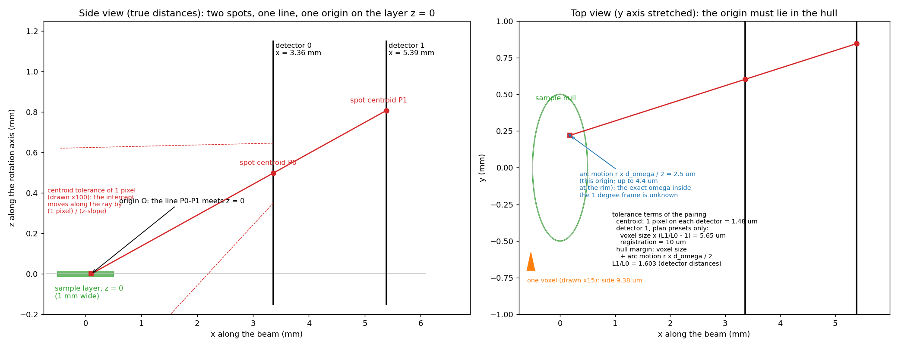
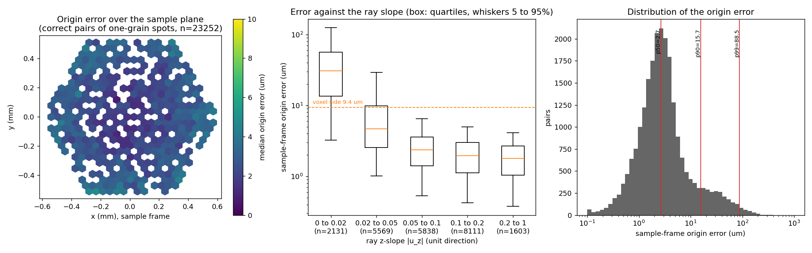
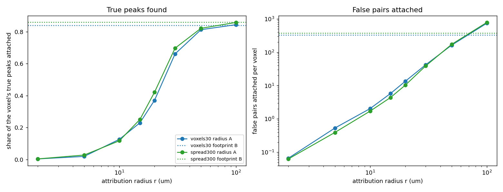
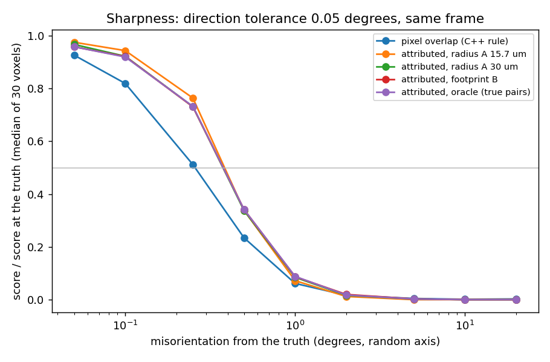

# Findings: matching spots across the two detectors (Task D, 2026-10-14)

## What we asked

Each diffracted ray hits both detectors, the near one (detector 0) and the far one (detector 1). So one peak makes
two spots, one on each detector, in the same omega frame. A straight line through those two spots is the ray. If we
follow that line back to the sample layer, we find where in the sample the peak came from. We call that point the
ray's **origin**.

If we can do this from the images alone, with no orientation search, we get two things:

1. For each voxel, a list of the peaks that came from it, each with an exact direction. A cost function or a
   Gauss-Newton step could then match peaks smoothly, instead of counting overlapping pixels (Tasks E and F).
2. A way to throw out spots that cannot belong to a voxel, before trying any orientation.

We tested this on the clean simulated images of the full sample (24,570 voxels). The simulator tells us which voxel
drew which spot, so every answer can be checked against the truth.

## What we found, in short

1. **A spot almost never comes from one voxel.** All the voxels of a grain diffract into the same spot, so a typical
   spot is drawn by about 44 voxels at once. Out of 57,389 spots, only 30 come from a single voxel. 2,593 spots mix several
   grains.

2. **We can match spots across the two detectors, as long as we also check the diffraction angle.**
   - The line through two spots must cross the sample layer inside the sample. That test alone is not enough:
     most spots have two or more possible partners, and fewer than half of the matches are right.
   - We added a second test: the angle between the line and the beam must be one of the copper diffraction angles.
     This test needs only the crystal structure, not the orientation.
   - With both tests, we find 98.7% of the spot pairs that come from one grain. 88.7% of all the matches we make
     are right.
   - Spots that mix several grains are matched only 27.5% of the time. This is consistent with their centre being
     an average over several grains, which then lies on no single ray. We did not split these spots to test it.
   - We chose these settings after seeing the results on this same sample, so the numbers are in-sample.

3. **The origin is accurate, except for rays that leave the sample almost flat.** The typical error is 2.7 µm. That
   is the median over 23,205 correct one-grain pairs, in the sample frame, with omega at the centre of each frame
   (1.7 µm in the lab frame). It is less than a third of a voxel (9.4 µm). For the flattest rays it grows to about
   31 µm, because a small error in the line moves its crossing point a long way along the layer.

4. **But the origin points to the grain, not to the voxel.** A spot is drawn by the whole grain, so its origin is the
   middle of the grain. To find a voxel's peaks, we take every ray whose origin is within some distance of the voxel.
   - Within 30 µm, we find two thirds of the voxel's real peaks, but also pick up about 42 wrong ones.
   - Within 50 µm, we find 81% of them, with about 162 wrong ones.
   There is no distance that gives most of the real peaks and few wrong ones.

5. **A cost built on these peak lists does not tell right from wrong orientations any better than the pixel cost,
   at the 0.05° match tolerance we chose.**
   - At that tolerance it is gentler, not sharper. Its score halves 0.38° away from the true orientation; the pixel
     cost's score halves at 0.26°.
   - The half-score radius follows the match tolerance. Over tolerances of 0.02° to 0.2° it runs from 0.18° to
     0.72°. So at 0.02° the peak-list score is sharper than the pixel cost, but it matches fewer of the true
     orientation's peaks.
   - Neither score lets a wrong orientation 1° or more away reach half the true score, as long as the peak list is
     good. That is 0 of 30 voxels for each (95% interval 0 to 0.114).
   - With the short list the plan suggested (rays within 15.7 µm of the voxel), the true orientation scores only
     8%, because most of the voxel's peaks are missing from the list.

6. **We did not build the classifier (Step 4).** The owner decided to skip it (decision D-20261014-N6). The plan
   said to build it only if fewer than 95% of single-voxel spots were matched. That number does not exist here,
   because there are almost no single-voxel spots. For one-grain spots we match 98.7%. Two problems remain open: 11%
   of our matches are wrong, and spots that mix several grains are mostly unmatched.

## What this means for the next tasks

**The useful result is that we can tie spots to grains.** The owner read the results this way (decision
D-20261014-N7). We do not need to tie spots to single voxels. A grain's spots are enough to start from:

- **A starting orientation.** The spots of one grain give a starting orientation for that grain. The area around the
  grain can then be sampled with it.
- **A starting point for the search.** From that orientation we can run the usual FindOptimal search, or other
  searches that work outward from it.
- **A smaller candidate list.** The combinations of peaks and grains define orientations. These may give a list of
  starting orientations that is much smaller than the usual one.

These are follow-ups still to plan. None of them is started.

**Why grain level, not voxel level.** The results above rule out the voxel-level use:

- **Single voxels cannot be found from the images alone on this sample.** Almost every spot is shared by a whole
  grain. The origin finds the grain, not the voxel.
- **A distance filter before the search would lose too many real peaks.** Any distance that keeps the wrong peaks few
  also drops a third or more of the real ones.
- **A hit-or-miss score on the peak list is no sharper than the pixel cost, at the 0.05° match tolerance.** Its
  half-score radius follows the tolerance (0.18° to 0.72° over 0.02° to 0.2°). The matched rays still have one use
  for Tasks E and F. A ray gives a smooth error to minimise, and we have not tested that.

**Proposal, not tested: an orientation from a grain's spots.** This is a note from the main session. We have not
tried it.

- A matched spot pair gives the direction of the scattered ray.
- The beam direction and the frame's omega angle are known. With them, the ray direction gives the **scattering
  vector** in the sample frame. The scattering vector is the direction normal to the planes that diffracted.
- The ring test tells us which family of planes made the peak, its {hkl} family.
- Two scattering vectors from one grain that are not parallel fix the grain's orientation, up to a small set of
  choices. This is the standard way to index a grain.
- **One pair of spots is not precise enough.** Each scattering vector carries two errors. One comes from the ray
  direction and one from the frame.
  - *The ray direction, as measured.* On these clean images the ray direction is very accurate. We measured its
    error as the ray's angle to the beam, 2θ, minus the nearest copper ring angle. Over the 23,205 correct
    one-grain pairs of `ring_tight`, the median error is 0.0044° and the 90th percentile is 0.0155°. The ray is the
    line through both centroids, so this error already includes both detectors. It is only the radial part of the
    error, toward or away from the beam. We did not measure the sideways part, a turn about the beam.
  - *The ray direction, as a tolerance.* The detectors sit 3.362 mm and 5.387 mm from the sample
    (`StandardGeometry.2Det` of Example2), so they are 2.03 mm apart. A pixel is 1.48 µm. One pixel of centroid
    error on one detector turns the ray by 1.48 µm / 2.03 mm = 0.042°. One pixel on each detector, added in
    quadrature, turns it by 0.059°. We keep one pixel as the matching tolerance and as the upper estimate. It is
    about ten times the measured median. It is not a strict limit: 99% of the measured errors are below 0.042°
    (99th percentile 0.037°), but the largest is 0.080°.
  - *From the ray to the scattering vector.* A sideways turn of the ray turns the scattering vector by about that
    angle divided by sin 2θ. Here 2θ is the angle between the ray and the beam. The eight copper rings lie at
    2θ = 5.3° to 13.7°. One pixel on one detector only becomes 0.45° to 0.18° on the scattering vector
    (0.042° / sin 5.3° and 0.042° / sin 13.7°). One pixel on each detector becomes 0.64° to 0.25°. The measured
    median becomes 0.048° to 0.019°, if the sideways error is about as large as the radial one. That is untested.
  - *From the frame.* Each frame covers 1° of omega, so the exact omega is known only to ±0.5°. That turns the
    scattering vector by up to 0.5° times the sine of its angle to the rotation axis. Over the matched pairs the
    median of that sine is 0.86. So this error reaches about 0.43°.
  - **On clean images the frame term dominates.** It reaches about 0.43°. The ray direction adds only about 0.02°
    to 0.05° at the measured median. Real data will have a larger direction error than these clean images.
  - The frame term can be larger than the pixel cost's half-score radius: that score halves 0.26° from the true
    orientation. The comparison is rough, because 0.26° is a turn of the whole orientation and the errors above
    are errors of one direction.
- So one pair of spots does not fix the orientation within the pixel cost's half-score radius (0.26°). A fit over
  many spots of the grain is needed. A grain has a median of 50 one-grain spots on detector 0 that have a true
  partner, matched or not. Every grain has at least 33, even the smallest grains of 4 voxels. How close such a
  fit gets is untested.
- There are two risks. Small grains give small spots, with few pixels in each centroid. And the spot groups of
  neighbouring grains may merge into one.

**How to test it.**

1. Group the matched rays into grains by clustering their origins on the sample layer.
2. Index each cluster. First, pairs of scattering vectors with their ring families propose orientations. Then one
   orientation is fitted to all of the cluster's spots.
3. Count the grains whose fitted orientation, the **seed**, lies within 0.1° and within 0.5° of the true
   orientation. Report the counts by grain size.
4. Run FindOptimal from those seeds and count its cost evaluations. Compare them, per voxel, with the counted
   evaluations of the usual search that has no starting orientation (the evaluation ledger of Tasks A and C).

There are two reasons the idea may hold up. Both are untested.

- Indexing can split a cluster that merged neighbouring grains. Another grain's scattering vectors do not fit the
  same orientation.
- The spots that mix several grains are poorly matched, but they matter little. Each grain has many one-grain
  spots.

## Notes for planning the learned model (D-20261014-N8)

These are notes from the main session for a later plan. Nothing here is built or tested.

- **Labels come free.** Task D's provenance writer records which voxel and grain drew each spot. A full labelled
  render took about 35 s (10 workers, contended).
- **Train for association, not for grain classes.** Grain IDs are arbitrary, so fixed grain classes make no sense.
  Instead, the model could give each spot an embedding, a short vector, and learn it with a pairwise or contrastive
  loss. Spots of one grain then end up close together.
- **Give the model the spot position.** The detector-1 spot has about the same size and shape as its detector-0
  partner. Over 23,022 true one-grain pairs away from the detector edges, the ratio of their pixel counts has a
  median of 1.00. Its 10th to 90th percentiles are 0.89 to 1.13. This fits the geometry: all the voxels of a
  grain diffract along the same direction, so a spot is a parallel projection of the grain. The detector-1 spot is
  shifted outward from the beam by about the detector gap times tan 2θ. The shift depends on where the spot sits.
  So the model needs the position, or crops around candidate pairs.
- **A hybrid aims at what geometry cannot do.** The geometric tests propose candidate pairs, and the model scores
  crops of each pair. That targets the remaining errors: the 0.887 precision of `ring_tight`, and the spots that
  mix several grains.
- **The main planning item is the gap between simulation and real data.** Simulated spots are clean and have sharp
  edges. They have no blur and no detector noise. The current noise model is flagged as unphysical.

## The details

### Step 1: which voxels drew each spot

We re-ran the simulator on the same clean images and recorded, for every lit pixel, which voxel and which
reflection drew it. The re-run gives the same lit pixels in all 360 images (180 frames on 2 detectors). Their
intensities are equal to the precision the stored image files keep. It also gives the same 57,389 spots. So the
record matches the images the other studies use. The re-run took 35 s on 10 workers. The load was 2.2 at the
start and the preflight warned, so this timing is labelled contended.

Two spots form a **true pair** when they share a voxel and reflection. There are 27,888 true pairs, together
carrying 1,375,053 peaks. 3,890 spots on detector 0 have no partner on detector 1; we did not find out why.

The table counts spots by how many sources they have. "Sources" means (voxel, reflection) pairs.

<!-- table:evalD_step1_components -->
| detector | class | components | with a true partner | median pixels | p90 pixels | median sources | max sources |
|---|---|---|---|---|---|---|---|
| 0 | single-source | 10 | 0 | 10 | 11 | 1 | 1 |
| 0 | one grain, several voxels | 28411 | 24671 | 97 | 223 | 44 | 185 |
| 0 | several grains | 1770 | 1630 | 230 | 462 | 106 | 296 |
| 1 | single-source | 20 | 20 | 3 | 10 | 1 | 1 |
| 1 | one grain, several voxels | 26355 | 26355 | 103 | 235 | 44 | 185 |
| 1 | several grains | 823 | 823 | 249 | 472 | 103 | 296 |
<!-- /table:evalD_step1_components -->

### Step 2: matching spots across the detectors

For each frame we try every spot on detector 0 against every spot on detector 1. One run over all 180 frames takes
about 2 s per preset in a single process. That is not a timing claim, because the machine was not checked for other
load. We tried several sets of tests, named in the table as follows:

- `hull`: the line must cross the sample layer inside the sample.
- `ring`: also, the angle to the beam must match a copper diffraction angle.
- `shape`: also, the two spots must have similar size and shape.
- `tight`: each spot's centre may be off by 1 pixel of its own detector.
- `plan`: adds the looser tolerances the plan listed on detector 1 (10 µm detector registration and 5.65 µm from
  the voxel size).
  The simulated images have no registration error, so this only makes the test looser.
- `c0.5`, `c2`: centre tolerance of 0.5 or 2 pixels instead of 1.
- `binary`: spot centre computed without weighting by intensity.

Our main choice is `ring_tight`. We picked it after seeing all the runs on this same sample. We also widened the
size test's offset from 1 to 4 pixels after we saw it reject true pairs. So these numbers are in-sample: the
settings were chosen on the data they are scored on. In the table, **precision** is the share of our matches that are right, and
**recall** is the share of true pairs we found. The brackets are 95% intervals.

<!-- table:evalD_step2_presets -->
| preset | predicted pairs | precision | link recall | peak recall | recall, one grain | recall, several grains |
|---|---|---|---|---|---|---|
| hull_tight | 54646 | 0.476 [0.472, 0.480] (26019/54646) | 0.933 [0.930, 0.936] (26019/27888) | 0.947 | 0.942 [0.939, 0.945] (22141/23502) | 0.884 [0.874, 0.893] (3878/4386) |
| hull_plan | 68984 | 0.377 [0.374, 0.381] (26034/68984) | 0.934 [0.931, 0.936] (26034/27888) | 0.947 | 0.942 [0.939, 0.945] (22141/23502) | 0.888 [0.878, 0.897] (3893/4386) |
| ring_tight | 27513 | 0.887 [0.883, 0.891] (24412/27513) | 0.875 [0.871, 0.879] (24412/27888) | 0.872 | 0.987 [0.986, 0.989] (23208/23502) | 0.275 [0.262, 0.288] (1204/4386) |
| ring_plan | 54706 | 0.497 [0.493, 0.501] (27196/54706) | 0.975 [0.973, 0.977] (27196/27888) | 0.977 | 0.998 [0.997, 0.998] (23453/23502) | 0.853 [0.843, 0.864] (3743/4386) |
| shape_tight | 24968 | 0.932 [0.929, 0.935] (23272/24968) | 0.834 [0.830, 0.839] (23272/27888) | 0.836 | 0.964 [0.962, 0.966] (22656/23502) | 0.140 [0.130, 0.151] (616/4386) |
| shape_plan | 43452 | 0.560 [0.555, 0.564] (24324/43452) | 0.872 [0.868, 0.876] (24324/27888) | 0.883 | 0.974 [0.972, 0.976] (22892/23502) | 0.326 [0.313, 0.341] (1432/4386) |
| ring_tight_c0.5 | 25121 | 0.945 [0.942, 0.947] (23728/25121) | 0.851 [0.847, 0.855] (23728/27888) | 0.845 | 0.980 [0.978, 0.982] (23033/23502) | 0.158 [0.148, 0.170] (695/4386) |
| ring_tight_c2 | 32754 | 0.778 [0.773, 0.782] (25481/32754) | 0.914 [0.910, 0.917] (25481/27888) | 0.914 | 0.992 [0.991, 0.993] (23313/23502) | 0.494 [0.480, 0.509] (2168/4386) |
| shape_tight_c0.5 | 23610 | 0.968 [0.966, 0.970] (22857/23610) | 0.820 [0.815, 0.824] (22857/27888) | 0.818 | 0.957 [0.954, 0.959] (22481/23502) | 0.086 [0.078, 0.094] (376/4386) |
| shape_tight_c2 | 27890 | 0.852 [0.848, 0.856] (23756/27890) | 0.852 [0.848, 0.856] (23756/27888) | 0.858 | 0.968 [0.966, 0.971] (22759/23502) | 0.227 [0.215, 0.240] (997/4386) |
| ring_tight_binary | 26111 | 0.880 [0.876, 0.884] (22969/26111) | 0.824 [0.819, 0.828] (22969/27888) | 0.815 | 0.929 [0.926, 0.932] (21835/23502) | 0.259 [0.246, 0.272] (1134/4386) |
| shape_tight_binary | 23634 | 0.927 [0.924, 0.931] (21919/23634) | 0.786 [0.781, 0.791] (21919/27888) | 0.782 | 0.908 [0.904, 0.912] (21344/23502) | 0.131 [0.121, 0.141] (575/4386) |
<!-- /table:evalD_step2_presets -->

Where `ring_tight` goes wrong:

- Of its 3,101 wrong matches, 3,038 join two spots that each have a different true partner.
- Of the true pairs it misses, 3,405 fail the angle test. Most of these (3,133) involve a spot that mixes several
  grains. Only 48 misses fail the inside-the-sample test.

**How far off the origin is.** The next table is for correct matches of one-grain spots. It groups them by how
steeply the ray leaves the sample layer (the z part of the ray's direction). The true origin is the average position
of the spot's voxels. The last column is the error that the tight tolerances of `ring_tight` predict (1 pixel on
each detector). Row by row it is 10 to 32 times the median error in the sample frame, and 21 times overall. So the
tolerance works as a loose limit, not as an error estimate.

<!-- table:evalD_step2_origin_error -->
| ray z-slope (abs u_z) | pairs | lab-frame error median (um) | lab-frame error p90 (um) | sample-frame error median (um) | sample-frame error p90 (um) | predicted sigma median (um) |
|---|---|---|---|---|---|---|
| 0 to 0.02 | 2127 | 30.8 | 92.8 | 30.8 | 92.8 | 302.0 |
| 0.02 to 0.05 | 5555 | 4.2 | 19.6 | 4.6 | 19.8 | 149.8 |
| 0.05 to 0.1 | 5821 | 1.6 | 4.3 | 2.4 | 5.1 | 61.7 |
| 0.1 to 1 | 9702 | 1.0 | 2.6 | 1.9 | 4.0 | 30.6 |
<!-- /table:evalD_step2_origin_error -->

The map below shows the origin error across the sample. We see no visible spatial pattern (judged by eye).

### Step 3: assigning peaks to a voxel, and does it help?

We tried two ways to decide which matched rays belong to a voxel:

- **By distance** (the plan's way): keep the rays whose origin is within r of the voxel's centre.
- **By footprint** (added): start a ray at the voxel's centre, in the matched pair's direction, and keep the pair if
  that ray hits both spots.

We checked these on 30 voxels from the earlier ray study, which include the six full-sample voxels used before. (The
plan asked for the six plus 30 others; we used the 30.) A run on 300 voxels spread over the sample gives the same
picture.

In the table, "true peaks found" is the share of the voxel's real peaks that we keep, and "false attached" is how
many wrong peaks we keep per voxel. "Interior" and "boundary" mean voxels inside a grain or next to a grain boundary.
Even a perfect rule could find at most 87% of the real peaks, because 13% of them sit in spot pairs we never matched.

<!-- table:evalD_step3_attach_voxels30 -->
| attachment | true peaks found | attached pairs per voxel | false attached per voxel | share of attached that are false | recall, interior | recall, boundary |
|---|---|---|---|---|---|---|
| A r=2 um | 0.004 [0.002, 0.008] (7/1714) | 0.3 | 0.1 | 0.222 | 0.008 | 0.002 |
| A r=5 um | 0.020 [0.014, 0.028] (34/1714) | 1.7 | 0.5 | 0.320 | 0.049 | 0.003 |
| A r=10 um | 0.127 [0.112, 0.143] (217/1714) | 9.3 | 2.0 | 0.219 | 0.320 | 0.015 |
| A r=15 um | 0.230 [0.211, 0.250] (394/1714) | 18.9 | 5.8 | 0.306 | 0.492 | 0.078 |
| A r=20 um | 0.370 [0.348, 0.394] (635/1714) | 34.5 | 13.4 | 0.387 | 0.545 | 0.270 |
| A r=30 um | 0.661 [0.638, 0.683] (1133/1714) | 79.8 | 42.1 | 0.527 | 0.667 | 0.657 |
| A r=50 um | 0.813 [0.794, 0.830] (1393/1714) | 208.8 | 162.3 | 0.778 | 0.804 | 0.818 |
| A r=100 um | 0.844 [0.826, 0.861] (1447/1714) | 783.6 | 735.4 | 0.938 | 0.839 | 0.847 |
| B footprint | 0.840 [0.822, 0.857] (1440/1714) | 374.7 | 326.7 | 0.872 | 0.836 | 0.843 |
<!-- /table:evalD_step3_attach_voxels30 -->

**Does a peak-list score tell right from wrong orientations?** For each voxel we scored the true orientation and
many wrong ones. The wrong ones were turned away from the truth by 0.05° to 20° about random axes, plus turns of
10° to 60° about low-index crystal axes, which can nearly fit. We compared two scores:

- the **pixel score**: 1 minus the usual pixel-overlap cost (strict C++ rule);
- the **peak-list score**: the share of the peaks this orientation predicts that match a ray in the voxel's list.
  A match means the same frame and a direction within 0.05°, about one pixel of error on each detector.

"Oracle" means the voxel's list is exactly its true peaks: the best any assignment rule could do.

The first table gives each score at the true orientation. The "half-score radius" is how far you can turn away
from the truth before the score falls to half its value at the truth.

<!-- table:evalD_step3_truth_scores -->
| score | median at the truth | minimum at the truth | half-score radius (deg) |
|---|---|---|---|
| pixel overlap (C++ rule) | 0.936 | 0.894 | 0.258 |
| attributed, A r=15.7 um | 0.078 | 0.000 | 0.384 |
| attributed, A r=30 um | 0.719 | 0.018 | 0.376 |
| attributed, B footprint | 0.792 | 0.696 | 0.377 |
| attributed, oracle (true pairs) | 0.789 | 0.696 | 0.378 |
<!-- /table:evalD_step3_truth_scores -->

Three cautions apply to this comparison:

- The two scores count different peaks. The peak-list score counts only predicted peaks whose voxel centre lands on
  both detectors. The C++ pixel rule also counts a peak that lands on detector 0 but not on detector 1.
- Both half-score radii are read off between the 0.25° and 0.5° points, by straight-line interpolation on a log
  angle scale.
- The `A r=15.7 um` column cannot be read as a sharpness. It divides by a truth score with median 0.078 and minimum
  0. The 7 voxels whose truth score is 0 drop out, so this column covers 23 of the 30 voxels. The radius 15.7 µm is
  about the 90th-percentile origin error (15.6 µm after the review fixes).

The next table shows how each score falls as the orientation turns away from the truth. Each score is divided by its
value at the truth.

<!-- table:evalD_step3_sharpness -->
| misorientation (deg) | pixel overlap (C++ rule) | attributed, A r=15.7 um | attributed, A r=30 um | attributed, B footprint | attributed, oracle (true pairs) |
|---|---|---|---|---|---|
| 0.05 | 0.927 | 0.976 | 0.967 | 0.958 | 0.958 |
| 0.1 | 0.819 | 0.944 | 0.922 | 0.921 | 0.920 |
| 0.25 | 0.512 | 0.764 | 0.732 | 0.731 | 0.733 |
| 0.5 | 0.235 | 0.338 | 0.338 | 0.342 | 0.342 |
| 1 | 0.061 | 0.072 | 0.085 | 0.087 | 0.088 |
| 2 | 0.017 | 0.012 | 0.017 | 0.020 | 0.018 |
| 5 | 0.004 | 0.000 | 0.003 | 0.003 | 0.003 |
| 10 | 0.001 | 0.000 | 0.000 | 0.000 | 0.000 |
| 20 | 0.003 | 0.000 | 0.000 | 0.000 | 0.000 |
<!-- /table:evalD_step3_sharpness -->

The last table asks whether any wrong orientation scores close to the truth. "Best wrong / truth" is the highest
wrong score divided by the true score. The last two columns count voxels where a wrong orientation scores at least
half of, or at least as much as, the truth. With 30 voxels, a count of 0 has a 95% interval of 0 to 0.114, and 28
of 30 has 0.787 to 0.982 (Wilson intervals; all are in `step3/separate_summary.json`).

<!-- table:evalD_step3_separation -->
| wrong orientations | score | median best wrong / truth | max over voxels | voxels >= 0.5 truth | voxels >= truth |
|---|---|---|---|---|---|
| random axis, 1 degree and more | pixel overlap (C++ rule) | 0.110 | 0.173 | 0 | 0 |
| random axis, 1 degree and more | attributed, A r=15.7 um | 0.178 | 1.035 | 5 | 1 |
| random axis, 1 degree and more | attributed, A r=30 um | 0.138 | 0.983 | 2 | 0 |
| random axis, 1 degree and more | attributed, B footprint | 0.139 | 0.260 | 0 | 0 |
| random axis, 1 degree and more | attributed, oracle (true pairs) | 0.139 | 0.260 | 0 | 0 |
| random axis, 0.25 to 0.5 degree | pixel overlap (C++ rule) | 0.640 | 0.818 | 28 | 0 |
| random axis, 0.25 to 0.5 degree | attributed, A r=15.7 um | 0.962 | 1.035 | 23 | 11 |
| random axis, 0.25 to 0.5 degree | attributed, A r=30 um | 0.849 | 1.526 | 30 | 3 |
| random axis, 0.25 to 0.5 degree | attributed, B footprint | 0.830 | 0.921 | 30 | 0 |
| random axis, 0.25 to 0.5 degree | attributed, oracle (true pairs) | 0.830 | 0.921 | 30 | 0 |
| rotations about low-index crystal axes | pixel overlap (C++ rule) | 0.310 | 0.350 | 0 | 0 |
| rotations about low-index crystal axes | attributed, A r=15.7 um | 0.316 | 1.000 | 4 | 1 |
| rotations about low-index crystal axes | attributed, A r=30 um | 0.309 | 0.667 | 2 | 0 |
| rotations about low-index crystal axes | attributed, B footprint | 0.310 | 0.435 | 0 | 0 |
| rotations about low-index crystal axes | attributed, oracle (true pairs) | 0.307 | 0.435 | 0 | 0 |
<!-- /table:evalD_step3_separation -->

**The 0.05° match tolerance sets how sharp the peak-list score is.** With 0.02° the score halves at 0.18°; with 0.2°
it halves at 0.72°. We chose 0.05° from the pixel size before running this test, so it was not tuned. The full scan is
in `step3/tables_separate.md`. The gentler score is consistent with the geometry of the proposal above: turning
the orientation turns the ray by only about sin 2θ as much, so a 0.05° ray tolerance acts like 0.2° to 0.5° in
orientation. We did not test this. We also did not test whether a smooth direction error helps a search.

## Not tested, or left open

- Splitting spots that mix several grains.
- Noisy images.
- A distance limit set per ray from its predicted origin error.
- Using the peak lists in a search (Tasks E and F).
- Why 3,890 detector-0 spots have no partner.
- A sample layer with real thickness (the simulated layer is a plane at z = 0).
- Whether a classifier would cut the 11% wrong matches or recover the several-grain spots.
- A learned model that ties spots across the two detectors. It would be a ConvNet or a vision transformer (ViT),
  trained on simulated images where each peak is labelled with its grain. The owner parked this as a research idea
  (decision D-20261014-N8). It needs its own plan.
- The follow-ups of decision D-20261014-N7, and the orientation-from-spots proposal and its test above.

## Files

- Library: `icenine/spot_pairing.py`, tests in `tests/test_spot_pairing.py`.
- Simulator change: the opt-in `ForwardSimulation.peak_hook`. It is off by default and then changes nothing.
- Recording script: `scripts/phase_d/render_provenance.py`. It sits beside `render_full.py`, which is unchanged.
- Study scripts: `scripts/eval_reduction/pairing_*.py`.
- Run record: `benchmarks/eval_reduction/D/RUN_LOG.md`.
- Results and figures: `benchmarks/eval_reduction/D/`. The tables are generated (`doc_tables_all.md`) and copied in
  with `scripts/dev/sync_doc_tables.py`.

All runs use clean images, the Q-max 8 configuration and sample seed 0. No golden test or default was changed. The
same results are in the "Task D" section of `MIGRATION_HISTORY.md`.
